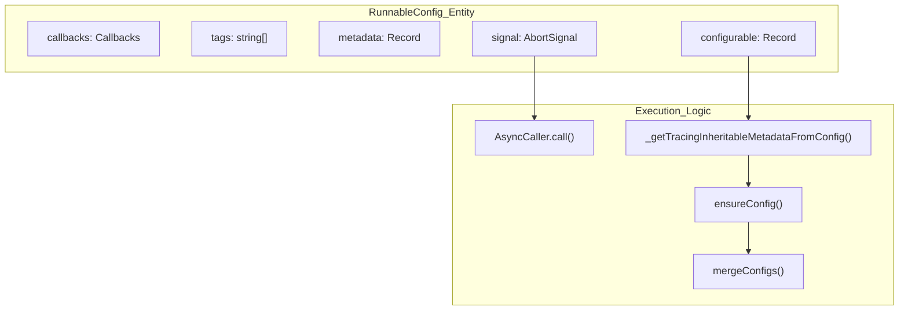
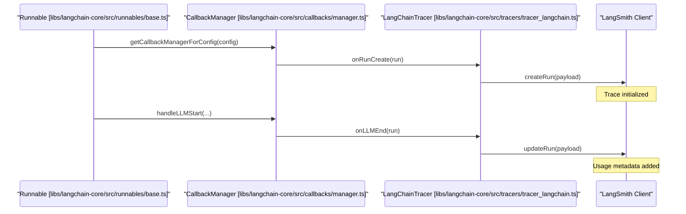

<!-- source: DeepWiki mcp.deepwiki.com · repo langchain-ai/langchainjs · page 2.4 Runnables and Execution · fetched 2026-10-26 -->

# Runnables and Execution

<details>
<summary>Relevant source files</summary>

The following files were used as context for generating this wiki page:

- [environment_tests/scripts/test-runner.ts](environment_tests/scripts/test-runner.ts)
- [libs/langchain-classic/src/hub/index.ts](libs/langchain-classic/src/hub/index.ts)
- [libs/langchain-classic/src/load/index.ts](libs/langchain-classic/src/load/index.ts)
- [libs/langchain-core/src/callbacks/base.ts](libs/langchain-core/src/callbacks/base.ts)
- [libs/langchain-core/src/callbacks/manager.ts](libs/langchain-core/src/callbacks/manager.ts)
- [libs/langchain-core/src/callbacks/tests/callbacks.test.ts](libs/langchain-core/src/callbacks/tests/callbacks.test.ts)
- [libs/langchain-core/src/callbacks/tests/manager.test.ts](libs/langchain-core/src/callbacks/tests/manager.test.ts)
- [libs/langchain-core/src/load/index.ts](libs/langchain-core/src/load/index.ts)
- [libs/langchain-core/src/load/serializable.ts](libs/langchain-core/src/load/serializable.ts)
- [libs/langchain-core/src/load/tests/index.test.ts](libs/langchain-core/src/load/tests/index.test.ts)
- [libs/langchain-core/src/load/validation.ts](libs/langchain-core/src/load/validation.ts)
- [libs/langchain-core/src/runnables/base.ts](libs/langchain-core/src/runnables/base.ts)
- [libs/langchain-core/src/runnables/config.ts](libs/langchain-core/src/runnables/config.ts)
- [libs/langchain-core/src/runnables/graph_mermaid.ts](libs/langchain-core/src/runnables/graph_mermaid.ts)
- [libs/langchain-core/src/runnables/history.ts](libs/langchain-core/src/runnables/history.ts)
- [libs/langchain-core/src/runnables/iter.ts](libs/langchain-core/src/runnables/iter.ts)
- [libs/langchain-core/src/runnables/tests/config.test.ts](libs/langchain-core/src/runnables/tests/config.test.ts)
- [libs/langchain-core/src/runnables/tests/graph_mermaid.test.ts](libs/langchain-core/src/runnables/tests/graph_mermaid.test.ts)
- [libs/langchain-core/src/runnables/tests/runnable_stream_events_v2.test.ts](libs/langchain-core/src/runnables/tests/runnable_stream_events_v2.test.ts)
- [libs/langchain-core/src/runnables/utils.ts](libs/langchain-core/src/runnables/utils.ts)
- [libs/langchain-core/src/singletons/callbacks.ts](libs/langchain-core/src/singletons/callbacks.ts)
- [libs/langchain-core/src/tracers/base.ts](libs/langchain-core/src/tracers/base.ts)
- [libs/langchain-core/src/tracers/event_stream.ts](libs/langchain-core/src/tracers/event_stream.ts)
- [libs/langchain-core/src/tracers/tests/__snapshots__/langchain_tracer.test.ts.snap](libs/langchain-core/src/tracers/tests/__snapshots__/langchain_tracer.test.ts.snap)
- [libs/langchain-core/src/tracers/tests/langchain_tracer.test.ts](libs/langchain-core/src/tracers/tests/langchain_tracer.test.ts)
- [libs/langchain-core/src/tracers/tracer_langchain.ts](libs/langchain-core/src/tracers/tracer_langchain.ts)
- [libs/langchain-core/src/utils/async_caller.ts](libs/langchain-core/src/utils/async_caller.ts)
- [libs/langchain-core/src/utils/p-retry/index.js](libs/langchain-core/src/utils/p-retry/index.js)
- [libs/langchain-core/src/utils/testing/chat_models.ts](libs/langchain-core/src/utils/testing/chat_models.ts)
- [libs/langchain-core/src/utils/tests/async_caller.test.ts](libs/langchain-core/src/utils/tests/async_caller.test.ts)
- [libs/langchain/src/hub/tests/hub.int.test.ts](libs/langchain/src/hub/tests/hub.int.test.ts)
- [libs/langchain/src/load/index.ts](libs/langchain/src/load/index.ts)
- [libs/langchain/src/load/tests/load.test.ts](libs/langchain/src/load/tests/load.test.ts)
- [libs/providers/langchain-openrouter/src/chat_models/index.ts](libs/providers/langchain-openrouter/src/chat_models/index.ts)
- [libs/providers/langchain-openrouter/src/chat_models/tests/index.test.ts](libs/providers/langchain-openrouter/src/chat_models/tests/index.test.ts)
- [libs/providers/langchain-openrouter/src/chat_models/types.ts](libs/providers/langchain-openrouter/src/chat_models/types.ts)
- [libs/providers/langchain-openrouter/src/utils/errors.ts](libs/providers/langchain-openrouter/src/utils/errors.ts)
- [libs/providers/langchain-openrouter/src/utils/tests/errors.test.ts](libs/providers/langchain-openrouter/src/utils/tests/errors.test.ts)

</details>


## Purpose and Scope

This document explains the `Runnable` interface, the foundational abstraction in LangChain.js that enables composable, streamable execution of LLM operations. The Runnable pattern provides a unified interface for invoking, streaming, and batching operations across all components including chat models, tools, retrievers, and chains.

For information about base chat model interfaces, see [Base Chat Model and LLM Interfaces](./2.1). For tool interfaces, see [Tools and Dynamic Tools](./2.3). For retriever interfaces, see [Retrievers and Document Compressors](./2.5).

---

## The Runnable Interface

The `Runnable` interface is the core abstraction that all executable components in LangChain.js implement. It defines a standardized contract for execution, enabling any component to be composed, piped, and executed in a consistent manner regardless of its underlying implementation.

### Core Interface Definition

```mermaid
classDiagram
    class "RunnableInterface" {
        <<interface>>
        +invoke(input, options?)
        +stream(input, options?)
        +batch(inputs, options?)
        +streamEvents(input, options)
        +pipe(next)
    }
    
    class "Runnable" {
        <<abstract>>
        +name: string
        +invoke(input, options)
        +withConfig(config)
        +withRetry(fields)
        +withFallbacks(fields)
    }
    
    class "BaseChatModel" {
        +invoke(messages, options)
    }
    
    class "RunnableLambda" {
        +from(func)
    }
    
    class "RunnableSequence" {
        +steps: Runnable[]
    }
    
    "RunnableInterface" <|-- "Runnable"
    "Runnable" <|-- "BaseChatModel"
    "Runnable" <|-- "RunnableLambda"
    "Runnable" <|-- "RunnableSequence"
```

**Diagram: Runnable Interface Hierarchy**

All major components extend the `Runnable` base class [libs/langchain-core/src/runnables/base.ts:131-133](), ensuring they can participate in composition patterns. The interface defines both execution methods (`invoke`, `stream`, `batch`) and configuration decorators (`withConfig`, `withRetry`, `withFallbacks`) [libs/langchain-core/src/runnables/base.ts:145-205]().

Sources: [libs/langchain-core/src/runnables/base.ts:131-205](), [libs/langchain-core/src/runnables/types.ts:11-13]()

---

## Execution Model and Config

Runnables are governed by `RunnableConfig`, which provides the execution context, including callbacks, tags, metadata, and signal handling.

### RunnableConfig and Signal Handling

The `RunnableConfig` object is passed through the execution chain, allowing for centralized control over the run [libs/langchain-core/src/runnables/config.ts:3-7]().



**Diagram: Configuration and Signal Propagation**

Key utilities for configuration management include:
*   `ensureConfig`: Merges provided config with implicit config from `AsyncLocalStorageProviderSingleton` [libs/langchain-core/src/runnables/config.ts:153-189]().
*   `mergeConfigs`: Combines multiple config objects, handling special cases like merging `tags` and `metadata` [libs/langchain-core/src/runnables/config.ts:49-148]().
*   `_getTracingInheritableMetadataFromConfig`: Extracts configurable values to be used as inheritable metadata for tracing, excluding sensitive keys like `api_key` [libs/langchain-core/src/runnables/config.ts:12-31]().
*   `AbortSignal` integration: The `AsyncCaller` uses `Promise.race` with the signal to handle timeouts and manual cancellations [libs/langchain-core/src/runnables/base.ts:37]().

Sources: [libs/langchain-core/src/runnables/config.ts:12-189](), [libs/langchain-core/src/runnables/base.ts:37](), [libs/langchain-core/src/singletons/index.ts:13]()

---

## Async Execution and Concurrency

LangChain.js utilizes the `AsyncCaller` class to wrap external calls with standardized retry and concurrency logic.

### AsyncCaller Implementation

The `AsyncCaller` uses `p-queue` for concurrency limiting and `p-retry` for exponential backoff [libs/langchain-core/src/utils/async_caller.ts:453-468]().

| Feature | Implementation | Source |
| :--- | :--- | :--- |
| **Concurrency** | `p-queue` with `maxConcurrency` | [libs/langchain-core/src/utils/async_caller.ts:453]() |
| **Retries** | `p-retry` with `maxRetries` | [libs/langchain-core/src/utils/async_caller.ts:5]() |
| **Error Filtering** | `STATUS_NO_RETRY` (400, 401, 403, 404, etc.) | [libs/langchain-core/src/utils/async_caller.ts:7-18]() |
| **Rate Limit Classification** | `classifyRateLimitError` identifies 429s, quota exhaustion, and `Retry-After` headers | [libs/langchain-core/src/utils/async_caller.ts:209-251]() |

Sources: [libs/langchain-core/src/utils/async_caller.ts:1-251](), [libs/langchain-core/src/utils/tests/async_caller.test.ts:1-194]()

---

## Callback System and Tracing

The execution model is deeply integrated with the `CallbackManager`, which orchestrates events for tracers and loggers.

### Callback Hierarchy

When a Runnable starts, it creates or retrieves a `CallbackManager` to handle lifecycle events like `handleChainStart`, `handleLLMStart`, and `handleToolStart` [libs/langchain-core/src/callbacks/manager.ts:200-210]().



**Diagram: Callback and Tracing Data Flow**

The `LangChainTracer` specifically extracts `usage_metadata` from LLM results (chat generations) and attaches it to the run metadata for tracking token consumption [libs/langchain-core/src/tracers/tracer_langchain.ts:148-165](). The `copyWithTracingConfig` method ensures that tracing metadata and tags are merged correctly, with specific keys (`ls_agent_type`) being overridable by child runs [libs/langchain-core/src/tracers/tracer_langchain.ts:167-210]().

Sources: [libs/langchain-core/src/callbacks/manager.ts:200-210](), [libs/langchain-core/src/tracers/tracer_langchain.ts:148-210](), [libs/langchain-core/src/tracers/tests/langchain_tracer.test.ts:116-160]()

---

## Stream Events API

The `streamEvents` API provides a standardized way to consume granular execution events as a stream. This is critical for UI applications that need to show intermediate steps (like tool calls or internal reasoning).

### Event Types and Structure

Stream events follow a standard schema including `event`, `name`, `run_id`, and `data` [libs/langchain-core/src/tracers/event_stream.ts:21-27](). The `streamEvents` method on a `Runnable` yields these `StreamEvent` objects [libs/langchain-core/src/runnables/tests/runnable_stream_events_v2.test.ts:54-79]().

| Event Name | Data Payload |
| :--- | :--- |
| `on_chain_start` | `{ input }` |
| `on_chain_stream` | `{ chunk }` |
| `on_chat_model_stream`| `{ chunk: AIMessageChunk }` |
| `on_chat_model_end` | `{ output: AIMessageChunk }` |
| `on_chain_end` | `{ output }` |

### Custom Event Dispatching

Users can dispatch custom events from within `RunnableLambda` or tools using `dispatchCustomEvent`, which are then surfaced in the `streamEvents` output via the `handleCustomEvent` callback [libs/langchain-core/src/runnables/tests/runnable_stream_events_v2.test.ts:29](), [libs/langchain-core/src/callbacks/manager.ts:149-183](). The `streamEvents` method also ensures that tracer-only configurable metadata (like `api_key`) is not propagated into the event stream [libs/langchain-core/src/runnables/tests/runnable_stream_events_v2.test.ts:82-124]().

Sources: [libs/langchain-core/src/runnables/tests/runnable_stream_events_v2.test.ts:44-124](), [libs/langchain-core/src/tracers/event_stream.ts:21-27](), [libs/langchain-core/src/callbacks/manager.ts:149-183]()

---

## Composition Patterns

### RunnableSequence (Piping)

The `pipe` pattern creates a `RunnableSequence`. During execution, the output of step $N$ is passed as the input to step $N+1$. This is the core of the LangChain Expression Language (LCEL).

### RunnableParallel (Mapping)

`RunnableMap` (often used via `RunnableParallel`) allows executing multiple Runnables in parallel on the same input, returning a dictionary of results [libs/langchain-core/src/runnables/base.ts:86-89]().

Sources: [libs/langchain-core/src/runnables/base.ts:86-89](), [libs/langchain-core/src/runnables/tests/runnable_stream_events_v2.test.ts:4-9]()

---

