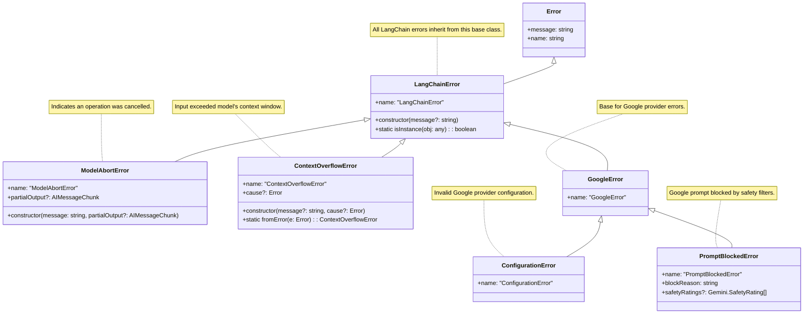

<!-- source: DeepWiki mcp.deepwiki.com · repo langchain-ai/langchainjs · page 2.5 Output Parsers, Serialization, and Utilities · fetched 2026-10-26 -->

# Output Parsers, Serialization, and Utilities

<details>
<summary>Relevant source files</summary>

The following files were used as context for generating this wiki page:

- [libs/langchain-core/src/errors/index.ts](libs/langchain-core/src/errors/index.ts)
- [libs/langchain-core/src/output_parsers/json.ts](libs/langchain-core/src/output_parsers/json.ts)
- [libs/langchain-core/src/output_parsers/standard_schema.ts](libs/langchain-core/src/output_parsers/standard_schema.ts)
- [libs/langchain-core/src/output_parsers/structured.ts](libs/langchain-core/src/output_parsers/structured.ts)
- [libs/langchain-core/src/output_parsers/tests/json.test.ts](libs/langchain-core/src/output_parsers/tests/json.test.ts)
- [libs/langchain-core/src/output_parsers/tests/standard_schema.test.ts](libs/langchain-core/src/output_parsers/tests/standard_schema.test.ts)
- [libs/langchain-core/src/output_parsers/tests/structured.test.ts](libs/langchain-core/src/output_parsers/tests/structured.test.ts)
- [libs/langchain-core/src/runnables/tests/runnable_stream_events.test.ts](libs/langchain-core/src/runnables/tests/runnable_stream_events.test.ts)
- [libs/langchain-core/src/utils/json.ts](libs/langchain-core/src/utils/json.ts)
- [libs/langchain-core/src/utils/tests/__mocks__/json.kitchen-sink.jsonl](libs/langchain-core/src/utils/tests/__mocks__/json.kitchen-sink.jsonl)
- [libs/langchain-core/src/utils/tests/json.test.ts](libs/langchain-core/src/utils/tests/json.test.ts)
- [libs/langchain-core/src/utils/tests/namespace.test-d.ts](libs/langchain-core/src/utils/tests/namespace.test-d.ts)
- [libs/langchain-core/src/utils/tests/namespace.test.ts](libs/langchain-core/src/utils/tests/namespace.test.ts)
- [libs/langchain-core/src/utils/tests/uuid.test.ts](libs/langchain-core/src/utils/tests/uuid.test.ts)
- [libs/langchain-core/src/utils/uuid/index.ts](libs/langchain-core/src/utils/uuid/index.ts)
- [libs/langchain-core/src/utils/uuid/v1ToV6.ts](libs/langchain-core/src/utils/uuid/v1ToV6.ts)
- [libs/langchain-core/src/utils/uuid/v6.ts](libs/langchain-core/src/utils/uuid/v6.ts)
- [libs/providers/langchain-anthropic/src/utils/errors.ts](libs/providers/langchain-anthropic/src/utils/errors.ts)
- [libs/providers/langchain-anthropic/src/utils/tests/errors.test.ts](libs/providers/langchain-anthropic/src/utils/tests/errors.test.ts)
- [libs/providers/langchain-google-common/src/tests/data/chat-json-schema-thinking-mock.json](libs/providers/langchain-google-common/src/tests/data/chat-json-schema-thinking-mock.json)
- [libs/providers/langchain-google/src/utils/errors.ts](libs/providers/langchain-google/src/utils/errors.ts)
- [libs/providers/langchain-google/src/utils/tests/errors.test.ts](libs/providers/langchain-google/src/utils/tests/errors.test.ts)
- [libs/providers/langchain-openai/src/utils/client.ts](libs/providers/langchain-openai/src/utils/client.ts)
- [libs/providers/langchain-openai/src/utils/errors.ts](libs/providers/langchain-openai/src/utils/errors.ts)
- [libs/providers/langchain-openai/src/utils/tests/errors.test.ts](libs/providers/langchain-openai/src/utils/tests/errors.test.ts)
- [libs/providers/langchain-openrouter/src/index.ts](libs/providers/langchain-openrouter/src/index.ts)

</details>


This page documents the core output parsers, the `Serializable` system for object persistence, the error handling hierarchy, and various shared utility modules within `@langchain/core`. These components are fundamental for processing LLM outputs, managing object lifecycle, and ensuring robust application behavior.

## Output Parsers

Output parsers are responsible for structuring the raw string output from Language Models into a more usable format, such as JSON, structured objects, or specific data schemas.

### JsonOutputParser

The `JsonOutputParser` is designed to parse LLM output into a JSON object. It supports both full JSON parsing and partial JSON parsing, which is crucial for streaming scenarios where the LLM might emit JSON incrementally.

- **`parse(text: string)`**: Parses a complete JSON string. It first attempts to use `JSON.parse()` and falls back to `parseJsonMarkdown()` for robustness [libs/langchain-core/src/output_parsers/json.ts:51-52]().
- **`parsePartialResult(generations: ChatGeneration[] | Generation[])`**: Parses partial JSON output, typically from streaming generations. It uses `parseJsonMarkdown()` to handle incomplete JSON structures [libs/langchain-core/src/output_parsers/json.ts:45-49]().
- **`_concatOutputChunks<T>(first: T, second: T): T`**: When diffing is enabled, this method concatenates output chunks. Otherwise, it simply returns the second chunk [libs/langchain-core/src/output_parsers/json.ts:23-27]().
- **`_diff(prev: unknown | undefined, next: unknown): Operation[] | undefined`**: Computes JSON patches (operations) between two JSON objects, enabling efficient updates for streaming outputs [libs/langchain-core/src/output_parsers/json.ts:30-41]().

#### Partial JSON Parsing (`strictParsePartialJson`)

The `strictParsePartialJson` function [libs/langchain-core/src/utils/json.ts:35-329]() is a recursive descent parser that can handle incomplete JSON strings. This is particularly useful for streaming LLM outputs where the model might send JSON tokens one by one.

**Key Features**:
- **Robustness**: It attempts `JSON.parse()` first and falls back to its custom partial parsing logic if `JSON.parse()` fails [libs/langchain-core/src/utils/json.ts:36-40]().
- **Incremental Parsing**: It can parse objects, arrays, strings, numbers, booleans, and null values even if they are not fully terminated [libs/langchain-core/src/utils/json.ts:187-207]().
- **Error Handling**: Throws errors for malformed JSON structures, such as mismatched brackets or invalid escape sequences [libs/langchain-core/src/utils/json.ts:246-247]().
- **Whitespace Handling**: Skips whitespace characters during parsing [libs/langchain-core/src/utils/json.ts:47-50]().

**Example of Partial Parsing**:
```typescript
// libs/langchain-core/src/utils/tests/json.test.ts
expectPartialJson("[1").toEqual([1]); // Parses partial array
expectPartialJson('[null,{"a":1').toEqual([null, { a: 1 }]); // Parses partial object in array
expectPartialJson('"hello').toBe("hello"); // Parses partial string
expectPartialJson("-12.1").toBe(-12.1); // Parses partial number
```
[libs/langchain-core/src/utils/tests/json.test.ts:22-23, 37, 45, 85]()

#### Markdown JSON Extraction (`parseJsonMarkdown`)

The `parseJsonMarkdown` function [libs/langchain-core/src/utils/json.ts:1-27]() extracts JSON content from markdown code blocks (e.g., ````json\n{...}\n````). This is common when LLMs are instructed to output JSON within markdown.

**Sources**: [libs/langchain-core/src/output_parsers/json.ts:10-69](), [libs/langchain-core/src/utils/json.ts:1-329](), [libs/langchain-core/src/output_parsers/tests/json.test.ts:1-171]()

### Structured Output Parsers

LangChain provides structured output parsers that leverage Zod schemas for validation and parsing.

- **`StructuredOutputParser`**: Parses string output into a JavaScript object conforming to a Zod schema. It includes instructions for the LLM on how to format the output.
- **`JsonOutputFunctionsParser`**: Specifically designed for models that support function calling, where the model's output is a JSON object representing a function call. It extracts the arguments of the function call.
- **`JsonOutputKeyToolsParser`**: Similar to `JsonOutputFunctionsParser` but extracts arguments for a specific tool key.

**Sources**: [libs/langchain-core/src/output_parsers/structured.ts:1-200](), [libs/langchain-core/src/output_parsers/tests/structured.test.ts:1-100]()

### Standard Schema Output Parsers

These parsers are designed to work with a predefined "Standard Schema" for common LLM outputs, ensuring consistency across different models and providers.

- **`BaseLLMOutputParser`**: Base class for parsers that handle LLM outputs.
- **`BaseChatOutputParser`**: Base class for parsers that handle chat model outputs.
- **`FunctionCallingOutputParser`**: Parses function calling outputs into a structured format.
- **`ToolCallingOutputParser`**: Parses tool calling outputs, which are a more general form of function calling.

**Sources**: [libs/langchain-core/src/output_parsers/standard_schema.ts:1-53](), [libs/langchain-core/src/output_parsers/tests/standard_schema.test.ts:1-50]()

## Serialization System (`Serializable`)

The `Serializable` system in `@langchain/core` provides a robust mechanism for converting LangChain objects into a portable JSON representation and reconstructing them. This is crucial for persistence, sharing, and debugging.

### Key Concepts

| Property / Method | Description | Location |
|-------------------|-------------|----------|
| `lc_serializable` | A boolean flag indicating if an instance of the class can be serialized. | [libs/langchain-core/src/load/serializable.ts:98]() |
| `lc_namespace` | An array of strings defining the hierarchical namespace of the class (e.g., `["langchain_core", "output_parsers"]`). Used for unique identification during loading. | [libs/langchain-core/src/load/serializable.ts:106]() |
| `lc_kwargs` | A record of constructor arguments used to reconstruct the object. | [libs/langchain-core/src/load/serializable.ts:100]() |
| `lc_secrets` | A map of sensitive keys (e.g., API keys) that should not be serialized directly. | [libs/langchain-core/src/load/serializable.ts:133-135]() |
| `toJSON()` | Converts the `Serializable` object into a `SerializedConstructor` JSON object, including its type, ID, and constructor arguments. | [libs/langchain-core/src/load/serializable.ts:177-215]() |

### Import Maps

The serialization system relies on "import maps" to resolve class names to their actual constructor functions during deserialization. This allows for dynamic loading of classes based on their `lc_namespace` and `lc_name`.

- **`importMap`**: A global map that stores the mapping from a fully qualified class ID (namespace + name) to its constructor. This map is populated during application startup or module loading.
- **`optionalImportsMap`**: Allows for extending the import map with classes from optional dependencies or provider packages.

**Sources**: [libs/langchain-core/src/load/serializable.ts:97-215]()

## Error Classes

LangChain defines a hierarchy of error classes to provide more specific and actionable error information. All custom errors extend `LangChainError`.

### LangChainError

The base class for all LangChain-specific errors. It provides a common interface for error handling and includes a troubleshooting URL in its message.

- **`LangChainError`**: The root error class [libs/langchain-core/src/errors/index.ts:91-100]().
- **`lc_error_code`**: A string code (e.g., `"CONTEXT_OVERFLOW"`, `"MODEL_RATE_LIMIT"`) that categorizes the error [libs/langchain-core/src/errors/index.ts:6-15]().
- **`addLangChainErrorFields(error: any, lc_error_code: LangChainErrorCodes)`**: A utility function to add `lc_error_code` and a troubleshooting URL to an existing error object [libs/langchain-core/src/errors/index.ts:18-25]().

### Specific Error Types

- **`ModelAbortError`**: Thrown when a model operation is aborted, potentially including `partialOutput` [libs/langchain-core/src/errors/index.ts:131-152](). It is marked as non-retryable [libs/langchain-core/src/errors/index.ts:150]().
- **`ContextOverflowError`**: Indicates that the input to a language model exceeded its maximum context length [libs/langchain-core/src/errors/index.ts:186-198](). This error is typically non-retryable.
  - **`ContextOverflowError.fromError(e: Error)`**: A static factory method to wrap an existing error into a `ContextOverflowError` [libs/langchain-core/src/errors/index.ts:200-209]().
- **Provider-Specific Errors**: Provider packages often wrap their client errors into LangChain-specific errors.
  - **OpenAI**: `wrapOpenAIClientError` [libs/providers/langchain-openai/src/utils/client.ts:22-79]() maps OpenAI API errors to LangChain errors like `ContextOverflowError`, `TimeoutError`, `AbortError`, and errors with `lc_error_code` such as `"MODEL_AUTHENTICATION"`, `"MODEL_RATE_LIMIT"`, `"MODEL_NOT_FOUND"`, and `"INVALID_TOOL_RESULTS"` [libs/providers/langchain-openai/src/utils/client.ts:45-74]().
  - **Anthropic**: `wrapAnthropicClientError` [libs/providers/langchain-anthropic/src/utils/errors.ts:28-65]() handles Anthropic errors, mapping them to `ContextOverflowError`, `"INVALID_TOOL_RESULTS"`, `"MODEL_AUTHENTICATION"`, `"MODEL_NOT_FOUND"`, and `"MODEL_RATE_LIMIT"`.
  - **Google**: `GoogleError` [libs/providers/langchain-google/src/utils/errors.ts:64-66]() is the base for Google-specific errors, including `ConfigurationError` [libs/providers/langchain-google/src/utils/errors.ts:85-92]() and `PromptBlockedError` [libs/providers/langchain-google/src/utils/errors.ts:131-201]().
  - **OpenRouter**: `OpenRouterError`, `OpenRouterAuthError`, `OpenRouterRateLimitError` [libs/providers/langchain-openrouter/src/index.ts:11-14]().

### Retryability

Errors can be explicitly marked as retryable or non-retryable using `stampRetryable()` and checked with `getRetryable()`. This is used by the `AsyncCaller` to determine if a failed operation should be retried.

- **`stampRetryable<T>(error: T, retryable: boolean)`**: Marks an error object with a non-enumerable symbol indicating its retryability [libs/langchain-core/src/errors/index.ts:43-56]().
- **`getRetryable(error: unknown)`**: Retrieves the retryability status of an error [libs/langchain-core/src/errors/index.ts:64-71]().



**Sources**: [libs/langchain-core/src/errors/index.ts:1-230](), [libs/providers/langchain-openai/src/utils/client.ts:2-79](), [libs/providers/langchain-openai/src/utils/tests/errors.test.ts:1-192](), [libs/providers/langchain-anthropic/src/utils/errors.ts:4-65](), [libs/providers/langchain-google/src/utils/errors.ts:2-232]()

## Shared Utilities

The `@langchain/core` package includes several shared utility modules for common tasks.

### JSON Utilities

- **`parseJsonMarkdown(s: string, parser = parsePartialJson)`**: Extracts and parses JSON from markdown code blocks. It can use either `JSON.parse` or `strictParsePartialJson` [libs/langchain-core/src/utils/json.ts:1-27]().
- **`strictParsePartialJson(s: string)`**: A robust recursive descent parser for partial JSON strings, as detailed in the Output Parsers section [libs/langchain-core/src/utils/json.ts:35-329]().

**Sources**: [libs/langchain-core/src/utils/json.ts:1-329](), [libs/langchain-core/src/utils/tests/json.test.ts:1-185]()

### UUID Generation

The `uuid` module provides functions for generating various versions of UUIDs.

- **`v1()`**: Generates a time-based UUID [libs/langchain-core/src/utils/uuid/index.ts:19]().
- **`v4()`**: Generates a random UUID [libs/langchain-core/src/utils/uuid/index.ts:20]().
- **`v5()`**: Generates a name-based UUID using SHA-1 hashing [libs/langchain-core/src/utils/uuid/index.ts:21]().
- **`v6()`**: Generates a reordered time-based UUID [libs/langchain-core/src/utils/uuid/index.ts:22]().
- **`v7()`**: Generates a UUID based on Unix Epoch timestamp [libs/langchain-core/src/utils/uuid/index.ts:23]().
- **`parse(uuid: string)`**: Parses a UUID string into a byte array [libs/langchain-core/src/utils/uuid/index.ts:17]().
- **`stringify(arr: number[], offset?: number)`**: Converts a byte array to a UUID string [libs/langchain-core/src/utils/uuid/index.ts:18]().
- **`validate(uuid: string)`**: Validates if a string is a valid UUID [libs/langchain-core/src/utils/uuid/index.ts:24]().
- **`version(uuid: string)`**: Returns the version of a UUID [libs/langchain-core/src/utils/uuid/index.ts:25]().

**Sources**: [libs/langchain-core/src/utils/uuid/index.ts:1-25](), [libs/langchain-core/src/utils/uuid/v1ToV6.ts:1-47](), [libs/langchain-core/src/utils/uuid/v6.ts:1-49](), [libs/langchain-core/src/utils/tests/uuid.test.ts:1-88]()

### Environment Variables

The `env` module provides utilities for interacting with environment variables.

- **`getEnvironmentVariable(name: string)`**: Retrieves the value of an environment variable.

### Namespace

The `namespace` module provides a utility for creating namespaced objects and classes, which is used internally for branding errors and other components.

- **`ns.brand(BaseClass, brandName)`**: Creates a branded class that extends `BaseClass` and includes a static `isInstance` method for type checking [libs/langchain-core/src/errors/index.ts:91](). This is used for `LangChainError` and its subclasses.

**Sources**: [libs/langchain-core/src/utils/namespace.ts:1-100](), [libs/langchain-core/src/utils/tests/namespace.test.ts:1-100](), [libs/langchain-core/src/utils/tests/namespace.test-d.ts:1-100]()

---

