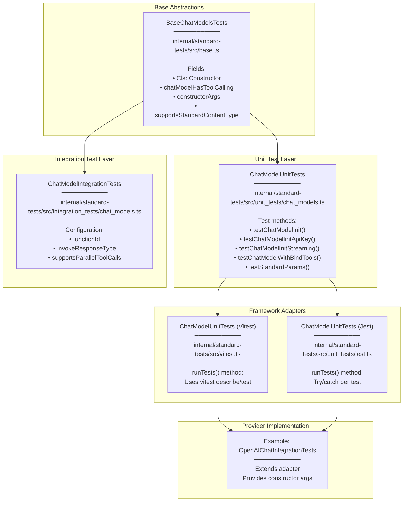
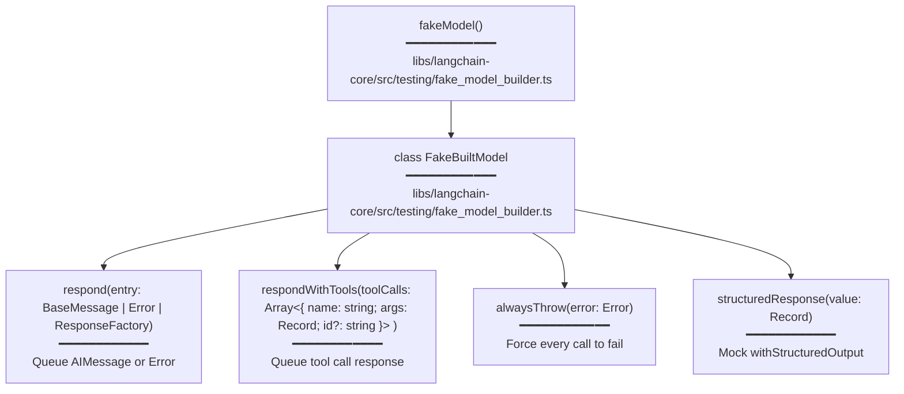

<!-- source: DeepWiki mcp.deepwiki.com · repo langchain-ai/langchainjs · page 2.6 Standard Test Framework and Testing Utilities · fetched 2026-10-26 -->

# Standard Test Framework and Testing Utilities

<details>
<summary>Relevant source files</summary>

The following files were used as context for generating this wiki page:

- [internal/standard-tests/package.json](internal/standard-tests/package.json)
- [internal/test-helpers/package.json](internal/test-helpers/package.json)
- [libs/langchain-core/src/testing/fake_model_builder.ts](libs/langchain-core/src/testing/fake_model_builder.ts)
- [libs/langchain-core/src/testing/index.ts](libs/langchain-core/src/testing/index.ts)
- [libs/langchain-core/src/testing/tests/fake_model_builder.test.ts](libs/langchain-core/src/testing/tests/fake_model_builder.test.ts)
- [libs/langchain-core/src/utils/testing/index.ts](libs/langchain-core/src/utils/testing/index.ts)
- [libs/langchain/tsconfig.json](libs/langchain/tsconfig.json)
- [libs/providers/langchain-mistralai/package.json](libs/providers/langchain-mistralai/package.json)
- [libs/providers/langchain-ollama/package.json](libs/providers/langchain-ollama/package.json)

</details>


The `@langchain/standard-tests` package provides a shared testing framework that ensures consistent behavior across all chat model implementations in the LangChain.js ecosystem. This framework defines a standardized test suite that verifies chat model implementations properly adhere to the `BaseChatModel` interface, handle tool calling, support streaming, return usage metadata, and work correctly with various message types and content blocks.

For information about the base chat model abstractions being tested, see [Base Chat Model and LLM Interfaces](2.1). For details on the broader testing strategy, see [Testing Strategy and Infrastructure](7.1).

## Purpose and Scope

The standard test framework addresses the challenge of maintaining API consistency across numerous provider packages. It acts as the **integration conformance layer**, ensuring that all chat model implementations meet the requirements of the `@langchain/core` interfaces.

Without standardized tests, provider implementations could diverge, leading to:
- Inconsistent error handling (e.g., missing `ModelAbortError` support).
- Varied support for core features like tool calling or streaming.
- Incompatible message formats for `AIMessage` or `ToolMessage`.
- Broken standard content block parsing.

The framework provides reusable test suites for both **unit tests** (validating initialization and parameter handling) and **integration tests** (verifying live API calls and streaming behavior).

Sources: [internal/standard-tests/package.json:1-4]()

## Architecture Overview

The standard test framework follows an inheritance-based architecture. Base test classes containing the logic are extended by framework-specific adapters (primarily Vitest).



Sources: [internal/standard-tests/package.json:42-52](), [internal/standard-tests/src/unit_tests/jest.ts:7-79]()

## Test Suite Types

### Unit Tests

Unit tests validate chat model initialization and interface compliance without making network calls. The `ChatModelUnitTests` class provides core tests for model lifecycle:

| Test Method | Purpose | Verification |
|---|---|---|
| `testChatModelInit()` | Basic instantiation | Model instance is correctly defined |
| `testChatModelInitApiKey()` | API key parameter | Model accepts `apiKey` in constructor |
| `testChatModelInitStreaming()` | Streaming toggle | Model accepts `streaming: true` or `disableStreaming` |
| `testChatModelWithBindTools()` | Tool binding | `bindTools()` exists and returns a `Runnable` |
| `testStandardParams()` | LangSmith parameters | Returns expected `ls_*` parameters via `getLsParams()` |

The unit tests verify that standard parameters are handled correctly by the `BaseChatModel` implementation.

Sources: [internal/standard-tests/src/unit_tests/jest.ts:7-79]()

### Integration Tests

Integration tests make actual API calls to verify end-to-end functionality. Key coverage areas include:

- **Core Invocation:** Basic `invoke()`, `stream()`, and `batch()` behavior.
- **Tool Calling:** Generation of tool calls and handling of `ToolMessage` histories.
- **Usage Metadata:** Verification of token counts in both `invoke` and `stream` responses.
- **Content Blocks:** Handling of text, image, audio, and file content blocks.

Sources: [internal/standard-tests/package.json:23-27]()

## Testing Utilities and Helpers

Beyond the standard test suite, `@langchain/core` provides utilities for general testing and mocking.

### Fake Model Builder

For unit testing chains and agents without incurring costs, the `fakeModel` utility allows creating mock chat models with predefined behaviors. It produces a `FakeBuiltModel` which implements `BaseChatModel`.



The `FakeBuiltModel` maintains an internal queue of `QueueEntry` items (messages, tool calls, errors, or factories) that are consumed in FIFO order during `invoke()` or `_generate()` calls. The `respond()` method [libs/langchain-core/src/testing/fake_model_builder.ts:104-113]() allows queuing `BaseMessage` instances, `Error` objects, or a `ResponseFactory` function for dynamic responses. The `respondWithTools()` method [libs/langchain-core/src/testing/fake_model_builder.ts:122-135]() specifically queues `AIMessage` instances with tool calls, deriving content from input messages. The `alwaysThrow()` method [libs/langchain-core/src/testing/fake_model_builder.ts:142-145]() forces all subsequent invocations to throw a specified error. For structured output testing, `structuredResponse()` [libs/langchain-core/src/testing/fake_model_builder.ts:152-155]() sets the return value for `withStructuredOutput`.

Sources: [libs/langchain-core/src/testing/fake_model_builder.ts:59-213](), [libs/langchain-core/src/testing/fake_model_builder.ts:20-27](), [libs/langchain-core/src/testing/index.ts:3]()

### Custom Matchers

LangChain provides custom matchers to simplify assertions on messages and tool calls. These are exported from `@langchain/core/testing`.

| Matcher | Purpose |
|---|---|
| `toBeHumanMessage()` | Validates a message is a `HumanMessage` with specific content |
| `toBeAIMessage()` | Validates an `AIMessage` and its properties |
| `toHaveToolCalls()` | Asserts that an `AIMessage` contains specific `tool_calls` |

Sources: [libs/langchain-core/src/testing/index.ts:1](), [libs/langchain-core/src/testing/tests/fake_model_builder.test.ts:24-30]()

## CI/CD and Configuration

Standard tests are integrated into the monorepo build and test pipeline using `vitest`.

### Vitest Configuration

The `@langchain/standard-tests` package provides a dedicated Vitest entry point to allow providers to easily run the standard suite within their own environment.

```json
// internal/standard-tests/package.json:47-50
"./vitest": {
  "types": "./src/vitest.ts",
  "import": "./src/vitest.ts"
}
```

Provider packages like `@langchain/ollama` and `@langchain/mistralai` include scripts to run these standard tests:
```json
// libs/providers/langchain-ollama/package.json:23-25
"test:standard:unit": "vitest run --mode standard-unit",
"test:standard:int": "vitest run --mode standard-int",
"test:standard": "pnpm test:standard:unit && pnpm test:standard:int"
```
This allows for granular testing of unit and integration aspects of the provider's implementation against the standard suite.

Sources: [internal/standard-tests/package.json:47-50](), [libs/providers/langchain-ollama/package.json:23-25](), [libs/providers/langchain-mistralai/package.json:23-25]()

### Internal Test Helpers

The `internal/test-helpers` package provides shared utilities for testing across the monorepo. While its `package.json` [internal/test-helpers/package.json:1-23]() is minimal, it serves as a common location for test-related code that might be used by various packages, including the standard tests themselves. It primarily exports an `index.ts` [internal/test-helpers/package.json:8-9]() which can contain various helper functions or configurations.

Sources: [internal/test-helpers/package.json:1-23]()

---

