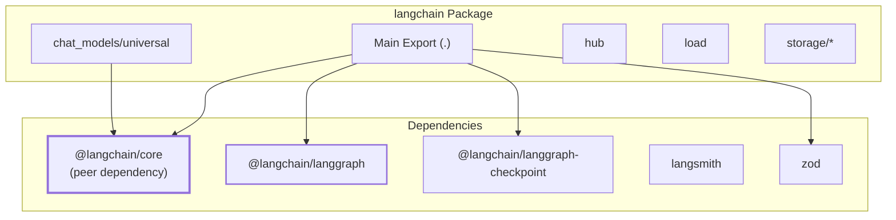
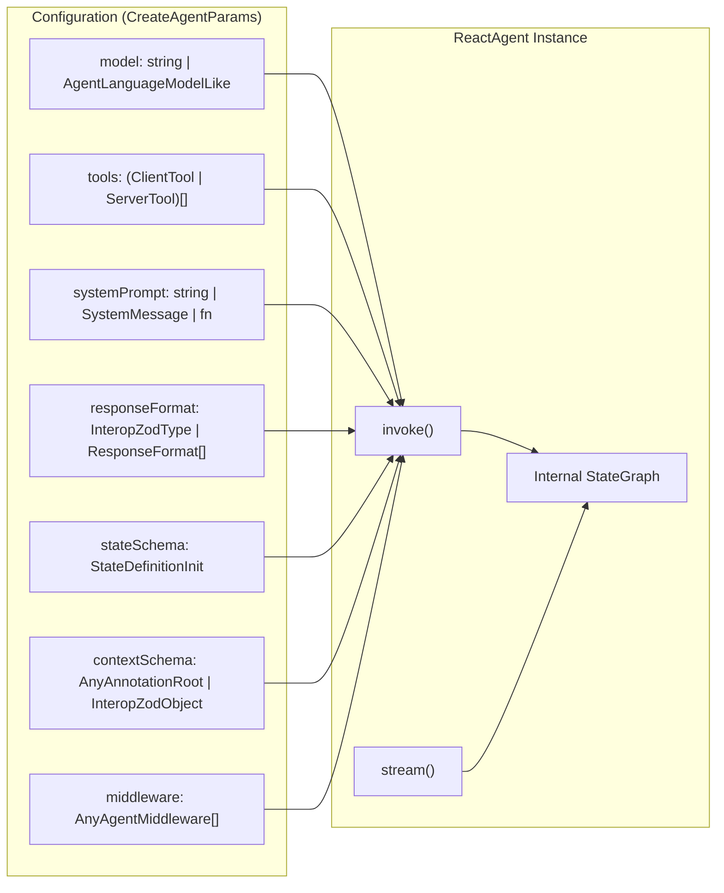

<!-- source: DeepWiki mcp.deepwiki.com · repo langchain-ai/langchainjs · page 3 Main Package (langchain) · fetched 2026-10-26 -->

# Main Package (langchain)

Relevant source files

The following files were used as context for generating this wiki page:

- [examples/src/createAgent/accessExternalContextInTools.ts](examples/src/createAgent/accessExternalContextInTools.ts)
- [libs/langchain-core/src/testing/matchers.ts](libs/langchain-core/src/testing/matchers.ts)
- [libs/langchain-core/src/testing/tests/matchers.test.ts](libs/langchain-core/src/testing/tests/matchers.test.ts)
- [libs/langchain-core/vitest.config.ts](libs/langchain-core/vitest.config.ts)
- [libs/langchain-core/vitest.setup.ts](libs/langchain-core/vitest.setup.ts)
- [libs/langchain/src/agents/annotation.ts](libs/langchain/src/agents/annotation.ts)
- [libs/langchain/src/agents/index.ts](libs/langchain/src/agents/index.ts)
- [libs/langchain/src/agents/middleware.ts](libs/langchain/src/agents/middleware.ts)
- [libs/langchain/src/agents/middleware/types.ts](libs/langchain/src/agents/middleware/types.ts)
- [libs/langchain/src/agents/nodes/middleware.ts](libs/langchain/src/agents/nodes/middleware.ts)
- [libs/langchain/src/agents/nodes/tests/utils.test.ts](libs/langchain/src/agents/nodes/tests/utils.test.ts)
- [libs/langchain/src/agents/nodes/utils.ts](libs/langchain/src/agents/nodes/utils.ts)
- [libs/langchain/src/agents/tests/state_schema.test.ts](libs/langchain/src/agents/tests/state_schema.test.ts)
- [libs/langchain/src/agents/types.ts](libs/langchain/src/agents/types.ts)
- [libs/langchain/src/index.ts](libs/langchain/src/index.ts)
- [libs/langchain/src/load/import_map.ts](libs/langchain/src/load/import_map.ts)
- [libs/langchain/tsdown.config.ts](libs/langchain/tsdown.config.ts)

The `langchain` package is the main framework package that provides a production-ready agent creation API built on top of `@langchain/core`. It implements the ReAct (Reasoning + Acting) pattern through the `createAgent` function and `ReactAgent` class, offering high-level abstractions for building agents with tools, middleware, and stateful workflows.

**Scope**: This page covers the `langchain` package's agent creation API, middleware system, state management, and LangGraph integration. For core abstractions like `BaseChatModel` and `Runnable`, see [Core Abstractions (@langchain/core)](#2). For community integrations and optional components, see [Classic Package (@langchain/classic)](#4). For specific LangGraph features like checkpointing and graph compilation, see [LangGraph Integration, Hub, and Storage](#3.6).

## Package Structure

The `langchain` package is organized as a standalone package in the monorepo at `libs/langchain/` with minimal exports to maintain a clean API surface.

**Key Exports**:

| Export Path | Purpose |
|-------------|---------|
| `.` | Main entry point: `createAgent`, `createMiddleware`, agent utilities [libs/langchain/src/index.ts:54-59]() |
| `chat_models/universal` | Universal chat model initialization (`initChatModel`) [libs/langchain/src/index.ts:23-23]() |
| `hub` | LangChain Hub integration for loading prompts [libs/langchain/tsdown.config.ts:16-22]() |
| `load` | Serialization and loading utilities [libs/langchain/tsdown.config.ts:18-19]() |
| `storage/*` | File system, in-memory, and encoder-backed storage [libs/langchain/tsdown.config.ts:20-22]() |

**Sources**: [libs/langchain/src/index.ts:54-59](), [libs/langchain/src/index.ts:23-23](), [libs/langchain/tsdown.config.ts:16-22](), [libs/langchain/tsdown.config.ts:18-19](), [libs/langchain/tsdown.config.ts:20-22]()

## Agent Creation API

### createAgent Function

The `createAgent` function is the primary entry point for creating agents. It accepts configuration parameters and returns a `ReactAgent` instance [libs/langchain/src/agents/index.ts:175-201]().

For details, see [Agent Creation API](#3.1).

**Sources**: [libs/langchain/src/agents/index.ts:35-170](), [libs/langchain/src/agents/index.ts:175-201]()

### ReactAgent Class

The `ReactAgent` class is the core implementation of the ReAct pattern, backed by a LangGraph `StateGraph` [libs/langchain/src/agents/ReactAgent.js:32-32](). It manages the lifecycle of agent execution, including model calls, tool execution, and middleware integration.

**Key Features**:
- **Stateful Execution**: Uses LangGraph's `StateGraph` to maintain agent state across turns [libs/langchain/src/agents/ReactAgent.js:32-32]().
- **Universal Model Support**: Accepts cross-version runnable models and strings for automatic model initialization via `initChatModel` [libs/langchain/src/index.ts:23-23]() (exported from `chat_models/universal.js`).
- **Tool Behavior**: Supports both `v1` and `v2` tool execution modes.

For details, see [Agent Creation API](#3.1).

**Sources**: [libs/langchain/src/agents/ReactAgent.js:32-32](), [libs/langchain/src/index.ts:23-23]()

## Middleware System

Middleware extends agent behavior through lifecycle hooks and state/context schemas. The system supports a wide range of built-in and custom behaviors via the `createMiddleware` factory [libs/langchain/src/agents/middleware.ts:76-86]().

**Hooks**:
- `beforeAgent` / `afterAgent`: Run at the start and end of the graph execution [libs/langchain/src/agents/middleware.ts:17-19]().
- `beforeModel` / `afterModel`: Run before and after the LLM call [libs/langchain/src/agents/middleware.ts:17-19]().
- `wrapModelCall` / `wrapToolCall`: Intercept and modify model or tool execution [libs/langchain/src/agents/middleware.ts:15-16]().

For details, see [Middleware System](#3.2).

**Sources**: [libs/langchain/src/agents/middleware.ts:76-86](), [libs/langchain/src/agents/middleware/types.ts:15-20]()

## Agent State Management

The agent's state management system uses a channel-based approach to handle message history, private state, and structured outputs [libs/langchain/src/agents/annotation.ts:24-31]().

**Key Components**:
- **State Schemas**: Define the shape of the agent's persistent state using `StateSchema` or Zod [libs/langchain/src/agents/annotation.ts:125-130]().
- **Reducers**: Control how state updates are merged, such as the `MessagesValue` for appending conversation history [libs/langchain/src/agents/annotation.ts:156-160]().
- **Private State**: Fields prefixed with `_` that persist in the graph but are hidden from the public input/output channels [libs/langchain/src/agents/nodes/utils.ts:147-152]().

For details, see [Agent State Management](#3.3).

**Sources**: [libs/langchain/src/agents/annotation.ts:24-169](), [libs/langchain/src/agents/nodes/utils.ts:147-152]()

## Response Format and Structured Output

The agent can be configured to return structured data instead of, or in addition to, natural language messages [libs/langchain/src/agents/index.ts:109-135]().

**Strategies**:
- **Provider Strategy**: Uses native LLM features like OpenAI JSON mode or provider-specific structured output [libs/langchain/src/agents/index.ts:28-31]() (via `ProviderStrategy`).
- **Tool Strategy**: Uses a tool call to extract data in a specific schema [libs/langchain/src/agents/index.ts:26-27]() (via `ToolStrategy`).

For details, see [Response Format and Structured Output](#3.4).

**Sources**: [libs/langchain/src/agents/index.ts:109-135](), [libs/langchain/src/agents/index.ts:26-31]()

## Tool Execution and Error Handling

Tool execution is handled by the `ToolNode`, which manages parallel execution, argument parsing, and error recovery.

**Key Features**:
- **Parallelism**: Built-in support for executing multiple tool calls simultaneously.
- **Error Handling**: Configurable via `handleToolErrors` to return error messages to the LLM for self-correction.

For details, see [Tool Execution and Error Handling](#3.5).

**Sources**: [libs/langchain/src/agents/middleware/types.ts:141-144]()

## LangGraph Integration

`ReactAgent` is built directly on LangGraph primitives, providing first-class support for complex control flows.

**Key Integrations**:
- **StateGraph**: The underlying topology defining the `model_request` and `tools` nodes [libs/langchain/src/agents/types.ts:9-12]().
- **Checkpointing**: Enables state persistence via `BaseCheckpointSaver` [libs/langchain/src/agents/types.ts:21-23]().
- **JumpTo**: Internal navigation mechanism to route control between nodes [libs/langchain/src/agents/constants.js:2-2]().

For details, see [LangGraph Integration, Hub, and Storage](#3.6).

**Sources**: [libs/langchain/src/agents/types.ts:9-12](), [libs/langchain/src/agents/types.ts:21-23](), [libs/langchain/src/agents/constants.js:2-2]()

## MCP Adapters

The `@langchain/mcp-adapters` package allows agents to interact with Model Context Protocol (MCP) servers, enabling access to remote tools and resources.

**Capabilities**:
- **Multi-Server Support**: Connect to multiple MCP servers simultaneously.
- **Transports**: Supports `stdio`, `SSE`, and `HTTP` transports for server communication.

For details, see [MCP Adapters](#3.7).

**Sources**: [libs/langchain/src/index.ts:29-33]() (Context of agent tool integration)

---

