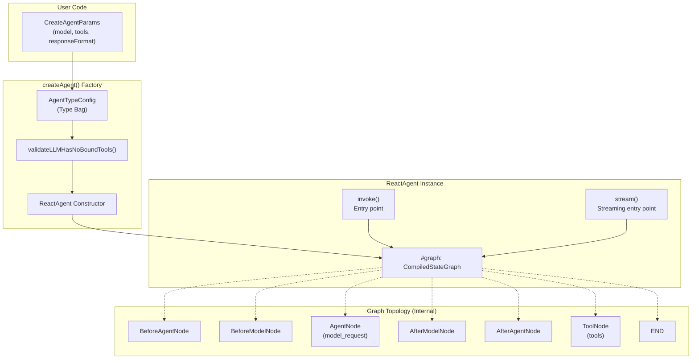
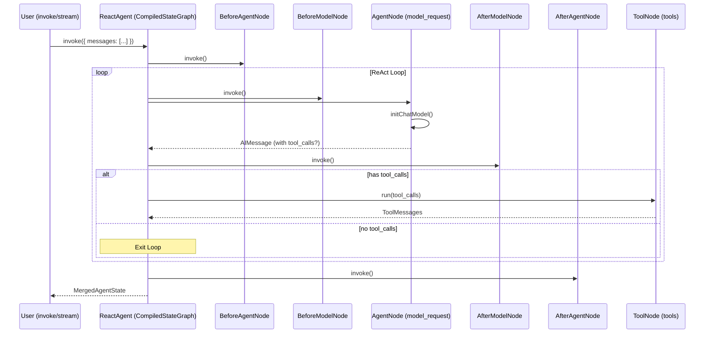

<!-- source: DeepWiki mcp.deepwiki.com · repo langchain-ai/langchainjs · page 3.1 Agent Creation API · fetched 2026-10-26 -->

# Agent Creation API

<details>
<summary>Relevant source files</summary>

The following files were used as context for generating this wiki page:

- [libs/langchain-classic/src/chat_models/tests/universal.int.test.ts](libs/langchain-classic/src/chat_models/tests/universal.int.test.ts)
- [libs/langchain-core/src/load/import_map.ts](libs/langchain-core/src/load/import_map.ts)
- [libs/langchain-core/src/utils/gateway.ts](libs/langchain-core/src/utils/gateway.ts)
- [libs/langchain-core/src/utils/tests/gateway.test.ts](libs/langchain-core/src/utils/tests/gateway.test.ts)
- [libs/langchain-core/tsdown.config.ts](libs/langchain-core/tsdown.config.ts)
- [libs/langchain/src/agents/ReactAgent.ts](libs/langchain/src/agents/ReactAgent.ts)
- [libs/langchain/src/agents/errors.ts](libs/langchain/src/agents/errors.ts)
- [libs/langchain/src/agents/middleware/tests/dynamicTools.test.ts](libs/langchain/src/agents/middleware/tests/dynamicTools.test.ts)
- [libs/langchain/src/agents/nodes/AfterAgentNode.ts](libs/langchain/src/agents/nodes/AfterAgentNode.ts)
- [libs/langchain/src/agents/nodes/AfterModelNode.ts](libs/langchain/src/agents/nodes/AfterModelNode.ts)
- [libs/langchain/src/agents/nodes/AgentNode.ts](libs/langchain/src/agents/nodes/AgentNode.ts)
- [libs/langchain/src/agents/nodes/BeforeAgentNode.ts](libs/langchain/src/agents/nodes/BeforeAgentNode.ts)
- [libs/langchain/src/agents/nodes/BeforeModelNode.ts](libs/langchain/src/agents/nodes/BeforeModelNode.ts)
- [libs/langchain/src/agents/nodes/ToolNode.ts](libs/langchain/src/agents/nodes/ToolNode.ts)
- [libs/langchain/src/agents/nodes/tests/AgentNode.test.ts](libs/langchain/src/agents/nodes/tests/AgentNode.test.ts)
- [libs/langchain/src/agents/nodes/tests/ToolNode.test.ts](libs/langchain/src/agents/nodes/tests/ToolNode.test.ts)
- [libs/langchain/src/agents/tests/middleware.test.ts](libs/langchain/src/agents/tests/middleware.test.ts)
- [libs/langchain/src/agents/tests/reactAgent.test.ts](libs/langchain/src/agents/tests/reactAgent.test.ts)
- [libs/langchain/src/agents/utils.ts](libs/langchain/src/agents/utils.ts)
- [libs/langchain/src/chat_models/tests/universal.int.test.ts](libs/langchain/src/chat_models/tests/universal.int.test.ts)
- [libs/langchain/src/chat_models/tests/universal.test.ts](libs/langchain/src/chat_models/tests/universal.test.ts)
- [libs/langchain/src/chat_models/universal.ts](libs/langchain/src/chat_models/universal.ts)
- [libs/providers/langchain-fireworks/src/chat_models.ts](libs/providers/langchain-fireworks/src/chat_models.ts)
- [libs/providers/langchain-fireworks/src/tests/chat_models.test.ts](libs/providers/langchain-fireworks/src/tests/chat_models.test.ts)

</details>


## Purpose and Scope

This page documents the `createAgent()` factory function and the `ReactAgent` class, which form the primary API for creating ReAct agents in the `langchain` package. This covers agent instantiation, configuration parameters, and the returned agent interface. For information about extending agent behavior, see [Middleware System](#3.2). For details on state management and schemas, see [Agent State Management](#3.3). For the underlying execution framework, see [Response Format and Structured Output](#3.4).

## Overview

The Agent Creation API provides a declarative interface for instantiating production-ready ReAct (Reasoning + Acting) agents. The API consists of:

- **`createAgent()`** - Factory function that accepts configuration and returns a `ReactAgent` instance [libs/langchain/src/agents/index.ts:172-207]().
- **`ReactAgent<Types>`** - The agent class parameterized by an `AgentTypeConfig` type bag [libs/langchain/src/agents/ReactAgent.ts:161-170]().
- **Configuration parameters** - Typed options for model, tools, prompts, state schemas, middleware, and structured output [libs/langchain/src/agents/types.ts:91-126]().

The API uses a type bag pattern (`AgentTypeConfig`) to encapsulate all generic type parameters, simplifying type signatures and making it easier to extend without breaking changes [libs/langchain/src/agents/types.ts:47-90]().

Sources: [libs/langchain/src/agents/index.ts:172-207](), [libs/langchain/src/agents/ReactAgent.ts:161-170](), [libs/langchain/src/agents/types.ts:47-126]()

## Factory Function Architecture

The following diagram bridges the high-level user configuration to the internal code entities that orchestrate the agent lifecycle.

### Agent Creation Flow


Sources: [libs/langchain/src/agents/index.ts:172-207](), [libs/langchain/src/agents/ReactAgent.ts:186-218](), [libs/langchain/src/agents/nodes/AgentNode.ts:91-91](), [libs/langchain/src/agents/nodes/ToolNode.ts:45-45](), [libs/langchain/src/agents/ReactAgent.ts:47-49]()

## The createAgent() Function

The `createAgent()` function is the primary entry point for creating agents. It accepts a configuration object and returns a fully-configured `ReactAgent` instance.

### Function Signature

The function uses overloads to handle different `responseFormat` types, ensuring that the `structuredResponse` field in the final state is correctly typed as either a single object or a union of objects [libs/langchain/src/agents/index.ts:172-214]().

```typescript
export function createAgent<
  StructuredResponseFormat,
  TStateSchema,
  ContextSchema,
  TMiddleware,
  TTools
>(
  params: CreateAgentParams<...>
): ReactAgent<AgentTypeConfig<...>>;
```

Sources: [libs/langchain/src/agents/index.ts:172-214]()

### Configuration Parameters

The `CreateAgentParams` interface defines the core configuration surface:

| Parameter | Type | Required | Description |
|-----------|------|----------|-------------|
| `model` | `string \| LanguageModelLike` | Yes | Model identifier (e.g., `"openai:gpt-4o"`) or model instance [libs/langchain/src/agents/ReactAgent.ts:208-210](). |
| `tools` | `Array<ClientTool \| ServerTool>` | No | Tools available to the agent [libs/langchain/src/agents/ReactAgent.ts:225-225](). |
| `prompt` | `string \| SystemMessage \| Function` | No | System instructions for the agent [libs/langchain/src/agents/index.ts:52-57](). |
| `responseFormat` | `ResponseFormatInput` | No | Zod schema or tool strategy for structured output [libs/langchain/src/agents/nodes/AgentNode.ts:103-103](). |
| `stateSchema` | `TStateSchema` | No | Custom state schema for memory [libs/langchain/src/agents/index.ts:78-78](). |
| `contextSchema` | `ContextSchema` | No | Read-only context schema [libs/langchain/src/agents/types.ts:98-100](). |
| `middleware` | `TMiddleware` | No | Middleware array for extending behavior [libs/langchain/src/agents/index.ts:79-79](). |
| `version` | `"v1" \| "v2"` | No | Tool execution mode (default: `"v2"`) [libs/langchain/src/agents/ReactAgent.ts:203-203](). |

Sources: [libs/langchain/src/agents/types.ts:91-126](), [libs/langchain/src/agents/ReactAgent.ts:186-225](), [libs/langchain/src/agents/index.ts:30-79]()

### Model Configuration and initChatModel

The `model` parameter is resolved using the `initChatModel` universal factory [libs/langchain/src/chat_models/universal.ts:206-236](). This allows users to pass a string like `"openai:gpt-4o"` which is automatically mapped to the correct provider package and class.

Supported providers include:
- `openai` -> `ChatOpenAI` from `@langchain/openai` [libs/langchain/src/chat_models/universal.ts:88-91]()
- `anthropic` -> `ChatAnthropic` from `@langchain/anthropic` [libs/langchain/src/chat_models/universal.ts:92-95]()
- `ollama` -> `ChatOllama` from `@langchain/ollama` [libs/langchain/src/chat_models/universal.ts:123-126]()
- `google` -> `ChatGoogle` from `@langchain/google` [libs/langchain/src/chat_models/universal.ts:107-110]()
- `langsmith` -> `ChatOpenAI` from `@langchain/openai` (via LangSmith Gateway) [libs/langchain/src/chat_models/universal.ts:99-102]()

The `initChatModel` function dynamically imports the necessary provider package and instantiates the chat model class based on the provided string identifier or `modelProvider` option [libs/langchain/src/chat_models/universal.ts:191-219](). It also handles LangSmith gateway configurations, allowing models to be routed through the LangSmith platform [libs/langchain/src/chat_models/universal.ts:43-67]().

Sources: [libs/langchain/src/chat_models/universal.ts:43-67](), [libs/langchain/src/chat_models/universal.ts:86-172](), [libs/langchain/src/chat_models/universal.ts:191-219](), [libs/langchain/src/agents/nodes/AgentNode.ts:24-24]()

## ReactAgent Class

The `ReactAgent` class encapsulates a LangGraph `CompiledStateGraph` that implements the ReAct loop.

### Node Topology and Routing Logic

The agent graph consists of several standard nodes and dynamic middleware nodes.

| Node Name | Class / Entity | Role |
|-----------|----------------|------|
| `before_agent` | `BeforeAgentNode` | Middleware hook executed at the very beginning of an agent run [libs/langchain/src/agents/ReactAgent.ts:47-47](). |
| `before_model` | `BeforeModelNode` | Middleware hook executed immediately before the model call [libs/langchain/src/agents/ReactAgent.ts:48-48](). |
| `model_request` | `AgentNode` | Invokes the LLM, handles system prompts, and extracts structured output [libs/langchain/src/agents/nodes/AgentNode.ts:91-141](). |
| `after_model` | `AfterModelNode` | Middleware hook executed immediately after the model returns [libs/langchain/src/agents/ReactAgent.ts:49-49](). |
| `after_agent` | `AfterAgentNode` | Middleware hook executed at the very end of an agent run [libs/langchain/src/agents/ReactAgent.ts:50-50](). |
| `tools` | `ToolNode` | Executes tool calls generated by the model in parallel [libs/langchain/src/agents/nodes/ToolNode.ts:45-218](). |

The routing logic is managed by `StateGraph` conditional edges. If the model produces `tool_calls`, the graph routes to the `tools` node; otherwise, it routes to `END` or structured output processing [libs/langchain/src/agents/ReactAgent.ts:84-90]().

Sources: [libs/langchain/src/agents/ReactAgent.ts:45-50](), [libs/langchain/src/agents/nodes/AgentNode.ts:127-141](), [libs/langchain/src/agents/nodes/ToolNode.ts:181-218]()

### State Merging and Annotation

`ReactAgent` uses `createAgentState` to merge multiple schemas into a single graph state [libs/langchain/src/agents/annotation.ts:24-31]().

1. **Built-in State**: Includes `messages` (with `MessagesValue` reducer) and `jumpTo` (an `UntrackedValue`) [libs/langchain/src/agents/annotation.ts:35-38]().
2. **User State**: Fields from `options.stateSchema` [libs/langchain/src/agents/annotation.ts:125-130]().
3. **Middleware State**: Fields defined in `middleware[i].stateSchema` [libs/langchain/src/agents/annotation.ts:136-144]().
4. **Structured Response**: An `UntrackedValue` named `structuredResponse` is added if a response format is defined [libs/langchain/src/agents/annotation.ts:147-149]().

Sources: [libs/langchain/src/agents/annotation.ts:24-169](), [libs/langchain/src/agents/ReactAgent.ts:37-37]()

## Execution Lifecycle

The following diagram illustrates how the `ReactAgent` instance bridges "Natural Language Space" (Messages) to "Code Entity Space" (Runnables and Nodes).

### Agent Execution Sequence


Sources: [libs/langchain/src/agents/ReactAgent.ts:161-170](), [libs/langchain/src/agents/nodes/AgentNode.ts:145-155](), [libs/langchain/src/agents/nodes/ToolNode.ts:207-213](), [libs/langchain/src/agents/nodes/AgentNode.ts:24-24](), [libs/langchain/src/agents/nodes/BeforeAgentNode.ts](), [libs/langchain/src/agents/nodes/BeforeModelNode.ts](), [libs/langchain/src/agents/nodes/AfterModelNode.ts](), [libs/langchain/src/agents/nodes/AfterAgentNode.ts]()

## Key Classes and Functions

### AgentNode
The core node for model interaction. It handles:
- **System Prompt Normalization**: Converts string/function prompts into `SystemMessage` [libs/langchain/src/agents/ReactAgent.ts:42-42]().
- **Response Format Resolution**: Uses `transformResponseFormat` to determine if it should use `withStructuredOutput` (native) or a tool-based extraction [libs/langchain/src/agents/nodes/AgentNode.ts:169-233]().
- **Middleware Wrapping**: Applies `wrapModelCall` hooks around the LLM invocation [libs/langchain/src/agents/nodes/AgentNode.ts:61-64]().

### ToolNode
The execution engine for tools. It handles:
- **Parallelism**: Executes multiple tool calls simultaneously via the LangGraph `Send` mechanism or parallel iteration [libs/langchain/src/agents/nodes/ToolNode.ts:138-141]().
- **Error Handling**: Uses `handleToolErrors` to catch exceptions and return `ToolMessage` objects so the model can retry [libs/langchain/src/agents/nodes/ToolNode.ts:116-135]().
- **Middleware Wrapping**: Applies `wrapToolCall` hooks around individual tool executions [libs/langchain/src/agents/nodes/ToolNode.ts:196-196]().

Sources: [libs/langchain/src/agents/nodes/AgentNode.ts:127-141](), [libs/langchain/src/agents/nodes/ToolNode.ts:181-218](), [libs/langchain/src/agents/nodes/AgentNode.ts:45-51]()

---

