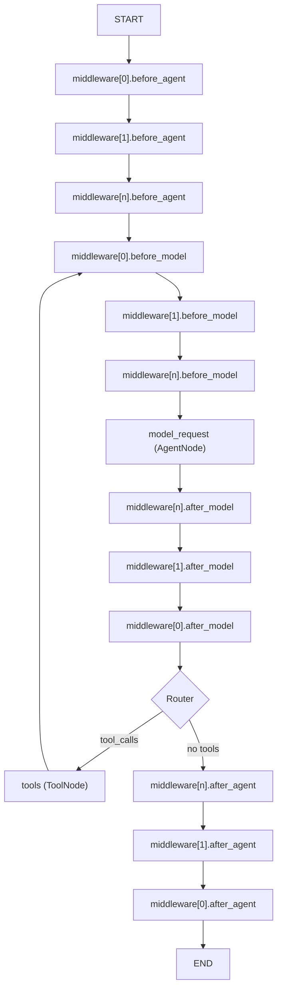
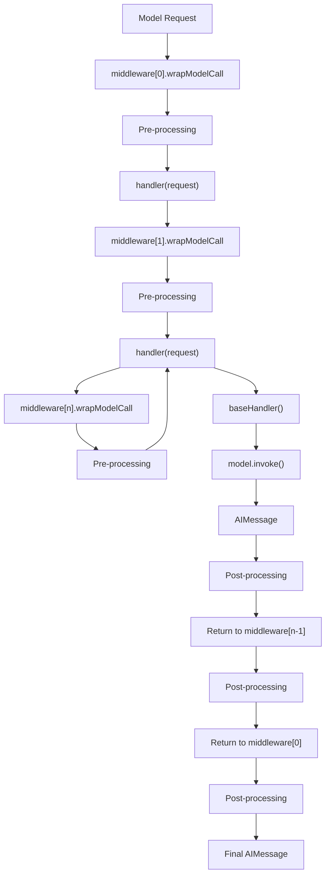
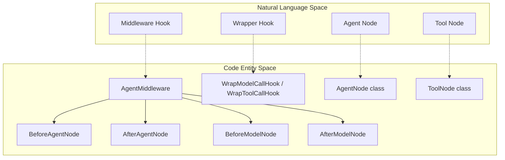
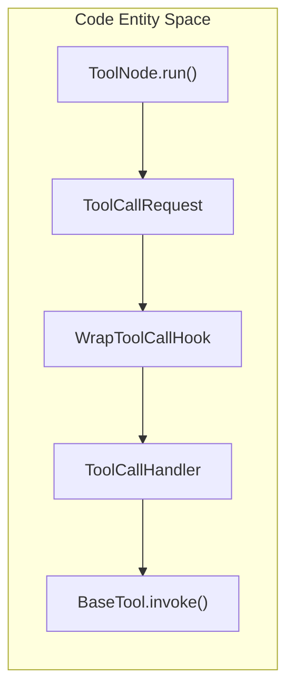

<!-- source: DeepWiki mcp.deepwiki.com · repo langchain-ai/langchainjs · page 3.2 Middleware System · fetched 2026-10-26 -->

# Middleware System

<details>
<summary>Relevant source files</summary>

The following files were used as context for generating this wiki page:

- [examples/src/createAgent/dynamicTools/advanced.ts](examples/src/createAgent/dynamicTools/advanced.ts)
- [examples/src/createAgent/middleware/hitl.ts](examples/src/createAgent/middleware/hitl.ts)
- [examples/src/createAgent/middleware/promptCaching.ts](examples/src/createAgent/middleware/promptCaching.ts)
- [examples/src/createAgent/middleware/simpleHitl.ts](examples/src/createAgent/middleware/simpleHitl.ts)
- [examples/src/createAgent/middleware/simpleSummarization.ts](examples/src/createAgent/middleware/simpleSummarization.ts)
- [libs/langchain-core/src/messages/tests/system.test.ts](libs/langchain-core/src/messages/tests/system.test.ts)
- [libs/langchain-core/src/runnables/index.ts](libs/langchain-core/src/runnables/index.ts)
- [libs/langchain/src/agents/constants.ts](libs/langchain/src/agents/constants.ts)
- [libs/langchain/src/agents/middleware/constants.ts](libs/langchain/src/agents/middleware/constants.ts)
- [libs/langchain/src/agents/middleware/contextEditing.ts](libs/langchain/src/agents/middleware/contextEditing.ts)
- [libs/langchain/src/agents/middleware/error.ts](libs/langchain/src/agents/middleware/error.ts)
- [libs/langchain/src/agents/middleware/hitl.ts](libs/langchain/src/agents/middleware/hitl.ts)
- [libs/langchain/src/agents/middleware/index.ts](libs/langchain/src/agents/middleware/index.ts)
- [libs/langchain/src/agents/middleware/llmToolSelector.ts](libs/langchain/src/agents/middleware/llmToolSelector.ts)
- [libs/langchain/src/agents/middleware/modelRetry.ts](libs/langchain/src/agents/middleware/modelRetry.ts)
- [libs/langchain/src/agents/middleware/summarization.ts](libs/langchain/src/agents/middleware/summarization.ts)
- [libs/langchain/src/agents/middleware/tests/__mocks__/@langchain/openai.ts](libs/langchain/src/agents/middleware/tests/__mocks__/@langchain/openai.ts)
- [libs/langchain/src/agents/middleware/tests/contextEditing.test.ts](libs/langchain/src/agents/middleware/tests/contextEditing.test.ts)
- [libs/langchain/src/agents/middleware/tests/dynamicSystemPrompt.test.ts](libs/langchain/src/agents/middleware/tests/dynamicSystemPrompt.test.ts)
- [libs/langchain/src/agents/middleware/tests/hitl.int.test.ts](libs/langchain/src/agents/middleware/tests/hitl.int.test.ts)
- [libs/langchain/src/agents/middleware/tests/hitl.test.ts](libs/langchain/src/agents/middleware/tests/hitl.test.ts)
- [libs/langchain/src/agents/middleware/tests/llmToolSelector.test.ts](libs/langchain/src/agents/middleware/tests/llmToolSelector.test.ts)
- [libs/langchain/src/agents/middleware/tests/modelRetry.test.ts](libs/langchain/src/agents/middleware/tests/modelRetry.test.ts)
- [libs/langchain/src/agents/middleware/tests/summarization.test.ts](libs/langchain/src/agents/middleware/tests/summarization.test.ts)
- [libs/langchain/src/agents/middleware/tests/todoList.test.ts](libs/langchain/src/agents/middleware/tests/todoList.test.ts)
- [libs/langchain/src/agents/middleware/tests/toolEmulator.test.ts](libs/langchain/src/agents/middleware/tests/toolEmulator.test.ts)
- [libs/langchain/src/agents/middleware/tests/toolError.test.ts](libs/langchain/src/agents/middleware/tests/toolError.test.ts)
- [libs/langchain/src/agents/middleware/tests/toolRetry.test.ts](libs/langchain/src/agents/middleware/tests/toolRetry.test.ts)
- [libs/langchain/src/agents/middleware/tests/utils.test.ts](libs/langchain/src/agents/middleware/tests/utils.test.ts)
- [libs/langchain/src/agents/middleware/todoListMiddleware.ts](libs/langchain/src/agents/middleware/todoListMiddleware.ts)
- [libs/langchain/src/agents/middleware/toolEmulator.ts](libs/langchain/src/agents/middleware/toolEmulator.ts)
- [libs/langchain/src/agents/middleware/toolError.ts](libs/langchain/src/agents/middleware/toolError.ts)
- [libs/langchain/src/agents/middleware/toolRetry.ts](libs/langchain/src/agents/middleware/toolRetry.ts)
- [libs/langchain/src/agents/middleware/utils.ts](libs/langchain/src/agents/middleware/utils.ts)
- [libs/langchain/src/agents/tests/middlewareErrorHandling.test.ts](libs/langchain/src/agents/tests/middlewareErrorHandling.test.ts)
- [libs/langchain/src/agents/tests/reactAgent.int.test.ts](libs/langchain/src/agents/tests/reactAgent.int.test.ts)
- [libs/langchain/src/agents/tests/returnDirect.int.test.ts](libs/langchain/src/agents/tests/returnDirect.int.test.ts)
- [libs/langchain/src/agents/tests/specifications/responses.json](libs/langchain/src/agents/tests/specifications/responses.json)
- [libs/langchain/src/agents/tests/utils.ts](libs/langchain/src/agents/tests/utils.ts)

</details>


The middleware system provides six lifecycle hooks into the agent execution flow: `beforeAgent`, `beforeModel`, `wrapModelCall`, `afterModel`, `wrapToolCall`, and `afterAgent`. Each middleware can define state schemas, context schemas, tools, and hook implementations. The system supports control flow redirection via `jumpTo`, state management with LangGraph's `StateSchema` and `ReducedValue`, and wrapper composition for `wrapModelCall` and `wrapToolCall` hooks.

For agent creation details, see [Agent Creation API](#3.1). For state management, see [Agent State Management](#3.3).

## AgentMiddleware Interface

The `AgentMiddleware` interface is defined in [libs/langchain/src/agents/middleware/types.ts:359-513]() with four type parameters:

| Type Parameter | Purpose | Example Types |
|---------------|---------|---------------|
| `TSchema` | State schema type | `InteropZodObject`, `StateSchema`, `AnnotationRoot`, `undefined` |
| `TContextSchema` | Context schema type | `InteropZodObject`, `InteropZodDefault`, `InteropZodOptional`, `undefined` |
| `TFullContext` | Full context type available to hooks | Any type inferred from context schema |
| `TTools` | Tools registered by middleware | `readonly (ClientTool | ServerTool)[]` |

**Core Properties:**

```typescript
interface AgentMiddleware<TSchema, TContextSchema, TFullContext, TTools> {
  readonly [MIDDLEWARE_BRAND]: true;  // Prevents accidental function assignment
  name: string;                       // Middleware identifier
  stateSchema?: TSchema;              // State definition
  contextSchema?: TContextSchema;     // Context definition
  tools?: TTools;                     // Additional tools
  
  // Lifecycle hooks
  beforeAgent?: BeforeAgentHook<TSchema, TFullContext>;
  beforeModel?: BeforeModelHook<TSchema, TFullContext>;
  afterModel?: AfterModelHook<TSchema, TFullContext>;
  afterAgent?: AfterAgentHook<TSchema, TFullContext>;
  
  // Wrapper hooks
  wrapModelCall?: WrapModelCallHook<TSchema, TFullContext>;
  wrapToolCall?: WrapToolCallHook<TSchema, TFullContext>;
}
```

The `MIDDLEWARE_BRAND` symbol prevents functions from being accidentally assigned to middleware arrays due to structural typing on the `name` property.

Sources: [libs/langchain/src/agents/middleware/types.ts:359-513](), [libs/langchain/src/agents/middleware/types.ts:340-341]()

## Lifecycle Hooks

### Hook Execution Order in StateGraph

The `ReactAgent` class in [libs/langchain/src/agents/ReactAgent.ts:172-670]() constructs a LangGraph `StateGraph` with middleware hooks as nodes:

**Execution Order Diagram:**



**Node Creation:**

- Before/after agent nodes: [libs/langchain/src/agents/ReactAgent.ts:293-360]()
- Before/after model nodes: [libs/langchain/src/agents/ReactAgent.ts:310-342]()
- Node naming: `${middlewareName}.before_agent`, `${middlewareName}.before_model`, etc.

Sources: [libs/langchain/src/agents/ReactAgent.ts:172-670](), [libs/langchain/src/agents/ReactAgent.ts:293-360]()

### Hook Signatures

Each hook type is defined with specific handler and optional control flow constraints:

**beforeAgent Hook:**

```typescript
type BeforeAgentHook<TSchema, TContext> =
  | ((state: TSchema, runtime: Runtime<TContext>) => PromiseOrValue<MiddlewareResult<TSchema>>)
  | {
      hook: (state: TSchema, runtime: Runtime<TContext>) => PromiseOrValue<MiddlewareResult<TSchema>>;
      canJumpTo?: JumpToTarget[];  // Optional control flow constraints
    };
```

**beforeModel Hook:**

```typescript
type BeforeModelHook<TSchema, TContext> =
  | ((state: TSchema, runtime: Runtime<TContext>) => PromiseOrValue<MiddlewareResult<TSchema>>)
  | {
      hook: (state: TSchema, runtime: Runtime<TContext>) => PromiseOrValue<MiddlewareResult<TSchema>>;
      canJumpTo?: JumpToTarget[];
    };
```

**afterModel Hook:**

```typescript
type AfterModelHook<TSchema, TContext> =
  | ((state: TSchema, runtime: Runtime<TContext>) => PromiseOrValue<MiddlewareResult<TSchema>>)
  | {
      hook: (state: TSchema, runtime: Runtime<TContext>) => PromiseOrValue<MiddlewareResult<TSchema>>;
      canJumpTo?: JumpToTarget[];
    };
```

**afterAgent Hook:**

```typescript
type AfterAgentHook<TSchema, TContext> =
  | ((state: TSchema, runtime: Runtime<TContext>) => PromiseOrValue<MiddlewareResult<TSchema>>)
  | {
      hook: (state: TSchema, runtime: Runtime<TContext>) => PromiseOrValue<MiddlewareResult<TSchema>>;
      canJumpTo?: JumpToTarget[];
    };
```

**MiddlewareResult Type:**

```typescript
type MiddlewareResult<TState> = 
  | (TState & { jumpTo?: JumpToTarget })
  | void;
```

Valid `jumpTo` targets: `"model_request"`, `"tools"`, `"end"`, or `undefined`.

Sources: [libs/langchain/src/agents/middleware/types.ts:222-333](), [libs/langchain/src/agents/middleware/types.ts:108-113](), [libs/langchain/src/agents/constants.ts:1-5]()

### Wrapper Hook Signatures

**wrapModelCall Hook:**

```typescript
type WrapModelCallHook<TSchema, TContext> = (
  request: ModelRequest<NormalizedSchemaInput<TSchema>, TContext>,
  handler: WrapModelCallHandler<TSchema, TContext>
) => PromiseOrValue<AIMessage>;

interface ModelRequest<TState, TContext> {
  model: LanguageModelLike;
  systemPrompt?: string;
  systemMessage?: SystemMessage;
  messages: BaseMessage[];
  tools?: (ClientTool | ServerTool)[];
  state: TState;
  runtime: Runtime<TContext>;
}

type WrapModelCallHandler<TSchema, TContext> = (
  request: Omit<ModelRequest<...>, "systemPrompt" | "systemMessage"> & {
    systemPrompt?: string;
    systemMessage?: SystemMessage;
  }
) => PromiseOrValue<AIMessage>;
```

**wrapToolCall Hook:**

```typescript
type WrapToolCallHook<TSchema, TContext> = (
  request: ToolCallRequest<NormalizedSchemaInput<TSchema>, TContext>,
  handler: ToolCallHandler<NormalizedSchemaInput<TSchema>, TContext>
) => PromiseOrValue<ToolMessage | Command>;

interface ToolCallRequest<TState, TContext> {
  toolCall: ToolCall;
  tool: ClientTool | ServerTool | undefined;  // undefined for dynamic tools
  state: TState;
  runtime: Runtime<TContext>;
}

type ToolCallHandler<TSchema, TContext> = (
  request: ToolCallRequest<TSchema, TContext>
) => PromiseOrValue<ToolMessage | Command>;
```

Sources: [libs/langchain/src/agents/middleware/types.ts:169-220](), [libs/langchain/src/agents/nodes/types.ts:1-22](), [libs/langchain/src/agents/middleware/types.ts:117-156]()

## Wrapper Hook Composition

The `wrapModelCall` and `wrapToolCall` hooks compose in sequence, similar to Express middleware. The first middleware is the outermost wrapper.

**Composition Pattern for wrapModelCall:**



**Implementation in AgentNode:**

The composition is built in [libs/langchain/src/agents/nodes/AgentNode.ts:387-569](). Key steps:

1. Create `baseHandler` that performs actual model invocation [libs/langchain/src/agents/nodes/AgentNode.ts:302-385]()
2. Build composed handler from last to first middleware [libs/langchain/src/agents/nodes/AgentNode.ts:398-569]()
3. Each middleware wraps the previous handler [libs/langchain/src/agents/nodes/AgentNode.ts:401-567]()

**Example: [auth, retry, cache] Array:**
- `auth.wrapModelCall` wraps `retry.wrapModelCall`
- `retry.wrapModelCall` wraps `cache.wrapModelCall`
- `cache.wrapModelCall` wraps `baseHandler`

**Validation:** Middleware cannot add new tools or modify existing tools in `wrapModelCall` [libs/langchain/src/agents/nodes/AgentNode.ts:465-498](). Tool modifications must be done in `beforeModel` hooks.

Sources: [libs/langchain/src/agents/nodes/AgentNode.ts:54-596](), [libs/langchain/src/agents/nodes/AgentNode.ts:387-569]()

## Built-in Middleware

The monorepo provides a variety of built-in middleware for common patterns in [libs/langchain/src/agents/middleware/index.ts]().

### summarizationMiddleware

Implements automatic conversation history compression using a separate model. Defined in [libs/langchain/src/agents/middleware/summarization.ts:279-470]().

**Configuration Schema:**

```typescript
interface SummarizationMiddlewareConfig {
  model: string | BaseLanguageModel;
  trigger?: ContextSize | ContextSize[];  // When to summarize
  keep?: KeepSize;                        // What to preserve
  tokenCounter?: TokenCounter;            // Custom token counting
  summaryPrompt?: string;                 // Custom prompt
  trimTokensToSummarize?: number;         // Limit tokens before summarizing
  summaryPrefix?: string;                 // Prefix for summary message
}
```

**Trigger Conditions:**

Summarization occurs if ANY condition in an array is met (OR logic). Within a single condition object, ALL properties must be satisfied (AND logic) [libs/langchain/src/agents/middleware/summarization.ts:154-170]().

```typescript
// Single condition: trigger if tokens >= 4000 AND messages >= 10
trigger: { tokens: 4000, messages: 10 }

// Multiple conditions: trigger if (tokens >= 5000) OR (messages >= 15)
trigger: [
  { tokens: 5000 },
  { messages: 15 }
]
```

**Implementation Details:**
- Executes in `beforeModel` hook [libs/langchain/src/agents/middleware/summarization.ts:301-469]().
- Preserves AI/Tool message pairs by searching for corresponding `ToolMessage` identifiers to maintain conversation validity [libs/langchain/src/agents/middleware/summarization.ts:760-797]().
- Uses `RemoveMessage` commands with `REMOVE_ALL_MESSAGES` to clear history in LangGraph [libs/langchain/src/agents/middleware/summarization.ts:461-467](), [libs/langchain/src/agents/middleware/summarization.ts:28]().
- Summarization model invocations are tagged with `lc_source: "summarization"` metadata [libs/langchain/src/agents/middleware/summarization.ts:399-401](). This metadata is merged with any parent runnable configuration from the runtime [libs/langchain/src/agents/middleware/summarization.ts:402-405]().

Sources: [libs/langchain/src/agents/middleware/summarization.ts:279-470](), [libs/langchain/src/agents/middleware/summarization.ts:149-200](), [libs/langchain/src/agents/middleware/tests/summarization.test.ts:66-107](), [libs/langchain/src/agents/middleware/tests/summarization.test.ts:109-159]()

### HITL (Human-In-The-Loop)

`humanInTheLoopMiddleware` provides mechanisms to interrupt execution for human approval, editing, or rejection of tool calls [libs/langchain/src/agents/middleware/hitl.ts:10-246](). It utilizes LangGraph `interrupt` to pause the graph state and waits for a `HITLResponse` via a `Command` [libs/langchain/src/agents/middleware/hitl.ts:8](), [libs/langchain/src/agents/middleware/hitl.ts:224-229]().

**Key Features:**
- `interruptOn`: Mapping of tool names to `InterruptOnConfig` or boolean [libs/langchain/src/agents/middleware/hitl.ts:240-242]().
- `allowedDecisions`: Supports `approve`, `edit`, and `reject` [libs/langchain/src/agents/middleware/hitl.ts:45-47]().
- `description`: Can be a static string or a dynamic `DescriptionFactory` function [libs/langchain/src/agents/middleware/hitl.ts:54-59]().
- `when`: An optional predicate function (`WhenPredicate`) that determines whether to interrupt for a given tool call [libs/langchain/src/agents/middleware/hitl.ts:134-154]().

Sources: [libs/langchain/src/agents/middleware/hitl.ts:1-246](), [libs/langchain/src/agents/middleware/hitl.ts:15-43]()

### Context Editing

`contextEditingMiddleware` allows for dynamic modification of the agent's context, such as clearing tool uses. It can be configured with `ContextEdit` objects, like `ClearToolUsesEdit`, to manipulate the message history [libs/langchain/src/agents/middleware/contextEditing.ts:1-10]().

Sources: [libs/langchain/src/agents/middleware/contextEditing.ts:1-10]()

### PII Redaction

`piiRedactionMiddleware` handles sensitive data masking in message history [libs/langchain/src/agents/middleware/piiRedaction.ts](). It utilizes a `PIIDetector` to find patterns like emails, credit cards, or IP addresses and applies a `PIIStrategy` (e.g., redact, hash) [libs/langchain/src/agents/middleware/pii.ts:19-35](). Built-in detectors include `detectEmail`, `detectCreditCard`, and `detectIP` [libs/langchain/src/agents/middleware/pii.ts:28-30]().

Sources: [libs/langchain/src/agents/middleware/pii.ts:19-35]()

### Limits and Retries

- **toolCallLimitMiddleware**: Prevents infinite loops by capping total tool calls per run or per thread [libs/langchain/src/agents/middleware/toolCallLimit.ts](). It supports `exitBehavior` of `"continue"`, `"error"`, or `"end"` [libs/langchain/src/agents/middleware/toolCallLimit.ts:57-82]().
- **modelCallLimitMiddleware**: Limits the number of model invocations per agent run [libs/langchain/src/agents/middleware/modelCallLimit.ts]().
- **toolRetryMiddleware**: Automatically retries failed tool calls with exponential backoff and jitter [libs/langchain/src/agents/middleware/toolRetry.ts:64-160](). Uses `calculateRetryDelay` for backoff logic [libs/langchain/src/agents/middleware/utils.ts:118-147]().
- **modelRetryMiddleware**: Wraps `wrapModelCall` to handle transient provider errors [libs/langchain/src/agents/middleware/modelRetry.ts]().
- **modelFallbackMiddleware**: Switches to a backup model if the primary model fails [libs/langchain/src/agents/middleware/modelFallback.ts]().

Sources: [libs/langchain/src/agents/middleware/toolCallLimit.ts](), [libs/langchain/src/agents/middleware/toolRetry.ts](), [libs/langchain/src/agents/middleware/utils.ts]()

### Todo List

`todoListMiddleware` provides a `write_todos` tool that allows the agent to create and manage a structured task list. This helps in organizing complex tasks, tracking progress, and demonstrating thoroughness. The middleware includes detailed instructions and examples on when and when not to use the `write_todos` tool [libs/langchain/src/agents/middleware/todoListMiddleware.ts:1-132]().

Sources: [libs/langchain/src/agents/middleware/todoListMiddleware.ts:1-132]()

### LLM Tool Selector

`llmToolSelectorMiddleware` uses an LLM to select the most relevant tools for a user's query from a larger set of available tools. This reduces token usage and helps the main model focus. It can be configured with a specific model for selection, a custom system prompt, a maximum number of tools to select (`maxTools`), and tools to always include (`alwaysInclude`) [libs/langchain/src/agents/middleware/llmToolSelector.ts:102-124](). The selection process involves creating a structured output schema dynamically based on available tools [libs/langchain/src/agents/middleware/llmToolSelector.ts:38-58]().

Sources: [libs/langchain/src/agents/middleware/llmToolSelector.ts:102-124](), [libs/langchain/src/agents/middleware/llmToolSelector.ts:38-58]()

### Tool Emulator

`toolEmulatorMiddleware` allows selective emulation of tools using an LLM instead of real execution [libs/langchain/src/agents/middleware/toolEmulator.ts:29-38](). It intercepts calls in `wrapToolCall` and returns a `ToolMessage` containing LLM-generated content [libs/langchain/src/agents/middleware/toolEmulator.ts:128-172](). The middleware can emulate all tools by default, or specific tools by name or instance [libs/langchain/src/agents/middleware/toolEmulator.ts:18-23]().

Sources: [libs/langchain/src/agents/middleware/toolEmulator.ts:1-175]()

### Provider-Specific Middleware

- **anthropicPromptCachingMiddleware**: Automatically adds `cache_control` tags to messages for Anthropic models to optimize costs [libs/langchain/src/agents/middleware/provider/anthropic/promptCaching.ts]().
- **bedrockPromptCachingMiddleware**: Similar to Anthropic's, this middleware adds `cache_control` tags for AWS Bedrock Converse API calls [libs/langchain/src/agents/middleware/provider/aws/promptCaching.ts]().
- **openAIModerationMiddleware**: Runs OpenAI's moderation API on user inputs or model outputs [libs/langchain/src/agents/middleware/provider/openai/moderation.ts]().

Sources: [libs/langchain/src/agents/middleware/index.ts:88-99]()

## State and Context Management

### State Schemas

Middleware can define state using `stateSchema` property, which accepts `InteropZodObject`, `StateSchema`, or `AnnotationRoot`. These fields are merged into the agent's state graph in [libs/langchain/src/agents/annotation.ts:24-159]().

**ReducedValue Support:**
Middleware can use `ReducedValue` to define fields with custom reducers. For example, a middleware might collect logs into an array throughout the execution [libs/langchain/src/agents/annotation.ts:59-67]().

**Private State:**
Fields starting with an underscore (e.g., `_internal_counter`) are treated as private. They persist in the graph state but are not exposed as input/output channels for the user [libs/langchain/src/agents/annotation.ts:54-56]().

Sources: [libs/langchain/src/agents/annotation.ts:24-159](), [libs/langchain/src/agents/nodes/utils.ts:108-152]()

### Context Schemas

Middleware can define `contextSchema` using Zod objects. Context is read-only and not persisted between invocations [libs/langchain/src/agents/middleware/types.ts:66-74]().

**Runtime Context Access:**
All hooks receive `runtime: Runtime<TContext>` which provides access to the parsed context, metadata, and LangGraph utilities like `writer` [libs/langchain/src/agents/runtime.ts:27]().

## Control Flow with jumpTo

Middleware hooks can redirect execution using the `jumpTo` property in their return value.

| Target | Node Name in Code | Description |
|--------|-------------------|-------------|
| `"model_request"` | `AGENT_NODE_NAME` | Jump to model invocation |
| `"tools"` | `TOOLS_NODE_NAME` | Jump to tool execution |
| `"end"` | `END` | Jump to agent completion |

The `ReactAgent` constructs conditional edges based on these targets in [libs/langchain/src/agents/ReactAgent.ts:429-641]().

Sources: [libs/langchain/src/agents/nodes/AgentNode.ts:91](), [libs/langchain/src/agents/nodes/ToolNode.ts:45](), [libs/langchain/src/agents/constants.ts:1-5](), [libs/langchain/src/agents/nodes/utils.ts:195-212]()

## Code Entity Space Bridge

The following diagram maps the logical middleware hooks to the internal LangGraph node structure and classes.



Sources: [libs/langchain/src/agents/ReactAgent.ts:44-49](), [libs/langchain/src/agents/middleware/types.ts:359-513]()

## Tool Call Execution Flow

This diagram bridges the tool execution logic with the middleware wrapping mechanism.



Sources: [libs/langchain/src/agents/nodes/ToolNode.ts:181-218](), [libs/langchain/src/agents/middleware/types.ts:138-198]()

---

**Page Sources:** [libs/langchain/src/agents/middleware/types.ts](), [libs/langchain/src/agents/ReactAgent.ts](), [libs/langchain/src/agents/nodes/AgentNode.ts](), [libs/langchain/src/agents/nodes/ToolNode.ts](), [libs/langchain/src/agents/annotation.ts](), [libs/langchain/src/agents/middleware/summarization.ts](), [libs/langchain/src/agents/middleware/hitl.ts](), [libs/langchain/src/agents/middleware/toolEmulator.ts](), [libs/langchain/src/agents/middleware/toolRetry.ts](), [libs/langchain/src/agents/nodes/utils.ts](), [libs/langchain/src/agents/middleware/index.ts](), [libs/langchain/src/agents/middleware/contextEditing.ts](), [libs/langchain/src/agents/middleware/todoListMiddleware.ts](), [libs/langchain/src/agents/middleware/llmToolSelector.ts]()

---

