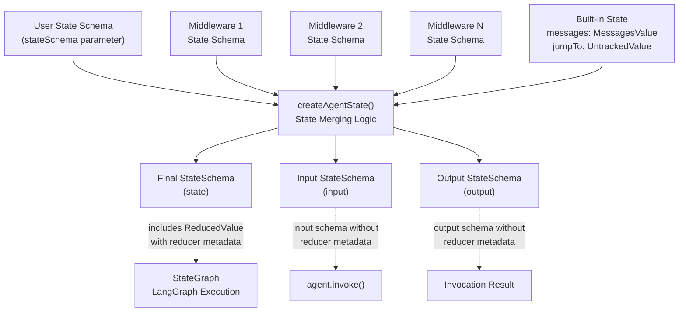
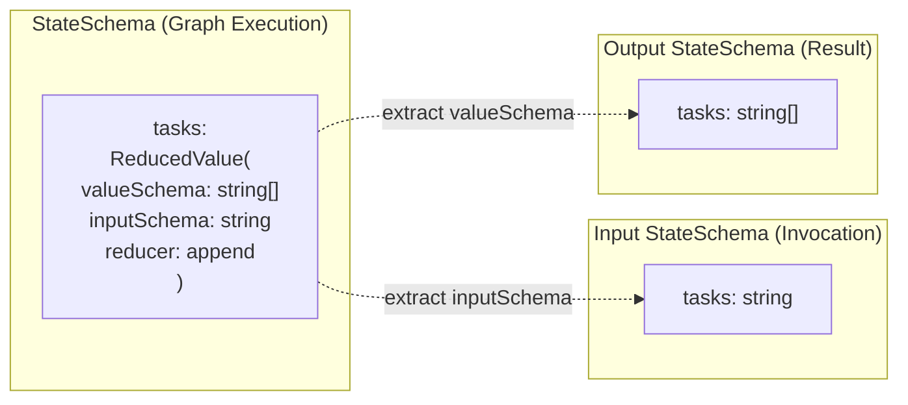
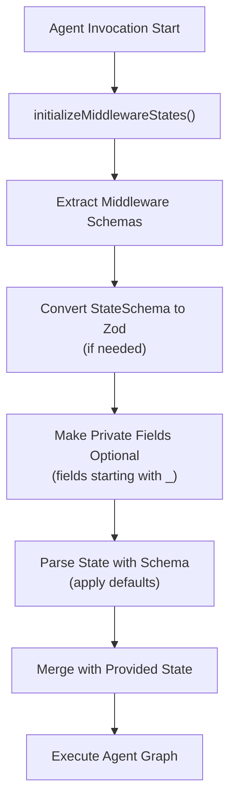

<!-- source: DeepWiki mcp.deepwiki.com · repo langchain-ai/langchainjs · page 3.3 Agent State Management · fetched 2026-10-26 -->

# Agent State Management

<details>
<summary>Relevant source files</summary>

The following files were used as context for generating this wiki page:

- [examples/src/createAgent/middleware/modelCallLimit.ts](examples/src/createAgent/middleware/modelCallLimit.ts)
- [libs/langchain/src/agents/annotation.ts](libs/langchain/src/agents/annotation.ts)
- [libs/langchain/src/agents/index.ts](libs/langchain/src/agents/index.ts)
- [libs/langchain/src/agents/middleware.ts](libs/langchain/src/agents/middleware.ts)
- [libs/langchain/src/agents/middleware/modelCallLimit.ts](libs/langchain/src/agents/middleware/modelCallLimit.ts)
- [libs/langchain/src/agents/middleware/modelFallback.ts](libs/langchain/src/agents/middleware/modelFallback.ts)
- [libs/langchain/src/agents/middleware/tests/modelCallLimit.test.ts](libs/langchain/src/agents/middleware/tests/modelCallLimit.test.ts)
- [libs/langchain/src/agents/middleware/tests/toolCallLimit.test.ts](libs/langchain/src/agents/middleware/tests/toolCallLimit.test.ts)
- [libs/langchain/src/agents/middleware/toolCallLimit.ts](libs/langchain/src/agents/middleware/toolCallLimit.ts)
- [libs/langchain/src/agents/middleware/types.ts](libs/langchain/src/agents/middleware/types.ts)
- [libs/langchain/src/agents/model.ts](libs/langchain/src/agents/model.ts)
- [libs/langchain/src/agents/nodes/middleware.ts](libs/langchain/src/agents/nodes/middleware.ts)
- [libs/langchain/src/agents/nodes/tests/utils.test.ts](libs/langchain/src/agents/nodes/tests/utils.test.ts)
- [libs/langchain/src/agents/nodes/utils.ts](libs/langchain/src/agents/nodes/utils.ts)
- [libs/langchain/src/agents/runtime.ts](libs/langchain/src/agents/runtime.ts)
- [libs/langchain/src/agents/tests/reactAgent.test-d.ts](libs/langchain/src/agents/tests/reactAgent.test-d.ts)
- [libs/langchain/src/agents/tests/runtime.test-d.ts](libs/langchain/src/agents/tests/runtime.test-d.ts)
- [libs/langchain/src/agents/tests/runtime.test.ts](libs/langchain/src/agents/tests/runtime.test.ts)
- [libs/langchain/src/agents/tests/state.test.ts](libs/langchain/src/agents/tests/state.test.ts)
- [libs/langchain/src/agents/tests/state_schema.test.ts](libs/langchain/src/agents/tests/state_schema.test.ts)
- [libs/langchain/src/agents/types.ts](libs/langchain/src/agents/types.ts)
- [libs/langchain/src/agents/withAgentName.ts](libs/langchain/src/agents/withAgentName.ts)

</details>


## Purpose and Scope

Agent State Management handles how agents maintain and update state across their execution lifecycle. This includes managing user-defined state fields, middleware state contributions, and built-in state like message history. The system provides type-safe state merging, custom reducer functions for field accumulation, and seamless integration between user schemas and middleware schemas.

For information about how agents are created and configured, see [Agent Creation API](3.1). For information about how middleware hooks interact with state, see [Middleware System](3.2). For information about how state flows through the LangGraph execution engine, see [LangGraph Integration](3.6).

## State Schema Primitives

Agent state management is built on LangGraph's native state primitives, with additional support for Zod schemas. The system supports three core state field types:

| Primitive | Purpose | Behavior |
|-----------|---------|----------|
| `StateSchema` | Define structured state | Container for state field definitions [libs/langchain/src/agents/annotation.ts:3-8]() |
| `ReducedValue` | Accumulating fields | Applies reducer function when updating [libs/langchain/src/agents/annotation.ts:6-7]() |
| `UntrackedValue` | Navigation control | Not persisted in checkpoints [libs/langchain/src/agents/annotation.ts:5-6]() |
| Regular Zod schemas | Simple state fields | Direct assignment updates [libs/langchain/src/agents/annotation.ts:73-74]() |

Sources: [libs/langchain/src/agents/annotation.ts:1-169]()

### StateSchema

`StateSchema` is LangGraph's native state container that defines the structure and behavior of agent state. It provides metadata that LangGraph Studio uses for visualization and supports advanced features like custom reducers.

```typescript
import { StateSchema, ReducedValue } from "@langchain/langgraph";
import { z } from "zod";

const AgentState = new StateSchema({
  userId: z.string(),
  count: z.number().default(0),
  tasks: new ReducedValue(
    z.array(z.string()).default(() => []),
    {
      inputSchema: z.string(),
      reducer: (current, next) => [...current, next]
    }
  )
});
```

Sources: [libs/langchain/src/agents/annotation.ts:44-71](), [libs/langchain/src/agents/index.ts:152-165]()

### ReducedValue

`ReducedValue` wraps a state field with a custom reducer function that controls how updates are merged. This enables accumulation patterns like appending to arrays, summing numbers, or applying custom merge logic.

The reducer function receives:
- `current`: The existing value in state
- `next`: The new value being applied

```typescript
new ReducedValue(
  z.array(z.string()).default(() => []),  // Value schema
  {
    inputSchema: z.string(),                // Input type (optional)
    reducer: (current, next) => [...current, next]  // Merge function
  }
)
```

When a `ReducedValue` field is updated, the reducer is invoked automatically by LangGraph's state management system. This happens during state updates from middleware hooks, tool results, or any other state modification.
For example, in `libs/langchain/src/agents/tests/state_schema.test.ts`, a `ReducedValue` for `history` is defined [libs/langchain/src/agents/tests/state_schema.test.ts:76-86](). When a tool returns a `Command` with an update to `history`, the reducer is called [libs/langchain/src/agents/tests/state_schema.test.ts:129-134]().

Sources: [libs/langchain/src/agents/annotation.ts:59-67](), [libs/langchain/src/agents/index.ts:155-158](), [libs/langchain/src/agents/tests/state_schema.test.ts:76-86](), [libs/langchain/src/agents/tests/state_schema.test.ts:129-134]()

### UntrackedValue

`UntrackedValue` marks fields that should not be persisted in checkpoints. This is used for internal navigation control like `jumpTo`, which directs the agent's execution flow but should not be saved across thread sessions.

```typescript
const stateFields = {
  jumpTo: new UntrackedValue<JumpToTarget>(),
  // ... other fields
};
```

Sources: [libs/langchain/src/agents/annotation.ts:35-38]()

## State Merging Architecture

The agent state system merges three sources of state into a unified schema:

Title: Agent State Merging Flow


**State Merging Flow**

The `createAgentState` function at [libs/langchain/src/agents/annotation.ts:24-169]() orchestrates the merging process:

1. **Initialize containers**: Creates `stateFields` for the main schema and separate `inputFields`/`outputFields` for I/O schemas [libs/langchain/src/agents/annotation.ts:35-42]().
2. **Apply user schema**: Extracts fields from the user-provided `stateSchema` parameter [libs/langchain/src/agents/annotation.ts:125-130]().
3. **Apply middleware schemas**: Iterates through `middlewareList` and merges each middleware's `stateSchema` [libs/langchain/src/agents/annotation.ts:136-144]().
4. **Preserve reducer behavior**: Wraps fields with `ReducedValue` metadata in the state schema while extracting plain schemas for input/output [libs/langchain/src/agents/annotation.ts:59-67]().
5. **Add built-in fields**: Injects `messages` (with `MessagesValue` reducer) and `jumpTo` (untracked) [libs/langchain/src/agents/annotation.ts:156-158]().
6. **Return three schemas**: Returns `state`, `input`, and `output` as distinct `StateSchema` instances [libs/langchain/src/agents/annotation.ts:155-168]().

Sources: [libs/langchain/src/agents/annotation.ts:24-169]()

### Field Merging Rules

When multiple schemas define the same field key, the system uses a first-wins strategy [libs/langchain/src/agents/annotation.ts:48-50]().

Fields are applied in order:
1. User-provided `stateSchema` fields [libs/langchain/src/agents/annotation.ts:125-130]().
2. Middleware schemas in array order [libs/langchain/src/agents/annotation.ts:136-144]().
3. Built-in fields (`messages`, `jumpTo`) [libs/langchain/src/agents/annotation.ts:156-158]().

Private fields (prefixed with `_`) are handled during merging to persist in the graph state but are not exposed as input/output channels [libs/langchain/src/agents/annotation.ts:54-56]().

Sources: [libs/langchain/src/agents/annotation.ts:44-119]()

## Input and Output Schema Separation

To avoid channel conflicts in LangGraph's state management, the system generates separate input and output schemas that extract plain Zod schemas from `ReducedValue` fields:

Title: Schema Separation for ReducedValue


This separation allows:
- **Type-safe invocation**: Users provide input values matching `inputSchema` types [libs/langchain/src/agents/annotation.ts:61-62]().
- **Type-safe results**: Users receive output values matching `valueSchema` types [libs/langchain/src/agents/annotation.ts:62-63]().
- **Reducer execution**: LangGraph applies reducers internally without exposing implementation details to the caller.

Sources: [libs/langchain/src/agents/annotation.ts:59-67]()

## State Initialization

Middleware state fields are initialized with default values before agent execution begins. This ensures all middleware state properties are available in hooks.

Title: Middleware State Initialization Logic


**Initialization Process**

The `initializeMiddlewareStates` function at [libs/langchain/src/agents/nodes/utils.ts:26-100]() handles state initialization:

1. **Iterate middleware**: Processes each middleware that defines a `stateSchema` [libs/langchain/src/agents/nodes/utils.ts:32-38]().
2. **Convert schemas**: Transforms `StateSchema` to Zod objects for parsing [libs/langchain/src/agents/nodes/utils.ts:41-55]().
3. **Make private fields optional**: Uses `interopZodObjectMakeFieldsOptional` to mark `_`-prefixed fields as optional so users aren't required to provide them [libs/langchain/src/agents/nodes/utils.ts:58-61]().
4. **Parse with defaults**: Calls `interopSafeParseAsync` to apply default values defined in the schema [libs/langchain/src/agents/nodes/utils.ts:64-68]().
5. **Error Handling**: If required public fields are missing, it throws a descriptive error explaining how to fix the schema [libs/langchain/src/agents/nodes/utils.ts:74-96]().

Sources: [libs/langchain/src/agents/nodes/utils.ts:26-100]()

## Type Inference and Runtime

The state system provides type helpers that automatically infer TypeScript types from state schemas.

### AgentTypeConfig

The `AgentTypeConfig` interface bundles all generic type parameters into a single configuration object [libs/langchain/src/agents/types.ts:91-126](). This includes:
- `State`: The custom state schema type [libs/langchain/src/agents/types.ts:112-112]().
- `Context`: The context schema type [libs/langchain/src/agents/types.ts:113-113]().
- `Middleware`: The middleware array type [libs/langchain/src/agents/types.ts:116-116]().

### Runtime Type

The `Runtime` type represents the execution context available to middleware hooks and tool executions [libs/langchain/src/agents/runtime.ts:63-71](). It provides access to:
- `context`: The context schema value (read-only, not persisted) [libs/langchain/src/agents/runtime.ts:66-66]().
- `configurable`: Metadata such as `thread_id` [libs/langchain/src/agents/runtime.ts:67-70]().

The `AgentBuiltInState` type defines the standard properties available in the agent's state [libs/langchain/src/agents/runtime.ts:17-44]():
- `messages`: Array of `BaseMessage` representing conversation history [libs/langchain/src/agents/runtime.ts:30-30]().
- `structuredResponse`: Populated when a `responseFormat` is configured [libs/langchain/src/agents/runtime.ts:43-43]().

Sources: [libs/langchain/src/agents/types.ts:91-126](), [libs/langchain/src/agents/runtime.ts:17-71](), [libs/langchain/src/agents/middleware/types.ts:174-175]()

## Private State Fields

Fields prefixed with underscore (`_`) are treated as private and have special handling:

1. **Internal Persistence**: Private state persists in the graph state but is not exposed as input/output channels [libs/langchain/src/agents/annotation.ts:54-56]().
2. **Derivation**: The `derivePrivateState` function creates a schema containing only these properties, all made optional [libs/langchain/src/agents/nodes/utils.ts:108-152]().
3. **Initialization**: During initialization, these fields are automatically made optional using `interopZodObjectMakeFieldsOptional` [libs/langchain/src/agents/nodes/utils.ts:58-61]().

For example, in `libs/langchain/src/agents/tests/state.test.ts`, `_privateMiddlewareAState` is defined as a private state property [libs/langchain/src/agents/tests/state.test.ts:36-36](). This property is accessible within middleware hooks [libs/langchain/src/agents/tests/state.test.ts:66-68]() but is not exposed in the agent's final output.

Sources: [libs/langchain/src/agents/annotation.ts:54-56](), [libs/langchain/src/agents/nodes/utils.ts:108-152](), [libs/langchain/src/agents/tests/state.test.ts:36-36](), [libs/langchain/src/agents/tests/state.test.ts:66-68]()

---

