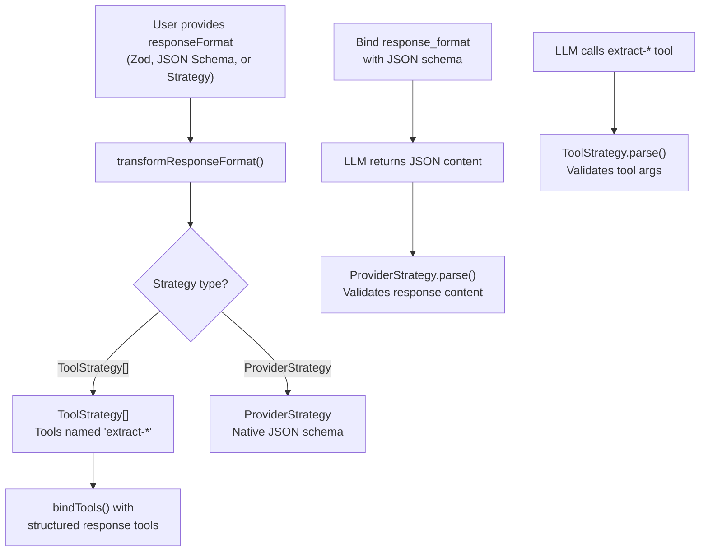
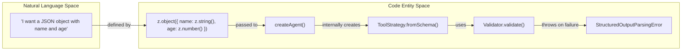

<!-- source: DeepWiki mcp.deepwiki.com · repo langchain-ai/langchainjs · page 3.4 Response Format and Structured Output · fetched 2026-10-26 -->

# Response Format and Structured Output

<details>
<summary>Relevant source files</summary>

The following files were used as context for generating this wiki page:

- [libs/langchain-core/src/language_models/structured_output.ts](libs/langchain-core/src/language_models/structured_output.ts)
- [libs/langchain-core/src/language_models/tests/structured_output.test.ts](libs/langchain-core/src/language_models/tests/structured_output.test.ts)
- [libs/langchain-core/src/output_parsers/index.ts](libs/langchain-core/src/output_parsers/index.ts)
- [libs/langchain-core/src/output_parsers/openai_tools/json_output_tools_parsers.ts](libs/langchain-core/src/output_parsers/openai_tools/json_output_tools_parsers.ts)
- [libs/langchain-core/src/utils/json_schema.ts](libs/langchain-core/src/utils/json_schema.ts)
- [libs/langchain-core/src/utils/tests/json_schema.test.ts](libs/langchain-core/src/utils/tests/json_schema.test.ts)
- [libs/langchain-core/src/utils/types/tests/zod.test.ts](libs/langchain-core/src/utils/types/tests/zod.test.ts)
- [libs/langchain-core/src/utils/types/zod.ts](libs/langchain-core/src/utils/types/zod.ts)
- [libs/langchain/src/agents/nodes/types.ts](libs/langchain/src/agents/nodes/types.ts)
- [libs/langchain/src/agents/responses.ts](libs/langchain/src/agents/responses.ts)
- [libs/langchain/src/agents/tests/middleware.test-d.ts](libs/langchain/src/agents/tests/middleware.test-d.ts)
- [libs/langchain/src/agents/tests/responses.int.test.ts](libs/langchain/src/agents/tests/responses.int.test.ts)
- [libs/langchain/src/agents/tests/responses.test-d.ts](libs/langchain/src/agents/tests/responses.test-d.ts)
- [libs/langchain/src/agents/tests/responses.test.ts](libs/langchain/src/agents/tests/responses.test.ts)
- [libs/langchain/src/agents/tests/types.test-d.ts](libs/langchain/src/agents/tests/types.test-d.ts)
- [libs/langchain/src/load/import_constants.ts](libs/langchain/src/load/import_constants.ts)

</details>


## Purpose and Scope

This page documents how LangChain.js agents extract structured outputs from language models using the `responseFormat` parameter. It covers the two primary strategies for obtaining structured data (tool-based and provider-native), their configuration, internal processing flow, error handling, and type inference.

For general agent creation, see [Agent Creation API](#3.1). For middleware that can access structured responses, see [Middleware System](#3.2).

---

## Overview

Structured output enables agents to return data in a validated, typed format rather than unstructured text. The agent framework supports extracting structured responses through two complementary mechanisms:

1.  **ToolStrategy**: Wraps response schemas as tool calls that the LLM can invoke.
2.  **ProviderStrategy**: Uses provider-native JSON schema output (e.g., OpenAI's `json_schema` response format).

Both strategies validate responses against schemas, handle parsing errors, and optionally retry on failure.

**Sources**: [libs/langchain/src/agents/responses.ts:54-162](), [libs/langchain/src/agents/responses.ts:164-245]()

---

## Response Format Strategies

### Strategy Selection Flow

The following diagram illustrates how the `createAgent` API transforms user-provided schemas into specific execution strategies.



**Sources**: [libs/langchain/src/agents/responses.ts:54-245](), [libs/langchain/src/agents/nodes/types.ts:93-96]()

### ToolStrategy

`ToolStrategy` wraps the response schema as a tool definition. The LLM receives this as a callable function and invokes it with the structured data as arguments. This is the most compatible method across different model providers.

| Aspect | Implementation |
| :--- | :--- |
| **Tool Name** | `"extract-{index}"` generated automatically via `bindingIdentifier` [libs/langchain/src/agents/responses.ts:46-104]() |
| **Tool Schema** | Converted to JSON Schema via `toJsonSchema` [libs/langchain/src/agents/responses.ts:107-118]() |
| **Validation** | Uses `Validator` from `@langchain/core/utils/json_schema` [libs/langchain/src/agents/responses.ts:152-161]() |
| **Error Handling** | Configurable retry via `handleError` option [libs/langchain/src/agents/responses.ts:251-260]() |

**Configuration Example**:

```typescript
import { createAgent, toolStrategy } from "langchain";
import { z } from "zod";

const ContactSchema = z.object({
  name: z.string(),
  email: z.string().email(),
});

const agent = createAgent({
  model: "gpt-4o",
  tools: [],
  responseFormat: toolStrategy(ContactSchema, {
    handleError: true, // Retry on parsing errors
  }),
});
```

**Sources**: [libs/langchain/src/agents/responses.ts:54-162](), [libs/langchain/src/agents/tests/responses.test.ts:41-130]()

### ProviderStrategy

`ProviderStrategy` uses provider-native structured output features, such as OpenAI's Structured Outputs or Anthropic's tool-use for specific formats.

| Aspect | Implementation |
| :--- | :--- |
| **Provider Options** | Sets `strict: true` by default for OpenAI [libs/langchain/src/agents/responses.ts:41-41]() |
| **Validation** | Relies on provider-side validation or post-hoc parsing of `AIMessage` content |
| **Strict Mode** | Configurable via `strict` option [libs/langchain/src/agents/responses.ts:174-180]() |

**Configuration Example**:

```typescript
import { createAgent, providerStrategy } from "langchain";
import { z } from "zod";

const WeatherSchema = z.object({
  temperature: z.number(),
  condition: z.string(),
});

const agent = createAgent({
  model: "openai:gpt-4o",
  tools: [],
  responseFormat: providerStrategy(WeatherSchema, {
    strict: true, // Enforce schema adherence at the provider level
  }),
});
```

**Sources**: [libs/langchain/src/agents/responses.ts:164-245](), [libs/langchain/src/agents/tests/responses.int.test.ts:184-215]()

---

## Schema Transformation and Validation

### JSON Schema Conversion

The system uses `toJsonSchema` to normalize various input types (Zod, Standard Schema, plain objects) into a standard JSON Schema format for the LLM.

*   **Zod Support**: Supports both Zod v3 and v4, including transformed schemas [libs/langchain-core/src/utils/json_schema.ts:68-77]().
*   **Caching**: Conversions are cached in a `WeakMap` to optimize performance in multi-turn agents [libs/langchain-core/src/utils/json_schema.ts:39-60]().
*   **Standard Schema**: Integrates with the `@standard-schema/spec` for broader library compatibility [libs/langchain-core/src/utils/json_schema.ts:64-67]().

**Sources**: [libs/langchain-core/src/utils/json_schema.ts:48-87](), [libs/langchain-core/src/utils/tests/json_schema.test.ts:124-147]()

### Interop Zod Types

To prevent performance issues and OOM errors in large TypeScript projects, `@langchain/core` uses "Like" interfaces for Zod types instead of direct imports of the massive Zod type tree.

*   **`ZodV3Like` / `ZodV4Like`**: Minimal structural interfaces that capture only what LangChain needs (e.g., `_def`, `parse`, `_zod`) [libs/langchain-core/src/utils/types/zod.ts:63-107]().
*   **`InteropZodType`**: A union type allowing either version to be passed to agent configuration [libs/langchain-core/src/utils/types/zod.ts:169-171]().

**Sources**: [libs/langchain-core/src/utils/types/zod.ts:23-56](), [libs/langchain-core/src/utils/types/tests/zod.test.ts:90-113]()

---

## Error Handling and Retries

When a model fails to produce valid structured output (either by failing validation or calling multiple extraction tools), the agent can automatically retry.

### Retry-on-Parse-Error

If `ToolStrategy.parse()` throws a `StructuredOutputParsingError`, the agent framework:
1.  Captures the validation error [libs/langchain/src/agents/responses.ts:154-159]().
2.  Appends a `ToolMessage` containing the error details to the conversation history.
3.  Prompts the model to correct its previous output.

### Multiple Structured Outputs

If a model calls multiple tools intended for structured output (e.g., calling both `extract-1` and `extract-2` simultaneously), a `MultipleStructuredOutputsError` is raised [libs/langchain/src/agents/responses.ts:19-20]().

**Retry Behavior**:
*   **Default**: Retries by prompting the model that it called multiple tools [libs/langchain/src/agents/tests/responses.test.ts:43-93]().
*   **Configurable**: Can be disabled by setting `handleError: false` in the strategy options [libs/langchain/src/agents/tests/responses.test.ts:95-130]().

**Sources**: [libs/langchain/src/agents/responses.ts:17-20](), [libs/langchain/src/agents/tests/responses.test.ts:132-196]()

---

## Type Inference and State

The `createAgent` API uses complex generics to ensure that the `structuredResponse` property in the agent's output is correctly typed based on the provided schema.

### Result Mapping

| Input `responseFormat` | `structuredResponse` Type |
| :--- | :--- |
| `undefined` | Property not present [libs/langchain/src/agents/responses.ts:28-30]() |
| `z.ZodSchema<T>` | `T` [libs/langchain/src/agents/tests/responses.test-d.ts:69-75]() |
| `[SchemaA, SchemaB]` | `TypeA | TypeB` [libs/langchain/src/agents/tests/responses.test-d.ts:116-139]() |
| `JsonSchemaFormat` | `Record<string, unknown>` [libs/langchain/src/agents/tests/responses.test-d.ts:43-58]()

### Response Format Association

The following diagram maps the Natural Language intent of "structured response" to the specific code entities involved in execution.



**Sources**: [libs/langchain/src/agents/responses.ts:54-162](), [libs/langchain/src/agents/tests/responses.test-d.ts:102-114](), [libs/langchain-core/src/utils/json_schema.ts:18-18]()

### ResponseFormatUndefined

When no format is provided, the type `ResponseFormatUndefined` is used internally. This ensures that the `structuredResponse` property is omitted from the return type of `agent.invoke()`, preventing runtime access to non-existent data.

**Sources**: [libs/langchain/src/agents/responses.ts:28-30](), [libs/langchain/src/agents/tests/responses.test-d.ts:27-34]()

---

