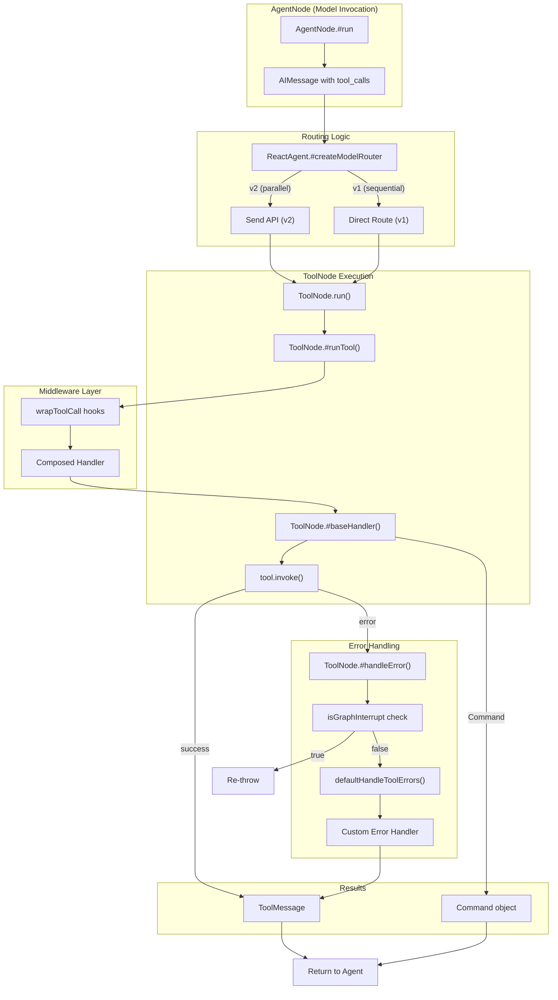
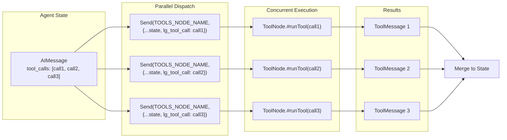
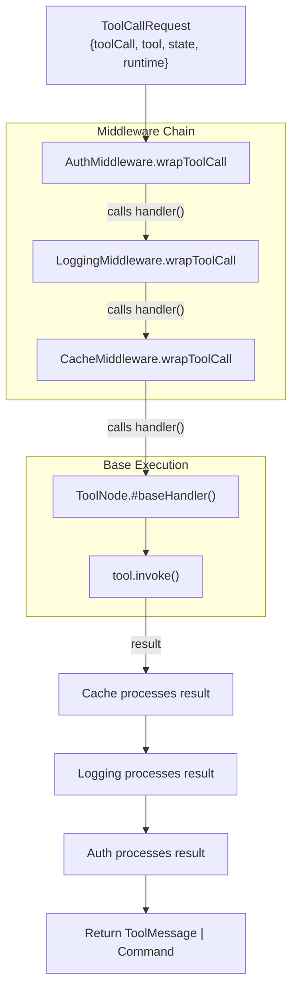
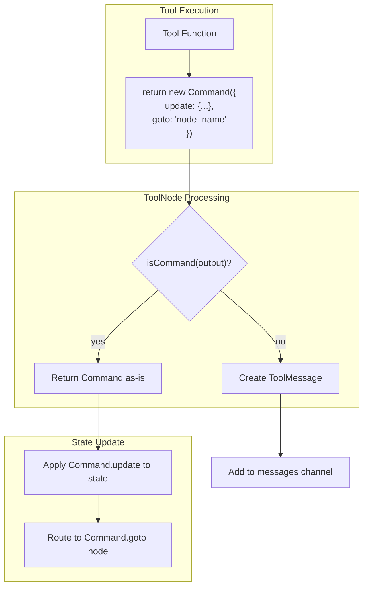
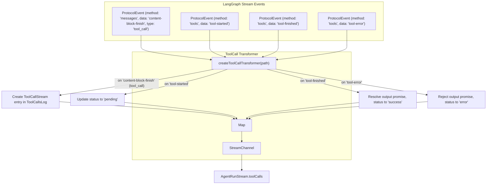

<!-- source: DeepWiki mcp.deepwiki.com · repo langchain-ai/langchainjs · page 3.5 Tool Execution and Error Handling · fetched 2026-10-26 -->

# Tool Execution and Error Handling

Relevant source files

The following files were used as context for generating this wiki page:

- [dependency_range_tests/scripts/create-mock-tsconfigs.sh](dependency_range_tests/scripts/create-mock-tsconfigs.sh)
- [internal/build/src/plugins/import-constants.ts](internal/build/src/plugins/import-constants.ts)
- [libs/langchain-classic/src/chains/base.ts](libs/langchain-classic/src/chains/base.ts)
- [libs/langchain-core/src/messages/tests/messages.test-d.ts](libs/langchain-core/src/messages/tests/messages.test-d.ts)
- [libs/langchain-core/src/tools/index.ts](libs/langchain-core/src/tools/index.ts)
- [libs/langchain-core/src/tools/tests/tools.test.ts](libs/langchain-core/src/tools/tests/tools.test.ts)
- [libs/langchain-core/src/tools/tests/types.test-d.ts](libs/langchain-core/src/tools/tests/types.test-d.ts)
- [libs/langchain-core/src/tools/types.ts](libs/langchain-core/src/tools/types.ts)
- [libs/langchain-core/src/utils/signal.ts](libs/langchain-core/src/utils/signal.ts)
- [libs/langchain/src/agents/ReactAgent.ts](libs/langchain/src/agents/ReactAgent.ts)
- [libs/langchain/src/agents/errors.ts](libs/langchain/src/agents/errors.ts)
- [libs/langchain/src/agents/middleware/tests/dynamicTools.test.ts](libs/langchain/src/agents/middleware/tests/dynamicTools.test.ts)
- [libs/langchain/src/agents/nodes/AgentNode.ts](libs/langchain/src/agents/nodes/AgentNode.ts)
- [libs/langchain/src/agents/nodes/ToolNode.ts](libs/langchain/src/agents/nodes/ToolNode.ts)
- [libs/langchain/src/agents/nodes/tests/AgentNode.test.ts](libs/langchain/src/agents/nodes/tests/AgentNode.test.ts)
- [libs/langchain/src/agents/nodes/tests/ToolNode.test.ts](libs/langchain/src/agents/nodes/tests/ToolNode.test.ts)
- [libs/langchain/src/agents/tests/middleware.test.ts](libs/langchain/src/agents/tests/middleware.test.ts)
- [libs/langchain/src/agents/tests/reactAgent.test.ts](libs/langchain/src/agents/tests/reactAgent.test.ts)
- [libs/langchain/src/agents/tests/tools.test-d.ts](libs/langchain/src/agents/tests/tools.test-d.ts)
- [libs/langchain/src/agents/tests/tools.test.ts](libs/langchain/src/agents/tests/tools.test.ts)
- [libs/langchain/src/agents/transformers/index.ts](libs/langchain/src/agents/transformers/index.ts)
- [libs/langchain/src/agents/transformers/subagent.ts](libs/langchain/src/agents/transformers/subagent.ts)
- [libs/langchain/src/agents/transformers/tests/subagent.test.ts](libs/langchain/src/agents/transformers/tests/subagent.test.ts)
- [libs/langchain/src/agents/transformers/tests/tool-call.test.ts](libs/langchain/src/agents/transformers/tests/tool-call.test.ts)
- [libs/langchain/src/agents/transformers/tool-call.ts](libs/langchain/src/agents/transformers/tool-call.ts)
- [libs/langchain/src/agents/transformers/types.ts](libs/langchain/src/agents/transformers/types.ts)
- [libs/langchain/src/agents/utils.ts](libs/langchain/src/agents/utils.ts)
- [libs/langchain/src/browser.ts](libs/langchain/src/browser.ts)
- [libs/langchain/src/tools/headless.ts](libs/langchain/src/tools/headless.ts)
- [libs/langchain/src/tools/index.ts](libs/langchain/src/tools/index.ts)
- [libs/langchain/src/tools/tests/headless.test-d.ts](libs/langchain/src/tools/tests/headless.test-d.ts)
- [libs/langchain/src/tools/tests/headless.test.ts](libs/langchain/src/tools/tests/headless.test.ts)

This document describes the tool execution infrastructure in the LangChain.js agent system, including the `ToolNode` class, parallel execution patterns, error handling strategies, and middleware integration. For information about tool definitions and schema validation, see [Tools and Dynamic Tools](#2.3). For information about middleware lifecycle hooks other than `wrapToolCall`, see [Middleware System](#3.2).

## Purpose and Scope

The tool execution system handles the invocation of tools that agents call during their reasoning process. When a language model decides to use a tool, the system:

1. Executes tools (potentially in parallel)
2. Handles execution errors with configurable strategies
3. Applies middleware transformations via `wrapToolCall` hooks
4. Converts results to `ToolMessage` objects for the conversation history
5. Supports advanced control flow via `Command` objects

This page focuses on the execution and error handling aspects. The routing logic that determines when to execute tools is covered in [LangGraph Integration, Hub, and Storage](#3.6).

Sources: [libs/langchain/src/agents/nodes/ToolNode.ts:1-135](), [libs/langchain/src/agents/nodes/AgentNode.ts:1-91]()

## Tool Execution Architecture

**ToolNode Execution Flow**

The flow begins when `AgentNode` receives tool calls from the model and routes to `ToolNode`. The node supports two execution modes controlled by `toolBehaviorVersion` in `ReactAgent`:

- **v1** (sequential): All tool calls processed in a single `ToolNode` invocation using `Promise.all` [libs/langchain/src/agents/tests/tools.test.ts:73-74]().
- **v2** (parallel): Each tool call routed individually via the `Send` API for parallel execution [libs/langchain/src/agents/tests/tools.test.ts:126-129]().

Sources: [libs/langchain/src/agents/nodes/ToolNode.ts:181-218](), [libs/langchain/src/agents/ReactAgent.ts:180-203](), [libs/langchain/src/agents/nodes/AgentNode.ts:91-141]()

## ToolNode Implementation

The `ToolNode` class extends `RunnableCallable` and manages tool execution:

| Property | Type | Purpose |
|----------|------|---------|
| `tools` | `(StructuredToolInterface \| DynamicTool \| RunnableToolLike)[]` | Registered tools available for execution [libs/langchain/src/agents/nodes/ToolNode.ts:185-185]() |
| `handleToolErrors` | `boolean \| ((error, toolCall) => ToolMessage \| undefined)` | Error handling strategy [libs/langchain/src/agents/nodes/ToolNode.ts:191-194]() |
| `wrapToolCall` | `WrapToolCallHook \| undefined` | Middleware composition function [libs/langchain/src/agents/nodes/ToolNode.ts:196-196]() |
| `signal` | `AbortSignal \| undefined` | Cancellation signal for aborting execution [libs/langchain/src/agents/nodes/ToolNode.ts:189-189]() |

The node is instantiated in the `ReactAgent` constructor when client-side tools or `wrapToolCall` middleware is present [libs/langchain/src/agents/ReactAgent.ts:222-226]().

Sources: [libs/langchain/src/agents/nodes/ToolNode.ts:181-214](), [libs/langchain/src/agents/ReactAgent.ts:44-53]()

## Parallel Tool Execution

### Send API Pattern (v2)

When `toolBehaviorVersion` is set to `"v2"` (default), the agent uses LangGraph's `Send` API to dispatch tool calls in parallel. This allows multiple tools to execute concurrently in different graph branches.

**Parallel Execution Implementation**

The router filters tool calls and creates `Send` objects for regular tools. Each `Send` includes the tool call in the `lg_tool_call` property [libs/langchain/src/agents/nodes/ToolNode.ts:101-104](), which `ToolNode` extracts during its run cycle.

Sources: [libs/langchain/src/agents/ReactAgent.ts:8-18](), [libs/langchain/src/agents/nodes/ToolNode.ts:101-104](), [libs/langchain/src/agents/nodes/ToolNode.ts:13-19]()

## Error Handling Strategies

### Error Handler Configuration

The `handleToolErrors` option in `ToolNodeOptions` controls how tool execution errors are managed:

| Value | Behavior |
|-------|----------|
| `undefined` | Default handler: catches `ToolInvocationError` and converts to `ToolMessage` [libs/langchain/src/agents/nodes/ToolNode.ts:116-135](). |
| `true` | Catch all errors and return a `ToolMessage` with the error content [libs/langchain/src/agents/nodes/ToolNode.ts:67-69](). |
| `false` | All errors are thrown immediately [libs/langchain/src/agents/nodes/ToolNode.ts:70-71](). |
| `Function` | Custom handler: returns `ToolMessage` to handle, or `undefined` to re-raise [libs/langchain/src/agents/nodes/ToolNode.ts:73-75](). |

### Error Handling Logic

The default error handler `defaultHandleToolErrors` converts tool invocation errors (often caused by invalid arguments from the LLM) into `ToolMessage` objects, allowing the model to see the error and potentially retry [libs/langchain/src/agents/nodes/ToolNode.ts:116-135]().

Sources: [libs/langchain/src/agents/nodes/ToolNode.ts:116-135](), [libs/langchain/src/agents/nodes/ToolNode.ts:47-88]()

### Special Error Cases

**GraphInterrupt Errors**

Errors that satisfy `isGraphInterrupt` (used for human-in-the-loop patterns) are typically re-thrown to allow the graph to pause execution [libs/langchain/src/agents/nodes/ToolNode.ts:16-19]().

Sources: [libs/langchain/src/agents/nodes/ToolNode.ts:13-19]()

**ToolInvocationError**

This error is thrown when tool arguments fail schema validation or when a tool is called with invalid parameters [libs/langchain/src/agents/errors.ts:23-23]().

Sources: [libs/langchain/src/agents/errors.ts:52-72]()

## Middleware Integration (wrapToolCall)

### Middleware Composition

Middleware can wrap tool execution, forming a nested chain where the first middleware is the outermost wrapper. This allows for cross-cutting concerns like logging, authentication, or retries.

**Composition Implementation**

Each middleware receives a `ToolCallRequest` containing the tool call, the tool instance, the current agent state, and the runtime context [libs/langchain/src/agents/middleware/types.ts:138-175]().

Sources: [libs/langchain/src/agents/middleware/types.ts:138-175](), [libs/langchain/src/agents/utils.ts:37-42]()

### Dynamic Tool Registration

Middleware can provide tool implementations for dynamically registered tools by spreading the request with a `tool` property. This is useful when tools are loaded at runtime or provided by an external service (like MCP) [libs/langchain/src/agents/middleware/types.ts:153-165]().

Sources: [libs/langchain/src/agents/middleware/types.ts:153-165]()

## Command-Based Control Flow

### Command Objects from Tools

Tools can return `Command` objects instead of plain values to control agent flow. A `Command` can update the state and simultaneously trigger a jump to another node (like `model_request` or `END`) [libs/langchain/src/agents/ReactAgent.ts:10-18]().

**Command Detection**

The `ToolNode` and `AgentNode` check if the result is a `Command` using `isCommand` [libs/langchain/src/agents/nodes/ToolNode.ts:13-14](). If it is, the command is returned to the graph for processing [libs/langchain/src/agents/nodes/AgentNode.ts:75-86]().

Sources: [libs/langchain/src/agents/nodes/ToolNode.ts:13-19](), [libs/langchain/src/agents/nodes/AgentNode.ts:10-13](), [libs/langchain/src/agents/nodes/AgentNode.ts:75-86]()

## Tool Transformers

Tool transformers are functions that convert raw LangGraph stream events into more structured, agent-specific stream events. They are defined in [libs/langchain/src/agents/transformers/index.ts]() and used by `ReactAgent` to provide richer streaming output.

### Tool-Call Transformer

The `createToolCallTransformer` function [libs/langchain/src/agents/transformers/tool-call.ts:111-113]() processes `tools` channel events and `content-block-finish` events from the `messages` channel to correlate them into per-call `ToolCallStream` objects. This allows for real-time tracking of tool execution status, input, and output.

The transformer maintains a map of pending tool calls, each with promises for its output, status, and error. As events arrive, these promises are resolved or rejected, providing a stream of `ToolCallStream` objects. It also includes logic to differentiate between genuine tool errors and `GraphInterrupt` events, ensuring that interrupts (which suspend execution) do not incorrectly mark a tool call as failed [libs/langchain/src/agents/transformers/tool-call.ts:34-69]().

Sources: [libs/langchain/src/agents/transformers/tool-call.ts:111-113](), [libs/langchain/src/agents/transformers/tool-call.ts:114-166](), [libs/langchain/src/agents/transformers/tool-call.ts:34-69]()

### Subagent Transformer

The `createSubagentTransformer` function [libs/langchain/src/agents/transformers/subagent.ts:1-1]() is used to project events from sub-graphs (subagents) into a unified stream. This allows the main agent to observe and react to the activities of its subagents.

Sources: [libs/langchain/src/agents/transformers/subagent.ts:1-1]()

## Headless Tools

Headless tools are a specialized type of tool designed for internal agent operations rather than direct user interaction. They are defined in [libs/langchain/src/tools/headless.ts]() and are typically used for tasks like internal state management, logging, or triggering specific agent behaviors.

### Characteristics

- **No User-Facing Description**: Headless tools often lack a `description` property, as they are not intended to be presented to the LLM for selection in the same way as regular tools.
- **Internal Use**: They are primarily invoked programmatically within the agent's logic or by middleware.
- **Control Flow**: Headless tools can be used to implement complex control flow mechanisms within the agent, such as interrupting execution or modifying the agent's state.

### Example Use Case

A headless tool might be used by a middleware to log specific events or to trigger a `Command` that alters the agent's execution path based on internal conditions.

Sources: [libs/langchain/src/tools/headless.ts:1-1]()

## Return Direct

### ReturnDirect Behavior

Tools can be configured with `returnDirect: true`. When such a tool is executed, the agent skips returning to the model and moves directly to the end of the execution or to the next phase of the workflow [libs/langchain/src/tools/index.ts:14](). This is useful for tools that produce a final answer or a result that should immediately terminate the current agent step.

Sources: [libs/langchain-core/src/tools/index.ts:128-131](), [libs/langchain-core/src/tools/types.ts:64-75]()

### Implementation in Graph

The `ReactAgent` calculates the `shouldReturnDirect` set by checking the `returnDirect` property on client tools [libs/langchain/src/agents/ReactAgent.ts:231-236](). This set is passed to the `AgentNode` to manage the lifecycle of the agent when these tools are invoked [libs/langchain/src/agents/nodes/AgentNode.ts:106-106]().

Sources: [libs/langchain/src/agents/ReactAgent.ts:231-236](), [libs/langchain/src/agents/nodes/AgentNode.ts:106-106]()

---

