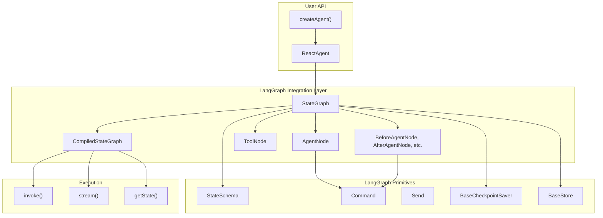
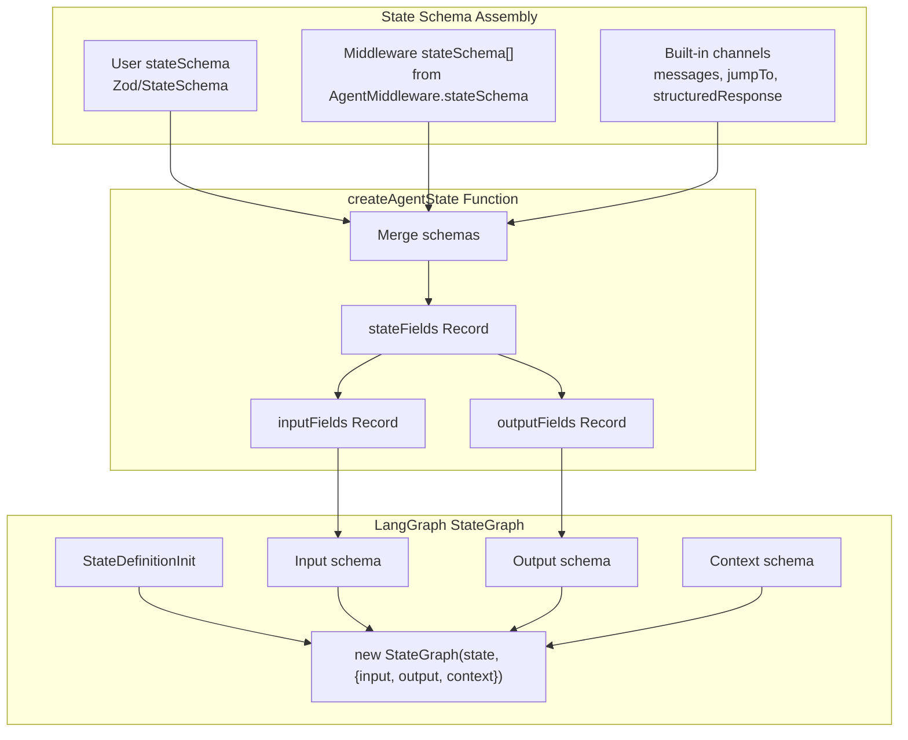
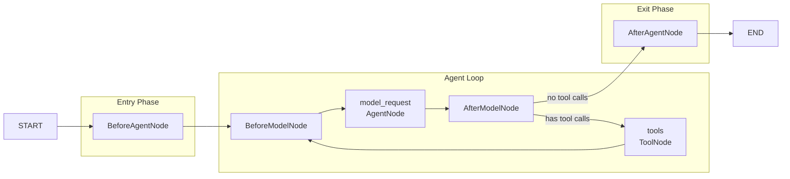
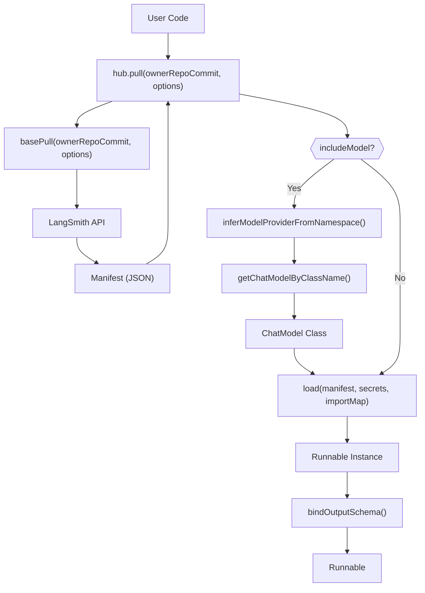

<!-- source: DeepWiki mcp.deepwiki.com · repo langchain-ai/langchainjs · page 3.6 LangGraph Integration, Hub, and Storage · fetched 2026-10-26 -->

# LangGraph Integration, Hub, and Storage

<details>
<summary>Relevant source files</summary>

The following files were used as context for generating this wiki page:

- [libs/langchain-classic/src/chat_models/universal.ts](libs/langchain-classic/src/chat_models/universal.ts)
- [libs/langchain-classic/src/hub/node.ts](libs/langchain-classic/src/hub/node.ts)
- [libs/langchain-classic/src/hub/tests/inferModelProviderFromNamespace.test.ts](libs/langchain-classic/src/hub/tests/inferModelProviderFromNamespace.test.ts)
- [libs/langchain-classic/src/storage/file_system.ts](libs/langchain-classic/src/storage/file_system.ts)
- [libs/langchain-classic/src/storage/tests/file_system.test.ts](libs/langchain-classic/src/storage/tests/file_system.test.ts)
- [libs/langchain/src/agents/ReactAgent.ts](libs/langchain/src/agents/ReactAgent.ts)
- [libs/langchain/src/agents/errors.ts](libs/langchain/src/agents/errors.ts)
- [libs/langchain/src/agents/middleware/tests/dynamicTools.test.ts](libs/langchain/src/agents/middleware/tests/dynamicTools.test.ts)
- [libs/langchain/src/agents/nodes/AgentNode.ts](libs/langchain/src/agents/nodes/AgentNode.ts)
- [libs/langchain/src/agents/nodes/ToolNode.ts](libs/langchain/src/agents/nodes/ToolNode.ts)
- [libs/langchain/src/agents/nodes/tests/AgentNode.test.ts](libs/langchain/src/agents/nodes/tests/AgentNode.test.ts)
- [libs/langchain/src/agents/nodes/tests/ToolNode.test.ts](libs/langchain/src/agents/nodes/tests/ToolNode.test.ts)
- [libs/langchain/src/agents/tests/middleware.test.ts](libs/langchain/src/agents/tests/middleware.test.ts)
- [libs/langchain/src/agents/tests/reactAgent.test.ts](libs/langchain/src/agents/tests/reactAgent.test.ts)
- [libs/langchain/src/agents/utils.ts](libs/langchain/src/agents/utils.ts)
- [libs/langchain/src/hub/base.ts](libs/langchain/src/hub/base.ts)
- [libs/langchain/src/hub/index.ts](libs/langchain/src/hub/index.ts)
- [libs/langchain/src/hub/node.ts](libs/langchain/src/hub/node.ts)
- [libs/langchain/src/hub/tests/inferModelProviderFromNamespace.test.ts](libs/langchain/src/hub/tests/inferModelProviderFromNamespace.test.ts)
- [libs/langchain/src/storage/file_system.ts](libs/langchain/src/storage/file_system.ts)
- [libs/langchain/src/storage/tests/file_system.test.ts](libs/langchain/src/storage/tests/file_system.test.ts)

</details>


## Purpose and Scope

The `langchain` package integrates with LangGraph to implement the `ReactAgent` system. The `ReactAgent` class is built as a wrapper around LangGraph's `StateGraph`, using LangGraph primitives for state management, control flow, and persistence. This integration allows agents to benefit from LangGraph's robust execution engine, including features like time-travel, parallel tool execution via the `Send` API, and fine-grained control flow using `Command` objects.

## Architecture Overview

The `ReactAgent` wraps a LangGraph `CompiledStateGraph` and delegates all execution, streaming, and persistence operations to it. The agent defines a graph topology with multiple nodes representing different phases of the ReAct pattern, then compiles and exposes this graph.

Title: LangGraph Integration Architecture


**Sources:** [libs/langchain/src/agents/ReactAgent.ts:180-181](), [libs/langchain/src/agents/nodes/AgentNode.ts:131-145](), [libs/langchain/src/agents/nodes/ToolNode.ts:181-184]()

## StateGraph Construction

The `ReactAgent` constructor creates a `StateGraph` instance with merged state schemas from the agent configuration and middleware. The state definition combines built-in channels with user-provided and middleware-specific fields.

Title: State Schema Assembly in ReactAgent


The `createAgentState` function handles state schema merging:

| Schema Type | Processing | Channel Exposure |
|-------------|-----------|------------------|
| `StateSchema` | Extract `.fields`, preserve `ReducedValue`/`UntrackedValue` | Public fields in input/output, underscore-prefixed are private [libs/langchain/src/agents/utils.ts:63-71]() |
| `InteropZodObject` (v3/v4) | Extract shape via `interopParse` | Public fields in input/output [libs/langchain/src/agents/utils.ts:74-76]() |
| `messages` | Always added as a core channel | Public channel for history [libs/langchain/src/agents/ReactAgent.ts:102-111]() |
| `jumpTo` | Added as `UntrackedValue` | Private navigation control used by `parseJumpToTarget` [libs/langchain/src/agents/nodes/utils.ts:53-54]() |
| `structuredResponse` | Added if `responseFormat` is present | Public output for extracted data [libs/langchain/src/agents/ReactAgent.ts:109-110]() |

**Sources:** [libs/langchain/src/agents/ReactAgent.ts:100-114](), [libs/langchain/src/agents/utils.ts:58-79](), [libs/langchain/src/agents/nodes/utils.ts:52-54]()

## Node Graph Topology

The `ReactAgent` defines a directed graph where each node is a `RunnableCallable` instance. These nodes process the agent state and return updates or LangGraph `Command` objects.

Title: ReactAgent Node Flow


Key node identifiers in the codebase:
- `AGENT_NODE_NAME`: The primary LLM interaction node, defined as `"model_request"` [libs/langchain/src/agents/nodes/AgentNode.ts:95]().
- `TOOLS_NODE_NAME`: The tool execution node, defined as `"tools"` [libs/langchain/src/agents/nodes/ToolNode.ts:45]().
- `BeforeAgentNode`: The first node executed, managing initial middleware [libs/langchain/src/agents/ReactAgent.ts:47]().
- `AfterAgentNode`: The final node before completion [libs/langchain/src/agents/ReactAgent.ts:50]().

**Sources:** [libs/langchain/src/agents/ReactAgent.ts:45-50](), [libs/langchain/src/agents/nodes/AgentNode.ts:95-95](), [libs/langchain/src/agents/nodes/ToolNode.ts:45-45]()

## Control Flow with Command and JumpTo

The agent uses LangGraph `Command` objects to manage dynamic navigation and state updates.

### JumpTo Mechanism
The `JumpTo` system allows nodes to bypass the standard linear flow. A node can return a `Command` targeting a specific logical destination. The `parseJumpToTarget` utility maps these logical labels to internal node names.

| Logical Target | Internal Destination |
|----------------|----------------------|
| `"model_request"` | `AGENT_NODE_NAME` |
| `"tools"` | `TOOLS_NODE_NAME` |
| `"end"` | `END` |

**Sources:** [libs/langchain/src/agents/nodes/utils.ts:53-54](), [libs/langchain/src/agents/ReactAgent.ts:91-94]()

### Parallel Dispatch with Send API
`ToolNode` implements parallel tool execution. When the model requests multiple tool calls, the agent can use the `Send` API to dispatch these calls to parallel execution branches within the graph [libs/langchain/src/agents/nodes/ToolNode.ts:15-15]().

## Hub Integration and Prompt Management

`ReactAgent` integrates with the LangChain Hub for prompt retrieval. The `pull` function in the hub module can instantiate prompts and optionally attach model instances based on metadata.

Title: LangChain Hub Integration


- **Prompt Normalization**: `normalizeSystemPrompt` ensures system messages are correctly formatted before being passed to the LLM [libs/langchain/src/agents/utils.ts:42-42]().
- **Hub Pull**: The `pull` function uses `basePull` and `load` to fetch and instantiate `Runnable` prompt templates [libs/langchain/src/hub/node.ts:119-164]().
- **Model Inference**: `inferModelProviderFromNamespace` attempts to determine the model provider from the manifest's ID namespace, which is then used by `getChatModelByClassName` to load the correct model class [libs/langchain/src/hub/node.ts:45-98](). This helps avoid class name collisions for models from different providers.

**Sources:** [libs/langchain/src/hub/node.ts:119-164](), [libs/langchain/src/agents/utils.ts:42-43](), [libs/langchain/src/hub/node.ts:45-98](), [libs/langchain/src/hub/node.ts:145-147]()

## Checkpointing and Persistence

Persistence is managed via LangGraph's checkpointer system. `ReactAgent` exposes the `checkpointer` property, which delegates to the underlying graph.

- **BaseCheckpointSaver**: Used to save and load graph state [libs/langchain/src/agents/ReactAgent.ts:23]().
- **Thread Isolation**: By providing a `thread_id` in the `RunnableConfig`, users can resume specific conversation states [libs/langchain/src/agents/tests/reactAgent.test.ts:60-61]().

```typescript
// Example from tests
const agent = createAgent({
  model,
  tools: [],
  checkpointer: syncCheckpointer,
});
const thread = { configurable: { thread_id: "123" } };
await agent.invoke({ messages: [new HumanMessage("hi")] }, thread);
```

**Sources:** [libs/langchain/src/agents/ReactAgent.ts:23](), [libs/langchain/src/agents/tests/reactAgent.test.ts:53-61]()

### File System Storage

The `LocalFileStore` class provides a file system-based implementation of `BaseStore` for persisting data. This can be used with LangGraph's checkpointer for local state persistence.

- **`LocalFileStore.fromPath(path)`**: Creates a new instance, ensuring the directory exists and cleaning up orphaned temporary files [libs/langchain/src/storage/file_system.ts:100-102]().
- **`mset(kvPairs)`**: Atomically writes key-value pairs to files, handling concurrent writes to the same key by queuing them [libs/langchain/src/storage/file_system.ts:119-121]().
- **`mget(keys)`**: Reads values from the file system [libs/langchain/src/storage/file_system.ts:134-136]().
- **`mdelete(keys)`**: Deletes files corresponding to the given keys [libs/langchain/src/storage/file_system.ts:149-151]().
- **`yieldKeys(prefix)`**: Iterates over keys with an optional prefix [libs/langchain/src/storage/file_system.ts:164-166]().

**Sources:** [libs/langchain/src/storage/file_system.ts:100-102](), [libs/langchain/src/storage/file_system.ts:119-121](), [libs/langchain/src/storage/file_system.ts:134-136](), [libs/langchain/src/storage/file_system.ts:149-151](), [libs/langchain/src/storage/file_system.ts:164-166]()

## In-Process Streaming

The integration provides native stream transformers to correlate events into high-level agent streams.

- **`createToolCallTransformer`**: Correlates `tools` channel events into `ToolCallStream` objects [libs/langchain/src/agents/transformers/index.ts:10-10]().
- **`AgentRunStream`**: A specialized type overlay for `GraphRunStream` that includes a `toolCalls` async iterable [libs/langchain/src/agents/transformers/index.ts:10-10]().

**Sources:** [libs/langchain/src/agents/transformers/index.ts:10-10]()

---

