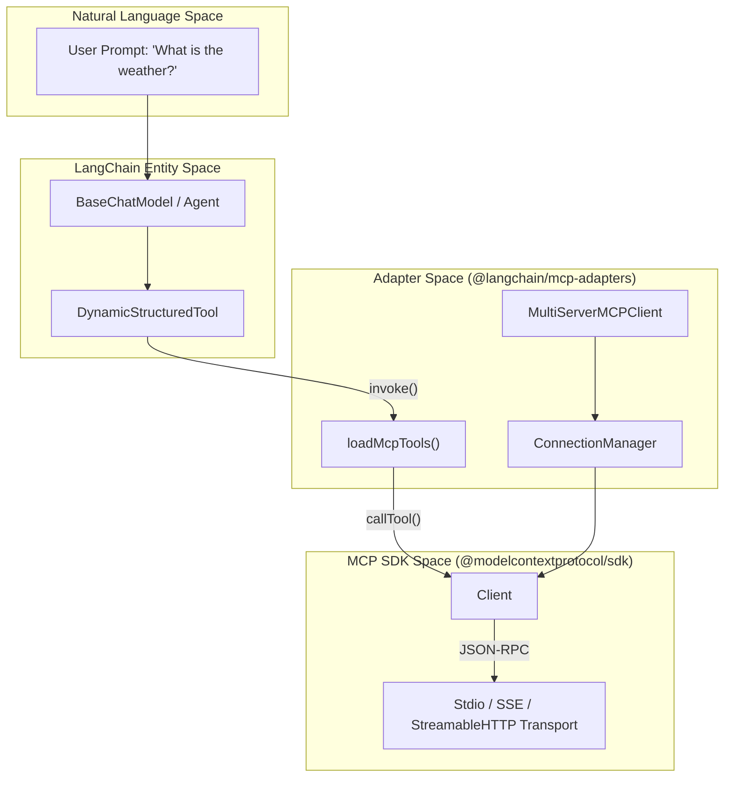
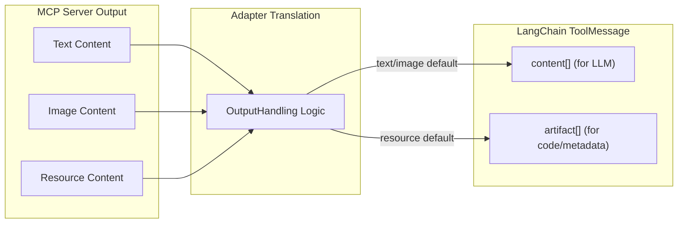

<!-- source: DeepWiki mcp.deepwiki.com · repo langchain-ai/langchainjs · page 3.7 MCP Adapters · fetched 2026-10-26 -->

# MCP Adapters

Relevant source files

The following files were used as context for generating this wiki page:

- [libs/langchain-mcp-adapters/README.md](libs/langchain-mcp-adapters/README.md)
- [libs/langchain-mcp-adapters/examples/calculator_sse_shttp_example.ts](libs/langchain-mcp-adapters/examples/calculator_sse_shttp_example.ts)
- [libs/langchain-mcp-adapters/examples/filesystem_langgraph_example.ts](libs/langchain-mcp-adapters/examples/filesystem_langgraph_example.ts)
- [libs/langchain-mcp-adapters/examples/firecrawl_custom_config_example.ts](libs/langchain-mcp-adapters/examples/firecrawl_custom_config_example.ts)
- [libs/langchain-mcp-adapters/examples/firecrawl_multiple_servers_example.ts](libs/langchain-mcp-adapters/examples/firecrawl_multiple_servers_example.ts)
- [libs/langchain-mcp-adapters/examples/langgraph_example.ts](libs/langchain-mcp-adapters/examples/langgraph_example.ts)
- [libs/langchain-mcp-adapters/examples/mcp_over_docker_example.ts](libs/langchain-mcp-adapters/examples/mcp_over_docker_example.ts)
- [libs/langchain-mcp-adapters/src/client.ts](libs/langchain-mcp-adapters/src/client.ts)
- [libs/langchain-mcp-adapters/src/index.ts](libs/langchain-mcp-adapters/src/index.ts)
- [libs/langchain-mcp-adapters/src/tests/client.test.ts](libs/langchain-mcp-adapters/src/tests/client.test.ts)
- [libs/langchain-mcp-adapters/src/tests/tools.test.ts](libs/langchain-mcp-adapters/src/tests/tools.test.ts)
- [libs/langchain-mcp-adapters/src/tools.ts](libs/langchain-mcp-adapters/src/tools.ts)
- [libs/langchain-mcp-adapters/src/types.ts](libs/langchain-mcp-adapters/src/types.ts)

The `@langchain/mcp-adapters` package provides a lightweight integration layer between the [Model Context Protocol (MCP)](https://modelcontextprotocol.io/) and LangChain.js. It allows developers to consume tools, resources, and prompts from MCP servers and use them directly within LangChain agents and LangGraph workflows.

## Architecture and Data Flow

The package acts as a bridge, translating MCP-specific structures (like JSON Schema-based tools and Content Blocks) into LangChain abstractions such as `DynamicStructuredTool` and `ToolMessage`.

### System-to-Code Mapping

The following diagram illustrates how Natural Language requests flow through the adapter entities into the MCP Protocol space.

**Request Flow: User to MCP Server**

Sources: `libs/langchain-mcp-adapters/src/client.ts:124-150`(), `libs/langchain-mcp-adapters/src/tools.ts:15-20`(), `libs/langchain-mcp-adapters/src/connection.ts`()

## MultiServerMCPClient

The `MultiServerMCPClient` is the primary entry point for managing multiple MCP server connections. It handles the lifecycle of connections, tool discovery, and error recovery.

### Key Capabilities
- **Multi-Server Management**: Connects to several servers simultaneously using a unified configuration object [libs/langchain-mcp-adapters/src/client.ts:124-150]().
- **Automatic Initialization**: Proactively establishes connections via `initialize()` or lazily upon calling `getTools()` [libs/langchain-mcp-adapters/src/client.ts:230-245]().
- **Tool Namespacing**: Optionally prefixes tool names with server names to avoid collisions using `prefixToolNameWithServerName` [libs/langchain-mcp-adapters/src/client.ts:206-207]().

### Transport Types

The adapter supports three primary transport mechanisms provided by the MCP SDK:

| Transport | Implementation Class | Use Case |
| :--- | :--- | :--- |
| **stdio** | `StdioClientTransport` | Local processes (e.g., `npx`, `python`) [libs/langchain-mcp-adapters/src/client.ts:1](). |
| **SSE** | `SSEClientTransport` | Server-Sent Events for remote web servers [libs/langchain-mcp-adapters/src/client.ts:3](). |
| **HTTP** | `StreamableHTTPClientTransport` | Modern bidirectional HTTP-based MCP transport [libs/langchain-mcp-adapters/src/client.ts:7](). |

Sources: `libs/langchain-mcp-adapters/src/client.ts:1-10`(), `libs/langchain-mcp-adapters/src/client.ts:56-119`()

## Tool Loading and Translation

The `loadMcpTools` function is responsible for converting MCP tool definitions into LangChain `DynamicStructuredTool` instances [libs/langchain-mcp-adapters/src/tools.ts:18-22]().

### Schema Dereferencing
MCP servers often provide JSON Schemas with `$ref` pointers to `$defs`. Since many LangChain-compatible validators (like Zod) require flat schemas for tool definitions, the adapter includes `dereferenceJsonSchema` to recursively inline these definitions [libs/langchain-mcp-adapters/src/tools.ts:71-152]().

### Tool Output Handling
The adapter manages how MCP `CallToolResult` content is mapped to LangChain `ToolMessage` fields. This is controlled via the `OutputHandling` configuration [libs/langchain-mcp-adapters/src/types.ts:95-137]().

**Tool Output Mapping Logic**

Sources: `libs/langchain-mcp-adapters/src/types.ts:111-137`(), `libs/langchain-mcp-adapters/src/tools.ts:4-16`()

## Resource Access Patterns

MCP allows servers to expose "Resources" (static or dynamic data like files or DB schemas). The adapter facilitates access to these through:

1.  **Embedded Resources**: When a tool returns a resource, it is placed in the `artifact` field of the `ToolMessage` by default to avoid overwhelming the LLM context [libs/langchain-mcp-adapters/src/types.ts:122-123]().
2.  **Resource Templates**: Models can use these templates to construct URIs for reading specific data from the server.
3.  **Direct Read**: The `MultiServerMCPClient` provides a `readResource` method to fetch content directly via a URI using the underlying MCP client [libs/langchain-mcp-adapters/src/client.ts:400-420]().

## Configuration and Error Handling

### Reconnection Strategies
For `stdio` and `sse` transports, the adapter supports configurable restart/reconnect logic:
- **Stdio**: `restart` config defines `maxAttempts` and `delayMs` for crashed local processes [libs/langchain-mcp-adapters/README.md:68-74]().
- **SSE/HTTP**: `reconnect` config manages connection drops for remote servers [libs/langchain-mcp-adapters/README.md:114-118]().

### Connection Error Behavior
The `onConnectionError` option determines how the client reacts when a server is unreachable during startup:
- `throw` (default): Fails the entire initialization if any server cannot be reached [libs/langchain-mcp-adapters/src/client.ts:226-227]().
- `ignore`: Continues with available servers, marking the failed one in `#failedServers` so the rest of the application can remain functional [libs/langchain-mcp-adapters/src/client.ts:158]().

Sources: `libs/langchain-mcp-adapters/src/client.ts:153-158`(), `libs/langchain-mcp-adapters/src/types.ts:175-200`()

## Examples

The `@langchain/mcp-adapters` package includes several examples demonstrating its usage with various MCP server types and LangChain/LangGraph integrations. These examples are located in the `libs/langchain-mcp-adapters/examples/` directory.

### `filesystem_langgraph_example.ts`
This example showcases how to integrate a filesystem MCP server with LangGraph to perform structured file operations. It demonstrates:
- Using `MultiServerMCPClient` to connect to a `stdio` transport-based filesystem server.
- Handling `onConnectionError: "ignore"` for optional servers.
- Creating a LangGraph workflow with `llmNode` and `toolNode` for reasoning and execution.
- Conditional routing based on whether the LLM suggests tool calls.
- Performing file read/write operations through MCP tools.

Sources: `libs/langchain-mcp-adapters/examples/filesystem_langgraph_example.ts:1-189`()

### `firecrawl_custom_config_example.ts`
This example illustrates how to use a custom configuration for the `MultiServerMCPClient` to connect to a Firecrawl MCP server. It covers:
- Defining a `ClientConfig` object with `sse` transport, URL, and authentication headers.
- Initializing `MultiServerMCPClient` with the custom configuration.
- Loading tools specifically from the "firecrawl" server.
- Integrating the loaded tools with a `createAgent` workflow.

Sources: `libs/langchain-mcp-adapters/examples/firecrawl_custom_config_example.ts:1-110`()

### `firecrawl_multiple_servers_example.ts`
This example demonstrates connecting to and utilizing multiple MCP servers simultaneously. It shows:
- Configuring `MultiServerMCPClient` with both a Firecrawl server and a Math server, both using `stdio` transport.
- Retrieving all tools from all connected servers.
- Using these tools within a `createAgent` setup to answer queries that might require tools from different servers.

Sources: `libs/langchain-mcp-adapters/examples/firecrawl_multiple_servers_example.ts:1-124`()

### `langgraph_example.ts`
This example provides a general demonstration of integrating MCP tools with LangGraph. It focuses on:
- Connecting to an "everything" MCP server (a reference server with various tools).
- Setting up a basic LangGraph workflow with an LLM node and a tool node.
- Implementing conditional edges to route between the LLM and tools based on the LLM's output.
- Executing a query that involves tool usage and observing the message flow.

Sources: `libs/langchain-mcp-adapters/examples/langgraph_example.ts:1-193`()

### `mcp_over_docker_example.ts`
This example demonstrates running an MCP server within a Docker container and connecting to it via `stdio` transport. It highlights:
- Configuring a `stdio` connection where the `command` is `docker` and `args` specify running an MCP filesystem image.
- Reusing the `filesystem_langgraph_example` logic to interact with the Dockerized MCP server.

Sources: `libs/langchain-mcp-adapters/examples/mcp_over_docker_example.ts:1-43`()

---

