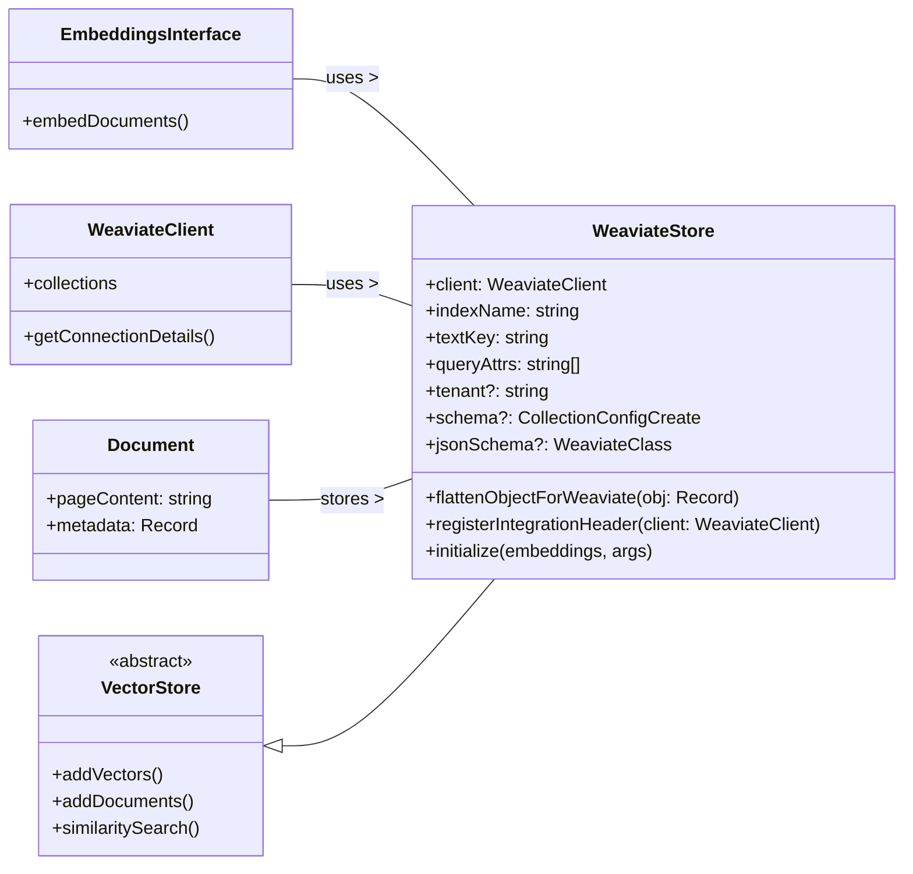
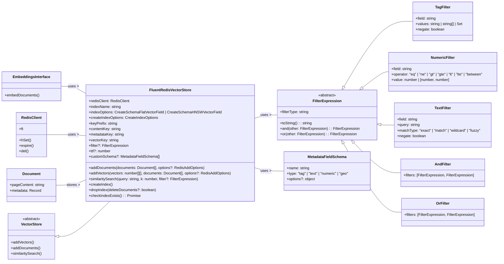
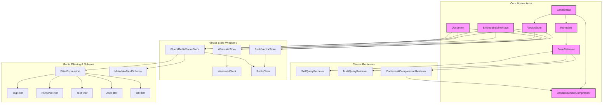

<!-- source: DeepWiki mcp.deepwiki.com · repo langchain-ai/langchainjs · page 4.2 Retrievers, Vector Store Wrappers, and Indexing · fetched 2026-10-26 -->

# Retrievers, Vector Store Wrappers, and Indexing

<details>
<summary>Relevant source files</summary>

The following files were used as context for generating this wiki page:

- [examples/src/langchain-classic/indexes/vector_stores/redis/redis_advanced_filtering.ts](examples/src/langchain-classic/indexes/vector_stores/redis/redis_advanced_filtering.ts)
- [libs/providers/langchain-redis/README.md](libs/providers/langchain-redis/README.md)
- [libs/providers/langchain-redis/src/filters.ts](libs/providers/langchain-redis/src/filters.ts)
- [libs/providers/langchain-redis/src/index.ts](libs/providers/langchain-redis/src/index.ts)
- [libs/providers/langchain-redis/src/query_safety.ts](libs/providers/langchain-redis/src/query_safety.ts)
- [libs/providers/langchain-redis/src/schema.ts](libs/providers/langchain-redis/src/schema.ts)
- [libs/providers/langchain-redis/src/tests/filters.test.ts](libs/providers/langchain-redis/src/tests/filters.test.ts)
- [libs/providers/langchain-redis/src/tests/schema.test.ts](libs/providers/langchain-redis/src/tests/schema.test.ts)
- [libs/providers/langchain-redis/src/tests/vectorstores.int.test.ts](libs/providers/langchain-redis/src/tests/vectorstores.int.test.ts)
- [libs/providers/langchain-redis/src/tests/vectorstores.test.ts](libs/providers/langchain-redis/src/tests/vectorstores.test.ts)
- [libs/providers/langchain-redis/src/vectorstores.ts](libs/providers/langchain-redis/src/vectorstores.ts)
- [libs/providers/langchain-redis/src/vectorstores_fluent.ts](libs/providers/langchain-redis/src/vectorstores_fluent.ts)
- [libs/providers/langchain-weaviate/src/tests/vectorstores.test.ts](libs/providers/langchain-weaviate/src/tests/vectorstores.test.ts)
- [libs/providers/langchain-weaviate/src/vectorstores.ts](libs/providers/langchain-weaviate/src/vectorstores.ts)
- [libs/providers/langchain-weaviate/tsdown.config.ts](libs/providers/langchain-weaviate/tsdown.config.ts)
- [libs/providers/langchain-weaviate/vitest.config.ts](libs/providers/langchain-weaviate/vitest.config.ts)

</details>


## Purpose and Scope

This document details the classic retriever implementations, document compressors, vector store base wrappers, and the indexing API available in LangChain.js. It covers how these components facilitate efficient retrieval-augmented generation (RAG) by managing and querying external knowledge bases.

## Classic Retrievers

LangChain.js provides several classic retriever implementations that build upon the `BaseRetriever` interface. These retrievers offer different strategies for fetching relevant documents.

### Self-Query Retriever

The self-query retriever allows an LLM to generate a structured query that can be executed against a vector store. This enables more sophisticated filtering and retrieval based on the user's natural language query.

### Multi-Query Retriever

The multi-query retriever generates multiple queries from a single user input, aiming to cover different facets or interpretations of the original query. The results from these multiple queries are then combined.

### Contextual Compression Retriever

The `ContextualCompressionRetriever` wraps another retriever and a `BaseDocumentCompressor`. It first retrieves a larger set of documents and then uses the compressor to filter or re-rank them, keeping only the most relevant parts. This helps reduce the amount of data passed to the LLM, saving tokens and improving focus.

## Document Compressors

Document compressors are used to refine the documents retrieved by a retriever. They implement the `BaseDocumentCompressor` interface.

### BaseDocumentCompressor

The `BaseDocumentCompressor` defines the interface for all document compressors. Its primary method is `compressDocuments`.

```typescript
interface BaseDocumentCompressor extends Serializable {
  compressDocuments(
    documents: Document[],
    query: string,
    callbacks?: Callbacks
  ): Promise<Document[]>;
}
```

**Sources**: [libs/langchain-core/src/runnables/base.ts:124-148]()

## Vector Store Wrappers

Vector store wrappers provide a standardized interface for interacting with various vector databases. They extend the `VectorStore` abstract class from `@langchain/core/vectorstores`.

### `VectorStore` Base Class

The `VectorStore` class defines the core methods for adding documents, adding vectors, and performing similarity searches.

```typescript
abstract class VectorStore extends Serializable {
  abstract FilterType: unknown;

  abstract addVectors(
    vectors: number[][],
    documents: Document[],
    options?: Record<string, unknown>
  ): Promise<string[] | void>;

  abstract addDocuments(
    documents: Document[],
    options?: Record<string, unknown>
  ): Promise<string[] | void>;

  abstract similaritySearch(
    query: string,
    k: number,
    filter?: this["FilterType"],
    callbacks?: Callbacks
  ): Promise<Document[]>;

  abstract similaritySearchWithScore(
    query: string,
    k: number,
    filter?: this["FilterType"],
    callbacks?: Callbacks
  ): Promise<[Document, number][]>;

  abstract _vectorstoreType(): string;

  static fromTexts(
    texts: string[],
    metadatas: Record<string, unknown>[],
    embeddings: EmbeddingsInterface,
    dbConfig?: Record<string, unknown>
  ): Promise<VectorStore>;

  static fromDocuments(
    docs: Document[],
    embeddings: EmbeddingsInterface,
    dbConfig?: Record<string, unknown>
  ): Promise<VectorStore>;
}
```

**Sources**: [libs/langchain-core/src/vectorstores.ts:19-49]()

### WeaviateStore

The `WeaviateStore` class provides an integration with Weaviate, a vector database. It extends `VectorStore` and implements methods for adding and searching documents in a Weaviate index.

#### Configuration (`WeaviateLibArgs`)

The `WeaviateLibArgs` interface defines the configuration parameters for `WeaviateStore`:
- `client`: An instance of `WeaviateClient`.
- `indexName`: The name of the collection (class) in Weaviate.
- `textKey`: The key used for the document content (defaults to "text").
- `metadataKeys`: An array of metadata keys to query.
- `tenant`: Optional tenant for multi-tenancy.
- `schema`: Optional `CollectionConfigCreate` for schema definition.
- `jsonSchema`: Raw Weaviate JSON schema, takes precedence over `schema`.

**Sources**: [libs/providers/langchain-weaviate/src/vectorstores.ts:72-88]()

#### Integration Header Registration

The `registerIntegrationHeader` function attempts to add an `X-Weaviate-Client-Integration` header to the Weaviate client's connection details. This helps Weaviate telemetry track LangChain usage [libs/providers/langchain-weaviate/src/vectorstores.ts:117-130](). This is a best-effort registration and will not throw errors if it fails [libs/providers/langchain-weaviate/src/vectorstores.ts:128-129]().

#### Data Flattening for Weaviate

The `flattenObjectForWeaviate` utility function [libs/providers/langchain-weaviate/src/vectorstores.ts:27-64]() transforms nested JavaScript objects into a flat structure suitable for Weaviate's property naming conventions. It replaces non-alphanumeric characters with underscores and handles nested objects by concatenating keys. It also ensures arrays contain only primitive types [libs/providers/langchain-weaviate/src/vectorstores.ts:53-59]().

#### `WeaviateStore` Initialization

The `WeaviateStore.initialize` static method handles the creation of the Weaviate collection if it doesn't already exist. It prioritizes `jsonSchema` over `schema` if both are provided [libs/providers/langchain-weaviate/src/tests/vectorstores.test.ts:129-143]().



**Sources**: [libs/providers/langchain-weaviate/src/vectorstores.ts:145-194](), [libs/providers/langchain-weaviate/src/tests/vectorstores.test.ts:107-152]()

### RedisVectorStore

The `RedisVectorStore` provides an integration with Redis as a vector database. It supports adding documents and vectors, performing similarity searches, and managing the Redis index.

#### Configuration (`RedisVectorStoreConfig`)

The `RedisVectorStoreConfig` interface defines the configuration for `RedisVectorStore`:
- `redisClient`: An instance of `createClient` or `createCluster`.
- `indexName`: The name of the RediSearch index.
- `indexOptions`: Vector field algorithm and distance metric (e.g., HNSW or FLAT).
- `createIndexOptions`: Options for index creation (e.g., `ON`, `PREFIX`).
- `keyPrefix`: Prefix for Redis keys (defaults to `doc:${indexName}:`).
- `contentKey`: Key for document content (defaults to `content`).
- `metadataKey`: Key for document metadata (defaults to `metadata`).
- `vectorKey`: Key for vector embeddings (defaults to `content_vector`).
- `filter`: Basic filter type (string array or raw string).
- `ttl`: Time-to-live for documents in seconds.
- `customSchema`: Optional custom schema for metadata fields.

**Sources**: [libs/providers/langchain-redis/src/vectorstores.ts:42-56]()

#### Metadata Validation

The `validateMetadata` method [libs/providers/langchain-redis/src/vectorstores.ts:131-177]() ensures that metadata conforms to the `customSchema` if provided. It checks for required fields and validates basic types (number, string, array for tags).

#### Index Management

The `RedisVectorStore` includes methods for creating (`createIndex`), checking existence (`checkIndexExists`), and dropping (`dropIndex`) the RediSearch index. The `dropIndex` method can optionally delete all associated documents [libs/providers/langchain-redis/src/tests/vectorstores.test.ts:183-209]().

#### Deprecation Notice

The `RedisVectorStore` is marked as deprecated in favor of `FluentRedisVectorStore` for advanced filtering capabilities [libs/providers/langchain-redis/src/vectorstores.ts:95-100]().

**Sources**: [libs/providers/langchain-redis/src/vectorstores.ts:95-201](), [libs/providers/langchain-redis/src/tests/vectorstores.test.ts:211-238]()

### FluentRedisVectorStore

The `FluentRedisVectorStore` is an advanced Redis vector store that provides structured metadata filtering using `FilterExpression` and requires explicit `MetadataFieldSchema` definitions.

#### Configuration (`FluentRedisVectorStoreConfig`)

Similar to `RedisVectorStoreConfig`, but with a `customSchema` that expects an array of `MetadataFieldSchema` objects for detailed field definitions [libs/providers/langchain-redis/src/vectorstores_fluent.ts:87-102](). The `filter` property also expects a `FilterExpression` [libs/providers/langchain-redis/src/vectorstores_fluent.ts:109-110]().

#### Metadata Schema (`MetadataFieldSchema`)

The `MetadataFieldSchema` interface defines how individual metadata fields should be indexed in Redis. It supports types like `tag`, `text`, `numeric`, and `geo`, each with specific options [libs/providers/langchain-redis/src/schema.ts:173-195]().

#### Filter Expressions

The `FluentRedisVectorStore` leverages a fluent API for building complex RediSearch queries using classes like `TagFilter`, `NumericFilter`, `TextFilter`, `GeoFilter`, `TimestampFilter`, `AndFilter`, and `OrFilter`. These classes generate RediSearch query syntax programmatically.



**Sources**: [libs/providers/langchain-redis/src/vectorstores_fluent.ts:148-205](), [libs/providers/langchain-redis/src/filters.ts:42-94](), [libs/providers/langchain-redis/src/filters.ts:98-130](), [libs/providers/langchain-redis/src/filters.ts:135-166](), [libs/providers/langchain-redis/src/filters.ts:197-204](), [libs/providers/langchain-redis/src/tests/filters.test.ts:21-74](), [libs/providers/langchain-redis/src/tests/filters.test.ts:78-129](), [libs/providers/langchain-redis/src/tests/filters.test.ts:132-193](), [libs/providers/langchain-redis/src/schema.ts:173-195](), [libs/providers/langchain-redis/src/tests/schema.test.ts:18-215]()

#### Query Safety

The `query_safety.ts` module provides utilities to ensure RediSearch queries are safe.
- `assertSafeRedisearchFieldName`: Validates field names against a regex to prevent injection [libs/providers/langchain-redis/src/query_safety.ts:51-54]().
- `escapeRedisearchValue`: Escapes special characters in query values to prevent syntax errors or injection, with options to preserve wildcards or whitespace [libs/providers/langchain-redis/src/query_safety.ts:57-72]().

**Sources**: [libs/providers/langchain-redis/src/query_safety.ts:1-72]()

## Indexing API

The indexing API provides tools for managing and updating vector store indexes. While specific implementations vary by vector store, the general pattern involves adding documents, creating/dropping indexes, and performing searches. The `FluentRedisVectorStore` demonstrates a comprehensive indexing API with schema management and advanced filtering.

**Sources**: [libs/providers/langchain-redis/src/vectorstores_fluent.ts:214-225]()

## Summary of Key Classes and Their Relationships



**Sources**: [libs/langchain-core/src/vectorstores.ts:19-49](), [libs/providers/langchain-weaviate/src/vectorstores.ts:145-194](), [libs/providers/langchain-redis/src/vectorstores.ts:95-201](), [libs/providers/langchain-redis/src/vectorstores_fluent.ts:148-205](), [libs/providers/langchain-redis/src/filters.ts:42-94](), [libs/providers/langchain-redis/src/schema.ts:173-195]()

---

