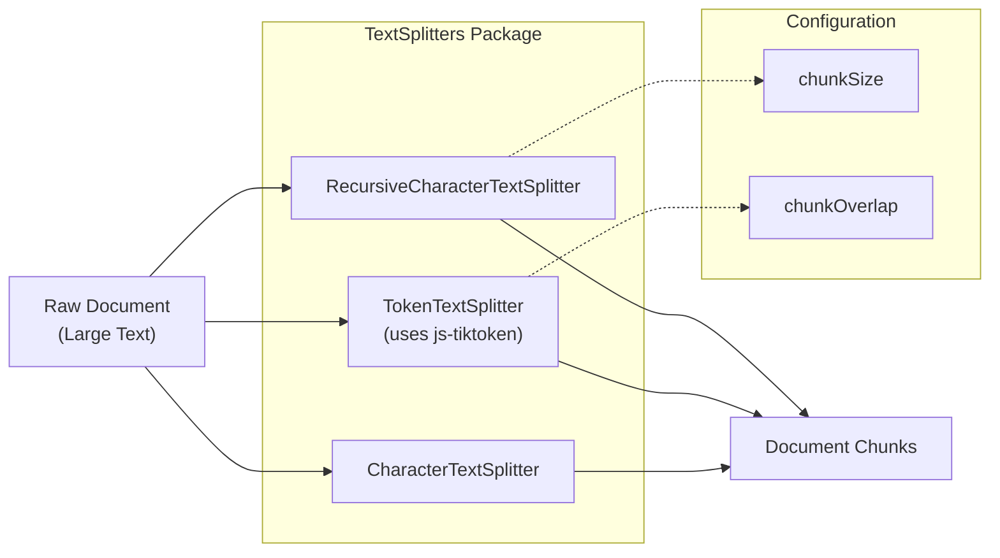

<!-- source: DeepWiki mcp.deepwiki.com · repo langchain-ai/langchainjs · page 4.3 Document Loaders and Text Splitters · fetched 2026-10-26 -->

# Document Loaders

<details>
<summary>Relevant source files</summary>

The following files were used as context for generating this wiki page:

- [libs/langchain-textsplitters/package.json](libs/langchain-textsplitters/package.json)

</details>


## Purpose and Scope

This document covers the document loading and text splitting infrastructure within the LangChain.js ecosystem. Document loaders are responsible for ingesting data from diverse sources and converting them into standardized `Document` objects. Text splitters then process these documents into smaller, semantically meaningful chunks to fit within LLM context windows and optimize retrieval performance.

Key packages covered include:
- `@langchain/community`: Contains 50+ document loaders for various file formats, web sources, and SaaS platforms.
- `@langchain/textsplitters`: A dedicated package for advanced text splitting logic, including recursive and token-based strategies. [libs/langchain-textsplitters/package.json:2-4]()
- `@langchain/core`: Defines the foundational `BaseDocumentLoader` and `Document` abstractions.

**Sources:** [libs/langchain-textsplitters/package.json:1-7]()

## Document Loader Architecture

### Base Abstractions

All document loaders implement a common interface that standardizes how data enters the system. A `Document` consists of `pageContent` (the text) and `metadata` (an object containing source information, timestamps, or custom attributes).

- `load()`: Primary method to fetch data and return an array of `Document` objects.
- `loadAndSplit(textSplitter?)`: A convenience method that pipes the loaded documents through a provided splitter.

### Code Entity Space: Loader Lifecycle

The following diagram maps the logical flow of document ingestion to the specific classes and methods used in the codebase.

```mermaid
graph TD
    subgraph "Document Loader Interface"
        BaseLoader["BaseDocumentLoader<br/>(Abstract Class)"]
        Document["Document<br/>pageContent: string<br/>metadata: Record"]
    end

    subgraph "Implementation Classes"
        FSLoader["TextLoader / PDFLoader<br/>(File System)"]
        WebLoader["CheerioWebBaseLoader<br/>(Web Scraping)"]
        SaaSLoader["NotionLoader / GitHubRepoLoader<br/>(API Based)"]
    end

    subgraph "Execution Methods"
        LoadMethod["load()"]
        SplitMethod["loadAndSplit(splitter)"]
    end

    FSLoader --|> BaseLoader
    WebLoader --|> BaseLoader
    SaaSLoader --|> BaseLoader

    BaseLoader --> LoadMethod
    BaseLoader --> SplitMethod
    
    LoadMethod -->|"returns"| Document
    SplitMethod -->|"calls"| SplitDocs["splitter.splitDocuments()"]
```

**Document Loader Architecture**: Relationship between base classes and implementations.

**Sources:** [libs/langchain-textsplitters/package.json:27-28]()

## Text Splitters (@langchain/textsplitters)

The `@langchain/textsplitters` package provides logic to break large documents into smaller chunks. This is critical for RAG (Retrieval-Augmented Generation) to ensure that retrieved context is relevant and fits within model limits. [libs/langchain-textsplitters/package.json:2-4]()

### RecursiveCharacterTextSplitter

The most recommended splitter for generic text. It attempts to split text based on a hierarchy of characters (e.g., `["\n\n", "\n", " ", ""]`). This preserves semantic structure by keeping paragraphs, then sentences, then words together as much as possible.

### TokenTextSplitter

Splits text based on token counts rather than character counts. This is more precise for LLM context management. It uses the `js-tiktoken` library to calculate tokens for specific model encodings (e.g., `gpt-4`). [libs/langchain-textsplitters/package.json:23-24]()

### Text Splitter Implementation Logic

| Class | Strategy | Key Parameters |
|-------|----------|----------------|
| `RecursiveCharacterTextSplitter` | Hierarchical split by separators | `chunkSize`, `chunkOverlap`, `separators` |
| `TokenTextSplitter` | Split by BPE tokens | `encodingName`, `chunkSize`, `chunkOverlap` |
| `CharacterTextSplitter` | Simple split by a single character | `separator`, `chunkSize` |

### Code Entity Space: Splitting Logic

This diagram bridges the natural language concept of "chunking" to the specific splitting classes in the `@langchain/textsplitters` package.



**Text Splitting Flow**: Mapping text processing to the `@langchain/textsplitters` entities.

**Sources:** [libs/langchain-textsplitters/package.json:2-4](), [libs/langchain-textsplitters/package.json:23-25]()

## Hub and Serialized Loading

LangChain supports loading components, including prompts that may be used alongside loaders, from the LangChain Hub. This uses a serialization system to instantiate classes dynamically.

### Dynamic Loading with `load`

The `load` function in `langchain` and `langchain-classic` acts as a factory that reconstructs objects from JSON representations. 

- It uses an `importMap` to resolve class names to actual constructors. 
- It supports `optionalImportsMap` for handling community or provider-specific dependencies. 
- **Security Warning:** This function instantiates classes based on input text. It should never be used with untrusted input. 

### Hub Integration

The `pull` function retrieves serialized manifests from the Hub and uses the `load` utility to create executable `Runnable` objects. 

**Sources:** [libs/langchain-textsplitters/package.json:27-28]()

## Summary of Processing Pipeline

The data flow for documents typically follows this sequence:

1.  **Load**: A `DocumentLoader` (e.g., `PDFLoader`) reads raw data from a source.
2.  **Split**: A `TextSplitter` from `@langchain/textsplitters` (e.g., `RecursiveCharacterTextSplitter`) breaks the text into overlapping chunks. [libs/langchain-textsplitters/package.json:2-4]()
3.  **Embed/Store**: Chunks are converted to vectors or persisted in a storage backend for later retrieval.

**Sources:** [libs/langchain-textsplitters/package.json:23-28]()

---

