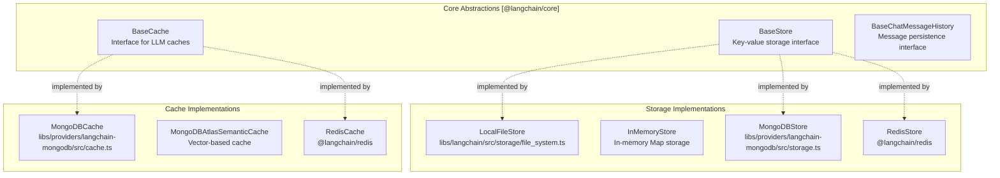
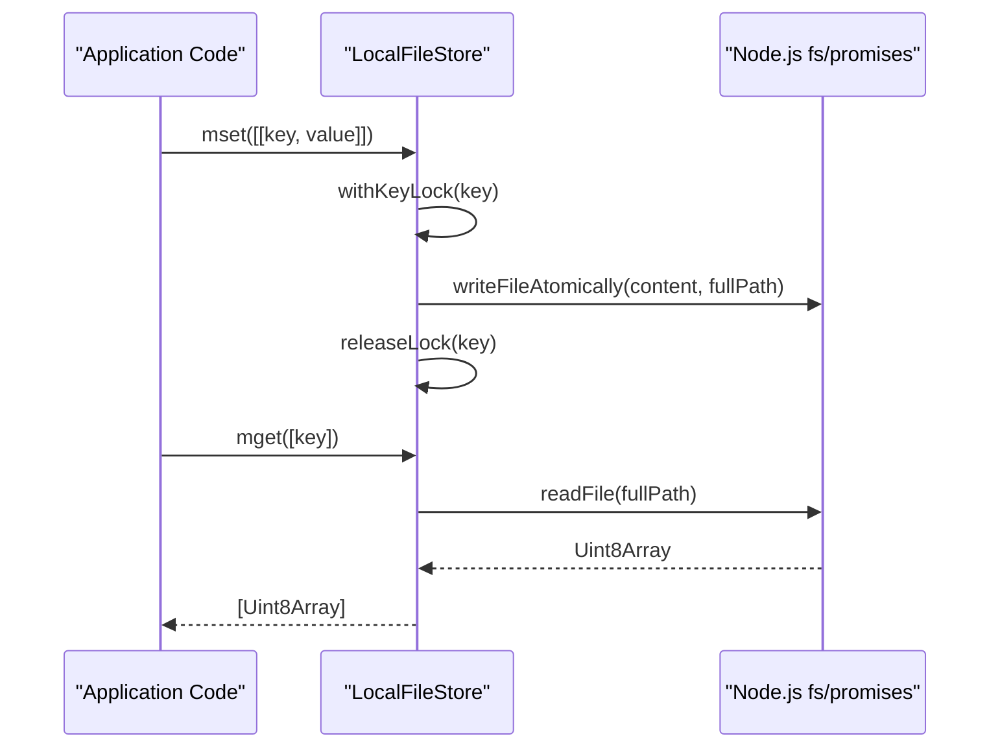
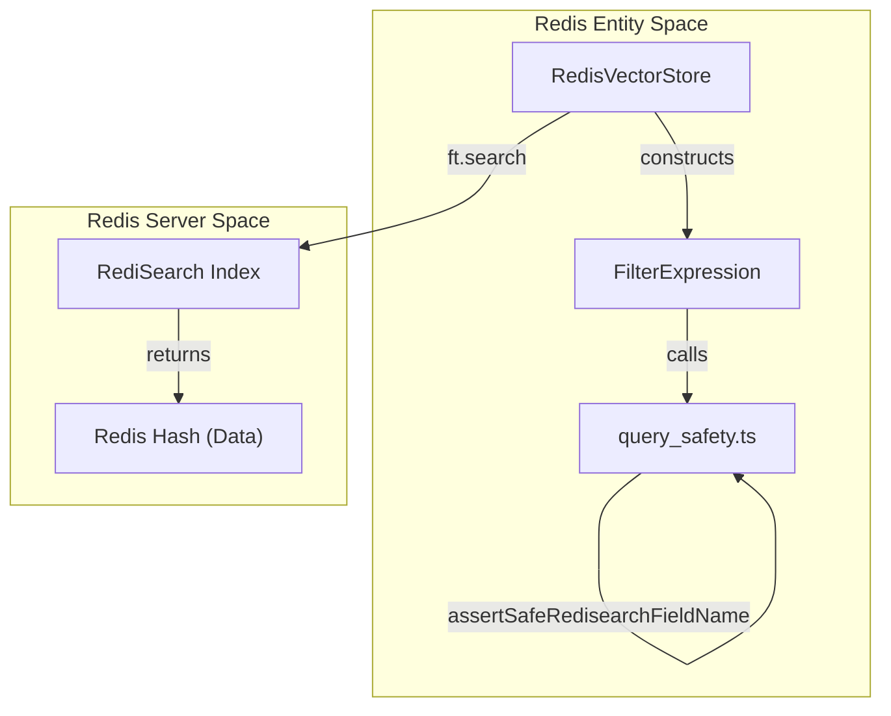
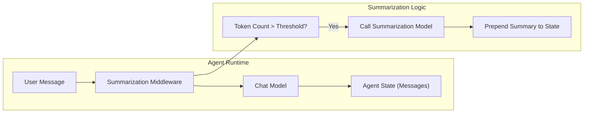

<!-- source: DeepWiki mcp.deepwiki.com · repo langchain-ai/langchainjs · page 4.4 Memory, Storage, and Caches · fetched 2026-10-26 -->

# Memory, Storage, and Caches

Relevant source files

The following files were used as context for generating this wiki page:

- [examples/src/cache/chat_models/mongodb.ts](examples/src/cache/chat_models/mongodb.ts)
- [examples/src/cache/semantic_cache/mongodb_atlas.ts](examples/src/cache/semantic_cache/mongodb_atlas.ts)
- [libs/langchain-classic/src/storage/file_system.ts](libs/langchain-classic/src/storage/file_system.ts)
- [libs/langchain-classic/src/storage/tests/file_system.test.ts](libs/langchain-classic/src/storage/tests/file_system.test.ts)
- [libs/langchain/src/storage/file_system.ts](libs/langchain/src/storage/file_system.ts)
- [libs/langchain/src/storage/tests/file_system.test.ts](libs/langchain/src/storage/tests/file_system.test.ts)
- [libs/providers/langchain-mongodb/README.md](libs/providers/langchain-mongodb/README.md)
- [libs/providers/langchain-mongodb/src/cache.ts](libs/providers/langchain-mongodb/src/cache.ts)
- [libs/providers/langchain-mongodb/src/index.ts](libs/providers/langchain-mongodb/src/index.ts)
- [libs/providers/langchain-mongodb/src/tests/chat_history.int.test.ts](libs/providers/langchain-mongodb/src/tests/chat_history.int.test.ts)
- [libs/providers/langchain-mongodb/src/tests/storage.int.test.ts](libs/providers/langchain-mongodb/src/tests/storage.int.test.ts)
- [libs/providers/langchain-mongodb/src/tests/voyage.int.test.ts](libs/providers/langchain-mongodb/src/tests/voyage.int.test.ts)
- [libs/providers/langchain-mongodb/src/tests/voyage.test.ts](libs/providers/langchain-mongodb/src/tests/voyage.test.ts)
- [libs/providers/langchain-mongodb/src/voyage.ts](libs/providers/langchain-mongodb/src/voyage.ts)

This document covers the memory layer, message store backends, and caching infrastructure in LangChain.js. These components provide persistent and ephemeral data storage capabilities, including chat message history, model response caching, and general-purpose key-value storage backends.

## Architecture Overview

The system is built on top of foundational abstractions in `@langchain/core` and extended by provider-specific implementations in `@langchain/community`, `@langchain/mongodb`, and `@langchain/redis`.

Sources: [libs/langchain/src/storage/file_system.ts:35-35](), [libs/providers/langchain-mongodb/src/cache.ts:2-5]()

## File System Storage

The `LocalFileStore` provides a persistent `BaseStore` implementation using the local file system. It is designed for environments where a full database is not required but persistence across restarts is necessary.

### Implementation Details
- **Atomic Writes**: Uses a temporary file and rename strategy to ensure data integrity during writes [libs/langchain/src/storage/file_system.ts:260-270]().
- **Key Locking**: Implements a `keyLocks` Map to prevent concurrent writes to the same file path [libs/langchain/src/storage/file_system.ts:40-40]().
- **Path Security**: Validates keys against regex `^[a-zA-Z0-9_\-:.]+$` to prevent path traversal attacks [libs/langchain/src/storage/file_system.ts:53-58]().
- **Serialization**: Stores values as `Uint8Array`, typically encoded from JSON strings [libs/langchain/src/storage/file_system.ts:35-35]().

### Data Flow: File Storage

Sources: [libs/langchain/src/storage/file_system.ts:1-200](), [libs/langchain/src/storage/tests/file_system.test.ts:30-126]()

## MongoDB Integration

The `@langchain/mongodb` package provides robust storage and caching capabilities leveraging MongoDB Atlas.

### MongoDBStore
The `MongoDBStore` implements `BaseStore<string, Uint8Array>`. It maps keys to a configurable `primaryKey` field (defaulting to `_id`) and stores the byte array in a `value` field.
The `MongoDBStore` handles invalid UTF-8 data by replacing it with replacement characters [libs/providers/langchain-mongodb/src/tests/storage.int.test.ts:155-173]().

- **Namespace Support**: Keys can be prefixed with a namespace (e.g., `namespace/key`) [libs/providers/langchain-mongodb/src/tests/storage.int.test.ts:97-108]().
- **Bulk Operations**: Uses MongoDB `bulkWrite` for efficient `mset` and `mdelete` operations [libs/providers/langchain-mongodb/src/tests/storage.int.test.ts:111-119]().

### Caching Strategies
| Class | Description | Use Case |
|-------|-------------|----------|
| `MongoDBCache` | Standard exact-match prompt caching. | Reducing costs for identical queries. |
| `MongoDBAtlasSemanticCache` | Uses Vector Search to find semantically similar cached prompts. | Handling variations in phrasing with high similarity. |

### Semantic Cache Configuration
The semantic cache requires a MongoDB Atlas Vector Search index.
- **Similarity Threshold**: Controlled via `scoreThreshold`.
- **Embeddings**: Requires an `EmbeddingsInterface` to vectorize incoming prompts for lookup.

Sources: [libs/providers/langchain-mongodb/src/cache.ts:1-20](), [libs/providers/langchain-mongodb/src/tests/storage.int.test.ts:1-201](), [examples/src/cache/semantic_cache/mongodb_atlas.ts:23-29](), [examples/src/cache/chat_models/mongodb.ts:15-17]()

## Redis Storage and Vector Search

The `@langchain/redis` package provides high-performance storage and vector-based memory.

### RedisVectorStore
The `RedisVectorStore` provides similarity search capabilities over Redis hashes [libs/providers/langchain-redis/src/vectorstores.ts:95-95]().

- **Filtering**: Supports basic string-based filtering and a new `FluentRedisVectorStore` for complex queries [libs/providers/langchain-redis/src/vectorstores.ts:86-94]().
- **Schema Management**: Metadata can be validated against a `customSchema` using `SchemaFieldTypes` (NUMERIC, TAG, TEXT) [libs/providers/langchain-redis/src/vectorstores.ts:131-177]().
- **TTL Support**: Documents can be stored with a Time-To-Live (TTL) using Redis `EXPIRE` [libs/providers/langchain-redis/src/vectorstores.ts:118-118]().

### Advanced Filtering System
The package includes a type-safe filter expression system for constructing RediSearch queries [libs/providers/langchain-redis/src/filters.ts:7-32]().

| Filter Type | Class | Example Syntax |
|-------------|-------|----------------|
| **Tag** | `TagFilter` | `@category:{electronics}` |
| **Numeric** | `NumericFilter` | `@price:[100 200]` |
| **Text** | `TextFilter` | `@title:("wireless headphones")` |
| **Logical** | `AndFilter`/`OrFilter` | `(@cat:{A} @price:[0 10])` |

### Redis Data Flow

Sources: [libs/providers/langchain-redis/src/vectorstores.ts:95-207](), [libs/providers/langchain-redis/src/filters.ts:42-197](), [libs/providers/langchain-redis/src/query_safety.ts:51-72]()

## Middleware-Based Memory

In the modern `createAgent` API, memory is often handled via middleware rather than standalone store classes.

### Summarization Middleware
The `summarizationMiddleware` manages long-running conversations by automatically condensing history when token limits are reached.

- **Trigger**: Activated by a token threshold.
- **Retention**: Keeps a specified number of recent messages intact while summarizing the rest.
- **Integration**: Injected into the agent's `middleware` array.

### State Management Flow

## Summary of Storage Interfaces

| Feature | Interface | Common Implementations |
|---------|-----------|------------------------|
| **KV Store** | `BaseStore<K, V>` | `LocalFileStore`, `MongoDBStore`, `RedisStore` |
| **LLM Cache** | `BaseCache` | `MongoDBCache`, `MongoDBAtlasSemanticCache`, `RedisCache` |
| **Chat History** | `BaseChatMessageHistory` | `MongoDBChatMessageHistory`, `RedisChatMessageHistory` |
| **Vector Memory**| `VectorStore` | `RedisVectorStore`, `MongoDBAtlasVectorSearch` |

Sources: [libs/langchain/src/storage/file_system.ts:35-35](), [libs/providers/langchain-redis/src/vectorstores.ts:95-95](), [libs/providers/langchain-mongodb/src/cache.ts:2-5]()

---

