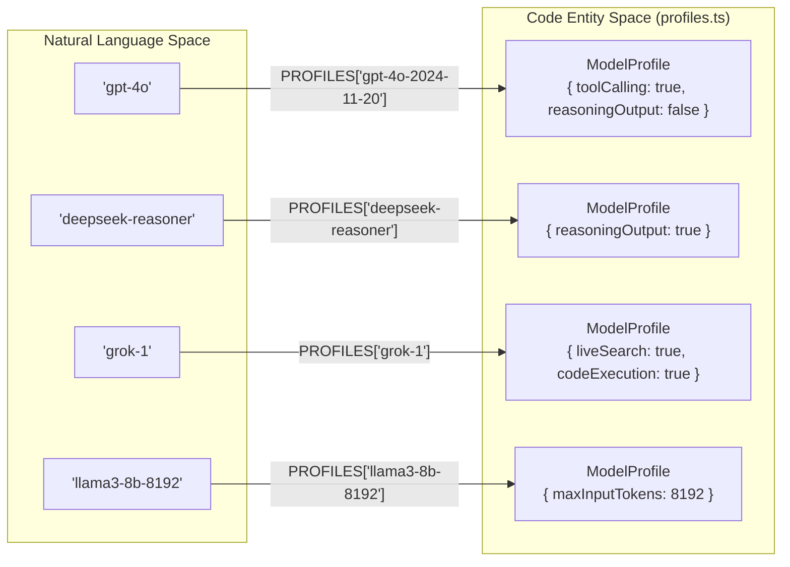

<!-- source: DeepWiki mcp.deepwiki.com · repo langchain-ai/langchainjs · page 5 Provider Packages · fetched 2026-10-26 -->

# Provider Packages

Relevant source files

The following files were used as context for generating this wiki page:

- [libs/langchain-classic/CHANGELOG.md](libs/langchain-classic/CHANGELOG.md)
- [libs/providers/langchain-cloudflare/package.json](libs/providers/langchain-cloudflare/package.json)
- [libs/providers/langchain-cohere/package.json](libs/providers/langchain-cohere/package.json)
- [libs/providers/langchain-deepseek/CHANGELOG.md](libs/providers/langchain-deepseek/CHANGELOG.md)
- [libs/providers/langchain-deepseek/package.json](libs/providers/langchain-deepseek/package.json)
- [libs/providers/langchain-exa/package.json](libs/providers/langchain-exa/package.json)
- [libs/providers/langchain-fireworks/CHANGELOG.md](libs/providers/langchain-fireworks/CHANGELOG.md)
- [libs/providers/langchain-fireworks/package.json](libs/providers/langchain-fireworks/package.json)
- [libs/providers/langchain-groq/package.json](libs/providers/langchain-groq/package.json)
- [libs/providers/langchain-mongodb/package.json](libs/providers/langchain-mongodb/package.json)
- [libs/providers/langchain-neo4j/CHANGELOG.md](libs/providers/langchain-neo4j/CHANGELOG.md)
- [libs/providers/langchain-neo4j/package.json](libs/providers/langchain-neo4j/package.json)
- [libs/providers/langchain-openai/CHANGELOG.md](libs/providers/langchain-openai/CHANGELOG.md)
- [libs/providers/langchain-openai/package.json](libs/providers/langchain-openai/package.json)
- [libs/providers/langchain-openrouter/CHANGELOG.md](libs/providers/langchain-openrouter/CHANGELOG.md)
- [libs/providers/langchain-openrouter/package.json](libs/providers/langchain-openrouter/package.json)
- [libs/providers/langchain-pinecone/package.json](libs/providers/langchain-pinecone/package.json)
- [libs/providers/langchain-qdrant/package.json](libs/providers/langchain-qdrant/package.json)
- [libs/providers/langchain-redis/package.json](libs/providers/langchain-redis/package.json)
- [libs/providers/langchain-tavily/package.json](libs/providers/langchain-tavily/package.json)
- [libs/providers/langchain-together-ai/CHANGELOG.md](libs/providers/langchain-together-ai/CHANGELOG.md)
- [libs/providers/langchain-together-ai/package.json](libs/providers/langchain-together-ai/package.json)
- [libs/providers/langchain-weaviate/package.json](libs/providers/langchain-weaviate/package.json)
- [libs/providers/langchain-xai/CHANGELOG.md](libs/providers/langchain-xai/CHANGELOG.md)
- [libs/providers/langchain-xai/package.json](libs/providers/langchain-xai/package.json)

## Purpose and Scope

This document provides an overview of dedicated provider packages in LangChain.js. Provider packages are standalone npm packages that implement integrations with specific LLM providers and cloud platforms. Each provider package follows a consistent architectural pattern and depends on `@langchain/core` for base abstractions.

For detailed information about specific providers:
- **Provider integration patterns**: see [Provider Integration Pattern](#5.1)
- **OpenAI integration**: see [OpenAI Integration](#5.2)
- **Anthropic integration**: see [Anthropic Integration](#5.3)
- **Google provider ecosystem**: see [Google Provider Ecosystem](#5.4)
- **AWS Bedrock integration**: see [AWS Bedrock Integration](#5.5)
- **OpenAI-Compatible Providers**: see [OpenAI-Compatible Providers](#5.6)
- **Local and Other Model Providers**: see [Local and Other Model Providers](#5.7)
- **Vector Store and Search Providers**: see [Vector Store and Search Providers](#5.8)

## What are Provider Packages?

Provider packages are dedicated npm packages published under the `@langchain/*` scope that provide integrations with specific LLM providers or cloud platforms. Unlike the monolithic `@langchain/community` package which contains hundreds of optional integrations, provider packages are maintained as first-class packages with:

- **Direct dependencies**: Provider-specific SDKs are listed as direct dependencies. For example, `@langchain/openai` depends on `openai` [libs/providers/langchain-openai/package.json:31]().
- **Focused scope**: Each package targets a single provider or related set of services.
- **Consistent releases**: Versioned independently but coordinated through the monorepo via Changesets.
- **Type safety**: Full TypeScript support with generated type definitions.
- **Dual module formats**: Both CommonJS and ESM exports provided via `tsdown` [libs/providers/langchain-openai/package.json:70-82]().

### Model Profiles
A key feature of provider packages is the inclusion of `profiles.ts`. This file is typically auto-generated from a `profiles.toml` configuration using the `@langchain/model-profiles` utility. These profiles define model capabilities such as `maxInputTokens`, `toolCalling` support, and `reasoningOutput`.
Sources: [libs/providers/langchain-openai/package.json:27]()

## Provider Package Architecture

### Dependency Structure

All provider packages follow a strict dependency hierarchy where `@langchain/core` serves as the shared foundation.

```mermaid
graph TB
    subgraph "Core Layer"
        Core["@langchain/core<br/>Base Abstractions"]
    end
    
    subgraph "Provider Packages"
        OpenAI["@langchain/openai"]
        Anthropic["@langchain/anthropic"]
        AWS["@langchain/aws"]
        Google["@langchain/google"]
        DeepSeek["@langchain/deepseek"]
        XAI["@langchain/xai"]
        OpenRouter["@langchain/openrouter"]
        Groq["@langchain/groq"]
        Fireworks["@langchain/fireworks"]
        TogetherAI["@langchain/together-ai"]
        Cloudflare["@langchain/cloudflare"]
        Neo4j["@langchain/neo4j"]
        MongoDB["@langchain/mongodb"]
    end
    
    subgraph "External SDKs"
        OpenAISDK["openai SDK"]
        AnthropicSDK["@anthropic-ai/sdk"]
        AWSSDK["@aws-sdk/client-bedrock-runtime"]
        GoogleSDK["google-auth-library"]
        GroqSDK["groq-sdk"]
        Neo4jSDK["neo4j-driver"]
        MongoDBSDK["mongodb"]
    end
    
    Core -. "peer dependency" .-> OpenAI
    Core -. "peer dependency" .-> Anthropic
    Core -. "peer dependency" .-> AWS
    Core -. "peer dependency" .-> Google
    Core -. "peer dependency" .-> DeepSeek
    Core -. "peer dependency" .-> XAI
    Core -. "peer dependency" .-> OpenRouter
    Core -. "peer dependency" .-> Groq
    Core -. "peer dependency" .-> Fireworks
    Core -. "peer dependency" .-> TogetherAI
    Core -. "peer dependency" .-> Cloudflare
    Core -. "peer dependency" .-> Neo4j
    Core -. "peer dependency" .-> MongoDB
    
    OpenAISDK --> OpenAI
    AnthropicSDK --> Anthropic
    AWSSDK --> AWS
    GoogleSDK --> Google
    GroqSDK --> Groq
    Neo4jSDK --> Neo4j
    MongoDBSDK --> MongoDB

    OpenAI --> XAI
    OpenAI --> DeepSeek
    OpenAI --> OpenRouter
    OpenAI --> Fireworks
    OpenAI --> TogetherAI
```

**Diagram: Provider Package Dependency Architecture**

**Key characteristics:**
1. **Peer dependency on @langchain/core**: All provider packages declare `@langchain/core` as a peer dependency to ensure version consistency and prevent singleton violations. For example, `@langchain/openai` declares `"@langchain/core": "workspace:^"` as a peer dependency [libs/providers/langchain-openai/package.json:35]().
2. **Direct provider SDK dependencies**: Packages like `@langchain/openai` list `openai` as a direct dependency [libs/providers/langchain-openai/package.json:31](). Similarly, `@langchain/groq` depends on `groq-sdk` [libs/providers/langchain-groq/package.json:30](), and `@langchain/neo4j` depends on `neo4j-driver` [libs/providers/langchain-neo4j/package.json:25]().
3. **Workspace protocol**: Within the monorepo, internal dependencies use `workspace:*` or `workspace:^`. For instance, `@langchain/xai` depends on `@langchain/openai` using `"workspace:*"` [libs/providers/langchain-xai/package.json:30]().

Sources: [libs/providers/langchain-openai/package.json:31,35](), [libs/providers/langchain-neo4j/package.json:25,28](), [libs/providers/langchain-xai/package.json:30,33](), [libs/providers/langchain-deepseek/package.json:30,33](), [libs/providers/langchain-openrouter/package.json:32,37](), [libs/providers/langchain-groq/package.json:30,33](), [libs/providers/langchain-fireworks/package.json:28,31](), [libs/providers/langchain-together-ai/package.json:30,33](), [libs/providers/langchain-cloudflare/package.json:28,39](), [libs/providers/langchain-mongodb/package.json:24,27]()

### Model Capability Mapping
Provider packages map natural language model names to specific technical capabilities via `ModelProfile` objects.

**Diagram: Model Name to Capability Mapping**

Sources: [libs/providers/langchain-openai/CHANGELOG.md:18](), [libs/providers/langchain-deepseek/package.json:27](), [libs/providers/langchain-xai/package.json:27](), [libs/providers/langchain-groq/package.json:27]()

## Provider Package Categories

### Major Model Providers
Primary packages for interacting with leading language models:
- **OpenAI**: `@langchain/openai` - Provides integrations for OpenAI models like GPT-4 and GPT-4o, supporting both the Completions API and Responses API, streaming, and various converters. For details, see [OpenAI Integration](#5.2).
- **Anthropic**: `@langchain/anthropic` - Integrates with Anthropic's Claude models, offering features like adaptive thinking, prompt caching, and streaming events. For details, see [Anthropic Integration](#5.3).
- **Google**: The Google provider ecosystem includes `@langchain/google` (unified), `@langchain/google-genai`, and `@langchain/google-vertexai`. It handles authentication, Gemini converters, and gateway routing. For details, see [Google Provider Ecosystem](#5.4).
- **AWS**: `@langchain/aws` - Provides Bedrock integrations, including the Converse API for multi-vendor support, message/tool conversion, and guardrails. For details, see [AWS Bedrock Integration](#5.5).

### OpenAI-Compatible Providers
Several providers leverage the OpenAI API compatibility layer, often extending it with unique features:
- **xAI**: `@langchain/xai` - Integrates with xAI models like Grok, supporting the Responses API, live search, and code execution. For details, see [OpenAI-Compatible Providers](#5.6).
- **DeepSeek**: `@langchain/deepseek` - Offers reasoning capabilities. It depends on `@langchain/openai` [libs/providers/langchain-deepseek/package.json:30](). For details, see [OpenAI-Compatible Providers](#5.6).
- **OpenRouter**: `@langchain/openrouter` - Supports attribution headers and error mapping. It also depends on `@langchain/openai` [libs/providers/langchain-openrouter/package.json:32](). For details, see [OpenAI-Compatible Providers](#5.6).
- **Groq**: `@langchain/groq` - Provides high-performance inference. For details, see [OpenAI-Compatible Providers](#5.6).
- **Fireworks**: `@langchain/fireworks` - Another OpenAI-compatible provider. It depends on `@langchain/openai` [libs/providers/langchain-fireworks/package.json:28](). For details, see [OpenAI-Compatible Providers](#5.6).
- **Together AI**: `@langchain/together-ai` - Offers integrations for Together AI models. It depends on `@langchain/openai` [libs/providers/langchain-together-ai/package.json:30](). For details, see [OpenAI-Compatible Providers](#5.6).
- **Perplexity**: `@langchain/perplexity` - A standalone provider package. For details, see [OpenAI-Compatible Providers](#5.6).

Sources: [libs/providers/langchain-openai/package.json:2](), [libs/providers/langchain-xai/package.json:2](), [libs/providers/langchain-deepseek/package.json:2,30](), [libs/providers/langchain-openrouter/package.json:2,32](), [libs/providers/langchain-groq/package.json:2](), [libs/providers/langchain-fireworks/package.json:2,28](), [libs/providers/langchain-together-ai/package.json:2,30](), [libs/langchain-classic/CHANGELOG.md:161]()

### Local and Other Model Providers
This category includes providers for local model execution and other distinct LLM services:
- **Ollama**: `@langchain/ollama` - For local model execution and embeddings. For details, see [Local and Other Model Providers](#5.7).
- **Mistral AI**: `@langchain/mistralai` - Integrates with Mistral AI models. For details, see [Local and Other Model Providers](#5.7).
- **Cohere**: `@langchain/cohere` - Provides integrations for Cohere models. For details, see [Local and Other Model Providers](#5.7).
- **Cloudflare**: `@langchain/cloudflare` - Integrates with Cloudflare services. For details, see [Local and Other Model Providers](#5.7).
- **IBM Watsonx**: `@langchain/watsonx` - Offers chat models, LLMs, embeddings, and toolkits. For details, see [Local and Other Model Providers](#5.7).

Sources: [libs/providers/langchain-cloudflare/package.json:2](), [libs/providers/langchain-cohere/package.json:2]()

### Vector Store and Search Providers
These packages focus on data retrieval and storage:
- **MongoDB Atlas**: `@langchain/mongodb` - Provides vector stores, cache, and storage. For details, see [Vector Store and Search Providers](#5.8).
- **Redis**: `@langchain/redis` - Offers schema, filters, and a fluent API. For details, see [Vector Store and Search Providers](#5.8).
- **Weaviate**: `@langchain/weaviate` - Integrates with the Weaviate vector database. For details, see [Vector Store and Search Providers](#5.8).
- **Qdrant**: `@langchain/qdrant` - Provides Qdrant vector store integration. For details, see [Vector Store and Search Providers](#5.8).
- **Pinecone**: `@langchain/pinecone` - Integrates with Pinecone vector database. For details, see [Vector Store and Search Providers](#5.8).
- **PGVector**: `@langchain/pgvector` - For PostgreSQL vector extensions. For details, see [Vector Store and Search Providers](#5.8).
- **Neo4j**: `@langchain/neo4j` - Integrates with Neo4j graph database. For details, see [Vector Store and Search Providers](#5.8).
- **Tavily**: `@langchain/tavily` - Provides search tools. For details, see [Vector Store and Search Providers](#5.8).
- **Exa**: `@langchain/exa` - Offers search tools. For details, see [Vector Store and Search Providers](#5.8).

Sources: [libs/providers/langchain-mongodb/package.json:2](), [libs/providers/langchain-redis/package.json:2](), [libs/providers/langchain-weaviate/package.json:2](), [libs/providers/langchain-qdrant/package.json:2](), [libs/providers/langchain-pinecone/package.json:2](), [libs/providers/langchain-neo4j/package.json:2](), [libs/providers/langchain-exa/package.json:2](), [libs/providers/langchain-tavily/package.json:2]()

## Standard Testing and Compliance

Provider packages utilize `@langchain/standard-tests` to ensure they correctly implement the base abstractions defined in `@langchain/core`.

| Test Mode | Command | Purpose |
|-----------|---------|---------|
| `standard-unit` | `pnpm test:standard:unit` | Verifies interface compliance without network calls. Example: `@langchain/openai` runs `vitest run --mode standard-unit` [libs/providers/langchain-openai/package.json:23](). |
| `standard-int` | `pnpm test:standard:int` | Verifies real-world behavior against the provider API. Example: `@langchain/openai` runs `vitest run --mode standard-int` [libs/providers/langchain-openai/package.json:24](). |
| `int` | `pnpm test:int` | General integration tests for provider-specific features. Example: `@langchain/openai` runs `vitest run --mode int` [libs/providers/langchain-openai/package.json:22](). |

New integrations can be scaffolded using the `create-langchain-integration` tool, which sets up the necessary structure for these tests. For details, see [Provider Integration Pattern](#5.1).

Sources: [libs/providers/langchain-openai/package.json:23-24]()

---

