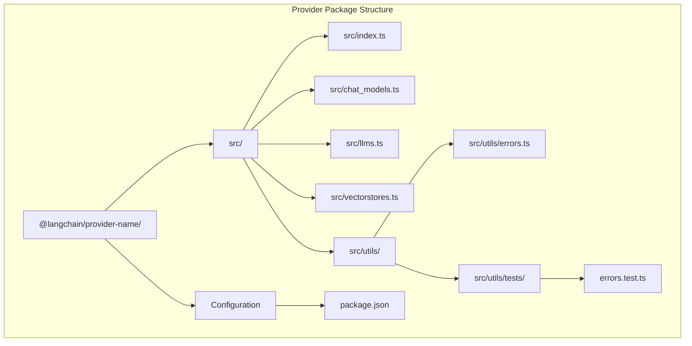
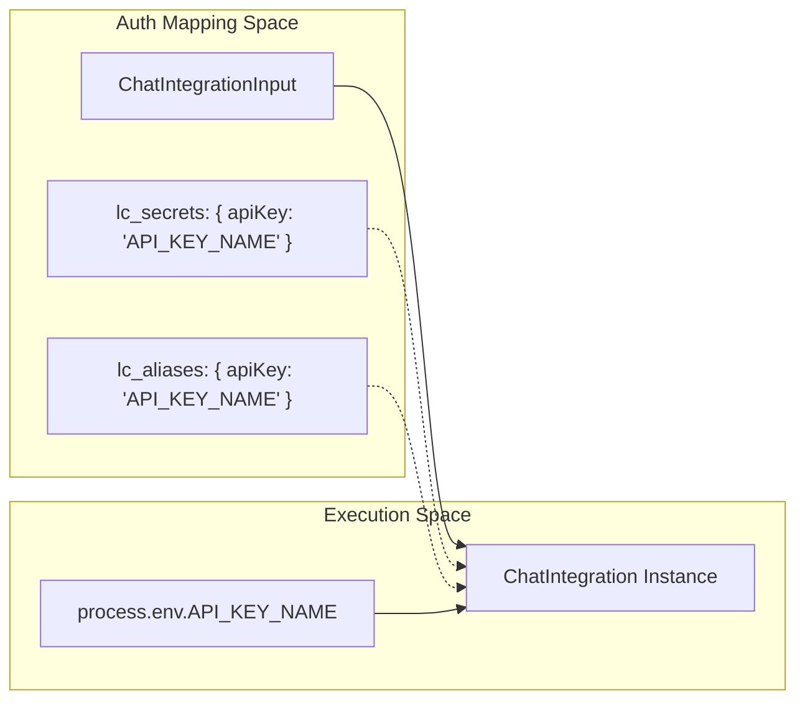
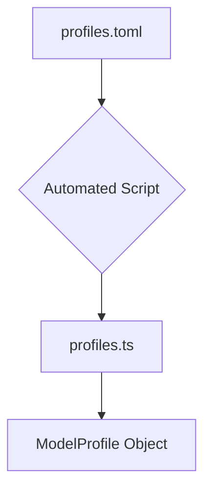
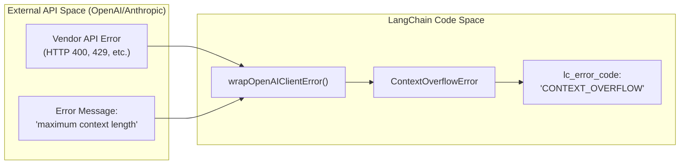

<!-- source: DeepWiki mcp.deepwiki.com · repo langchain-ai/langchainjs · page 5.1 Provider Integration Pattern · fetched 2026-10-26 -->

# Provider Integration Pattern

<details>
<summary>Relevant source files</summary>

The following files were used as context for generating this wiki page:

- [libs/create-langchain-integration/helpers/git.ts](libs/create-langchain-integration/helpers/git.ts)
- [libs/create-langchain-integration/helpers/is-url.ts](libs/create-langchain-integration/helpers/is-url.ts)
- [libs/create-langchain-integration/helpers/templates.ts](libs/create-langchain-integration/helpers/templates.ts)
- [libs/create-langchain-integration/package.json](libs/create-langchain-integration/package.json)
- [libs/create-langchain-integration/template/.release-it.json](libs/create-langchain-integration/template/.release-it.json)
- [libs/create-langchain-integration/template/README.md](libs/create-langchain-integration/template/README.md)
- [libs/create-langchain-integration/template/src/chat_models.ts](libs/create-langchain-integration/template/src/chat_models.ts)
- [libs/create-langchain-integration/template/src/llms.ts](libs/create-langchain-integration/template/src/llms.ts)
- [libs/create-langchain-integration/template/src/vectorstores.ts](libs/create-langchain-integration/template/src/vectorstores.ts)
- [libs/langchain-core/src/errors/index.ts](libs/langchain-core/src/errors/index.ts)
- [libs/langchain-core/src/utils/tests/namespace.test-d.ts](libs/langchain-core/src/utils/tests/namespace.test-d.ts)
- [libs/langchain-core/src/utils/tests/namespace.test.ts](libs/langchain-core/src/utils/tests/namespace.test.ts)
- [libs/providers/langchain-anthropic/src/utils/errors.ts](libs/providers/langchain-anthropic/src/utils/errors.ts)
- [libs/providers/langchain-anthropic/src/utils/tests/errors.test.ts](libs/providers/langchain-anthropic/src/utils/tests/errors.test.ts)
- [libs/providers/langchain-deepseek/src/profiles.ts](libs/providers/langchain-deepseek/src/profiles.ts)
- [libs/providers/langchain-google-common/src/profiles.ts](libs/providers/langchain-google-common/src/profiles.ts)
- [libs/providers/langchain-google-genai/src/profiles.ts](libs/providers/langchain-google-genai/src/profiles.ts)
- [libs/providers/langchain-google/profiles.toml](libs/providers/langchain-google/profiles.toml)
- [libs/providers/langchain-google/src/chat_models/profiles.ts](libs/providers/langchain-google/src/chat_models/profiles.ts)
- [libs/providers/langchain-google/src/utils/errors.ts](libs/providers/langchain-google/src/utils/errors.ts)
- [libs/providers/langchain-google/src/utils/tests/errors.test.ts](libs/providers/langchain-google/src/utils/tests/errors.test.ts)
- [libs/providers/langchain-groq/src/profiles.ts](libs/providers/langchain-groq/src/profiles.ts)
- [libs/providers/langchain-openai/src/chat_models/profiles.ts](libs/providers/langchain-openai/src/chat_models/profiles.ts)
- [libs/providers/langchain-openai/src/utils/client.ts](libs/providers/langchain-openai/src/utils/client.ts)
- [libs/providers/langchain-openai/src/utils/errors.ts](libs/providers/langchain-openai/src/utils/errors.ts)
- [libs/providers/langchain-openai/src/utils/tests/errors.test.ts](libs/providers/langchain-openai/src/utils/tests/errors.test.ts)
- [libs/providers/langchain-xai/src/profiles.ts](libs/providers/langchain-xai/src/profiles.ts)

</details>


This document describes the standardized pattern for creating provider integration packages in LangChain.js. It covers package structure, base class extension, authentication strategies, model profiles, build configuration, and error handling requirements.

## Purpose and Scope

Provider packages implement integrations with specific LLM vendors (OpenAI, Anthropic, Google), cloud platforms (AWS, IBM), or external services (MongoDB, Turbopuffer). The provider integration pattern ensures:

- **Consistent interfaces**: All providers extend base classes from `@langchain/core`, enabling interoperability.
- **Type safety**: Peer dependency on `@langchain/core` ensures version consistency across the ecosystem.
- **Modular installation**: Users install only the providers they need. [libs/create-langchain-integration/template/README.md:8-12]()
- **Standardized testing**: Compliance with `@langchain/standard-tests` validates interface requirements. [libs/create-langchain-integration/template/README.md:108-110]()
- **Dual module support**: Packages provide both CommonJS and ESM builds using the `tsdown` pattern.

## Package Structure and Naming

### Naming Convention

Provider packages follow the naming pattern `@langchain/<provider-name>` and are typically located in `libs/providers/`.

### Directory Structure



**Sources:** [libs/create-langchain-integration/template/src/chat_models.ts:1-38](), [libs/create-langchain-integration/template/src/vectorstores.ts:1-14](), [libs/providers/langchain-openai/src/utils/tests/errors.test.ts:1-5]()

## Core Dependencies and Base Classes

### Dependency Pattern

All provider packages declare `@langchain/core` as a **peer dependency** to prevent version duplication. If multiple packages are used, they must resolve to the same core instance. [libs/create-langchain-integration/template/README.md:11-35]()

### Base Class Extension

Providers implement integration by extending abstract base classes. For chat models, integrations typically extend `SimpleChatModel` or `BaseChatModel`. [libs/create-langchain-integration/template/src/chat_models.ts:33-36]()

- **Chat Models**: Extend `SimpleChatModel<BaseLanguageModelCallOptions>`. [libs/create-langchain-integration/template/src/chat_models.ts:36-36]()
- **Vector Stores**: Extend `VectorStore`. [libs/create-langchain-integration/template/src/vectorstores.ts:14-14]()
- **Serialization**: Classes must set `lc_serializable = true` and define `lc_secrets` to mask sensitive keys during serialization. [libs/create-langchain-integration/template/src/chat_models.ts:44-55]()

## Authentication Strategies

Provider packages implement authentication through constructor parameters and environment variables.

### Pattern: Secret Mapping and Aliases

Providers use `lc_secrets` to identify fields that should be treated as sensitive and `lc_aliases` to map internal names to external environment variables.



**Sources:** [libs/create-langchain-integration/template/src/chat_models.ts:51-61](), [libs/create-langchain-integration/template/README.md:45-58]()

## Model Profiles

Model profiles define the capabilities and limitations of specific models offered by a provider. These profiles are stored in `profiles.ts` files within each provider package, often generated from a `profiles.toml` file.

### Structure of a Model Profile

A `ModelProfile` object specifies various attributes of a model, such as:
- `maxInputTokens`: Maximum number of input tokens.
- `imageInputs`, `audioInputs`, `pdfInputs`, `videoInputs`: Boolean flags indicating support for different input modalities.
- `maxOutputTokens`: Maximum number of output tokens.
- `reasoningOutput`: Whether the model can produce reasoning outputs.
- `imageOutputs`, `audioOutputs`, `videoOutputs`: Boolean flags indicating support for different output modalities.
- `toolCalling`: Whether the model supports tool calling.
- `structuredOutput`: Whether the model supports structured output.
- `imageUrlInputs`, `pdfToolMessage`, `imageToolMessage`, `toolChoice`: Specific features related to multimodal inputs and tool usage.

### Example Model Profile

```typescript
const PROFILES: Record<string, ModelProfile> = {
  "gpt-4o-2024-05-13": {
    maxInputTokens: 128000,
    imageInputs: true,
    audioInputs: false,
    pdfInputs: true,
    videoInputs: false,
    maxOutputTokens: 4096,
    reasoningOutput: false,
    imageOutputs: false,
    audioOutputs: false,
    videoOutputs: false,
    toolCalling: true,
    structuredOutput: true,
    imageUrlInputs: true,
    pdfToolMessage: true,
    imageToolMessage: true,
    toolChoice: true,
  },
  // ... other profiles
};
```
**Sources:** [libs/providers/langchain-openai/src/chat_models/profiles.ts:5-59]()

### Profile Generation

Model profiles are typically generated automatically from a `profiles.toml` file. This ensures consistency and allows for easy updates. For example, the OpenAI profiles are defined in a TOML file and then converted into the `profiles.ts` format.



**Sources:** [libs/providers/langchain-openai/src/chat_models/profiles.ts:1-2](), [libs/providers/langchain-deepseek/src/profiles.ts:1-2](), [libs/providers/langchain-google/src/chat_models/profiles.ts:1-2]()

## Build Pattern (`tsdown`)

LangChain.js uses the `tsdown` build system to compile provider packages. This system ensures that packages are built for both CommonJS (CJS) and ES Module (ESM) environments, providing broad compatibility. The `tsdown` configuration handles TypeScript compilation, module resolution, and export generation.

The `build` script in `package.json` typically invokes `pnpm build --filter <package-name>` which then uses `tsdown` internally. [libs/create-langchain-integration/template/README.md:101-103]()

## Error Handling Hierarchy

Providers must wrap vendor-specific errors into standard LangChain error classes to ensure consistent behavior in chains and agents.

### LangChain Error Namespace

All errors should extend `LangChainError` from `@langchain/core/errors`. [libs/langchain-core/src/errors/index.ts:91-92]() Providers create a sub-namespace for their specific errors:

```typescript
const ns = baseNs.sub("google");
export class GoogleError extends ns.brand(LangChainError) {}
```
**Sources:** [libs/providers/langchain-google/src/utils/errors.ts:6-66]()

### Error Wrapping Pattern

Providers implement a `wrap[Provider]ClientError` function to map HTTP status codes and error messages to standard types like `ContextOverflowError`. [libs/providers/langchain-openai/src/utils/client.ts:22-62]()

| Vendor Condition | LangChain Error Code | LangChain Class | Retryable |
|------------------|----------------------|-----------------|-----------|
| HTTP 401 | `MODEL_AUTHENTICATION` | `LangChainError` | `false` |
| HTTP 429 | `MODEL_RATE_LIMIT` | `LangChainError` | `true` |
| HTTP 404 | `MODEL_NOT_FOUND` | `LangChainError` | `false` |
| "context_length_exceeded" | `CONTEXT_OVERFLOW` | `ContextOverflowError` | `false` |
| "tool_calls" validation | `INVALID_TOOL_RESULTS`| `LangChainError` | `false` |
| APIConnectionTimeoutError | `TimeoutError` | `Error` | `true` |
| APIUserAbortError | `AbortError` | `Error` | `false` |

**Sources:** [libs/providers/langchain-openai/src/utils/client.ts:3-79](), [libs/providers/langchain-anthropic/src/utils/errors.ts:28-65](), [libs/langchain-core/src/errors/index.ts:141-144]()

### Visualizing Error Translation



**Sources:** [libs/providers/langchain-openai/src/utils/tests/errors.test.ts:6-26](), [libs/providers/langchain-openai/src/utils/client.ts:42-43](), [libs/providers/langchain-anthropic/src/utils/errors.ts:28-38]()

## Standard Tests Compliance

Every provider package must include a suite of standard tests to ensure it behaves correctly within the ecosystem.

### Test Categorization
- **Unit Tests**: End in `.test.ts`. Focus on logic like error wrapping. [libs/create-langchain-integration/template/README.md:108-109]()
- **Integration Tests**: End in `.int.test.ts`. Require real API keys and network access. [libs/create-langchain-integration/template/README.md:109-110]()

### Dependency Range Testing
Integrations are validated in CI using Docker to ensure compatibility with both the `lowest` and `latest` versions of dependencies.

## Scaffolding New Integrations

The `create-langchain-integration` tool automates the creation of new provider packages. It uses `installTemplate` to copy a standard boilerplate into the target directory. [libs/create-langchain-integration/helpers/templates.ts:10-28]()

### Scaffolding Process
1. **Copy Files**: Copies the `template/` directory. [libs/create-langchain-integration/helpers/templates.ts:20-28]()
2. **Configure package.json**: Sets the package name, description, and build scripts. [libs/create-langchain-integration/helpers/templates.ts:39-45]()
3. **Initialize Git**: Sets up `.gitignore`. [libs/create-langchain-integration/helpers/templates.ts:52-55]()

**Sources:** [libs/create-langchain-integration/helpers/templates.ts:10-58](), [libs/create-langchain-integration/package.json:1-29]()

---

