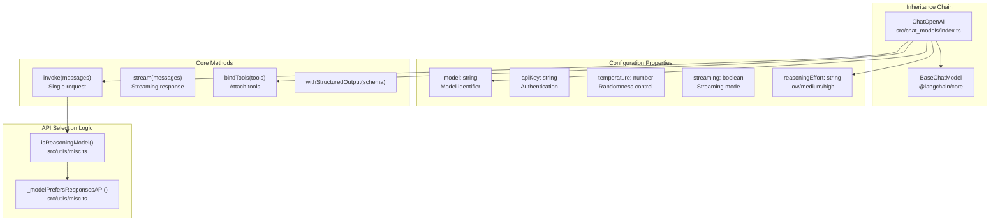
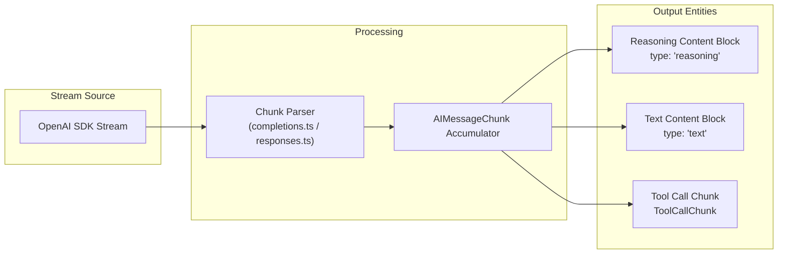

<!-- source: DeepWiki mcp.deepwiki.com · repo langchain-ai/langchainjs · page 5.2 OpenAI Integration · fetched 2026-10-26 -->

# OpenAI Integration

Relevant source files

The following files were used as context for generating this wiki page:

- [libs/langchain-core/src/messages/block_translators/openai.ts](libs/langchain-core/src/messages/block_translators/openai.ts)
- [libs/langchain-core/src/messages/block_translators/tests/openai.test.ts](libs/langchain-core/src/messages/block_translators/tests/openai.test.ts)
- [libs/providers/langchain-openai/README.md](libs/providers/langchain-openai/README.md)
- [libs/providers/langchain-openai/src/azure/chat_models/common.ts](libs/providers/langchain-openai/src/azure/chat_models/common.ts)
- [libs/providers/langchain-openai/src/azure/embeddings.ts](libs/providers/langchain-openai/src/azure/embeddings.ts)
- [libs/providers/langchain-openai/src/azure/llms.ts](libs/providers/langchain-openai/src/azure/llms.ts)
- [libs/providers/langchain-openai/src/chat_models/base.ts](libs/providers/langchain-openai/src/chat_models/base.ts)
- [libs/providers/langchain-openai/src/chat_models/completions.ts](libs/providers/langchain-openai/src/chat_models/completions.ts)
- [libs/providers/langchain-openai/src/chat_models/responses.ts](libs/providers/langchain-openai/src/chat_models/responses.ts)
- [libs/providers/langchain-openai/src/chat_models/tests/completions.test.ts](libs/providers/langchain-openai/src/chat_models/tests/completions.test.ts)
- [libs/providers/langchain-openai/src/chat_models/tests/index.test.ts](libs/providers/langchain-openai/src/chat_models/tests/index.test.ts)
- [libs/providers/langchain-openai/src/chat_models/tests/responses.int.test.ts](libs/providers/langchain-openai/src/chat_models/tests/responses.int.test.ts)
- [libs/providers/langchain-openai/src/chat_models/tests/responses.test.ts](libs/providers/langchain-openai/src/chat_models/tests/responses.test.ts)
- [libs/providers/langchain-openai/src/chat_models/tests/serialization.test.ts](libs/providers/langchain-openai/src/chat_models/tests/serialization.test.ts)
- [libs/providers/langchain-openai/src/converters/completions.ts](libs/providers/langchain-openai/src/converters/completions.ts)
- [libs/providers/langchain-openai/src/converters/responses.ts](libs/providers/langchain-openai/src/converters/responses.ts)
- [libs/providers/langchain-openai/src/converters/tests/completions.test.ts](libs/providers/langchain-openai/src/converters/tests/completions.test.ts)
- [libs/providers/langchain-openai/src/converters/tests/responses.test.ts](libs/providers/langchain-openai/src/converters/tests/responses.test.ts)
- [libs/providers/langchain-openai/src/embeddings.ts](libs/providers/langchain-openai/src/embeddings.ts)
- [libs/providers/langchain-openai/src/llms.ts](libs/providers/langchain-openai/src/llms.ts)
- [libs/providers/langchain-openai/src/tools/index.ts](libs/providers/langchain-openai/src/tools/index.ts)
- [libs/providers/langchain-openai/src/tools/shell.ts](libs/providers/langchain-openai/src/tools/shell.ts)
- [libs/providers/langchain-openai/src/tools/tests/shell.int.test.ts](libs/providers/langchain-openai/src/tools/tests/shell.int.test.ts)
- [libs/providers/langchain-openai/src/tools/tests/shell.test-d.ts](libs/providers/langchain-openai/src/tools/tests/shell.test-d.ts)
- [libs/providers/langchain-openai/src/tools/tests/shell.test.ts](libs/providers/langchain-openai/src/tools/tests/shell.test.ts)
- [libs/providers/langchain-openai/src/types.ts](libs/providers/langchain-openai/src/types.ts)
- [libs/providers/langchain-openai/src/utils/azure.ts](libs/providers/langchain-openai/src/utils/azure.ts)
- [libs/providers/langchain-openai/src/utils/misc.ts](libs/providers/langchain-openai/src/utils/misc.ts)
- [libs/providers/langchain-openai/src/utils/output.ts](libs/providers/langchain-openai/src/utils/output.ts)

## Purpose and Scope

This page documents the `@langchain/openai` package, which provides production-ready implementations of chat models, completions, embeddings, and related utilities for OpenAI's API. The package wraps the official OpenAI SDK while implementing the standard interfaces defined in `@langchain/core`.

The OpenAI integration distinguishes between the **Completions API** (standard chat models) and the **Responses API** (specialized reasoning models like o1, o3, and gpt-5.5). It also includes specialized support for Azure OpenAI and reasoning-specific features like "Zero-Data Retention" (ZDR) mode and server-side tools.

## Package Architecture

The `@langchain/openai` package follows the standard provider package architecture with a peer dependency on `@langchain/core`. This design ensures modularity and type safety across the LangChain.js ecosystem.

### Package Structure

```mermaid
graph TB
    subgraph "Core Abstraction Layer (@langchain/core)"
        BaseChatModel["BaseChatModel"]
        BaseLanguageModel["BaseLanguageModel"]
        BaseEmbeddings["BaseEmbeddings"]
        MessageTypes["SystemMessage<br/>HumanMessage<br/>AIMessage<br/>ToolMessage"]
        ToolInterface["StructuredTool<br/>DynamicTool"]
    end
    
    subgraph "@langchain/openai Package"
        ChatOpenAI["ChatOpenAI<br/>src/chat_models/index.ts"]
        OpenAI["OpenAI<br/>src/llms.ts"]
        OpenAIEmbeddings["OpenAIEmbeddings<br/>src/embeddings.ts"]
        
        subgraph "Converters"
            completionsConverter["completions.ts<br/>src/converters/completions.ts"]
            responsesConverter["responses.ts<br/>src/converters/responses.ts"]
        end
        
        subgraph "API Modes"
            CompletionsAPI["Completions API<br/>gpt-4o, gpt-4"]
            ResponsesAPI["Responses API<br/>o1, o3, gpt-5.5"]
        end
    end
    
    subgraph "Native SDK"
        OpenAISDK["openai npm package<br/>^6.34.0"]
        OpenAIClient["OpenAI client"]
        AzureOpenAI["AzureOpenAI client"]
    end
    
    ChatOpenAI --> BaseChatModel
    OpenAI --> BaseLanguageModel
    OpenAIEmbeddings --> BaseEmbeddings
    
    ChatOpenAI --> MessageTypes
    ChatOpenAI --> ToolInterface
    
    ChatOpenAI --> completionsConverter
    ChatOpenAI --> responsesConverter
    
    ChatOpenAI --> CompletionsAPI
    ChatOpenAI --> ResponsesAPI
    
    ChatOpenAI --> OpenAIClient
    OpenAI --> OpenAIClient
    OpenAIEmbeddings --> OpenAIClient
    
    OpenAIClient --> OpenAISDK
    AzureOpenAI --> OpenAISDK
```

**Sources:** [libs/providers/langchain-openai/package.json:29-36](), [libs/providers/langchain-openai/src/chat_models/base.ts:1-60](), [libs/providers/langchain-openai/src/converters/responses.ts:1-42]()

### Dependency Management

The package declares `@langchain/core` as a peer dependency to ensure version consistency:

| Dependency Type | Package | Version | Purpose |
|----------------|---------|---------|---------|
| Peer Dependency | `@langchain/core` | `workspace:^` | Base abstractions and interfaces |
| Direct Dependency | `openai` | `^6.34.0` | Official OpenAI SDK |
| Direct Dependency | `js-tiktoken` | `^1.0.12` | Token counting |
| Development Dependency | `@azure/identity` | `^4.2.1` | Azure OpenAI authentication |

**Minimum Node.js Version:** 20

**Sources:** [libs/providers/langchain-openai/package.json:8-35]()

## ChatOpenAI Class

### Class Hierarchy and Core Interface

The `ChatOpenAI` class extends `BaseChatModel` from `@langchain/core`. It is the primary entry entry point for interacting with OpenAI chat models. It handles the orchestration of request formatting, API invocation, and response parsing.

**Sources:** [libs/providers/langchain-openai/src/chat_models/base.ts:83-203](), [libs/providers/langchain-openai/src/chat_models/tests/index.test.ts:15-80]()

### API Mode Selection

The integration automatically routes requests based on model capabilities:

| API Type | Models | Method | Key Feature |
|----------|--------|--------|-------------|
| **Completions API** | GPT-4o, GPT-4, GPT-3.5 | `chat.completions.create` | Standard tool calling, JSON mode |
| **Responses API** | o1, o3-mini, gpt-5.5-pro | `chat.responses.create` | Reasoning summaries, phase parameters |

**Reasoning Models:** For models like `o3-mini` or `gpt-5.5-pro`, the integration supports `reasoningEffort` ("low", "medium", "high") and can surface internal reasoning steps as content blocks. The Responses API is now the default for newer models like `gpt-5.5-pro`.
The `isReasoningModel` utility [libs/providers/langchain-openai/src/utils/misc.ts:11-15]() checks if a model name indicates a reasoning model (e.g., starting with "o" followed by a digit or "gpt-5"). The `_modelPrefersResponsesAPI` utility [libs/providers/langchain-openai/src/utils/misc.ts:93-101]() explicitly identifies models that should use the Responses API, such as `gpt-5.2-pro`, `gpt-5.4-pro`, `gpt-5.5-pro`, `gpt-5.6-sol`, and `codex` models.

**Sources:** [libs/providers/langchain-openai/src/chat_models/base.ts:178-196](), [libs/providers/langchain-openai/src/utils/misc.ts:10-12](), [libs/providers/langchain-openai/src/converters/responses.ts:113-147](), [libs/providers/langchain-openai/CHANGELOG.md:7-8](), [libs/providers/langchain-openai/src/utils/misc.ts:11-15](), [libs/providers/langchain-openai/src/utils/misc.ts:93-101]()

## Message and Tool Conversion

### Message Converter Architecture

The package implements complex logic to translate LangChain's `BaseMessage` hierarchy into OpenAI's specific requirements for both the Completions and Responses APIs.

| Function | File | Purpose |
|----------|------|---------|
| `convertMessagesToResponsesInput` | `responses.ts` | Converts messages for the Responses API, including reasoning blocks. |
| `convertResponsesMessageToAIMessage` | `responses.ts` | Elevates reasoning summaries into the `AIMessage.content` array. |
| `convertResponsesUsageToUsageMetadata` | `responses.ts` | Maps detailed token counts (cached, reasoning) to standard metadata. |
| `completionsApiContentBlockConverter` | `completions.ts` | Handles standard multimodal and tool-calling content blocks. |

**Sources:** [libs/providers/langchain-openai/src/converters/responses.ts:206-250](), [libs/providers/langchain-openai/src/converters/tests/responses.test.ts:84-147]()

The `convertOpenAIAnnotationToLangChain` function [libs/providers/langchain-openai/src/converters/responses.ts:67-119]() converts various OpenAI annotation types (e.g., `url_citation`, `file_citation`, `container_file_citation`, `file_path`) into LangChain's `ContentBlock.Citation` format or `ContentBlock.NonStandard` for unknown types. Conversely, `convertLangChainAnnotationToOpenAI` [libs/providers/langchain-openai/src/converters/responses.ts:128-198]() performs the inverse conversion.

The `completionsApiContentBlockConverter` [libs/providers/langchain-openai/src/converters/completions.ts:46-206]() is a `StandardContentBlockConverter` that translates LangChain's standard content blocks (text, image, audio, file) into the format required by OpenAI's Completions API. It handles different `source_type` values (e.g., `url`, `base64`, `id`) and performs necessary data URL parsing and MIME type validation for audio and file blocks.

### Server Tools and Search

The Responses API supports "Server Tools" such as `tool_search`. The integration provides a factory `tools.toolSearch()` to define these tools, which can operate in both server-executed and client-executed modes. It also supports `defer_loading` for on-demand tool discovery.
The `ChatOpenAIResponses` class [libs/providers/langchain-openai/src/chat_models/responses.ts:73-84]() is an internal implementation for the OpenAI Responses API. It extends `BaseChatOpenAI` and handles the specific invocation parameters for the Responses API, including `text`, `truncation`, `include`, `previous_response_id`, and `verbosity`.

**Sources:** [libs/providers/langchain-openai/CHANGELOG.md:76-81](), [libs/providers/langchain-openai/src/chat_models/responses.ts:73-84]()

## Structured Output and ZDR Mode

### withStructuredOutput Implementation

OpenAI supports several structured output strategies. The `withStructuredOutput` method chooses the most appropriate one:

1.  **Strict Mode:** Uses `strict: true` in tool definitions to guarantee schema adherence.
2.  **JSON Schema Mode:** Configures `response_format: { type: "json_schema" }`.
3.  **Standard Schema:** Supports the LangChain standard schema interface for validation.

**Sources:** [libs/providers/langchain-openai/src/chat_models/base.ts:136-150](), [libs/providers/langchain-openai/src/chat_models/tests/index.test.ts:82-154](), [libs/providers/langchain-openai/CHANGELOG.md:100-103]()

### ZDR Mode

The `zdrEnabled` property [libs/providers/langchain-openai/src/chat_models/responses.ts:162]() in `ChatOpenAIResponses` allows enabling Zero-Data Retention (ZDR) mode by setting `store: false` in the invocation parameters. This ensures that no data is stored by the model provider, which is crucial for privacy-sensitive applications.

**Sources:** [libs/providers/langchain-openai/src/chat_models/responses.ts:162]()

## Azure OpenAI and Authentication

The integration provides deep support for Azure OpenAI, including specialized embedding and chat model classes.

### Azure Configuration

The `getEndpoint` and `getHeadersWithUserAgent` utilities in `azure.ts` handle the construction of Azure-specific request parameters.

| Parameter | Role |
|-----------|------|
| `azureOpenAIApiKey` | API key or AAD token. |
| `azureOpenAIApiDeploymentName` | The specific deployment ID in the Azure portal. |
| `azureOpenAIApiInstanceName` | The name of the Azure OpenAI resource. |

**Sources:** [libs/providers/langchain-openai/src/utils/azure.ts:1-42](), [libs/providers/langchain-openai/src/chat_models/base.ts:38-42]()

## Streaming and Reasoning

### Streaming Logic

Streaming in OpenAI models involves processing `ChatCompletionChunk` (Completions) or `ResponseOutputItem` (Responses). 

**Reasoning Content:** For reasoning models, the stream includes `reasoning_content` or `reasoning` summary blocks. LangChain surfaces these as specialized content blocks with type `reasoning`. Chunks now include an `index` for proper merging during reasoning.
The `convertResponsesDeltaToChatGenerationChunk` function [libs/providers/langchain-openai/src/converters/responses.ts:300-390]() converts a streaming delta from the OpenAI Responses API into a `ChatGenerationChunk`. This function handles the merging of content, tool calls, and reasoning summaries across multiple chunks. It also processes annotations and maps them to LangChain's `ContentBlock.Citation` format.

**Sources:** [libs/providers/langchain-openai/src/converters/responses.ts:15-39](), [libs/providers/langchain-openai/src/converters/tests/responses.test.ts:85-147](), [libs/providers/langchain-openai/CHANGELOG.md:18-19](), [libs/providers/langchain-openai/src/converters/responses.ts:300-390]()

## Usage Metadata

OpenAI provides granular token usage data, which LangChain maps to a unified `UsageMetadata` interface.

| OpenAI Field | LangChain Metadata Field | Description |
|--------------|--------------------------|-------------|
| `input_tokens_details.cached_tokens` | `input_token_details.cache_read` | Tokens retrieved from OpenAI's prompt cache. |
| `output_tokens_details.reasoning_tokens` | `output_token_details.reasoning` | Tokens spent on internal reasoning steps. |

The `convertResponsesUsageToUsageMetadata` function [libs/providers/langchain-openai/src/converters/responses.ts:206-250]() specifically handles the conversion of OpenAI Responses API usage statistics to LangChain's `UsageMetadata`. It maps `input_tokens_details.cached_tokens` to `input_token_details.cache_read` and `input_tokens_details.cache_write_tokens` to `input_token_details.cache_creation`. It also maps `output_tokens_details.reasoning_tokens` to `output_token_details.reasoning`.

**Sources:** [libs/providers/langchain-openai/src/converters/responses.ts:206-250](), [libs/providers/langchain-openai/src/converters/tests/responses.test.ts:22-51]()

---

