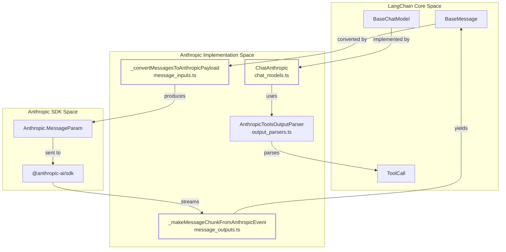
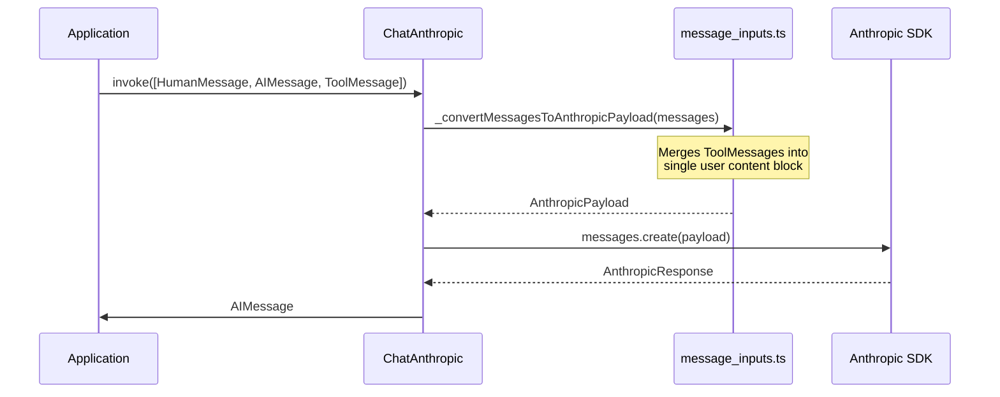
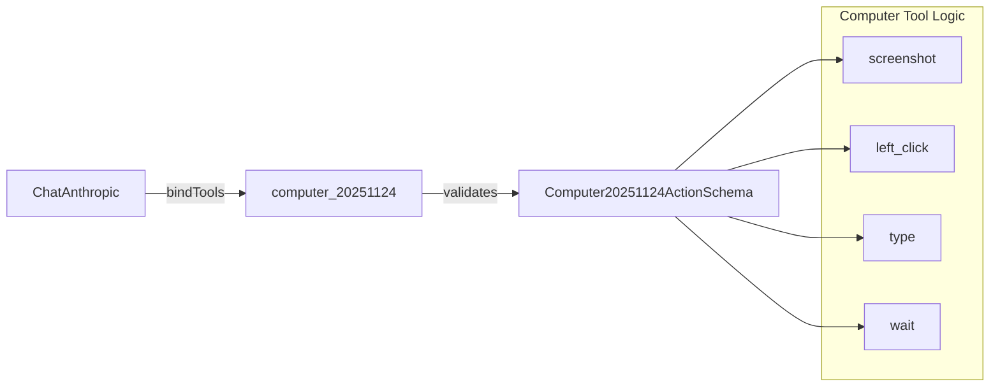

<!-- source: DeepWiki mcp.deepwiki.com · repo langchain-ai/langchainjs · page 5.3 Anthropic Integration · fetched 2026-10-26 -->

# Anthropic Integration

Relevant source files

The following files were used as context for generating this wiki page:

- [libs/providers/langchain-anthropic/README.md](libs/providers/langchain-anthropic/README.md)
- [libs/providers/langchain-anthropic/profiles.toml](libs/providers/langchain-anthropic/profiles.toml)
- [libs/providers/langchain-anthropic/src/chat_models.ts](libs/providers/langchain-anthropic/src/chat_models.ts)
- [libs/providers/langchain-anthropic/src/output_parsers.ts](libs/providers/langchain-anthropic/src/output_parsers.ts)
- [libs/providers/langchain-anthropic/src/profiles.ts](libs/providers/langchain-anthropic/src/profiles.ts)
- [libs/providers/langchain-anthropic/src/tests/chat_models-strict.int.test.ts](libs/providers/langchain-anthropic/src/tests/chat_models-strict.int.test.ts)
- [libs/providers/langchain-anthropic/src/tests/chat_models-tool_search.test.ts](libs/providers/langchain-anthropic/src/tests/chat_models-tool_search.test.ts)
- [libs/providers/langchain-anthropic/src/tests/chat_models-tools.int.test.ts](libs/providers/langchain-anthropic/src/tests/chat_models-tools.int.test.ts)
- [libs/providers/langchain-anthropic/src/tests/chat_models.int.test.ts](libs/providers/langchain-anthropic/src/tests/chat_models.int.test.ts)
- [libs/providers/langchain-anthropic/src/tests/chat_models.test.ts](libs/providers/langchain-anthropic/src/tests/chat_models.test.ts)
- [libs/providers/langchain-anthropic/src/tools/bash.ts](libs/providers/langchain-anthropic/src/tools/bash.ts)
- [libs/providers/langchain-anthropic/src/tools/index.ts](libs/providers/langchain-anthropic/src/tools/index.ts)
- [libs/providers/langchain-anthropic/src/tools/mcpToolset.ts](libs/providers/langchain-anthropic/src/tools/mcpToolset.ts)
- [libs/providers/langchain-anthropic/src/tools/tests/bash.int.test.ts](libs/providers/langchain-anthropic/src/tools/tests/bash.int.test.ts)
- [libs/providers/langchain-anthropic/src/tools/tests/bash.test.ts](libs/providers/langchain-anthropic/src/tools/tests/bash.test.ts)
- [libs/providers/langchain-anthropic/src/tools/tests/mcpToolset.int.test.ts](libs/providers/langchain-anthropic/src/tools/tests/mcpToolset.int.test.ts)
- [libs/providers/langchain-anthropic/src/tools/tests/mcpToolset.test.ts](libs/providers/langchain-anthropic/src/tools/tests/mcpToolset.test.ts)
- [libs/providers/langchain-anthropic/src/tools/types.ts](libs/providers/langchain-anthropic/src/tools/types.ts)
- [libs/providers/langchain-anthropic/src/types.ts](libs/providers/langchain-anthropic/src/types.ts)
- [libs/providers/langchain-anthropic/src/utils/content.ts](libs/providers/langchain-anthropic/src/utils/content.ts)
- [libs/providers/langchain-anthropic/src/utils/message_inputs.ts](libs/providers/langchain-anthropic/src/utils/message_inputs.ts)
- [libs/providers/langchain-anthropic/src/utils/message_outputs.ts](libs/providers/langchain-anthropic/src/utils/message_outputs.ts)
- [libs/providers/langchain-anthropic/src/utils/params.ts](libs/providers/langchain-anthropic/src/utils/params.ts)
- [libs/providers/langchain-anthropic/src/utils/stream_events.ts](libs/providers/langchain-anthropic/src/utils/stream_events.ts)
- [libs/providers/langchain-anthropic/src/utils/tests/message_outputs.test.ts](libs/providers/langchain-anthropic/src/utils/tests/message_outputs.test.ts)
- [libs/providers/langchain-anthropic/src/utils/tests/stream_events.test.ts](libs/providers/langchain-anthropic/src/utils/tests/stream_events.test.ts)
- [libs/providers/langchain-anthropic/src/utils/tests/tools.test.ts](libs/providers/langchain-anthropic/src/utils/tests/tools.test.ts)
- [libs/providers/langchain-anthropic/src/utils/tools.ts](libs/providers/langchain-anthropic/src/utils/tools.ts)

## Purpose and Scope

The `@langchain/anthropic` package provides LangChain.js integrations for Anthropic's Claude models through their official SDK [[libs/providers/langchain-anthropic/src/chat_models.ts:1-1](), [libs/providers/langchain-anthropic/README.md:3-4]()]. This integration centers around the `ChatAnthropic` class, which implements the `BaseChatModel` interface [[libs/providers/langchain-anthropic/src/chat_models.ts:10-14]()].

Key technical capabilities include:
- **ChatAnthropic**: High-level chat interface for Claude 3.x and 4.x families [[libs/providers/langchain-anthropic/src/chat_models.ts:86-112]()].
- **Adaptive Thinking**: Support for extended reasoning blocks via `thinkingConfig` and handling of `thinking` content blocks [[libs/providers/langchain-anthropic/src/chat_models.ts:57-57](), [libs/providers/langchain-anthropic/src/utils/message_outputs.ts:137-146]()].
- **Prompt Caching**: Ephemeral caching control for reducing latency and cost by marking content blocks with `cache_control` [[libs/providers/langchain-anthropic/src/chat_models.ts:129-132](), [libs/providers/langchain-anthropic/src/chat_models.ts:189-189]()].
- **Built-in Tools**: Native wrappers for Anthropic's computer use, bash, text editor, web search, and memory tools [[libs/providers/langchain-anthropic/src/tools/index.ts:30-42]()].
- **MCP Integration**: Support for Model Context Protocol (MCP) toolsets [[libs/providers/langchain-anthropic/src/chat_models.ts:171-171](), [libs/providers/langchain-anthropic/src/tools/mcpToolset.ts:1-1]()].

**Sources**: [libs/providers/langchain-anthropic/src/chat_models.ts:1-182](), [libs/providers/langchain-anthropic/src/tools/index.ts:30-42](), [libs/providers/langchain-anthropic/README.md:1-4]()

## Package Architecture

The integration bridges LangChain's standard message format to Anthropic's specific API requirements, particularly for tool results and multimodal content.

### Entity Mapping Diagram

This diagram maps LangChain core entities to the specific implementation classes and utility functions in the Anthropic provider.

**Sources**: [libs/providers/langchain-anthropic/src/chat_models.ts:10-14](), [libs/providers/langchain-anthropic/src/utils/message_inputs.ts:142-154](), [libs/providers/langchain-anthropic/src/utils/message_outputs.ts:16-24]()

## ChatAnthropic Class

`ChatAnthropic` handles the lifecycle of requests to Anthropic. It automatically manages model-specific defaults for `max_tokens` based on the model family [[libs/providers/langchain-anthropic/src/chat_models.ts:86-112]()].

### Data Flow: Message Conversion

Anthropic requires a specific message structure where `ToolMessage` instances must be merged into a single `user` role message if they follow an assistant's tool call [[libs/providers/langchain-anthropic/src/utils/message_inputs.ts:90-134]()].

**Key Implementation Details**:
- **Tool Choice**: Handled via `handleToolChoice`, supporting OpenAI-style "required" by mapping it to Anthropic's "any" [[libs/providers/langchain-anthropic/src/utils/tools.ts:5-36]()].
- **Beta Headers**: Automatically applies required beta headers (e.g., `advanced-tool-use-2025-11-20`) based on the specific tools or features enabled [[libs/providers/langchain-anthropic/src/utils/tools.ts:55-64]()].
- **Max Tokens**: Defaults are calculated by `defaultMaxOutputTokensForModel` based on model name prefixes [[libs/providers/langchain-anthropic/src/chat_models.ts:115-123]()].
- **LangSmith Gateway**: The constructor supports LangSmith Gateway environment configuration, allowing API requests to be routed through the gateway [[libs/providers/langchain-anthropic/src/tests/chat_models.test.ts:83-96]()].

**Sources**: [libs/providers/langchain-anthropic/src/chat_models.ts:86-123](), [libs/providers/langchain-anthropic/src/utils/message_inputs.ts:90-134](), [libs/providers/langchain-anthropic/src/utils/tools.ts:5-64](), [libs/providers/langchain-anthropic/src/tests/chat_models.test.ts:83-96]()

## Adaptive Thinking and Context

Anthropic models (starting with Claude 3.7/4.x) support "Extended Thinking," where the model generates a reasoning chain before the final response [[libs/providers/langchain-anthropic/src/chat_models.ts:103-104]()].

### Thinking Configuration
Thinking is configured via `AnthropicThinkingConfigParam` [[libs/providers/langchain-anthropic/src/types.ts:57-57]()]. When enabled, the model returns `thinking` content blocks, which are processed into `AIMessageChunk` objects during streaming [[libs/providers/langchain-anthropic/src/utils/message_outputs.ts:137-146]()].
- **Compatibility**: `validateInvocationParamCompatibility` ensures that thinking configurations are compatible with the chosen model, preventing unsupported combinations of `thinking` types, `topK`, `topP`, and `temperature` [[libs/providers/langchain-anthropic/src/utils/params.ts:66-139]()]. For example, `thinking.type="enabled"` is not supported for adaptive-only models like `claude-opus-4-7` [[libs/providers/langchain-anthropic/src/utils/params.ts:87-89]()].

### Prompt Caching
`ChatAnthropic` supports prompt caching via `cache_control` blocks [[libs/providers/langchain-anthropic/src/chat_models.ts:129-132]()].
- **Type**: `ephemeral` [[libs/providers/langchain-anthropic/src/chat_models.ts:130-130]()].
- **Application**: Applied to the last content block of a message via `applyCacheControlToPayload` to enable prefix caching [[libs/providers/langchain-anthropic/src/chat_models.ts:189-189](), [libs/providers/langchain-anthropic/src/utils/message_inputs.ts:38-39]()].
- **Usage Metadata**: Cached tokens are tracked in `usage_metadata` extracted from the Anthropic response [[libs/providers/langchain-anthropic/src/utils/message_outputs.ts:38-38]()].

**Sources**: [libs/providers/langchain-anthropic/src/chat_models.ts:129-132](), [libs/providers/langchain-anthropic/src/utils/message_outputs.ts:38-43](), [libs/providers/langchain-anthropic/src/utils/message_outputs.ts:137-146](), [libs/providers/langchain-anthropic/src/utils/params.ts:66-139]()

## Built-in Tools

The package provides specialized LangChain tools that map to Anthropic's native "beta" tools. These tools require specific beta headers to be passed to the API [[libs/providers/langchain-anthropic/src/utils/tools.ts:55-64]()].

### Tool Definitions

| Tool Name | Source | Purpose |
|-----------|-----------|---------|
| `bash_20250124` | `tools/bash.ts` | Execute shell commands [[libs/providers/langchain-anthropic/src/tools/index.ts:27-27]()] |
| `computer_20251124` | `tools/computer.ts` | GUI interaction (screenshots, clicks, typing) [[libs/providers/langchain-anthropic/src/tools/index.ts:17-18]()] |
| `textEditor_20250728` | `tools/textEditor.ts` | File manipulation (view, create, replace) [[libs/providers/langchain-anthropic/src/tools/index.ts:13-14]()] |
| `webSearch_20250305` | `tools/webSearch.ts` | Real-time web search with citations [[libs/providers/langchain-anthropic/src/tools/index.ts:3-3]()] |
| `memory_20250818` | `tools/memory.ts` | Persistent cross-session memory storage [[libs/providers/langchain-anthropic/src/tools/index.ts:1-1]()] |
| `mcpToolset_20251120` | `tools/mcpToolset.ts` | Dynamic tool loading from MCP servers [[libs/providers/langchain-anthropic/src/tools/index.ts:28-28]()] |

### Computer Use Action Flow
The `computer` tool supports complex actions like `left_click`, `type`, and `screenshot` [[libs/providers/langchain-anthropic/src/tools/types.ts:167-182]()].

**Sources**: [libs/providers/langchain-anthropic/src/tools/index.ts:1-42](), [libs/providers/langchain-anthropic/src/tools/types.ts:167-182](), [libs/providers/langchain-anthropic/src/utils/tools.ts:55-64]()

## Output Parsing and Structured Output

Anthropic uses a tool-calling mechanism for structured output by binding a schema as a tool and forcing its use [[libs/providers/langchain-anthropic/src/chat_models.test.ts:33-79]()].

### AnthropicToolsOutputParser
This parser extracts arguments from `tool_use` blocks [[libs/providers/langchain-anthropic/src/output_parsers.ts:133-148]()]. It supports validation via:
1. **Zod**: Using `zodSchema` [[libs/providers/langchain-anthropic/src/output_parsers.ts:43-43]()].
2. **Standard Schema**: Using `serializableSchema` [[libs/providers/langchain-anthropic/src/output_parsers.ts:45-45]()].

### Implementation in `ChatAnthropic`
The `withStructuredOutput` method assembles a pipeline using `assembleStructuredOutputPipeline` [[libs/providers/langchain-anthropic/src/chat_models.ts:73-76]()]. It transforms the provided schema into an Anthropic tool definition using `transformJSONSchema` from the SDK [[libs/providers/langchain-anthropic/src/chat_models.ts:3-3]()].
- **Strict Tool Use**: Anthropic supports strict tool use, which guarantees tool input matches the schema. This can be enabled per-call, per-tool, or as a default for a tool-bound model. When using `withStructuredOutput`, strict mode applies when `method: "functionCalling"` [[libs/providers/langchain-anthropic/README.md:78-162]()].

**Sources**: [libs/providers/langchain-anthropic/src/chat_models.ts:73-76](), [libs/providers/langchain-anthropic/src/output_parsers.ts:43-148](), [libs/providers/langchain-anthropic/README.md:78-162]()

## Multimodal Content Handling

`ChatAnthropic` supports images and documents (PDFs) in message content.

- **Images**: Supports base64 data URLs and standard URLs [[libs/providers/langchain-anthropic/src/utils/message_inputs.ts:43-84]()].
- **Documents**: Handles `document` blocks for PDF processing [[libs/providers/langchain-anthropic/src/utils/message_inputs.ts:23-23]()].
- **Citations**: During streaming, the model can return `citations_delta` events which are converted into text content with citation metadata [[libs/providers/langchain-anthropic/src/utils/message_outputs.ts:118-118]()].

**Sources**: [libs/providers/langchain-anthropic/src/utils/message_inputs.ts:23-84](), [libs/providers/langchain-anthropic/src/utils/message_outputs.ts:118-118]()

---

