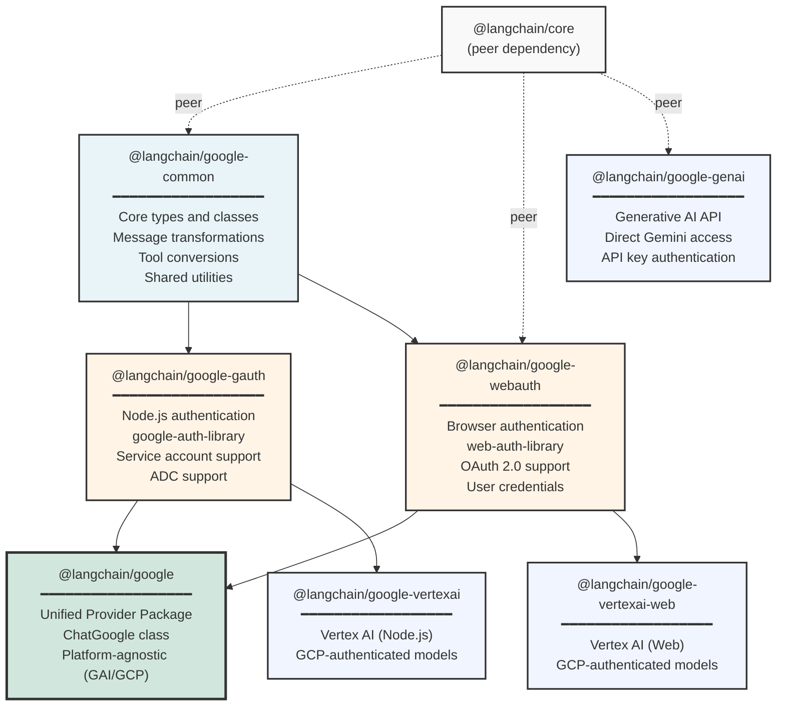
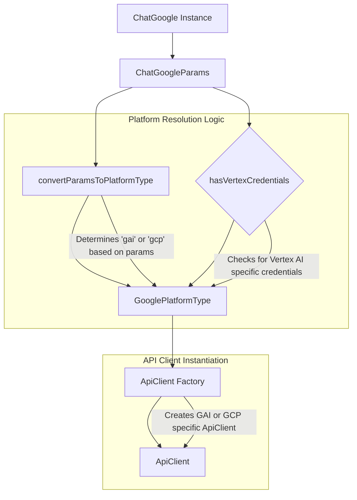

<!-- source: DeepWiki mcp.deepwiki.com · repo langchain-ai/langchainjs · page 5.4 Google Provider Ecosystem · fetched 2026-10-26 -->

# Google Provider Ecosystem

Relevant source files

The following files were used as context for generating this wiki page:

- [libs/providers/langchain-google-common/CHANGELOG.md](libs/providers/langchain-google-common/CHANGELOG.md)
- [libs/providers/langchain-google-common/package.json](libs/providers/langchain-google-common/package.json)
- [libs/providers/langchain-google-common/src/connection.ts](libs/providers/langchain-google-common/src/connection.ts)
- [libs/providers/langchain-google-common/src/tests/chat_models.test.ts](libs/providers/langchain-google-common/src/tests/chat_models.test.ts)
- [libs/providers/langchain-google-common/src/tests/data/chat-3-input-audio-mock.json](libs/providers/langchain-google-common/src/tests/data/chat-3-input-audio-mock.json)
- [libs/providers/langchain-google-common/src/tests/utils.test.ts](libs/providers/langchain-google-common/src/tests/utils.test.ts)
- [libs/providers/langchain-google-common/src/types.ts](libs/providers/langchain-google-common/src/types.ts)
- [libs/providers/langchain-google-common/src/utils/anthropic.ts](libs/providers/langchain-google-common/src/utils/anthropic.ts)
- [libs/providers/langchain-google-common/src/utils/gemini.ts](libs/providers/langchain-google-common/src/utils/gemini.ts)
- [libs/providers/langchain-google-gauth/CHANGELOG.md](libs/providers/langchain-google-gauth/CHANGELOG.md)
- [libs/providers/langchain-google-gauth/package.json](libs/providers/langchain-google-gauth/package.json)
- [libs/providers/langchain-google-genai/CHANGELOG.md](libs/providers/langchain-google-genai/CHANGELOG.md)
- [libs/providers/langchain-google-genai/package.json](libs/providers/langchain-google-genai/package.json)
- [libs/providers/langchain-google-genai/src/chat_models.ts](libs/providers/langchain-google-genai/src/chat_models.ts)
- [libs/providers/langchain-google-genai/src/index.ts](libs/providers/langchain-google-genai/src/index.ts)
- [libs/providers/langchain-google-genai/src/tests/chat_models.int.test.ts](libs/providers/langchain-google-genai/src/tests/chat_models.int.test.ts)
- [libs/providers/langchain-google-genai/src/tests/common.test.ts](libs/providers/langchain-google-genai/src/tests/common.test.ts)
- [libs/providers/langchain-google-genai/src/tests/gateway.test.ts](libs/providers/langchain-google-genai/src/tests/gateway.test.ts)
- [libs/providers/langchain-google-genai/src/tests/tool_call_conversion.test.ts](libs/providers/langchain-google-genai/src/tests/tool_call_conversion.test.ts)
- [libs/providers/langchain-google-genai/src/types.ts](libs/providers/langchain-google-genai/src/types.ts)
- [libs/providers/langchain-google-genai/src/utils/common.ts](libs/providers/langchain-google-genai/src/utils/common.ts)
- [libs/providers/langchain-google-genai/src/utils/errors.ts](libs/providers/langchain-google-genai/src/utils/errors.ts)
- [libs/providers/langchain-google-genai/src/utils/tests/errors.test.ts](libs/providers/langchain-google-genai/src/utils/tests/errors.test.ts)
- [libs/providers/langchain-google-genai/src/utils/validate_schema.ts](libs/providers/langchain-google-genai/src/utils/validate_schema.ts)
- [libs/providers/langchain-google-vertexai-web/CHANGELOG.md](libs/providers/langchain-google-vertexai-web/CHANGELOG.md)
- [libs/providers/langchain-google-vertexai-web/package.json](libs/providers/langchain-google-vertexai-web/package.json)
- [libs/providers/langchain-google-vertexai/CHANGELOG.md](libs/providers/langchain-google-vertexai/CHANGELOG.md)
- [libs/providers/langchain-google-vertexai/package.json](libs/providers/langchain-google-vertexai/package.json)
- [libs/providers/langchain-google-vertexai/src/tests/chat_models.int.test.ts](libs/providers/langchain-google-vertexai/src/tests/chat_models.int.test.ts)
- [libs/providers/langchain-google-webauth/CHANGELOG.md](libs/providers/langchain-google-webauth/CHANGELOG.md)
- [libs/providers/langchain-google-webauth/package.json](libs/providers/langchain-google-webauth/package.json)
- [libs/providers/langchain-google/package.json](libs/providers/langchain-google/package.json)
- [libs/providers/langchain-google/src/chat_models/api-types.ts](libs/providers/langchain-google/src/chat_models/api-types.ts)
- [libs/providers/langchain-google/src/chat_models/base.ts](libs/providers/langchain-google/src/chat_models/base.ts)
- [libs/providers/langchain-google/src/chat_models/index.ts](libs/providers/langchain-google/src/chat_models/index.ts)
- [libs/providers/langchain-google/src/chat_models/node.ts](libs/providers/langchain-google/src/chat_models/node.ts)
- [libs/providers/langchain-google/src/chat_models/tests/gateway.test.ts](libs/providers/langchain-google/src/chat_models/tests/gateway.test.ts)
- [libs/providers/langchain-google/src/chat_models/tests/index.int.test.ts](libs/providers/langchain-google/src/chat_models/tests/index.int.test.ts)
- [libs/providers/langchain-google/src/chat_models/tests/index.test.ts](libs/providers/langchain-google/src/chat_models/tests/index.test.ts)
- [libs/providers/langchain-google/src/chat_models/types.ts](libs/providers/langchain-google/src/chat_models/types.ts)
- [libs/providers/langchain-google/src/converters/messages.ts](libs/providers/langchain-google/src/converters/messages.ts)
- [libs/providers/langchain-google/src/converters/params.ts](libs/providers/langchain-google/src/converters/params.ts)
- [libs/providers/langchain-google/src/converters/tests/messages.test.ts](libs/providers/langchain-google/src/converters/tests/messages.test.ts)
- [libs/providers/langchain-google/src/converters/tests/tools.test.ts](libs/providers/langchain-google/src/converters/tests/tools.test.ts)
- [libs/providers/langchain-google/src/converters/tools.ts](libs/providers/langchain-google/src/converters/tools.ts)
- [libs/providers/langchain-google/src/openapi/gemini-openapi.json](libs/providers/langchain-google/src/openapi/gemini-openapi.json)
- [libs/providers/langchain-google/src/utils/stream_events.ts](libs/providers/langchain-google/src/utils/stream_events.ts)
- [libs/providers/langchain-google/src/utils/tests/stream_events.test.ts](libs/providers/langchain-google/src/utils/tests/stream_events.test.ts)
- [libs/providers/langchain-google/typegen.jsonc](libs/providers/langchain-google/typegen.jsonc)

This document describes the Google provider packages in LangChain.js, which provide integration with Google's AI services including Vertex AI and Google Generative AI (Gemini). The ecosystem consists of a unified core provider package (`@langchain/google`), shared common utilities, and environment-specific authentication strategies.

## Package Architecture Overview

The Google provider ecosystem uses a modular architecture where packages build on shared foundations. This design allows code reuse while providing environment-specific implementations for Node.js, browser, and different authentication methods.

**Dependency Flow and Package Roles:**

| Package | Dependencies | Purpose |
|---------|--------------|---------|
| `@langchain/google-common` | `@langchain/core`, `uuid` | Base types, transformations, and shared utilities [libs/providers/langchain-google-common/package.json:2-40](). |
| `@langchain/google-gauth` | `google-common`, `google-auth-library` | Node.js authentication layer (ADC, Service Accounts) [libs/providers/langchain-google-gauth/package.json:2-31](). |
| `@langchain/google-webauth` | `google-common`, `web-auth-library` | Browser authentication layer (OAuth 2.0) [libs/providers/langchain-google-webauth/package.json:2-28](). |
| `@langchain/google` | `google-auth-library`, `eventsource-parser` | Unified entry point for Gemini on both GAI and Vertex AI platforms [libs/providers/langchain-google/package.json:2-35](). |
| `@langchain/google-genai` | `@google/generative-ai` | Direct Gemini API access via API keys [libs/providers/langchain-google-genai/package.json:2-32](). |
| `@langchain/google-vertexai` | `@langchain/google-gauth` | Node.js specific Vertex AI integration [libs/providers/langchain-google-vertexai/package.json:2-26](). |
| `@langchain/google-vertexai-web` | `@langchain/google-webauth` | Web specific Vertex AI integration [libs/providers/langchain-google-vertexai-web/package.json:2-27](). |

**Sources:** [libs/providers/langchain-google-common/package.json:1-119](), [libs/providers/langchain-google-gauth/package.json:1-89](), [libs/providers/langchain-google-webauth/package.json:1-103](), [libs/providers/langchain-google-genai/package.json:1-74](), [libs/providers/langchain-google/package.json:1-92](), [libs/providers/langchain-google-vertexai/package.json:1-95](), [libs/providers/langchain-google-vertexai-web/package.json:1-87]()

## Unified Provider (@langchain/google)

The `@langchain/google` package introduces a unified `ChatGoogle` class designed to work across both Google AI (GAI) and Vertex AI (GCP) platforms.

### Base Implementation and Platform Selection
The core logic resides in `BaseChatGoogle`, which extends `BaseChatModel` [libs/providers/langchain-google/src/chat_models/base.ts:1-6](). It determines the platform type (`gai` or `gcp`) based on the presence of an API key or explicit configuration [libs/providers/langchain-google/src/chat_models/base.ts:146-149]().

**Key Configuration Parameters:**
- `model`: The Gemini model name (e.g., "gemini-1.5-pro") [libs/providers/langchain-google/src/chat_models/tests/index.int.test.ts:96]().
- `platformType`: Explicitly set "gai" or "gcp" [libs/providers/langchain-google/src/chat_models/base.ts:135]().
- `apiClient`: The abstract client for making HTTP requests [libs/providers/langchain-google/src/chat_models/base.ts:37]().

**Sources:** [libs/providers/langchain-google/src/chat_models/base.ts:1-173](), [libs/providers/langchain-google/src/chat_models/tests/index.int.test.ts:96]()

### Gateway Routing
The `applyGeminiGatewayParams` function handles routing requests through the LangSmith gateway for Gemini Developer API (`gai`) calls [libs/providers/langchain-google/src/chat_models/base.ts:131-140](). This is only applied when the resolved platform is `gai` and no explicit `endpoint` is set. Vertex AI configurations or explicit credentials bypass gateway routing [libs/providers/langchain-google/src/chat_models/base.ts:142-149]().

**Sources:** [libs/providers/langchain-google/src/chat_models/base.ts:131-173]()

## Message Conversion and Multimodal Support

The ecosystem uses specialized converters to bridge LangChain's message system with Google's Gemini API requirements.

### Content Block Translation
Gemini models utilize a "Part" based system. The `geminiContentBlockConverter` handles the translation of standard LangChain content blocks (text, image, audio, file) into Gemini `Part` objects [libs/providers/langchain-google/src/converters/messages.ts:35-41]().

- **Images**: Supports `base64`, `url`, and `id` (fileUri) sources [libs/providers/langchain-google/src/converters/messages.ts:47-111]().
- **Audio/Files**: Similar support for base64 and URIs, mapping to `inlineData` or `fileData` [libs/providers/langchain-google/src/converters/messages.ts:120-220]().

**Sources:** [libs/providers/langchain-google/src/converters/messages.ts:28-220]()

### Thinking and Reasoning
Recent Gemini models support "Thinking" traces. The `convertFieldsToThinkingConfig` function maps user parameters to Gemini's `thinkingConfig` [libs/providers/langchain-google/src/converters/params.ts:61-62](). This allows the model to output reasoning blocks before the final response. Models like `gemini-3.1-flash-lite` are identified as thinking models in test configurations [libs/providers/langchain-google/src/chat_models/tests/index.int.test.ts:107-109]().

**Sources:** [libs/providers/langchain-google/src/converters/params.ts:61-62](), [libs/providers/langchain-google/src/chat_models/tests/index.int.test.ts:107-109]()

### Tool Call Conversion
Tool calls are converted between LangChain's `ToolCall` and Gemini's `functionCall` structures. 
- `convertGeminiPartsToToolCalls`: Extracts tool calls from API responses, generating unique IDs if the server does not provide them [libs/providers/langchain-google/src/converters/messages.ts:5-44]().
- `convertMessagesToGeminiContents`: Merges consecutive `ToolMessage` instances into a single function turn for parallel tool execution [libs/providers/langchain-google/src/converters/tests/messages.test.ts:237-238]().

**Sources:** [libs/providers/langchain-google/src/converters/messages.ts:5-44](), [libs/providers/langchain-google/src/converters/tests/messages.test.ts:9-110](), [libs/providers/langchain-google/src/converters/tests/messages.test.ts:237-238]()

### Stream Events
The `convertGoogleGeminiStream` utility processes raw stream events from the Gemini API into LangChain's `ChatModelStreamEvent` format [libs/providers/langchain-google/src/utils/stream_events.ts:1-2](). This ensures a consistent streaming experience across different models and providers.

**Sources:** [libs/providers/langchain-google/src/utils/stream_events.ts:1-2]()

## Authentication Packages

The Google ecosystem provides two primary authentication strategies:

### @langchain/google-gauth (Node.js)
Provides authentication using the official `google-auth-library` [libs/providers/langchain-google-gauth/package.json:30](). It supports:
- **Application Default Credentials (ADC)**
- **Service Account Keys**
- **Google Cloud Environment Metadata**

**Sources:** [libs/providers/langchain-google-gauth/package.json:1-31]()

### @langchain/google-webauth (Browser)
Enables browser-based authentication using `web-auth-library` [libs/providers/langchain-google-webauth/package.json:27](). It is designed for client-side OAuth 2.0 flows.

**Sources:** [libs/providers/langchain-google-webauth/package.json:1-28]()

## Google Generative AI (@langchain/google-genai)

The `@langchain/google-genai` package is a specialized integration for the Google AI SDK (`@google/generative-ai`) [libs/providers/langchain-google-genai/package.json:31]().

### Features
- **API Key Auth**: Primarily used for simple API key authentication.
- **Role Mapping**: Maps LangChain roles (ai, system, human, tool) to Gemini roles (model, system, user, function) [libs/providers/langchain-google-genai/src/utils/common.ts:73-95]().
- **Safety Settings**: Configurable safety thresholds to prevent blocked prompts.
- **Token Details**: Detailed usage metadata including `inputTokenDetails` (cache read/write) and `outputTokenDetails` [libs/providers/langchain-google-genai/src/utils/common.ts:32-33]().

### Multimodal Logic
The package implements `_multimodalContentBlockToPart` to handle `ContentBlock.Multimodal.Data`. It differentiates between `DataRecordBase64` (inlineData) and `DataRecordUrl` (fileData) [libs/providers/langchain-google-genai/src/utils/common.ts:144-181]().

**Sources:** [libs/providers/langchain-google-genai/src/utils/common.ts:60-237](), [libs/providers/langchain-google-genai/package.json:30-33]()

## Testing and Compliance

The Google provider ecosystem uses a combination of unit, integration, and standard tests to ensure reliability.

| Test Type | Package/Tool | Description |
|-----------|--------------|-------------|
| **Unit** | `vitest` | Fast tests for converters and utilities [libs/providers/langchain-google/src/chat_models/tests/index.test.ts:10](). |
| **Integration** | `vitest --mode int` | Tests against live Google APIs [libs/providers/langchain-google-gauth/package.json:23](). |
| **Standard** | `@langchain/standard-tests` | Ensures compliance with core `BaseChatModel` interfaces [libs/providers/langchain-google-genai/package.json:26](). |

**Sources:** [libs/providers/langchain-google/src/chat_models/tests/index.test.ts:1-10](), [libs/providers/langchain-google-gauth/package.json:20-27](), [libs/providers/langchain-google-genai/package.json:20-26]()

---

