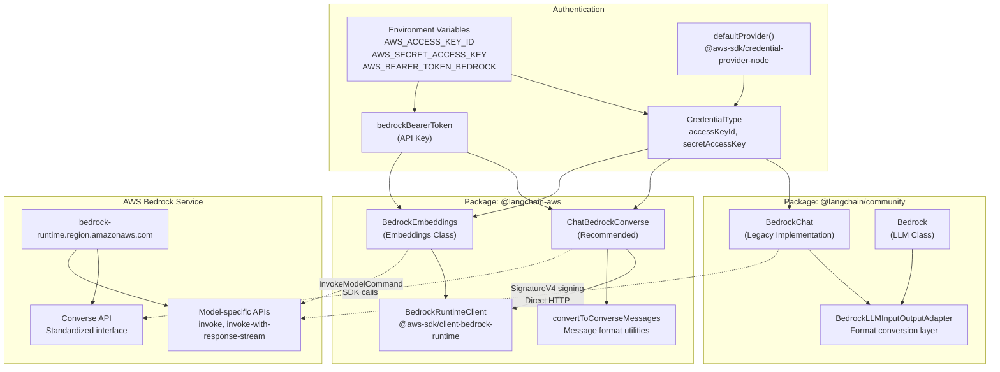
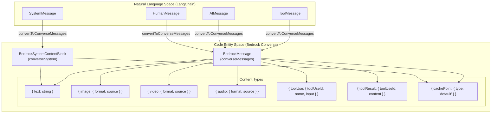
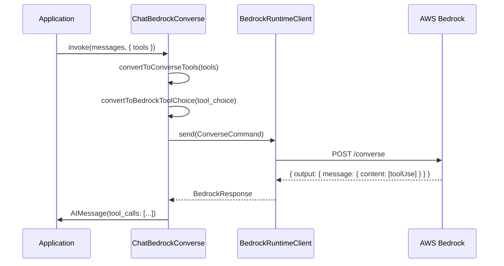
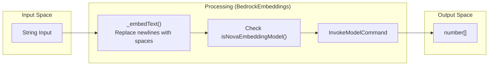

<!-- source: DeepWiki mcp.deepwiki.com · repo langchain-ai/langchainjs · page 5.5 AWS Bedrock Integration · fetched 2026-10-26 -->

# AWS Bedrock Integration

Relevant source files

The following files were used as context for generating this wiki page:

- [libs/langchain-core/src/messages/block_translators/bedrock_converse.ts](libs/langchain-core/src/messages/block_translators/bedrock_converse.ts)
- [libs/langchain-core/src/messages/block_translators/tests/bedrock_converse.test.ts](libs/langchain-core/src/messages/block_translators/tests/bedrock_converse.test.ts)
- [libs/providers/langchain-aws/README.md](libs/providers/langchain-aws/README.md)
- [libs/providers/langchain-aws/src/chat_models.ts](libs/providers/langchain-aws/src/chat_models.ts)
- [libs/providers/langchain-aws/src/embeddings.ts](libs/providers/langchain-aws/src/embeddings.ts)
- [libs/providers/langchain-aws/src/tests/chat_models.int.test.ts](libs/providers/langchain-aws/src/tests/chat_models.int.test.ts)
- [libs/providers/langchain-aws/src/tests/chat_models.invocation.test.ts](libs/providers/langchain-aws/src/tests/chat_models.invocation.test.ts)
- [libs/providers/langchain-aws/src/tests/chat_models.test.ts](libs/providers/langchain-aws/src/tests/chat_models.test.ts)
- [libs/providers/langchain-aws/src/tests/convertToConverseTools.test.ts](libs/providers/langchain-aws/src/tests/convertToConverseTools.test.ts)
- [libs/providers/langchain-aws/src/tests/embeddings.test.ts](libs/providers/langchain-aws/src/tests/embeddings.test.ts)
- [libs/providers/langchain-aws/src/utils/bedrock_auth.ts](libs/providers/langchain-aws/src/utils/bedrock_auth.ts)
- [libs/providers/langchain-aws/src/utils/compat.ts](libs/providers/langchain-aws/src/utils/compat.ts)
- [libs/providers/langchain-aws/src/utils/message_inputs.ts](libs/providers/langchain-aws/src/utils/message_inputs.ts)
- [libs/providers/langchain-aws/src/utils/message_outputs.ts](libs/providers/langchain-aws/src/utils/message_outputs.ts)
- [libs/providers/langchain-aws/src/utils/stream_timeout.ts](libs/providers/langchain-aws/src/utils/stream_timeout.ts)
- [libs/providers/langchain-aws/src/utils/tests/message_outputs.test.ts](libs/providers/langchain-aws/src/utils/tests/message_outputs.test.ts)
- [libs/providers/langchain-aws/src/utils/tools.ts](libs/providers/langchain-aws/src/utils/tools.ts)

This document describes the AWS Bedrock integration implementations in LangChain.js. AWS Bedrock provides access to foundation models from multiple providers (Anthropic, Meta, Cohere, AI21, Amazon, Mistral) through a unified API.

**Scope**: This page covers the two main Bedrock integrations: `BedrockChat` (legacy) in `@langchain/community` and `ChatBedrockConverse` (recommended) in `@langchain/aws`. It also covers `BedrockEmbeddings` for vector generation and the use of the Converse API.

---

## Integration Architecture

LangChain.js provides two distinct implementations for AWS Bedrock, each with different architectural approaches and capabilities.

### Dual Implementation Pattern

The diagram below illustrates the relationship between the provider packages and the underlying AWS SDK.

Title: Bedrock Integration Architecture

**Sources**: [libs/providers/langchain-aws/src/chat_models.ts:23-59](), [libs/providers/langchain-aws/src/embeddings.ts:1-7](), [libs/providers/langchain-aws/README.md:41-56]()

---

## ChatBedrockConverse (Recommended)

The `ChatBedrockConverse` class in `@langchain/aws` is the modern implementation utilizing the AWS SDK's Converse API. It provides a consistent interface across all supported Bedrock models.

### Core Configuration

The class can be initialized with various AWS authentication methods and model parameters.

| Parameter | Type | Description |
|-----------|------|-------------|
| `model` | `string` | Model ID (e.g., `anthropic.claude-3-sonnet-20240229-v1:0`) [libs/providers/langchain-aws/src/chat_models.ts:144-146]() |
| `region` | `string` | AWS region (e.g., `us-east-1`) [libs/providers/langchain-aws/src/chat_models.ts:161-165]() |
| `credentials` | `CredentialType` | Explicit AWS credentials [libs/providers/langchain-aws/src/chat_models.ts:168-171]() |
| `bedrockBearerToken` | `string` | API key for bearer-token authentication [libs/providers/langchain-aws/src/chat_models.ts:129-132]() |
| `client` | `BedrockRuntimeClient` | Custom AWS SDK client instance [libs/providers/langchain-aws/src/chat_models.ts:95-100]() |
| `temperature` | `number` | Sampling temperature [libs/providers/langchain-aws/src/chat_models.ts:174-176]() |
| `maxTokens` | `number` | Maximum tokens to generate [libs/providers/langchain-aws/src/chat_models.ts:179-181]() |
| `guardrailConfig`| `GuardrailConfiguration`| AWS Bedrock Guardrail settings [libs/providers/langchain-aws/src/chat_models.ts:219-222]() |
| `applicationInferenceProfile` | `string` | Application Inference Profile ARN [libs/providers/langchain-aws/src/chat_models.ts:149-155]() |
| `streamIdleTimeout` | `number` | Timeout for stream inactivity in milliseconds [libs/providers/langchain-aws/src/chat_models.ts:249-252]() |

**Sources**: [libs/providers/langchain-aws/src/chat_models.ts:88-252](), [libs/providers/langchain-aws/README.md:63-69]()

### Message Data Flow

The integration transforms LangChain's standard message types into the Bedrock Converse API format using `convertToConverseMessages` defined in `libs/providers/langchain-aws/src/utils/message_inputs.ts`.

Title: Message Conversion Logic

**Key Implementation Details**:
- **System Messages**: LangChain `SystemMessage` instances are extracted and converted into an array of `BedrockSystemContentBlock` [libs/providers/langchain-aws/src/utils/message_inputs.ts:468-472]().
- **Multimodal Support**: `extractImageInfo` handles base64 image data parsing and format detection [libs/providers/langchain-aws/src/utils/message_inputs.ts:141-172](). Video and audio are supported via `convertMultimodalVideoBlock` and `convertMultimodalAudioBlock` using `resolveMediaSource` to handle bytes or S3 locations [libs/providers/langchain-aws/src/utils/message_inputs.ts:240-309]().
- **Prompt Caching**: Content blocks with `type: "cache_point"` are converted to Bedrock's `cachePoint` structure, enabling efficient context reuse [libs/providers/langchain-aws/src/utils/message_inputs.ts:50-60](). The `applyCachePointsToConversePayload` function injects cache points into system messages, the last user message, or tools based on `BedrockPromptCacheControl` settings [libs/providers/langchain-aws/src/utils/message_inputs.ts:90-139]().

**Sources**: [libs/providers/langchain-aws/src/utils/message_inputs.ts:24-111](), [libs/providers/langchain-aws/src/tests/chat_models.test.ts:24-111]()

### Tool Calling and Execution

`ChatBedrockConverse` supports tool calling through the `ConverseAPI`. Tools are converted using `convertToConverseTools` and tool choice is handled by `convertToBedrockToolChoice` [libs/providers/langchain-aws/src/chat_models.ts:825-896]().

Title: Tool Call Sequence

**Tool Conversion**:
The `convertToConverseTools` function [libs/providers/langchain-aws/src/utils/tools.ts:16-54]() handles various tool formats:
- LangChain `StructuredToolInterface` (from `tool()` function)
- OpenAI `ToolDefinition` (from `ToolStrategy` for structured output)
- Native Bedrock `BedrockTool`

**Tool Choice**:
`convertToBedrockToolChoice` [libs/providers/langchain-aws/src/utils/tools.ts:63-128]() maps LangChain's `tool_choice` options (`"auto"`, `"any"`, tool name string) to Bedrock's `BedrockToolChoice` structure. It also validates if the chosen tool choice type is supported by the specific model using `supportedToolChoiceValuesForModel` [libs/providers/langchain-aws/src/utils/tools.ts:130-149]().

**Sources**: [libs/providers/langchain-aws/src/chat_models.ts:825-896](), [libs/providers/langchain-aws/src/utils/tools.ts:48-52](), [libs/providers/langchain-aws/src/tests/convertToConverseTools.test.ts:9-67]()

---

## BedrockEmbeddings

The `BedrockEmbeddings` class provides vector generation for text using models like Amazon Titan or Nova.

### Model-Specific Request Formats

The implementation branches logic based on the model ID, specifically distinguishing between Titan and Nova models. Nova models require a `messages` array, while Titan models use `inputText` [libs/providers/langchain-aws/src/embeddings.ts:160-177]().

| Model Category | Logic Function | Request Field |
|----------------|----------------|---------------|
| Amazon Nova | `isNovaEmbeddingModel` | `messages` |
| Amazon Titan | Default | `inputText` |

**Sources**: [libs/providers/langchain-aws/src/embeddings.ts:19-21](), [libs/providers/langchain-aws/src/embeddings.ts:160-177]()

### Data Flow for Embeddings

Title: Embedding Generation Flow

**Sources**: [libs/providers/langchain-aws/src/embeddings.ts:152-199](), [libs/providers/langchain-aws/src/tests/embeddings.test.ts:14-55]()

---

## Advanced Features and Error Handling

### Service Tiers and Performance

Bedrock supports `ServiceTierType` (priority, default, flex, reserved) to control latency and cost. This can be set globally in the constructor or per invocation [libs/providers/langchain-aws/src/chat_models.ts:230-233](). Performance can also be tuned via `performanceConfig` (e.g., `latency: "optimized"`) [libs/providers/langchain-aws/src/chat_models.ts:224-228]().

### Guardrails

The `guardrailConfig` parameter allows integration with AWS Bedrock Guardrails. This configuration is passed directly to the Bedrock Converse API to enforce safety policies [libs/providers/langchain-aws/src/chat_models.ts:219-222]().

### Streaming

Streaming is supported via `ConverseStreamCommand`. LangChain processes the stream by handling `contentBlockDelta` events using `handleConverseStreamContentBlockDelta` to construct `AIMessageChunk` objects [libs/providers/langchain-aws/src/chat_models.ts:550-600](). Usage metadata (token counts) is extracted from the stream metadata via `handleConverseStreamMetadata` if `streamUsage` is enabled [libs/providers/langchain-aws/src/chat_models.ts:178-183]().

**Streaming Timeouts**:
The `streamIdleTimeout` parameter [libs/providers/langchain-aws/src/chat_models.ts:249-252]() controls how long the client waits for the first or next chunk from the Bedrock stream.
- `DEFAULT_STREAM_IDLE_TIMEOUT` is 60 seconds [libs/providers/langchain-aws/src/utils/stream_timeout.ts:2]().
- `withRequestIdleTimeout` [libs/providers/langchain-aws/src/utils/stream_timeout.ts:48-78]() monitors the initial response.
- `withStreamIdleTimeout` [libs/providers/langchain-aws/src/utils/stream_timeout.ts:81-128]() monitors subsequent chunks.
- If a timeout occurs, `createStreamIdleTimeoutError` generates an error with `lc_error_code: "MODEL_STREAM_TIMEOUT"` [libs/providers/langchain-aws/src/utils/stream_timeout.ts:18-26]().

### Authentication

`ChatBedrockConverse` and `BedrockEmbeddings` support both standard AWS credentials and bearer token authentication.
- **Standard Credentials**: `accessKeyId`, `secretAccessKey`, `sessionToken` can be provided directly or via environment variables (`BEDROCK_AWS_ACCESS_KEY_ID`, `BEDROCK_AWS_SECRET_ACCESS_KEY`, `BEDROCK_AWS_SESSION_TOKEN`) [libs/providers/langchain-aws/src/chat_models.ts:108-122]().
- **Bearer Token**: `bedrockBearerToken` can be provided directly or via the `AWS_BEARER_TOKEN_BEDROCK` environment variable [libs/providers/langchain-aws/src/chat_models.ts:129-132](). When a bearer token is present, it takes precedence over standard credentials [libs/providers/langchain-aws/src/utils/bedrock_auth.ts:10-12](). The `createBedrockBearerTokenClientConfig` utility configures the `BedrockRuntimeClient` for bearer token usage [libs/providers/langchain-aws/src/utils/bedrock_auth.ts:14-21]().

### Error Normalization

The integration includes a `normalizeBedrockError` utility in `libs/providers/langchain-aws/src/utils/errors.ts`. It extracts descriptive error messages from complex AWS SDK error objects or arrays of errors, ensuring LangChain users receive readable feedback [libs/providers/langchain-aws/src/utils/errors.ts:38-47]().

**Sources**: [libs/providers/langchain-aws/src/chat_models.ts:109-110](), [libs/providers/langchain-aws/src/utils/message_outputs.ts:56-59](), [libs/providers/langchain-aws/README.md:131-145](), [libs/providers/langchain-aws/src/tests/chat_models.invocation.test.ts:102-148]()

---

