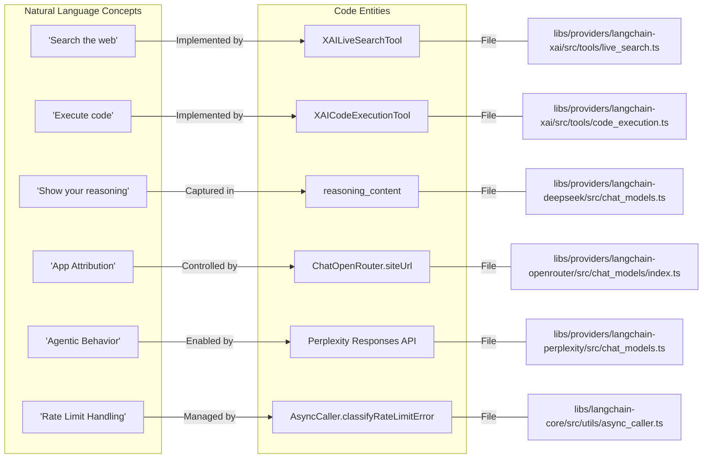

<!-- source: DeepWiki mcp.deepwiki.com · repo langchain-ai/langchainjs · page 5.6 OpenAI-Compatible Providers · fetched 2026-10-26 -->

# OpenAI-Compatible Providers

<details>
<summary>Relevant source files</summary>

The following files were used as context for generating this wiki page:

- [libs/langchain-core/src/utils/async_caller.ts](libs/langchain-core/src/utils/async_caller.ts)
- [libs/langchain-core/src/utils/p-retry/index.js](libs/langchain-core/src/utils/p-retry/index.js)
- [libs/langchain-core/src/utils/tests/async_caller.test.ts](libs/langchain-core/src/utils/tests/async_caller.test.ts)
- [libs/providers/langchain-deepseek/src/chat_models.ts](libs/providers/langchain-deepseek/src/chat_models.ts)
- [libs/providers/langchain-deepseek/src/tests/chat_models_reasoning.test.ts](libs/providers/langchain-deepseek/src/tests/chat_models_reasoning.test.ts)
- [libs/providers/langchain-groq/src/chat_models.ts](libs/providers/langchain-groq/src/chat_models.ts)
- [libs/providers/langchain-groq/src/tests/chat_models.test.ts](libs/providers/langchain-groq/src/tests/chat_models.test.ts)
- [libs/providers/langchain-groq/src/tests/chat_models_structured_output.int.test.ts](libs/providers/langchain-groq/src/tests/chat_models_structured_output.int.test.ts)
- [libs/providers/langchain-groq/src/tests/groq-schema.test.ts](libs/providers/langchain-groq/src/tests/groq-schema.test.ts)
- [libs/providers/langchain-groq/src/utils/groq-schema.ts](libs/providers/langchain-groq/src/utils/groq-schema.ts)
- [libs/providers/langchain-openrouter/src/chat_models/index.ts](libs/providers/langchain-openrouter/src/chat_models/index.ts)
- [libs/providers/langchain-openrouter/src/chat_models/tests/index.test.ts](libs/providers/langchain-openrouter/src/chat_models/tests/index.test.ts)
- [libs/providers/langchain-openrouter/src/chat_models/types.ts](libs/providers/langchain-openrouter/src/chat_models/types.ts)
- [libs/providers/langchain-openrouter/src/utils/errors.ts](libs/providers/langchain-openrouter/src/utils/errors.ts)
- [libs/providers/langchain-openrouter/src/utils/tests/errors.test.ts](libs/providers/langchain-openrouter/src/utils/tests/errors.test.ts)
- [libs/providers/langchain-perplexity/LICENSE](libs/providers/langchain-perplexity/LICENSE)
- [libs/providers/langchain-perplexity/README.md](libs/providers/langchain-perplexity/README.md)
- [libs/providers/langchain-perplexity/src/chat_models.ts](libs/providers/langchain-perplexity/src/chat_models.ts)
- [libs/providers/langchain-perplexity/src/index.ts](libs/providers/langchain-perplexity/src/index.ts)
- [libs/providers/langchain-perplexity/src/retrievers.ts](libs/providers/langchain-perplexity/src/retrievers.ts)
- [libs/providers/langchain-perplexity/src/tests/chat_models.int.test.ts](libs/providers/langchain-perplexity/src/tests/chat_models.int.test.ts)
- [libs/providers/langchain-perplexity/src/tests/chat_models.test.ts](libs/providers/langchain-perplexity/src/tests/chat_models.test.ts)
- [libs/providers/langchain-perplexity/src/tests/chat_models_responses.test.ts](libs/providers/langchain-perplexity/src/tests/chat_models_responses.test.ts)
- [libs/providers/langchain-perplexity/src/tests/retrievers.int.test.ts](libs/providers/langchain-perplexity/src/tests/retrievers.int.test.ts)
- [libs/providers/langchain-perplexity/src/tests/retrievers.test.ts](libs/providers/langchain-perplexity/src/tests/retrievers.test.ts)
- [libs/providers/langchain-perplexity/src/tests/tools.int.test.ts](libs/providers/langchain-perplexity/src/tests/tools.int.test.ts)
- [libs/providers/langchain-perplexity/src/tests/tools.test.ts](libs/providers/langchain-perplexity/src/tests/tools.test.ts)
- [libs/providers/langchain-perplexity/src/tools.ts](libs/providers/langchain-perplexity/src/tools.ts)
- [libs/providers/langchain-xai/README.md](libs/providers/langchain-xai/README.md)
- [libs/providers/langchain-xai/src/chat_models/completions.ts](libs/providers/langchain-xai/src/chat_models/completions.ts)
- [libs/providers/langchain-xai/src/chat_models/index.ts](libs/providers/langchain-xai/src/chat_models/index.ts)
- [libs/providers/langchain-xai/src/chat_models/responses-types.ts](libs/providers/langchain-xai/src/chat_models/responses-types.ts)
- [libs/providers/langchain-xai/src/chat_models/responses.ts](libs/providers/langchain-xai/src/chat_models/responses.ts)
- [libs/providers/langchain-xai/src/chat_models/tests/completions.int.test.ts](libs/providers/langchain-xai/src/chat_models/tests/completions.int.test.ts)
- [libs/providers/langchain-xai/src/chat_models/tests/completions.standard.int.test.ts](libs/providers/langchain-xai/src/chat_models/tests/completions.standard.int.test.ts)
- [libs/providers/langchain-xai/src/chat_models/tests/completions.standard.test.ts](libs/providers/langchain-xai/src/chat_models/tests/completions.standard.test.ts)
- [libs/providers/langchain-xai/src/chat_models/tests/completions.test.ts](libs/providers/langchain-xai/src/chat_models/tests/completions.test.ts)
- [libs/providers/langchain-xai/src/chat_models/tests/completions_structured_output.int.test.ts](libs/providers/langchain-xai/src/chat_models/tests/completions_structured_output.int.test.ts)
- [libs/providers/langchain-xai/src/chat_models/tests/responses.int.test.ts](libs/providers/langchain-xai/src/chat_models/tests/responses.int.test.ts)
- [libs/providers/langchain-xai/src/chat_models/tests/responses.test.ts](libs/providers/langchain-xai/src/chat_models/tests/responses.test.ts)
- [libs/providers/langchain-xai/src/tools/code_execution.ts](libs/providers/langchain-xai/src/tools/code_execution.ts)
- [libs/providers/langchain-xai/src/tools/collections_search.ts](libs/providers/langchain-xai/src/tools/collections_search.ts)
- [libs/providers/langchain-xai/src/tools/index.ts](libs/providers/langchain-xai/src/tools/index.ts)
- [libs/providers/langchain-xai/src/tools/live_search.ts](libs/providers/langchain-xai/src/tools/live_search.ts)
- [libs/providers/langchain-xai/src/tools/tests/code_execution.test.ts](libs/providers/langchain-xai/src/tools/tests/code_execution.test.ts)
- [libs/providers/langchain-xai/src/tools/tests/collections_search.test.ts](libs/providers/langchain-xai/src/tools/tests/collections_search.test.ts)

</details>


This document covers additional first-party provider packages in the LangChain.js ecosystem, including xAI, OpenRouter, Groq, DeepSeek, Mistral AI, Cohere, and others. These packages extend `@langchain/core` abstractions to provide specialized capabilities like live search, reasoning models, and optimized routing.

---

## xAI Integration (`@langchain/xai`)

The `@langchain/xai` package provides integration with xAI's Grok models. While compatible with the OpenAI API, it includes specialized features for live web search, code execution, and reasoning.

### Key Classes and Functions
- **`ChatXAI`**: The primary chat model class. It extends `ChatOpenAICompletions` but adds xAI-specific parameters like `search_parameters` and support for built-in tools [libs/providers/langchain-xai/src/chat_models/completions.ts:166-224]().
- **`XAILiveSearchTool`**: A specialized tool type for xAI's Live Search API [libs/providers/langchain-xai/src/tools/live_search.ts:31-33]().
- **`XAICodeExecutionTool`**: A tool enabling Grok to execute code in a sandboxed environment [libs/providers/langchain-xai/src/tools/code_execution.ts:13-15]().
- **`ChatXAIResponses`**: Provides access to the xAI Responses API for managing model outputs [libs/providers/langchain-xai/src/chat_models/responses.ts:38-40]().

### Built-in Tools and Reasoning
xAI supports "built-in" tools that are executed server-side. The `ChatXAI` model detects these tools during invocation and moves them into the `search_parameters` field of the request body [libs/providers/langchain-xai/src/chat_models/completions.ts:143-159]().

| Tool Type | Code Entity | Purpose |
|-----------|-------------|---------|
| `live_search` | `XAI_LIVE_SEARCH_TOOL_TYPE` | Server-side web and social search [libs/providers/langchain-xai/src/tools/live_search.ts:31-33](). |
| `code_interpreter` | `XAI_CODE_EXECUTION_TOOL_TYPE` | Server-side sandboxed code execution [libs/providers/langchain-xai/src/tools/code_execution.ts:13-15](). |

Reasoning content from Grok models (like Grok-3) is captured in the `reasoning_content` field within `XAIAdditionalKwargs` [libs/providers/langchain-xai/src/chat_models/completions.ts:81-87]().

Sources: [libs/providers/langchain-xai/src/chat_models/completions.ts:1-229](), [libs/providers/langchain-xai/src/tools/live_search.ts:31-33](), [libs/providers/langchain-xai/src/tools/code_execution.ts:13-15]()

---

## OpenRouter Integration (`@langchain/openrouter`)

OpenRouter acts as a unified interface for hundreds of models. The `@langchain/openrouter` package implements specific logic for attribution headers and model routing.

### Attribution and Headers
OpenRouter uses specific HTTP headers to identify the calling application for its dashboard.
- **`HTTP-Referer`**: Set via `siteUrl` (defaults to LangChain docs) [libs/providers/langchain-openrouter/src/chat_models/types.ts:78-82]().
- **`X-Title`**: Set via `siteName` (defaults to 'LangChain') [libs/providers/langchain-openrouter/src/chat_models/types.ts:83-90]().
- **`X-OpenRouter-Categories`**: Set via `appCategories` for marketplace classification [libs/providers/langchain-openrouter/src/chat_models/types.ts:91-102]().

### Model Routing and Parameters
OpenRouter supports a `models` array for fallback routing and a `route` strategy [libs/providers/langchain-openrouter/src/chat_models/types.ts:52-55]().

### Error Mapping
The `OpenRouterError` class is used to wrap API errors, providing a consistent error handling mechanism. `OpenRouterAuthError` specifically handles authentication failures [libs/providers/langchain-openrouter/src/utils/errors.ts:1-10](). The `ChatOpenRouter` constructor throws `OpenRouterAuthError` if `OPENROUTER_API_KEY` is not set [libs/providers/langchain-openrouter/src/chat_models/tests/index.test.ts:131-144]().

#### Diagram: OpenRouter Request Flow with Attribution and Error Handling
```mermaid
graph TD
    A[User Application] --> B{ChatOpenRouter.invoke()};
    B --> C{Build Request Headers};
    C --> D{Construct OpenRouter Request Body};
    D --> E[Send Request to OpenRouter API];
    E -- HTTP 200 OK --> F[Parse Response];
    E -- HTTP 401 Unauthorized --> G[Throw OpenRouterAuthError];
    E -- Other HTTP Error --> H[Throw OpenRouterError];
    F --> I[Return ChatResult];

    subgraph "Header Construction"
        C1["siteUrl (HTTP-Referer)"]
        C2["siteName (X-Title)"]
        C3["appCategories (X-OpenRouter-Categories)"]
    end

    subgraph "Request Body Construction"
        D1["model"]
        D2["messages"]
        D3["models (routing list)"]
        D4["route (strategy)"]
        D5["transforms"]
        D6["prediction"]
    end

    C --> C1;
    C --> C2;
    C --> C3;
    D --> D1;
    D --> D2;
    D --> D3;
    D --> D4;
    D --> D5;
    D --> D6;

    style G fill:#f9f,stroke:#333,stroke-width:2px
    style H fill:#f9f,stroke:#333,stroke-width:2px
```

Sources: [libs/providers/langchain-openrouter/src/chat_models/index.ts:88-232](), [libs/providers/langchain-openrouter/src/chat_models/tests/index.test.ts:147-215](), [libs/providers/langchain-openrouter/src/chat_models/types.ts:1-129](), [libs/providers/langchain-openrouter/src/utils/errors.ts:1-10](), [libs/providers/langchain-openrouter/src/chat_models/tests/index.test.ts:131-144]()

---

## DeepSeek Integration (`@langchain/deepseek`)

The `@langchain/deepseek` package integrates DeepSeek's models, specifically supporting the `deepseek-reasoner` (R1) series which includes internal "thinking" processes.

### Reasoning and Think Tags
DeepSeek models output a reasoning chain before the final answer. The integration captures this in `additional_kwargs`:
- **`reasoning_content`**: Contains the model's internal reasoning process [libs/providers/langchain-deepseek/src/chat_models.ts:129-131]().

When streaming, `ChatDeepSeek` emits `AIMessageChunk` objects where the `reasoning_content` is populated as it arrives [libs/providers/langchain-deepseek/src/chat_models.ts:160-162]().

Sources: [libs/providers/langchain-deepseek/src/chat_models.ts:1-142]()

---

## Groq Integration (`@langchain/groq`)

The `@langchain/groq` package provides high-speed inference. It includes a custom implementation of `withStructuredOutput` that supports `functionCalling` and `jsonMode` [libs/providers/langchain-groq/src/chat_models.ts:655-660]().

### Technical Details
- **SDK**: Wraps `groq-sdk` [libs/providers/langchain-groq/src/chat_models.ts:39]().
- **Usage Metadata**: Supports `streamUsage` to include token counts in the final chunk of a stream via `stream_options` [libs/providers/langchain-groq/src/chat_models.ts:143-152]().
- **Performance Metrics**: Captures `TimingMetadata` including `queue_time` and `completion_time` [libs/providers/langchain-groq/src/chat_models.ts:169-189]().

Sources: [libs/providers/langchain-groq/src/chat_models.ts:1-232](), [libs/providers/langchain-groq/src/utils/groq-schema.ts:1-69]()

---

## Mistral AI Integration (`@langchain/mistralai`)

The `@langchain/mistralai` package wraps the official `@mistralai/mistralai` SDK [libs/providers/langchain-mistralai/package.json:28]().

### Message Conversion Logic
Mistral requires a strict sequence of messages. The integration filters out tool calls that do not have a corresponding `ToolMessage` result, as the Mistral API will reject "orphan" tool calls [libs/providers/langchain-mistralai/src/tests/chat_models.test.ts:75-112]().

### Tool Call ID Normalization
Mistral requires tool call IDs to follow a specific format. The integration uses `_convertToolCallIdToMistralCompatible` to hash arbitrary LangChain IDs into a format accepted by the Mistral API [libs/providers/langchain-mistralai/src/utils.ts:15-17]().

Sources: [libs/providers/langchain-mistralai/src/chat_models.ts:1-202](), [libs/providers/langchain-mistralai/src/utils.ts:1-25]()

---

## Perplexity Integration (`@langchain/perplexity`)

The `@langchain/perplexity` package integrates Perplexity AI models, supporting both the standard Chat Completions API and the specialized Responses API (also known as the Agent API).

### Responses API (Agent API)
Perplexity offers a Responses API for more advanced agentic capabilities, including built-in tools and conversational state management.
- **`useResponsesApi`**: A boolean flag that explicitly forces the use of the Responses API [libs/providers/langchain-perplexity/src/chat_models.ts:165-166]().
- **Automatic Routing**: The `_useResponsesApi` function automatically routes requests to the Responses API if certain conditions are met, such as the presence of built-in tools (`web_search`, `fetch_url`, `finance_search`, `people_search`) or Responses-only fields (`previousResponseId`, `instructions`, `input`, `include`) [libs/providers/langchain-perplexity/src/chat_models.ts:213-217]().
- **Built-in Tools**: Perplexity supports built-in tools like `web_search` which are handled by the Responses API [libs/providers/langchain-perplexity/src/chat_models.ts:183-185]().
- **Conversational State**: The `previousResponseId` option allows continuing a prior Agent API turn, maintaining conversational context [libs/providers/langchain-perplexity/src/chat_models.ts:191-194]().
- **Structured Output**: Perplexity supports `response_format` for structured output, including JSON schema [libs/providers/langchain-perplexity/src/chat_models.ts:170-177]().

### Error Handling and Rate Limiting
The `AsyncCaller` utility in `@langchain/core` provides robust error handling, including retry logic and rate limit classification.
- **`classifyRateLimitError`**: This function analyzes errors to determine if they are rate limits, and if so, whether they are retryable, capacity-based, or quota-exhausted [libs/langchain-core/src/utils/async_caller.ts:209-251]().
- **`parseRetryAfterMs`**: Extracts `Retry-After` header values or parses retry hints from error messages to determine delay times [libs/langchain-core/src/utils/async_caller.ts:183-207]().
- **Non-Retryable Errors**: HTTP 4xx errors (e.g., 400 Bad Request, 401 Unauthorized) are generally not retried [libs/langchain-core/src/utils/async_caller.ts:7-18]().
- **Quota Exhaustion**: Errors indicating insufficient quota are classified as `stop` actions, preventing further retries [libs/langchain-core/src/utils/async_caller.ts:218-228]().

#### Diagram: Perplexity API Routing and Error Handling
```mermaid
graph TD
    A[User Request] --> B{ChatPerplexity.invoke()};
    B --> C{Check for Responses API Triggers};
    C -- useResponsesApi: true --> D[Call Perplexity Responses API];
    C -- Built-in Tools Present --> D;
    C -- previousResponseId Present --> D;
    C -- instructions/input/include Present --> D;
    C -- No Triggers --> E[Call Perplexity Chat Completions API];

    D -- API Call --> F{Perplexity API};
    E -- API Call --> F;

    F -- HTTP 200 OK --> G[Parse Response];
    F -- HTTP 429 Rate Limit --> H{classifyRateLimitError};
    F -- Other HTTP Error --> I[Throw PerplexityError];

    H -- Action: "wait" --> J[Retry after delay (parseRetryAfterMs)];
    H -- Action: "capacity" --> K[Throw RateLimitCapacityError];
    H -- Action: "stop" --> L[Throw RateLimitQuotaExhaustedError];

    J --> F;
    G --> M[Return ChatResult];

    style K fill:#f9f,stroke:#333,stroke-width:2px
    style L fill:#f9f,stroke:#333,stroke-width:2px
    style I fill:#f9f,stroke:#333,stroke-width:2px
```

Sources: [libs/providers/langchain-perplexity/src/chat_models.ts:1-217](), [libs/providers/langchain-perplexity/src/tests/chat_models_responses.test.ts:50-159](), [libs/langchain-core/src/utils/async_caller.ts:1-251](), [libs/langchain-core/src/utils/tests/async_caller.test.ts:153-187]()

---

## Other Notable Providers

| Package | Key Class | Notable Feature |
|---------|-----------|-----------------|
| `@langchain/cloudflare` | `ChatCloudflareWorkersAI` | Integration for Cloudflare Workers AI [libs/providers/langchain-cloudflare/package.json:2](). |
| `@langchain/fireworks` | `ChatFireworks` | Extends `@langchain/openai` for Fireworks AI models [libs/providers/langchain-fireworks/package.json:28](). |
| `@langchain/together-ai` | `ChatTogetherAI` | Extends `@langchain/openai` for Together AI endpoints [libs/providers/langchain-together-ai/package.json:30](). |
| `@langchain/cohere` | `ChatCohere` | Integration for Cohere's Command models [libs/providers/langchain-cohere/src/chat_models.ts](). |
| `@langchain/neo4j` | `Neo4jVectorStore` | Vector search and graph integration for Neo4j [libs/providers/langchain-neo4j/package.json:2-4](). |

### System Mapping: Natural Language to Code Entities



Sources: [libs/providers/langchain-xai/src/tools/live_search.ts:31-33](), [libs/providers/langchain-xai/src/tools/code_execution.ts:13-15](), [libs/providers/langchain-deepseek/src/chat_models.ts:129-131](), [libs/providers/langchain-openrouter/src/chat_models/index.ts:225-226](), [libs/providers/langchain-perplexity/src/chat_models.ts:165-166](), [libs/langchain-core/src/utils/async_caller.ts:209-251]()

---

