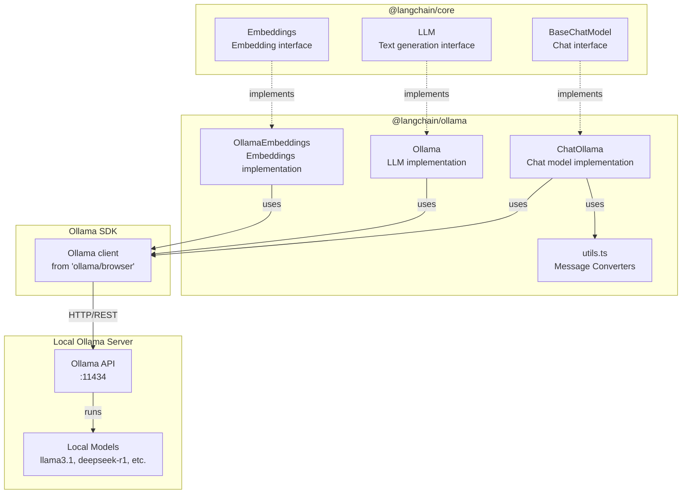
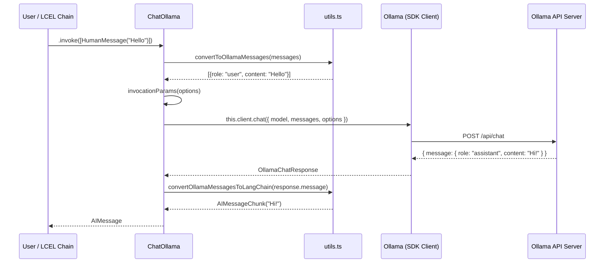
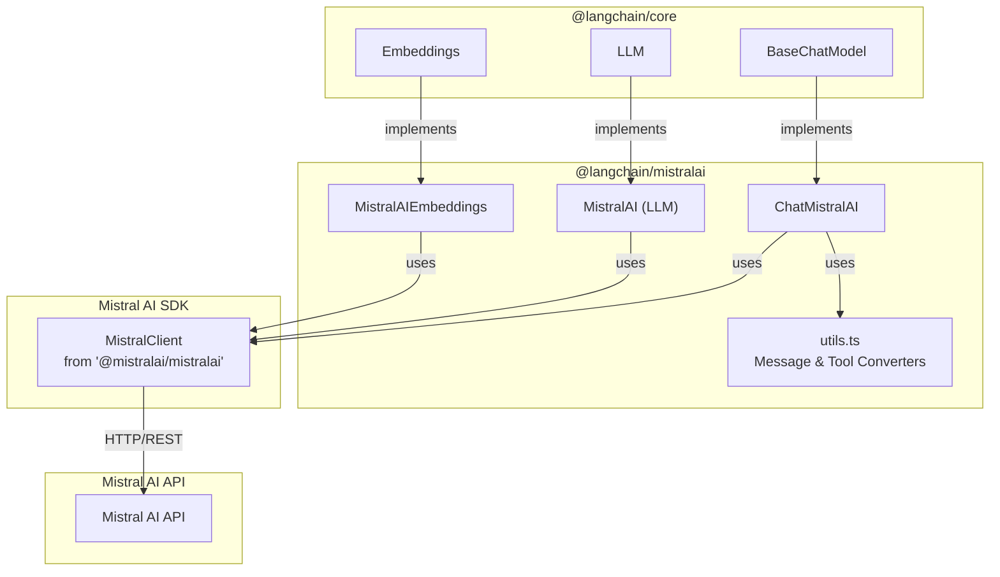
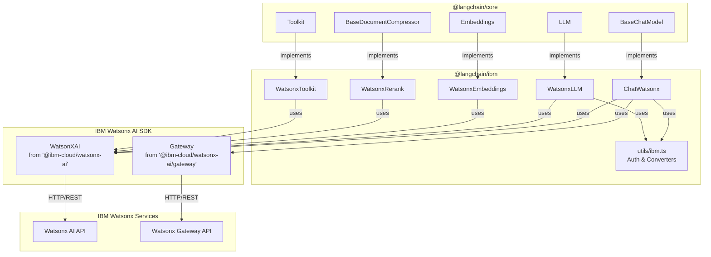

<!-- source: DeepWiki mcp.deepwiki.com · repo langchain-ai/langchainjs · page 5.7 Local and Other Model Providers · fetched 2026-10-26 -->

# Local and Other Model Providers

Relevant source files

The following files were used as context for generating this wiki page:

- [libs/providers/langchain-ibm/LICENSE](libs/providers/langchain-ibm/LICENSE)
- [libs/providers/langchain-ibm/README.md](libs/providers/langchain-ibm/README.md)
- [libs/providers/langchain-ibm/src/agents/toolkits/ibm.ts](libs/providers/langchain-ibm/src/agents/toolkits/ibm.ts)
- [libs/providers/langchain-ibm/src/agents/toolkits/tests/ibm.test.ts](libs/providers/langchain-ibm/src/agents/toolkits/tests/ibm.test.ts)
- [libs/providers/langchain-ibm/src/chat_models/ibm.ts](libs/providers/langchain-ibm/src/chat_models/ibm.ts)
- [libs/providers/langchain-ibm/src/chat_models/tests/ibm.test.ts](libs/providers/langchain-ibm/src/chat_models/tests/ibm.test.ts)
- [libs/providers/langchain-ibm/src/document_compressors/ibm.ts](libs/providers/langchain-ibm/src/document_compressors/ibm.ts)
- [libs/providers/langchain-ibm/src/document_compressors/tests/ibm.test.ts](libs/providers/langchain-ibm/src/document_compressors/tests/ibm.test.ts)
- [libs/providers/langchain-ibm/src/embeddings/ibm.ts](libs/providers/langchain-ibm/src/embeddings/ibm.ts)
- [libs/providers/langchain-ibm/src/llms/ibm.ts](libs/providers/langchain-ibm/src/llms/ibm.ts)
- [libs/providers/langchain-ibm/src/utils/ibm.ts](libs/providers/langchain-ibm/src/utils/ibm.ts)
- [libs/providers/langchain-mistralai/src/chat_models.ts](libs/providers/langchain-mistralai/src/chat_models.ts)
- [libs/providers/langchain-mistralai/src/embeddings.ts](libs/providers/langchain-mistralai/src/embeddings.ts)
- [libs/providers/langchain-mistralai/src/llms.ts](libs/providers/langchain-mistralai/src/llms.ts)
- [libs/providers/langchain-mistralai/src/tests/chat_models.int.test.ts](libs/providers/langchain-mistralai/src/tests/chat_models.int.test.ts)
- [libs/providers/langchain-mistralai/src/tests/chat_models.test.ts](libs/providers/langchain-mistralai/src/tests/chat_models.test.ts)
- [libs/providers/langchain-mistralai/src/tests/llms.int.test.ts](libs/providers/langchain-mistralai/src/tests/llms.int.test.ts)
- [libs/providers/langchain-mistralai/src/tests/llms.test.ts](libs/providers/langchain-mistralai/src/tests/llms.test.ts)
- [libs/providers/langchain-mistralai/src/utils.ts](libs/providers/langchain-mistralai/src/utils.ts)
- [libs/providers/langchain-ollama/src/chat_models.ts](libs/providers/langchain-ollama/src/chat_models.ts)
- [libs/providers/langchain-ollama/src/embeddings.ts](libs/providers/langchain-ollama/src/embeddings.ts)
- [libs/providers/langchain-ollama/src/llms.ts](libs/providers/langchain-ollama/src/llms.ts)
- [libs/providers/langchain-ollama/src/tests/chat_models.int.test.ts](libs/providers/langchain-ollama/src/tests/chat_models.int.test.ts)
- [libs/providers/langchain-ollama/src/tests/chat_models.standard.int.test.ts](libs/providers/langchain-ollama/src/tests/chat_models.standard.int.test.ts)
- [libs/providers/langchain-ollama/src/tests/chat_models.standard.test.ts](libs/providers/langchain-ollama/src/tests/chat_models.standard.test.ts)
- [libs/providers/langchain-ollama/src/tests/chat_models.test.ts](libs/providers/langchain-ollama/src/tests/chat_models.test.ts)
- [libs/providers/langchain-ollama/src/tests/chat_models_structured_output.int.test.ts](libs/providers/langchain-ollama/src/tests/chat_models_structured_output.int.test.ts)
- [libs/providers/langchain-ollama/src/tests/chat_models_think.int.test.ts](libs/providers/langchain-ollama/src/tests/chat_models_think.int.test.ts)
- [libs/providers/langchain-ollama/src/tests/embeddings.test.ts](libs/providers/langchain-ollama/src/tests/embeddings.test.ts)
- [libs/providers/langchain-ollama/src/tests/llms_think.int.test.ts](libs/providers/langchain-ollama/src/tests/llms_think.int.test.ts)
- [libs/providers/langchain-ollama/src/tests/utils.test.ts](libs/providers/langchain-ollama/src/tests/utils.test.ts)
- [libs/providers/langchain-ollama/src/utils.ts](libs/providers/langchain-ollama/src/utils.ts)

This page documents the integration of several model providers that offer local execution capabilities or are distinct from the major cloud providers. Specifically, it covers `@langchain/ollama` for local LLM and embedding execution, `@langchain/mistralai` for Mistral AI models, `@langchain/cohere` for Cohere models, `@langchain/cloudflare` for Cloudflare Workers AI, and `@langchain/ibm` for IBM Watsonx models and related services.

---

## Ollama Integration

The `@langchain/ollama` package provides integration with Ollama for running open-source language models locally. This package enables chat models, text generation, and embeddings through the Ollama server, supporting multimodal inputs, tool calling, and advanced reasoning models with thinking mode.

### Package Overview

The Ollama integration follows the standard provider package pattern, implementing base abstractions from `@langchain/core` while wrapping the official `ollama` SDK.

**Package Architecture**

Sources: [libs/providers/langchain-ollama/src/chat_models.ts:15-23](), [libs/providers/langchain-ollama/src/llms.ts:69-71](), [libs/providers/langchain-ollama/src/embeddings.ts:63-74]()

### ChatOllama Class

`ChatOllama` is the primary interface for conversational AI. It supports tool calling, structured output, and specialized handling for reasoning models (e.g., DeepSeek R1).

#### Message Conversion
The integration includes robust utility functions to translate between LangChain's `BaseMessage` hierarchy and Ollama's internal message format.

- **`convertToOllamaMessages`**: Maps `HumanMessage`, `AIMessage`, `SystemMessage`, and `ToolMessage` to Ollama's role-based format. It specifically handles multimodal `image_url` content by extracting base64 data and mapping tool calls into the Ollama `tool_calls` structure [libs/providers/langchain-ollama/src/utils.ts:196-212](), [libs/providers/langchain-ollama/src/utils.ts:51-76](), [libs/providers/langchain-ollama/src/utils.ts:139-153]().
- **`convertOllamaMessagesToLangChain`**: Converts Ollama's response back to LangChain messages, extracting `thinking` content into `reasoning_content` within `additional_kwargs` and assembling `tool_call_chunks` [libs/providers/langchain-ollama/src/utils.ts:17-44]().

#### Thinking Mode and Reasoning
For models that support internal reasoning (like `deepseek-r1`), `ChatOllama` can capture the thought process separately from the final response.

- When `think` is enabled (default), reasoning content is extracted from the model's output and stored in `AIMessage.additional_kwargs.reasoning_content` [libs/providers/langchain-ollama/src/tests/utils.test.ts:8-23]().
- In streaming mode, reasoning is yielded via `contentBlocks` with type `reasoning`. This allows UI layers to display the model's thought process in real-time [libs/providers/langchain-ollama/src/tests/chat_models_think.int.test.ts:84-105]().

#### Structured Output
`ChatOllama` implements `withStructuredOutput`, supporting multiple methods to enforce schema adherence:
1. **`functionCalling`**: Uses Ollama's native tool-calling capabilities to extract structured data [libs/providers/langchain-ollama/src/tests/chat_models.int.test.ts:215-230]().
2. **`jsonMode`**: Constrains the model to output a valid JSON object [libs/providers/langchain-ollama/src/tests/chat_models.int.test.ts:158-169]().
3. **`jsonSchema`**: Passes a JSON schema directly to the model to guide generation [libs/providers/langchain-ollama/src/tests/chat_models_structured_output.int.test.ts:10-36]().

Sources: [libs/providers/langchain-ollama/src/chat_models.ts:311-352](), [libs/providers/langchain-ollama/src/tests/chat_models_structured_output.int.test.ts:8-36]()

### Ollama LLM Class

The `Ollama` class provides a text-completion interface. It maps camelCase configuration to the snake_case parameters expected by the Ollama API.

#### Invocation Parameters Mapping
The `invocationParams` method transforms class properties into the `options` object for the Ollama SDK:

| LangChain Property | Ollama API Parameter | Description |
|-------------------|----------------------|-------------|
| `numCtx` | `num_ctx` | Context window size |
| `numPredict` | `num_predict` | Max tokens to generate |
| `temperature` | `temperature` | Sampling temperature |
| `stop` | `stop` | Sequences to stop generation |
| `f16KV` | `f16_kv` | Use 16-bit floats for KV cache |
| `keepAlive` | `keep_alive` | Controls how long the model stays in memory |

Sources: [libs/providers/langchain-ollama/src/llms.ts:196-234](), [libs/providers/langchain-ollama/src/llms.ts:158-190]()

#### Streaming Implementation
The `_streamResponseChunks` method handles the asynchronous generation of tokens. If `think` is enabled, it attempts to prioritize `chunk.thinking` tokens (the reasoning process) before the standard response content [libs/providers/langchain-ollama/src/llms.ts:236-282]().

### OllamaEmbeddings Class

The `OllamaEmbeddings` class provides local vector generation for documents and queries.

#### Key Features:
- **`embedDocuments(texts: string[])`**: Batch generates embeddings using the `/api/embed` endpoint [libs/providers/langchain-ollama/src/embeddings.ts:154-156]().
- **`embedQuery(text: string)`**: Generates an embedding for a single string [libs/providers/langchain-ollama/src/embeddings.ts:158-160]().
- **`truncate`**: Optional boolean to truncate input text to fit the model's context window [libs/providers/langchain-ollama/src/embeddings.ts:42-43]().

#### Parameter Conversion
Like the LLM class, `OllamaEmbeddings` uses a `_convertOptions` helper to ensure that camelCase `requestOptions` are correctly mapped to snake_case for the Ollama API (e.g., `useMmap` to `use_mmap`, `numGpu` to `num_gpu`) [libs/providers/langchain-ollama/src/embeddings.ts:104-152]().

Sources: [libs/providers/langchain-ollama/src/embeddings.ts:63-98](), [libs/providers/langchain-ollama/src/embeddings.ts:162-174]()

### Data Flow: Natural Language to Code Entities

The following diagram illustrates how a user request flows through the Ollama integration, highlighting the specific code entities involved.

Sources: [libs/providers/langchain-ollama/src/chat_models.ts:236-258](), [libs/providers/langchain-ollama/src/utils.ts:196-212](), [libs/providers/langchain-ollama/src/utils.ts:17-44]()

### Technical Configuration Summary

| Feature | Support | Code Pointer |
|---------|---------|--------------|
| Tool Calling | Yes | [libs/providers/langchain-ollama/src/chat_models.ts:285-309]() |
| Structured Output | Yes | [libs/providers/langchain-ollama/src/chat_models.ts:311-352]() |
| Streaming | Yes | [libs/providers/langchain-ollama/src/chat_models.ts:354-380]() |
| Multimodal (Images) | Yes | [libs/providers/langchain-ollama/src/utils.ts:139-153]() |
| Reasoning/Thinking | Yes | [libs/providers/langchain-ollama/src/tests/chat_models_think.int.test.ts:43-82]() |
| Custom Headers | Yes | [libs/providers/langchain-ollama/src/chat_models.ts:99-101]() |
| Model Pulling | Yes | [libs/providers/langchain-ollama/src/chat_models.ts:103-108]() |

Sources: [libs/providers/langchain-ollama/src/chat_models.ts:84-118](), [libs/providers/langchain-ollama/src/llms.ts:16-44]()

---

## Mistral AI Integration

The `@langchain/mistralai` package provides integration with Mistral AI models, supporting both chat and traditional LLM interfaces, along with embeddings.

### Package Overview

The Mistral AI integration wraps the official `@mistralai/mistralai` SDK. It provides `ChatMistralAI` for chat-based interactions, `MistralAI` for text completion, and `MistralAIEmbeddings` for generating embeddings.

Sources: [libs/providers/langchain-mistralai/src/chat_models.ts:44-48](), [libs/providers/langchain-mistralai/src/llms.ts:132-134](), [libs/providers/langchain-mistralai/src/embeddings.ts:20-22]()

### ChatMistralAI Class

The `ChatMistralAI` class extends `BaseChatModel` and provides an interface for interacting with Mistral AI chat models.

#### Key Features:
- **Tool Calling**: Supports `BindToolsInput` for defining tools and `MistralAIToolChoice` for controlling tool usage [libs/providers/langchain-mistralai/src/chat_models.ts:94-102](). It includes logic to filter tool calls to ensure they have corresponding `ToolMessage` entries, preventing API rejection [libs/providers/langchain-mistralai/src/tests/chat_models.test.ts:70-112]().
- **Structured Output**: Implements `withStructuredOutput` using `functionCalling` or `json_object` response formats [libs/providers/langchain-mistralai/src/chat_models.ts:98-100]().
- **Streaming**: Supports streaming responses, including token usage information [libs/providers/langchain-mistralai/src/chat_models.ts:104-107]().
- **Message Conversion**: `convertMessagesToMistralMessages` handles the transformation of LangChain `BaseMessage` objects into `MistralAIMessage` format, including handling `tool_calls` and `tool_call_id` [libs/providers/langchain-mistralai/src/chat_models.ts:400-402]().
- **Tool Call ID Conversion**: Includes utility functions like `_isValidMistralToolCallId` and `_convertToolCallIdToMistralCompatible` to ensure tool call IDs conform to Mistral's requirements [libs/providers/langchain-mistralai/src/tests/chat_models.test.ts:21-42]().

Sources: [libs/providers/langchain-mistralai/src/chat_models.ts:113-194](), [libs/providers/langchain-mistralai/src/chat_models.ts:44-48]()

### MistralAI LLM Class

The `MistralAI` class extends `LLM` for text completion tasks.

#### Key Features:
- **FIM (Fill-in-the-Middle) Completion**: Supports FIM for code models like `codestral-latest` via the `useFim` parameter [libs/providers/langchain-mistralai/src/llms.ts:106-116]().
- **Streaming**: Provides streaming capabilities for text generation [libs/providers/langchain-mistralai/src/llms.ts:76-77]().
- **Batching**: Supports batch processing of prompts [libs/providers/langchain-mistralai/src/llms.ts:83-84]().

Sources: [libs/providers/langchain-mistralai/src/llms.ts:34-117](), [libs/providers/langchain-mistralai/src/llms.ts:132-134]()

### MistralAIEmbeddings Class

The `MistralAIEmbeddings` class provides an interface for generating embeddings using Mistral AI models.

#### Key Features:
- **`embedDocuments(texts: string[])`**: Generates embeddings for a list of texts.
- **`embedQuery(text: string)`**: Generates an embedding for a single text.
- **Batching**: Embeddings are generated in batches to optimize API calls.

Sources: [libs/providers/langchain-mistralai/src/embeddings.ts:20-22](), [libs/providers/langchain-mistralai/src/embeddings.ts:30-59]()

---

## IBM Watsonx Integration

The `@langchain/ibm` package provides comprehensive integration with IBM Watsonx, offering chat models, traditional LLMs, embeddings, and specialized tools like `WatsonxRerank` and toolkits.

### Package Overview

The IBM Watsonx integration wraps the `@ibm-cloud/watsonx-ai` SDK. It includes `ChatWatsonx` for chat models, `WatsonxLLM` for text generation, `WatsonxEmbeddings` for embeddings, and `WatsonxRerank` for document reranking. It also provides toolkits for agents.

Sources: [libs/providers/langchain-ibm/src/chat_models/ibm.ts:23-27](), [libs/providers/langchain-ibm/src/llms/ibm.ts:10-12](), [libs/providers/langchain-ibm/src/embeddings/ibm.ts:10-12](), [libs/providers/langchain-ibm/src/document_compressors/ibm.ts:10-12](), [libs/providers/langchain-ibm/src/agents/toolkits/ibm.ts:10-12]()

### ChatWatsonx Class

The `ChatWatsonx` class provides an interface for interacting with IBM Watsonx chat models. It supports different authentication and deployment methods.

#### Key Features:
- **Authentication**: Supports API key-based authentication (`watsonxAIApikey`) and various authentication types (`watsonxAIAuthType`) [libs/providers/langchain-ibm/src/chat_models/tests/ibm.test.ts:23-25]().
- **Deployment Modes**: Can connect to Watsonx AI services via:
    - **Project Space**: Using `projectId` or `spaceId` [libs/providers/langchain-ibm/src/chat_models/tests/ibm.test.ts:74-109]().
    - **Deployed Model**: Interacting with a specific deployed model [libs/providers/langchain-ibm/src/chat_models/ibm.ts:117-125]().
    - **Gateway**: Using the Watsonx Gateway API for chat completions [libs/providers/langchain-ibm/src/chat_models/ibm.ts:145-159]().
- **Tool Calling**: Supports `BindToolsInput` and converts LangChain tools to `WatsonXAI.TextChatParameterTools` [libs/providers/langchain-ibm/src/chat_models/ibm.ts:185-204]().
- **Streaming**: Provides streaming responses from Watsonx models [libs/providers/langchain-ibm/src/chat_models/tests/ibm.test.ts:201-220]().
- **Message Conversion**: Includes `_convertMessagesToWatsonxMessages` to map LangChain messages to Watsonx message formats [libs/providers/langchain-ibm/src/chat_models/ibm.ts:237-238]().
- **Structured Output**: Supports structured output using `JsonOutputParser` and `StructuredOutputParser` [libs/providers/langchain-ibm/src/chat_models/ibm.ts:62-64]().

Sources: [libs/providers/langchain-ibm/src/chat_models/ibm.ts:150-152](), [libs/providers/langchain-ibm/src/chat_models/ibm.ts:153-155](), [libs/providers/langchain-ibm/src/chat_models/ibm.ts:157-159]()

### WatsonxLLM Class

The `WatsonxLLM` class provides a traditional LLM interface for text generation with IBM Watsonx models.

#### Key Features:
- **Model Parameters**: Configurable parameters like `modelId`, `temperature`, `maxTokens`, `minTokens`, `topP`, `topK`, `repetitionPenalty`, `stopSequences` [libs/providers/langchain-ibm/src/llms/ibm.ts:100-110]().
- **Streaming**: Supports streaming text generation.

Sources: [libs/providers/langchain-ibm/src/llms/ibm.ts:100-110](), [libs/providers/langchain-ibm/src/llms/ibm.ts:112-114]()

### WatsonxEmbeddings Class

The `WatsonxEmbeddings` class provides an interface for generating embeddings using IBM Watsonx models.

#### Key Features:
- **Model Selection**: Specifies the embedding model via `modelId` [libs/providers/langchain-ibm/src/embeddings/ibm.ts:20-21]().
- **`embedDocuments(texts: string[])`**: Generates embeddings for a list of texts.
- **`embedQuery(text: string)`**: Generates an embedding for a single text.

Sources: [libs/providers/langchain-ibm/src/embeddings/ibm.ts:10-12](), [libs/providers/langchain-ibm/src/embeddings/ibm.ts:19-29]()

### WatsonxRerank Class

The `WatsonxRerank` class is a document compressor that uses IBM Watsonx's reranking capabilities to improve retrieval results.

#### Key Features:
- **Reranking**: Takes a query and a list of documents, and returns a reranked list based on relevance scores.
- **Model Selection**: Configurable `modelId` for the reranking model [libs/providers/langchain-ibm/src/document_compressors/ibm.ts:20-21]().

Sources: [libs/providers/langchain-ibm/src/document_compressors/ibm.ts:10-12](), [libs/providers/langchain-ibm/src/document_compressors/ibm.ts:19-29]()

### WatsonxToolkit

The `WatsonxToolkit` provides a set of tools for agents to interact with IBM Watsonx services.

#### Key Features:
- **Tools**: Includes tools for various Watsonx functionalities, enabling agents to perform tasks like model invocation or data retrieval.

Sources: [libs/providers/langchain-ibm/src/agents/toolkits/ibm.ts:10-12]()

---

## Cohere Integration

The `@langchain/cohere` package provides integration with Cohere models for chat, text generation, and embeddings.

*(Content for Cohere integration would go here, detailing `ChatCohere`, `Cohere`, `CohereEmbeddings`, and any specific features like command R+ models, tool use, or reranking.)*

---

## Cloudflare Integration

The `@langchain/cloudflare` package provides integration with Cloudflare Workers AI, allowing access to various models deployed on Cloudflare's edge network.

*(Content for Cloudflare integration would go here, detailing `ChatCloudflareWorkersAI`, `CloudflareWorkersAI`, `CloudflareWorkersAIEmbeddings`, and specific features like model deployment, authentication, and available models.)*

---

