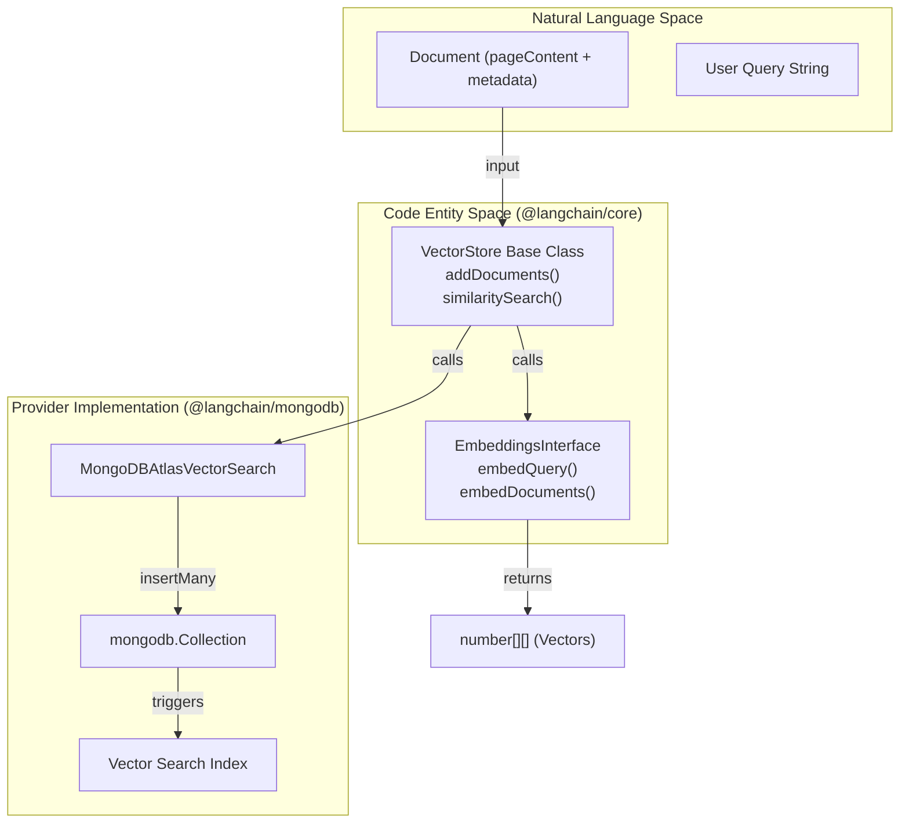
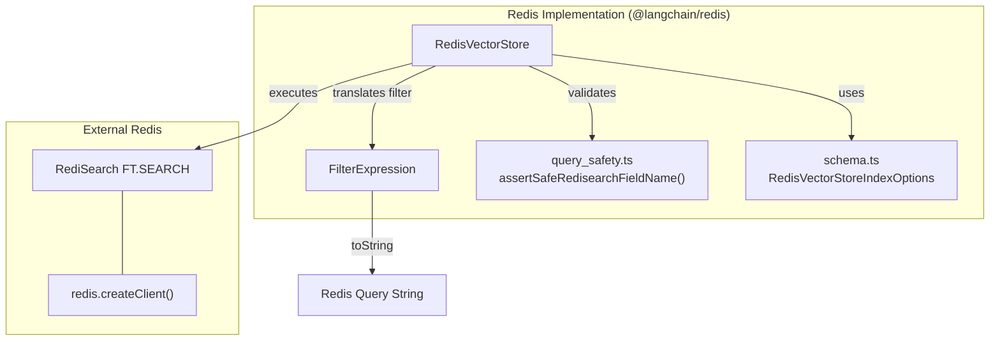

<!-- source: DeepWiki mcp.deepwiki.com · repo langchain-ai/langchainjs · page 5.8 Vector Store and Search Providers · fetched 2026-10-26 -->

# Vector Store and Search Providers

<details>
<summary>Relevant source files</summary>

The following files were used as context for generating this wiki page:

- [examples/src/langchain-classic/indexes/vector_stores/redis/redis_advanced_filtering.ts](examples/src/langchain-classic/indexes/vector_stores/redis/redis_advanced_filtering.ts)
- [libs/providers/langchain-cloudflare/package.json](libs/providers/langchain-cloudflare/package.json)
- [libs/providers/langchain-cohere/package.json](libs/providers/langchain-cohere/package.json)
- [libs/providers/langchain-exa/package.json](libs/providers/langchain-exa/package.json)
- [libs/providers/langchain-groq/package.json](libs/providers/langchain-groq/package.json)
- [libs/providers/langchain-mongodb/package.json](libs/providers/langchain-mongodb/package.json)
- [libs/providers/langchain-mongodb/src/tests/cache.int.test.ts](libs/providers/langchain-mongodb/src/tests/cache.int.test.ts)
- [libs/providers/langchain-mongodb/src/tests/setup.ts](libs/providers/langchain-mongodb/src/tests/setup.ts)
- [libs/providers/langchain-mongodb/src/tests/teardown.ts](libs/providers/langchain-mongodb/src/tests/teardown.ts)
- [libs/providers/langchain-mongodb/src/tests/utils.ts](libs/providers/langchain-mongodb/src/tests/utils.ts)
- [libs/providers/langchain-mongodb/src/tests/vectorstores.int.test.ts](libs/providers/langchain-mongodb/src/tests/vectorstores.int.test.ts)
- [libs/providers/langchain-mongodb/src/tests/vectorstores_auto_embed.int.test.ts](libs/providers/langchain-mongodb/src/tests/vectorstores_auto_embed.int.test.ts)
- [libs/providers/langchain-mongodb/src/tests/vectorstores_rerank.int.test.ts](libs/providers/langchain-mongodb/src/tests/vectorstores_rerank.int.test.ts)
- [libs/providers/langchain-mongodb/src/vectorstores.ts](libs/providers/langchain-mongodb/src/vectorstores.ts)
- [libs/providers/langchain-pgvector/package.json](libs/providers/langchain-pgvector/package.json)
- [libs/providers/langchain-pinecone/package.json](libs/providers/langchain-pinecone/package.json)
- [libs/providers/langchain-qdrant/package.json](libs/providers/langchain-qdrant/package.json)
- [libs/providers/langchain-redis/README.md](libs/providers/langchain-redis/README.md)
- [libs/providers/langchain-redis/package.json](libs/providers/langchain-redis/package.json)
- [libs/providers/langchain-redis/src/filters.ts](libs/providers/langchain-redis/src/filters.ts)
- [libs/providers/langchain-redis/src/index.ts](libs/providers/langchain-redis/src/index.ts)
- [libs/providers/langchain-redis/src/query_safety.ts](libs/providers/langchain-redis/src/query_safety.ts)
- [libs/providers/langchain-redis/src/schema.ts](libs/providers/langchain-redis/src/schema.ts)
- [libs/providers/langchain-redis/src/tests/filters.test.ts](libs/providers/langchain-redis/src/tests/filters.test.ts)
- [libs/providers/langchain-redis/src/tests/schema.test.ts](libs/providers/langchain-redis/src/tests/schema.test.ts)
- [libs/providers/langchain-redis/src/tests/vectorstores.int.test.ts](libs/providers/langchain-redis/src/tests/vectorstores.int.test.ts)
- [libs/providers/langchain-redis/src/tests/vectorstores.test.ts](libs/providers/langchain-redis/src/tests/vectorstores.test.ts)
- [libs/providers/langchain-redis/src/vectorstores.ts](libs/providers/langchain-redis/src/vectorstores.ts)
- [libs/providers/langchain-redis/src/vectorstores_fluent.ts](libs/providers/langchain-redis/src/vectorstores_fluent.ts)
- [libs/providers/langchain-tavily/package.json](libs/providers/langchain-tavily/package.json)
- [libs/providers/langchain-weaviate/package.json](libs/providers/langchain-weaviate/package.json)
- [libs/providers/langchain-weaviate/src/tests/vectorstores.test.ts](libs/providers/langchain-weaviate/src/tests/vectorstores.test.ts)
- [libs/providers/langchain-weaviate/src/vectorstores.ts](libs/providers/langchain-weaviate/src/vectorstores.ts)
- [libs/providers/langchain-weaviate/tsdown.config.ts](libs/providers/langchain-weaviate/tsdown.config.ts)
- [libs/providers/langchain-weaviate/vitest.config.ts](libs/providers/langchain-weaviate/vitest.config.ts)

</details>


## Purpose and Scope

This document provides a technical overview of the vector store and search provider integrations available in the LangChain.js ecosystem. These integrations enable LangChain.js applications to leverage external services for efficient vector similarity search, data storage, and web search capabilities. While many integrations reside in `@langchain/community`, high-performance and widely-used providers like Pinecone, Qdrant, Weaviate, Redis, and MongoDB Atlas are maintained in dedicated provider packages.

Vector stores in LangChain.js extend the `VectorStore` base class from `@langchain/core/vectorstores` and provide methods for storing, searching, and managing vector embeddings with associated metadata. Search providers offer tools to perform web searches and retrieve relevant information. This page covers the implementation details, data flow, and architectural patterns for these integrations.

Sources: [libs/providers/langchain-mongodb/package.json:1-30](), [libs/providers/langchain-redis/package.json:1-30]()

## Vector Store Ecosystem

The ecosystem is organized into three primary tiers: Core abstractions, Community-contributed integrations, and dedicated Provider packages.

### Provider Package Structure
Dedicated provider packages offer specialized implementations that often include support beyond simple vector storage, such as caching, storage for parent documents, and chat history.

| Package | Key Classes | Primary External Dependency |
|---------|-------------|----------------------------|
| `@langchain/mongodb` | `MongoDBAtlasVectorSearch`, `MongoDBStore` | `mongodb` [libs/providers/langchain-mongodb/package.json:24-24]() |
| `@langchain/redis` | `RedisVectorStore`, `FluentRedisVectorStore` | `redis` [libs/providers/langchain-redis/package.json:25-25]() |
| `@langchain/weaviate` | `WeaviateStore` | `weaviate-client` [libs/providers/langchain-weaviate/package.json:35-35]() |
| `@langchain/qdrant` | `QdrantVectorStore` | `@qdrant/js-client-rest` [libs/providers/langchain-qdrant/package.json:31-31]() |
| `@langchain/pinecone` | `PineconeStore` | `@pinecone-database/pinecone` [libs/providers/langchain-pinecone/package.json:35-35]() |
| `@langchain/pgvector` | `PGVectorStore` | `pg` [libs/providers/langchain-pgvector/package.json:31-31]() |
| `@langchain/exa` | `ExaSearchTool`, `ExaSearchResults` | `exa-js` [libs/providers/langchain-exa/package.json:32-32]() |
| `@langchain/tavily` | `TavilySearchResults` | `zod` [libs/providers/langchain-tavily/package.json:31-31]() |

Sources: [libs/providers/langchain-mongodb/package.json:1-30](), [libs/providers/langchain-redis/package.json:1-30](), [libs/providers/langchain-weaviate/package.json:1-40](), [libs/providers/langchain-qdrant/package.json:1-35](), [libs/providers/langchain-pinecone/package.json:1-36](), [libs/providers/langchain-pgvector/package.json:1-35](), [libs/providers/langchain-exa/package.json:1-35](), [libs/providers/langchain-tavily/package.json:1-35]()

## Data Flow and Implementation

### Natural Language to Vector Space Mapping
The following diagram illustrates how natural language documents are transformed and stored within the `VectorStore` implementations, mapping high-level concepts to specific code entities.

**Vector Store Data Flow: Document Ingestion**

Sources: [libs/providers/langchain-mongodb/src/vectorstores.ts:18-100](), [libs/providers/langchain-mongodb/src/tests/vectorstores.int.test.ts:115-130]()

### Redis Integration Architecture
The Redis integration utilizes specialized filtering logic to bridge LangChain's abstract filter schemas with Redis's internal query syntax. It supports a legacy `RedisVectorStore` and a newer `FluentRedisVectorStore` for advanced metadata filtering.

**Redis Vector Store Implementation**

Sources: [libs/providers/langchain-redis/src/vectorstores.ts:95-120](), [libs/providers/langchain-redis/src/filters.ts:42-95](), [libs/providers/langchain-redis/src/query_safety.ts:1-15]()

### Weaviate Integration Architecture
The Weaviate integration provides a `WeaviateStore` class that interacts with the Weaviate client. It handles schema creation, data flattening for Weaviate's data model, and telemetry registration.

**Weaviate Store Implementation**
```mermaid
graph TD
    subgraph "LangChain.js Application"
        App[("Application Code")]
    end

    subgraph "Weaviate Integration (@langchain/weaviate)"
        WS["WeaviateStore"]
        Embeddings["EmbeddingsInterface"]
        Flatten["flattenObjectForWeaviate()"]
        RegisterHeader["registerIntegrationHeader()"]
    end

    subgraph "Weaviate Client (weaviate-client)"
        WC["WeaviateClient"]
        CollectionCreate["client.collections.createFromJson()"]
        CollectionQuery["client.collections.query()"]
        ConnectionDetails["client.getConnectionDetails()"]
    end

    subgraph "Weaviate Database"
        WeaviateDB["Weaviate Instance"]
    end

    App -->|instantiates| WS
    WS -->|uses| Embeddings
    WS -->|configures| WC
    WS -->|calls on init| RegisterHeader
    RegisterHeader -->|accesses| ConnectionDetails
    WS -->|addDocuments()| Flatten
    Flatten -->|prepares data for| WC
    WS -->|addDocuments()| CollectionCreate
    WS -->|similaritySearch()| CollectionQuery
    WC --> WeaviateDB
```
Sources: [libs/providers/langchain-weaviate/src/vectorstores.ts:145-170](), [libs/providers/langchain-weaviate/src/vectorstores.ts:27-65](), [libs/providers/langchain-weaviate/src/vectorstores.ts:117-129]()

## Key Integration Details

### MongoDB Atlas Vector Search
The MongoDB integration provides vector storage and specialized `MongoDBStore` for key-value persistence (often used in `ParentDocumentRetriever`).

*   **Class**: `MongoDBAtlasVectorSearch` [libs/providers/langchain-mongodb/src/tests/vectorstores.int.test.ts:18-18]()
*   **Storage**: `MongoDBStore` implements the `BaseStore` interface, handling `mget`, `mset`, and `mdelete` operations using MongoDB bulk operations [libs/providers/langchain-mongodb/src/tests/storage.int.test.ts:4-35]().
*   **Search Types**: Supports `similaritySearch` and `maxMarginalRelevanceSearch` (MMR) [libs/providers/langchain-mongodb/src/tests/vectorstores.int.test.ts:194-205]().

### Redis Vector Store
Redis provides high-performance vector search using the RediSearch module.

*   **Filtering**: The `FilterExpression` system allows for complex logical combinations (`AndFilter`, `OrFilter`) and type-specific filters like `TagFilter`, `NumericFilter`, and `GeoFilter` [libs/providers/langchain-redis/src/filters.ts:98-170]().
*   **Schema Validation**: The `RedisVectorStore` can validate metadata against a `customSchema` before insertion [libs/providers/langchain-redis/src/vectorstores.ts:131-150]().
*   **Query Safety**: Field names and values are escaped and validated to prevent injection in RediSearch queries [libs/providers/langchain-redis/src/query_safety.ts:1-15]().

### Weaviate
The Weaviate integration provides a `WeaviateStore` for interacting with Weaviate vector databases.

*   **Class**: `WeaviateStore` [libs/providers/langchain-weaviate/src/vectorstores.ts:145-145]()
*   **Schema Handling**: Supports `CollectionConfigCreate` or raw `WeaviateClass` JSON schema for collection creation [libs/providers/langchain-weaviate/src/vectorstores.ts:81-87]().
*   **Data Flattening**: The `flattenObjectForWeaviate` utility prepares document metadata for Weaviate's data model, handling nested objects and array types [libs/providers/langchain-weaviate/src/vectorstores.ts:27-65]().
*   **Telemetry**: Registers an integration header (`X-Weaviate-Client-Integration`) for Weaviate telemetry, identifying LangChain.js usage [libs/providers/langchain-weaviate/src/vectorstores.ts:95-130]().

### Qdrant
The Qdrant integration provides `QdrantVectorStore` for interacting with Qdrant vector databases.

*   **Class**: `QdrantVectorStore` [libs/providers/langchain-qdrant/package.json:4-4]()
*   **Dependency**: Relies on the `@qdrant/js-client-rest` SDK [libs/providers/langchain-qdrant/package.json:31-31]().

### Pinecone
The Pinecone integration provides `PineconeStore` for interacting with Pinecone vector databases.

*   **Class**: `PineconeStore` [libs/providers/langchain-pinecone/package.json:4-4]()
*   **Dependency**: Relies on the `@pinecone-database/pinecone` SDK [libs/providers/langchain-pinecone/package.json:35-35]().

### PGVector
The PGVector integration provides `PGVectorStore` for PostgreSQL databases with the `pgvector` extension.

*   **Class**: `PGVectorStore` [libs/providers/langchain-pgvector/package.json:4-4]()
*   **Dependency**: Uses the `pg` client for PostgreSQL interaction [libs/providers/langchain-pgvector/package.json:31-31]().

### Tavily Search
The Tavily integration provides tools for web search.

*   **Class**: `TavilySearchResults` [libs/providers/langchain-tavily/package.json:4-4]()
*   **Dependency**: Uses `zod` for schema validation [libs/providers/langchain-tavily/package.json:31-31]().

### Exa Search
The Exa integration provides tools for web search.

*   **Class**: `ExaSearchTool`, `ExaSearchResults` [libs/providers/langchain-exa/package.json:4-4]()
*   **Dependency**: Relies on the `exa-js` SDK [libs/providers/langchain-exa/package.json:32-32]().

### Neo4j
While not explicitly listed in the provided `package.json` files, Neo4j is a graph database that can be used for vector storage and retrieval, often integrated through community packages or custom implementations.

Sources: [libs/providers/langchain-mongodb/src/tests/vectorstores.int.test.ts:18-18](), [libs/providers/langchain-mongodb/src/tests/storage.int.test.ts:4-35](), [libs/providers/langchain-mongodb/src/tests/vectorstores.int.test.ts:194-205](), [libs/providers/langchain-redis/src/filters.ts:98-170](), [libs/providers/langchain-redis/src/vectorstores.ts:131-150](), [libs/providers/langchain-redis/src/query_safety.ts:1-15](), [libs/providers/langchain-weaviate/src/vectorstores.ts:145-145](), [libs/providers/langchain-weaviate/src/vectorstores.ts:81-87](), [libs/providers/langchain-weaviate/src/vectorstores.ts:27-65](), [libs/providers/langchain-weaviate/src/vectorstores.ts:95-130](), [libs/providers/langchain-qdrant/package.json:4-4](), [libs/providers/langchain-qdrant/package.json:31-31](), [libs/providers/langchain-pinecone/package.json:4-4](), [libs/providers/langchain-pinecone/package.json:35-35](), [libs/providers/langchain-pgvector/package.json:4-4](), [libs/providers/langchain-pgvector/package.json:31-31](), [libs/providers/langchain-tavily/package.json:4-4](), [libs/providers/langchain-tavily/package.json:31-31](), [libs/providers/langchain-exa/package.json:4-4](), [libs/providers/langchain-exa/package.json:32-32]()

## Common Patterns Across Implementations

### Metadata Filtering
Most vector stores implement a `FilterType` to allow users to narrow down searches based on document metadata.

| Implementation | Filter Logic Implementation |
|----------------|-----------------------------|
| **Redis** | Fluent API in `filters.ts` generating RediSearch strings [libs/providers/langchain-redis/src/filters.ts:1-32]() |
| **MongoDB** | Aggregation pipeline stages using `$vectorSearch` [libs/providers/langchain-mongodb/src/tests/vectorstores.int.test.ts:95-112]() |
| **Qdrant** | Qdrant-specific filter objects via `@qdrant/js-client-rest` [libs/providers/langchain-qdrant/package.json:31-31]() |
| **Weaviate** | `FilterValue` type from `weaviate-client` [libs/providers/langchain-weaviate/src/vectorstores.ts:6-6]() |

### Testing and Validation
Integrations are validated using integration tests (marked with `.int.test.ts`) that often simulate real-world delays or index propagation.

*   **Wait for Index**: MongoDB tests include a `waitForIndexToBeQueryable` helper to account for the asynchronous nature of search index creation [libs/providers/langchain-mongodb/src/tests/vectorstores.int.test.ts:74-74]().
*   **Patched Vector Stores**: Tests often use "patched" versions of vector stores to wrap `addDocuments` with retry logic until the documents are searchable [libs/providers/langchain-mongodb/src/tests/vectorstores.int.test.ts:99-113]().

Sources: [libs/providers/langchain-mongodb/src/tests/vectorstores.int.test.ts:1-113](), [libs/providers/langchain-redis/src/tests/filters.test.ts:1-100](), [libs/providers/langchain-weaviate/src/vectorstores.ts:6-6]()

---

