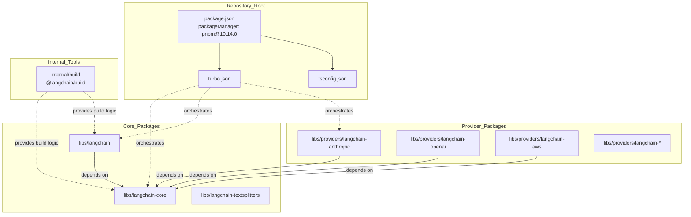
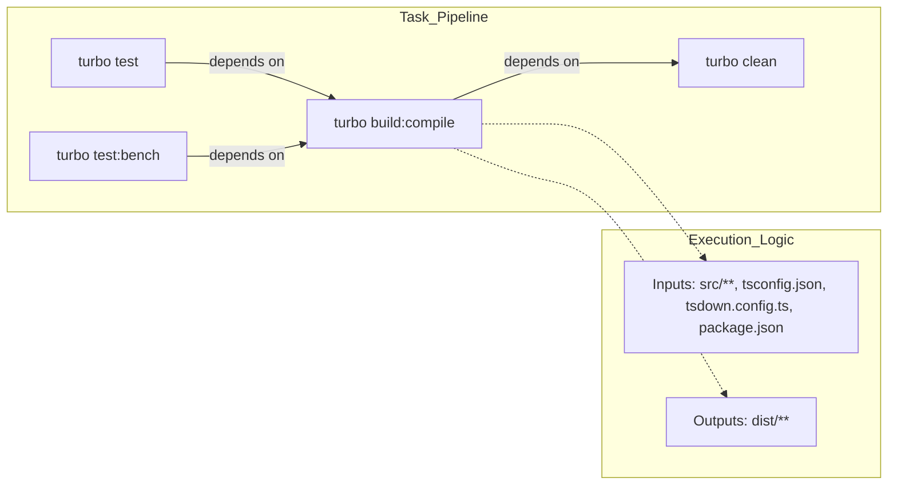

<!-- source: DeepWiki mcp.deepwiki.com · repo langchain-ai/langchainjs · page 6 Build System and Infrastructure · fetched 2026-10-26 -->

# Build System and Infrastructure

<details>
<summary>Relevant source files</summary>

The following files were used as context for generating this wiki page:

- [internal/build/package.json](internal/build/package.json)
- [turbo.json](turbo.json)

</details>


## Purpose and Scope

This document describes the build system and infrastructure for the LangChain.js monorepo. It covers the high-level organization of the build system, package management with pnpm, task orchestration with Turborepo, compilation tooling, and module generation. This page provides an overview of how the build system components interact. For detailed information about specific subsystems, see:

- **6.1 Monorepo Management**: [Monorepo Management](#6.1), workspace protocol, overrides, and dependency management. Covers the singleton constraint for `@langchain/core`, Deno compatibility, and VS Code configuration.
- **6.2 Build Pipeline and Turbo**: [Build Pipeline and Turbo](#6.2), `tsdown` compiler, and parallel build orchestration. Covers the `internal/build` package and `tsconfig` inheritance.
- **6.3 Module Export System**: [Module Export System](#6.3), entrypoint generation, and import maps. Covers the `load/import_map.ts` pattern and how the export surface is defined.
- **6.4 Release Process**: [Release Process](#6.4), versioning, npm publication, and the publish workflow.

For testing infrastructure and CI/CD pipelines, see **Testing and Quality Assurance** (#7).

## Monorepo Architecture

The LangChain.js repository is structured as a monorepo managed using pnpm workspaces and orchestrated with Turborepo. The workspace layout organizes packages by purpose and dependency relationships.

**Diagram: Repository Structure and Dependencies**



**Sources**: [package.json:1-12](), [package.json:39-40](), [libs/langchain/package.json:74-75](), [libs/providers/langchain-anthropic/package.json:33-35]()

The root `package.json` defines the workspace configuration with `"private": true` and `"packageManager": "pnpm@10.14.0"` [package.json:5-11](). All packages reside under the `libs/` or `internal/` directories.

## Build Tool Stack

The build system integrates multiple specialized tools to handle the complexity of a multi-environment TypeScript monorepo:

| Tool | Purpose | Configuration |
|------|---------|---------------|
| **pnpm** | Package manager and workspace orchestration | [package.json:11]() |
| **Turborepo** | Task runner, parallelization, and caching | [package.json:52](), [turbo.json:1-55]() |
| **tsdown** | Fast TypeScript compilation and bundling | [internal/build/package.json:16]() |
| **oxlint / oxfmt** | High-performance linting and formatting | [package.json:17-20](), [package.json:47-48]() |
| **Changesets** | Version management and changelog generation | [package.json:33-34](), [package.json:37-38]() |
| **@langchain/build** | Internal build logic and compilation tooling | [package.json:39](), [internal/build/package.json:1-6]() |

**Sources**: [package.json:11-53](), [turbo.json:1-55](), [internal/build/package.json:1-6](), [internal/build/package.json:16]()

### Internal Build Tooling (@langchain/build)

The `@langchain/build` package is a private workspace package that encapsulates the build logic used across the monorepo [package.json:39](), [internal/build/package.json:1-4](). It leverages `tsdown` to handle the heavy lifting of compilation and bundling across packages [internal/build/package.json:16]().

## Dependency Management and Overrides

A critical aspect of the LangChain.js infrastructure is ensuring version consistency, particularly for `@langchain/core`. Because all integration packages must share the same version of core to maintain compatibility, the monorepo uses pnpm overrides.

```json
"pnpm": {
  "overrides": {
    "@langchain/core": "workspace:^",
    "langchain": "workspace:^"
  }
}
```

This configuration forces all packages within the monorepo to resolve `@langchain/core` to the local workspace version rather than fetching it from the npm registry [package.json:55-58](). This is also reflected in the `pnpm-lock.yaml` which maps these to workspace links [pnpm-lock.yaml:7-9](), [pnpm-lock.yaml:157-159]().

**Sources**: [package.json:55-58](), [pnpm-lock.yaml:7-9](), [pnpm-lock.yaml:157-159]()

## Task Orchestration with Turborepo

Turborepo manages the execution of scripts across the workspace. The `turbo.json` file defines the task graph and dependency relationships [turbo.json:1-55]().

**Diagram: Turbo Task Pipeline**



**Sources**: [turbo.json:6-54](), [package.json:13-15]()

Key tasks include:
- **`build:compile`**: Compiles source code to `dist/` using `tsdown` [turbo.json:7-12](), [internal/build/package.json:16]().
- **`test`**: Runs unit tests using Vitest, depending on a successful compilation [turbo.json:16-20](), [libs/langchain/package.json:39]().
- **`clean`**: Removes build artifacts [turbo.json:51-53](), [libs/langchain/package.json:38]().

## Development Workflow

The root `package.json` provides entry points for common developer tasks that wrap Turbo or pnpm commands:

- **Build**: `pnpm build` executes `turbo build:compile` [package.json:13]().
- **Watch**: `pnpm watch` runs compilation in watch mode for rapid iteration [package.json:14]().
- **Lint/Format**: Uses `oxlint` and `oxfmt` for near-instantaneous code quality checks [package.json:17-20]().
- **Release**: `pnpm release` triggers the `changeset publish` flow [package.json:23]().
- **Standard Tests**: Specialized tasks for integration compliance [package.json:30-32]().

For detailed instructions on the release cycle, see [Release Process](#6.4).

**Sources**: [package.json:12-35]()

---

