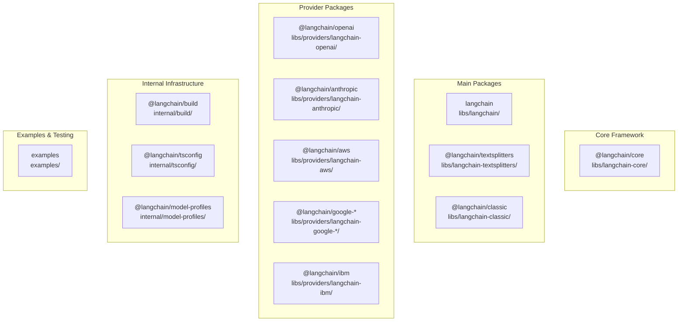
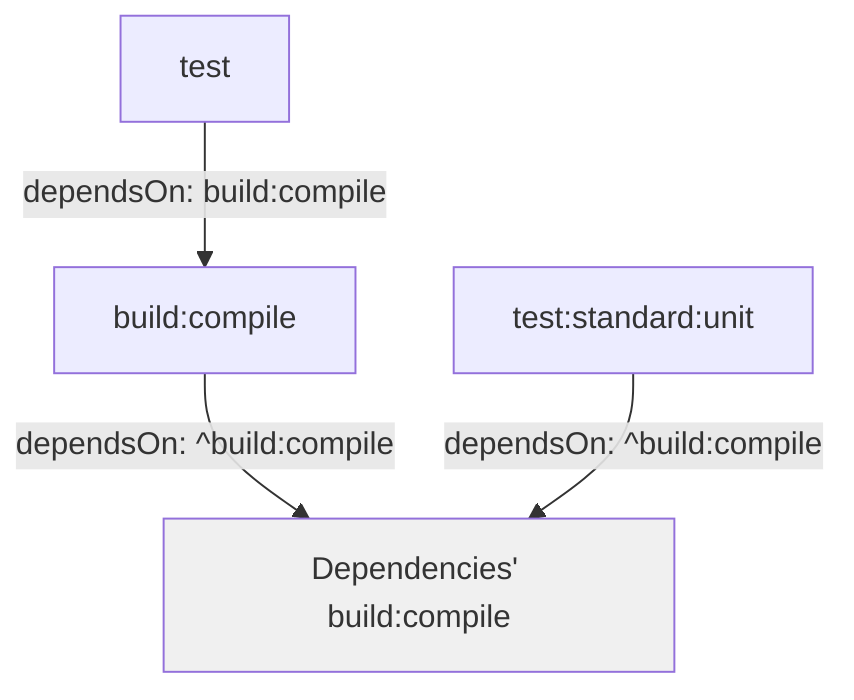

<!-- source: DeepWiki mcp.deepwiki.com · repo langchain-ai/langchainjs · page 6.1 Monorepo Management · fetched 2026-10-26 -->

# Monorepo Management

<details>
<summary>Relevant source files</summary>

The following files were used as context for generating this wiki page:

- [.github/dependabot.yml](.github/dependabot.yml)
- [.gitignore](.gitignore)
- [.vscode/extensions.json](.vscode/extensions.json)
- [.vscode/settings.json](.vscode/settings.json)
- [deno.json](deno.json)
- [dependency_range_tests/scripts/langchain/node/update_resolutions_latest.js](dependency_range_tests/scripts/langchain/node/update_resolutions_latest.js)
- [dependency_range_tests/scripts/langchain/node/update_resolutions_lowest.js](dependency_range_tests/scripts/langchain/node/update_resolutions_lowest.js)
- [examples/package.json](examples/package.json)
- [internal/model-profiles/package.json](internal/model-profiles/package.json)
- [libs/langchain-classic/package.json](libs/langchain-classic/package.json)
- [libs/langchain-core/CHANGELOG.md](libs/langchain-core/CHANGELOG.md)
- [libs/langchain-core/package.json](libs/langchain-core/package.json)
- [libs/langchain-core/src/load/map_keys.ts](libs/langchain-core/src/load/map_keys.ts)
- [libs/langchain-core/src/load/tests/map_keys.test.ts](libs/langchain-core/src/load/tests/map_keys.test.ts)
- [libs/langchain-core/src/tracers/console.ts](libs/langchain-core/src/tracers/console.ts)
- [libs/langchain-mcp-adapters/package.json](libs/langchain-mcp-adapters/package.json)
- [libs/langchain/CHANGELOG.md](libs/langchain/CHANGELOG.md)
- [libs/langchain/package.json](libs/langchain/package.json)
- [libs/providers/langchain-anthropic/CHANGELOG.md](libs/providers/langchain-anthropic/CHANGELOG.md)
- [libs/providers/langchain-anthropic/package.json](libs/providers/langchain-anthropic/package.json)
- [libs/providers/langchain-aws/CHANGELOG.md](libs/providers/langchain-aws/CHANGELOG.md)
- [libs/providers/langchain-aws/package.json](libs/providers/langchain-aws/package.json)
- [libs/providers/langchain-ibm/package.json](libs/providers/langchain-ibm/package.json)
- [package.json](package.json)
- [pnpm-lock.yaml](pnpm-lock.yaml)

</details>


This document explains how the LangChain.js monorepo is structured and managed using pnpm workspaces and Turbo. It covers workspace configuration, package dependency resolution, the singleton constraint for `@langchain/core`, and environment-specific configurations.

## Workspace Architecture

The LangChain.js repository is a pnpm workspace-based monorepo containing multiple packages organized into distinct categories. The workspace is configured using pnpm's native workspace protocol and orchestrated by Turbo for task execution.

### Package Categories


Sources: [package.json:1-11](), [pnpm-lock.yaml:142-211](), [libs/langchain-ibm/package.json:1-89](), [internal/model-profiles/package.json:1-20]()

### Workspace Configuration

The root `package.json` declares the workspace structure and Pins the exact pnpm version for consistency:
- `packageManager: "pnpm@10.14.0"` [package.json:11-11]().

**Dependency Overrides:**
The root enforces global version constraints through pnpm overrides to ensure security and version alignment across the entire monorepo [package.json:55-122]().

```json
{
  "pnpm": {
    "overrides": {
      "@langchain/core": "workspace:^",
      "langchain": "workspace:^",
      "protobufjs": ">=7.6.3 <8",
      "form-data": ">=4.0.6",
      "tar": ">=7.5.21",
      "postcss": ">=8.5.18",
      "valibot": ">=1.4.2",
      "fast-uri": ">=4.1.3",
      "body-parser": ">=2.3.0",
      "node-forge": ">=1.4.0",
      "minimatch": ">=3.1.3",
      "underscore": ">=1.13.8",
      "esbuild": ">=0.28.1",
      "@opentelemetry/core": ">=2.8.0",
      "uuid@<11.1.1": "11.1.1",
      "undici": ">=8.9.0",
      "qs": ">=6.16.0",
      "mysql2": ">=3.23.1",
      "ws@8": ">=8.20.1",
      "ip-address": ">=10.3.1",
      "ajv@8": ">=8.18.0",
      "yauzl": ">=3.2.1",
      "fast-xml-parser": ">=5.5.7",
      "@grpc/grpc-js": ">=1.14.4",
      "thrift": ">=0.23.0 <0.24",
      "flatted": ">=3.4.2",
      "simple-git": ">=3.32.3",
      "sharp": ">=0.35.3",
      "hono": ">=4.12.33",
      "@hono/node-server": ">=2.0.12",
      "express-rate-limit": ">=8.2.2",
      "basic-ftp": ">=5.3.0",
      "vite": ">=7.3.5",
      "websocket-driver": ">=0.7.5",
      "defu": "^6.1.5",
      "axios": ">=0.30.3",
      "@tootallnate/once": ">=3.0.1",
      "convict": ">=6.2.5",
      "lodash": ">=4.18.0",
      "path-to-regexp": ">=8.4.0",
      "brace-expansion": ">=5.0.9",
      "deepmerge-ts": ">=8.0.0",
      "micromatch>picomatch": "2.3.2",
      "anymatch>picomatch": "2.3.2",
      "readdirp>picomatch": "2.3.2",
      "express>path-to-regexp": "0.1.13",
      "router>path-to-regexp": ">=8.4.0",
      "picomatch@2": ">=2.3.2",
      "picomatch@4": ">=4.0.4",
      "es-define-property": "npm:@socketregistry/es-define-property@^1",
      "es-set-tostringtag": "npm:@socketregistry/es-set-tostringtag@^1",
      "function-bind": "npm:@socketregistry/function-bind@^1",
      "gopd": "npm:@socketregistry/gopd@^1",
      "has-symbols": "npm:@socketregistry/has-symbols@^1",
      "has-tostringtag": "npm:@socketregistry/has-tostringtag@^1",
      "hasown": "npm:@socketregistry/hasown@^1",
      "indent-string": "npm:@socketregistry/indent-string@^1",
      "is-interactive": "npm:@socketregistry/is-interactive@^1",
      "is-unicode-supported": "npm:@socketregistry/is-unicode-supported@^1",
      "isarray": "npm:@socketregistry/isarray@^1",
      "object-assign": "npm:@socketregistry/object-assign@^1",
      "safe-buffer": "npm:@socketregistry/safe-buffer@^1",
      "safer-buffer": "npm:@socketregistry/safer-buffer@^1",
      "side-channel": "npm:@socketregistry/side-channel@^1",
      "shell-quote": "npm:shell-quote@^1"
    }
  }
}
```
This ensures:
1. All packages reference the workspace version of `@langchain/core` and `langchain` [package.json:57-58]().
2. Security patches and minimum versions are applied globally for common dependencies like `undici`, `axios`, and `lodash` [package.json:71-95]().
3. Transitive dependency issues (like `picomatch` version conflicts) are resolved at the root [package.json:99-105]().
4. Specific packages are aliased to `@socketregistry` versions for security [package.json:106-121]().

Sources: [package.json:11-11](), [package.json:55-122](), [pnpm-lock.yaml:7-73]()

### Dependabot Configuration

Dependabot is configured to automatically update dependencies across the monorepo. It monitors `package.json` files in the root and all workspace packages.

```yaml
# .github/dependabot.yml
version: 2
updates:
  - package-ecosystem: "npm"
    directory: "/"
    schedule:
      interval: "weekly"
    groups:
      langchain-deps:
        patterns:
          - "@langchain/*"
          - "langchain"
      all-deps:
        patterns:
          - "*"
        exclude-patterns:
          - "@langchain/*"
          - "langchain"
    commit-message:
      prefix: "chore"
      include: "scope"
    labels:
      - "dependencies"
      - "npm"
  - package-ecosystem: "npm"
    directory: "/libs/langchain-core"
    schedule:
      interval: "weekly"
    commit-message:
      prefix: "chore"
      include: "scope"
    labels:
      - "dependencies"
      - "npm"
  # ... (similar entries for other libs/ and internal/ packages)
```
Dependabot is configured to run weekly, grouping updates for `@langchain/*` and `langchain` packages separately from other dependencies. This helps manage the impact of dependency updates and ensures core packages are handled with care.

Sources: [.github/dependabot.yml:1-30]()

## Workspace Protocol and Dependency Management

### The `workspace:*` and `workspace:^` Protocol

pnpm's workspace protocol enables inter-package dependencies to resolve to local workspace copies rather than published npm versions. This allows for simultaneous development across multiple packages.

**Usage Patterns:**
- **Internal Tools**: Packages like `@langchain/build` are referenced with `workspace:*` to always use the current local version [package.json:39-39]().
- **Public Packages**: Inter-package dependencies for public libraries often use `workspace:^` to ensure they are released with compatible semver ranges [libs/langchain-core/package.json:33-33]().

**Example from devDependencies:**
The root package depends on internal build and configuration packages using the workspace protocol [package.json:39-40]().

```json
"devDependencies": {
  "@langchain/build": "workspace:*",
  "@langchain/tsconfig": "workspace:*"
}
```

Sources: [package.json:39-40](), [libs/langchain-core/package.json:33-33](), [libs/langchain/package.json:47-47]()

### The @langchain/core Singleton Constraint

A critical architectural constraint in LangChain.js is that all used packages must share the same version of `@langchain/core` [libs/langchain-core/CHANGELOG.md:56-59](). This is necessary because:
- Base classes (e.g., `BaseChatModel`, `Runnable`) must be identical for `instanceof` checks to work. This is explicitly handled by overriding `Symbol.hasInstance` for comparable properties [libs/langchain-core/CHANGELOG.md:56-59](), [libs/langchain/CHANGELOG.md:58-61]().
- Serialization logic relies on shared schemas.
- Large structural types (like Zod schemas) can cause TypeScript OOM errors if multiple versions are compared.

**Implementation Pattern for Packages:**
To maintain this, integration packages define `@langchain/core` as a `peerDependency` [libs/providers/langchain-anthropic/package.json:33-35]().

```json
{
  "peerDependencies": {
    "@langchain/core": "workspace:^"
  }
}
```

In the `examples` package, this is strictly enforced to test real-world interoperability [examples/package.json:37-37]().

Sources: [libs/langchain-core/CHANGELOG.md:56-59](), [libs/langchain/CHANGELOG.md:58-61](), [libs/providers/langchain-anthropic/package.json:33-35](), [libs/langchain/package.json:73-75](), [examples/package.json:37-37]()

## Turbo Orchestration

Turbo manages task execution across the workspace, providing caching and parallelization.

### Task Pipeline Configuration

The `turbo.json` file defines the task dependency graph, ensuring that dependencies are built before the packages that rely on them.



**Key Pipeline Rules:**
- **`build:compile`**: Depends on the `build:compile` task of its dependencies (`^build:compile`). It tracks `src/**`, `tsconfig.json`, and `tsdown.config.ts` as inputs.
- **`test`**: Depends on the local `build:compile` being finished to ensure tests run against fresh build artifacts.
- **Caching**: Output directories like `dist/` are cached to speed up subsequent runs.

Sources: [package.json:13-34]()

## Environment Compatibility

LangChain.js is designed to run in diverse environments, including Node.js (ESM and CJS), Browsers, Cloudflare Workers, and Deno.

### Deno Compatibility

Deno support is managed through a `deno.json` file that maps package imports to their npm equivalents or specific Deno modules [deno.json:1-39]().

| Import | Target |
| :--- | :--- |
| `langchain/` | `npm:/langchain@1.4.0/` |
| `@langchain/core/` | `npm:/@langchain/core@1.1.44/` |
| `readline` | `https://deno.land/x/readline@v1.1.0/mod.ts` |

Sources: [deno.json:1-39]()

### `.gitignore` Conventions

The `.gitignore` file is crucial for managing what files are tracked by Git. In a monorepo, it's particularly important to ignore build artifacts and temporary files generated by various tools.

```
# .gitignore
# Node.js
node_modules/
.pnpm-store/
.env
.env.local
.env.*.local

# pnpm
pnpm-lock.yaml
pnpm-workspace.yaml

# Build artifacts
dist/
dist-cjs/
.turbo/

# IDEs
.vscode/
.idea/

# Test reports
coverage/
.vitest-cache/

# Deno
deno.lock
```
Key ignored items include:
- `node_modules/` and `.pnpm-store/`: Standard package manager directories.
- `.env*`: Environment variable files.
- `pnpm-lock.yaml`: The lockfile is typically committed, but if it's generated dynamically or needs to be ignored for specific workflows, it would be listed here. (Note: In this codebase, `pnpm-lock.yaml` is committed, so this entry would not be present in the actual `.gitignore` for the lockfile itself, but other pnpm-related files might be).
- `dist/`, `dist-cjs/`, `.turbo/`: Build output and Turbo cache directories.
- IDE-specific configuration files like `.vscode/` and `.idea/`.
- Test reports and caches.
- `deno.lock`: Deno's dependency lock file.

Sources: [.gitignore:1-20]()

### VS Code Configuration

The repository includes specific VS Code settings to ensure a consistent development experience across the monorepo.

**Key Settings:**
- **Working Directories**: ESLint is configured to recognize the distinct package roots [ .vscode/settings.json:2-8]().
- **Formatting**: `oxfmt` and `oxlint` are used for rapid linting and formatting, replacing slower legacy tools [package.json:17-20]().
- **Exclusions**: The `.turbo` and `dist` directories are excluded from search and the file explorer to reduce noise [ .vscode/settings.json:22-31]().

**Recommended Extensions:**
The project recommends specialized TypeScript/YAML/JSON support extensions [ .vscode/extensions.json:1-11]().

Sources: [ .vscode/settings.json:1-41](), [ .vscode/extensions.json:1-11](), [package.json:17-20]()

## Development Scripts

The root `package.json` provides centralized scripts for managing the monorepo [package.json:12-35]().

| Script | Command | Purpose |
| :--- | :--- | :--- |
| `build` | `turbo build:compile` | Build all packages in topological order [package.json:13-13]() |
| `test:unit` | `turbo test --filter=...` | Run unit tests excluding specific environments [package.json:26-26]() |
| `lint` | `oxlint .` | Run fast linting across the repo [package.json:19-19]() |
| `format` | `oxfmt .` | Format all files [package.json:17-17]() |
| `test:standard` | `pnpm test:standard:unit && ...` | Run standard interface compliance tests [package.json:32-32]() |
| `release` | `changeset publish` | Publish packages using Changesets [package.json:23-23]() |

Sources: [package.json:12-35]()

---

