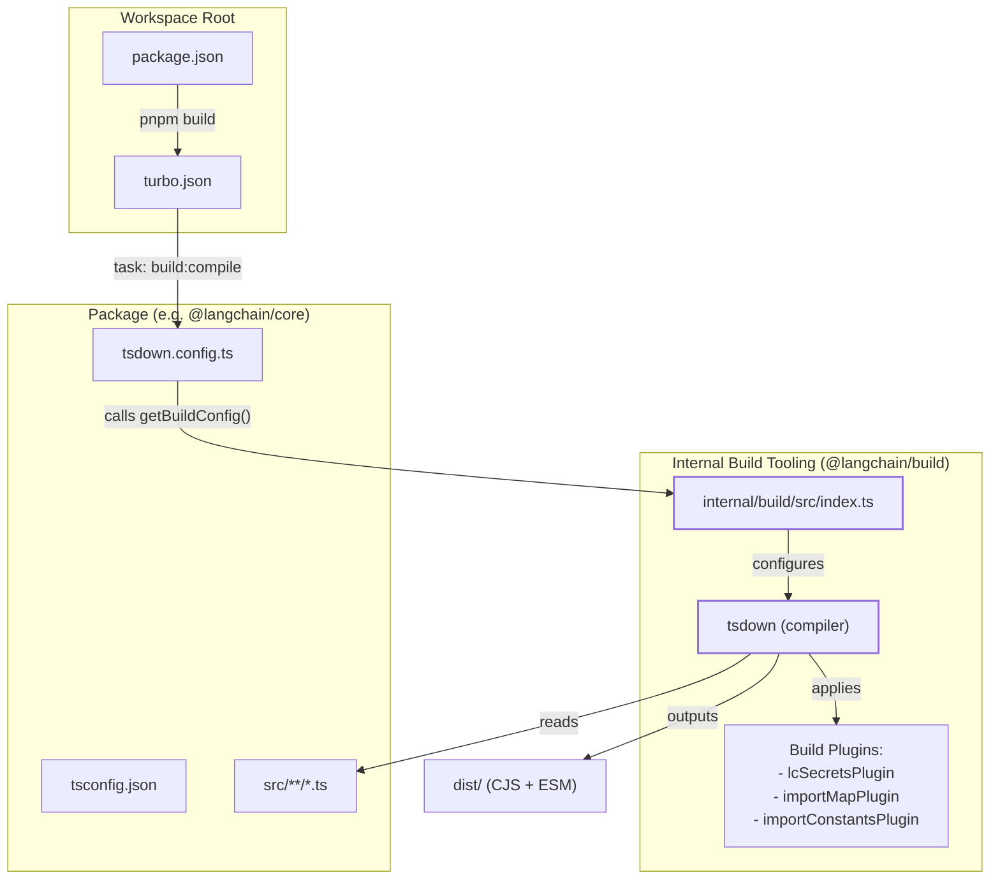
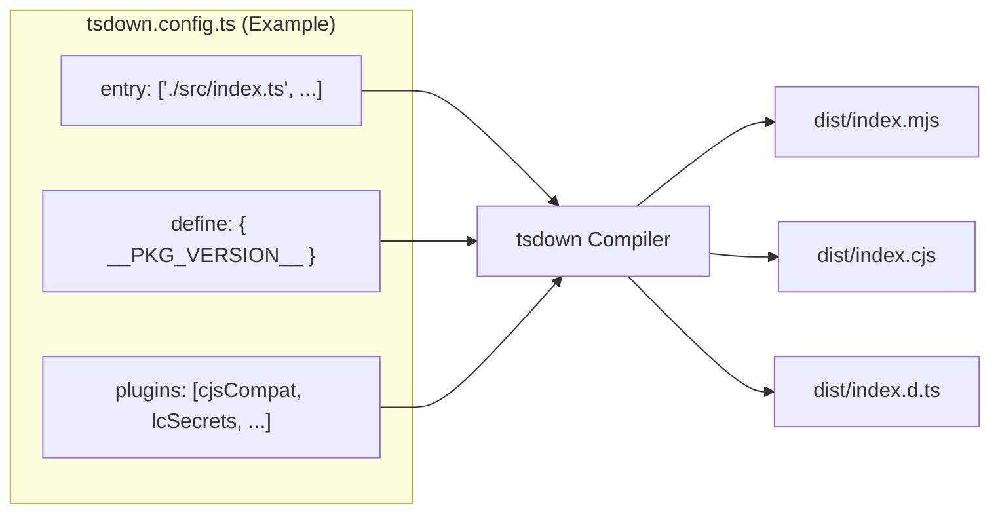

<!-- source: DeepWiki mcp.deepwiki.com · repo langchain-ai/langchainjs · page 6.2 Build Pipeline and Turbo · fetched 2026-10-26 -->

# Build Pipeline and Turbo

Relevant source files

The following files were used as context for generating this wiki page:

- [internal/build/package.json](internal/build/package.json)
- [libs/langchain/vitest.config.ts](libs/langchain/vitest.config.ts)
- [turbo.json](turbo.json)

This document describes the build orchestration system used in the LangChain.js monorepo. It covers the Turbo build system configuration, the `tsdown` compiler integration, and the specialized build logic contained within the `internal/build` package.

---

## Overview

The LangChain.js monorepo uses **Turbo** (version 2.9.3+) as its build orchestration tool to manage tasks across the workspace. Turbo provides intelligent caching, parallel task execution, and dependency-aware scheduling. The actual compilation of TypeScript source code into distributable JavaScript is handled by `tsdown`, a high-performance compiler wrapper.

The build system is configured through several key layers:
- **Root Orchestration**: `package.json` and `turbo.json` define the global task pipeline.
- **Build Logic Package**: `@langchain/build` (located in `internal/build/`) provides shared build utilities and compiler plugins.
- **Package-level Configuration**: Each package contains a `tsdown.config.ts` that defines its entry points and specific build behavior.

Sources: [turbo.json:1-55](), [internal/build/package.json:1-20]()

---

## Build System Architecture

The following diagram illustrates how the build system components interact to transform source code into distribution artifacts.

### Build Data Flow and Entity Mapping

Sources: [turbo.json:7-12](), [internal/build/package.json:15-16]()

---

## Turbo Task Pipeline

The `turbo.json` file defines the complete task pipeline, specifying dependencies between tasks and input/output patterns for caching.

### Task Dependencies

| Task | Depends On | Inputs | Outputs |
| :--- | :--- | :--- | :--- |
| `build:compile` | `^build:compile` | `src/**`, `tsconfig.json`, `tsdown.config.ts`, `package.json` | `dist/**` |
| `test` | `build:compile` | `src/**`, `tests/**`, `**/*.test.ts`, `vitest.config.ts` | (None) |
| `test:standard:unit` | `^build:compile` | `src/**`, `tests/**` | (None) |
| `build:examples` | `^build:compile` | (Inherited) | (Inherited) |

The caret (`^`) in `^build:compile` indicates that a package's build task depends on the successful completion of the build task for all its internal workspace dependencies [turbo.json:8]().

### Global Configuration
Turbo tracks global dependencies that invalidate all caches if changed:
- `**/.env` files [turbo.json:3]()
- `pnpm-lock.yaml` [turbo.json:3]()

It also passes through critical environment variables like `CI`, `NODE_ENV`, and `GITHUB_ACTIONS` to the build processes [turbo.json:4]().

Sources: [turbo.json:1-55]()

---

## The `@langchain/build` Package

The `internal/build` package is a private workspace package that centralizes the build logic for the entire monorepo. It abstracts the complexity of configuring `tsdown` and provides custom plugins required for the LangChain ecosystem.

### Key Dependencies
- **tsdown**: The primary compiler [internal/build/package.json:16]().
- **rolldown**: Used for bundling operations [internal/build/package.json:15]().
- **publint / @arethetypeswrong/core**: Used for validating package exports and type compatibility [internal/build/package.json:12-14]().

### Custom Build Plugins
The build system utilizes several specialized plugins defined in `@langchain/build` and imported into package configurations:

1.  **`importMapPlugin`**: Manages the generation of `import_map.ts` files, which are used for dynamic loading of integrations.
2.  **`importConstantsPlugin`**: Injects build-time constants and handles specialized entrypoint logic.
3.  **`lcSecretsPlugin`**: Handles the identification or masking of sensitive keys during the build process.
4.  **`cjsCompatPlugin`**: Ensures that the generated output maintains compatibility with CommonJS environments, specifically handling files like `CHANGELOG.md` and `README.md` in the distribution.

Sources: [internal/build/package.json:1-20]()

---

## Compilation with tsdown

Each package defines its build surface in `tsdown.config.ts`. This configuration specifies which files are entry points and which plugins to apply.

### Configuration Pattern
Packages use the `getBuildConfig` helper from `@langchain/build` to ensure consistent settings across the monorepo.

### Entrypoint Management
The build system supports multiple entry points per package. For example, **@langchain/core** defines over 70 entry points including `agents.ts`, `messages/index.ts`, and various utility modules.

### Version Injection
The build process injects the current package version into the source code using the `define` property, allowing runtime access to `__PKG_VERSION__`.

---

## tsconfig Inheritance

TypeScript configuration follows a hierarchical structure to maintain consistency while allowing package-specific overrides.

1.  **Base Config**: `@langchain/tsconfig` (referenced in `devDependencies` of packages) provides the foundation [internal/build/package.json:22]().
2.  **Recommended Defaults**: The repo also utilizes `@tsconfig/recommended` as a baseline [internal/build/package.json:23]().
3.  **Package Config**: Each package has its own `tsconfig.json` (tracked as a Turbo input) that extends the base configurations [turbo.json:10]().

Sources: [internal/build/package.json:22-23](), [turbo.json:10]()

---

## Vitest Configuration

Vitest is used for testing across the monorepo. Its configuration is managed per package, allowing for specific test environments and behaviors.

### Configuration Structure
Each package, such as `libs/langchain`, has a `vitest.config.ts` file. This file uses `defineConfig` from `vitest/config` to set up testing parameters [libs/langchain/vitest.config.ts:3-5]().

### Version Injection for Tests
The `__PKG_VERSION__` constant is also injected into the test environment, ensuring tests can access the package's version [libs/langchain/vitest.config.ts:8]().

### Test Modes
The `vitest.config.ts` supports different test modes, determined by the `env.mode` variable:

-   **Default Mode**: Runs unit tests, excluding integration (`.int.test.ts`) and benchmark (`.bench.test.ts`) files. It uses a Node.js environment, sets a default timeout of 30 seconds, and limits workers to 50% of available CPUs [libs/langchain/vitest.config.ts:10-24, 56-63](). Type checking is enabled in this mode [libs/langchain/vitest.config.ts:62]().
-   **`int` Mode**: Specifically runs integration tests (`.int.test.ts`). It disables globals, increases the test timeout to 100 seconds, and sets the test name to "int" [libs/langchain/vitest.config.ts:28-37]().
-   **`bench` Mode**: Runs benchmark tests (`.bench.test.ts`). Similar to `int` mode, it disables globals, sets a 100-second timeout, and names the test "bench" [libs/langchain/vitest.config.ts:41-53]().

All test modes include `dotenv/config` as a setup file to load environment variables [libs/langchain/vitest.config.ts:23]().

Sources: [libs/langchain/vitest.config.ts:1-64]()

---

## Build Modes and Scripts

The system supports different build modes via environment variables.

### Build Scripts in `package.json`
- **`build`**: Runs `turbo build:compile` for all packages.
- **`watch`**: Runs Turbo in watch mode for incremental compilation during development.
- **`prerelease`**: Executes the build with `BUILD_MODE=prerelease`, which may trigger different plugin behaviors or versioning logic.
- **`dev`**: Specifically targets the `@langchain/build` package for development of the build tools themselves.

### Integration with Testing
Testing tasks in Turbo are explicitly configured to depend on the completion of the `build:compile` task to ensure tests run against the latest compiled artifacts [turbo.json:17, 22, 26, 31, 35, 40, 44, 48]().

Sources: [turbo.json:16-50]()

---

