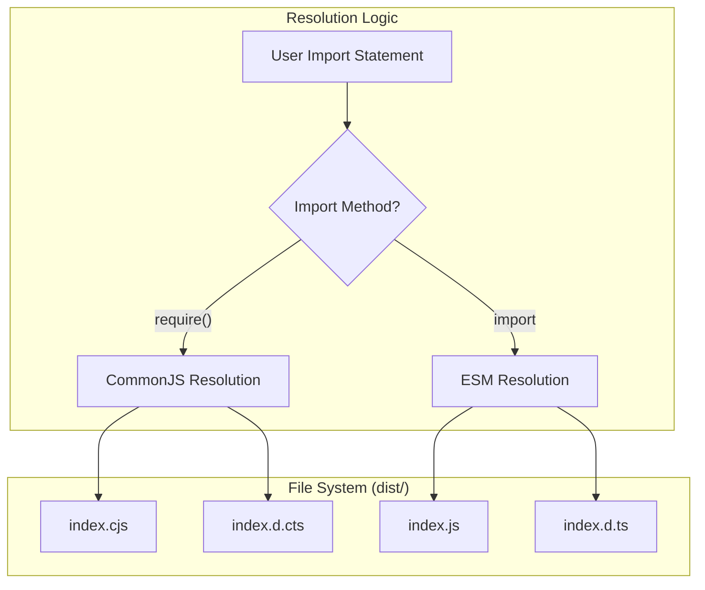
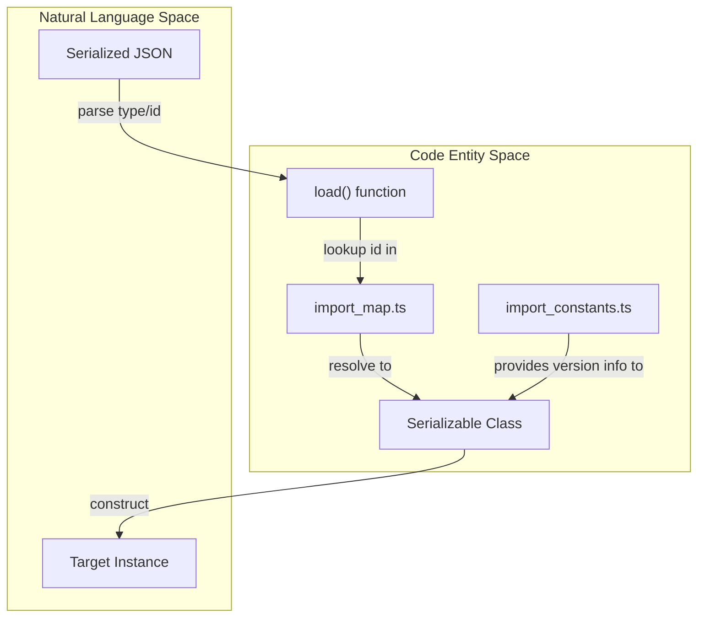
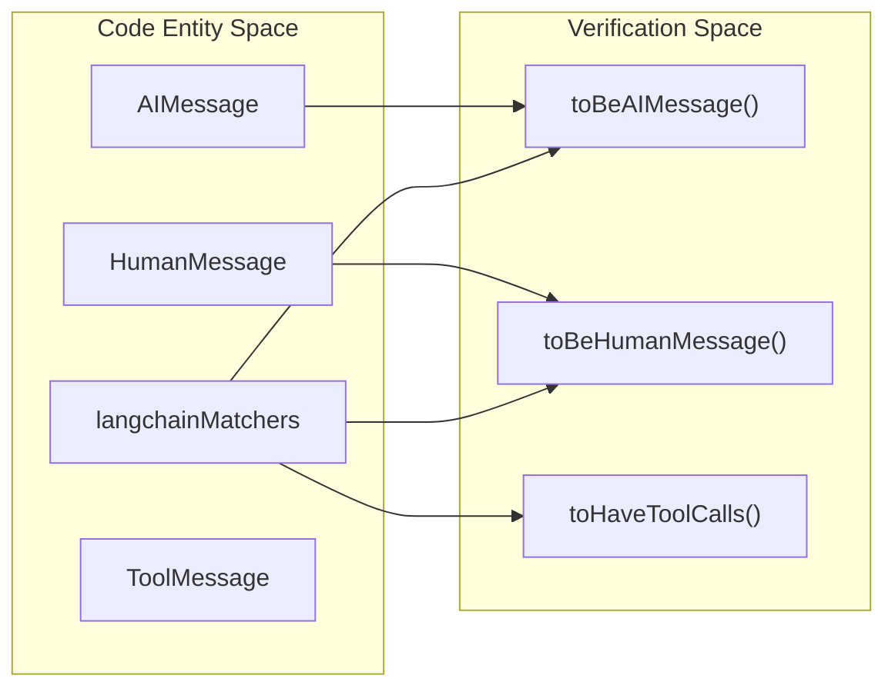

<!-- source: DeepWiki mcp.deepwiki.com · repo langchain-ai/langchainjs · page 6.3 Module Export System · fetched 2026-10-26 -->

# Module Export System

Relevant source files

The following files were used as context for generating this wiki page:

- [examples/src/createAgent/accessExternalContextInTools.ts](examples/src/createAgent/accessExternalContextInTools.ts)
- [libs/langchain-classic/src/chat_models/tests/universal.int.test.ts](libs/langchain-classic/src/chat_models/tests/universal.int.test.ts)
- [libs/langchain-core/src/load/import_map.ts](libs/langchain-core/src/load/import_map.ts)
- [libs/langchain-core/src/testing/matchers.ts](libs/langchain-core/src/testing/matchers.ts)
- [libs/langchain-core/src/testing/tests/matchers.test.ts](libs/langchain-core/src/testing/tests/matchers.test.ts)
- [libs/langchain-core/src/utils/gateway.ts](libs/langchain-core/src/utils/gateway.ts)
- [libs/langchain-core/src/utils/tests/gateway.test.ts](libs/langchain-core/src/utils/tests/gateway.test.ts)
- [libs/langchain-core/tsdown.config.ts](libs/langchain-core/tsdown.config.ts)
- [libs/langchain-core/vitest.config.ts](libs/langchain-core/vitest.config.ts)
- [libs/langchain-core/vitest.setup.ts](libs/langchain-core/vitest.setup.ts)
- [libs/langchain/src/agents/nodes/types.ts](libs/langchain/src/agents/nodes/types.ts)
- [libs/langchain/src/agents/responses.ts](libs/langchain/src/agents/responses.ts)
- [libs/langchain/src/agents/tests/middleware.test-d.ts](libs/langchain/src/agents/tests/middleware.test-d.ts)
- [libs/langchain/src/agents/tests/responses.int.test.ts](libs/langchain/src/agents/tests/responses.int.test.ts)
- [libs/langchain/src/agents/tests/responses.test-d.ts](libs/langchain/src/agents/tests/responses.test-d.ts)
- [libs/langchain/src/agents/tests/responses.test.ts](libs/langchain/src/agents/tests/responses.test.ts)
- [libs/langchain/src/chat_models/tests/universal.int.test.ts](libs/langchain/src/chat_models/tests/universal.int.test.ts)
- [libs/langchain/src/chat_models/tests/universal.test.ts](libs/langchain/src/chat_models/tests/universal.test.ts)
- [libs/langchain/src/chat_models/universal.ts](libs/langchain/src/chat_models/universal.ts)
- [libs/langchain/src/index.ts](libs/langchain/src/index.ts)
- [libs/langchain/src/load/import_constants.ts](libs/langchain/src/load/import_constants.ts)
- [libs/langchain/src/load/import_map.ts](libs/langchain/src/load/import_map.ts)
- [libs/langchain/tsdown.config.ts](libs/langchain/tsdown.config.ts)
- [libs/providers/langchain-fireworks/src/chat_models.ts](libs/providers/langchain-fireworks/src/chat_models.ts)
- [libs/providers/langchain-fireworks/src/tests/chat_models.test.ts](libs/providers/langchain-fireworks/src/tests/chat_models.test.ts)

## Purpose and Scope

This document describes the module export system used across LangChain.js packages to provide dual CommonJS (CJS) and ECMAScript Module (ESM) outputs, manage hundreds of entrypoints, and enable dynamic loading with optional dependencies. The system ensures compatibility across Node.js, browsers, edge runtimes (Vercel, Cloudflare), and alternative JavaScript runtimes (Deno, Bun).

The system relies on a specialized build pipeline using `tsdown` and custom plugins to generate entrypoints, import maps, and serialization constants.

## Dual Format Exports (CJS and ESM)

All LangChain.js packages export both CommonJS and ESM formats. This is achieved through the `exports` field in `package.json` and the `tsdown` build configuration.

### Build Configuration and Plugins

The build process is defined in `tsdown.config.ts` files. Key plugins handle the transformation of source code into dual-format outputs:

- `cjsCompatPlugin`: Generates CommonJS compatible files and handles necessary file copying (e.g., README, LICENSE).
- `importConstantsPlugin`: Injects package version and entrypoint constants.
- `lcSecretsPlugin`: Handles the identification and obfuscation of sensitive keys during serialization.

### Package.json Export Structure

Each package maintains an `exports` map that directs consumers to the correct file based on their environment. This is verified by environment tests that check imports across different runtimes.

| Runtime/Bundler | Entrypoint Test File | Export Logic |
|-----------------|----------------------|--------------|
| **Bun** | `environment_tests/test-exports-bun/src/entrypoints.js` | Uses `export * from "langchain/load"` |
| **Cloudflare** | `environment_tests/test-exports-cf/src/entrypoints.js` | Uses `export * from "langchain/load"` |
| **CJS** | `environment_tests/test-exports-cjs/src/entrypoints.js` | Uses `require("langchain/load")` |
| **ESM** | `environment_tests/test-exports-esm/src/entrypoints.js` | Uses `import * as load from "langchain/load"` |
| **Vite** | `environment_tests/test-exports-vite/src/entrypoints.js` | Uses `export * from "langchain/load"` |

### Dual Export Resolution Flow

Sources: [libs/langchain-core/tsdown.config.ts:1-101]()

## Entrypoint Architecture

LangChain.js packages expose granular entrypoints to allow users to import specific components without loading the entire library, which is critical for tree-shaking and reducing bundle size.

### Defining the Export Surface

The export surface is explicitly defined in `tsdown.config.ts`. Every file that should be accessible as a subpath must be listed in the `entry` array. For example, the `@langchain/core` package defines numerous entrypoints in its `tsdown.config.ts` [libs/langchain-core/tsdown.config.ts:12-83](). The `langchain` package similarly defines its entrypoints [libs/langchain/tsdown.config.ts:12-30]().

| Category | Key Export Paths | Source Reference |
|---------|-----------------|----------------|
| **Messages** | `BaseMessage`, `AIMessage`, `HumanMessage` | [libs/langchain/src/index.ts:4-18]() |
| **Agents** | `createAgent`, `toolStrategy`, `providerStrategy` | [libs/langchain/src/index.ts:54-59]() |
| **Tools** | `tool`, `DynamicTool`, `StructuredTool` | [libs/langchain/src/index.ts:28-44]() |
| **Testing** | `langchainMatchers`, `fakeModel` | [libs/langchain/src/index.ts:74-78]() |

Sources: [libs/langchain/src/index.ts:1-78](), [libs/langchain-core/tsdown.config.ts:12-83](), [libs/langchain/tsdown.config.ts:12-30]()

## Import Maps and Dynamic Loading

The `import_map.ts` system facilitates dynamic loading and cross-package aliasing. This is particularly important for the main `langchain` package, which re-exports many abstractions from `@langchain/core`.

### Import Map Generation

The `importMapPlugin` generates `src/load/import_map.ts`. This file maps internal paths to their respective modules, allowing the serialization system to locate classes during deserialization. For example, `@langchain/core`'s `import_map.ts` lists exports like `agents`, `caches`, `callbacks__base`, etc. [libs/langchain-core/src/load/import_map.ts:3-70](). Similarly, `langchain` has its own `import_map.ts` [libs/langchain/src/load/import_map.ts:3-10]().

### Dynamic Loading Flow

The system bridges the "Natural Language Space" (serialized JSON) to the "Code Entity Space" (actual classes) via the load/import_map pattern.

Sources: [libs/langchain-core/src/load/import_map.ts:3-70](), [libs/langchain/src/load/import_map.ts:3-10](), [libs/langchain/src/load/import_constants.ts:1-5]()

## Serialization and Structured Output

The export system is tightly coupled with the `Serializable` interface and the agent response system. The `ToolStrategy` and `ProviderStrategy` classes utilize these exports to handle structured output parsing.

### Tool Strategy Implementation

`ToolStrategy` manages structured responses via tool calls. It uses `toJsonSchema` to convert schemas into a format the model understands [libs/langchain/src/agents/responses.ts:107-118]().

- `fromSchema`: Creates a strategy from Zod or JSON schemas [libs/langchain/src/agents/responses.ts:94-142]().
- `parse`: Validates tool arguments against the original schema using a `Validator` [libs/langchain/src/agents/responses.ts:151-161]().

### Provider Strategy Implementation

`ProviderStrategy` uses native model provider features (like OpenAI's JSON mode) for structured output. It supports a `strict` mode to ensure output exactly matches the schema [libs/langchain/src/agents/responses.ts:164-205](). The default strictness for `providerStrategy` is `true` [libs/langchain/src/agents/responses.ts:41]().

Sources: [libs/langchain/src/agents/responses.ts:41](), [libs/langchain/src/agents/responses.ts:54-205](), [libs/langchain/src/agents/tests/responses.test.ts:41-196]()

## Testing the Export System

To ensure that the complex export map and dual-format system work across all supported environments, LangChain.js employs several testing strategies.

### Environment Compatibility
The build system includes configurations for `vitest` that run tests in different modes (unit, integration, benchmark) to ensure that imports resolve correctly in various contexts. For example, `@langchain/core`'s `vitest.config.ts` defines these modes [libs/langchain-core/vitest.config.ts:1-44]().

| Test Mode | Purpose | Configuration |
|-----------|---------|---------------|
| `unit` | Standard logic tests | [libs/langchain-core/vitest.config.ts:44]() |
| `int` | Integration (network/IO) | [libs/langchain-core/vitest.config.ts:27-39]() |
| `bench` | Performance testing | [libs/langchain-core/vitest.config.ts:41-44]() |

### Matcher and Assertion System
The system includes custom Vitest matchers to verify the structure of exported messages and agent states. These matchers are defined in `libs/langchain-core/src/testing/matchers.ts` and are used extensively in tests [libs/langchain-core/src/testing/matchers.ts:1-229]().

Sources: [libs/langchain-core/vitest.config.ts:1-44](), [libs/langchain-core/src/testing/matchers.ts:1-229](), [libs/langchain-core/src/testing/tests/matchers.test.ts:10-145](), [libs/langchain/src/index.ts:74-78]()

---

