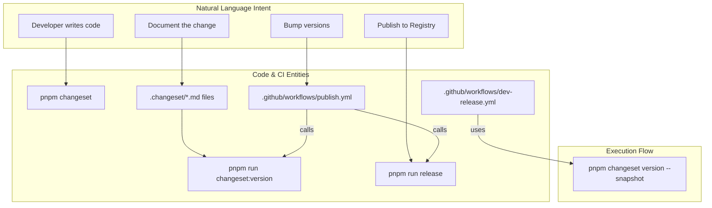
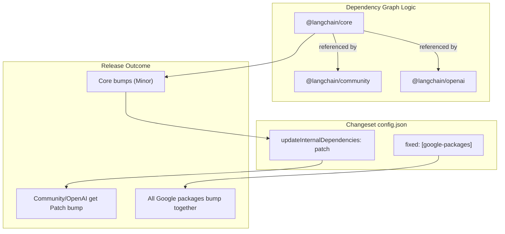

<!-- source: DeepWiki mcp.deepwiki.com · repo langchain-ai/langchainjs · page 6.4 Release Process · fetched 2026-10-26 -->

# Release Process

Relevant source files

The following files were used as context for generating this wiki page:

- [.changeset/README.md](.changeset/README.md)
- [.changeset/config.json](.changeset/config.json)
- [.github/workflows/benchmark-tests.yml](.github/workflows/benchmark-tests.yml)
- [.github/workflows/dev-release.yml](.github/workflows/dev-release.yml)
- [.github/workflows/publish-preview.yml](.github/workflows/publish-preview.yml)
- [.github/workflows/publish.yml](.github/workflows/publish.yml)
- [.github/workflows/release.yml](.github/workflows/release.yml)

## Purpose and Scope

This document explains the release workflow for LangChain.js packages using **Changesets** for version management and coordinated npm publication. It covers the automated CI/CD pipelines for production releases, dev releases, and pull request previews.

For information about the build system that prepares packages for release, see [6.2 Build Pipeline and Turbo](). For details about module export configuration, see [6.3 Module Export System](). For monorepo dependency management, see [6.1 Monorepo Management]().

---

## Release Architecture

LangChain.js utilizes a multi-tiered release strategy managed through GitHub Actions and the Changesets CLI. The system supports three primary release types:

1.  **Production Releases**: Triggered by merging a Version PR to `main`.
2.  **Dev Releases**: Manual snapshots triggered via `workflow_dispatch` for testing specific branches on npm.
3.  **Preview Releases**: Automated ephemeral releases to `pkg.pr.new` for every Pull Request.

### System Data Flow: Changeset to NPM

The following diagram maps the natural language intent of "Releasing Code" to the specific scripts and GitHub Actions that execute the process.

**Release Workflow Entity Map**

Sources: [.github/workflows/publish.yml:54-61](), [.github/workflows/dev-release.yml:65-70](), [.github/workflows/release.yml:33-54]()

---

## Production Release Workflow

Production releases are governed by the `🦋 Changesets Release` workflow [.github/workflows/publish.yml:1](). This workflow implements a two-step process:

1.  **Version PR Generation**: When changesets exist on `main`, the workflow opens a PR that bumps versions and updates `CHANGELOG.md` files via `pnpm run changeset:version` [.github/workflows/publish.yml:54-60]().
2.  **NPM Publication**: When that Version PR is merged back into `main`, the workflow builds the packages and publishes them to npm using `pnpm run release` [.github/workflows/publish.yml:61]().

### Key Implementation Details
- **Trusted Publishing**: The project uses npm's OIDC-based Trusted Publisher. The entry point is `.github/workflows/release.yml`, which handles the `id-token: write` permission required for provenance [.github/workflows/release.yml:28-31]().
- **Action Configuration**: The `changesets/action` is configured to use `pnpm run changeset:version` for versioning and `pnpm run release` for publication [.github/workflows/publish.yml:54-61]().

Sources: [.github/workflows/publish.yml:14-25](), [.github/workflows/release.yml:3-10](), [.github/workflows/release.yml:28-31]()

---

## Dev (Snapshot) Releases

Dev releases allow developers to publish experimental versions of packages to npm under a specific tag (defaulting to `dev`). This is useful for testing fixes in real-world environments before merging.

### Dev Release Mechanism
The `Dev Release` workflow [.github/workflows/dev-release.yml]() performs a "Snapshot" release:

1.  **Validation**: It first checks for the existence of changeset files in the `.changeset` directory [.github/workflows/dev-release.yml:46-57]().
2.  **Preparation**: It modifies `.changeset/config.json` on the fly using `json` to disable changelogs and enable `useCalculatedVersion` with a `{tag}-{timestamp}` template [.github/workflows/dev-release.yml:59-63]().
3.  **Snapshot Versioning**: Executes `pnpm changeset version --snapshot <tag>` [.github/workflows/dev-release.yml:70](). This creates versions like `1.2.0-dev-202310271230`.
4.  **Selective Publishing**: It iterates through all `libs/` directories, identifies non-private packages with the snapshot suffix in their `package.json`, and runs `pnpm publish --tag <tag> --no-git-checks --access public` [.github/workflows/dev-release.yml:107-126]().

Sources: [.github/workflows/dev-release.yml:46-57](), [.github/workflows/dev-release.yml:59-63](), [.github/workflows/dev-release.yml:65-70](), [.github/workflows/dev-release.yml:97-126]()

---

## Preview Releases (pkg.pr.new)

For every Pull Request, the `publish-preview` workflow provides ephemeral installable versions of changed packages without polluting the npm registry.

### Logic Flow
- **Triggering**: Runs on PR events (opened, synchronized, etc.) or manual `workflow_dispatch` if the `publish-preview` label is present [.github/workflows/publish-preview.yml:3-18]().
- **Change Detection**: It detects packages from changed changesets using a script that compares base and head SHAs [.github/workflows/publish-preview.yml:39-42]().
- **Deployment**: The identified packages are published to `https://pkg.pr.new` using `pnpm dlx pkg-pr-new@latest publish` [.github/workflows/publish-preview.yml:44-54]().

Sources: [.github/workflows/publish-preview.yml:3-18](), [.github/workflows/publish-preview.yml:39-54]()

---

## Changeset Configuration

The behavior of the release system is defined in `.changeset/config.json`.

| Key | Purpose |
| :--- | :--- |
| `changelog` | Uses `@changesets/changelog-github` to link entries to PRs and authors [.changeset/config.json:3-8](). |
| `fixed` | Ensures that all Google provider packages (e.g., `@langchain/google-genai`, `@langchain/google-vertexai`) are always versioned together [.changeset/config.json:10-19](). |
| `updateInternalDependencies` | Set to `patch`, ensuring that if a dependency bumps, the dependent package gets a patch bump [.changeset/config.json:23](). |
| `ignore` | The `examples` package is explicitly excluded from the release process [.changeset/config.json:24](). |

### Versioning Logic Diagram

Sources: [.changeset/config.json:1-28]()

---

## Release Commands Reference

| Command | File:Line | Description |
| :--- | :--- | :--- |
| `pnpm changeset` | `package.json:34` | Interactive CLI to create a new changeset file. |
| `pnpm changeset:version` | `package.json:35` | Consumes changesets and updates `package.json` and `CHANGELOG.md`. |
| `pnpm release` | `package.json:24` | Publishes all packages with updated versions to npm. |
| `pnpm prerelease` | `package.json:23` | Runs a full build with `BUILD_MODE=prerelease` before publishing. |

Sources: [package.json:23-24](), [package.json:34-35]()

---

