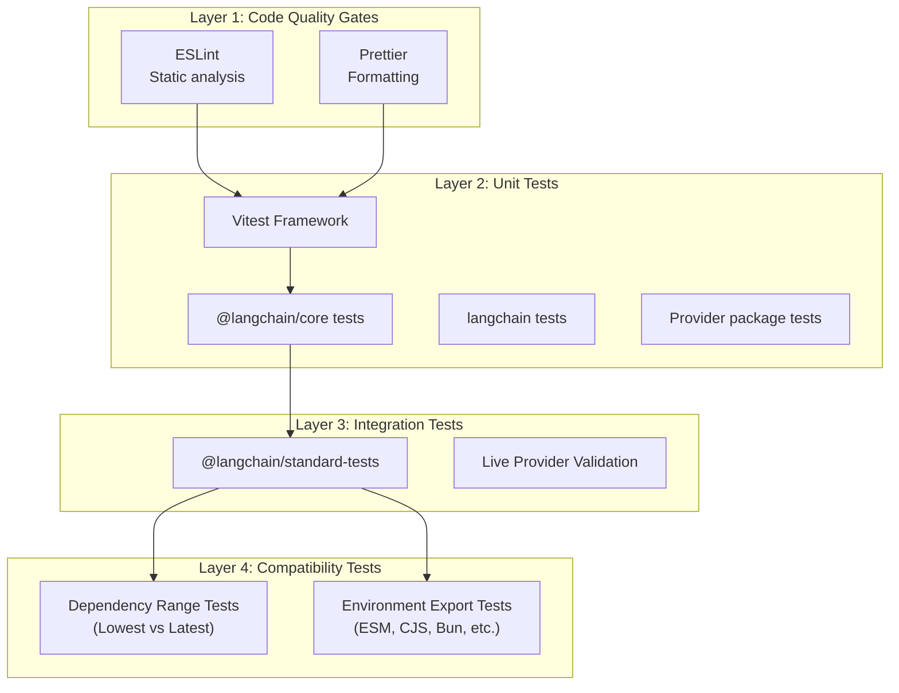
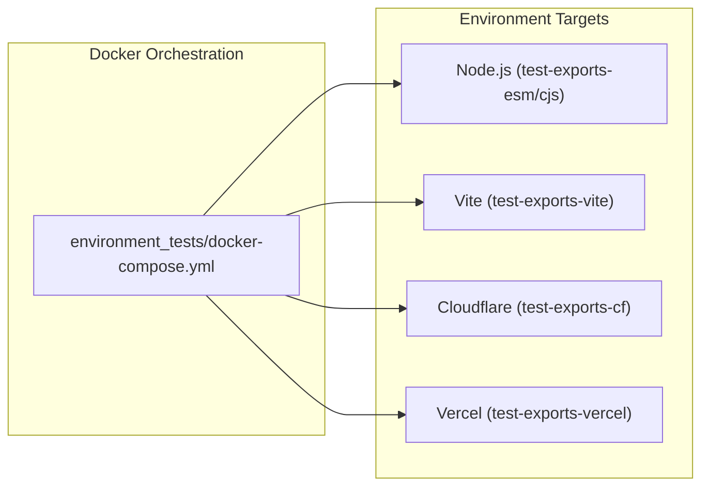

<!-- source: DeepWiki mcp.deepwiki.com · repo langchain-ai/langchainjs · page 7 Testing and Quality Assurance · fetched 2026-10-26 -->

# Testing and Quality Assurance

Relevant source files

The following files were used as context for generating this wiki page:

- [.github/workflows/ci.yml](.github/workflows/ci.yml)
- [.github/workflows/compatibility.yml](.github/workflows/compatibility.yml)
- [.github/workflows/examples.yml](.github/workflows/examples.yml)
- [.github/workflows/format.yml](.github/workflows/format.yml)
- [.github/workflows/integration.yml](.github/workflows/integration.yml)
- [.github/workflows/platform-compatibility.yml](.github/workflows/platform-compatibility.yml)
- [.github/workflows/standard-tests.yml](.github/workflows/standard-tests.yml)
- [.github/workflows/test-exports.yml](.github/workflows/test-exports.yml)
- [.github/workflows/unit-tests-integrations.yml](.github/workflows/unit-tests-integrations.yml)
- [.github/workflows/unit-tests-langchain-core.yml](.github/workflows/unit-tests-langchain-core.yml)
- [.github/workflows/unit-tests-langchain.yml](.github/workflows/unit-tests-langchain.yml)
- [internal/standard-tests/package.json](internal/standard-tests/package.json)
- [internal/test-helpers/package.json](internal/test-helpers/package.json)
- [libs/providers/langchain-mistralai/package.json](libs/providers/langchain-mistralai/package.json)
- [libs/providers/langchain-ollama/package.json](libs/providers/langchain-ollama/package.json)

## Purpose and Scope

This document provides a high-level overview of the comprehensive testing and quality assurance infrastructure in the LangChain.js repository. The strategy encompasses a multi-layered approach including static analysis, unit testing, integration conformance, and environment compatibility.

For deep dives into specific testing areas, refer to the following child pages:
- **[Testing Strategy and Infrastructure](#7.1)**: Details on Vitest configuration, test categorization, and the fake model builder for mocking.
- **[CI/CD Workflows](#7.2)**: Documentation of GitHub Actions, test orchestration via Turbo, and secret management.
- **[Writing Standard Tests for Integrations](#7.3)**: Guide for using `@langchain/standard-tests` to validate provider implementations.
- **[Environment and Dependency Compatibility Testing](#7.4)**: Details on Docker-based tests for ESM/CJS, Vite, Vercel, Cloudflare, and dependency range validation.

---

## Testing Strategy Overview

The LangChain.js repository implements a four-layer testing pyramid designed to catch issues at different levels of the stack while optimizing CI execution time.

### The Testing Pyramid

**Sources:** [.github/workflows/ci.yml:30-45](), [.github/workflows/standard-tests.yml:12-49](), [.github/workflows/compatibility.yml:50-86](), [.github/workflows/test-exports.yml:37-125]()

---

## Code Quality Gates

Before logic is tested, the codebase must pass static quality gates. These are enforced on every Pull Request to maintain consistency across the monorepo.

- **Linting**: Enforced via ESLint. The `lint` job runs `pnpm run lint` [.github/workflows/ci.yml:30-45]().
- **Formatting**: Prettier ensures a unified style across the repository. The `format` workflow runs `pnpm run format:check` [.github/workflows/format.yml:25-40]().
- **Circular Dependencies**: Detected during the build and linting process to prevent runtime module loading failures.

**Sources:** [.github/workflows/ci.yml:30-45](), [.github/workflows/format.yml:25-40]()

---

## Unit Testing Infrastructure

Unit tests are powered by **Vitest** and are designed to be fast and isolated.

- **Test Organization**: Tests are co-located with source code, following `*.test.ts` naming conventions.
- **Package Isolation**: Workflows are segmented by package (Core, Main, Integrations) to allow for parallel execution and targeted testing based on changed files [.github/workflows/unit-tests-langchain-core.yml:9-12](), [.github/workflows/unit-tests-langchain.yml:9-14]().
- **Mocking**: The system utilizes a fake model builder to test logic without making actual LLM calls.

For details on the framework setup and mocking utilities, see **[Testing Strategy and Infrastructure](#7.1)**.

**Sources:** [.github/workflows/unit-tests-langchain-core.yml:1-61](), [.github/workflows/unit-tests-langchain.yml:1-65](), [.github/workflows/unit-tests-integrations.yml:1-133]()

---

## Integration and Standard Tests

To ensure that various provider implementations (OpenAI, Anthropic, Google, etc.) behave consistently, LangChain.js uses a specialized conformance suite.

- **Standard Tests**: The `@langchain/standard-tests` package defines base test classes that integrations must pass.
- **Live Validation**: Scheduled workflows run daily integration tests against real provider APIs using stored secrets [.github/workflows/standard-tests.yml:5-6]().
- **Secret Management**: Integration tests use specific secrets (e.g., `ANTHROPIC_API_KEY`, `GOOGLE_API_KEY`) mapped to matrix packages [.github/workflows/standard-tests.yml:41-48]().

For a guide on implementing these for a new provider, see **[Writing Standard Tests for Integrations](#7.3)**.

**Sources:** [.github/workflows/standard-tests.yml:1-72]()

---

## Environment and Compatibility Testing

Because LangChain.js runs in diverse environments (Node.js, Browsers, Cloudflare Workers, Vercel Edge, Bun), compatibility testing is critical.

### Natural Language to Code Entity Mapping

| Concept | Code Entity / Path | Purpose |
| :--- | :--- | :--- |
| **Edge Compatibility** | `test-exports-cf`, `test-exports-vercel` | Validates runtime behavior in Cloudflare and Vercel Edge [.github/workflows/test-exports.yml:127-186]() |
| **Bundler Support** | `test-exports-vite`, `test-exports-esbuild` | Ensures code is tree-shakeable and bundleable [.github/workflows/test-exports.yml:37-65, 187-204]() |
| **Dependency Health** | `langchain-latest-deps`, `langchain-lowest-deps` | Checks if the package works with both the oldest and newest allowed peer dependencies [.github/workflows/compatibility.yml:50-87]() |
| **Module Systems** | `test-exports-esm`, `test-exports-cjs` | Validates dual-module stability [.github/workflows/test-exports.yml:67-126]() |

### Compatibility Workflow

For technical details on Docker setup and the test entrypoints, see **[Environment and Dependency Compatibility Testing](#7.4)**.

**Sources:** [.github/workflows/test-exports.yml:37-204](), [.github/workflows/compatibility.yml:50-87]()

---

## CI/CD Orchestration

The repository uses **GitHub Actions** and **Turbo** to manage the complex dependency graph of the monorepo.

- **Smart Execution**: The `prepare-matrix` logic determines which packages need testing based on git diffs in `libs/`, preventing unnecessary test runs for unchanged code [.github/workflows/unit-tests-integrations.yml:44-96]().
- **Concurrency**: Workflows are configured to cancel in-progress runs when new commits are pushed to the same branch [.github/workflows/ci.yml:25-27]().
- **Platform Coverage**: Certain workflows validate compatibility across `ubuntu-latest`, `windows-latest`, and `macos-latest` [.github/workflows/platform-compatibility.yml:27-31]().

For details on the CI pipeline logic, see **[CI/CD Workflows](#7.2)**.

**Sources:** [.github/workflows/unit-tests-integrations.yml:44-96](), [.github/workflows/ci.yml:25-27](), [.github/workflows/platform-compatibility.yml:27-31]()

---

