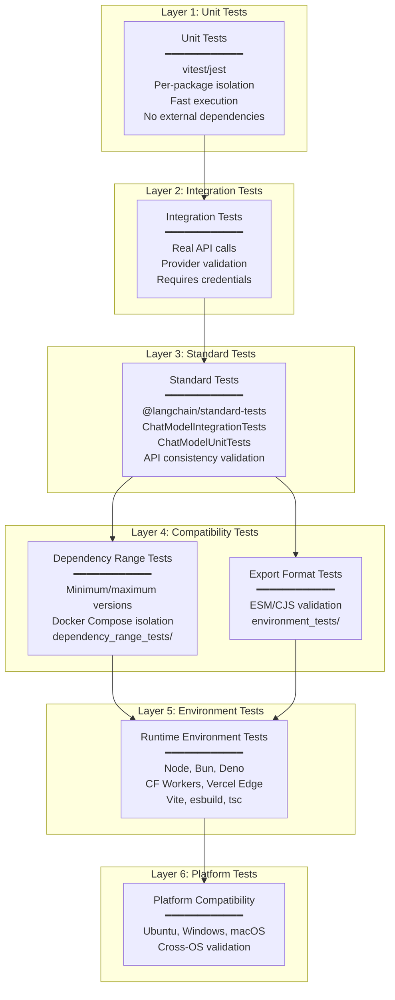
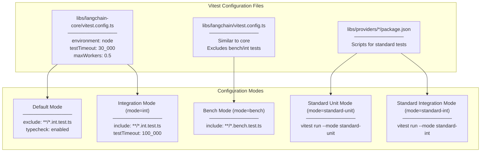
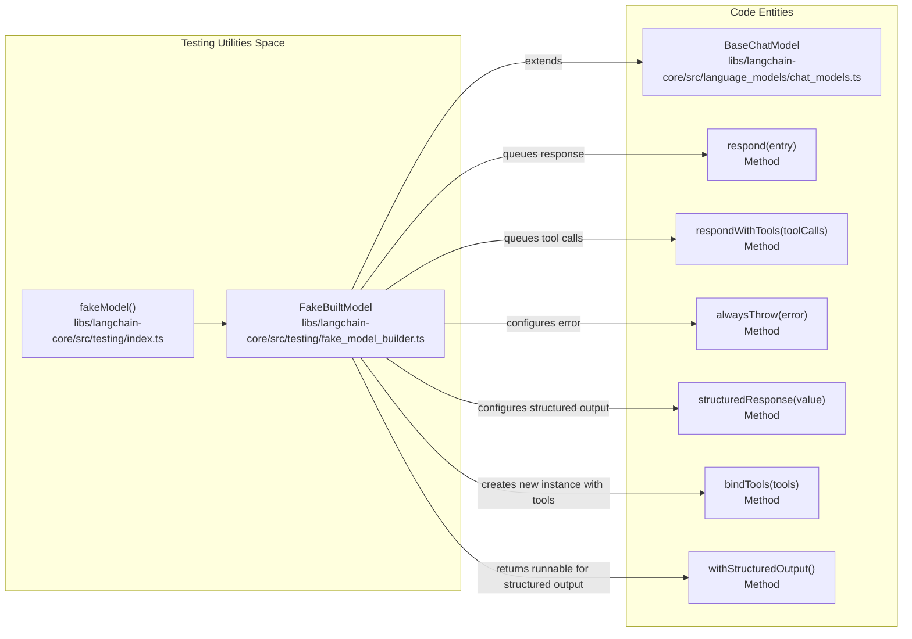

<!-- source: DeepWiki mcp.deepwiki.com · repo langchain-ai/langchainjs · page 7.1 Testing Strategy and Infrastructure · fetched 2026-10-26 -->

# Testing Strategy and Infrastructure

Relevant source files

The following files were used as context for generating this wiki page:

- [internal/standard-tests/package.json](internal/standard-tests/package.json)
- [internal/test-helpers/package.json](internal/test-helpers/package.json)
- [libs/langchain-core/src/testing/fake_model_builder.ts](libs/langchain-core/src/testing/fake_model_builder.ts)
- [libs/langchain-core/src/testing/index.ts](libs/langchain-core/src/testing/index.ts)
- [libs/langchain-core/src/testing/tests/fake_model_builder.test.ts](libs/langchain-core/src/testing/tests/fake_model_builder.test.ts)
- [libs/langchain-core/src/utils/testing/index.ts](libs/langchain-core/src/utils/testing/index.ts)
- [libs/langchain/tsconfig.json](libs/langchain/tsconfig.json)
- [libs/langchain/vitest.config.ts](libs/langchain/vitest.config.ts)
- [libs/providers/langchain-mistralai/package.json](libs/providers/langchain-mistralai/package.json)
- [libs/providers/langchain-ollama/package.json](libs/providers/langchain-ollama/package.json)

This document describes the comprehensive testing infrastructure for the LangChain.js monorepo. It covers the multi-layered testing strategy including unit tests, integration tests, standard tests, compatibility validation, and environment-specific testing. The testing infrastructure ensures code quality, API consistency across provider integrations, and compatibility across diverse JavaScript runtimes and dependency versions.

## Testing Philosophy and Multi-Layered Strategy

LangChain.js employs a **multi-layered testing approach** designed to validate different aspects of the codebase at appropriate levels of isolation and integration. This strategy balances thorough testing with CI resource efficiency.

### Testing Layers Overview

**Sources:** [libs/langchain/vitest.config.ts:18-24]()

### Test Execution Strategy

| Test Type | Execution Context | File Pattern | Timeout |
|-----------|------------------|--------------|---------|
| Unit Tests | Local + CI | `**/*.test.ts` | 30,000ms |
| Integration Tests | Scheduled + Manual | `**/*.int.test.ts` | 100,000ms |
| Benchmark Tests | Performance Monitoring | `**/*.bench.test.ts` | 100,000ms |
| Standard Unit Tests | CI | `**/*.standard-unit.test.ts` | 30,000ms |
| Standard Integration Tests | CI | `**/*.standard-int.test.ts` | 100,000ms |

**Sources:** [libs/langchain/vitest.config.ts:16-54](), [libs/providers/langchain-ollama/package.json:23-25](), [libs/providers/langchain-mistralai/package.json:23-25]()

## Test Infrastructure Components

### Test Runners and Frameworks

LangChain.js uses **Vitest** as the primary test runner across all packages. Vitest provides fast execution, TypeScript support, and ESM compatibility.

#### Vitest Configuration Architecture

**Core Package Configuration:** The core package's Vitest configuration [libs/langchain/vitest.config.ts:1-64]() defines the base settings for unit and integration tests.
Key settings:
- `environment: "node"` - Run tests in Node.js environment [libs/langchain/vitest.config.ts:13-13]()
- `testTimeout: 30_000` - 30 second timeout for unit tests [libs/langchain/vitest.config.ts:16-16]()
- `exclude: ["**/*.int.test.ts"]` - Skip integration tests by default [libs/langchain/vitest.config.ts:18-21]()
- `maxWorkers: 0.5` - Throttle workers to prevent OOM in CI [libs/langchain/vitest.config.ts:17-17]()

**LangChain Package Configuration:** The `langchain` package's Vitest configuration [libs/langchain/vitest.config.ts:1-64]() extends the core configuration.
Additional exclusions:
- `**/*.bench.test.ts` - Benchmark tests run separately [libs/langchain/vitest.config.ts:20-20]()

**Provider Package Configurations:** Provider packages like `@langchain/ollama` [libs/providers/langchain-ollama/package.json:23-25]() and `@langchain/mistralai` [libs/providers/langchain-mistralai/package.json:23-25]() define specific scripts for running standard unit and integration tests using Vitest modes.

**Sources:** [libs/langchain/vitest.config.ts:10-64](), [libs/providers/langchain-ollama/package.json:23-25](), [libs/providers/langchain-mistralai/package.json:23-25]()

### Fake Model Builder for Mocking

To support robust unit testing without making real network calls, LangChain.js provides a `fakeModel` utility and the `FakeBuiltModel` class.

**Implementation:**
- `fakeModel` is the entry point for creating mocked chat models [libs/langchain-core/src/testing/index.ts:3-3]().
- `FakeBuiltModel` allows developers to enqueue sequences of responses, tool calls, and errors for testing complex logic [libs/langchain-core/src/testing/fake_model_builder.ts:59-135]().
- `respond()` enqueues a `BaseMessage`, `Error`, or a dynamic factory function [libs/langchain-core/src/testing/fake_model_builder.ts:104-113]().
- `respondWithTools()` enqueues an `AIMessage` with specific tool calls, deriving content from input messages [libs/langchain-core/src/testing/fake_model_builder.ts:122-135]().
- `alwaysThrow()` configures the model to throw a specific error on every invocation [libs/langchain-core/src/testing/fake_model_builder.ts:142-145]().
- `structuredResponse()` sets a predefined value for `withStructuredOutput` [libs/langchain-core/src/testing/fake_model_builder.ts:152-155]().
- `bindTools()` returns a new model instance with bound tools, sharing the response queue and call history [libs/langchain-core/src/testing/fake_model_builder.ts:162-174]().
- `withStructuredOutput()` returns a `Runnable` that produces the `_structuredResponseValue` [libs/langchain-core/src/testing/fake_model_builder.ts:183-201]().
- The `calls` getter provides access to all recorded invocations for inspection [libs/langchain-core/src/testing/fake_model_builder.ts:75-78]().

**Sources:** [libs/langchain-core/src/testing/fake_model_builder.ts:59-201](), [libs/langchain-core/src/testing/index.ts:3-3](), [libs/langchain-core/src/testing/tests/fake_model_builder.test.ts:1-194]()

### Custom Test Matchers

LangChain.js provides custom Vitest matchers specifically designed for testing LLM interactions. These matchers are defined in `@langchain/core` and are compatible with both Vitest and Jest.

**Matcher Definition:** [libs/langchain-core/src/testing/matchers.ts:1-134]()

| Matcher | Purpose | Implementation |
|---------|---------|----------------|
| `toBeHumanMessage()` | Validate HumanMessage type and content | [libs/langchain-core/src/testing/matchers.ts:114-117]() |
| `toBeAIMessage()` | Validate AIMessage type and fields | [libs/langchain-core/src/testing/matchers.ts:119-122]() |
| `toBeSystemMessage()` | Validate SystemMessage type | [libs/langchain-core/src/testing/matchers.ts:124-127]() |
| `toBeToolMessage()` | Validate ToolMessage type | [libs/langchain-core/src/testing/matchers.ts:129-132]() |
| `toHaveToolCalls()` | Check specific tool calls on an AIMessage | [libs/langchain-core/src/testing/matchers.ts:134-192]() |
| `toHaveToolCallCount()`| Check the number of tool calls | [libs/langchain-core/src/testing/matchers.ts:194-223]()

**Sources:** [libs/langchain-core/src/testing/matchers.ts:1-240](), [libs/langchain-core/src/testing/tests/matchers.test.ts:10-145]()

## Unit Testing Workflows

### Test Organization
Tests are co-located with the source code using the `.test.ts` suffix for unit tests and `.int.test.ts` for integration tests.
The `@langchain/standard-tests` package [internal/standard-tests/package.json:1-59]() provides a framework for defining and running standard test suites against provider implementations.

- **Unit Tests**: Focus on individual functions or classes. Use `fakeModel` to avoid network I/O.
- **Integration Tests**: Focus on the interaction between LangChain and external providers (e.g., OpenAI, Anthropic).
- **Standard Tests**: A suite of tests that every provider implementation must pass to ensure interface compliance. These are further categorized into `standard-unit` and `standard-int` modes [libs/providers/langchain-ollama/package.json:23-25]().

### Package Infrastructure
The build and export system also supports testing by ensuring that entrypoints are correctly mapped.
- `tsdown.config.ts` defines the entrypoints that need to be validated [libs/langchain/tsdown.config.ts:11-23]().
- `importMapPlugin` and `importConstantsPlugin` generate the necessary maps to ensure tests can resolve internal modules across CJS/ESM boundaries [libs/langchain/tsdown.config.ts:30-119]().

**Sources:** [libs/langchain/tsdown.config.ts:1-121](), [libs/langchain/src/load/import_map.ts:1-117](), [internal/standard-tests/package.json:1-59]()

---

