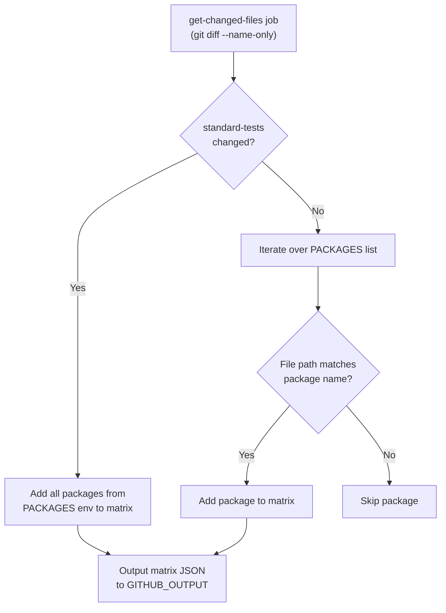

<!-- source: DeepWiki mcp.deepwiki.com · repo langchain-ai/langchainjs · page 7.2 CI/CD Workflows · fetched 2026-10-26 -->

# CI/CD Workflows

Relevant source files

The following files were used as context for generating this wiki page:

- [.github/workflows/ci.yml](.github/workflows/ci.yml)
- [.github/workflows/codeql.yml](.github/workflows/codeql.yml)
- [.github/workflows/compatibility.yml](.github/workflows/compatibility.yml)
- [.github/workflows/examples.yml](.github/workflows/examples.yml)
- [.github/workflows/format.yml](.github/workflows/format.yml)
- [.github/workflows/integration.yml](.github/workflows/integration.yml)
- [.github/workflows/labeler.yml](.github/workflows/labeler.yml)
- [.github/workflows/no-response.yml](.github/workflows/no-response.yml)
- [.github/workflows/people.yml](.github/workflows/people.yml)
- [.github/workflows/platform-compatibility.yml](.github/workflows/platform-compatibility.yml)
- [.github/workflows/pr-approval-label.yml](.github/workflows/pr-approval-label.yml)
- [.github/workflows/standard-tests.yml](.github/workflows/standard-tests.yml)
- [.github/workflows/test-exports.yml](.github/workflows/test-exports.yml)
- [.github/workflows/unit-tests-integrations.yml](.github/workflows/unit-tests-integrations.yml)
- [.github/workflows/unit-tests-langchain-core.yml](.github/workflows/unit-tests-langchain-core.yml)
- [.github/workflows/unit-tests-langchain.yml](.github/workflows/unit-tests-langchain.yml)

## Purpose and Scope

This document describes the Continuous Integration and Continuous Deployment (CI/CD) infrastructure for the LangChain.js monorepo. It details the GitHub Actions workflows that automate linting, unit testing, integration testing across LLM providers, environment compatibility validation, and the release process. The system leverages Turborepo for task orchestration and a dynamic matrix logic to optimize resource usage by only testing changed packages.

## CI/CD Architecture Overview

The LangChain.js CI/CD infrastructure is built on GitHub Actions and orchestrated by Turborepo. The workflow suite is divided into specialized pipelines based on the scope of changes and the execution environment.

Title: GitHub Actions Workflow Orchestration

```mermaid
graph TD
    subgraph "Triggers"
        PR["Pull Request"]
        PUSH["Push to Main"]
        SCHED["Schedule (Cron)"]
        DISP["Workflow Dispatch"]
    end

    subgraph "Orchestration Layer"
        PREP["prepare-matrix job<br/>(unit-tests-integrations.yml)"]
        TURBO["pnpm turbo<br/>(Orchestration)"]
    end

    subgraph "Core Workflows"
        CI_LINT["CI (Linting)<br/>ci.yml"]
        UNIT_CORE["Unit Tests (Core)<br/>unit-tests-langchain-core.yml"]
        UNIT_LC["Unit Tests (LangChain)<br/>unit-tests-langchain.yml"]
        UNIT_INT["Unit Tests (Integrations)<br/>unit-tests-integrations.yml"]
        FORMAT["Format<br/>format.yml"]
    end

    subgraph "Quality & Compatibility"
        STD_TEST["Standard Tests (Integration)<br/>standard-tests.yml"]
        ENV_TEST["Environment Tests<br/>test-exports.yml"]
        DEP_TEST["Dependency Range Tests<br/>compatibility.yml"]
        PLAT_COMPAT["Platform Compatibility<br/>platform-compatibility.yml"]
        CODEQL["CodeQL<br/>codeql.yml"]
    end

    subgraph "Release Pipeline"
        DEV_REL["Dev Release<br/>dev-release.yml"]
        PUB["Changesets Release<br/>publish.yml"]
    end

    subgraph "Community Automation"
        LABELER["Labeler<br/>labeler.yml"]
        NO_RESPONSE["No Response<br/>no-response.yml"]
        PEOPLE["People<br/>people.yml"]
        PR_APPROVAL["PR Approval Label<br/>pr-approval-label.yml"]
    end

    PR --> CI_LINT
    PR --> FORMAT
    PR --> PREP
    PREP --> UNIT_INT
    PR --> UNIT_CORE
    PR --> UNIT_LC
    
    SCHED --> STD_TEST
    PR --> ENV_TEST
    PR --> DEP_TEST
    PR --> PLAT_COMPAT
    PR --> CODEQL

    PUSH --> PUB
    DISP --> DEV_REL

    UNIT_INT --> TURBO
    STD_TEST --> TURBO

    PR --> LABELER
    PR --> NO_RESPONSE
    PR --> PEOPLE
    PR --> PR_APPROVAL
```

**Sources:** [.github/workflows/ci.yml:4-14](), [.github/workflows/unit-tests-integrations.yml:4-12](), [.github/workflows/standard-tests.yml:1-6](), [.github/workflows/test-exports.yml:1-13](), [.github/workflows/format.yml:4-9](), [.github/workflows/compatibility.yml:1-11](), [.github/workflows/platform-compatibility.yml:4-11](), [.github/workflows/codeql.yml:1-10]()

## Unit Test Orchestration and Matrix Logic

To manage the high volume of provider packages in the monorepo, the `unit-tests-integrations.yml` workflow implements a dynamic matrix generation strategy.

### Prepare-Matrix Logic
The `prepare-matrix` job identifies which packages need testing based on git diffs. If the `standard-tests` package is modified, it triggers tests for all integration packages to ensure no regressions in the testing utility itself [.github/workflows/unit-tests-integrations.yml:61-63]().

Title: Matrix Generation Logic (unit-tests-integrations.yml)

The matrix output is consumed by the `unit-tests` job, which runs `pnpm test:unit:ci --filter @langchain/${{ matrix.package }}` [.github/workflows/unit-tests-integrations.yml:105-133]().

**Sources:** [.github/workflows/unit-tests-integrations.yml:28-96](), [.github/workflows/unit-tests-integrations.yml:132-133]()

## Standard Integration Tests

The `standard-tests.yml` workflow runs daily integration tests against live LLM provider APIs. Unlike unit tests which use mocks, these validate actual provider connectivity and response formats.

### Secret Management
Secrets are injected conditionally into the test environment based on the matrix package to prevent leaking credentials to irrelevant jobs [.github/workflows/standard-tests.yml:40-49]().

| Matrix Package | Secret Injected | Usage |
| :--- | :--- | :--- |
| `anthropic` | `ANTHROPIC_API_KEY` | Validates `ChatAnthropic` |
| `google-genai` | `GOOGLE_API_KEY` | Validates `ChatGoogleGenerativeAI` |
| `groq` | `GROQ_API_KEY` | Validates `ChatGroq` |
| `mistralai` | `MISTRAL_API_KEY` | Validates `ChatMistralAI` |
| `aws` | `BEDROCK_AWS_ACCESS_KEY_ID` | Validates `BedrockChat` |
| `aws` | `BEDROCK_AWS_SECRET_ACCESS_KEY` | Validates `BedrockChat` |
| `aws` | `BEDROCK_AWS_REGION` | Validates `BedrockChat` |
| `google-vertexai-web` | `GOOGLE_VERTEX_AI_WEB_CREDENTIALS` | Validates `ChatVertexAI` |
| `ibm` | `WATSONX_AI_APIKEY` | Validates `WatsonxAI` |
| `ibm` | `WATSONX_AI_PROJECT_ID` | Validates `WatsonxAI` |
| `ibm` | `WATSONX_AI_SERVICE_URL` | Validates `WatsonxAI` |
| `ibm` | `WATSONX_AI_GATEWAY_URL` | Validates `WatsonxAI` |

### OpenAI Special Handling
The `@langchain/openai` package contains specific standard tests for structured output and vision that are run as a separate job `standard-tests-openai` to allow granular file-level targeting [.github/workflows/standard-tests.yml:53-71]().

**Sources:** [.github/workflows/standard-tests.yml:11-49](), [.github/workflows/standard-tests.yml:68-69]()

## Environment and Compatibility Testing

### Environment Tests (`test-exports.yml`)
Validates that the dual ESM/CJS build system works across different runtimes. It uses Docker Compose to run tests in:
- **esbuild** environment [.github/workflows/test-exports.yml:37-65]()
- **Pure ESM** environment [.github/workflows/test-exports.yml:67-95]()
- **CommonJS (CJS)** environment [.github/workflows/test-exports.yml:97-125]()
- **Cloudflare Workers** environment [.github/workflows/test-exports.yml:127-155]()
- **Vercel Edge** environment [.github/workflows/test-exports.yml:157-185]()

### Dependency Range Tests (`compatibility.yml`)
Ensures LangChain.js remains compatible with both the **lowest** and **latest** versions of its peer dependencies [.github/workflows/compatibility.yml:50-86](). This prevents "dependency hell" for users on older infrastructure.

### Platform Compatibility Tests (`platform-compatibility.yml`)
This workflow runs on `ubuntu-latest`, `windows-latest`, and `macos-latest` to ensure that the codebase builds and installs dependencies correctly across different operating systems [.github/workflows/platform-compatibility.yml:28-31]().

**Sources:** [.github/workflows/test-exports.yml:1-185](), [.github/workflows/compatibility.yml:1-86](), [.github/workflows/platform-compatibility.yml:1-44]()

## Code Quality and Security

### Linting and Formatting
The `ci.yml` workflow includes a `lint` job that runs `pnpm run lint` to enforce code style and catch potential errors [.github/workflows/ci.yml:30-45]().
The `format.yml` workflow runs `pnpm run format:check` on pull requests to ensure consistent code formatting across the codebase [.github/workflows/format.yml:25-40]().

### CodeQL Analysis (`codeql.yml`)
The `codeql.yml` workflow performs static code analysis using GitHub's CodeQL to find security vulnerabilities and coding errors. It analyzes `actions` and `javascript-typescript` languages [.github/workflows/codeql.yml:1-42](). The results are stored as artifacts for review [.github/workflows/codeql.yml:45-50]().

**Sources:** [.github/workflows/ci.yml:30-45](), [.github/workflows/format.yml:25-40](), [.github/workflows/codeql.yml:1-50]()

## Release Workflows

### Changesets Release (`publish.yml`)
The primary release mechanism using the `changesets/action`.
1. **Version Phase**: If changesets exist, it creates a PR with version bumps and changelog updates [.github/workflows/publish.yml:54-61]().
2. **Publish Phase**: Once the PR is merged to `main`, it builds the packages and publishes to npm using Trusted Publishing [.github/workflows/publish.yml:21-25]().

### Dev Release (`dev-release.yml`)
Triggered manually or via workflow call to create "snapshot" releases.
- It modifies `.changeset/config.json` on the fly to enable snapshot mode and `useCalculatedVersion` [.github/workflows/dev-release.yml:59-63]().
- Packages are versioned with a timestamp (e.g., `1.2.0-dev.20231027`) and published with the `dev` tag [.github/workflows/dev-release.yml:117-121]().

**Sources:** [.github/workflows/publish.yml:1-65](), [.github/workflows/dev-release.yml:1-138]()

## Concurrency and Resource Optimization

To prevent wasting GitHub Actions minutes, all major workflows implement a concurrency group policy. If a new commit is pushed to a PR while a workflow is still running, the previous run is immediately canceled [.github/workflows/ci.yml:25-27](), [.github/workflows/unit-tests-integrations.yml:23-25](), [.github/workflows/test-exports.yml:24-26]().

**Sources:** [.github/workflows/ci.yml:25-27](), [.github/workflows/unit-tests-integrations.yml:23-25](), [.github/workflows/test-exports.yml:24-26]()

---

