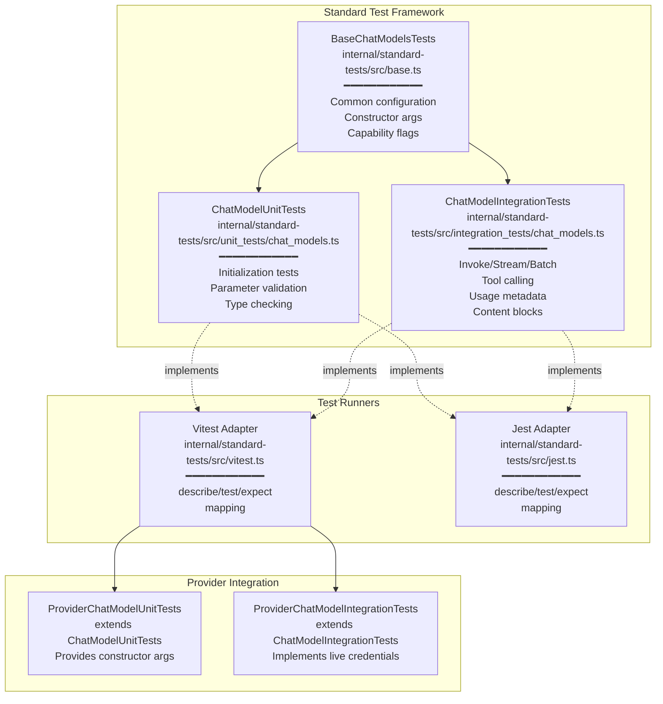
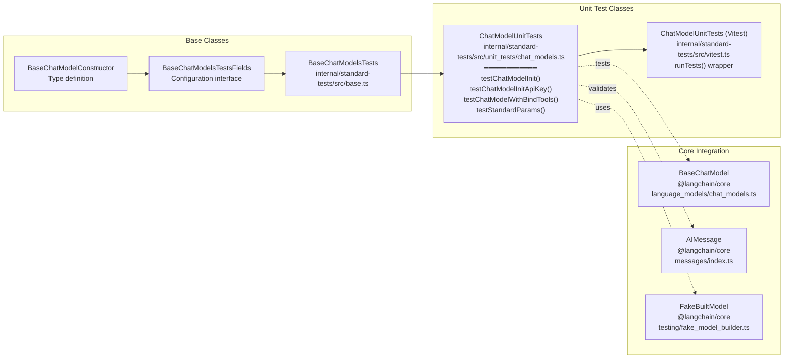
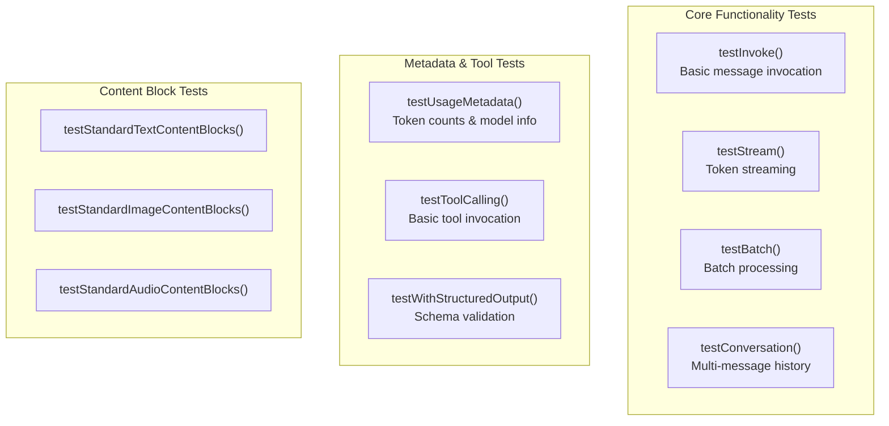

<!-- source: DeepWiki mcp.deepwiki.com · repo langchain-ai/langchainjs · page 7.3 Writing Standard Tests for Integrations · fetched 2026-10-26 -->

# Writing Standard Tests for Integrations

<details>
<summary>Relevant source files</summary>

The following files were used as context for generating this wiki page:

- [internal/standard-tests/package.json](internal/standard-tests/package.json)
- [internal/test-helpers/package.json](internal/test-helpers/package.json)
- [libs/providers/langchain-mistralai/package.json](libs/providers/langchain-mistralai/package.json)
- [libs/providers/langchain-ollama/package.json](libs/providers/langchain-ollama/package.json)
- [libs/providers/langchain-ollama/src/chat_models.ts](libs/providers/langchain-ollama/src/chat_models.ts)
- [libs/providers/langchain-ollama/src/embeddings.ts](libs/providers/langchain-ollama/src/embeddings.ts)
- [libs/providers/langchain-ollama/src/llms.ts](libs/providers/langchain-ollama/src/llms.ts)
- [libs/providers/langchain-ollama/src/tests/chat_models.int.test.ts](libs/providers/langchain-ollama/src/tests/chat_models.int.test.ts)
- [libs/providers/langchain-ollama/src/tests/chat_models.standard.int.test.ts](libs/providers/langchain-ollama/src/tests/chat_models.standard.int.test.ts)
- [libs/providers/langchain-ollama/src/tests/chat_models.standard.test.ts](libs/providers/langchain-ollama/src/tests/chat_models.standard.test.ts)
- [libs/providers/langchain-ollama/src/tests/chat_models.test.ts](libs/providers/langchain-ollama/src/tests/chat_models.test.ts)
- [libs/providers/langchain-ollama/src/tests/chat_models_structured_output.int.test.ts](libs/providers/langchain-ollama/src/tests/chat_models_structured_output.int.test.ts)
- [libs/providers/langchain-ollama/src/tests/chat_models_think.int.test.ts](libs/providers/langchain-ollama/src/tests/chat_models_think.int.test.ts)
- [libs/providers/langchain-ollama/src/tests/embeddings.test.ts](libs/providers/langchain-ollama/src/tests/embeddings.test.ts)
- [libs/providers/langchain-ollama/src/tests/llms_think.int.test.ts](libs/providers/langchain-ollama/src/tests/llms_think.int.test.ts)
- [libs/providers/langchain-ollama/src/tests/utils.test.ts](libs/providers/langchain-ollama/src/tests/utils.test.ts)
- [libs/providers/langchain-ollama/src/utils.ts](libs/providers/langchain-ollama/src/utils.ts)

</details>


The `@langchain/standard-tests` package provides a standardized testing framework for ensuring consistent behavior across all chat model implementations in the LangChain.js ecosystem. This document explains how to implement standard test suites when creating new provider integrations.

For information about the broader testing strategy and CI/CD infrastructure, see page 7.1. For details on environment compatibility testing, see page 7.4. For CI/CD workflow orchestration, see page 7.2.

## Purpose and Architecture

The standard tests framework enforces API contracts defined in `@langchain/core` by providing two abstract test classes that integration developers extend:

- **`ChatModelUnitTests`**: Tests model initialization, parameter validation, and type conformance without making external API calls.
- **`ChatModelIntegrationTests`**: Tests runtime behavior including invocation, streaming, tool calling, and usage metadata by making real API calls.

This dual-layer approach enables rapid unit testing during development while ensuring production behavior matches specifications.

### Test Framework Organization

The framework is located in `internal/standard-tests` and provides specialized entry points for different test runners.



**Sources:** [internal/standard-tests/package.json:1-59](), [internal/standard-tests/src/index.ts:1-2](), [internal/standard-tests/src/vitest.ts:1-2]()

## Test Class Hierarchy and Entities

The following diagram maps the key code entities in the standard-tests framework, showing how they relate to the core abstractions:



**Sources:** [internal/standard-tests/src/base.ts:1-50](), [libs/langchain-core/src/language_models/chat_models.ts:1-100](), [libs/langchain-core/src/testing/fake_model_builder.ts:54-85]()

## Creating Unit Tests

Unit tests verify model initialization and parameter handling without making external API calls. They ensure the model class accepts standard constructor arguments and exposes expected methods like `bindTools` and `withStructuredOutput`.

### Basic Implementation

Extend `ChatModelUnitTests` from the appropriate test runner (Vitest is the standard for the monorepo):

```typescript
import { ChatModelUnitTests } from "@langchain/standard-tests/vitest";
import { YourChatModel } from "./your_chat_model.js";

class YourChatModelUnitTests extends ChatModelUnitTests {
  constructor() {
    super({
      Cls: YourChatModel,
      chatModelHasToolCalling: true,
      chatModelHasStructuredOutput: true,
      constructorArgs: {
        apiKey: "test-key",
        model: "your-model-name",
      },
    });
  }
}

const testClass = new YourChatModelUnitTests();
testClass.runTests();
```

### Standard Unit Test Methods

Unit tests automatically run the following test methods when `runTests()` is called:

| Method | Purpose |
|--------|---------|
| `testChatModelInit()` | Verifies basic model instantiation |
| `testChatModelInitApiKey()` | Tests initialization with API key |
| `testChatModelInitStreaming()` | Tests initialization with streaming enabled |
| `testChatModelWithBindTools()` | Verifies `bindTools()` method exists when supported |
| `testChatModelWithStructuredOutput()` | Verifies `withStructuredOutput()` method exists when supported |
| `testStandardParams()` | Validates LangSmith parameter mapping |

**Sources:** [internal/standard-tests/src/unit_tests/chat_models.ts:1-150](), [libs/langchain-core/src/language_models/chat_models.ts:1-200]()

## Creating Integration Tests

Integration tests make real API calls to verify runtime behavior. They validate invocation, streaming, tool calling, usage metadata, and content blocks.

### Example: Ollama Chat Model Integration Tests

The Ollama provider package (`@langchain/ollama`) provides a concrete example of how to implement standard integration tests.

The `ChatOllama` class [libs/providers/langchain-ollama/src/chat_models.ts:124-125]() extends `BaseChatModel` and implements the necessary interfaces. Its integration tests are defined in `libs/providers/langchain-ollama/src/tests/chat_models.standard.int.test.ts` and `libs/providers/langchain-ollama/src/tests/chat_models.standard.test.ts`.

The `ChatOllamaIntegrationTests` class [libs/providers/langchain-ollama/src/tests/chat_models.standard.int.test.ts:1-100]() extends `ChatModelIntegrationTests` and configures the `ChatOllama` instance with appropriate constructor arguments and capability flags.

```typescript
// libs/providers/langchain-ollama/src/tests/chat_models.standard.int.test.ts
import { ChatModelIntegrationTests } from "@langchain/standard-tests/vitest";
import { ChatOllama } from "../chat_models.js";

class ChatOllamaIntegrationTests extends ChatModelIntegrationTests {
  constructor() {
    super({
      Cls: ChatOllama,
      constructorArgs: {
        model: "llama3", // Specify a model for testing
        temperature: 0,
      },
      // Configure capabilities based on the model's features
      chatModelHasToolCalling: true,
      chatModelHasStructuredOutput: true,
      supports=StandardContentType: {
        image: ["base64", "dataUrl"], // Ollama supports image content via base64/dataUrl
      },
    });
  }
}

const testClass = new ChatOllamaIntegrationTests();
testClass.runTests();
```
**Sources:** [libs/providers/langchain-ollama/src/chat_models.ts:124-125](), [libs/providers/langchain-ollama/src/tests/chat_models.standard.int.test.ts:1-100]()

### Standard Integration Test Methods

The `runTests()` method executes a comprehensive suite of tests:



**Sources:** [internal/standard-tests/src/integration_tests/chat_models.ts:1-200](), [libs/langchain-core/src/language_models/chat_models.ts:1-100]()

### Content Block Support Configuration

Configure which content types and formats your model supports using the `supportsStandardContentType` field. The framework automatically skips unsupported content block tests.

| Format | Description |
|--------|-------------|
| `"url"` | HTTP/HTTPS URLs |
| `"base64"` | Raw base64 strings |
| `"dataUrl"` | Data URLs |

For example, the `ChatOllama` model supports image content via `base64` and `dataUrl` formats [libs/providers/langchain-ollama/src/utils.ts:46-49](), which is reflected in its test configuration.

**Sources:** [libs/langchain-core/src/language_models/chat_models.ts:1-200](), [libs/providers/langchain-ollama/src/utils.ts:46-49]()

## Testing Utilities and Matchers

LangChain provides custom matchers to simplify assertions on messages and tool calls. These are available via `@langchain/core/testing`.

### Fake Model Builder

For unit tests requiring a mock chat model, use `fakeModel()`. This utility allows queuing responses, tool calls, or errors.

```typescript
import { fakeModel } from "@langchain/core/testing";
import { AIMessage, HumanMessage } from "@langchain/core/messages";

const model = fakeModel()
  .respond(new AIMessage("Hello!"))
  .respondWithTools([{ name: "search", args: { query: "weather" } }]);

const res = await model.invoke([new HumanMessage("hi")]);
```

**Sources:** [libs/langchain-core/src/testing/fake_model_builder.ts:54-132](), [libs/langchain-core/src/testing/tests/fake_model_builder.test.ts:14-125]()

### Message and Tool Matchers

| Matcher | Description |
|---------|-------------|
| `toBeHumanMessage()` | Validates a `HumanMessage` instance |
| `toBeAIMessage()` | Validates an `AIMessage` instance |
| `toHaveToolCalls()` | Asserts an `AIMessage` contains specific tool calls |
| `toHaveToolCallCount()` | Asserts the number of tool calls in an `AIMessage` |

**Sources:** [libs/langchain-core/src/testing/matchers.ts:1-245](), [libs/langchain-core/src/testing/index.ts:1-3]()

## Test Execution and Configuration

### Dual Format Exports

The standard test package supports both Vitest and Jest through dedicated entry points defined in `package.json`.

```json
"exports": {
  ".": {
    "types": "./src/index.ts",
    "import": "./src/index.ts"
  },
  "./vitest": {
    "types": "./src/vitest.ts",
    "import": "./src/vitest.ts"
  }
}
```

**Sources:** [internal/standard-tests/package.json:42-52](), [libs/langchain/tsconfig.json:1-14]()

### Running Standard Tests in Provider Packages

Provider packages typically include scripts in their `package.json` to run standard tests. For example, `@langchain/ollama` and `@langchain/mistralai` define `test:standard:unit` and `test:standard:int` scripts:

```json
// libs/providers/langchain-ollama/package.json
{
  "name": "@langchain/ollama",
  // ...
  "scripts": {
    // ...
    "test:standard:unit": "vitest run --mode standard-unit",
    "test:standard:int": "vitest run --mode standard-int",
    "test:standard": "pnpm test:standard:unit && pnpm test:standard:int"
  },
  "devDependencies": {
    // ...
    "@langchain/standard-tests": "workspace:*",
    "vitest": "^4.1.11"
  }
}
```
These scripts leverage `vitest` with specific modes to differentiate between unit and integration tests, ensuring that integration tests requiring external API calls are only run when appropriate (e.g., in CI environments with credentials).

**Sources:** [libs/providers/langchain-ollama/package.json:1-72](), [libs/providers/langchain-mistralai/package.json:1-71]()

---

