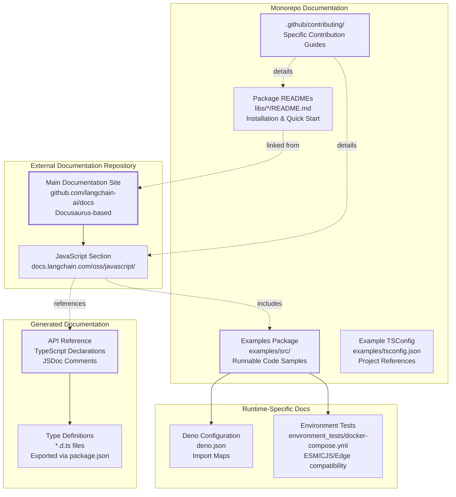
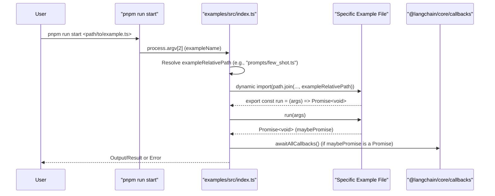

<!-- source: DeepWiki mcp.deepwiki.com · repo langchain-ai/langchainjs · page 8 Documentation, Examples, and Contributing · fetched 2026-10-26 -->

# Documentation, Examples, and Contributing

Relevant source files

The following files were used as context for generating this wiki page:

- [CONTRIBUTING.md](CONTRIBUTING.md)
- [examples/src/README.md](examples/src/README.md)
- [examples/src/index.ts](examples/src/index.ts)
- [examples/tsconfig.json](examples/tsconfig.json)
- [libs/providers/langchain-google-common/README.md](libs/providers/langchain-google-common/README.md)
- [libs/providers/langchain-google-common/src/chat_models.ts](libs/providers/langchain-google-common/src/chat_models.ts)
- [libs/providers/langchain-google-common/src/tests/data/chat-json-schema-mock.json](libs/providers/langchain-google-common/src/tests/data/chat-json-schema-mock.json)
- [libs/providers/langchain-google-common/src/tests/data/chat-stream-usage-cache-mock.json](libs/providers/langchain-google-common/src/tests/data/chat-stream-usage-cache-mock.json)
- [libs/providers/langchain-google-common/src/tests/data/chat-usage-metadata-mock.json](libs/providers/langchain-google-common/src/tests/data/chat-usage-metadata-mock.json)
- [libs/providers/langchain-google-common/src/tests/zod_to_gemini_parameters.test.ts](libs/providers/langchain-google-common/src/tests/zod_to_gemini_parameters.test.ts)
- [libs/providers/langchain-google-common/src/utils/common.ts](libs/providers/langchain-google-common/src/utils/common.ts)
- [libs/providers/langchain-google-common/src/utils/zod_to_gemini_parameters.ts](libs/providers/langchain-google-common/src/utils/zod_to_gemini_parameters.ts)
- [libs/providers/langchain-google-vertexai/README.md](libs/providers/langchain-google-vertexai/README.md)
- [libs/providers/langchain-ollama/README.md](libs/providers/langchain-ollama/README.md)

## Purpose and Scope

This page provides a high-level overview of the documentation infrastructure, the examples package, and the various ways to contribute to the LangChain.js codebase. It serves as a parent page, linking to more detailed child pages for each specific topic. The goal is to guide users and contributors through finding information, running examples, and understanding the contribution process.

## Documentation Architecture

The LangChain.js documentation system is distributed across multiple locations and formats to serve different user needs:

**Sources:** [examples/src/README.md:1-34](), [examples/tsconfig.json:1-45](), [CONTRIBUTING.md:49-50]()

## API Reference Generation

API reference documentation is generated directly from TypeScript source code using JSDoc comments and type definitions.

### TypeScript Declaration Files

Each package exports type definitions through the `types` field in `package.json`. These `.d.ts` files provide the source of truth for the documentation site and IDE IntelliSense.

### Project References in Examples
The `examples` package maintains a `tsconfig.json` that uses TypeScript **Project References** to link to the source code of all library packages. This ensures that examples are always validated against the latest local code rather than published npm versions.

| Reference Path | Package Target |
|----------------|----------------|
| `../libs/langchain-core` | Foundation abstractions | [examples/tsconfig.json:15]() |
| `../libs/providers/langchain-openai` | OpenAI Integration | [examples/tsconfig.json:36]() |
| `../libs/providers/langchain-anthropic` | Anthropic Integration | [examples/tsconfig.json:18]() |
| `../libs/providers/langchain-google-common` | Google Common Logic | [examples/tsconfig.json:26]() |
| `../libs/providers/langchain-together-ai` | Together AI Integration | [examples/tsconfig.json:42]() |
| `../libs/providers/langchain-ollama` | Ollama Integration | [examples/tsconfig.json:35]() |

**Sources:** [examples/tsconfig.json:14-45]()

## Examples System

The `examples/` directory serves as a live documentation suite. It contains runnable TypeScript files that demonstrate various features and integrations of LangChain.js. These examples are crucial for understanding how to use the library in practice and are regularly tested to ensure their correctness.

For a detailed guide on the structure of the `examples/` workspace and how to run specific examples, see [Examples Package](#8.1). This includes examples for `createAgent`, middleware, multi-agent setups, and the extensive `langchain-classic` catalog.

### Configuration and Environment
Most examples require API keys and external configuration. The system provides a template for environment variables in `examples/.env.example`. Users are expected to copy this to `.env` before running samples [examples/src/README.md:16-16]().

### Running Examples
The system uses a central runner `examples/src/index.ts` to execute individual examples. It handles path resolution for both source (`.ts`) and transpiled (`.js`) files [examples/src/index.ts:14-30]().

**Sources:** [examples/src/index.ts:1-56](), [examples/src/README.md:1-34]()

## Contributing to LangChain.js

LangChain.js welcomes contributions from the community. There are several ways to contribute, including reporting bugs, requesting features, improving documentation, and contributing code or new integrations.

For a comprehensive guide on the development setup, code quality tools, changesets, PR and issue templates, and the review process, see [Contribution Workflow](#8.2).

### Ways to Contribute

*   **Report Bugs**: Follow the process of searching existing issues and creating new ones with minimal reproducible examples [CONTRIBUTING.md:9-20]().
*   **Request Features**: Search for existing requests or start a new discussion, describing the use case and potential value [CONTRIBUTING.md:21-28]().
*   **Improve Documentation**: Contributions to documentation are always welcome. A dedicated documentation contribution guide is available [CONTRIBUTING.md:30-31]().
*   **Contribute Code**: Work on existing issues, especially those labeled "good first issue" or "help wanted" [CONTRIBUTING.md:34-38]().
*   **Add an Integration**: Integrations are a core component. While new integrations must be published as standalone packages, LangChain.js provides standard interfaces and patterns to facilitate this [CONTRIBUTING.md:40-61]().

### Integration Contribution Guides

Specific guidelines and patterns for contributing integrations are available. These guides cover how to implement new embeddings, LLMs, tools, memory, message stores, document loaders, and vector stores, often leveraging the `create-langchain-integration` templates.

For detailed information on integration patterns and how to use scaffolding tools, see [Integration Contribution Guides](#8.3).

### Pull Request Guidelines

When submitting a pull request, contributors are expected to:
*   Fill out the PR template and link related issues [CONTRIBUTING.md:78-80]().
*   Keep PRs focused on a single feature or fix [CONTRIBUTING.md:81]().
*   Include unit tests for new functionality and integration tests for new external APIs [CONTRIBUTING.md:82]().
*   Update relevant documentation if public APIs are affected [CONTRIBUTING.md:83]().
*   Run local checks (`pnpm lint`, `pnpm format:check`, `pnpm test`) before pushing [CONTRIBUTING.md:84]().

The review process involves a maintainer reviewing the PR, requesting changes, and merging once approved [CONTRIBUTING.md:87-90]().

**Sources:** [CONTRIBUTING.md:76-90]()

## Documentation Maintenance

### JSDoc Standards for API Reference
API documentation should follow a structured format to ensure the generated site is searchable and includes examples:

1.  **Summary**: Clear description of the class/function.
2.  **@param**: Documented parameters with types and descriptions.
3.  **@returns**: Description of the return value.
4.  **@example**: Runnable code block (often extracted from the `examples/` package).

For example, the `ChatGoogleBase` class in `@langchain/google-common` includes JSDoc comments for its purpose and parameters [libs/providers/langchain-google-common/src/chat_models.ts:171-186](). Similarly, the `schemaToGeminiParameters` utility function has detailed JSDoc explaining its role in converting Zod schemas to Gemini-compatible JSON schemas [libs/providers/langchain-google-common/src/utils/zod_to_gemini_parameters.ts:130-140]().

**Sources:** [libs/providers/langchain-google-common/src/chat_models.ts:171-186](), [libs/providers/langchain-google-common/src/utils/zod_to_gemini_parameters.ts:130-140]()

---

