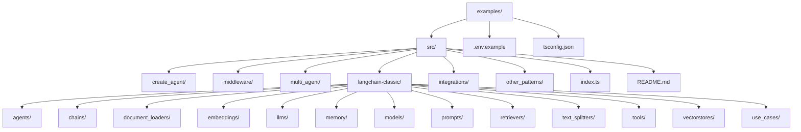
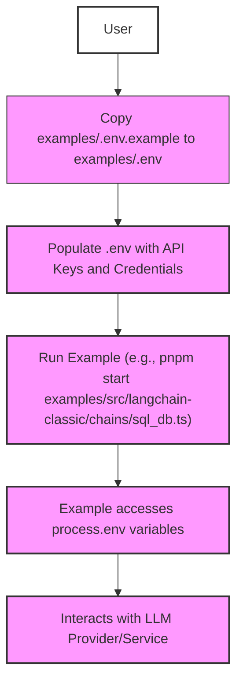
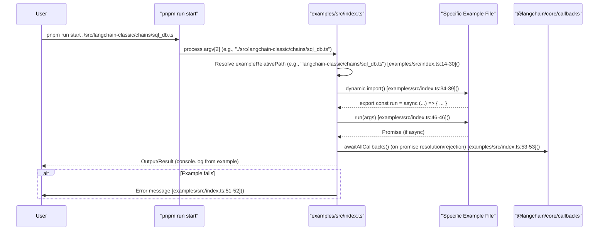

<!-- source: DeepWiki mcp.deepwiki.com · repo langchain-ai/langchainjs · page 8.1 Examples Package · fetched 2026-10-26 -->

# Examples Package

<details>
<summary>Relevant source files</summary>

The following files were used as context for generating this wiki page:

- [examples/.env.example](examples/.env.example)
- [examples/src/README.md](examples/src/README.md)
- [examples/src/index.ts](examples/src/index.ts)
- [examples/src/langchain-classic/chains/sql_db.ts](examples/src/langchain-classic/chains/sql_db.ts)
- [examples/src/langchain-classic/chains/sql_db_custom_prompt.ts](examples/src/langchain-classic/chains/sql_db_custom_prompt.ts)
- [examples/src/langchain-classic/chains/sql_db_custom_prompt_legacy.ts](examples/src/langchain-classic/chains/sql_db_custom_prompt_legacy.ts)
- [examples/src/langchain-classic/chains/sql_db_legacy.ts](examples/src/langchain-classic/chains/sql_db_legacy.ts)
- [examples/src/langchain-classic/chains/sql_db_sql_output.ts](examples/src/langchain-classic/chains/sql_db_sql_output.ts)
- [examples/src/langchain-classic/chains/sql_db_sql_output_legacy.ts](examples/src/langchain-classic/chains/sql_db_sql_output_legacy.ts)
- [examples/src/langchain-classic/guides/expression_language/cookbook_sql_db.ts](examples/src/langchain-classic/guides/expression_language/cookbook_sql_db.ts)
- [examples/src/langchain-classic/use_cases/sql/db.ts](examples/src/langchain-classic/use_cases/sql/db.ts)
- [examples/src/langchain-classic/use_cases/sql/db_check.ts](examples/src/langchain-classic/use_cases/sql/db_check.ts)
- [examples/src/langchain-classic/use_cases/sql/large_db.ts](examples/src/langchain-classic/use_cases/sql/large_db.ts)
- [examples/tsconfig.json](examples/tsconfig.json)

</details>


The `examples/` directory serves as a live documentation suite within the LangChain.js monorepo. Unlike static snippets, these are full TypeScript files that are compiled and can be executed against various runtimes. This package is crucial for demonstrating how to use LangChain.js features, integrations, and patterns in a runnable context.

## Purpose and Scope

The `examples/` workspace provides practical, runnable code samples for various LangChain.js functionalities. It covers:
- **`createAgent` examples**: Demonstrating the agent creation API and its capabilities.
- **Middleware examples**: Illustrating the use of middleware for enhancing agent behavior.
- **Multi-agent examples**: Showcasing complex interactions between multiple agents.
- **`langchain-classic` examples**: A large catalog of examples covering chains, retrievers, memory, and other features from the `@langchain/classic` package.

These examples are designed to be directly executable, providing a hands-on way to understand the codebase and verify functionality.

## Workspace Structure

The `examples/` workspace is structured to categorize examples by their primary LangChain.js component or pattern.



**Sources:** [examples/src/index.ts:1-56](), [examples/src/README.md:1-34](), [examples/tsconfig.json:1-45](), [examples/.env.example:1-91]()

## Configuration and Environment

Most examples require API keys and external configuration to interact with various LLM providers and services. The system provides a template for environment variables in `examples/.env.example` [examples/.env.example:1-91](). Users are expected to copy this file to `.env` in the root of the `examples/` directory and populate it with their respective API keys and credentials before running samples.


**Sources:** [examples/.env.example:1-91]()

## Running Examples

The system uses a central runner `examples/src/index.ts` to execute individual examples. This runner handles path resolution for both source (`.ts`) and transpiled (`.js`) files, allowing users to specify examples using various path formats.

### Execution Flow


The `index.ts` script parses the command-line arguments to determine which example to run. It then dynamically imports the specified example file, which is expected to export an `async` function named `run`. This `run` function is then executed, and any pending callbacks are awaited before the process exits.

**Sources:** [examples/src/index.ts:1-56]()

### Example Path Resolution

The `examples/src/index.ts` script is designed to be flexible with how example paths are provided. It normalizes various input formats to correctly locate and import the example module.

| Input Path Format | Resolved `exampleRelativePath` |
|-------------------|--------------------------------|
| `./examples/src/foo.ts` | `foo.ts` |
| `examples/src/foo.ts` | `foo.ts` |
| `./src/foo.ts` | `foo.ts` |
| `./dist/foo.js` | `foo.js` |
| `src/foo.ts` | `foo.ts` |
| `dist/foo.js` | `foo.js` |
| `foo.ts` | `foo.ts` |

This flexibility allows developers to quickly run examples regardless of their current working directory or how they reference the file.

**Sources:** [examples/src/index.ts:14-30]()

## `createAgent` Examples

These examples demonstrate the use of the `createAgent` API from the `langchain` package, showcasing how to build sophisticated agents with various tools and configurations. They often involve defining agent state, middleware, and tool execution logic.

## Middleware Examples

The middleware system allows for intercepting and modifying agent and tool calls. Examples in this category illustrate how to implement and apply custom middleware, as well as how to use built-in middleware for functionalities like summarization, human-in-the-loop (HITL), context editing, and retry mechanisms.

## Multi-Agent Examples

These examples showcase scenarios where multiple agents collaborate to achieve a complex goal. They often involve defining communication protocols, shared state, and coordination strategies between agents.

## `langchain-classic` Example Catalog

The `langchain-classic` directory contains a comprehensive collection of examples for features residing in the `@langchain/classic` package. This includes:

### Chains

Examples for various types of chains, demonstrating how to link LLMs with other components. A common pattern is the SQL database chain, which allows an LLM to interact with a SQL database.

#### SQL Database Chain Example

This example demonstrates how to use `SqlDatabaseChain` to query a SQL database using natural language. It uses a `Chinook.db` SQLite database.

```typescript
// examples/src/langchain-classic/chains/sql_db.ts
import { SqlDatabase } from "@langchain/classic/sql_db";
import { ChatOpenAI } from "@langchain/openai";
import { PromptTemplate } from "@langchain/core/prompts";
import { RunnableSequence } from "@langchain/core/runnables";
import { StringOutputParser } from "@langchain/core/output_parsers";

// ... (database setup)

const llm = new ChatOpenAI({
  model: "gpt-4o-mini",
});

// Chain to generate SQL query
const sqlQueryChain = RunnableSequence.from([
  {
    schema: async () => db.getTableInfo(),
    question: (input: { question: string }) => input.question,
  },
  PromptTemplate.fromTemplate(`Based on the provided SQL table schema below, write a SQL query that would answer the user's question.
------------
SCHEMA: {schema}
------------
QUESTION: {question}
------------
SQL QUERY:`),
  llm.withConfig({ stop: ["\nSQLResult:"] }),
  new StringOutputParser(),
]);

// Chain to generate natural language response from SQL query result
const finalChain = RunnableSequence.from([
  {
    question: (input) => input.question,
    query: sqlQueryChain,
  },
  {
    schema: async () => db.getTableInfo(),
    question: (input) => input.question,
    query: (input) => input.query,
    response: (input) => db.run(input.query),
  },
  PromptTemplate.fromTemplate(`Based on the table schema below, question, SQL query, and SQL response, write a natural language response:
------------
SCHEMA: {schema}
------------
QUESTION: {question}
------------
SQL QUERY: {query}
------------
SQL RESPONSE: {response}
------------
NATURAL LANGUAGE RESPONSE:`),
  llm,
  new StringOutputParser(),
]);

const finalResponse = await finalChain.invoke({
  question: "How many employees are there?",
});
console.log({ finalResponse });
// Expected output: { finalResponse: 'There are 8 employees.' }
```
This example demonstrates a two-step process: first, an LLM generates a SQL query based on the schema and user question, and then another LLM generates a natural language response based on the query, its result, and the schema.

**Sources:** [examples/src/langchain-classic/chains/sql_db.ts:1-120](), [examples/src/langchain-classic/chains/sql_db_legacy.ts:1-24](), [examples/src/langchain-classic/chains/sql_db_sql_output.ts:1-107](), [examples/src/langchain-classic/chains/sql_db_sql_output_legacy.ts:1-30](), [examples/src/langchain-classic/chains/sql_db_custom_prompt.ts:1-55](), [examples/src/langchain-classic/chains/sql_db_custom_prompt_legacy.ts:1-55](), [examples/src/langchain-classic/guides/expression_language/cookbook_sql_db.ts:1-87](), [examples/src/langchain-classic/use_cases/sql/db.ts:1-8](), [examples/src/langchain-classic/use_cases/sql/db_check.ts:1-19]()

### Other `langchain-classic` Categories

-   **Agents**: Legacy agent implementations.
-   **Document Loaders**: How to load data from various sources.
-   **Embeddings**: Generating vector representations of text.
-   **LLMs**: Interacting with different Large Language Models.
-   **Memory**: Storing and retrieving conversation history.
-   **Models**: Examples for various model types.
-   **Prompts**: Crafting effective prompts for LLMs.
-   **Retrievers**: Fetching relevant documents for RAG applications.
-   **Text Splitters**: Breaking down large texts into smaller chunks.
-   **Tools**: Defining and using tools for agents.
-   **Vectorstores**: Storing and querying vector embeddings.
-   **Use Cases**: End-to-end examples for specific applications.

## Project References in Examples

The `examples/` package maintains a `tsconfig.json` that uses TypeScript **Project References** to link to the source code of all library packages [examples/tsconfig.json:1-45](). This ensures that examples are always validated against the latest local code rather than published npm versions, providing strong type checking and preventing regressions.

| Reference Path | Package Target |
|----------------|----------------|
| `../libs/langchain-core` | `@langchain/core` (Foundation abstractions) |
| `../libs/langchain-classic` | `@langchain/classic` (Legacy/high-level framework) |
| `../libs/langchain-textsplitters` | `@langchain/textsplitters` (Text splitting utilities) |
| `../libs/providers/langchain-anthropic` | `@langchain/anthropic` (Anthropic integration) |
| `../libs/providers/langchain-aws` | `@langchain/aws` (AWS Bedrock integration) |
| `../libs/providers/langchain-cloudflare` | `@langchain/cloudflare` (Cloudflare integration) |
| `../libs/providers/langchain-cohere` | `@langchain/cohere` (Cohere integration) |
| `../libs/providers/langchain-deepseek` | `@langchain/deepseek` (DeepSeek integration) |
| `../libs/providers/langchain-exa` | `@langchain/exa` (Exa search tool integration) |
| `../libs/providers/langchain-fireworks` | `@langchain/fireworks` (Fireworks AI integration) |
| `../libs/providers/langchain-google-common` | `@langchain/google-common` (Google common utilities) |
| `../libs/providers/langchain-google-genai` | `@langchain/google-genai` (Google Generative AI integration) |
| `../libs/providers/langchain-google-vertexai` | `@langchain/google-vertexai` (Google Vertex AI integration) |
| `../libs/providers/langchain-google-vertexai-web` | `@langchain/google-vertexai-web` (Google Vertex AI web integration) |
| `../libs/providers/langchain-groq` | `@langchain/groq` (Groq integration) |
| `../libs/providers/langchain-ibm` | `@langchain/ibm` (IBM Watsonx integration) |
| `../libs/providers/langchain-mistralai` | `@langchain/mistralai` (Mistral AI integration) |
| `../libs/providers/langchain-mongodb` | `@langchain/mongodb` (MongoDB integration) |
| `../libs/providers/langchain-neo4j` | `@langchain/neo4j` (Neo4j integration) |
| `../libs/providers/langchain-ollama` | `@langchain/ollama` (Ollama integration) |
| `../libs/providers/langchain-openai` | `@langchain/openai` (OpenAI integration) |
| `../libs/providers/langchain-perplexity` | `@langchain/perplexity` (Perplexity AI integration) |
| `../libs/providers/langchain-pinecone` | `@langchain/pinecone` (Pinecone integration) |
| `../libs/providers/langchain-qdrant` | `@langchain/qdrant` (Qdrant integration) |
| `../libs/providers/langchain-redis` | `@langchain/redis` (Redis integration) |
| `../libs/providers/langchain-tavily` | `@langchain/tavily` (Tavily search tool integration) |
| `../libs/providers/langchain-together-ai` | `@langchain/together-ai` (Together AI integration) |
| `../libs/providers/langchain-weaviate` | `@langchain/weaviate` (Weaviate integration) |
| `../libs/providers/langchain-xai` | `@langchain/xai` (xAI integration) |

**Sources:** [examples/tsconfig.json:14-45]()

---

