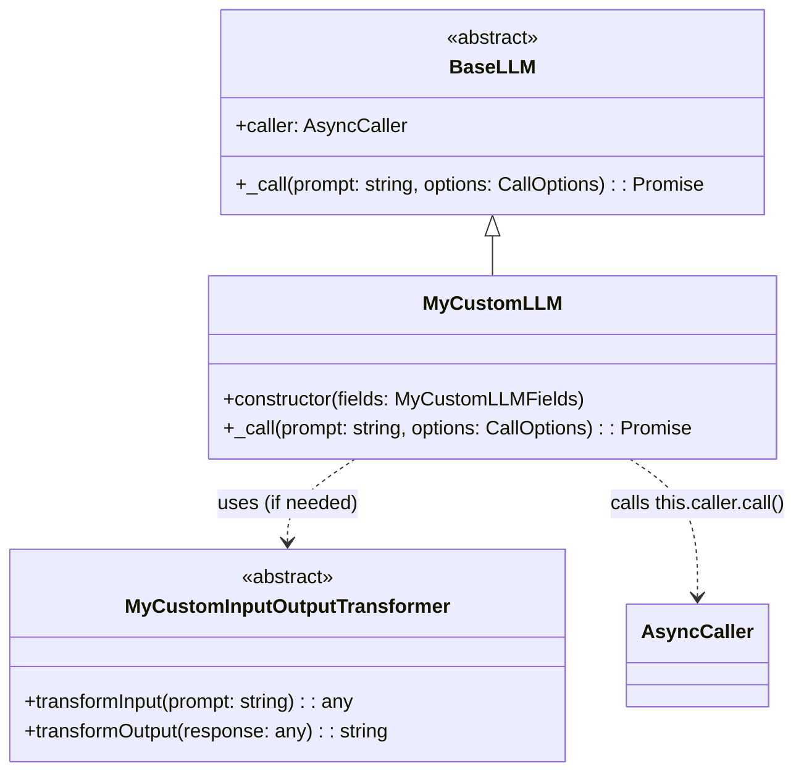
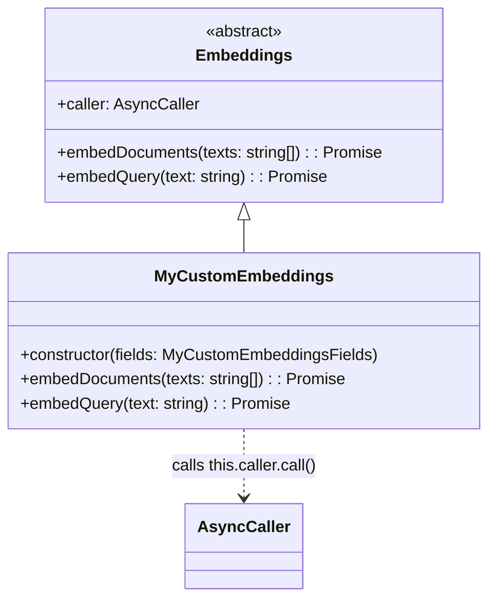
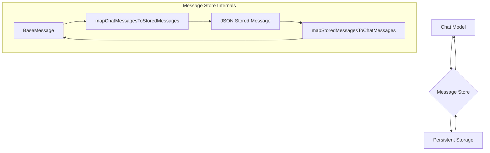

<!-- source: DeepWiki mcp.deepwiki.com · repo langchain-ai/langchainjs · page 8.3 Integration Contribution Guides · fetched 2026-10-26 -->

# Integration Contribution Guides

<details>
<summary>Relevant source files</summary>

The following files were used as context for generating this wiki page:

- [.devcontainer/README.md](.devcontainer/README.md)
- [.github/codeql/codeql-config.yml](.github/codeql/codeql-config.yml)
- [.github/contributing/INTEGRATIONS.md](.github/contributing/INTEGRATIONS.md)
- [.github/contributing/integrations/DOCUMENT_LOADERS.md](.github/contributing/integrations/DOCUMENT_LOADERS.md)
- [.github/contributing/integrations/EMBEDDINGS.md](.github/contributing/integrations/EMBEDDINGS.md)
- [.github/contributing/integrations/LLMS.md](.github/contributing/integrations/LLMS.md)
- [.github/contributing/integrations/MEMORY.md](.github/contributing/integrations/MEMORY.md)
- [.github/contributing/integrations/MESSAGE_STORES.md](.github/contributing/integrations/MESSAGE_STORES.md)
- [.github/contributing/integrations/TOOLS.md](.github/contributing/integrations/TOOLS.md)
- [.github/contributing/integrations/VECTOR_STORES.md](.github/contributing/integrations/VECTOR_STORES.md)
- [libs/create-langchain-integration/helpers/git.ts](libs/create-langchain-integration/helpers/git.ts)
- [libs/create-langchain-integration/helpers/is-url.ts](libs/create-langchain-integration/helpers/is-url.ts)
- [libs/create-langchain-integration/helpers/templates.ts](libs/create-langchain-integration/helpers/templates.ts)
- [libs/create-langchain-integration/template/.release-it.json](libs/create-langchain-integration/template/.release-it.json)
- [libs/create-langchain-integration/template/README.md](libs/create-langchain-integration/template/README.md)
- [libs/create-langchain-integration/template/package.json](libs/create-langchain-integration/template/package.json)

</details>


This page provides detailed guidelines for contributing new integrations to LangChain.js. It covers general concepts applicable to all integration types, specific advice for different categories (LLMs, Embeddings, Memory, Message Stores, Document Loaders, Vector Stores), and how to leverage the `create-langchain-integration` template for scaffolding new projects.

## General Integration Concepts

When contributing a new integration, several general principles apply to ensure consistency, maintainability, and optimal performance within the LangChain.js ecosystem.

### Separate Entrypoints

Integrations should generally not be exported from a monolithic `index.ts` file. Instead, each integration should have its own dedicated entrypoint defined in the `entrypoints` field of the `langchain.config.js` file within the `libs/community/langchain-community` package [libs/community/langchain-community/langchain.config.js:11-43](). This approach helps in tree-shaking and ensures that users only bundle the code they actually use.

For example, if you're adding a new vector store for a provider named "langco", you would create a file like `vectorstores/langco.ts` and add an entrypoint `"vectorstores/langco": "vectorstores/langco"` to the configuration [libs/community/langchain-community/langchain.config.js:39]().

```javascript
// libs/community/langchain-community/langchain.config.js
export const config = {
  internals: [
    // ...
  ],
  entrypoints: {
    load: "load/index",
    "vectorstores/chroma": "vectorstores/chroma",
    "vectorstores/hnswlib": "vectorstores/hnswlib",
    "vectorstores/langco": "vectorstores/langco", // New entrypoint
  },
  // ...
};
```
Sources: [.github/contributing/INTEGRATIONS.md:11-43]()

### Third-Party Dependencies

All third-party dependencies required by an integration must be added as `peerDependencies` and `devDependencies` in the `package.json` of the `libs/community/langchain-community` package, not as direct `dependencies` [libs/community/langchain-community/package.json:27-44](). This keeps the core LangChain.js package size small and allows for broader runtime support. Additionally, an entry under `peerDependenciesMeta` should be included.

It is recommended to use caret syntax (`^`) for peer dependencies to allow for non-breaking updates. Ensure that all introduced dependencies have permissive licenses (MIT is preferred) and are well-maintained [libs/community/langchain-community/package.json:27-44]().

Furthermore, any entrypoint that requires an optional dependency must be listed under `requiresOptionalDependency` in `langchain.config.js` to prevent build failures [libs/community/langchain-community/langchain.config.js:67-71](). This ensures that developers who import your entrypoint will receive an error if they are missing the required peer dependency.

```javascript
// libs/community/langchain-community/langchain.config.js
export const config = {
  // ...
  entrypoints: {
    // ...
    "vectorstores/langco": "vectorstores/langco",
  },
  requiresOptionalDependency: [
    // ...
    "vectorstores/langco", // Mark as requiring optional dependency
  ],
  // ...
};
```
Sources: [.github/contributing/INTEGRATIONS.md:46-74]()

### Prioritizing Exported Third-Party Types for Client Configuration

When an integration initializes instances of third-party clients, it's crucial to leverage the client's own exported configuration types (e.g., `LangCoClientOptions`) whenever possible [libs/community/langchain-community/langchain.config.js:85-88](). This practice avoids redundant type definitions, reduces the risk of desynchronization when the underlying client updates, and simplifies maintenance.

The integration's constructor should accept a configuration object that includes a `clientOptions` property, which is then directly passed to the third-party client's constructor. This allows users to pass any vendor-specific configuration directly without LangChain.js needing to explicitly define or manage all possible options.

```typescript
// Example: Document Loader with third-party client options
import {
  LangCoClient,
  LangCoClientOptions,
} from "langco-client";

import { BaseDocumentLoader, DocumentLoader } from "../base.js";

export class LangCoDatasetLoader
  extends BaseDocumentLoader
  implements DocumentLoader
{
  protected langCoClient: LangCoClient;
  protected datasetId: string;
  protected verbose: boolean;

  constructor(
    datasetId: string,
    config: {
      verbose: boolean;
      clientOptions?: LangCoClientOptions; // Using third-party type
    }
  ) {
    super();
    this.langCoClient = new LangCoClient(config.clientOptions ?? {});
    this.verbose = config.verbose ?? false;
  }
  // ...
}
```
Sources: [.github/contributing/INTEGRATIONS.md:78-115]()

### Documentation and Integration Tests

High-quality documentation and integration tests are essential for new integrations. They help reviewers verify functionality and streamline the review process. Contributors should provide clear examples of how to set up and use their integration [libs/create-langchain-integration/template/README.md:39-82]().

### Linting and Formatting

All contributions must adhere to the project's established style guidelines. Before submitting a pull request, run `pnpm lint` and `pnpm format` to ensure code conformity [libs/create-langchain-integration/template/README.md:118-121]().

Sources: [.github/contributing/INTEGRATIONS.md:123-126]()

## Integration-Specific Guidelines

LangChain.js categorizes integrations, and each category may have specific implementation considerations.

### LLM Providers

For new LLM providers, the general approach is to subclass the `LLM` class and implement the `_call` method. This method is responsible for taking a prompt, calling the LLM API, and transforming the response into a generated string output [LLMS.md:13-16]().

Some providers, like Amazon SageMaker, might host a variety of models with non-standard input/output formats. In such cases, it's beneficial to introduce a simple abstract class that users can implement to handle input/output transformations specific to their hosted model [LLMS.md:17-20](). For providers with defined input/output formats (e.g., OpenAI, Anthropic), these transformations should occur directly within the `_call` method.

All calls to the LLM should be wrapped in `this.caller.call`. The `caller` instance property, inherited from the base `LLM` class, automatically handles retries, errors, and timeouts [LLMS.md:19-21]().


**Diagram: LLM Integration Architecture**

Sources: [.github/contributing/integrations/LLMS.md:1-21]()

### Embeddings Providers

To add a new Text Embeddings provider, subclass the `Embeddings` class and implement the `embedDocuments` and `embedQuery` methods [EMBEDDINGS.md:13-15]().

*   `embedDocuments(texts: string[])`: Takes a list of documents and returns a list of corresponding embeddings.
*   `embedQuery(text: string)`: Takes a single query string and returns its embedding. This can often be implemented by calling `embedDocuments` with a list containing only the query [EMBEDDINGS.md:16-17]().

Similar to LLMs, all external API requests for embeddings should be wrapped in `this.caller.call` to leverage built-in retry and error handling mechanisms [EMBEDDINGS.md:19-21]().


**Diagram: Embeddings Integration Architecture**

Sources: [.github/contributing/integrations/EMBEDDINGS.md:1-21]()

### Memory

Memory integrations are used to provide an LLM or chat model with context from past conversations. Unlike message stores, memory can perform transformations on messages (e.g., summarization) or emphasize specific information. Memory implementations may rely on message stores for persistent storage.

Sources: [.github/contributing/integrations/MEMORY.md]()

### Vector Stores

Vector store integrations provide mechanisms for storing and querying vector embeddings. This typically involves implementing methods for adding documents with their embeddings and performing similarity searches.

Sources: [.github/contributing/integrations/VECTOR_STORES.md]()

### Persistent Message Stores

Message stores are distinct from memory. They focus solely on serializing and persistently storing raw chat messages, without performing transformations or emphasizing specific parts of the conversation. Message stores are primarily used with chat models.

When implementing a message store, use the utility functions `mapChatMessagesToStoredMessages` and `mapStoredMessagesToChatMessages` to convert between LangChain's `BaseMessage` format and a storable JSON format [MESSAGE_STORES.md:17-19]().


**Diagram: Message Store Data Flow**

Sources: [.github/contributing/integrations/MESSAGE_STORES.md:1-19]()

### Document Loaders

Document loaders are responsible for loading documents from various sources (e.g., files, web pages, databases) for subsequent processing, such as storage in vector stores.

Sources: [.github/contributing/integrations/DOCUMENT_LOADERS.md]()

### Tools

Tool integrations define external functionalities that LLMs can use to interact with the outside world, such as searching the web, executing code, or accessing databases.

Sources: [.github/contributing/integrations/TOOLS.md]()

## Using `create-langchain-integration` Templates

The `libs/create-langchain-integration` package provides a template for scaffolding new integration projects. This template helps set up the basic structure, `package.json` scripts, and `README.md` for a new integration.

### Template Structure

The template includes:
*   A `package.json` file with predefined scripts for building, testing, and linting [libs/create-langchain-integration/template/package.json:1-67]().
*   A `README.md` with installation instructions, usage examples for chat models and embeddings, and development guidelines [libs/create-langchain-integration/template/README.md:1-126]().
*   A `.release-it.json` for release configuration [libs/create-langchain-integration/template/.release-it.json:1-13]().

### Scaffolding a New Integration

The `installTemplate` function in `libs/create-langchain-integration/helpers/templates.ts` is responsible for copying the template files and customizing them for the new integration [libs/create-langchain-integration/helpers/templates.ts:10-28]().

When creating a new integration, the `appName` (e.g., `@langchain/my-integration`) is used to update the `package.json` name, description, homepage, and build script [libs/create-langchain-integration/helpers/templates.ts:39-45]().

```typescript
// libs/create-langchain-integration/helpers/templates.ts
export async function installTemplate({
  appName, // e.g., "@langchain/my-integration"
  root,
}: {
  appName: string;
  root: string;
}) {
  // ...
  const packageJson: Record<string, any> = JSON.parse(
    await fs.readFile(packageJsonFile, "utf8")
  );

  packageJson.name = appName;
  if (appName.startsWith("@langchain/")) {
    const integrationName = appName.replace("@langchain/", "");
    packageJson.description = `Integration for LangChain ${integrationName}`;
    packageJson.homepage = `https://github.com/langchain-ai/langchainjs/tree/main/libs/langchain-${integrationName}/`;
    packageJson.scripts.build = `pnpm build --filter ${appName}`;
  }
  // ...
}
```
This process ensures that new integrations start with a consistent and functional setup, ready for specific implementation.

Sources: [libs/create-langchain-integration/template/package.json:1-67](), [libs/create-langchain-integration/template/README.md:1-126](), [libs/create-langchain-integration/helpers/templates.ts:10-58]()

---

