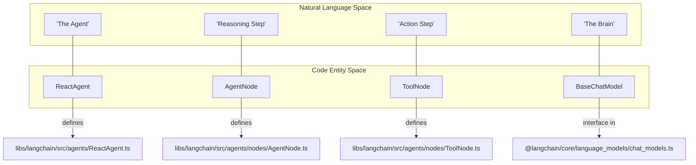
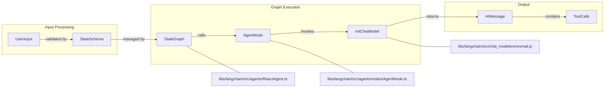

<!-- source: DeepWiki mcp.deepwiki.com · repo langchain-ai/langchainjs · page 9 Glossary · fetched 2026-10-26 -->

# Glossary

Relevant source files

The following files were used as context for generating this wiki page:

- [README.md](README.md)
- [libs/langchain-core/README.md](libs/langchain-core/README.md)
- [libs/langchain-core/src/messages/ai.ts](libs/langchain-core/src/messages/ai.ts)
- [libs/langchain-core/src/messages/base.ts](libs/langchain-core/src/messages/base.ts)
- [libs/langchain-core/src/messages/chat.ts](libs/langchain-core/src/messages/chat.ts)
- [libs/langchain-core/src/messages/format.ts](libs/langchain-core/src/messages/format.ts)
- [libs/langchain-core/src/messages/function.ts](libs/langchain-core/src/messages/function.ts)
- [libs/langchain-core/src/messages/human.ts](libs/langchain-core/src/messages/human.ts)
- [libs/langchain-core/src/messages/modifier.ts](libs/langchain-core/src/messages/modifier.ts)
- [libs/langchain-core/src/messages/system.ts](libs/langchain-core/src/messages/system.ts)
- [libs/langchain-core/src/messages/tests/ai.test.ts](libs/langchain-core/src/messages/tests/ai.test.ts)
- [libs/langchain-core/src/messages/tests/base_message.test.ts](libs/langchain-core/src/messages/tests/base_message.test.ts)
- [libs/langchain-core/src/messages/tool.ts](libs/langchain-core/src/messages/tool.ts)
- [libs/langchain-core/src/utils/namespace.ts](libs/langchain-core/src/utils/namespace.ts)
- [libs/langchain/README.md](libs/langchain/README.md)
- [libs/langchain/src/agents/ReactAgent.ts](libs/langchain/src/agents/ReactAgent.ts)
- [libs/langchain/src/agents/errors.ts](libs/langchain/src/agents/errors.ts)
- [libs/langchain/src/agents/middleware/tests/dynamicTools.test.ts](libs/langchain/src/agents/middleware/tests/dynamicTools.test.ts)
- [libs/langchain/src/agents/nodes/AgentNode.ts](libs/langchain/src/agents/nodes/AgentNode.ts)
- [libs/langchain/src/agents/nodes/ToolNode.ts](libs/langchain/src/agents/nodes/ToolNode.ts)
- [libs/langchain/src/agents/nodes/tests/AgentNode.test.ts](libs/langchain/src/agents/nodes/tests/AgentNode.test.ts)
- [libs/langchain/src/agents/nodes/tests/ToolNode.test.ts](libs/langchain/src/agents/nodes/tests/ToolNode.test.ts)
- [libs/langchain/src/agents/tests/middleware.test.ts](libs/langchain/src/agents/tests/middleware.test.ts)
- [libs/langchain/src/agents/tests/reactAgent.test.ts](libs/langchain/src/agents/tests/reactAgent.test.ts)
- [libs/langchain/src/agents/utils.ts](libs/langchain/src/agents/utils.ts)

This glossary defines codebase-specific terms, jargon, and domain concepts used throughout the LangChain.js monorepo. It serves as a technical reference for onboarding engineers to understand the relationship between high-level concepts and their implementation in code.

## Core Architectural Terms

### Runnable
The fundamental unit of work in LangChain. The `Runnable` interface defines a standard protocol for data processing, enabling components to be "piped" together. Key methods include `invoke`, `stream`, and `batch`.
*   **Implementation**: `Runnable` is the base class for almost all components in `@langchain/core`.
*   **Code Pointer**: [libs/langchain-core/src/runnables/base.ts:1-1](), [libs/langchain/src/agents/nodes/AgentNode.ts:2-2]()
*   **Data Flow**: Data enters a Runnable via `invoke(input)`, undergoes transformation, and is returned or streamed as output.

### LCEL (LangChain Expression Language)
A declarative way to chain Runnables together using a piping pattern. While originally implemented with a `.pipe()` method, it represents the underlying graph of execution.
*   **Code Pointer**: [libs/langchain-core/src/runnables/base.ts:1-100]()

### Provider Strategy
A mechanism used to extract structured data from a language model using its native capabilities (e.g., OpenAI's JSON mode or Tool Calling).
*   **Implementation**: `ProviderStrategy` class.
*   **Code Pointer**: [libs/langchain/src/agents/nodes/AgentNode.ts:47-47](), [libs/langchain/src/agents/nodes/AgentNode.ts:202-232]()

## Agentic Concepts

### ReAct Agent
A "Reasoning and Acting" pattern where an LLM determines which tools to call, observes the results, and repeats until a final answer is reached.
*   **Implementation**: `ReactAgent` class in the `langchain` package, which orchestrates a `StateGraph`.
*   **Code Pointer**: [libs/langchain/src/agents/ReactAgent.ts:161-170]()

### StateGraph
A graph-based orchestration framework (from `@langchain/langgraph`) used to define the control flow of an agent. It consists of nodes (functions) and edges (transitions).
*   **Implementation**: `StateGraph` class.
*   **Code Pointer**: [libs/langchain/src/agents/ReactAgent.ts:6-17](), [libs/langchain/src/agents/ReactAgent.ts:178-178]()

### ToolNode
A specialized graph node responsible for executing tools requested by the language model.
*   **Implementation**: `ToolNode` class.
*   **Code Pointer**: [libs/langchain/src/agents/nodes/ToolNode.ts:1-1]() (referenced in [libs/langchain/src/agents/ReactAgent.ts:46-46]())

### Middleware
Interceptors that wrap model or tool calls to inject logic like logging, retries, or state manipulation.
*   **Implementation**: `AgentMiddleware` type and `wrapModelCall` hooks.
*   **Code Pointer**: [libs/langchain/src/agents/middleware/types.ts:71-79](), [libs/langchain/src/agents/nodes/AgentNode.ts:39-42]()

## Message System

LangChain uses a standardized message format to communicate between models and tools.

| Term | Description | Code Pointer |
| :--- | :--- | :--- |
| `BaseMessage` | The abstract base class for all message types. | [libs/langchain-core/src/messages/base.ts:215-216]() |
| `AIMessage` | A message representing a response from the AI model. | [libs/langchain-core/src/messages/ai.ts:46-49]() |
| `HumanMessage` | A message representing input from a user. | [libs/langchain-core/src/messages/human.ts:1-1]() |
| `ToolMessage` | A message representing the output/result of a tool execution. | [libs/langchain-core/src/messages/tool.ts:1-1]() |
| `SystemMessage` | A message used to set the behavior or context for the AI. | [libs/langchain-core/src/messages/system.ts:1-1]() |

Sources: [libs/langchain-core/src/messages/base.ts:215-216](), [libs/langchain-core/src/messages/ai.ts:46-49](), [libs/langchain-core/src/messages/human.ts:1-1](), [libs/langchain-core/src/messages/tool.ts:1-1](), [libs/langchain-core/src/messages/system.ts:1-1]()

## System Mapping Diagrams

### Concept to Code Entity Mapping
The following diagram bridges high-level agent concepts to the specific classes and files that implement them.

**Diagram: Agent Concept Mapping**

Sources: [libs/langchain/src/agents/ReactAgent.ts:161-170](), [libs/langchain/src/agents/nodes/AgentNode.ts:127-141](), [libs/langchain/src/agents/nodes/ToolNode.ts:1-1](), [libs/langchain-core/src/language_models/chat_models.ts:1-1]()

### Execution Flow Mapping
This diagram associates execution phases with the specific functions and configurations used in the codebase.

**Diagram: Execution Data Flow**

Sources: [libs/langchain/src/agents/ReactAgent.ts:68-68](), [libs/langchain/src/agents/nodes/AgentNode.ts:150-150](), [libs/langchain/src/chat_models/universal.js:1-1]()

## Monorepo Jargon

### Core (@langchain/core)
The dependency-free (or minimal dependency) package containing all base interfaces. Every provider and framework package depends on this.
*   **Code Pointer**: [libs/langchain-core/README.md:1-1]()

### Classic (@langchain/classic)
Contains legacy abstractions and older "Chains" (e.g., `LLMChain`) that were part of the original LangChain design before the move to LCEL and Runnables.
*   **Code Pointer**: [libs/langchain/README.md:1-1]()

### MCP (Model Context Protocol)
A standard for connecting AI models to external data sources and tools. The `langchain-mcp-adapters` allow LangChain to act as an MCP client.
*   **Code Pointer**: [libs/langchain/README.md:1-1]()

### Provider Package
A package dedicated to a specific LLM provider (e.g., `@langchain/openai`, `@langchain/anthropic`). These packages implement the interfaces defined in `@langchain/core`.
*   **Code Pointer**: [libs/langchain/README.md:1-1]()

## Technical Abbreviations

*   **LCEL**: LangChain Expression Language.
*   **LLM**: Large Language Model.
*   **AIM**: AI Message.
*   **HITL**: Human-In-The-Loop (referring to manual intervention in agent flows).
*   **ZDR**: Zero-Data Retention (specifically used in some OpenAI configurations).
*   **SSE**: Server-Sent Events (used for streaming).
*   **MCP**: Model Context Protocol.

Sources: [libs/langchain/README.md:1-1](), [libs/langchain-core/README.md:1-1](), [libs/langchain/src/agents/ReactAgent.ts:1-50](), [libs/langchain/src/agents/nodes/AgentNode.ts:1-100]()