# Page: Overview

# Overview

<details>
<summary>Relevant source files</summary>

The following files were used as context for generating this wiki page:

- [README.md](README.md)
- [examples/package.json](examples/package.json)
- [internal/model-profiles/package.json](internal/model-profiles/package.json)
- [libs/langchain-classic/package.json](libs/langchain-classic/package.json)
- [libs/langchain-core/CHANGELOG.md](libs/langchain-core/CHANGELOG.md)
- [libs/langchain-core/README.md](libs/langchain-core/README.md)
- [libs/langchain-core/package.json](libs/langchain-core/package.json)
- [libs/langchain-mcp-adapters/package.json](libs/langchain-mcp-adapters/package.json)
- [libs/langchain/CHANGELOG.md](libs/langchain/CHANGELOG.md)
- [libs/langchain/README.md](libs/langchain/README.md)
- [libs/langchain/package.json](libs/langchain/package.json)
- [libs/providers/langchain-anthropic/CHANGELOG.md](libs/providers/langchain-anthropic/CHANGELOG.md)
- [libs/providers/langchain-anthropic/package.json](libs/providers/langchain-anthropic/package.json)
- [libs/providers/langchain-aws/CHANGELOG.md](libs/providers/langchain-aws/CHANGELOG.md)
- [libs/providers/langchain-aws/package.json](libs/providers/langchain-aws/package.json)
- [libs/providers/langchain-ibm/package.json](libs/providers/langchain-ibm/package.json)
- [package.json](package.json)
- [pnpm-lock.yaml](pnpm-lock.yaml)

</details>


LangChain.js is a framework for building LLM-powered applications in TypeScript and JavaScript. It provides a modular, component-based architecture for connecting language models to external data sources, tools, and systems through standardized interfaces. The framework enables rapid prototyping and production deployment of AI applications across Node.js, edge runtimes, and browsers.

This document introduces the LangChain.js ecosystem structure and core architectural principles. For detailed package relationships, see [Package Architecture](#1.1). For terminology definitions, see [Core Concepts and Terminology](#1.2). For installation instructions, see [Installation and Setup](#1.3).

## What is LangChain.js?

LangChain.js helps developers build applications powered by Large Language Models (LLMs) through:

- **Standardized interfaces** for models, embeddings, vector stores, retrievers, and tools.
- **Model interoperability** allowing swapping between providers (OpenAI, Anthropic, Google, AWS, etc.).
- **Real-time data augmentation** connecting LLMs to diverse data sources and external/internal systems.
- **Agent orchestration** for complex, multi-step reasoning workflows using stateful graphs.
- **Production-ready features** including monitoring, evaluation, and debugging integrations.

The framework consists of a core abstraction layer ([libs/langchain-core/package.json:1-4]()) that defines base interfaces, with provider-specific packages implementing these interfaces for interoperability.

Sources: [README.md:1-79](), [libs/langchain/README.md:1-68]()

## Ecosystem Structure

The LangChain.js ecosystem follows a hierarchical package architecture organized as a pnpm monorepo. The structure ensures modularity while maintaining type safety and version consistency across dozens of packages.

### Ecosystem Hierarchy

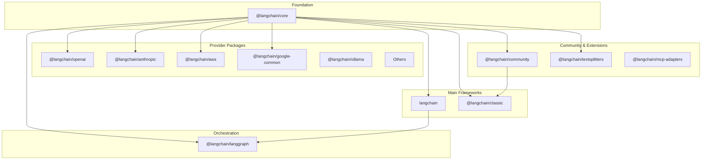

**Diagram: LangChain.js Package Ecosystem**

### Package Categories

| Category | Packages | Purpose |
|----------|----------|---------|
| **Foundation** | `@langchain/core` | Base abstractions and schemas (BaseChatModel, BaseRetriever, Runnable, etc.) |
| **Main Framework** | `langchain`, `@langchain/classic` | High-level APIs for agents, chains, and legacy components |
| **Provider Integrations** | `@langchain/openai`, `@langchain/anthropic`, `@langchain/aws`, etc. | Model-specific implementations for major LLM vendors |
| **Community** | `@langchain/community` | Optional third-party integrations (vector stores, loaders, tools) |
| **Specialized** | `@langchain/langgraph`, `@langchain/textsplitters`, `@langchain/mcp-adapters` | Advanced orchestration, text processing utilities, and Model Context Protocol adapters |

Sources: [pnpm-lock.yaml:1-45](), [libs/langchain-core/package.json:1-32](), [libs/langchain/package.json:1-50](), [libs/langchain-classic/package.json:1-20](), [libs/langchain-mcp-adapters/package.json:1-10]()

## Key Architectural Principles

### 1. Peer Dependency Pattern

All packages declare `@langchain/core` as a peer dependency using the `workspace:^` protocol. The root `pnpm` configuration enforces consistency:

```yaml
overrides:
  '@langchain/core': workspace:^
  langchain: workspace:^
```

This ensures a single instance of core abstractions across the entire dependency tree, preventing type incompatibilities when multiple packages are used together. This is critical for avoiding TypeScript OOM issues caused by deep structural comparisons of Zod types.

Sources: [package.json:55-58](), [libs/langchain/package.json:73-75](), [libs/providers/langchain-anthropic/package.json:33-35](), [libs/langchain-core/CHANGELOG.md:84-87]()

### 2. Base Class Extension Model

Provider packages extend base classes from `@langchain/core` to ensure uniform interfaces.

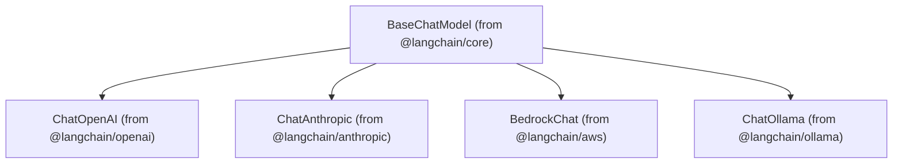

**Diagram: Chat Model Inheritance Hierarchy**

This pattern allows applications to swap providers with minimal code changes while enabling provider-specific features when needed.

Sources: [libs/langchain-core/package.json:81-91](), [libs/providers/langchain-anthropic/package.json:33-35](), [libs/providers/langchain-aws/package.json:32-34]()

### 3. Dual Module Format

All packages support both CommonJS (CJS) and ECMAScript Modules (ESM) through dual exports defined in `package.json`. For example, in `@langchain/core`:

```json
{
  "main": "./dist/index.cjs",
  "types": "./dist/index.d.cts",
  "exports": {
    ".": {
      "require": {
        "types": "./dist/index.d.cts",
        "default": "./dist/index.cjs"
      },
      "import": {
        "types": "./dist/index.d.ts",
        "default": "./dist/index.js"
      }
    }
  }
}
```

The build pipeline uses `tsdown` to compile TypeScript into both formats with corresponding type definitions.

Sources: [libs/langchain-core/package.json:9-80](), [libs/langchain/package.json:99-113](), [README.md:58-69]()

### 4. Monorepo Build Orchestration

The repository uses Turbo for parallel build orchestration with intelligent caching.

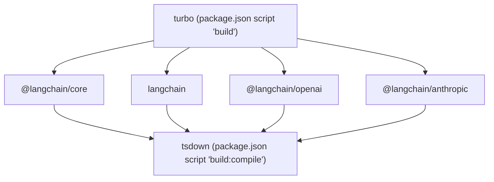

**Diagram: Build Pipeline**

The `turbo.json` configuration defines task dependencies, ensuring that `build:compile` runs in the correct order across the workspace.

Sources: [package.json:12-16](), [libs/langchain/package.json:35-37](), [libs/langchain-core/package.json:17-18]()

## Supported Environments

LangChain.js is written in TypeScript and supports diverse JavaScript runtimes:

| Environment | Support Level | Notes |
|-------------|---------------|-------|
| **Node.js** | Full support | Versions 20.x, 22.x, 24.x |
| **Cloudflare Workers** | Full support | Edge runtime |
| **Vercel / Next.js** | Full support | Browser, Serverless, and Edge functions |
| **Supabase Edge Functions**| Full support | Deno-based |
| **Browser** | Full support | Modern browsers |
| **Deno** | Full support | Native ESM support |
| **Bun** | Full support | Native support |

All packages specify `"type": "module"` and require `"node": ">=20"` in their engine constraints.

Sources: [README.md:58-69](), [libs/langchain-core/package.json:6-8](), [libs/langchain/package.json:7-10]()

## Integration with LangSmith and LangGraph

LangChain.js integrates deeply with the broader LangChain ecosystem:

- **LangSmith**: Unified developer platform for monitoring, debugging, and evaluating LLM applications. Core and framework packages include `langsmith` as a dependency ([libs/langchain-core/package.json:30](), [libs/langchain/package.json:79]()).
- **LangGraph**: A low-level agent orchestration framework. The main `langchain` package utilizes `@langchain/langgraph` ([libs/langchain/package.json:77]()) to provide high-level agent creation APIs like `createAgent`.

Sources: [README.md:50-55](), [libs/langchain/package.json:77-79](), [libs/langchain-core/package.json:30]()

## Repository Structure

The codebase is organized as a pnpm monorepo:

```
langchainjs/
├── libs/
│   ├── langchain-core/          # Foundation abstractions
│   ├── langchain/               # Main framework (Agents, Middleware)
│   ├── langchain-classic/       # Legacy components
│   ├── langchain-textsplitters/ # Text processing utilities
│   ├── langchain-mcp-adapters/  # Model Context Protocol adapters
│   └── providers/               # Dedicated provider packages
│       ├── langchain-openai/
│       ├── langchain-anthropic/
│       ├── langchain-aws/
│       └── ...
├── internal/                    # Build and config utilities
├── examples/                    # Usage examples
└── package.json                 # Root workspace config
```

Sources: [package.json:1-11](), [libs/langchain-core/package.json:11-15](), [libs/langchain/package.json:29-33](), [libs/langchain-mcp-adapters/package.json:1-10]()

## Release Management

The project uses Changesets for coordinated versioning and changelog generation across all packages. Release tasks are managed via the root `package.json` scripts:

- `pnpm changeset`: Generate a new changeset.
- `pnpm changeset:version`: Bump versions based on changesets.
- `pnpm release`: Publish updated packages to npm.

Sources: [package.json:33-34](), [pnpm-lock.yaml:52-54](), [libs/langchain/CHANGELOG.md:1-26]()

---

# Page: Package Architecture

# Package Architecture

<details>
<summary>Relevant source files</summary>

The following files were used as context for generating this wiki page:

- [examples/package.json](examples/package.json)
- [internal/model-profiles/package.json](internal/model-profiles/package.json)
- [libs/langchain-classic/CHANGELOG.md](libs/langchain-classic/CHANGELOG.md)
- [libs/langchain-classic/package.json](libs/langchain-classic/package.json)
- [libs/langchain-core/CHANGELOG.md](libs/langchain-core/CHANGELOG.md)
- [libs/langchain-core/package.json](libs/langchain-core/package.json)
- [libs/langchain-mcp-adapters/package.json](libs/langchain-mcp-adapters/package.json)
- [libs/langchain/CHANGELOG.md](libs/langchain/CHANGELOG.md)
- [libs/langchain/package.json](libs/langchain/package.json)
- [libs/providers/langchain-anthropic/CHANGELOG.md](libs/providers/langchain-anthropic/CHANGELOG.md)
- [libs/providers/langchain-anthropic/package.json](libs/providers/langchain-anthropic/package.json)
- [libs/providers/langchain-aws/CHANGELOG.md](libs/providers/langchain-aws/CHANGELOG.md)
- [libs/providers/langchain-aws/package.json](libs/providers/langchain-aws/package.json)
- [libs/providers/langchain-deepseek/CHANGELOG.md](libs/providers/langchain-deepseek/CHANGELOG.md)
- [libs/providers/langchain-deepseek/package.json](libs/providers/langchain-deepseek/package.json)
- [libs/providers/langchain-fireworks/CHANGELOG.md](libs/providers/langchain-fireworks/CHANGELOG.md)
- [libs/providers/langchain-fireworks/package.json](libs/providers/langchain-fireworks/package.json)
- [libs/providers/langchain-ibm/package.json](libs/providers/langchain-ibm/package.json)
- [libs/providers/langchain-neo4j/CHANGELOG.md](libs/providers/langchain-neo4j/CHANGELOG.md)
- [libs/providers/langchain-neo4j/package.json](libs/providers/langchain-neo4j/package.json)
- [libs/providers/langchain-openai/CHANGELOG.md](libs/providers/langchain-openai/CHANGELOG.md)
- [libs/providers/langchain-openai/package.json](libs/providers/langchain-openai/package.json)
- [libs/providers/langchain-openrouter/CHANGELOG.md](libs/providers/langchain-openrouter/CHANGELOG.md)
- [libs/providers/langchain-openrouter/package.json](libs/providers/langchain-openrouter/package.json)
- [libs/providers/langchain-together-ai/CHANGELOG.md](libs/providers/langchain-together-ai/CHANGELOG.md)
- [libs/providers/langchain-together-ai/package.json](libs/providers/langchain-together-ai/package.json)
- [libs/providers/langchain-xai/CHANGELOG.md](libs/providers/langchain-xai/CHANGELOG.md)
- [libs/providers/langchain-xai/package.json](libs/providers/langchain-xai/package.json)
- [package.json](package.json)
- [pnpm-lock.yaml](pnpm-lock.yaml)

</details>


This document explains the hierarchical package structure of LangChain.js, the dependency relationships between packages, and the role of `@langchain/core` as the foundational layer. It covers the monorepo organization, package dependency patterns, and how different layers of the ecosystem interact.

---

## Package Hierarchy

LangChain.js is organized as a layered architecture with `@langchain/core` at the foundation. Each layer depends on the layer below it, creating a strict dependency hierarchy that ensures consistency and type safety across the ecosystem.

### Architectural Layers

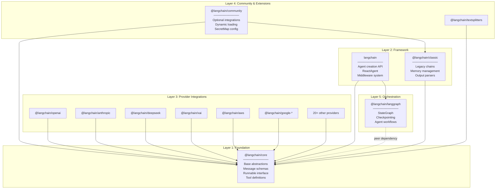

**Sources:** [libs/langchain-core/package.json:2-4](), [libs/langchain/package.json:2-4](), [libs/langchain-classic/package.json:2-4](), [libs/langchain/package.json:73-75]()

---

## Core Package: @langchain/core

The `@langchain/core` package is the single source of truth for all base abstractions, schemas, and interfaces. Every other package in the ecosystem depends on it, making it the foundation that ensures type compatibility and interface consistency.

### Core Package Structure

| Export Path | Purpose | Key Classes/Interfaces |
|-------------|---------|------------------------|
| `@langchain/core` | Main entry point | All base abstractions |
| `@langchain/core/messages` | Message types | `AIMessage`, `HumanMessage`, `SystemMessage`, `ToolMessage` |
| `@langchain/core/language_models/chat_models` | Chat model base | `BaseChatModel` |
| `@langchain/core/tools` | Tool definitions | `DynamicTool`, `DynamicStructuredTool` |
| `@langchain/core/runnables` | Execution interface | `Runnable`, `RunnableSequence` |
| `@langchain/core/retrievers` | Retriever interface | `BaseRetriever` |
| `@langchain/core/vectorstores` | Vector store base | `VectorStore` |

**Sources:** [libs/langchain-core/package.json:65-229]()

### Core Dependencies

The `@langchain/core` package maintains a minimal dependency footprint to ensure stability:

```json
{
  "dependencies": {
    "@cfworker/json-schema": "^4.0.2",
    "@standard-schema/spec": "^1.1.0",
    "js-tiktoken": "^1.0.12",
    "langsmith": ">=0.5.0 <1.0.0",
    "mustache": "^4.2.0",
    "p-queue": "^6.6.2",
    "zod": "^3.25.76 || ^4"
  }
}
```

**Sources:** [libs/langchain-core/package.json:26-34]()

---

## Dependency Management Pattern

LangChain.js uses a **peer dependency pattern** with the `workspace:^` protocol to ensure all packages use the same version of `@langchain/core`. This prevents type incompatibilities and ensures interface consistency across the ecosystem.

### Peer Dependency Flow

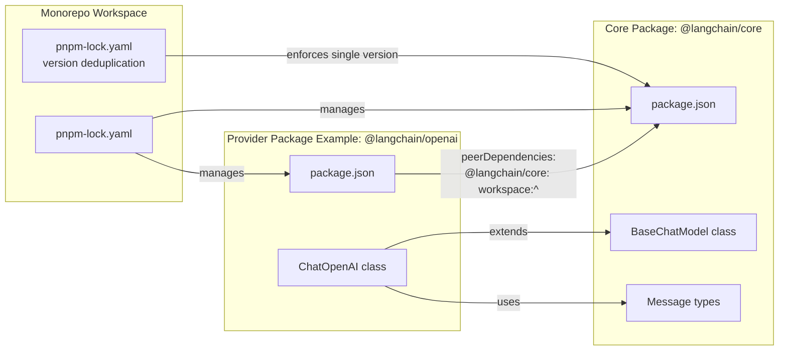

**Sources:** [pnpm-lock.yaml:7-9](), [libs/langchain/package.json:73-75](), [libs/providers/langchain-anthropic/package.json:33-35]()

### Example: Anthropic Package Dependencies

```json
{
  "name": "@langchain/anthropic",
  "version": "1.5.10",
  "peerDependencies": {
    "@langchain/core": "workspace:^"
  },
  "dependencies": {
    "@anthropic-ai/sdk": "^0.122.0",
    "zod": "^3.25.76 || ^4"
  }
}
```

The `workspace:^` protocol tells `pnpm` to resolve `@langchain/core` from the local monorepo workspace, ensuring development occurs against the latest local core code.

**Sources:** [libs/providers/langchain-anthropic/package.json:2-4](), [libs/providers/langchain-anthropic/package.json:33-35]()

---

## Monorepo Structure

LangChain.js is organized as a **pnpm workspace monorepo**. This enables coordinated releases, shared tooling, and strict dependency version consistency.

### Workspace Organization

```mermaid
graph TB
    subgraph "Root Workspace"
        Root["package.json<br/>────────────<br/>pnpm overrides<br/>turbo scripts"]
        PnpmLock["pnpm-lock.yaml<br/>────────────<br/>Dependency resolution<br/>Version deduplication"]
    end
    
    subgraph "Core Libraries (libs/)"
        CoreLib["langchain-core/"]
        LangChainLib["langchain/"]
        ClassicLib["langchain-classic/"]
        TextSplittersLib["langchain-textsplitters/"]
        MCPAdaptersLib["langchain-mcp-adapters/"]
    end
    
    subgraph "Provider Packages (libs/providers/)"
        OpenAIProvider["langchain-openai/"]
        AnthropicProvider["langchain-anthropic/"]
        AWSProvider["langchain-aws/"]
        DeepseekProvider["langchain-deepseek/"]
        XAIProvider["langchain-xai/"]
        Neo4jProvider["langchain-neo4j/"]
        IBMProvider["langchain-ibm/"]
        OpenRouterProvider["langchain-openrouter/"]
        FireworksProvider["langchain-fireworks/"]
        TogetherAIProvider["langchain-together-ai/"]
    end
    
    subgraph "Internal Tooling (internal/)"
        Build["build/"]
        TSConfig["tsconfig/"]
        ModelProfiles["model-profiles/"]
    end
    
    subgraph "Examples & Development"
        Examples["examples/"]
    end
    
    Root --> CoreLib
    Root --> LangChainLib
    Root --> OpenAIProvider
    Root --> Build
    Root --> Examples
```

**Sources:** [pnpm-lock.yaml:74-76](), [package.json:36-54](), [examples/package.json:1-4]()

### Version Override Enforcement

The root `package.json` contains `pnpm.overrides` that enforce consistent versions of critical packages across the entire workspace:

```json
"pnpm": {
  "overrides": {
    "@langchain/core": "workspace:^",
    "langchain": "workspace:^",
    "protobufjs": ">=7.6.3 <8",
    "form-data": ">=4.0.6"
  }
}
```

This ensures that even transitive dependencies resolve to the correct workspace version of core, preventing "multiple core versions" bugs.

**Sources:** [package.json:55-60]()

---

## Package Categories

### Framework Packages

The main framework packages build on `@langchain/core` to provide high-level APIs:

| Package | Purpose | Key Features |
|---------|---------|--------------|
| `langchain` | Modern agent framework | `createAgent`, `initChatModel`, middleware system, LangGraph integration |
| `@langchain/classic` | Legacy abstractions | Old chains, memory, classic agents, output parsers |
| `@langchain/mcp-adapters` | Model Context Protocol adapters | `MultiServerMCPClient`, transport types, tool loading |

**Sources:** [libs/langchain/package.json:76-81](), [libs/langchain-classic/package.json:11-90](), [libs/langchain-mcp-adapters/package.json:2-4]()

### Provider Packages

Provider packages implement integrations with specific LLM vendors. They follow a consistent pattern, extending base classes from core.

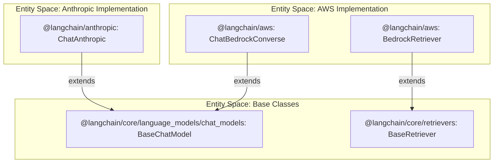

**Sources:** [libs/providers/langchain-anthropic/package.json:2-4](), [libs/providers/langchain-aws/package.json:2-4]()

---

## Module Export Pattern

All packages use **dual CJS/ESM exports** with TypeScript type definitions for both formats. This is managed by `tsdown` during the build process.

### Export Configuration (langchain-core)

```json
"exports": {
  ".": {
    "input": "./src/index.ts",
    "require": {
      "types": "./dist/index.d.cts",
      "default": "./dist/index.cjs"
    },
    "import": {
      "types": "./dist/index.d.ts",
      "default": "./dist/index.js"
    }
  },
  "./agents": {
    "input": "./src/agents.ts",
    "require": {
      "types": "./dist/agents.d.cts",
      "default": "./dist/agents.cjs"
    },
    "import": {
      "types": "./dist/agents.d.ts",
      "default": "./dist/agents.js"
    }
  }
}
```

This structure:
- Supports both `require()` (CommonJS) and `import` (ES Modules).
- Provides TypeScript types for both formats (`.d.cts` for CJS, `.d.ts` for ESM).
- Enables subpath exports for granular imports (e.g., `@langchain/core/agents`).

**Sources:** [libs/langchain-core/package.json:65-91](), [libs/langchain/package.json:101-113]()

---

## Build and Release Orchestration

The monorepo uses **Turborepo** for build orchestration and **Changesets** for version management.

### Build Pipeline

The `turbo.json` file defines the dependency graph for builds. The `build:compile` task ensures that a package's dependencies are built before the package itself.

**Sources:** [package.json:13-16](), [libs/langchain/package.json:35-36]()

### Release Coordination

Releases are managed via the `changeset` CLI. When a change is made to `@langchain/core`, Changesets identifies all dependent packages (like `langchain` or `@langchain/openai`) and coordinates their version bumps to maintain compatibility.

**Sources:** [package.json:33-34](), [libs/langchain/CHANGELOG.md:15-17]()

---

# Page: Core Concepts and Terminology

# Core Concepts and Terminology

<details>
<summary>Relevant source files</summary>

The following files were used as context for generating this wiki page:

- [README.md](README.md)
- [libs/langchain-classic/src/hub/index.ts](libs/langchain-classic/src/hub/index.ts)
- [libs/langchain-classic/src/load/index.ts](libs/langchain-classic/src/load/index.ts)
- [libs/langchain-core/README.md](libs/langchain-core/README.md)
- [libs/langchain-core/src/load/index.ts](libs/langchain-core/src/load/index.ts)
- [libs/langchain-core/src/load/serializable.ts](libs/langchain-core/src/load/serializable.ts)
- [libs/langchain-core/src/load/tests/index.test.ts](libs/langchain-core/src/load/tests/index.test.ts)
- [libs/langchain-core/src/load/validation.ts](libs/langchain-core/src/load/validation.ts)
- [libs/langchain-core/src/runnables/base.ts](libs/langchain-core/src/runnables/base.ts)
- [libs/langchain-core/src/runnables/history.ts](libs/langchain-core/src/runnables/history.ts)
- [libs/langchain/README.md](libs/langchain/README.md)
- [libs/langchain/src/hub/tests/hub.int.test.ts](libs/langchain/src/hub/tests/hub.int.test.ts)
- [libs/langchain/src/load/index.ts](libs/langchain/src/load/index.ts)
- [libs/langchain/src/load/tests/load.test.ts](libs/langchain/src/load/tests/load.test.ts)

</details>


This document defines the fundamental concepts and terminology used throughout LangChain.js. Understanding these concepts is essential for working with any LangChain package or integration. For information about the package structure itself, see [Package Architecture](./1.1).

## Purpose and Scope

LangChain.js is built around a set of core abstractions that enable interoperability across different LLM providers, data sources, and tools. This page defines the key terminology including:

- **Execution model**: Runnables and the piping pattern (LCEL).
- **Model interfaces**: Chat models, language models, and message types.
- **Tool system**: Tool definitions, dynamic tools, and function calling.
- **Application patterns**: Chains and agents.
- **Retrieval components**: Retrievers, vector stores, and embeddings.
- **Data processing**: Document loaders, text splitters, and output parsers.

---

## Core Execution Model: Runnables and LCEL

The `Runnable` interface is the foundational abstraction in LangChain.js. All major components (models, prompts, retrievers, tools) implement this interface, enabling standardized execution and composition via the **LangChain Expression Language (LCEL)**.

### Runnable Interface

The `Runnable` class provides a standard interface for creating custom chains. It defines several methods that allow for different execution modes.

Title: Runnable Interface and Implementations
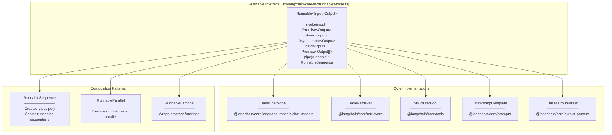
**Sources**: [libs/langchain-core/src/runnables/base.ts:124-133](), [libs/langchain-core/README.md:5-10]()

### Execution Methods

| Method | Purpose | Return Type | Use Case |
|--------|---------|-------------|----------|
| `invoke(input)` | Single execution | `Promise<Output>` | Standard one-off requests |
| `stream(input)` | Streaming execution | `AsyncIterator<Output>` | Real-time UI updates |
| `batch(inputs)` | Batch processing | `Promise<Output[]>` | Processing multiple inputs efficiently |
| `pipe(runnable)` | Composition | `RunnableSequence` | Building LCEL chains |

The piping pattern allows developers to compose complex logic from simple components:
`const chain = prompt.pipe(model).pipe(outputParser);`

**Sources**: [libs/langchain-core/src/runnables/base.ts:145-148](), [libs/langchain-core/README.md:29-70]()

---

## Language Model Interfaces

LangChain.js distinguishes between two types of models: **Chat Models** (message-based) and **LLMs** (string-based).

### Model Hierarchy

Title: Model Interface Hierarchy
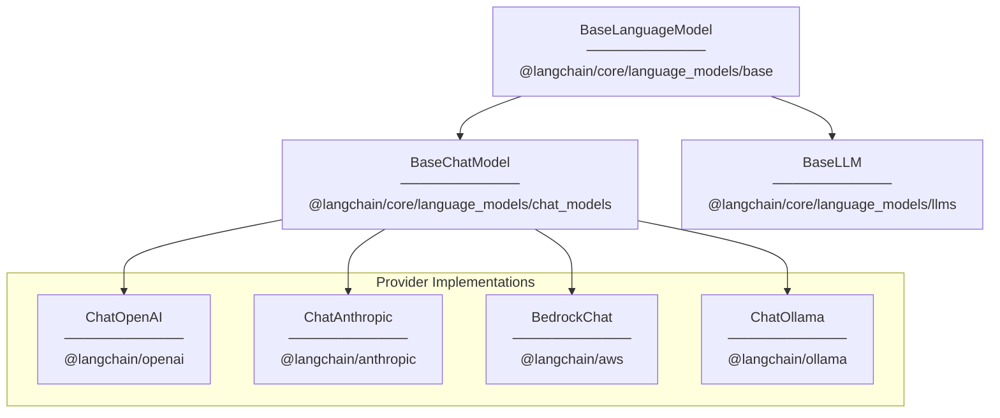
**Sources**: [libs/langchain-core/README.md:5-10]()

### Message System and Content Blocks

Chat models exchange `BaseMessage` objects. Modern models support **Standard Content Blocks** for multimodal data (images, tool calls).

| Message Type | Purpose | Key Fields |
|--------------|---------|------------|
| `SystemMessage` | High-level instructions | `content` |
| `HumanMessage` | User-generated input | `content` |
| `AIMessage` | Model-generated response | `content`, `tool_calls` |
| `ToolMessage` | Result of a tool execution | `content`, `tool_call_id` |

**Sources**: [libs/langchain-core/src/runnables/history.ts:6-10]()

---

## Tools and Dynamic Tools

Tools are interfaces that allow LLMs to interact with the world. In LangChain.js, tools are defined using Zod schemas to ensure type safety.

### Tool Types

- **StructuredTool**: The base class for all tools requiring a schema.
- **DynamicTool**: A simple tool created from a function that takes a string input.
- **DynamicStructuredTool**: A tool created from a function that takes a structured (Zod) input.

Title: Tool Abstractions and Dynamic Creation
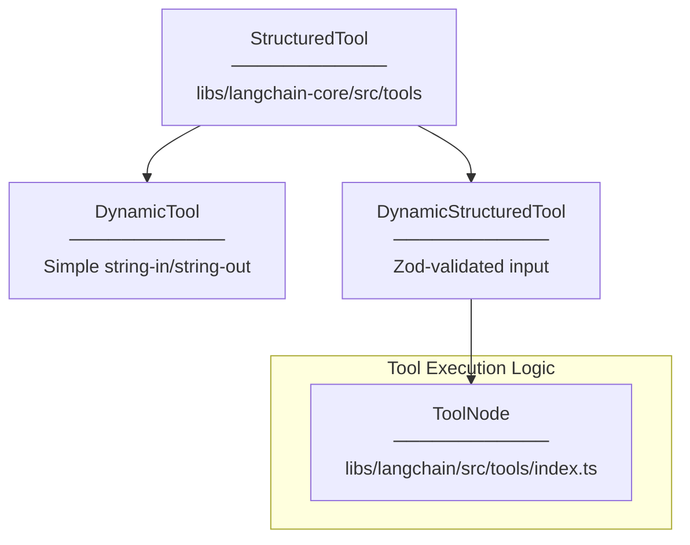
**Sources**: [libs/langchain-core/src/runnables/base.ts:60-61]()

---

## Chains vs Agents

While both orchestrate LLM calls, they differ in how the "next step" is decided.

### Chains (Static)
A **Chain** is a hardcoded sequence of steps. It uses LCEL to pipe components together. The developer defines the flow entirely at design time.

### Agents (Dynamic)
An **Agent** uses an LLM as a reasoning engine to determine which actions to take and in what order.
- **createAgent**: The high-level API in the `langchain` package for creating agents.
- **ReactAgent**: A common pattern where the agent follows a "Reasoning + Acting" loop.

Title: Agent Orchestration Flow
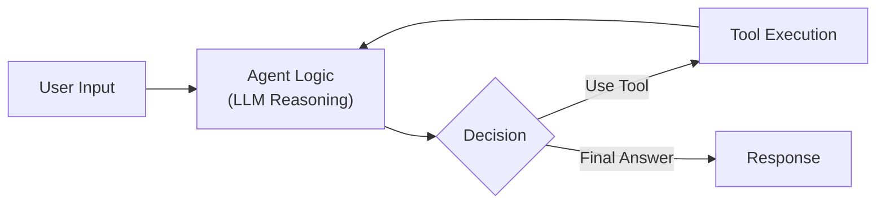
**Sources**: [README.md:17-17](), [libs/langchain/README.md:5-5]()

---

## Retrieval and Vector Stores

The retrieval system allows models to access data not present in their training set (RAG).

### Key Components

1.  **Document Loaders**: Classes that bring data in from external sources.
2.  **Text Splitters**: Utilities in `@langchain/textsplitters` that break long documents into manageable chunks.
3.  **Embeddings**: Models that convert text into numerical vectors.
4.  **Vector Stores**: Databases (e.g., Pinecone, PGVector) that store these vectors for similarity search.
5.  **Retrievers**: High-level interfaces that take a query and return relevant `Document` objects.

Title: RAG Pipeline Terminology
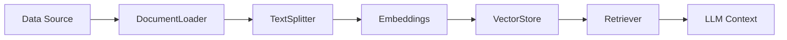
**Sources**: [libs/langchain-core/README.md:18-25]()

---

## Terminology Summary Table

| Term | Code Entity | Package | Role |
| :--- | :--- | :--- | :--- |
| **Runnable** | `Runnable` | `@langchain/core` | The atomic unit of composition. |
| **Chain** | `RunnableSequence` | `@langchain/core` | A static sequence of runnables. |
| **Agent** | `createAgent` | `langchain` | A dynamic loop using LLM reasoning. |
| **Retriever** | `BaseRetriever` | `@langchain/core` | An interface for fetching relevant docs. |
| **Vector Store** | `VectorStore` | `@langchain/core` | A database for embedding-based search. |
| **Tool** | `StructuredTool` | `@langchain/core` | A function the LLM can decide to call. |

**Sources**: [libs/langchain-core/src/runnables/base.ts:124-133](), [libs/langchain-core/README.md:5-10](), [libs/langchain/README.md:5-5]()

---

# Page: Installation and Setup

# Installation and Setup

<details>
<summary>Relevant source files</summary>

The following files were used as context for generating this wiki page:

- [.vscode/extensions.json](.vscode/extensions.json)
- [.vscode/settings.json](.vscode/settings.json)
- [deno.json](deno.json)
- [examples/.env.example](examples/.env.example)

</details>


This page guides you through installing LangChain.js packages, selecting the appropriate packages for your use case, and configuring your development environment. It covers the monorepo package structure, version consistency requirements, and environment setup for LLM provider integrations.

For information about the architectural principles underlying the package structure, see **1.1 Package Architecture**. For details on building and developing LangChain.js itself, see **6.1 Monorepo Management**.

---

## Understanding the Package Ecosystem

LangChain.js is distributed as a collection of npm packages organized in a hierarchical structure. Understanding this structure is essential for selecting the correct packages to install.

### Package Categories

The ecosystem consists of several primary package categories:

| Category | Package Pattern | Purpose | Path in Monorepo |
|----------|----------------|---------|------------------|
| **Core** | `@langchain/core` | Base abstractions, schemas, and interfaces | `libs/langchain-core` |
| **Main Framework** | `langchain` | High-level agent API, chains, utilities | `libs/langchain` |
| **Text Splitters** | `@langchain/textsplitters` | Text splitting utilities | `libs/langchain-textsplitters` |
| **Provider Packages** | `@langchain/{provider}` | Dedicated packages for major LLM providers | `libs/providers/langchain-*` |
| **Build Tools** | `@langchain/build` | Internal build pipeline orchestration | `internal/build` |

**Sources:** [libs/langchain-core/README.md:5-7](), [libs/langchain-core/README.md:16-20](), [internal/build/package.json:2-6]()

### Package Dependency Architecture

The following diagram illustrates how your application interacts with the LangChain ecosystem and how internal dependencies are structured.

**LangChain.js Dependency Flow**

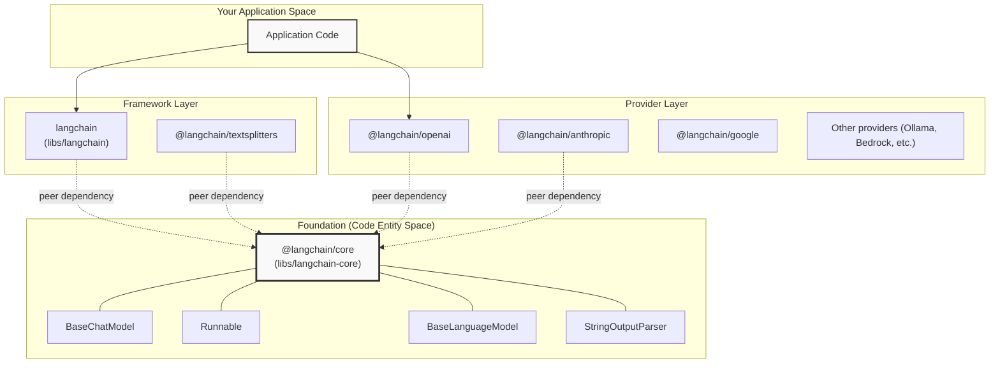

**Key Principle:** All packages declare `@langchain/core` as a **peer dependency**, not a direct dependency. This ensures that your application uses a single, consistent version of core abstractions across all packages.

**Sources:** [libs/langchain-core/README.md:72-82](), [libs/langchain-core/README.md:93-100]()

---

## Basic Installation

### Installing the Main Package

For most applications, start by installing the `langchain` package:

```bash
npm install -S langchain
# or
pnpm install langchain
# or
yarn add langchain
```

This provides access to high-level features like agents and orchestration.

**Sources:** [README.md:31-35](), [libs/langchain/README.md:17-27]()

### Installing Provider Packages

To use specific LLM providers, install their dedicated packages. These packages extend core classes like `BaseChatModel`.

```bash
# OpenAI (GPT-4o, etc.)
pnpm install @langchain/openai

# Anthropic (Claude)
pnpm install @langchain/anthropic

# Google Gemini
pnpm install @langchain/google

# Ollama (Local models)
pnpm install @langchain/ollama
```

**Sources:** [libs/langchain-core/README.md:21-25](), [libs/langchain-core/README.md:78-79]()

---

## Ensuring Core Version Consistency

**Critical:** All LangChain packages in your project must share the same version of `@langchain/core`. Mismatched versions cause runtime errors due to incompatible type definitions and schema mismatches.

### Version Resolution Strategy

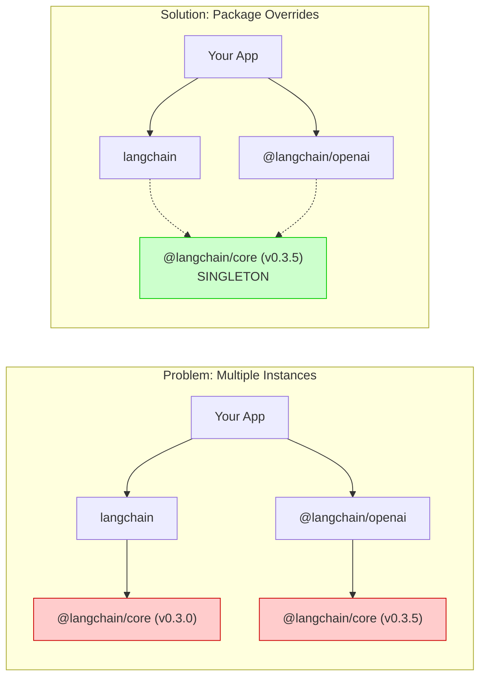

### Configuring package.json Overrides

To force version consistency, use the `overrides` (npm/pnpm) or `resolutions` (yarn) field in your root `package.json`. Within the LangChain.js monorepo itself, the `pnpm.overrides` field is used to link all packages to the local workspace version of core.

```json
{
  "pnpm": {
    "overrides": {
      "@langchain/core": "workspace:^",
      "langchain": "workspace:^"
    }
  }
}
```

For end-users, use standard semver to ensure a singleton instance of core:
```json
{
  "overrides": {
    "@langchain/core": "^0.3.0"
  }
}
```

**Sources:** [libs/langchain-core/README.md:72-82](), [package.json:55-58]()

---

## Environment Configuration

### API Key Management

Most LLM providers require API authentication. Configure credentials using environment variables. The codebase looks for specific variable names by default.

| Provider | Default Environment Variable | Source |
|----------|-----------------------------|--------|
| **Anthropic** | `ANTHROPIC_API_KEY` | [examples/.env.example:1]() |
| **OpenAI** | `OPENAI_API_KEY` | [examples/.env.example:9]() |
| **Google** | `GOOGLE_PALM_API_KEY` | [examples/.env.example:3]() |
| **AWS** | `AWS_ACCESS_KEY_ID`, `AWS_SECRET_ACCESS_KEY` | [examples/.env.example:72-73]() |
| **Azure OpenAI**| `AZURE_OPENAI_API_KEY` | [examples/.env.example:11]() |
| **Pinecone** | `PINECONE_API_KEY` | [examples/.env.example:31]() |

### Example .env Setup

Create a `.env` file in your project root. You can use `examples/.env.example` as a template:

```bash
# Core Provider Keys
ANTHROPIC_API_KEY=ADD_YOURS_HERE
OPENAI_API_KEY=ADD_YOURS_HERE

# Search & Tools
SERPAPI_API_KEY=ADD_YOURS_HERE
TAVILY_API_KEY=ADD_YOURS_HERE

# Vector Databases
PINECONE_API_KEY=ADD_YOURS_HERE
WEAVIATE_API_KEY=ADD_YOURS_HERE
```

**Sources:** [examples/.env.example:1-91]()

---

## Supported Environments

LangChain.js is written in TypeScript and supports a wide range of modern runtimes:

| Environment | Supported Versions / Context |
|------------|-----------------------------|
| **Node.js** | 20.x, 22.x, 24.x (ESM & CommonJS) |
| **Cloudflare Workers** | Supported |
| **Vercel / Next.js** | Browser, Serverless, and Edge functions |
| **Deno** | Supported |
| **Bun** | Supported |
| **Browser** | Supported |

**Sources:** [README.md:59-69](), [libs/langchain/README.md:44-54]()

---

## Workspace and Examples Setup

If you are contributing to the LangChain.js repository or running the provided examples, you must use `pnpm` (version `10.14.0` specified in the root).

### Monorepo Setup
The repository uses `pnpm` workspaces and `turbo` for build orchestration.

1. **Install Dependencies:**
   ```bash
   pnpm install
   ```
2. **Build All Packages:**
   ```bash
   pnpm build
   ```
   This triggers the `turbo build:compile` task, which respects dependency order. [package.json:13](), [turbo.json:7-12]()

### Running Examples
The `examples/` directory contains a dedicated suite for testing and demonstrating functionality.

1. **Setup Environment:**
   ```bash
   cd examples
   cp .env.example .env
   # Edit .env with your keys
   ```
2. **Execute an Example:**
   Examples are run via a dispatcher that handles path resolution and callback cleanup.
   ```bash
   pnpm run start ./src/prompts/few_shot.ts
   ```
   The dispatcher in `examples/src/index.ts` handles the `run` function exported by the example file and ensures `awaitAllCallbacks()` is called upon completion. [examples/src/index.ts:32-56](), [examples/src/README.md:18-24]()

---

## Deno Configuration

For Deno users, the `deno.json` file at the root of the repository defines import maps for various LangChain.js packages and external npm dependencies. This allows Deno to resolve npm packages directly.

**Deno Import Map Structure**

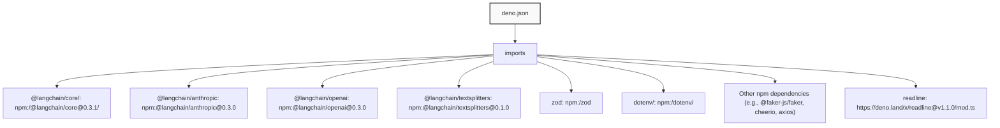

The `imports` field maps package names to their npm URLs, specifying a particular version. For example, `@langchain/core` is mapped to `npm:/@langchain/core@0.3.1/` [deno.json:11](). This ensures that Deno uses the specified npm package directly.

**Sources:** [deno.json:1-39]()

---

## VS Code Settings

The `.vscode/settings.json` file configures VS Code for an optimal development experience within the LangChain.js monorepo.

**Key Settings:**

*   `typescript.tsdk`: Points to the TypeScript SDK within `node_modules` [.vscode/settings.json:5](), ensuring the correct TypeScript version is used.
*   `editor.formatOnSave`: Enables automatic code formatting on save [.vscode/settings.json:14]().
*   `files.exclude` and `search.exclude`: Configures file and folder exclusions for better performance and cleaner search results, ignoring build artifacts and dependency directories like `dist`, `dist-cjs`, `node_modules`, and `.turbo` [.vscode/settings.json:15-24]().
*   `typescript.preferences.importModuleSpecifier`: Sets import module specifiers to `relative` [.vscode/settings.json:25]().
*   `editor.defaultFormatter`: Specifies `oxc.oxc-vscode` as the default formatter for JavaScript and TypeScript files [.vscode/settings.json:26-31]().
*   `deno.enable`: Explicitly disables Deno language server integration for the workspace [.vscode/settings.json:33](), as the primary development environment is Node.js.

The `.vscode/extensions.json` file also recommends essential extensions for contributors, including ESLint, Prettier, TypeScript, Code Spell Checker, and YAML support [.vscode/extensions.json:1-8]().

**Sources:** [.vscode/settings.json:1-34](), [.vscode/extensions.json:1-11]()

---

## Installation Verification

### Basic Import Test

Verify your installation by instantiating a model and output parser from core. The following pattern uses the standard `Runnable` interface's `pipe` method:

```typescript
import { ChatOpenAI } from "@langchain/openai";
import { StringOutputParser } from "@langchain/core/output_parsers";
import { ChatPromptTemplate } from "@langchain/core/prompts";

const model = new ChatOpenAI({
  model: "gpt-4o-mini",
  temperature: 0.8,
});

const prompt = ChatPromptTemplate.fromTemplate(
  "Answer the following question to the best of your ability:\n{question}"
);

const outputParser = new StringOutputParser();

// Create a chain using LCEL (LangChain Expression Language)
const chain = prompt.pipe(model).pipe(outputParser);

const stream = await chain.stream({
  question: "Why is the sky blue?",
});

for await (const chunk of stream) {
  process.stdout.write(chunk);
}
```

**Sources:** [libs/langchain-core/README.md:29-53]()

---

# Page: Core Abstractions (@langchain/core)

# Core Abstractions (@langchain/core)

<details>
<summary>Relevant source files</summary>

The following files were used as context for generating this wiki page:

- [libs/langchain-classic/src/hub/index.ts](libs/langchain-classic/src/hub/index.ts)
- [libs/langchain-classic/src/load/index.ts](libs/langchain-classic/src/load/index.ts)
- [libs/langchain-core/src/language_models/base.ts](libs/langchain-core/src/language_models/base.ts)
- [libs/langchain-core/src/language_models/chat_models.ts](libs/langchain-core/src/language_models/chat_models.ts)
- [libs/langchain-core/src/language_models/llms.ts](libs/langchain-core/src/language_models/llms.ts)
- [libs/langchain-core/src/language_models/tests/chat_models.test.ts](libs/langchain-core/src/language_models/tests/chat_models.test.ts)
- [libs/langchain-core/src/language_models/tests/count_tokens.test.ts](libs/langchain-core/src/language_models/tests/count_tokens.test.ts)
- [libs/langchain-core/src/language_models/tests/llms.test.ts](libs/langchain-core/src/language_models/tests/llms.test.ts)
- [libs/langchain-core/src/language_models/utils.ts](libs/langchain-core/src/language_models/utils.ts)
- [libs/langchain-core/src/load/index.ts](libs/langchain-core/src/load/index.ts)
- [libs/langchain-core/src/load/serializable.ts](libs/langchain-core/src/load/serializable.ts)
- [libs/langchain-core/src/load/tests/index.test.ts](libs/langchain-core/src/load/tests/index.test.ts)
- [libs/langchain-core/src/load/validation.ts](libs/langchain-core/src/load/validation.ts)
- [libs/langchain-core/src/runnables/base.ts](libs/langchain-core/src/runnables/base.ts)
- [libs/langchain-core/src/runnables/history.ts](libs/langchain-core/src/runnables/history.ts)
- [libs/langchain/src/hub/tests/hub.int.test.ts](libs/langchain/src/hub/tests/hub.int.test.ts)
- [libs/langchain/src/load/index.ts](libs/langchain/src/load/index.ts)
- [libs/langchain/src/load/tests/load.test.ts](libs/langchain/src/load/tests/load.test.ts)
- [libs/providers/langchain-google-common/src/llms.ts](libs/providers/langchain-google-common/src/llms.ts)
- [libs/providers/langchain-openai/src/chat_models/tests/index.int.test.ts](libs/providers/langchain-openai/src/chat_models/tests/index.int.test.ts)

</details>


## Purpose and Scope

The `@langchain/core` package defines the foundational abstractions, interfaces, and base classes that all other packages in the LangChain.js ecosystem implement. It provides type-safe schemas, base implementations for language models, message systems, tool calling, runnables (LCEL), and observability primitives. This page documents the core abstractions and their relationships.

For specific implementation details of chat models and LLMs, see [Base Chat Model and LLM Interfaces](#2.1). For message content structures, see [Message System and Content Blocks](#2.2). For tool definitions, see [Tools and Dynamic Tools](#2.3). For execution logic, see [Runnables and Execution](#2.4). For output parsing and serialization, see [Output Parsers, Serialization, and Utilities](#2.5). For integration testing, see [Standard Test Framework and Testing Utilities](#2.6).

## Package Structure

The `@langchain/core` package is organized into logical modules, each exported as a separate entrypoint to enable tree-shaking and minimize bundle sizes.

### Module Organization

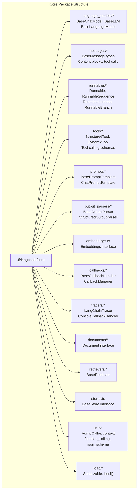

**Key Export Categories**:

| Export Path | Purpose | Key Classes/Interfaces |
|-------------|---------|------------------------|
| `language_models/base` | Base language model abstractions | `BaseLanguageModel`, `BaseLanguageModelCallOptions` |
| `language_models/chat_models` | Chat model interface | `BaseChatModel`, `BaseChatModelCallOptions` |
| `language_models/llms` | Text completion interface | `BaseLLM`, `BaseLLMCallOptions` |
| `messages` | Message type system | `BaseMessage`, `HumanMessage`, `AIMessage`, `SystemMessage`, `ToolMessage` |
| `messages/tool` | Tool calling structures | `ToolCall`, `ToolCallChunk`, `InvalidToolCall` |
| `runnables` | LCEL composition primitives | `Runnable`, `RunnableSequence`, `RunnableLambda` |
| `tools` | Tool abstractions | `StructuredTool`, `DynamicTool`, `DynamicStructuredTool` |
| `prompts` | Prompt templates | `BasePromptTemplate`, `ChatPromptTemplate` |
| `callbacks/manager` | Callback orchestration | `CallbackManager`, `CallbackManagerForLLMRun` |
| `load` | Serialization and deserialization | `Serializable`, `load` |

Sources: [libs/langchain-core/src/language_models/chat_models.ts:1-74](), [libs/langchain-core/src/messages/index.ts:1-17]()

## The Runnable Interface

The `Runnable` interface is the foundational abstraction in LangChain.js, enabling LangChain Expression Language (LCEL). All components that can be invoked, streamed, or composed implement this interface. For details, see [Runnables and Execution](#2.4).

### Runnable Hierarchy

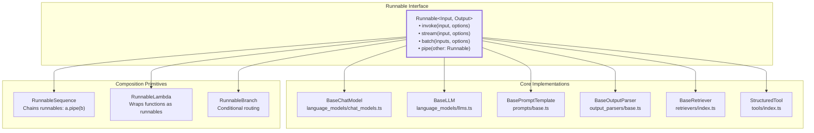

### Runnable Methods

The `Runnable` interface defines standard methods that all components implement:

| Method | Description | Return Type |
|--------|-------------|-------------|
| `invoke(input, options?)` | Synchronously invoke with input | `Promise<Output>` |
| `stream(input, options?)` | Stream output chunks | `AsyncGenerator<Output>` |
| `batch(inputs, options?)` | Process multiple inputs | `Promise<Output[]>` |
| `pipe(other)` | Compose with another runnable | `RunnableSequence<Input, NewOutput>` |

**CallOptions Parameter**:

All methods accept a `RunnableConfig` parameter containing:
- `signal?: AbortSignal` - For cancellation [libs/langchain-core/src/language_models/llms.ts:44-45]().
- `callbacks?: Callbacks` - For observability [libs/langchain-core/src/language_models/base.ts:232-233]().
- `tags?: string[]` - For metadata tagging [libs/langchain-core/src/language_models/base.ts:233-234]().
- `metadata?: Record<string, unknown>` - Additional metadata [libs/langchain-core/src/language_models/base.ts:234-235]().

Sources: [libs/langchain-core/src/runnables/base.ts:124-130](), [libs/langchain-core/src/language_models/base.ts:240-258](), [libs/langchain-core/src/language_models/llms.ts:58-69]()

## Language Model Abstractions

Language models are the primary components in LangChain.js. The core package defines three base classes in a hierarchy: `BaseLanguageModel` → `BaseChatModel` / `BaseLLM`. For details, see [Base Chat Model and LLM Interfaces](#2.1).

### Natural Language to Code Entity Space: Language Models

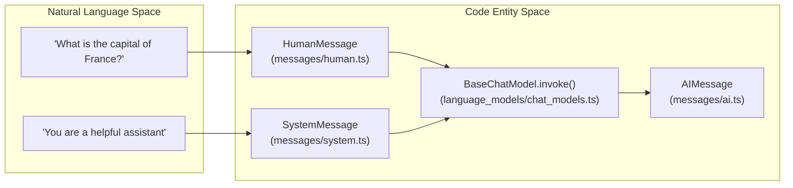

### BaseChatModel Interface

`BaseChatModel` is the foundation for conversational AI models that work with structured message objects. It extends `BaseLanguageModel` [libs/langchain-core/src/language_models/chat_models.ts:28-34]().

**Structured Output Support**:
The `withStructuredOutput()` method enables models to return validated objects (e.g., via Zod) instead of raw strings or messages [libs/langchain-core/src/language_models/chat_models.ts:69](). It supports both Zod schemas and the Standard Schema specification [libs/langchain-core/src/language_models/chat_models.ts:55-57]().

Sources: [libs/langchain-core/src/language_models/chat_models.ts:216-240](), [libs/langchain-core/src/language_models/base.ts:33-59]()

## Message System

The message system provides a type-safe abstraction for conversational interactions. All messages inherit from `BaseMessage` and contain typed content blocks. For details, see [Message System and Content Blocks](#2.2).

### Message Type Hierarchy

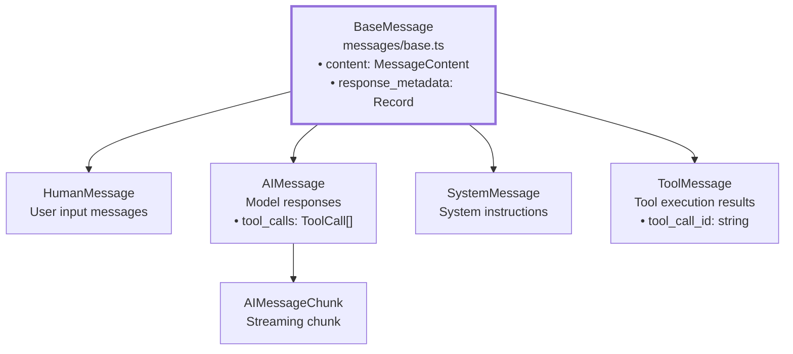

### Natural Language to Code Entity Space: Messages

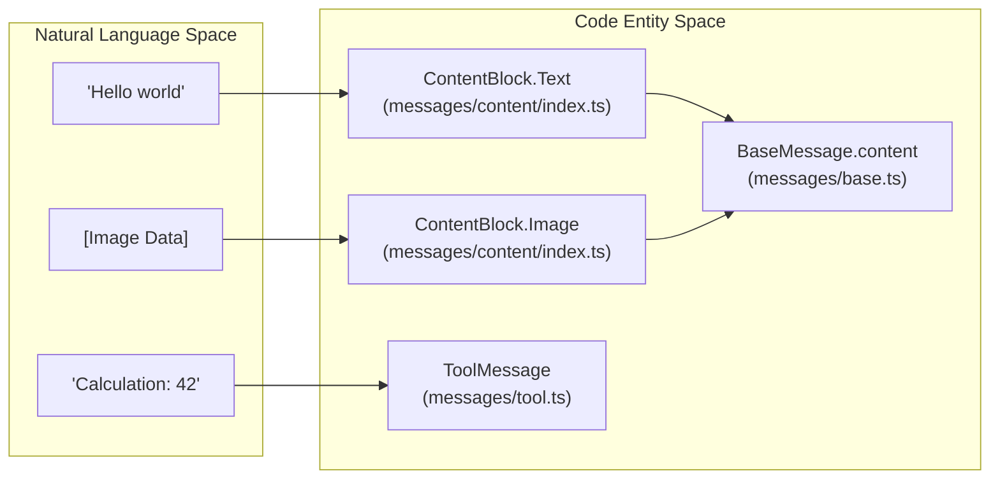

Sources: [libs/langchain-core/src/messages/base.ts:215-225](), [libs/langchain-core/src/messages/ai.ts:33-43](), [libs/langchain-core/src/messages/system.ts:18-25]()

## Tool Abstractions

Tools enable language models to interact with external systems. The core package defines base tool classes and factory functions. For details, see [Tools and Dynamic Tools](#2.3).

### Tool Class Hierarchy

```mermaid
graph TB
    StructuredTool["StructuredTool&lt;T&gt;<br/>tools/index.ts<br/>• name: string<br/>• description: string<br/>• schema: T"]
    
    StructuredTool --> DynamicStructuredTool["DynamicStructuredTool&lt;T&gt;<br/>Function-based tool"]
    
    StructuredTool --> DynamicTool["DynamicTool<br/>Simple string-based tool"]
    
    style StructuredTool stroke-width:3px
```

Sources: [libs/langchain-core/src/language_models/chat_models.ts:44-51](), [libs/langchain-core/src/language_models/chat_models.ts:204-210]()

## Other Core Abstractions

### Callbacks and Tracing
The callback system enables observability and instrumentation. `CallbackManager` orchestrates handlers for lifecycle events like `handleLLMStart` and `handleLLMEnd` [libs/langchain-core/src/callbacks/manager.ts:10-12](). For details, see [Runnables and Execution](#2.4).

Sources: [libs/langchain-core/src/language_models/chat_models.ts:37-40](), [libs/langchain-core/src/language_models/llms.ts:122-131]()

### Serialization
Core components extend `Serializable`, allowing them to be serialized to JSON and reconstructed using the `load` utility [libs/langchain-core/src/load/serializable.ts:97-100](). This system includes mechanisms to prevent secret injection and ensure data integrity during deserialization [libs/langchain-core/src/load/index.ts:1-67](). For details, see [Output Parsers, Serialization, and Utilities](#2.5).

Sources: [libs/langchain-core/src/load/index.ts:70-75](), [libs/langchain-core/src/load/validation.ts:101-110]()

---

# Page: Base Chat Model and LLM Interfaces

# Base Chat Model and LLM Interfaces

<details>
<summary>Relevant source files</summary>

The following files were used as context for generating this wiki page:

- [libs/langchain-core/src/language_models/base.ts](libs/langchain-core/src/language_models/base.ts)
- [libs/langchain-core/src/language_models/chat_models.ts](libs/langchain-core/src/language_models/chat_models.ts)
- [libs/langchain-core/src/language_models/llms.ts](libs/langchain-core/src/language_models/llms.ts)
- [libs/langchain-core/src/language_models/tests/chat_models.test.ts](libs/langchain-core/src/language_models/tests/chat_models.test.ts)
- [libs/langchain-core/src/language_models/tests/count_tokens.test.ts](libs/langchain-core/src/language_models/tests/count_tokens.test.ts)
- [libs/langchain-core/src/language_models/tests/llms.test.ts](libs/langchain-core/src/language_models/tests/llms.test.ts)
- [libs/langchain-core/src/language_models/utils.ts](libs/langchain-core/src/language_models/utils.ts)
- [libs/providers/langchain-deepseek/src/profiles.ts](libs/providers/langchain-deepseek/src/profiles.ts)
- [libs/providers/langchain-google-common/src/llms.ts](libs/providers/langchain-google-common/src/llms.ts)
- [libs/providers/langchain-google-common/src/profiles.ts](libs/providers/langchain-google-common/src/profiles.ts)
- [libs/providers/langchain-google-genai/src/profiles.ts](libs/providers/langchain-google-genai/src/profiles.ts)
- [libs/providers/langchain-google/profiles.toml](libs/providers/langchain-google/profiles.toml)
- [libs/providers/langchain-google/src/chat_models/profiles.ts](libs/providers/langchain-google/src/chat_models/profiles.ts)
- [libs/providers/langchain-groq/src/profiles.ts](libs/providers/langchain-groq/src/profiles.ts)
- [libs/providers/langchain-openai/src/chat_models/profiles.ts](libs/providers/langchain-openai/src/chat_models/profiles.ts)
- [libs/providers/langchain-openai/src/chat_models/tests/index.int.test.ts](libs/providers/langchain-openai/src/chat_models/tests/index.int.test.ts)
- [libs/providers/langchain-xai/src/profiles.ts](libs/providers/langchain-xai/src/profiles.ts)

</details>


## Purpose and Scope

This document explains the foundational base classes and interfaces in `@langchain/core` that enable Language Model (LLM) provider interoperability across the LangChain.js ecosystem. The primary abstractions are `BaseChatModel` and `BaseLanguageModel`, which define standardized interfaces that all LLM provider packages must implement.

This page covers:
- The implementation details of `BaseChatModel` and `BaseLLM`.
- Model profiles and capability tracking.
- Structured output base classes and Zod integration.
- Language model utility functions for token counting and message casting.
- The `ChatModelStream` system for protocol-compliant streaming.

## Overview of Base Abstractions

The `@langchain/core` package provides two fundamental base classes for working with language models, both of which inherit from a common `BaseLanguageModel` [libs/langchain-core/src/language_models/base.ts:240-247]():

| Base Class | Purpose | Primary Use Cases |
|------------|---------|-------------------|
| `BaseChatModel` | Conversational AI with message-based interfaces [libs/langchain-core/src/language_models/chat_models.ts:216-220]() | Chat applications, multi-turn conversations, tool calling |
| `BaseLLM` | Text-in, text-out completion interface [libs/langchain-core/src/language_models/llms.ts:38-40]() | Legacy completion models, simple text generation |

Both classes implement the `Runnable` interface [libs/langchain-core/src/language_models/base.ts:20-21](), providing a unified execution model with support for streaming, batching, and composition.

## Base Class Hierarchy

The following diagram maps the code entities from the core abstractions to specific provider implementations.

```mermaid
graph TB
    subgraph "Natural Language Space"
        UserPrompt["User Input (Text/Messages)"]
        ModelResponse["Model Output (Text/Messages)"]
    end

    subgraph "Code Entity Space (@langchain/core)"
        Runnable["Runnable [libs/langchain-core/src/runnables/base.js]"]
        BaseLangChain["BaseLangChain [libs/langchain-core/src/language_models/base.ts:240]"]
        BaseLanguageModel["BaseLanguageModel [libs/langchain-core/src/language_models/base.ts:240]"]
        BaseChatModel["BaseChatModel [libs/langchain-core/src/language_models/chat_models.ts:216]"]
        BaseLLM["BaseLLM [libs/langchain-core/src/language_models/llms.ts:38]"]
    end

    subgraph "Provider Space"
        ChatOpenAI["ChatOpenAI [@langchain/openai]"]
        ChatGoogle["ChatGoogleBase [@langchain/google-common]"]
        GoogleLLM["GoogleBaseLLM [@langchain/google-common]"]
    end

    UserPrompt --> Runnable
    Runnable --> BaseLangChain
    BaseLangChain --> BaseLanguageModel
    BaseLanguageModel --> BaseChatModel
    BaseLanguageModel --> BaseLLM
    
    BaseChatModel --> ChatOpenAI
    BaseChatModel --> ChatGoogle
    BaseLLM --> GoogleLLM
    
    ChatOpenAI --> ModelResponse
```
**Diagram: Entity mapping from core abstractions to provider implementations.**
Sources: [libs/langchain-core/src/language_models/base.ts:240](), [libs/langchain-core/src/language_models/chat_models.ts:216](), [libs/langchain-core/src/language_models/llms.ts:38](), [libs/providers/langchain-google-common/src/llms.ts:71]()

## BaseChatModel Interface

`BaseChatModel` is the core abstraction for models that operate on message sequences (`BaseMessage[]`) [libs/langchain-core/src/language_models/chat_models.ts:216]().

### Configuration and Parameters
Models are configured via `BaseChatModelParams`, which includes:
- `disableStreaming`: Whether to bypass `stream()` and defer to `invoke()` [libs/langchain-core/src/language_models/chat_models.ts:110]().
- `outputVersion`: Controls the format of `AIMessage` output. "v0" uses provider-specific formats, while "v1" uses standardized content blocks [libs/langchain-core/src/language_models/chat_models.ts:125-126]().

### Core Execution Flow
The internal execution flow for a chat model call involves several stages of normalization and callback handling.

```mermaid
sequenceDiagram
    participant App as "Application"
    participant BCM as "BaseChatModel [chat_models.ts]"
    participant Provider as "Provider Implementation"
    participant Utils as "Language Model Utils"

    App->>BCM: invoke(messages, options)
    BCM->>BCM: _separateRunnableConfigFromCallOptions()
    BCM->>Utils: castStandardMessageContent() (if v1) [libs/langchain-core/src/language_models/utils.ts:7-17]
    BCM->>Provider: _generate(messages, parsedOptions)
    Provider->>Provider: Call Vendor API
    Provider-->>BCM: ChatResult
    BCM-->>App: AIMessage
```
**Diagram: Internal data flow for BaseChatModel.invoke().**
Sources: [libs/langchain-core/src/language_models/chat_models.ts:216](), [libs/langchain-core/src/language_models/utils.ts:7-17]()

### Tool Binding and Structured Output
Chat models support two primary patterns for specialized output:
1. **`bindTools(tools)`**: Attaches tool definitions to the model call [libs/langchain-core/src/language_models/chat_models.ts:204-210]().
2. **`withStructuredOutput(schema)`**: Uses `assembleStructuredOutputPipeline` to create a `Runnable` that returns parsed objects instead of messages [libs/langchain-core/src/language_models/chat_models.ts:69](). This supports Zod schemas, JSON schemas, and `SerializableSchema` [libs/langchain-core/src/language_models/chat_models.ts:67-68]().

## Streaming Architecture

LangChain.js utilizes a sophisticated streaming protocol to handle real-time model outputs, including text, reasoning (thinking), and tool calls.

### ChatModelStream
The `ChatModelStream` class [libs/langchain-core/src/language_models/chat_models.ts:71]() manages an async generator of `ChatModelStreamEvent`. It provides sub-streams for specific content types:
- `.text`: An async iterable yielding incremental text deltas.
- `.reasoning`: An async iterable for model "thinking" or reasoning tokens.

### Delta Application
The `applyDelta` function (not shown in provided files, but conceptually part of the streaming implementation) is responsible for merging incremental updates into accumulated content blocks:
- `text-delta`: Appends text to a text block.
- `reasoning-delta`: Appends reasoning text to "thinking" or "reasoning" blocks.
- `block-delta`: Shallow merges fields for tool call chunks.

## Model Profiles and Capabilities

LangChain.js uses `ModelProfile` to track the technical capabilities of specific models, such as context limits and input/output support [libs/langchain-core/src/language_models/base.ts:28]().

### Profile Attributes
A `ModelProfile` typically defines:
- `maxInputTokens`: The context window size [libs/providers/langchain-openai/src/chat_models/profiles.ts:7]().
- `maxOutputTokens`: Maximum tokens the model can generate [libs/providers/langchain-openai/src/chat_models/profiles.ts:12]().
- `toolCalling` / `structuredOutput`: Boolean flags for feature support [libs/providers/langchain-openai/src/chat_models/profiles.ts:17-18]().
- `reasoningOutput`: Support for "thinking" or reasoning tokens [libs/providers/langchain-openai/src/chat_models/profiles.ts:13]().

Examples of model profiles can be found in provider packages:
- OpenAI: [libs/providers/langchain-openai/src/chat_models/profiles.ts]()
- DeepSeek: [libs/providers/langchain-deepseek/src/profiles.ts]()
- Google: [libs/providers/langchain-google/src/chat_models/profiles.ts]()
- xAI: [libs/providers/langchain-xai/src/profiles.ts]()
- Groq: [libs/providers/langchain-groq/src/profiles.ts]()

### Capability Utility Functions
`@langchain/core` provides utilities to query model limits:
- `getModelContextSize(modelName)`: Returns the max input tokens for known models (e.g., GPT-4o: 128k, Gemini 1.5: 1M, Claude 3.5: 200k) [libs/langchain-core/src/language_models/base.ts:81-170]().
- `calculateMaxTokens({ prompt, modelName })`: Calculates remaining tokens by encoding the prompt via `js-tiktoken` and subtracting from the model's context size [libs/langchain-core/src/language_models/base.ts:198-220]().

## Language Model Utility Functions

The following utilities assist in message handling and provider interoperability:

### Message Casting
`castStandardMessageContent` is used to convert messages to the "v1" standardized format, moving `contentBlocks` into the primary `content` field and updating `response_metadata` [libs/langchain-core/src/language_models/utils.ts:7-17]().

### Input Normalization
`BaseChatModel` includes `_formatForTracing`, which prepares messages for observability platforms by converting multimodal content (like base64 images) into OpenAI-compatible image blocks for consistent visualization [libs/langchain-core/src/language_models/chat_models.ts:166-192]().

## Summary of Key Classes

| Symbol | File Path | Role |
|--------|-----------|------|
| `BaseLanguageModel` | [libs/langchain-core/src/language_models/base.ts:240]() | Common base for LLMs and Chat Models. |
| `BaseChatModel` | [libs/langchain-core/src/language_models/chat_models.ts:216]() | Abstract class for message-based models. |
| `BaseLLM` | [libs/langchain-core/src/language_models/llms.ts:38]() | Abstract class for string-based models. |
| `ChatModelStream` | [libs/langchain-core/src/language_models/chat_models.ts:71]() | Orchestrates streaming events and sub-streams. |
| `ModelProfile` | [libs/langchain-core/src/language_models/base.ts:28]() | Interface for model capability metadata. |

Sources: [libs/langchain-core/src/language_models/base.ts](), [libs/langchain-core/src/language_models/chat_models.ts](), [libs/langchain-core/src/language_models/llms.ts](), [libs/langchain-core/src/language_models/utils.ts]()

---

# Page: Message System and Content Blocks

# Message System and Content Blocks

<details>
<summary>Relevant source files</summary>

The following files were used as context for generating this wiki page:

- [libs/langchain-core/src/messages/ai.ts](libs/langchain-core/src/messages/ai.ts)
- [libs/langchain-core/src/messages/base.ts](libs/langchain-core/src/messages/base.ts)
- [libs/langchain-core/src/messages/chat.ts](libs/langchain-core/src/messages/chat.ts)
- [libs/langchain-core/src/messages/format.ts](libs/langchain-core/src/messages/format.ts)
- [libs/langchain-core/src/messages/function.ts](libs/langchain-core/src/messages/function.ts)
- [libs/langchain-core/src/messages/human.ts](libs/langchain-core/src/messages/human.ts)
- [libs/langchain-core/src/messages/modifier.ts](libs/langchain-core/src/messages/modifier.ts)
- [libs/langchain-core/src/messages/system.ts](libs/langchain-core/src/messages/system.ts)
- [libs/langchain-core/src/messages/tests/ai.test.ts](libs/langchain-core/src/messages/tests/ai.test.ts)
- [libs/langchain-core/src/messages/tests/base_message.test.ts](libs/langchain-core/src/messages/tests/base_message.test.ts)
- [libs/langchain-core/src/messages/tests/message_utils.test.ts](libs/langchain-core/src/messages/tests/message_utils.test.ts)
- [libs/langchain-core/src/messages/tool.ts](libs/langchain-core/src/messages/tool.ts)
- [libs/langchain-core/src/messages/transformers.ts](libs/langchain-core/src/messages/transformers.ts)
- [libs/langchain-core/src/messages/utils.ts](libs/langchain-core/src/messages/utils.ts)
- [libs/langchain-core/src/utils/env.ts](libs/langchain-core/src/utils/env.ts)
- [libs/langchain-core/src/utils/namespace.ts](libs/langchain-core/src/utils/namespace.ts)
- [libs/providers/langchain-openai/src/tools/mcp.ts](libs/providers/langchain-openai/src/tools/mcp.ts)
- [libs/providers/langchain-openai/src/tools/tests/mcp.int.test.ts](libs/providers/langchain-openai/src/tools/tests/mcp.int.test.ts)
- [libs/providers/langchain-openai/src/tools/tests/mcp.test.ts](libs/providers/langchain-openai/src/tools/tests/mcp.test.ts)
- [libs/providers/langchain-openai/src/utils/tools.ts](libs/providers/langchain-openai/src/utils/tools.ts)

</details>


## Purpose and Scope

This document describes the message system in LangChain.js, which defines how conversational data is structured and passed through the framework. Messages are the fundamental unit of communication between users, AI models, and tools. The message system provides a standardized representation that works across all LLM providers while preserving provider-specific metadata.

This page covers message types (`AIMessage`, `HumanMessage`, etc.), the content block system for multimodal data, provider-specific block translators, and message merging utilities used during streaming.

## Message Type Hierarchy

LangChain.js defines a hierarchy of message classes representing different participants in a conversation. All message types extend from the `BaseMessage` class, which implements `Serializable` for cross-environment persistence [libs/langchain-core/src/messages/base.ts:215-221]().

```mermaid
graph TB
    BaseMessage["BaseMessage<br/>────────<br/>content: MessageContent<br/>additional_kwargs: Record<string, any><br/>response_metadata?: Record<string, any><br/>id?: string<br/>name?: string"]
    
    HumanMessage["HumanMessage<br/>────────<br/>User input<br/>example: boolean"]
    
    AIMessage["AIMessage<br/>────────<br/>Model responses<br/>tool_calls?: ToolCall[]<br/>invalid_tool_calls?: InvalidToolCall[]<br/>usage_metadata?: UsageMetadata"]
    
    SystemMessage["SystemMessage<br/>────────<br/>System instructions"]
    
    ToolMessage["ToolMessage<br/>────────<br/>Tool execution results<br/>tool_call_id: string<br/>artifact?: unknown"]
    
    ChatMessage["ChatMessage<br/>────────<br/>Generic role-based<br/>role: string"]
    
    RemoveMessage["RemoveMessage<br/>────────<br/>State management<br/>id: string"]
    
    BaseMessage --> HumanMessage
    BaseMessage --> AIMessage
    BaseMessage --> SystemMessage
    BaseMessage --> ToolMessage
    BaseMessage --> ChatMessage
    BaseMessage --> RemoveMessage
```

**Message Type Roles**

| Message Type | Purpose | Key Fields |
|--------------|---------|------------|
| `HumanMessage` | User input to the model | `content`, `name` |
| `AIMessage` | Model-generated responses | `tool_calls`, `usage_metadata`, `invalid_tool_calls` |
| `SystemMessage` | System-level instructions | `content` |
| `ToolMessage` | Results from tool execution | `tool_call_id`, `status`, `artifact` |
| `ChatMessage` | Generic message with custom role | `role` string |
| `RemoveMessage` | State management (deletion) | `id` of message to remove |

Sources: [libs/langchain-core/src/messages/base.ts:215-221](), [libs/langchain-core/src/messages/ai.ts:33-43](), [libs/langchain-core/src/messages/modifier.ts:22-29](), [libs/langchain-core/src/messages/system.ts:18-20](), [libs/langchain-core/src/messages/tool.ts:24-26]()

## Content Block System

The `content` field of a message can be a simple string or an array of `ContentBlock` objects [libs/langchain-core/src/messages/base.ts:52-53](). This enables multimodal interactions (text + images) and structured reasoning.

### Standard Content Blocks
LangChain.js uses a standardized block format to ensure interoperability between providers like OpenAI, Anthropic, and Google.

```mermaid
graph LR
    subgraph "Natural Language Space"
        UserText["User says 'Hello'"]
        UserImage["User sends Image"]
        ModelReasoning["Model thinks..."]
        ToolCallRequest["Model requests tool call"]
        ToolOutput["Tool returns output"]
    end

    subgraph "Code Entity Space"
        ContentBlockText["ContentBlock.Text<br/>{ type: 'text', text: string }"]
        ContentBlockImage["ContentBlock.Image<br/>{ type: 'image_url', image_url: { url: string } }"]
        ContentBlockReasoning["ContentBlock.Reasoning<br/>{ type: 'reasoning', reasoning: string }"]
        ContentBlockToolCall["ContentBlock.Tools.ToolCall<br/>{ type: 'tool_call', id: string, name: string, args: Record<string, any> }"]
        ContentBlockToolOutput["ContentBlock.Tools.ToolOutput<br/>{ type: 'tool_output', tool_call_id: string, content: string }"]
    end

    UserText --> ContentBlockText
    UserImage --> ContentBlockImage
    ModelReasoning --> ContentBlockReasoning
    ToolCallRequest --> ContentBlockToolCall
    ToolOutput --> ContentBlockToolOutput
```

**Key Block Types:**
- **Text**: Standard text content.
- **Image**: Multimodal input using URLs or base64 data. Supported via `image_url` or standard image blocks [libs/langchain-core/src/messages/tests/base_message.test.ts:60-66]().
- **Reasoning**: Internal model "thinking" or chain-of-thought. OpenAI's reasoning summary is elevated to the content array as a `reasoning` block [libs/langchain-core/src/messages/tests/ai.test.ts:180-182]().
- **Tool Call**: Structured request to execute a tool, often represented as a `tool_call` type block in v1 content [libs/langchain-core/src/messages/ai.ts:125-132]().
- **Citation**: Source attribution blocks used by providers like OpenAI Responses API, mapping `url_citation` or `file_citation` to standard `citation` blocks [libs/langchain-core/src/messages/tests/ai.test.ts:193-196]().

Sources: [libs/langchain-core/src/messages/base.ts:52-53](), [libs/langchain-core/src/messages/ai.ts:125-132](), [libs/langchain-core/src/messages/tests/base_message.test.ts:60-66](), [libs/langchain-core/src/messages/tests/ai.test.ts:180-182](), [libs/langchain-core/src/messages/tests/ai.test.ts:193-196]()

## Block Translators

Since different providers use incompatible formats for multimodal data and tool calls, LangChain uses `StandardContentBlockTranslator` implementations to normalize provider-specific responses into the standard `contentBlocks` array.

| Translator | Provider | Behavior |
|------------|----------|----------|
| `convertToV1FromChatCompletions` | OpenAI | Normalizes `tool_calls` and text into standard blocks [libs/langchain-core/src/messages/block_translators/openai.ts:49-73](). |
| `convertToV1FromOpenAIResponses` | OpenAI | Converts reasoning summaries, annotations, and tool outputs into standard blocks [libs/langchain-core/src/messages/block_translators/openai.ts:204-213](). |
| `convertToV1FromAnthropicInput` | Anthropic | Converts Anthropic's tool use and text blocks into standard blocks [libs/langchain-core/src/messages/base.ts:4-5](). |

The `AIMessage.contentBlocks` getter dynamically invokes these translators based on the `model_provider` found in `response_metadata` [libs/langchain-core/src/messages/ai.ts:184-193]().

Sources: [libs/langchain-core/src/messages/ai.ts:184-193](), [libs/langchain-core/src/messages/base.ts:4-5]()

## Message Merging and Concatenation

During streaming, messages are received as "chunks" (`AIMessageChunk`, `ToolMessageChunk`, etc.). LangChain provides utilities to merge these chunks into a single message.

### `mergeContent` Function
This utility handles merging two `MessageContent` values. It concatenates strings, joins arrays, and handles the transition from string to array if multimodal content is added [libs/langchain-core/src/messages/base.ts:110-162]().

### `_mergeLists` Logic
Used primarily for streaming tool calls and reasoning blocks. It merges blocks based on an `index` or `id`. If an index is missing (common in some OpenAI-compatible APIs), it falls back to `id`-based merging to prevent duplicate entries [libs/langchain-core/src/messages/tests/base_message.test.ts:217-260]().

```mermaid
graph TD
    subgraph "Streaming Data Flow"
        Chunk1["AIMessageChunk 1<br/>{ content: 'Hello ', index: 0 }"]
        Chunk2["AIMessageChunk 2<br/>{ content: 'world', index: 0 }"]
        
        MergeOp["mergeContent() / _mergeLists()"]
        
        FinalMsg["AIMessage<br/>{ content: 'Hello world' }"]
    end

    Chunk1 --> MergeOp
    Chunk2 --> MergeOp
    MergeOp --> FinalMsg
```

Sources: [libs/langchain-core/src/messages/base.ts:110-162](), [libs/langchain-core/src/messages/tests/base_message.test.ts:217-260]()

## Tool Calling Integration

`AIMessage` objects track tool requests through `tool_calls` and `invalid_tool_calls`.

- **`tool_calls`**: Successfully parsed tool requests containing `name`, `args`, and a unique `id` [libs/langchain-core/src/messages/ai.ts:52-52]().
- **`invalid_tool_calls`**: Requests that failed JSON parsing or schema validation, preserved so the agent can see the model's error [libs/langchain-core/src/messages/ai.ts:54-54]().

The constructor automatically synchronizes `tool_calls` with `contentBlocks` if the output version is "v1". It adds missing tool calls to the content array to ensure consistency across the message state [libs/langchain-core/src/messages/ai.ts:115-158]().

Sources: [libs/langchain-core/src/messages/ai.ts:52-54](), [libs/langchain-core/src/messages/ai.ts:115-158](), [libs/langchain-core/src/messages/tests/base_message.test.ts:88-118]()

## Formatting Utilities

The `convertToFormattedString` function provides a "pretty" print version of messages, which is useful for logging and debugging. It extracts tool calls, arguments, and content into a human-readable format [libs/langchain-core/src/messages/format.ts:7-60]().

Sources: [libs/langchain-core/src/messages/format.ts:7-60]()

---

# Page: Tools and Dynamic Tools

# Tools and Dynamic Tools

<details>
<summary>Relevant source files</summary>

The following files were used as context for generating this wiki page:

- [internal/build/src/plugins/import-constants.ts](internal/build/src/plugins/import-constants.ts)
- [libs/langchain-classic/src/chains/base.ts](libs/langchain-classic/src/chains/base.ts)
- [libs/langchain-core/src/language_models/structured_output.ts](libs/langchain-core/src/language_models/structured_output.ts)
- [libs/langchain-core/src/language_models/tests/structured_output.test.ts](libs/langchain-core/src/language_models/tests/structured_output.test.ts)
- [libs/langchain-core/src/messages/tests/messages.test-d.ts](libs/langchain-core/src/messages/tests/messages.test-d.ts)
- [libs/langchain-core/src/output_parsers/index.ts](libs/langchain-core/src/output_parsers/index.ts)
- [libs/langchain-core/src/output_parsers/openai_tools/json_output_tools_parsers.ts](libs/langchain-core/src/output_parsers/openai_tools/json_output_tools_parsers.ts)
- [libs/langchain-core/src/tools/index.ts](libs/langchain-core/src/tools/index.ts)
- [libs/langchain-core/src/tools/tests/tools.test.ts](libs/langchain-core/src/tools/tests/tools.test.ts)
- [libs/langchain-core/src/tools/tests/types.test-d.ts](libs/langchain-core/src/tools/tests/types.test-d.ts)
- [libs/langchain-core/src/tools/types.ts](libs/langchain-core/src/tools/types.ts)
- [libs/langchain-core/src/utils/json_schema.ts](libs/langchain-core/src/utils/json_schema.ts)
- [libs/langchain-core/src/utils/signal.ts](libs/langchain-core/src/utils/signal.ts)
- [libs/langchain-core/src/utils/tests/json_schema.test.ts](libs/langchain-core/src/utils/tests/json_schema.test.ts)
- [libs/langchain-core/src/utils/types/tests/zod.test.ts](libs/langchain-core/src/utils/types/tests/zod.test.ts)
- [libs/langchain-core/src/utils/types/zod.ts](libs/langchain-core/src/utils/types/zod.ts)
- [libs/langchain/src/agents/tests/tools.test-d.ts](libs/langchain/src/agents/tests/tools.test-d.ts)
- [libs/langchain/src/agents/tests/tools.test.ts](libs/langchain/src/agents/tests/tools.test.ts)
- [libs/langchain/src/agents/tests/types.test-d.ts](libs/langchain/src/agents/tests/types.test-d.ts)
- [libs/langchain/src/browser.ts](libs/langchain/src/browser.ts)
- [libs/langchain/src/tools/headless.ts](libs/langchain/src/tools/headless.ts)
- [libs/langchain/src/tools/index.ts](libs/langchain/src/tools/index.ts)
- [libs/langchain/src/tools/tests/headless.test-d.ts](libs/langchain/src/tools/tests/headless.test-d.ts)
- [libs/langchain/src/tools/tests/headless.test.ts](libs/langchain/src/tools/tests/headless.test.ts)

</details>


This page documents the tool abstraction system in LangChain.js, focusing on the foundational interfaces and dynamic tool creation patterns defined in `@langchain/core/tools`. Tools are functional units that language models can invoke to perform actions, retrieve data, or interact with external systems. This guide covers tool definitions, `StructuredTool`, `DynamicTool`, `DynamicStructuredTool`, and the integration with Zod and JSON schema utilities.

---

## Overview

The LangChain.js tool system provides a standardized interface for bridging the gap between Natural Language (LLM prompts) and Code Entities (executable functions). Key features include:

- **Unified Interface**: All tools implement a common `StructuredToolInterface` [libs/langchain-core/src/tools/index.ts:106-106]().
- **Schema-Driven**: Input validation and LLM instructions are derived from Zod or JSON schemas [libs/langchain-core/src/tools/index.ts:112-112]().
- **Flexible Execution**: Supports both simple string-based tools and complex structured tools with multiple parameters [libs/langchain-core/src/tools/index.ts:95-100]().
- **Response Formats**: Tools can return simple content or a tuple of (content, artifact) for downstream processing [libs/langchain-core/src/tools/index.ts:145-145]().
- **Headless Tools**: Support for lightweight tool definitions using the `tool()` factory function [libs/langchain/src/browser.ts:43-48]().

**Sources:** [libs/langchain-core/src/tools/index.ts:95-161](), [libs/langchain-core/src/tools/types.ts:30-35](), [libs/langchain/src/browser.ts:43-48]()

---

## Tool Architecture and Data Flow

The following diagram illustrates how a natural language request from an LLM is transformed into a validated code execution through the tool system.

### Natural Language to Code Entity Mapping

```mermaid
graph TD
    subgraph "Natural Language Space (LLM)"
        AIMsg["AIMessage<br/>(tool_calls)"]
        TC_Args["tool_call.args<br/>(JSON Object)"]
    end

    subgraph "Validation Layer (@langchain/core/tools)"
        InteropZod["InteropZodType<br/>(v3 or v4)"]
        Parse["interopParseAsync()"]
        Schema["StructuredTool.schema"]
    end

    subgraph "Code Entity Space (JavaScript/TypeScript)"
        ToolClass["StructuredTool Class"]
        CallMethod["_call(validatedInput)"]
        Result["Tool Output<br/>(String or Artifact)"]
    end

    AIMsg --> TC_Args
    TC_Args --> Parse
    Schema --> InteropZod
    InteropZod --> Parse
    Parse --> CallMethod
    ToolClass -- defines --> Schema
    CallMethod --> Result
```

**Diagram: Data Flow from LLM Tool Call to Function Execution**

**Sources:** [libs/langchain-core/src/tools/index.ts:235-260](), [libs/langchain-core/src/utils/types/zod.ts:169-171]()

---

## Core Tool Abstractions

### StructuredTool

`StructuredTool` is the base class for all tools that accept structured input. It extends `BaseLangChain` and implements `StructuredToolInterface` [libs/langchain-core/src/tools/index.ts:95-107]().

| Property | Type | Description |
| :--- | :--- | :--- |
| `name` | `string` | Unique identifier for the tool used by the LLM [libs/langchain-core/src/tools/index.ts:108-108](). |
| `description` | `string` | Instructions for the LLM on when and how to use the tool [libs/langchain-core/src/tools/index.ts:110-110](). |
| `schema` | `ZodObject \| JSONSchema` | The schema defining valid inputs for the tool [libs/langchain-core/src/tools/index.ts:112-112](). |
| `returnDirect` | `boolean` | If true, the agent stops after this tool call and returns the result [libs/langchain-core/src/tools/index.ts:128-128](). |
| `responseFormat` | `"content" \| "content_and_artifact"` | Determines if the tool returns just text or additional metadata [libs/langchain-core/src/tools/index.ts:145-145](). |
| `extras` | `Record<string, unknown>` | Optional provider-specific extra fields for the tool [libs/langchain-core/src/tools/index.ts:120-120](). |

**Sources:** [libs/langchain-core/src/tools/index.ts:108-150](), [libs/langchain-core/src/tools/types.ts:86-118]()

---

## Dynamic Tools and Factory Functions

Dynamic tools allow developers to create tool instances from functions without subclassing `StructuredTool`.

### DynamicTool
A simple wrapper for functions that take a single string input. It uses a default `StringInputToolSchema` [libs/langchain-core/src/tools/types.ts:203-203]().

### DynamicStructuredTool
A wrapper for functions that take structured objects as input, validated against a provided Zod schema.

### Headless Tool Factory
The `tool()` function provides a streamlined way to create `DynamicStructuredTool` instances [libs/langchain/src/browser.ts:43-48]().

```mermaid
classDiagram
    class StructuredTool {
        <<abstract>>
        +name: string
        +description: string
        +schema: ToolInputSchemaBase
        +invoke(input, config)
        #_call(arg, runManager)
    }

    class DynamicTool {
        +func: (input, runManager) => Promise
    }

    class DynamicStructuredTool {
        +func: (input, runManager) => Promise
        +schema: ZodObject
    }

    class toolFactory["tool() factory"] {
        +create(implementation, fields)
    }

    StructuredTool <|-- DynamicTool
    StructuredTool <|-- DynamicStructuredTool
    toolFactory ..> DynamicStructuredTool : creates
```

**Diagram: Tool Creation and Class Hierarchy**

**Sources:** [libs/langchain-core/src/tools/index.ts:95-107](), [libs/langchain/src/browser.ts:32-48](), [libs/langchain-core/src/tools/tests/types.test-d.ts:9-31]()

---

## Schema Integration and Zod Utilities

LangChain.js provides extensive utilities for handling different schema versions and formats, primarily through the `InteropZodType` abstraction.

### Zod Version Interoperability
The codebase supports both Zod v3 and Zod v4 schemas. To prevent massive structural comparisons that crash the TypeScript compiler, `@langchain/core` uses "Like" interfaces (e.g., `ZodV3Like`, `ZodV4Like`) that capture only the properties required at runtime [libs/langchain-core/src/utils/types/zod.ts:35-55]().

- **`isInteropZodSchema(schema)`**: Detects if a schema is a valid Zod v3 or v4 object [libs/langchain-core/src/utils/types/zod.ts:90-113]().
- **`interopParseAsync(schema, data)`**: Parses data using the appropriate Zod version logic [libs/langchain-core/src/utils/types/zod.ts:34-34]().
- **`interopZodTransformInputSchema(schema)`**: Extracts the input schema from a Zod transform, ensuring the LLM sees the pre-transformed structure [libs/langchain-core/src/utils/json_schema.ts:9-9]().

### JSON Schema Conversion
Tools are often sent to LLM providers as JSON Schemas. The `toJsonSchema` utility handles this conversion, including support for the "Standard Schema" specification [libs/langchain-core/src/utils/json_schema.ts:48-51]().

- **Caching**: Results are cached in a `WeakMap` to avoid redundant serializations across agent steps [libs/langchain-core/src/utils/json_schema.ts:39-40]().
- **Standard Schema Support**: Detects and uses the `~standard` interface for modern schema libraries [libs/langchain-core/src/utils/json_schema.ts:64-67]().

**Sources:** [libs/langchain-core/src/utils/types/zod.ts:57-101](), [libs/langchain-core/src/utils/json_schema.ts:39-87](), [libs/langchain-core/src/utils/types/zod.ts:90-113](), [libs/langchain-core/src/utils/json_schema.ts:9-9]()

---

## Tool Calling Interface

When a tool is invoked via `invoke()`, the system handles the transition from a `ToolCall` (generated by an LLM) to the final `ToolMessage` [libs/langchain-core/src/tools/index.ts:175-181]().

1.  **Input Normalization**: If the input is a `ToolCall` object, the system extracts the `args` [libs/langchain-core/src/tools/index.ts:190-194]().
2.  **Validation**: The input is validated against `this.schema` using `interopParseAsync` [libs/langchain-core/src/tools/index.ts:235-240]().
3.  **Execution**: The internal `_call` method is executed with the validated object [libs/langchain-core/src/tools/index.ts:163-167]().
4.  **Result Wrapping**: If the execution was triggered by a `ToolCall`, the output is wrapped in a `ToolMessage` containing the `tool_call_id` [libs/langchain-core/src/tools/index.ts:206-208]().

**Sources:** [libs/langchain-core/src/tools/index.ts:175-210](), [libs/langchain-core/src/messages/tool.ts:21-21](), [libs/langchain-core/src/tools/index.ts:163-167]()

---

## Tool Types and Definitions

| Type | Source | Purpose |
| :--- | :--- | :--- |
| `ToolInputSchemaBase` | `types.ts` | Union of `InteropZodType` and `JSONSchema` [libs/langchain-core/src/tools/types.ts:81-81](). |
| `ToolReturnType` | `types.ts` | Conditional type determining if the tool returns a string or `ToolMessage` [libs/langchain-core/src/tools/types.ts:64-75](). |
| `ToolRunnableConfig` | `types.ts` | Configuration object for tool execution, including optional `toolCall` metadata [libs/langchain-core/src/tools/types.ts:120-128]().
| `ToolRuntime` | `types.ts` | Provides access to agent state, context, and configuration during tool execution [libs/langchain-core/src/tools/types.ts:59-59]().

**Sources:** [libs/langchain-core/src/tools/types.ts:64-128](), [libs/langchain-core/src/tools/types.ts:59-59]()

---

# Page: Runnables and Execution

# Runnables and Execution

<details>
<summary>Relevant source files</summary>

The following files were used as context for generating this wiki page:

- [environment_tests/scripts/test-runner.ts](environment_tests/scripts/test-runner.ts)
- [libs/langchain-classic/src/hub/index.ts](libs/langchain-classic/src/hub/index.ts)
- [libs/langchain-classic/src/load/index.ts](libs/langchain-classic/src/load/index.ts)
- [libs/langchain-core/src/callbacks/base.ts](libs/langchain-core/src/callbacks/base.ts)
- [libs/langchain-core/src/callbacks/manager.ts](libs/langchain-core/src/callbacks/manager.ts)
- [libs/langchain-core/src/callbacks/tests/callbacks.test.ts](libs/langchain-core/src/callbacks/tests/callbacks.test.ts)
- [libs/langchain-core/src/callbacks/tests/manager.test.ts](libs/langchain-core/src/callbacks/tests/manager.test.ts)
- [libs/langchain-core/src/load/index.ts](libs/langchain-core/src/load/index.ts)
- [libs/langchain-core/src/load/serializable.ts](libs/langchain-core/src/load/serializable.ts)
- [libs/langchain-core/src/load/tests/index.test.ts](libs/langchain-core/src/load/tests/index.test.ts)
- [libs/langchain-core/src/load/validation.ts](libs/langchain-core/src/load/validation.ts)
- [libs/langchain-core/src/runnables/base.ts](libs/langchain-core/src/runnables/base.ts)
- [libs/langchain-core/src/runnables/config.ts](libs/langchain-core/src/runnables/config.ts)
- [libs/langchain-core/src/runnables/graph_mermaid.ts](libs/langchain-core/src/runnables/graph_mermaid.ts)
- [libs/langchain-core/src/runnables/history.ts](libs/langchain-core/src/runnables/history.ts)
- [libs/langchain-core/src/runnables/iter.ts](libs/langchain-core/src/runnables/iter.ts)
- [libs/langchain-core/src/runnables/tests/config.test.ts](libs/langchain-core/src/runnables/tests/config.test.ts)
- [libs/langchain-core/src/runnables/tests/graph_mermaid.test.ts](libs/langchain-core/src/runnables/tests/graph_mermaid.test.ts)
- [libs/langchain-core/src/runnables/tests/runnable_stream_events_v2.test.ts](libs/langchain-core/src/runnables/tests/runnable_stream_events_v2.test.ts)
- [libs/langchain-core/src/runnables/utils.ts](libs/langchain-core/src/runnables/utils.ts)
- [libs/langchain-core/src/singletons/callbacks.ts](libs/langchain-core/src/singletons/callbacks.ts)
- [libs/langchain-core/src/tracers/base.ts](libs/langchain-core/src/tracers/base.ts)
- [libs/langchain-core/src/tracers/event_stream.ts](libs/langchain-core/src/tracers/event_stream.ts)
- [libs/langchain-core/src/tracers/tests/__snapshots__/langchain_tracer.test.ts.snap](libs/langchain-core/src/tracers/tests/__snapshots__/langchain_tracer.test.ts.snap)
- [libs/langchain-core/src/tracers/tests/langchain_tracer.test.ts](libs/langchain-core/src/tracers/tests/langchain_tracer.test.ts)
- [libs/langchain-core/src/tracers/tracer_langchain.ts](libs/langchain-core/src/tracers/tracer_langchain.ts)
- [libs/langchain-core/src/utils/async_caller.ts](libs/langchain-core/src/utils/async_caller.ts)
- [libs/langchain-core/src/utils/p-retry/index.js](libs/langchain-core/src/utils/p-retry/index.js)
- [libs/langchain-core/src/utils/testing/chat_models.ts](libs/langchain-core/src/utils/testing/chat_models.ts)
- [libs/langchain-core/src/utils/tests/async_caller.test.ts](libs/langchain-core/src/utils/tests/async_caller.test.ts)
- [libs/langchain/src/hub/tests/hub.int.test.ts](libs/langchain/src/hub/tests/hub.int.test.ts)
- [libs/langchain/src/load/index.ts](libs/langchain/src/load/index.ts)
- [libs/langchain/src/load/tests/load.test.ts](libs/langchain/src/load/tests/load.test.ts)
- [libs/providers/langchain-openrouter/src/chat_models/index.ts](libs/providers/langchain-openrouter/src/chat_models/index.ts)
- [libs/providers/langchain-openrouter/src/chat_models/tests/index.test.ts](libs/providers/langchain-openrouter/src/chat_models/tests/index.test.ts)
- [libs/providers/langchain-openrouter/src/chat_models/types.ts](libs/providers/langchain-openrouter/src/chat_models/types.ts)
- [libs/providers/langchain-openrouter/src/utils/errors.ts](libs/providers/langchain-openrouter/src/utils/errors.ts)
- [libs/providers/langchain-openrouter/src/utils/tests/errors.test.ts](libs/providers/langchain-openrouter/src/utils/tests/errors.test.ts)

</details>


## Purpose and Scope

This document explains the `Runnable` interface, the foundational abstraction in LangChain.js that enables composable, streamable execution of LLM operations. The Runnable pattern provides a unified interface for invoking, streaming, and batching operations across all components including chat models, tools, retrievers, and chains.

For information about base chat model interfaces, see [Base Chat Model and LLM Interfaces](./2.1). For tool interfaces, see [Tools and Dynamic Tools](./2.3). For retriever interfaces, see [Retrievers and Document Compressors](./2.5).

---

## The Runnable Interface

The `Runnable` interface is the core abstraction that all executable components in LangChain.js implement. It defines a standardized contract for execution, enabling any component to be composed, piped, and executed in a consistent manner regardless of its underlying implementation.

### Core Interface Definition

```mermaid
classDiagram
    class "RunnableInterface" {
        <<interface>>
        +invoke(input, options?)
        +stream(input, options?)
        +batch(inputs, options?)
        +streamEvents(input, options)
        +pipe(next)
    }
    
    class "Runnable" {
        <<abstract>>
        +name: string
        +invoke(input, options)
        +withConfig(config)
        +withRetry(fields)
        +withFallbacks(fields)
    }
    
    class "BaseChatModel" {
        +invoke(messages, options)
    }
    
    class "RunnableLambda" {
        +from(func)
    }
    
    class "RunnableSequence" {
        +steps: Runnable[]
    }
    
    "RunnableInterface" <|-- "Runnable"
    "Runnable" <|-- "BaseChatModel"
    "Runnable" <|-- "RunnableLambda"
    "Runnable" <|-- "RunnableSequence"
```

**Diagram: Runnable Interface Hierarchy**

All major components extend the `Runnable` base class [libs/langchain-core/src/runnables/base.ts:131-133](), ensuring they can participate in composition patterns. The interface defines both execution methods (`invoke`, `stream`, `batch`) and configuration decorators (`withConfig`, `withRetry`, `withFallbacks`) [libs/langchain-core/src/runnables/base.ts:145-205]().

Sources: [libs/langchain-core/src/runnables/base.ts:131-205](), [libs/langchain-core/src/runnables/types.ts:11-13]()

---

## Execution Model and Config

Runnables are governed by `RunnableConfig`, which provides the execution context, including callbacks, tags, metadata, and signal handling.

### RunnableConfig and Signal Handling

The `RunnableConfig` object is passed through the execution chain, allowing for centralized control over the run [libs/langchain-core/src/runnables/config.ts:3-7]().

```mermaid
graph TD
    subgraph "RunnableConfig_Entity"
        C_CB["callbacks: Callbacks"]
        C_TAGS["tags: string[]"]
        C_META["metadata: Record"]
        C_SIG["signal: AbortSignal"]
        C_CONF["configurable: Record"]
    end

    subgraph "Execution_Logic"
        E_ENSURE["ensureConfig()"]
        E_MERGE["mergeConfigs()"]
        E_CALL["AsyncCaller.call()"]
        E_TRACING_META["_getTracingInheritableMetadataFromConfig()"]
    end

    C_SIG --> E_CALL
    C_CONF --> E_TRACING_META
    E_TRACING_META --> E_ENSURE
    E_ENSURE --> E_MERGE
```

**Diagram: Configuration and Signal Propagation**

Key utilities for configuration management include:
*   `ensureConfig`: Merges provided config with implicit config from `AsyncLocalStorageProviderSingleton` [libs/langchain-core/src/runnables/config.ts:153-189]().
*   `mergeConfigs`: Combines multiple config objects, handling special cases like merging `tags` and `metadata` [libs/langchain-core/src/runnables/config.ts:49-148]().
*   `_getTracingInheritableMetadataFromConfig`: Extracts configurable values to be used as inheritable metadata for tracing, excluding sensitive keys like `api_key` [libs/langchain-core/src/runnables/config.ts:12-31]().
*   `AbortSignal` integration: The `AsyncCaller` uses `Promise.race` with the signal to handle timeouts and manual cancellations [libs/langchain-core/src/runnables/base.ts:37]().

Sources: [libs/langchain-core/src/runnables/config.ts:12-189](), [libs/langchain-core/src/runnables/base.ts:37](), [libs/langchain-core/src/singletons/index.ts:13]()

---

## Async Execution and Concurrency

LangChain.js utilizes the `AsyncCaller` class to wrap external calls with standardized retry and concurrency logic.

### AsyncCaller Implementation

The `AsyncCaller` uses `p-queue` for concurrency limiting and `p-retry` for exponential backoff [libs/langchain-core/src/utils/async_caller.ts:453-468]().

| Feature | Implementation | Source |
| :--- | :--- | :--- |
| **Concurrency** | `p-queue` with `maxConcurrency` | [libs/langchain-core/src/utils/async_caller.ts:453]() |
| **Retries** | `p-retry` with `maxRetries` | [libs/langchain-core/src/utils/async_caller.ts:5]() |
| **Error Filtering** | `STATUS_NO_RETRY` (400, 401, 403, 404, etc.) | [libs/langchain-core/src/utils/async_caller.ts:7-18]() |
| **Rate Limit Classification** | `classifyRateLimitError` identifies 429s, quota exhaustion, and `Retry-After` headers | [libs/langchain-core/src/utils/async_caller.ts:209-251]() |

Sources: [libs/langchain-core/src/utils/async_caller.ts:1-251](), [libs/langchain-core/src/utils/tests/async_caller.test.ts:1-194]()

---

## Callback System and Tracing

The execution model is deeply integrated with the `CallbackManager`, which orchestrates events for tracers and loggers.

### Callback Hierarchy

When a Runnable starts, it creates or retrieves a `CallbackManager` to handle lifecycle events like `handleChainStart`, `handleLLMStart`, and `handleToolStart` [libs/langchain-core/src/callbacks/manager.ts:200-210]().

```mermaid
sequenceDiagram
    participant R as "Runnable [libs/langchain-core/src/runnables/base.ts]"
    participant CM as "CallbackManager [libs/langchain-core/src/callbacks/manager.ts]"
    participant T as "LangChainTracer [libs/langchain-core/src/tracers/tracer_langchain.ts]"
    participant LS as "LangSmith Client"

    R->>CM: getCallbackManagerForConfig(config)
    CM->>T: onRunCreate(run)
    T->>LS: createRun(payload)
    Note over LS: Trace initialized
    
    R->>CM: handleLLMStart(...)
    CM->>T: onLLMEnd(run)
    T->>LS: updateRun(payload)
    Note over LS: Usage metadata added
```

**Diagram: Callback and Tracing Data Flow**

The `LangChainTracer` specifically extracts `usage_metadata` from LLM results (chat generations) and attaches it to the run metadata for tracking token consumption [libs/langchain-core/src/tracers/tracer_langchain.ts:148-165](). The `copyWithTracingConfig` method ensures that tracing metadata and tags are merged correctly, with specific keys (`ls_agent_type`) being overridable by child runs [libs/langchain-core/src/tracers/tracer_langchain.ts:167-210]().

Sources: [libs/langchain-core/src/callbacks/manager.ts:200-210](), [libs/langchain-core/src/tracers/tracer_langchain.ts:148-210](), [libs/langchain-core/src/tracers/tests/langchain_tracer.test.ts:116-160]()

---

## Stream Events API

The `streamEvents` API provides a standardized way to consume granular execution events as a stream. This is critical for UI applications that need to show intermediate steps (like tool calls or internal reasoning).

### Event Types and Structure

Stream events follow a standard schema including `event`, `name`, `run_id`, and `data` [libs/langchain-core/src/tracers/event_stream.ts:21-27](). The `streamEvents` method on a `Runnable` yields these `StreamEvent` objects [libs/langchain-core/src/runnables/tests/runnable_stream_events_v2.test.ts:54-79]().

| Event Name | Data Payload |
| :--- | :--- |
| `on_chain_start` | `{ input }` |
| `on_chain_stream` | `{ chunk }` |
| `on_chat_model_stream`| `{ chunk: AIMessageChunk }` |
| `on_chat_model_end` | `{ output: AIMessageChunk }` |
| `on_chain_end` | `{ output }` |

### Custom Event Dispatching

Users can dispatch custom events from within `RunnableLambda` or tools using `dispatchCustomEvent`, which are then surfaced in the `streamEvents` output via the `handleCustomEvent` callback [libs/langchain-core/src/runnables/tests/runnable_stream_events_v2.test.ts:29](), [libs/langchain-core/src/callbacks/manager.ts:149-183](). The `streamEvents` method also ensures that tracer-only configurable metadata (like `api_key`) is not propagated into the event stream [libs/langchain-core/src/runnables/tests/runnable_stream_events_v2.test.ts:82-124]().

Sources: [libs/langchain-core/src/runnables/tests/runnable_stream_events_v2.test.ts:44-124](), [libs/langchain-core/src/tracers/event_stream.ts:21-27](), [libs/langchain-core/src/callbacks/manager.ts:149-183]()

---

## Composition Patterns

### RunnableSequence (Piping)

The `pipe` pattern creates a `RunnableSequence`. During execution, the output of step $N$ is passed as the input to step $N+1$. This is the core of the LangChain Expression Language (LCEL).

### RunnableParallel (Mapping)

`RunnableMap` (often used via `RunnableParallel`) allows executing multiple Runnables in parallel on the same input, returning a dictionary of results [libs/langchain-core/src/runnables/base.ts:86-89]().

Sources: [libs/langchain-core/src/runnables/base.ts:86-89](), [libs/langchain-core/src/runnables/tests/runnable_stream_events_v2.test.ts:4-9]()

---

# Page: Output Parsers, Serialization, and Utilities

# Output Parsers, Serialization, and Utilities

<details>
<summary>Relevant source files</summary>

The following files were used as context for generating this wiki page:

- [libs/langchain-core/src/errors/index.ts](libs/langchain-core/src/errors/index.ts)
- [libs/langchain-core/src/output_parsers/json.ts](libs/langchain-core/src/output_parsers/json.ts)
- [libs/langchain-core/src/output_parsers/standard_schema.ts](libs/langchain-core/src/output_parsers/standard_schema.ts)
- [libs/langchain-core/src/output_parsers/structured.ts](libs/langchain-core/src/output_parsers/structured.ts)
- [libs/langchain-core/src/output_parsers/tests/json.test.ts](libs/langchain-core/src/output_parsers/tests/json.test.ts)
- [libs/langchain-core/src/output_parsers/tests/standard_schema.test.ts](libs/langchain-core/src/output_parsers/tests/standard_schema.test.ts)
- [libs/langchain-core/src/output_parsers/tests/structured.test.ts](libs/langchain-core/src/output_parsers/tests/structured.test.ts)
- [libs/langchain-core/src/runnables/tests/runnable_stream_events.test.ts](libs/langchain-core/src/runnables/tests/runnable_stream_events.test.ts)
- [libs/langchain-core/src/utils/json.ts](libs/langchain-core/src/utils/json.ts)
- [libs/langchain-core/src/utils/tests/__mocks__/json.kitchen-sink.jsonl](libs/langchain-core/src/utils/tests/__mocks__/json.kitchen-sink.jsonl)
- [libs/langchain-core/src/utils/tests/json.test.ts](libs/langchain-core/src/utils/tests/json.test.ts)
- [libs/langchain-core/src/utils/tests/namespace.test-d.ts](libs/langchain-core/src/utils/tests/namespace.test-d.ts)
- [libs/langchain-core/src/utils/tests/namespace.test.ts](libs/langchain-core/src/utils/tests/namespace.test.ts)
- [libs/langchain-core/src/utils/tests/uuid.test.ts](libs/langchain-core/src/utils/tests/uuid.test.ts)
- [libs/langchain-core/src/utils/uuid/index.ts](libs/langchain-core/src/utils/uuid/index.ts)
- [libs/langchain-core/src/utils/uuid/v1ToV6.ts](libs/langchain-core/src/utils/uuid/v1ToV6.ts)
- [libs/langchain-core/src/utils/uuid/v6.ts](libs/langchain-core/src/utils/uuid/v6.ts)
- [libs/providers/langchain-anthropic/src/utils/errors.ts](libs/providers/langchain-anthropic/src/utils/errors.ts)
- [libs/providers/langchain-anthropic/src/utils/tests/errors.test.ts](libs/providers/langchain-anthropic/src/utils/tests/errors.test.ts)
- [libs/providers/langchain-google-common/src/tests/data/chat-json-schema-thinking-mock.json](libs/providers/langchain-google-common/src/tests/data/chat-json-schema-thinking-mock.json)
- [libs/providers/langchain-google/src/utils/errors.ts](libs/providers/langchain-google/src/utils/errors.ts)
- [libs/providers/langchain-google/src/utils/tests/errors.test.ts](libs/providers/langchain-google/src/utils/tests/errors.test.ts)
- [libs/providers/langchain-openai/src/utils/client.ts](libs/providers/langchain-openai/src/utils/client.ts)
- [libs/providers/langchain-openai/src/utils/errors.ts](libs/providers/langchain-openai/src/utils/errors.ts)
- [libs/providers/langchain-openai/src/utils/tests/errors.test.ts](libs/providers/langchain-openai/src/utils/tests/errors.test.ts)
- [libs/providers/langchain-openrouter/src/index.ts](libs/providers/langchain-openrouter/src/index.ts)

</details>


This page documents the core output parsers, the `Serializable` system for object persistence, the error handling hierarchy, and various shared utility modules within `@langchain/core`. These components are fundamental for processing LLM outputs, managing object lifecycle, and ensuring robust application behavior.

## Output Parsers

Output parsers are responsible for structuring the raw string output from Language Models into a more usable format, such as JSON, structured objects, or specific data schemas.

### JsonOutputParser

The `JsonOutputParser` is designed to parse LLM output into a JSON object. It supports both full JSON parsing and partial JSON parsing, which is crucial for streaming scenarios where the LLM might emit JSON incrementally.

- **`parse(text: string)`**: Parses a complete JSON string. It first attempts to use `JSON.parse()` and falls back to `parseJsonMarkdown()` for robustness [libs/langchain-core/src/output_parsers/json.ts:51-52]().
- **`parsePartialResult(generations: ChatGeneration[] | Generation[])`**: Parses partial JSON output, typically from streaming generations. It uses `parseJsonMarkdown()` to handle incomplete JSON structures [libs/langchain-core/src/output_parsers/json.ts:45-49]().
- **`_concatOutputChunks<T>(first: T, second: T): T`**: When diffing is enabled, this method concatenates output chunks. Otherwise, it simply returns the second chunk [libs/langchain-core/src/output_parsers/json.ts:23-27]().
- **`_diff(prev: unknown | undefined, next: unknown): Operation[] | undefined`**: Computes JSON patches (operations) between two JSON objects, enabling efficient updates for streaming outputs [libs/langchain-core/src/output_parsers/json.ts:30-41]().

#### Partial JSON Parsing (`strictParsePartialJson`)

The `strictParsePartialJson` function [libs/langchain-core/src/utils/json.ts:35-329]() is a recursive descent parser that can handle incomplete JSON strings. This is particularly useful for streaming LLM outputs where the model might send JSON tokens one by one.

**Key Features**:
- **Robustness**: It attempts `JSON.parse()` first and falls back to its custom partial parsing logic if `JSON.parse()` fails [libs/langchain-core/src/utils/json.ts:36-40]().
- **Incremental Parsing**: It can parse objects, arrays, strings, numbers, booleans, and null values even if they are not fully terminated [libs/langchain-core/src/utils/json.ts:187-207]().
- **Error Handling**: Throws errors for malformed JSON structures, such as mismatched brackets or invalid escape sequences [libs/langchain-core/src/utils/json.ts:246-247]().
- **Whitespace Handling**: Skips whitespace characters during parsing [libs/langchain-core/src/utils/json.ts:47-50]().

**Example of Partial Parsing**:
```typescript
// libs/langchain-core/src/utils/tests/json.test.ts
expectPartialJson("[1").toEqual([1]); // Parses partial array
expectPartialJson('[null,{"a":1').toEqual([null, { a: 1 }]); // Parses partial object in array
expectPartialJson('"hello').toBe("hello"); // Parses partial string
expectPartialJson("-12.1").toBe(-12.1); // Parses partial number
```
[libs/langchain-core/src/utils/tests/json.test.ts:22-23, 37, 45, 85]()

#### Markdown JSON Extraction (`parseJsonMarkdown`)

The `parseJsonMarkdown` function [libs/langchain-core/src/utils/json.ts:1-27]() extracts JSON content from markdown code blocks (e.g., ````json\n{...}\n````). This is common when LLMs are instructed to output JSON within markdown.

**Sources**: [libs/langchain-core/src/output_parsers/json.ts:10-69](), [libs/langchain-core/src/utils/json.ts:1-329](), [libs/langchain-core/src/output_parsers/tests/json.test.ts:1-171]()

### Structured Output Parsers

LangChain provides structured output parsers that leverage Zod schemas for validation and parsing.

- **`StructuredOutputParser`**: Parses string output into a JavaScript object conforming to a Zod schema. It includes instructions for the LLM on how to format the output.
- **`JsonOutputFunctionsParser`**: Specifically designed for models that support function calling, where the model's output is a JSON object representing a function call. It extracts the arguments of the function call.
- **`JsonOutputKeyToolsParser`**: Similar to `JsonOutputFunctionsParser` but extracts arguments for a specific tool key.

**Sources**: [libs/langchain-core/src/output_parsers/structured.ts:1-200](), [libs/langchain-core/src/output_parsers/tests/structured.test.ts:1-100]()

### Standard Schema Output Parsers

These parsers are designed to work with a predefined "Standard Schema" for common LLM outputs, ensuring consistency across different models and providers.

- **`BaseLLMOutputParser`**: Base class for parsers that handle LLM outputs.
- **`BaseChatOutputParser`**: Base class for parsers that handle chat model outputs.
- **`FunctionCallingOutputParser`**: Parses function calling outputs into a structured format.
- **`ToolCallingOutputParser`**: Parses tool calling outputs, which are a more general form of function calling.

**Sources**: [libs/langchain-core/src/output_parsers/standard_schema.ts:1-53](), [libs/langchain-core/src/output_parsers/tests/standard_schema.test.ts:1-50]()

## Serialization System (`Serializable`)

The `Serializable` system in `@langchain/core` provides a robust mechanism for converting LangChain objects into a portable JSON representation and reconstructing them. This is crucial for persistence, sharing, and debugging.

### Key Concepts

| Property / Method | Description | Location |
|-------------------|-------------|----------|
| `lc_serializable` | A boolean flag indicating if an instance of the class can be serialized. | [libs/langchain-core/src/load/serializable.ts:98]() |
| `lc_namespace` | An array of strings defining the hierarchical namespace of the class (e.g., `["langchain_core", "output_parsers"]`). Used for unique identification during loading. | [libs/langchain-core/src/load/serializable.ts:106]() |
| `lc_kwargs` | A record of constructor arguments used to reconstruct the object. | [libs/langchain-core/src/load/serializable.ts:100]() |
| `lc_secrets` | A map of sensitive keys (e.g., API keys) that should not be serialized directly. | [libs/langchain-core/src/load/serializable.ts:133-135]() |
| `toJSON()` | Converts the `Serializable` object into a `SerializedConstructor` JSON object, including its type, ID, and constructor arguments. | [libs/langchain-core/src/load/serializable.ts:177-215]() |

### Import Maps

The serialization system relies on "import maps" to resolve class names to their actual constructor functions during deserialization. This allows for dynamic loading of classes based on their `lc_namespace` and `lc_name`.

- **`importMap`**: A global map that stores the mapping from a fully qualified class ID (namespace + name) to its constructor. This map is populated during application startup or module loading.
- **`optionalImportsMap`**: Allows for extending the import map with classes from optional dependencies or provider packages.

**Sources**: [libs/langchain-core/src/load/serializable.ts:97-215]()

## Error Classes

LangChain defines a hierarchy of error classes to provide more specific and actionable error information. All custom errors extend `LangChainError`.

### LangChainError

The base class for all LangChain-specific errors. It provides a common interface for error handling and includes a troubleshooting URL in its message.

- **`LangChainError`**: The root error class [libs/langchain-core/src/errors/index.ts:91-100]().
- **`lc_error_code`**: A string code (e.g., `"CONTEXT_OVERFLOW"`, `"MODEL_RATE_LIMIT"`) that categorizes the error [libs/langchain-core/src/errors/index.ts:6-15]().
- **`addLangChainErrorFields(error: any, lc_error_code: LangChainErrorCodes)`**: A utility function to add `lc_error_code` and a troubleshooting URL to an existing error object [libs/langchain-core/src/errors/index.ts:18-25]().

### Specific Error Types

- **`ModelAbortError`**: Thrown when a model operation is aborted, potentially including `partialOutput` [libs/langchain-core/src/errors/index.ts:131-152](). It is marked as non-retryable [libs/langchain-core/src/errors/index.ts:150]().
- **`ContextOverflowError`**: Indicates that the input to a language model exceeded its maximum context length [libs/langchain-core/src/errors/index.ts:186-198](). This error is typically non-retryable.
  - **`ContextOverflowError.fromError(e: Error)`**: A static factory method to wrap an existing error into a `ContextOverflowError` [libs/langchain-core/src/errors/index.ts:200-209]().
- **Provider-Specific Errors**: Provider packages often wrap their client errors into LangChain-specific errors.
  - **OpenAI**: `wrapOpenAIClientError` [libs/providers/langchain-openai/src/utils/client.ts:22-79]() maps OpenAI API errors to LangChain errors like `ContextOverflowError`, `TimeoutError`, `AbortError`, and errors with `lc_error_code` such as `"MODEL_AUTHENTICATION"`, `"MODEL_RATE_LIMIT"`, `"MODEL_NOT_FOUND"`, and `"INVALID_TOOL_RESULTS"` [libs/providers/langchain-openai/src/utils/client.ts:45-74]().
  - **Anthropic**: `wrapAnthropicClientError` [libs/providers/langchain-anthropic/src/utils/errors.ts:28-65]() handles Anthropic errors, mapping them to `ContextOverflowError`, `"INVALID_TOOL_RESULTS"`, `"MODEL_AUTHENTICATION"`, `"MODEL_NOT_FOUND"`, and `"MODEL_RATE_LIMIT"`.
  - **Google**: `GoogleError` [libs/providers/langchain-google/src/utils/errors.ts:64-66]() is the base for Google-specific errors, including `ConfigurationError` [libs/providers/langchain-google/src/utils/errors.ts:85-92]() and `PromptBlockedError` [libs/providers/langchain-google/src/utils/errors.ts:131-201]().
  - **OpenRouter**: `OpenRouterError`, `OpenRouterAuthError`, `OpenRouterRateLimitError` [libs/providers/langchain-openrouter/src/index.ts:11-14]().

### Retryability

Errors can be explicitly marked as retryable or non-retryable using `stampRetryable()` and checked with `getRetryable()`. This is used by the `AsyncCaller` to determine if a failed operation should be retried.

- **`stampRetryable<T>(error: T, retryable: boolean)`**: Marks an error object with a non-enumerable symbol indicating its retryability [libs/langchain-core/src/errors/index.ts:43-56]().
- **`getRetryable(error: unknown)`**: Retrieves the retryability status of an error [libs/langchain-core/src/errors/index.ts:64-71]().

```mermaid
classDiagram
    class Error {
        +message: string
        +name: string
    }

    class LangChainError {
        +name: "LangChainError"
        +constructor(message?: string)
        +static isInstance(obj: any): boolean
    }

    class ModelAbortError {
        +name: "ModelAbortError"
        +partialOutput?: AIMessageChunk
        +constructor(message: string, partialOutput?: AIMessageChunk)
    }

    class ContextOverflowError {
        +name: "ContextOverflowError"
        +cause?: Error
        +constructor(message?: string, cause?: Error)
        +static fromError(e: Error): ContextOverflowError
    }

    class GoogleError {
        +name: "GoogleError"
    }

    class ConfigurationError {
        +name: "ConfigurationError"
    }

    class PromptBlockedError {
        +name: "PromptBlockedError"
        +blockReason: string
        +safetyRatings?: Gemini.SafetyRating[]
    }

    Error <|-- LangChainError
    LangChainError <|-- ModelAbortError
    LangChainError <|-- ContextOverflowError
    LangChainError <|-- GoogleError
    GoogleError <|-- ConfigurationError
    GoogleError <|-- PromptBlockedError

    note for LangChainError "All LangChain errors inherit from this base class."
    note for ModelAbortError "Indicates an operation was cancelled."
    note for ContextOverflowError "Input exceeded model's context window."
    note for GoogleError "Base for Google provider errors."
    note for ConfigurationError "Invalid Google provider configuration."
    note for PromptBlockedError "Google prompt blocked by safety filters."
```

**Sources**: [libs/langchain-core/src/errors/index.ts:1-230](), [libs/providers/langchain-openai/src/utils/client.ts:2-79](), [libs/providers/langchain-openai/src/utils/tests/errors.test.ts:1-192](), [libs/providers/langchain-anthropic/src/utils/errors.ts:4-65](), [libs/providers/langchain-google/src/utils/errors.ts:2-232]()

## Shared Utilities

The `@langchain/core` package includes several shared utility modules for common tasks.

### JSON Utilities

- **`parseJsonMarkdown(s: string, parser = parsePartialJson)`**: Extracts and parses JSON from markdown code blocks. It can use either `JSON.parse` or `strictParsePartialJson` [libs/langchain-core/src/utils/json.ts:1-27]().
- **`strictParsePartialJson(s: string)`**: A robust recursive descent parser for partial JSON strings, as detailed in the Output Parsers section [libs/langchain-core/src/utils/json.ts:35-329]().

**Sources**: [libs/langchain-core/src/utils/json.ts:1-329](), [libs/langchain-core/src/utils/tests/json.test.ts:1-185]()

### UUID Generation

The `uuid` module provides functions for generating various versions of UUIDs.

- **`v1()`**: Generates a time-based UUID [libs/langchain-core/src/utils/uuid/index.ts:19]().
- **`v4()`**: Generates a random UUID [libs/langchain-core/src/utils/uuid/index.ts:20]().
- **`v5()`**: Generates a name-based UUID using SHA-1 hashing [libs/langchain-core/src/utils/uuid/index.ts:21]().
- **`v6()`**: Generates a reordered time-based UUID [libs/langchain-core/src/utils/uuid/index.ts:22]().
- **`v7()`**: Generates a UUID based on Unix Epoch timestamp [libs/langchain-core/src/utils/uuid/index.ts:23]().
- **`parse(uuid: string)`**: Parses a UUID string into a byte array [libs/langchain-core/src/utils/uuid/index.ts:17]().
- **`stringify(arr: number[], offset?: number)`**: Converts a byte array to a UUID string [libs/langchain-core/src/utils/uuid/index.ts:18]().
- **`validate(uuid: string)`**: Validates if a string is a valid UUID [libs/langchain-core/src/utils/uuid/index.ts:24]().
- **`version(uuid: string)`**: Returns the version of a UUID [libs/langchain-core/src/utils/uuid/index.ts:25]().

**Sources**: [libs/langchain-core/src/utils/uuid/index.ts:1-25](), [libs/langchain-core/src/utils/uuid/v1ToV6.ts:1-47](), [libs/langchain-core/src/utils/uuid/v6.ts:1-49](), [libs/langchain-core/src/utils/tests/uuid.test.ts:1-88]()

### Environment Variables

The `env` module provides utilities for interacting with environment variables.

- **`getEnvironmentVariable(name: string)`**: Retrieves the value of an environment variable.

### Namespace

The `namespace` module provides a utility for creating namespaced objects and classes, which is used internally for branding errors and other components.

- **`ns.brand(BaseClass, brandName)`**: Creates a branded class that extends `BaseClass` and includes a static `isInstance` method for type checking [libs/langchain-core/src/errors/index.ts:91](). This is used for `LangChainError` and its subclasses.

**Sources**: [libs/langchain-core/src/utils/namespace.ts:1-100](), [libs/langchain-core/src/utils/tests/namespace.test.ts:1-100](), [libs/langchain-core/src/utils/tests/namespace.test-d.ts:1-100]()

---

# Page: Standard Test Framework and Testing Utilities

# Standard Test Framework and Testing Utilities

<details>
<summary>Relevant source files</summary>

The following files were used as context for generating this wiki page:

- [internal/standard-tests/package.json](internal/standard-tests/package.json)
- [internal/test-helpers/package.json](internal/test-helpers/package.json)
- [libs/langchain-core/src/testing/fake_model_builder.ts](libs/langchain-core/src/testing/fake_model_builder.ts)
- [libs/langchain-core/src/testing/index.ts](libs/langchain-core/src/testing/index.ts)
- [libs/langchain-core/src/testing/tests/fake_model_builder.test.ts](libs/langchain-core/src/testing/tests/fake_model_builder.test.ts)
- [libs/langchain-core/src/utils/testing/index.ts](libs/langchain-core/src/utils/testing/index.ts)
- [libs/langchain/tsconfig.json](libs/langchain/tsconfig.json)
- [libs/providers/langchain-mistralai/package.json](libs/providers/langchain-mistralai/package.json)
- [libs/providers/langchain-ollama/package.json](libs/providers/langchain-ollama/package.json)

</details>


The `@langchain/standard-tests` package provides a shared testing framework that ensures consistent behavior across all chat model implementations in the LangChain.js ecosystem. This framework defines a standardized test suite that verifies chat model implementations properly adhere to the `BaseChatModel` interface, handle tool calling, support streaming, return usage metadata, and work correctly with various message types and content blocks.

For information about the base chat model abstractions being tested, see [Base Chat Model and LLM Interfaces](2.1). For details on the broader testing strategy, see [Testing Strategy and Infrastructure](7.1).

## Purpose and Scope

The standard test framework addresses the challenge of maintaining API consistency across numerous provider packages. It acts as the **integration conformance layer**, ensuring that all chat model implementations meet the requirements of the `@langchain/core` interfaces.

Without standardized tests, provider implementations could diverge, leading to:
- Inconsistent error handling (e.g., missing `ModelAbortError` support).
- Varied support for core features like tool calling or streaming.
- Incompatible message formats for `AIMessage` or `ToolMessage`.
- Broken standard content block parsing.

The framework provides reusable test suites for both **unit tests** (validating initialization and parameter handling) and **integration tests** (verifying live API calls and streaming behavior).

Sources: [internal/standard-tests/package.json:1-4]()

## Architecture Overview

The standard test framework follows an inheritance-based architecture. Base test classes containing the logic are extended by framework-specific adapters (primarily Vitest).

```mermaid
graph TB
    subgraph "Base Abstractions"
        BaseChatModelsTests["BaseChatModelsTests<br/>━━━━━━━━━━━━<br/>internal/standard-tests/src/base.ts<br/><br/>Fields:<br/>• Cls: Constructor<br/>• chatModelHasToolCalling<br/>• constructorArgs<br/>• supportsStandardContentType"]
    end
    
    subgraph "Unit Test Layer"
        BaseUnitTests["ChatModelUnitTests<br/>━━━━━━━━━━━━<br/>internal/standard-tests/src/unit_tests/chat_models.ts<br/><br/>Test methods:<br/>• testChatModelInit()<br/>• testChatModelInitApiKey()<br/>• testChatModelInitStreaming()<br/>• testChatModelWithBindTools()<br/>• testStandardParams()"]
    end
    
    subgraph "Integration Test Layer"
        BaseIntTests["ChatModelIntegrationTests<br/>━━━━━━━━━━━━<br/>internal/standard-tests/src/integration_tests/chat_models.ts<br/><br/>Configuration:<br/>• functionId<br/>• invokeResponseType<br/>• supportsParallelToolCalls"]
    end
    
    subgraph "Framework Adapters"
        VitestUnit["ChatModelUnitTests (Vitest)<br/>━━━━━━━━━━━━<br/>internal/standard-tests/src/vitest.ts<br/><br/>runTests() method:<br/>Uses vitest describe/test"]
        
        JestUnit["ChatModelUnitTests (Jest)<br/>━━━━━━━━━━━━<br/>internal/standard-tests/src/unit_tests/jest.ts<br/><br/>runTests() method:<br/>Try/catch per test"]
    end
    
    subgraph "Provider Implementation"
        ProviderTests["Example: OpenAIChatIntegrationTests<br/>━━━━━━━━━━━━<br/>Extends adapter<br/>Provides constructor args"]
    end
    
    BaseChatModelsTests --> BaseUnitTests
    BaseChatModelsTests --> BaseIntTests
    
    BaseUnitTests --> VitestUnit
    BaseUnitTests --> JestUnit
    
    VitestUnit --> ProviderTests
    JestUnit --> ProviderTests
```

Sources: [internal/standard-tests/package.json:42-52](), [internal/standard-tests/src/unit_tests/jest.ts:7-79]()

## Test Suite Types

### Unit Tests

Unit tests validate chat model initialization and interface compliance without making network calls. The `ChatModelUnitTests` class provides core tests for model lifecycle:

| Test Method | Purpose | Verification |
|---|---|---|
| `testChatModelInit()` | Basic instantiation | Model instance is correctly defined |
| `testChatModelInitApiKey()` | API key parameter | Model accepts `apiKey` in constructor |
| `testChatModelInitStreaming()` | Streaming toggle | Model accepts `streaming: true` or `disableStreaming` |
| `testChatModelWithBindTools()` | Tool binding | `bindTools()` exists and returns a `Runnable` |
| `testStandardParams()` | LangSmith parameters | Returns expected `ls_*` parameters via `getLsParams()` |

The unit tests verify that standard parameters are handled correctly by the `BaseChatModel` implementation.

Sources: [internal/standard-tests/src/unit_tests/jest.ts:7-79]()

### Integration Tests

Integration tests make actual API calls to verify end-to-end functionality. Key coverage areas include:

- **Core Invocation:** Basic `invoke()`, `stream()`, and `batch()` behavior.
- **Tool Calling:** Generation of tool calls and handling of `ToolMessage` histories.
- **Usage Metadata:** Verification of token counts in both `invoke` and `stream` responses.
- **Content Blocks:** Handling of text, image, audio, and file content blocks.

Sources: [internal/standard-tests/package.json:23-27]()

## Testing Utilities and Helpers

Beyond the standard test suite, `@langchain/core` provides utilities for general testing and mocking.

### Fake Model Builder

For unit testing chains and agents without incurring costs, the `fakeModel` utility allows creating mock chat models with predefined behaviors. It produces a `FakeBuiltModel` which implements `BaseChatModel`.

```mermaid
graph TD
    FakeModelBuilder["fakeModel()<br/>━━━━━━━━━━━━<br/>libs/langchain-core/src/testing/fake_model_builder.ts"]
    
    FakeBuiltModel["class FakeBuiltModel<br/>━━━━━━━━━━━━<br/>libs/langchain-core/src/testing/fake_model_builder.ts"]
    
    Respond["respond(entry: BaseMessage | Error | ResponseFactory)<br/>━━━━━━━━━━━━<br/>Queue AIMessage or Error"]
    
    RespondTools["respondWithTools(toolCalls: Array<{ name: string; args: Record<string, any>; id?: string }> )<br/>━━━━━━━━━━━━<br/>Queue tool call response"]
    
    AlwaysThrow["alwaysThrow(error: Error)<br/>━━━━━━━━━━━━<br/>Force every call to fail"]
    
    Structured["structuredResponse(value: Record<string, any>)<br/>━━━━━━━━━━━━<br/>Mock withStructuredOutput"]

    FakeModelBuilder --> FakeBuiltModel
    FakeBuiltModel --> Respond
    FakeBuiltModel --> RespondTools
    FakeBuiltModel --> AlwaysThrow
    FakeBuiltModel --> Structured
```

The `FakeBuiltModel` maintains an internal queue of `QueueEntry` items (messages, tool calls, errors, or factories) that are consumed in FIFO order during `invoke()` or `_generate()` calls. The `respond()` method [libs/langchain-core/src/testing/fake_model_builder.ts:104-113]() allows queuing `BaseMessage` instances, `Error` objects, or a `ResponseFactory` function for dynamic responses. The `respondWithTools()` method [libs/langchain-core/src/testing/fake_model_builder.ts:122-135]() specifically queues `AIMessage` instances with tool calls, deriving content from input messages. The `alwaysThrow()` method [libs/langchain-core/src/testing/fake_model_builder.ts:142-145]() forces all subsequent invocations to throw a specified error. For structured output testing, `structuredResponse()` [libs/langchain-core/src/testing/fake_model_builder.ts:152-155]() sets the return value for `withStructuredOutput`.

Sources: [libs/langchain-core/src/testing/fake_model_builder.ts:59-213](), [libs/langchain-core/src/testing/fake_model_builder.ts:20-27](), [libs/langchain-core/src/testing/index.ts:3]()

### Custom Matchers

LangChain provides custom matchers to simplify assertions on messages and tool calls. These are exported from `@langchain/core/testing`.

| Matcher | Purpose |
|---|---|
| `toBeHumanMessage()` | Validates a message is a `HumanMessage` with specific content |
| `toBeAIMessage()` | Validates an `AIMessage` and its properties |
| `toHaveToolCalls()` | Asserts that an `AIMessage` contains specific `tool_calls` |

Sources: [libs/langchain-core/src/testing/index.ts:1](), [libs/langchain-core/src/testing/tests/fake_model_builder.test.ts:24-30]()

## CI/CD and Configuration

Standard tests are integrated into the monorepo build and test pipeline using `vitest`.

### Vitest Configuration

The `@langchain/standard-tests` package provides a dedicated Vitest entry point to allow providers to easily run the standard suite within their own environment.

```json
// internal/standard-tests/package.json:47-50
"./vitest": {
  "types": "./src/vitest.ts",
  "import": "./src/vitest.ts"
}
```

Provider packages like `@langchain/ollama` and `@langchain/mistralai` include scripts to run these standard tests:
```json
// libs/providers/langchain-ollama/package.json:23-25
"test:standard:unit": "vitest run --mode standard-unit",
"test:standard:int": "vitest run --mode standard-int",
"test:standard": "pnpm test:standard:unit && pnpm test:standard:int"
```
This allows for granular testing of unit and integration aspects of the provider's implementation against the standard suite.

Sources: [internal/standard-tests/package.json:47-50](), [libs/providers/langchain-ollama/package.json:23-25](), [libs/providers/langchain-mistralai/package.json:23-25]()

### Internal Test Helpers

The `internal/test-helpers` package provides shared utilities for testing across the monorepo. While its `package.json` [internal/test-helpers/package.json:1-23]() is minimal, it serves as a common location for test-related code that might be used by various packages, including the standard tests themselves. It primarily exports an `index.ts` [internal/test-helpers/package.json:8-9]() which can contain various helper functions or configurations.

Sources: [internal/test-helpers/package.json:1-23]()

---

# Page: Main Package (langchain)

# Main Package (langchain)

<details>
<summary>Relevant source files</summary>

The following files were used as context for generating this wiki page:

- [examples/src/createAgent/accessExternalContextInTools.ts](examples/src/createAgent/accessExternalContextInTools.ts)
- [libs/langchain-core/src/testing/matchers.ts](libs/langchain-core/src/testing/matchers.ts)
- [libs/langchain-core/src/testing/tests/matchers.test.ts](libs/langchain-core/src/testing/tests/matchers.test.ts)
- [libs/langchain-core/vitest.config.ts](libs/langchain-core/vitest.config.ts)
- [libs/langchain-core/vitest.setup.ts](libs/langchain-core/vitest.setup.ts)
- [libs/langchain/src/agents/annotation.ts](libs/langchain/src/agents/annotation.ts)
- [libs/langchain/src/agents/index.ts](libs/langchain/src/agents/index.ts)
- [libs/langchain/src/agents/middleware.ts](libs/langchain/src/agents/middleware.ts)
- [libs/langchain/src/agents/middleware/types.ts](libs/langchain/src/agents/middleware/types.ts)
- [libs/langchain/src/agents/nodes/middleware.ts](libs/langchain/src/agents/nodes/middleware.ts)
- [libs/langchain/src/agents/nodes/tests/utils.test.ts](libs/langchain/src/agents/nodes/tests/utils.test.ts)
- [libs/langchain/src/agents/nodes/utils.ts](libs/langchain/src/agents/nodes/utils.ts)
- [libs/langchain/src/agents/tests/state_schema.test.ts](libs/langchain/src/agents/tests/state_schema.test.ts)
- [libs/langchain/src/agents/types.ts](libs/langchain/src/agents/types.ts)
- [libs/langchain/src/index.ts](libs/langchain/src/index.ts)
- [libs/langchain/src/load/import_map.ts](libs/langchain/src/load/import_map.ts)
- [libs/langchain/tsdown.config.ts](libs/langchain/tsdown.config.ts)

</details>


The `langchain` package is the main framework package that provides a production-ready agent creation API built on top of `@langchain/core`. It implements the ReAct (Reasoning + Acting) pattern through the `createAgent` function and `ReactAgent` class, offering high-level abstractions for building agents with tools, middleware, and stateful workflows.

**Scope**: This page covers the `langchain` package's agent creation API, middleware system, state management, and LangGraph integration. For core abstractions like `BaseChatModel` and `Runnable`, see [Core Abstractions (@langchain/core)](#2). For community integrations and optional components, see [Classic Package (@langchain/classic)](#4). For specific LangGraph features like checkpointing and graph compilation, see [LangGraph Integration, Hub, and Storage](#3.6).

## Package Structure

The `langchain` package is organized as a standalone package in the monorepo at `libs/langchain/` with minimal exports to maintain a clean API surface.

```mermaid
graph TB
    subgraph "langchain Package"
        MainExport["Main Export (.)"]
        UniversalChat["chat_models/universal"]
        HubExport["hub"]
        LoadExport["load"]
        StorageExport["storage/*"]
    end
    
    subgraph "Dependencies"
        Core["@langchain/core<br/>(peer dependency)"]
        LangGraph["@langchain/langgraph"]
        LangGraphCheckpoint["@langchain/langgraph-checkpoint"]
        LangSmith["langsmith"]
        Zod["zod"]
    end
    
    MainExport --> Core
    MainExport --> LangGraph
    MainExport --> LangGraphCheckpoint
    MainExport --> Zod
    
    UniversalChat --> Core
    
    style Core stroke-width:3px
    style LangGraph stroke-width:2px
```

**Key Exports**:

| Export Path | Purpose |
|-------------|---------|
| `.` | Main entry point: `createAgent`, `createMiddleware`, agent utilities [libs/langchain/src/index.ts:54-59]() |
| `chat_models/universal` | Universal chat model initialization (`initChatModel`) [libs/langchain/src/index.ts:23-23]() |
| `hub` | LangChain Hub integration for loading prompts [libs/langchain/tsdown.config.ts:16-22]() |
| `load` | Serialization and loading utilities [libs/langchain/tsdown.config.ts:18-19]() |
| `storage/*` | File system, in-memory, and encoder-backed storage [libs/langchain/tsdown.config.ts:20-22]() |

**Sources**: [libs/langchain/src/index.ts:54-59](), [libs/langchain/src/index.ts:23-23](), [libs/langchain/tsdown.config.ts:16-22](), [libs/langchain/tsdown.config.ts:18-19](), [libs/langchain/tsdown.config.ts:20-22]()

## Agent Creation API

### createAgent Function

The `createAgent` function is the primary entry point for creating agents. It accepts configuration parameters and returns a `ReactAgent` instance [libs/langchain/src/agents/index.ts:175-201]().

```mermaid
graph LR
    subgraph "Configuration (CreateAgentParams)"
        Model["model: string | AgentLanguageModelLike"]
        Tools["tools: (ClientTool | ServerTool)[]"]
        SystemPrompt["systemPrompt: string | SystemMessage | fn"]
        ResponseFormat["responseFormat: InteropZodType | ResponseFormat[]"]
        StateSchema["stateSchema: StateDefinitionInit"]
        ContextSchema["contextSchema: AnyAnnotationRoot | InteropZodObject"]
        Middleware["middleware: AnyAgentMiddleware[]"]
    end
    
    subgraph "ReactAgent Instance"
        InvokeMethod["invoke()"]
        StreamMethod["stream()"]
        Graph["Internal StateGraph"]
    end
    
    Model --> InvokeMethod
    Tools --> InvokeMethod
    SystemPrompt --> InvokeMethod
    ResponseFormat --> InvokeMethod
    StateSchema --> InvokeMethod
    ContextSchema --> InvokeMethod
    Middleware --> InvokeMethod
    
    InvokeMethod --> Graph
    StreamMethod --> Graph
```

For details, see [Agent Creation API](#3.1).

**Sources**: [libs/langchain/src/agents/index.ts:35-170](), [libs/langchain/src/agents/index.ts:175-201]()

### ReactAgent Class

The `ReactAgent` class is the core implementation of the ReAct pattern, backed by a LangGraph `StateGraph` [libs/langchain/src/agents/ReactAgent.js:32-32](). It manages the lifecycle of agent execution, including model calls, tool execution, and middleware integration.

**Key Features**:
- **Stateful Execution**: Uses LangGraph's `StateGraph` to maintain agent state across turns [libs/langchain/src/agents/ReactAgent.js:32-32]().
- **Universal Model Support**: Accepts cross-version runnable models and strings for automatic model initialization via `initChatModel` [libs/langchain/src/index.ts:23-23]() (exported from `chat_models/universal.js`).
- **Tool Behavior**: Supports both `v1` and `v2` tool execution modes.

For details, see [Agent Creation API](#3.1).

**Sources**: [libs/langchain/src/agents/ReactAgent.js:32-32](), [libs/langchain/src/index.ts:23-23]()

## Middleware System

Middleware extends agent behavior through lifecycle hooks and state/context schemas. The system supports a wide range of built-in and custom behaviors via the `createMiddleware` factory [libs/langchain/src/agents/middleware.ts:76-86]().

**Hooks**:
- `beforeAgent` / `afterAgent`: Run at the start and end of the graph execution [libs/langchain/src/agents/middleware.ts:17-19]().
- `beforeModel` / `afterModel`: Run before and after the LLM call [libs/langchain/src/agents/middleware.ts:17-19]().
- `wrapModelCall` / `wrapToolCall`: Intercept and modify model or tool execution [libs/langchain/src/agents/middleware.ts:15-16]().

For details, see [Middleware System](#3.2).

**Sources**: [libs/langchain/src/agents/middleware.ts:76-86](), [libs/langchain/src/agents/middleware/types.ts:15-20]()

## Agent State Management

The agent's state management system uses a channel-based approach to handle message history, private state, and structured outputs [libs/langchain/src/agents/annotation.ts:24-31]().

**Key Components**:
- **State Schemas**: Define the shape of the agent's persistent state using `StateSchema` or Zod [libs/langchain/src/agents/annotation.ts:125-130]().
- **Reducers**: Control how state updates are merged, such as the `MessagesValue` for appending conversation history [libs/langchain/src/agents/annotation.ts:156-160]().
- **Private State**: Fields prefixed with `_` that persist in the graph but are hidden from the public input/output channels [libs/langchain/src/agents/nodes/utils.ts:147-152]().

For details, see [Agent State Management](#3.3).

**Sources**: [libs/langchain/src/agents/annotation.ts:24-169](), [libs/langchain/src/agents/nodes/utils.ts:147-152]()

## Response Format and Structured Output

The agent can be configured to return structured data instead of, or in addition to, natural language messages [libs/langchain/src/agents/index.ts:109-135]().

**Strategies**:
- **Provider Strategy**: Uses native LLM features like OpenAI JSON mode or provider-specific structured output [libs/langchain/src/agents/index.ts:28-31]() (via `ProviderStrategy`).
- **Tool Strategy**: Uses a tool call to extract data in a specific schema [libs/langchain/src/agents/index.ts:26-27]() (via `ToolStrategy`).

For details, see [Response Format and Structured Output](#3.4).

**Sources**: [libs/langchain/src/agents/index.ts:109-135](), [libs/langchain/src/agents/index.ts:26-31]()

## Tool Execution and Error Handling

Tool execution is handled by the `ToolNode`, which manages parallel execution, argument parsing, and error recovery.

**Key Features**:
- **Parallelism**: Built-in support for executing multiple tool calls simultaneously.
- **Error Handling**: Configurable via `handleToolErrors` to return error messages to the LLM for self-correction.

For details, see [Tool Execution and Error Handling](#3.5).

**Sources**: [libs/langchain/src/agents/middleware/types.ts:141-144]()

## LangGraph Integration

`ReactAgent` is built directly on LangGraph primitives, providing first-class support for complex control flows.

**Key Integrations**:
- **StateGraph**: The underlying topology defining the `model_request` and `tools` nodes [libs/langchain/src/agents/types.ts:9-12]().
- **Checkpointing**: Enables state persistence via `BaseCheckpointSaver` [libs/langchain/src/agents/types.ts:21-23]().
- **JumpTo**: Internal navigation mechanism to route control between nodes [libs/langchain/src/agents/constants.js:2-2]().

For details, see [LangGraph Integration, Hub, and Storage](#3.6).

**Sources**: [libs/langchain/src/agents/types.ts:9-12](), [libs/langchain/src/agents/types.ts:21-23](), [libs/langchain/src/agents/constants.js:2-2]()

## MCP Adapters

The `@langchain/mcp-adapters` package allows agents to interact with Model Context Protocol (MCP) servers, enabling access to remote tools and resources.

**Capabilities**:
- **Multi-Server Support**: Connect to multiple MCP servers simultaneously.
- **Transports**: Supports `stdio`, `SSE`, and `HTTP` transports for server communication.

For details, see [MCP Adapters](#3.7).

**Sources**: [libs/langchain/src/index.ts:29-33]() (Context of agent tool integration)

---

# Page: Agent Creation API

# Agent Creation API

<details>
<summary>Relevant source files</summary>

The following files were used as context for generating this wiki page:

- [libs/langchain-classic/src/chat_models/tests/universal.int.test.ts](libs/langchain-classic/src/chat_models/tests/universal.int.test.ts)
- [libs/langchain-core/src/load/import_map.ts](libs/langchain-core/src/load/import_map.ts)
- [libs/langchain-core/src/utils/gateway.ts](libs/langchain-core/src/utils/gateway.ts)
- [libs/langchain-core/src/utils/tests/gateway.test.ts](libs/langchain-core/src/utils/tests/gateway.test.ts)
- [libs/langchain-core/tsdown.config.ts](libs/langchain-core/tsdown.config.ts)
- [libs/langchain/src/agents/ReactAgent.ts](libs/langchain/src/agents/ReactAgent.ts)
- [libs/langchain/src/agents/errors.ts](libs/langchain/src/agents/errors.ts)
- [libs/langchain/src/agents/middleware/tests/dynamicTools.test.ts](libs/langchain/src/agents/middleware/tests/dynamicTools.test.ts)
- [libs/langchain/src/agents/nodes/AfterAgentNode.ts](libs/langchain/src/agents/nodes/AfterAgentNode.ts)
- [libs/langchain/src/agents/nodes/AfterModelNode.ts](libs/langchain/src/agents/nodes/AfterModelNode.ts)
- [libs/langchain/src/agents/nodes/AgentNode.ts](libs/langchain/src/agents/nodes/AgentNode.ts)
- [libs/langchain/src/agents/nodes/BeforeAgentNode.ts](libs/langchain/src/agents/nodes/BeforeAgentNode.ts)
- [libs/langchain/src/agents/nodes/BeforeModelNode.ts](libs/langchain/src/agents/nodes/BeforeModelNode.ts)
- [libs/langchain/src/agents/nodes/ToolNode.ts](libs/langchain/src/agents/nodes/ToolNode.ts)
- [libs/langchain/src/agents/nodes/tests/AgentNode.test.ts](libs/langchain/src/agents/nodes/tests/AgentNode.test.ts)
- [libs/langchain/src/agents/nodes/tests/ToolNode.test.ts](libs/langchain/src/agents/nodes/tests/ToolNode.test.ts)
- [libs/langchain/src/agents/tests/middleware.test.ts](libs/langchain/src/agents/tests/middleware.test.ts)
- [libs/langchain/src/agents/tests/reactAgent.test.ts](libs/langchain/src/agents/tests/reactAgent.test.ts)
- [libs/langchain/src/agents/utils.ts](libs/langchain/src/agents/utils.ts)
- [libs/langchain/src/chat_models/tests/universal.int.test.ts](libs/langchain/src/chat_models/tests/universal.int.test.ts)
- [libs/langchain/src/chat_models/tests/universal.test.ts](libs/langchain/src/chat_models/tests/universal.test.ts)
- [libs/langchain/src/chat_models/universal.ts](libs/langchain/src/chat_models/universal.ts)
- [libs/providers/langchain-fireworks/src/chat_models.ts](libs/providers/langchain-fireworks/src/chat_models.ts)
- [libs/providers/langchain-fireworks/src/tests/chat_models.test.ts](libs/providers/langchain-fireworks/src/tests/chat_models.test.ts)

</details>


## Purpose and Scope

This page documents the `createAgent()` factory function and the `ReactAgent` class, which form the primary API for creating ReAct agents in the `langchain` package. This covers agent instantiation, configuration parameters, and the returned agent interface. For information about extending agent behavior, see [Middleware System](#3.2). For details on state management and schemas, see [Agent State Management](#3.3). For the underlying execution framework, see [Response Format and Structured Output](#3.4).

## Overview

The Agent Creation API provides a declarative interface for instantiating production-ready ReAct (Reasoning + Acting) agents. The API consists of:

- **`createAgent()`** - Factory function that accepts configuration and returns a `ReactAgent` instance [libs/langchain/src/agents/index.ts:172-207]().
- **`ReactAgent<Types>`** - The agent class parameterized by an `AgentTypeConfig` type bag [libs/langchain/src/agents/ReactAgent.ts:161-170]().
- **Configuration parameters** - Typed options for model, tools, prompts, state schemas, middleware, and structured output [libs/langchain/src/agents/types.ts:91-126]().

The API uses a type bag pattern (`AgentTypeConfig`) to encapsulate all generic type parameters, simplifying type signatures and making it easier to extend without breaking changes [libs/langchain/src/agents/types.ts:47-90]().

Sources: [libs/langchain/src/agents/index.ts:172-207](), [libs/langchain/src/agents/ReactAgent.ts:161-170](), [libs/langchain/src/agents/types.ts:47-126]()

## Factory Function Architecture

The following diagram bridges the high-level user configuration to the internal code entities that orchestrate the agent lifecycle.

### Agent Creation Flow
```mermaid
graph TD
    subgraph "User Code"
        Config["CreateAgentParams<br/>(model, tools, responseFormat)"]
    end
    
    subgraph "createAgent() Factory"
        TypeInference["AgentTypeConfig<br/>(Type Bag)"]
        Validation["validateLLMHasNoBoundTools()"]
        Construction["ReactAgent Constructor"]
    end
    
    subgraph "ReactAgent Instance"
        InvokeMethod["invoke()<br/>Entry point"]
        StreamMethod["stream()<br/>Streaming entry point"]
        Graph["#graph: CompiledStateGraph"]
    end
    
    subgraph "Graph Topology (Internal)"
        BAMNode["BeforeAgentNode"]
        BModNode["BeforeModelNode"]
        ANode["AgentNode<br/>(model_request)"]
        AModNode["AfterModelNode"]
        AANode["AfterAgentNode"]
        TNode["ToolNode<br/>(tools)"]
        EndNode["END"]
    end
    
    Config --> TypeInference
    TypeInference --> Validation
    Validation --> Construction
    Construction --> Graph
    Graph -.-> BAMNode
    Graph -.-> BModNode
    Graph -.-> ANode
    Graph -.-> AModNode
    Graph -.-> AANode
    Graph -.-> TNode
    Graph -.-> EndNode
    InvokeMethod --> Graph
    StreamMethod --> Graph
```

Sources: [libs/langchain/src/agents/index.ts:172-207](), [libs/langchain/src/agents/ReactAgent.ts:186-218](), [libs/langchain/src/agents/nodes/AgentNode.ts:91-91](), [libs/langchain/src/agents/nodes/ToolNode.ts:45-45](), [libs/langchain/src/agents/ReactAgent.ts:47-49]()

## The createAgent() Function

The `createAgent()` function is the primary entry point for creating agents. It accepts a configuration object and returns a fully-configured `ReactAgent` instance.

### Function Signature

The function uses overloads to handle different `responseFormat` types, ensuring that the `structuredResponse` field in the final state is correctly typed as either a single object or a union of objects [libs/langchain/src/agents/index.ts:172-214]().

```typescript
export function createAgent<
  StructuredResponseFormat,
  TStateSchema,
  ContextSchema,
  TMiddleware,
  TTools
>(
  params: CreateAgentParams<...>
): ReactAgent<AgentTypeConfig<...>>;
```

Sources: [libs/langchain/src/agents/index.ts:172-214]()

### Configuration Parameters

The `CreateAgentParams` interface defines the core configuration surface:

| Parameter | Type | Required | Description |
|-----------|------|----------|-------------|
| `model` | `string \| LanguageModelLike` | Yes | Model identifier (e.g., `"openai:gpt-4o"`) or model instance [libs/langchain/src/agents/ReactAgent.ts:208-210](). |
| `tools` | `Array<ClientTool \| ServerTool>` | No | Tools available to the agent [libs/langchain/src/agents/ReactAgent.ts:225-225](). |
| `prompt` | `string \| SystemMessage \| Function` | No | System instructions for the agent [libs/langchain/src/agents/index.ts:52-57](). |
| `responseFormat` | `ResponseFormatInput` | No | Zod schema or tool strategy for structured output [libs/langchain/src/agents/nodes/AgentNode.ts:103-103](). |
| `stateSchema` | `TStateSchema` | No | Custom state schema for memory [libs/langchain/src/agents/index.ts:78-78](). |
| `contextSchema` | `ContextSchema` | No | Read-only context schema [libs/langchain/src/agents/types.ts:98-100](). |
| `middleware` | `TMiddleware` | No | Middleware array for extending behavior [libs/langchain/src/agents/index.ts:79-79](). |
| `version` | `"v1" \| "v2"` | No | Tool execution mode (default: `"v2"`) [libs/langchain/src/agents/ReactAgent.ts:203-203](). |

Sources: [libs/langchain/src/agents/types.ts:91-126](), [libs/langchain/src/agents/ReactAgent.ts:186-225](), [libs/langchain/src/agents/index.ts:30-79]()

### Model Configuration and initChatModel

The `model` parameter is resolved using the `initChatModel` universal factory [libs/langchain/src/chat_models/universal.ts:206-236](). This allows users to pass a string like `"openai:gpt-4o"` which is automatically mapped to the correct provider package and class.

Supported providers include:
- `openai` -> `ChatOpenAI` from `@langchain/openai` [libs/langchain/src/chat_models/universal.ts:88-91]()
- `anthropic` -> `ChatAnthropic` from `@langchain/anthropic` [libs/langchain/src/chat_models/universal.ts:92-95]()
- `ollama` -> `ChatOllama` from `@langchain/ollama` [libs/langchain/src/chat_models/universal.ts:123-126]()
- `google` -> `ChatGoogle` from `@langchain/google` [libs/langchain/src/chat_models/universal.ts:107-110]()
- `langsmith` -> `ChatOpenAI` from `@langchain/openai` (via LangSmith Gateway) [libs/langchain/src/chat_models/universal.ts:99-102]()

The `initChatModel` function dynamically imports the necessary provider package and instantiates the chat model class based on the provided string identifier or `modelProvider` option [libs/langchain/src/chat_models/universal.ts:191-219](). It also handles LangSmith gateway configurations, allowing models to be routed through the LangSmith platform [libs/langchain/src/chat_models/universal.ts:43-67]().

Sources: [libs/langchain/src/chat_models/universal.ts:43-67](), [libs/langchain/src/chat_models/universal.ts:86-172](), [libs/langchain/src/chat_models/universal.ts:191-219](), [libs/langchain/src/agents/nodes/AgentNode.ts:24-24]()

## ReactAgent Class

The `ReactAgent` class encapsulates a LangGraph `CompiledStateGraph` that implements the ReAct loop.

### Node Topology and Routing Logic

The agent graph consists of several standard nodes and dynamic middleware nodes.

| Node Name | Class / Entity | Role |
|-----------|----------------|------|
| `before_agent` | `BeforeAgentNode` | Middleware hook executed at the very beginning of an agent run [libs/langchain/src/agents/ReactAgent.ts:47-47](). |
| `before_model` | `BeforeModelNode` | Middleware hook executed immediately before the model call [libs/langchain/src/agents/ReactAgent.ts:48-48](). |
| `model_request` | `AgentNode` | Invokes the LLM, handles system prompts, and extracts structured output [libs/langchain/src/agents/nodes/AgentNode.ts:91-141](). |
| `after_model` | `AfterModelNode` | Middleware hook executed immediately after the model returns [libs/langchain/src/agents/ReactAgent.ts:49-49](). |
| `after_agent` | `AfterAgentNode` | Middleware hook executed at the very end of an agent run [libs/langchain/src/agents/ReactAgent.ts:50-50](). |
| `tools` | `ToolNode` | Executes tool calls generated by the model in parallel [libs/langchain/src/agents/nodes/ToolNode.ts:45-218](). |

The routing logic is managed by `StateGraph` conditional edges. If the model produces `tool_calls`, the graph routes to the `tools` node; otherwise, it routes to `END` or structured output processing [libs/langchain/src/agents/ReactAgent.ts:84-90]().

Sources: [libs/langchain/src/agents/ReactAgent.ts:45-50](), [libs/langchain/src/agents/nodes/AgentNode.ts:127-141](), [libs/langchain/src/agents/nodes/ToolNode.ts:181-218]()

### State Merging and Annotation

`ReactAgent` uses `createAgentState` to merge multiple schemas into a single graph state [libs/langchain/src/agents/annotation.ts:24-31]().

1. **Built-in State**: Includes `messages` (with `MessagesValue` reducer) and `jumpTo` (an `UntrackedValue`) [libs/langchain/src/agents/annotation.ts:35-38]().
2. **User State**: Fields from `options.stateSchema` [libs/langchain/src/agents/annotation.ts:125-130]().
3. **Middleware State**: Fields defined in `middleware[i].stateSchema` [libs/langchain/src/agents/annotation.ts:136-144]().
4. **Structured Response**: An `UntrackedValue` named `structuredResponse` is added if a response format is defined [libs/langchain/src/agents/annotation.ts:147-149]().

Sources: [libs/langchain/src/agents/annotation.ts:24-169](), [libs/langchain/src/agents/ReactAgent.ts:37-37]()

## Execution Lifecycle

The following diagram illustrates how the `ReactAgent` instance bridges "Natural Language Space" (Messages) to "Code Entity Space" (Runnables and Nodes).

### Agent Execution Sequence
```mermaid
sequenceDiagram
    participant U as User (invoke/stream)
    participant R as ReactAgent (CompiledStateGraph)
    participant BAM as BeforeAgentNode
    participant BM as BeforeModelNode
    participant AN as AgentNode (model_request)
    participant AM as AfterModelNode
    participant AA as AfterAgentNode
    participant TN as ToolNode (tools)
    
    U->>R: invoke({ messages: [...] })
    R->>BAM: invoke()
    loop ReAct Loop
        R->>BM: invoke()
        R->>AN: #run(state)
        AN->>AN: initChatModel()
        AN-->>R: AIMessage (with tool_calls?)
        R->>AM: invoke()
        alt has tool_calls
            R->>TN: run(tool_calls)
            TN-->>R: ToolMessages
        else no tool_calls
            Note over R: Exit Loop
        end
    end
    R->>AA: invoke()
    R-->>U: MergedAgentState
```

Sources: [libs/langchain/src/agents/ReactAgent.ts:161-170](), [libs/langchain/src/agents/nodes/AgentNode.ts:145-155](), [libs/langchain/src/agents/nodes/ToolNode.ts:207-213](), [libs/langchain/src/agents/nodes/AgentNode.ts:24-24](), [libs/langchain/src/agents/nodes/BeforeAgentNode.ts](), [libs/langchain/src/agents/nodes/BeforeModelNode.ts](), [libs/langchain/src/agents/nodes/AfterModelNode.ts](), [libs/langchain/src/agents/nodes/AfterAgentNode.ts]()

## Key Classes and Functions

### AgentNode
The core node for model interaction. It handles:
- **System Prompt Normalization**: Converts string/function prompts into `SystemMessage` [libs/langchain/src/agents/ReactAgent.ts:42-42]().
- **Response Format Resolution**: Uses `transformResponseFormat` to determine if it should use `withStructuredOutput` (native) or a tool-based extraction [libs/langchain/src/agents/nodes/AgentNode.ts:169-233]().
- **Middleware Wrapping**: Applies `wrapModelCall` hooks around the LLM invocation [libs/langchain/src/agents/nodes/AgentNode.ts:61-64]().

### ToolNode
The execution engine for tools. It handles:
- **Parallelism**: Executes multiple tool calls simultaneously via the LangGraph `Send` mechanism or parallel iteration [libs/langchain/src/agents/nodes/ToolNode.ts:138-141]().
- **Error Handling**: Uses `handleToolErrors` to catch exceptions and return `ToolMessage` objects so the model can retry [libs/langchain/src/agents/nodes/ToolNode.ts:116-135]().
- **Middleware Wrapping**: Applies `wrapToolCall` hooks around individual tool executions [libs/langchain/src/agents/nodes/ToolNode.ts:196-196]().

Sources: [libs/langchain/src/agents/nodes/AgentNode.ts:127-141](), [libs/langchain/src/agents/nodes/ToolNode.ts:181-218](), [libs/langchain/src/agents/nodes/AgentNode.ts:45-51]()

---

# Page: Middleware System

# Middleware System

<details>
<summary>Relevant source files</summary>

The following files were used as context for generating this wiki page:

- [examples/src/createAgent/dynamicTools/advanced.ts](examples/src/createAgent/dynamicTools/advanced.ts)
- [examples/src/createAgent/middleware/hitl.ts](examples/src/createAgent/middleware/hitl.ts)
- [examples/src/createAgent/middleware/promptCaching.ts](examples/src/createAgent/middleware/promptCaching.ts)
- [examples/src/createAgent/middleware/simpleHitl.ts](examples/src/createAgent/middleware/simpleHitl.ts)
- [examples/src/createAgent/middleware/simpleSummarization.ts](examples/src/createAgent/middleware/simpleSummarization.ts)
- [libs/langchain-core/src/messages/tests/system.test.ts](libs/langchain-core/src/messages/tests/system.test.ts)
- [libs/langchain-core/src/runnables/index.ts](libs/langchain-core/src/runnables/index.ts)
- [libs/langchain/src/agents/constants.ts](libs/langchain/src/agents/constants.ts)
- [libs/langchain/src/agents/middleware/constants.ts](libs/langchain/src/agents/middleware/constants.ts)
- [libs/langchain/src/agents/middleware/contextEditing.ts](libs/langchain/src/agents/middleware/contextEditing.ts)
- [libs/langchain/src/agents/middleware/error.ts](libs/langchain/src/agents/middleware/error.ts)
- [libs/langchain/src/agents/middleware/hitl.ts](libs/langchain/src/agents/middleware/hitl.ts)
- [libs/langchain/src/agents/middleware/index.ts](libs/langchain/src/agents/middleware/index.ts)
- [libs/langchain/src/agents/middleware/llmToolSelector.ts](libs/langchain/src/agents/middleware/llmToolSelector.ts)
- [libs/langchain/src/agents/middleware/modelRetry.ts](libs/langchain/src/agents/middleware/modelRetry.ts)
- [libs/langchain/src/agents/middleware/summarization.ts](libs/langchain/src/agents/middleware/summarization.ts)
- [libs/langchain/src/agents/middleware/tests/__mocks__/@langchain/openai.ts](libs/langchain/src/agents/middleware/tests/__mocks__/@langchain/openai.ts)
- [libs/langchain/src/agents/middleware/tests/contextEditing.test.ts](libs/langchain/src/agents/middleware/tests/contextEditing.test.ts)
- [libs/langchain/src/agents/middleware/tests/dynamicSystemPrompt.test.ts](libs/langchain/src/agents/middleware/tests/dynamicSystemPrompt.test.ts)
- [libs/langchain/src/agents/middleware/tests/hitl.int.test.ts](libs/langchain/src/agents/middleware/tests/hitl.int.test.ts)
- [libs/langchain/src/agents/middleware/tests/hitl.test.ts](libs/langchain/src/agents/middleware/tests/hitl.test.ts)
- [libs/langchain/src/agents/middleware/tests/llmToolSelector.test.ts](libs/langchain/src/agents/middleware/tests/llmToolSelector.test.ts)
- [libs/langchain/src/agents/middleware/tests/modelRetry.test.ts](libs/langchain/src/agents/middleware/tests/modelRetry.test.ts)
- [libs/langchain/src/agents/middleware/tests/summarization.test.ts](libs/langchain/src/agents/middleware/tests/summarization.test.ts)
- [libs/langchain/src/agents/middleware/tests/todoList.test.ts](libs/langchain/src/agents/middleware/tests/todoList.test.ts)
- [libs/langchain/src/agents/middleware/tests/toolEmulator.test.ts](libs/langchain/src/agents/middleware/tests/toolEmulator.test.ts)
- [libs/langchain/src/agents/middleware/tests/toolError.test.ts](libs/langchain/src/agents/middleware/tests/toolError.test.ts)
- [libs/langchain/src/agents/middleware/tests/toolRetry.test.ts](libs/langchain/src/agents/middleware/tests/toolRetry.test.ts)
- [libs/langchain/src/agents/middleware/tests/utils.test.ts](libs/langchain/src/agents/middleware/tests/utils.test.ts)
- [libs/langchain/src/agents/middleware/todoListMiddleware.ts](libs/langchain/src/agents/middleware/todoListMiddleware.ts)
- [libs/langchain/src/agents/middleware/toolEmulator.ts](libs/langchain/src/agents/middleware/toolEmulator.ts)
- [libs/langchain/src/agents/middleware/toolError.ts](libs/langchain/src/agents/middleware/toolError.ts)
- [libs/langchain/src/agents/middleware/toolRetry.ts](libs/langchain/src/agents/middleware/toolRetry.ts)
- [libs/langchain/src/agents/middleware/utils.ts](libs/langchain/src/agents/middleware/utils.ts)
- [libs/langchain/src/agents/tests/middlewareErrorHandling.test.ts](libs/langchain/src/agents/tests/middlewareErrorHandling.test.ts)
- [libs/langchain/src/agents/tests/reactAgent.int.test.ts](libs/langchain/src/agents/tests/reactAgent.int.test.ts)
- [libs/langchain/src/agents/tests/returnDirect.int.test.ts](libs/langchain/src/agents/tests/returnDirect.int.test.ts)
- [libs/langchain/src/agents/tests/specifications/responses.json](libs/langchain/src/agents/tests/specifications/responses.json)
- [libs/langchain/src/agents/tests/utils.ts](libs/langchain/src/agents/tests/utils.ts)

</details>


The middleware system provides six lifecycle hooks into the agent execution flow: `beforeAgent`, `beforeModel`, `wrapModelCall`, `afterModel`, `wrapToolCall`, and `afterAgent`. Each middleware can define state schemas, context schemas, tools, and hook implementations. The system supports control flow redirection via `jumpTo`, state management with LangGraph's `StateSchema` and `ReducedValue`, and wrapper composition for `wrapModelCall` and `wrapToolCall` hooks.

For agent creation details, see [Agent Creation API](#3.1). For state management, see [Agent State Management](#3.3).

## AgentMiddleware Interface

The `AgentMiddleware` interface is defined in [libs/langchain/src/agents/middleware/types.ts:359-513]() with four type parameters:

| Type Parameter | Purpose | Example Types |
|---------------|---------|---------------|
| `TSchema` | State schema type | `InteropZodObject`, `StateSchema`, `AnnotationRoot`, `undefined` |
| `TContextSchema` | Context schema type | `InteropZodObject`, `InteropZodDefault`, `InteropZodOptional`, `undefined` |
| `TFullContext` | Full context type available to hooks | Any type inferred from context schema |
| `TTools` | Tools registered by middleware | `readonly (ClientTool | ServerTool)[]` |

**Core Properties:**

```typescript
interface AgentMiddleware<TSchema, TContextSchema, TFullContext, TTools> {
  readonly [MIDDLEWARE_BRAND]: true;  // Prevents accidental function assignment
  name: string;                       // Middleware identifier
  stateSchema?: TSchema;              // State definition
  contextSchema?: TContextSchema;     // Context definition
  tools?: TTools;                     // Additional tools
  
  // Lifecycle hooks
  beforeAgent?: BeforeAgentHook<TSchema, TFullContext>;
  beforeModel?: BeforeModelHook<TSchema, TFullContext>;
  afterModel?: AfterModelHook<TSchema, TFullContext>;
  afterAgent?: AfterAgentHook<TSchema, TFullContext>;
  
  // Wrapper hooks
  wrapModelCall?: WrapModelCallHook<TSchema, TFullContext>;
  wrapToolCall?: WrapToolCallHook<TSchema, TFullContext>;
}
```

The `MIDDLEWARE_BRAND` symbol prevents functions from being accidentally assigned to middleware arrays due to structural typing on the `name` property.

Sources: [libs/langchain/src/agents/middleware/types.ts:359-513](), [libs/langchain/src/agents/middleware/types.ts:340-341]()

## Lifecycle Hooks

### Hook Execution Order in StateGraph

The `ReactAgent` class in [libs/langchain/src/agents/ReactAgent.ts:172-670]() constructs a LangGraph `StateGraph` with middleware hooks as nodes:

**Execution Order Diagram:**

```mermaid
graph TB
    START["START"] --> BA1["middleware[0].before_agent"]
    BA1 --> BA2["middleware[1].before_agent"]
    BA2 --> BAn["middleware[n].before_agent"]
    
    BAn --> BM1["middleware[0].before_model"]
    BM1 --> BM2["middleware[1].before_model"]
    BM2 --> BMn["middleware[n].before_model"]
    
    BMn --> MR["model_request (AgentNode)"]
    
    MR --> AMn["middleware[n].after_model"]
    AMn --> AM2["middleware[1].after_model"]
    AM2 --> AM1["middleware[0].after_model"]
    
    AM1 --> ROUTER{"Router"}
    ROUTER -->|"tool_calls"| TOOLS["tools (ToolNode)"]
    ROUTER -->|"no tools"| AAn["middleware[n].after_agent"]
    
    TOOLS --> BM1
    
    AAn --> AA2["middleware[1].after_agent"]
    AA2 --> AA1["middleware[0].after_agent"]
    AA1 --> END["END"]
```

**Node Creation:**

- Before/after agent nodes: [libs/langchain/src/agents/ReactAgent.ts:293-360]()
- Before/after model nodes: [libs/langchain/src/agents/ReactAgent.ts:310-342]()
- Node naming: `${middlewareName}.before_agent`, `${middlewareName}.before_model`, etc.

Sources: [libs/langchain/src/agents/ReactAgent.ts:172-670](), [libs/langchain/src/agents/ReactAgent.ts:293-360]()

### Hook Signatures

Each hook type is defined with specific handler and optional control flow constraints:

**beforeAgent Hook:**

```typescript
type BeforeAgentHook<TSchema, TContext> =
  | ((state: TSchema, runtime: Runtime<TContext>) => PromiseOrValue<MiddlewareResult<TSchema>>)
  | {
      hook: (state: TSchema, runtime: Runtime<TContext>) => PromiseOrValue<MiddlewareResult<TSchema>>;
      canJumpTo?: JumpToTarget[];  // Optional control flow constraints
    };
```

**beforeModel Hook:**

```typescript
type BeforeModelHook<TSchema, TContext> =
  | ((state: TSchema, runtime: Runtime<TContext>) => PromiseOrValue<MiddlewareResult<TSchema>>)
  | {
      hook: (state: TSchema, runtime: Runtime<TContext>) => PromiseOrValue<MiddlewareResult<TSchema>>;
      canJumpTo?: JumpToTarget[];
    };
```

**afterModel Hook:**

```typescript
type AfterModelHook<TSchema, TContext> =
  | ((state: TSchema, runtime: Runtime<TContext>) => PromiseOrValue<MiddlewareResult<TSchema>>)
  | {
      hook: (state: TSchema, runtime: Runtime<TContext>) => PromiseOrValue<MiddlewareResult<TSchema>>;
      canJumpTo?: JumpToTarget[];
    };
```

**afterAgent Hook:**

```typescript
type AfterAgentHook<TSchema, TContext> =
  | ((state: TSchema, runtime: Runtime<TContext>) => PromiseOrValue<MiddlewareResult<TSchema>>)
  | {
      hook: (state: TSchema, runtime: Runtime<TContext>) => PromiseOrValue<MiddlewareResult<TSchema>>;
      canJumpTo?: JumpToTarget[];
    };
```

**MiddlewareResult Type:**

```typescript
type MiddlewareResult<TState> = 
  | (TState & { jumpTo?: JumpToTarget })
  | void;
```

Valid `jumpTo` targets: `"model_request"`, `"tools"`, `"end"`, or `undefined`.

Sources: [libs/langchain/src/agents/middleware/types.ts:222-333](), [libs/langchain/src/agents/middleware/types.ts:108-113](), [libs/langchain/src/agents/constants.ts:1-5]()

### Wrapper Hook Signatures

**wrapModelCall Hook:**

```typescript
type WrapModelCallHook<TSchema, TContext> = (
  request: ModelRequest<NormalizedSchemaInput<TSchema>, TContext>,
  handler: WrapModelCallHandler<TSchema, TContext>
) => PromiseOrValue<AIMessage>;

interface ModelRequest<TState, TContext> {
  model: LanguageModelLike;
  systemPrompt?: string;
  systemMessage?: SystemMessage;
  messages: BaseMessage[];
  tools?: (ClientTool | ServerTool)[];
  state: TState;
  runtime: Runtime<TContext>;
}

type WrapModelCallHandler<TSchema, TContext> = (
  request: Omit<ModelRequest<...>, "systemPrompt" | "systemMessage"> & {
    systemPrompt?: string;
    systemMessage?: SystemMessage;
  }
) => PromiseOrValue<AIMessage>;
```

**wrapToolCall Hook:**

```typescript
type WrapToolCallHook<TSchema, TContext> = (
  request: ToolCallRequest<NormalizedSchemaInput<TSchema>, TContext>,
  handler: ToolCallHandler<NormalizedSchemaInput<TSchema>, TContext>
) => PromiseOrValue<ToolMessage | Command>;

interface ToolCallRequest<TState, TContext> {
  toolCall: ToolCall;
  tool: ClientTool | ServerTool | undefined;  // undefined for dynamic tools
  state: TState;
  runtime: Runtime<TContext>;
}

type ToolCallHandler<TSchema, TContext> = (
  request: ToolCallRequest<TSchema, TContext>
) => PromiseOrValue<ToolMessage | Command>;
```

Sources: [libs/langchain/src/agents/middleware/types.ts:169-220](), [libs/langchain/src/agents/nodes/types.ts:1-22](), [libs/langchain/src/agents/middleware/types.ts:117-156]()

## Wrapper Hook Composition

The `wrapModelCall` and `wrapToolCall` hooks compose in sequence, similar to Express middleware. The first middleware is the outermost wrapper.

**Composition Pattern for wrapModelCall:**

```mermaid
graph TB
    REQUEST["Model Request"] --> MW0["middleware[0].wrapModelCall"]
    MW0 --> PRE0["Pre-processing"]
    PRE0 --> NEXT0["handler(request)"]
    
    NEXT0 --> MW1["middleware[1].wrapModelCall"]
    MW1 --> PRE1["Pre-processing"]
    PRE1 --> NEXT1["handler(request)"]
    
    NEXT1 --> MWN["middleware[n].wrapModelCall"]
    MWN --> PREN["Pre-processing"]
    PREN --> NEXT1["handler(request)"]
    
    NEXT1 --> BASE["baseHandler()"]
    BASE --> INVOKE["model.invoke()"]
    INVOKE --> RESP["AIMessage"]
    
    RESP --> POSTN["Post-processing"]
    POSTN --> RESPN["Return to middleware[n-1]"]
    RESPN --> POST1["Post-processing"]
    POST1 --> RESP1["Return to middleware[0]"]
    RESP1 --> POST0["Post-processing"]
    POST0 --> FINAL["Final AIMessage"]
```

**Implementation in AgentNode:**

The composition is built in [libs/langchain/src/agents/nodes/AgentNode.ts:387-569](). Key steps:

1. Create `baseHandler` that performs actual model invocation [libs/langchain/src/agents/nodes/AgentNode.ts:302-385]()
2. Build composed handler from last to first middleware [libs/langchain/src/agents/nodes/AgentNode.ts:398-569]()
3. Each middleware wraps the previous handler [libs/langchain/src/agents/nodes/AgentNode.ts:401-567]()

**Example: [auth, retry, cache] Array:**
- `auth.wrapModelCall` wraps `retry.wrapModelCall`
- `retry.wrapModelCall` wraps `cache.wrapModelCall`
- `cache.wrapModelCall` wraps `baseHandler`

**Validation:** Middleware cannot add new tools or modify existing tools in `wrapModelCall` [libs/langchain/src/agents/nodes/AgentNode.ts:465-498](). Tool modifications must be done in `beforeModel` hooks.

Sources: [libs/langchain/src/agents/nodes/AgentNode.ts:54-596](), [libs/langchain/src/agents/nodes/AgentNode.ts:387-569]()

## Built-in Middleware

The monorepo provides a variety of built-in middleware for common patterns in [libs/langchain/src/agents/middleware/index.ts]().

### summarizationMiddleware

Implements automatic conversation history compression using a separate model. Defined in [libs/langchain/src/agents/middleware/summarization.ts:279-470]().

**Configuration Schema:**

```typescript
interface SummarizationMiddlewareConfig {
  model: string | BaseLanguageModel;
  trigger?: ContextSize | ContextSize[];  // When to summarize
  keep?: KeepSize;                        // What to preserve
  tokenCounter?: TokenCounter;            // Custom token counting
  summaryPrompt?: string;                 // Custom prompt
  trimTokensToSummarize?: number;         // Limit tokens before summarizing
  summaryPrefix?: string;                 // Prefix for summary message
}
```

**Trigger Conditions:**

Summarization occurs if ANY condition in an array is met (OR logic). Within a single condition object, ALL properties must be satisfied (AND logic) [libs/langchain/src/agents/middleware/summarization.ts:154-170]().

```typescript
// Single condition: trigger if tokens >= 4000 AND messages >= 10
trigger: { tokens: 4000, messages: 10 }

// Multiple conditions: trigger if (tokens >= 5000) OR (messages >= 15)
trigger: [
  { tokens: 5000 },
  { messages: 15 }
]
```

**Implementation Details:**
- Executes in `beforeModel` hook [libs/langchain/src/agents/middleware/summarization.ts:301-469]().
- Preserves AI/Tool message pairs by searching for corresponding `ToolMessage` identifiers to maintain conversation validity [libs/langchain/src/agents/middleware/summarization.ts:760-797]().
- Uses `RemoveMessage` commands with `REMOVE_ALL_MESSAGES` to clear history in LangGraph [libs/langchain/src/agents/middleware/summarization.ts:461-467](), [libs/langchain/src/agents/middleware/summarization.ts:28]().
- Summarization model invocations are tagged with `lc_source: "summarization"` metadata [libs/langchain/src/agents/middleware/summarization.ts:399-401](). This metadata is merged with any parent runnable configuration from the runtime [libs/langchain/src/agents/middleware/summarization.ts:402-405]().

Sources: [libs/langchain/src/agents/middleware/summarization.ts:279-470](), [libs/langchain/src/agents/middleware/summarization.ts:149-200](), [libs/langchain/src/agents/middleware/tests/summarization.test.ts:66-107](), [libs/langchain/src/agents/middleware/tests/summarization.test.ts:109-159]()

### HITL (Human-In-The-Loop)

`humanInTheLoopMiddleware` provides mechanisms to interrupt execution for human approval, editing, or rejection of tool calls [libs/langchain/src/agents/middleware/hitl.ts:10-246](). It utilizes LangGraph `interrupt` to pause the graph state and waits for a `HITLResponse` via a `Command` [libs/langchain/src/agents/middleware/hitl.ts:8](), [libs/langchain/src/agents/middleware/hitl.ts:224-229]().

**Key Features:**
- `interruptOn`: Mapping of tool names to `InterruptOnConfig` or boolean [libs/langchain/src/agents/middleware/hitl.ts:240-242]().
- `allowedDecisions`: Supports `approve`, `edit`, and `reject` [libs/langchain/src/agents/middleware/hitl.ts:45-47]().
- `description`: Can be a static string or a dynamic `DescriptionFactory` function [libs/langchain/src/agents/middleware/hitl.ts:54-59]().
- `when`: An optional predicate function (`WhenPredicate`) that determines whether to interrupt for a given tool call [libs/langchain/src/agents/middleware/hitl.ts:134-154]().

Sources: [libs/langchain/src/agents/middleware/hitl.ts:1-246](), [libs/langchain/src/agents/middleware/hitl.ts:15-43]()

### Context Editing

`contextEditingMiddleware` allows for dynamic modification of the agent's context, such as clearing tool uses. It can be configured with `ContextEdit` objects, like `ClearToolUsesEdit`, to manipulate the message history [libs/langchain/src/agents/middleware/contextEditing.ts:1-10]().

Sources: [libs/langchain/src/agents/middleware/contextEditing.ts:1-10]()

### PII Redaction

`piiRedactionMiddleware` handles sensitive data masking in message history [libs/langchain/src/agents/middleware/piiRedaction.ts](). It utilizes a `PIIDetector` to find patterns like emails, credit cards, or IP addresses and applies a `PIIStrategy` (e.g., redact, hash) [libs/langchain/src/agents/middleware/pii.ts:19-35](). Built-in detectors include `detectEmail`, `detectCreditCard`, and `detectIP` [libs/langchain/src/agents/middleware/pii.ts:28-30]().

Sources: [libs/langchain/src/agents/middleware/pii.ts:19-35]()

### Limits and Retries

- **toolCallLimitMiddleware**: Prevents infinite loops by capping total tool calls per run or per thread [libs/langchain/src/agents/middleware/toolCallLimit.ts](). It supports `exitBehavior` of `"continue"`, `"error"`, or `"end"` [libs/langchain/src/agents/middleware/toolCallLimit.ts:57-82]().
- **modelCallLimitMiddleware**: Limits the number of model invocations per agent run [libs/langchain/src/agents/middleware/modelCallLimit.ts]().
- **toolRetryMiddleware**: Automatically retries failed tool calls with exponential backoff and jitter [libs/langchain/src/agents/middleware/toolRetry.ts:64-160](). Uses `calculateRetryDelay` for backoff logic [libs/langchain/src/agents/middleware/utils.ts:118-147]().
- **modelRetryMiddleware**: Wraps `wrapModelCall` to handle transient provider errors [libs/langchain/src/agents/middleware/modelRetry.ts]().
- **modelFallbackMiddleware**: Switches to a backup model if the primary model fails [libs/langchain/src/agents/middleware/modelFallback.ts]().

Sources: [libs/langchain/src/agents/middleware/toolCallLimit.ts](), [libs/langchain/src/agents/middleware/toolRetry.ts](), [libs/langchain/src/agents/middleware/utils.ts]()

### Todo List

`todoListMiddleware` provides a `write_todos` tool that allows the agent to create and manage a structured task list. This helps in organizing complex tasks, tracking progress, and demonstrating thoroughness. The middleware includes detailed instructions and examples on when and when not to use the `write_todos` tool [libs/langchain/src/agents/middleware/todoListMiddleware.ts:1-132]().

Sources: [libs/langchain/src/agents/middleware/todoListMiddleware.ts:1-132]()

### LLM Tool Selector

`llmToolSelectorMiddleware` uses an LLM to select the most relevant tools for a user's query from a larger set of available tools. This reduces token usage and helps the main model focus. It can be configured with a specific model for selection, a custom system prompt, a maximum number of tools to select (`maxTools`), and tools to always include (`alwaysInclude`) [libs/langchain/src/agents/middleware/llmToolSelector.ts:102-124](). The selection process involves creating a structured output schema dynamically based on available tools [libs/langchain/src/agents/middleware/llmToolSelector.ts:38-58]().

Sources: [libs/langchain/src/agents/middleware/llmToolSelector.ts:102-124](), [libs/langchain/src/agents/middleware/llmToolSelector.ts:38-58]()

### Tool Emulator

`toolEmulatorMiddleware` allows selective emulation of tools using an LLM instead of real execution [libs/langchain/src/agents/middleware/toolEmulator.ts:29-38](). It intercepts calls in `wrapToolCall` and returns a `ToolMessage` containing LLM-generated content [libs/langchain/src/agents/middleware/toolEmulator.ts:128-172](). The middleware can emulate all tools by default, or specific tools by name or instance [libs/langchain/src/agents/middleware/toolEmulator.ts:18-23]().

Sources: [libs/langchain/src/agents/middleware/toolEmulator.ts:1-175]()

### Provider-Specific Middleware

- **anthropicPromptCachingMiddleware**: Automatically adds `cache_control` tags to messages for Anthropic models to optimize costs [libs/langchain/src/agents/middleware/provider/anthropic/promptCaching.ts]().
- **bedrockPromptCachingMiddleware**: Similar to Anthropic's, this middleware adds `cache_control` tags for AWS Bedrock Converse API calls [libs/langchain/src/agents/middleware/provider/aws/promptCaching.ts]().
- **openAIModerationMiddleware**: Runs OpenAI's moderation API on user inputs or model outputs [libs/langchain/src/agents/middleware/provider/openai/moderation.ts]().

Sources: [libs/langchain/src/agents/middleware/index.ts:88-99]()

## State and Context Management

### State Schemas

Middleware can define state using `stateSchema` property, which accepts `InteropZodObject`, `StateSchema`, or `AnnotationRoot`. These fields are merged into the agent's state graph in [libs/langchain/src/agents/annotation.ts:24-159]().

**ReducedValue Support:**
Middleware can use `ReducedValue` to define fields with custom reducers. For example, a middleware might collect logs into an array throughout the execution [libs/langchain/src/agents/annotation.ts:59-67]().

**Private State:**
Fields starting with an underscore (e.g., `_internal_counter`) are treated as private. They persist in the graph state but are not exposed as input/output channels for the user [libs/langchain/src/agents/annotation.ts:54-56]().

Sources: [libs/langchain/src/agents/annotation.ts:24-159](), [libs/langchain/src/agents/nodes/utils.ts:108-152]()

### Context Schemas

Middleware can define `contextSchema` using Zod objects. Context is read-only and not persisted between invocations [libs/langchain/src/agents/middleware/types.ts:66-74]().

**Runtime Context Access:**
All hooks receive `runtime: Runtime<TContext>` which provides access to the parsed context, metadata, and LangGraph utilities like `writer` [libs/langchain/src/agents/runtime.ts:27]().

## Control Flow with jumpTo

Middleware hooks can redirect execution using the `jumpTo` property in their return value.

| Target | Node Name in Code | Description |
|--------|-------------------|-------------|
| `"model_request"` | `AGENT_NODE_NAME` | Jump to model invocation |
| `"tools"` | `TOOLS_NODE_NAME` | Jump to tool execution |
| `"end"` | `END` | Jump to agent completion |

The `ReactAgent` constructs conditional edges based on these targets in [libs/langchain/src/agents/ReactAgent.ts:429-641]().

Sources: [libs/langchain/src/agents/nodes/AgentNode.ts:91](), [libs/langchain/src/agents/nodes/ToolNode.ts:45](), [libs/langchain/src/agents/constants.ts:1-5](), [libs/langchain/src/agents/nodes/utils.ts:195-212]()

## Code Entity Space Bridge

The following diagram maps the logical middleware hooks to the internal LangGraph node structure and classes.

```mermaid
graph TB
    subgraph "Natural Language Space"
        MA["Middleware Hook"]
        WA["Wrapper Hook"]
        AN["Agent Node"]
        TN["Tool Node"]
    end

    subgraph "Code Entity Space"
        MA_CODE["AgentMiddleware"]
        WA_CODE["WrapModelCallHook / WrapToolCallHook"]
        AN_CODE["AgentNode class"]
        TN_CODE["ToolNode class"]
        
        B_AGENT["BeforeAgentNode"]
        A_AGENT["AfterAgentNode"]
        B_MODEL["BeforeModelNode"]
        A_MODEL["AfterModelNode"]
    end

    MA -.-> MA_CODE
    WA -.-> WA_CODE
    AN -.-> AN_CODE
    TN -.-> TN_CODE
    
    MA_CODE --> B_AGENT
    MA_CODE --> A_AGENT
    MA_CODE --> B_MODEL
    MA_CODE --> A_MODEL
```

Sources: [libs/langchain/src/agents/ReactAgent.ts:44-49](), [libs/langchain/src/agents/middleware/types.ts:359-513]()

## Tool Call Execution Flow

This diagram bridges the tool execution logic with the middleware wrapping mechanism.

```mermaid
graph LR
    subgraph "Code Entity Space"
        TN["ToolNode.run()"]
        WTCH["WrapToolCallHook"]
        TCR["ToolCallRequest"]
        TCH["ToolCallHandler"]
        BT["BaseTool.invoke()"]
    end

    TN --> TCR
    TCR --> WTCH
    WTCH --> TCH
    TCH --> BT
```

Sources: [libs/langchain/src/agents/nodes/ToolNode.ts:181-218](), [libs/langchain/src/agents/middleware/types.ts:138-198]()

---

**Page Sources:** [libs/langchain/src/agents/middleware/types.ts](), [libs/langchain/src/agents/ReactAgent.ts](), [libs/langchain/src/agents/nodes/AgentNode.ts](), [libs/langchain/src/agents/nodes/ToolNode.ts](), [libs/langchain/src/agents/annotation.ts](), [libs/langchain/src/agents/middleware/summarization.ts](), [libs/langchain/src/agents/middleware/hitl.ts](), [libs/langchain/src/agents/middleware/toolEmulator.ts](), [libs/langchain/src/agents/middleware/toolRetry.ts](), [libs/langchain/src/agents/nodes/utils.ts](), [libs/langchain/src/agents/middleware/index.ts](), [libs/langchain/src/agents/middleware/contextEditing.ts](), [libs/langchain/src/agents/middleware/todoListMiddleware.ts](), [libs/langchain/src/agents/middleware/llmToolSelector.ts]()

---

# Page: Agent State Management

# Agent State Management

<details>
<summary>Relevant source files</summary>

The following files were used as context for generating this wiki page:

- [examples/src/createAgent/middleware/modelCallLimit.ts](examples/src/createAgent/middleware/modelCallLimit.ts)
- [libs/langchain/src/agents/annotation.ts](libs/langchain/src/agents/annotation.ts)
- [libs/langchain/src/agents/index.ts](libs/langchain/src/agents/index.ts)
- [libs/langchain/src/agents/middleware.ts](libs/langchain/src/agents/middleware.ts)
- [libs/langchain/src/agents/middleware/modelCallLimit.ts](libs/langchain/src/agents/middleware/modelCallLimit.ts)
- [libs/langchain/src/agents/middleware/modelFallback.ts](libs/langchain/src/agents/middleware/modelFallback.ts)
- [libs/langchain/src/agents/middleware/tests/modelCallLimit.test.ts](libs/langchain/src/agents/middleware/tests/modelCallLimit.test.ts)
- [libs/langchain/src/agents/middleware/tests/toolCallLimit.test.ts](libs/langchain/src/agents/middleware/tests/toolCallLimit.test.ts)
- [libs/langchain/src/agents/middleware/toolCallLimit.ts](libs/langchain/src/agents/middleware/toolCallLimit.ts)
- [libs/langchain/src/agents/middleware/types.ts](libs/langchain/src/agents/middleware/types.ts)
- [libs/langchain/src/agents/model.ts](libs/langchain/src/agents/model.ts)
- [libs/langchain/src/agents/nodes/middleware.ts](libs/langchain/src/agents/nodes/middleware.ts)
- [libs/langchain/src/agents/nodes/tests/utils.test.ts](libs/langchain/src/agents/nodes/tests/utils.test.ts)
- [libs/langchain/src/agents/nodes/utils.ts](libs/langchain/src/agents/nodes/utils.ts)
- [libs/langchain/src/agents/runtime.ts](libs/langchain/src/agents/runtime.ts)
- [libs/langchain/src/agents/tests/reactAgent.test-d.ts](libs/langchain/src/agents/tests/reactAgent.test-d.ts)
- [libs/langchain/src/agents/tests/runtime.test-d.ts](libs/langchain/src/agents/tests/runtime.test-d.ts)
- [libs/langchain/src/agents/tests/runtime.test.ts](libs/langchain/src/agents/tests/runtime.test.ts)
- [libs/langchain/src/agents/tests/state.test.ts](libs/langchain/src/agents/tests/state.test.ts)
- [libs/langchain/src/agents/tests/state_schema.test.ts](libs/langchain/src/agents/tests/state_schema.test.ts)
- [libs/langchain/src/agents/types.ts](libs/langchain/src/agents/types.ts)
- [libs/langchain/src/agents/withAgentName.ts](libs/langchain/src/agents/withAgentName.ts)

</details>


## Purpose and Scope

Agent State Management handles how agents maintain and update state across their execution lifecycle. This includes managing user-defined state fields, middleware state contributions, and built-in state like message history. The system provides type-safe state merging, custom reducer functions for field accumulation, and seamless integration between user schemas and middleware schemas.

For information about how agents are created and configured, see [Agent Creation API](3.1). For information about how middleware hooks interact with state, see [Middleware System](3.2). For information about how state flows through the LangGraph execution engine, see [LangGraph Integration](3.6).

## State Schema Primitives

Agent state management is built on LangGraph's native state primitives, with additional support for Zod schemas. The system supports three core state field types:

| Primitive | Purpose | Behavior |
|-----------|---------|----------|
| `StateSchema` | Define structured state | Container for state field definitions [libs/langchain/src/agents/annotation.ts:3-8]() |
| `ReducedValue` | Accumulating fields | Applies reducer function when updating [libs/langchain/src/agents/annotation.ts:6-7]() |
| `UntrackedValue` | Navigation control | Not persisted in checkpoints [libs/langchain/src/agents/annotation.ts:5-6]() |
| Regular Zod schemas | Simple state fields | Direct assignment updates [libs/langchain/src/agents/annotation.ts:73-74]() |

Sources: [libs/langchain/src/agents/annotation.ts:1-169]()

### StateSchema

`StateSchema` is LangGraph's native state container that defines the structure and behavior of agent state. It provides metadata that LangGraph Studio uses for visualization and supports advanced features like custom reducers.

```typescript
import { StateSchema, ReducedValue } from "@langchain/langgraph";
import { z } from "zod";

const AgentState = new StateSchema({
  userId: z.string(),
  count: z.number().default(0),
  tasks: new ReducedValue(
    z.array(z.string()).default(() => []),
    {
      inputSchema: z.string(),
      reducer: (current, next) => [...current, next]
    }
  )
});
```

Sources: [libs/langchain/src/agents/annotation.ts:44-71](), [libs/langchain/src/agents/index.ts:152-165]()

### ReducedValue

`ReducedValue` wraps a state field with a custom reducer function that controls how updates are merged. This enables accumulation patterns like appending to arrays, summing numbers, or applying custom merge logic.

The reducer function receives:
- `current`: The existing value in state
- `next`: The new value being applied

```typescript
new ReducedValue(
  z.array(z.string()).default(() => []),  // Value schema
  {
    inputSchema: z.string(),                // Input type (optional)
    reducer: (current, next) => [...current, next]  // Merge function
  }
)
```

When a `ReducedValue` field is updated, the reducer is invoked automatically by LangGraph's state management system. This happens during state updates from middleware hooks, tool results, or any other state modification.
For example, in `libs/langchain/src/agents/tests/state_schema.test.ts`, a `ReducedValue` for `history` is defined [libs/langchain/src/agents/tests/state_schema.test.ts:76-86](). When a tool returns a `Command` with an update to `history`, the reducer is called [libs/langchain/src/agents/tests/state_schema.test.ts:129-134]().

Sources: [libs/langchain/src/agents/annotation.ts:59-67](), [libs/langchain/src/agents/index.ts:155-158](), [libs/langchain/src/agents/tests/state_schema.test.ts:76-86](), [libs/langchain/src/agents/tests/state_schema.test.ts:129-134]()

### UntrackedValue

`UntrackedValue` marks fields that should not be persisted in checkpoints. This is used for internal navigation control like `jumpTo`, which directs the agent's execution flow but should not be saved across thread sessions.

```typescript
const stateFields = {
  jumpTo: new UntrackedValue<JumpToTarget>(),
  // ... other fields
};
```

Sources: [libs/langchain/src/agents/annotation.ts:35-38]()

## State Merging Architecture

The agent state system merges three sources of state into a unified schema:

Title: Agent State Merging Flow
```mermaid
graph TB
    UserSchema["User State Schema<br/>(stateSchema parameter)"]
    MW1["Middleware 1<br/>State Schema"]
    MW2["Middleware 2<br/>State Schema"]
    MWN["Middleware N<br/>State Schema"]
    
    BuiltIn["Built-in State<br/>messages: MessagesValue<br/>jumpTo: UntrackedValue"]
    
    Merge["createAgentState()<br/>State Merging Logic"]
    
    StateSchemaNode["Final StateSchema<br/>(state)"]
    InputSchemaNode["Input StateSchema<br/>(input)"]
    OutputSchemaNode["Output StateSchema<br/>(output)"]
    
    UserSchema --> Merge
    MW1 --> Merge
    MW2 --> Merge
    MWN --> Merge
    BuiltIn --> Merge
    
    Merge --> StateSchemaNode
    Merge --> InputSchemaNode
    Merge --> OutputSchemaNode
    
    StateSchemaNode -.->|"includes ReducedValue<br/>with reducer metadata"| StateGraph["StateGraph<br/>LangGraph Execution"]
    InputSchemaNode -.->|"input schema without<br/>reducer metadata"| InvokeCall["agent.invoke()"]
    OutputSchemaNode -.->|"output schema without<br/>reducer metadata"| InvokeResult["Invocation Result"]
```

**State Merging Flow**

The `createAgentState` function at [libs/langchain/src/agents/annotation.ts:24-169]() orchestrates the merging process:

1. **Initialize containers**: Creates `stateFields` for the main schema and separate `inputFields`/`outputFields` for I/O schemas [libs/langchain/src/agents/annotation.ts:35-42]().
2. **Apply user schema**: Extracts fields from the user-provided `stateSchema` parameter [libs/langchain/src/agents/annotation.ts:125-130]().
3. **Apply middleware schemas**: Iterates through `middlewareList` and merges each middleware's `stateSchema` [libs/langchain/src/agents/annotation.ts:136-144]().
4. **Preserve reducer behavior**: Wraps fields with `ReducedValue` metadata in the state schema while extracting plain schemas for input/output [libs/langchain/src/agents/annotation.ts:59-67]().
5. **Add built-in fields**: Injects `messages` (with `MessagesValue` reducer) and `jumpTo` (untracked) [libs/langchain/src/agents/annotation.ts:156-158]().
6. **Return three schemas**: Returns `state`, `input`, and `output` as distinct `StateSchema` instances [libs/langchain/src/agents/annotation.ts:155-168]().

Sources: [libs/langchain/src/agents/annotation.ts:24-169]()

### Field Merging Rules

When multiple schemas define the same field key, the system uses a first-wins strategy [libs/langchain/src/agents/annotation.ts:48-50]().

Fields are applied in order:
1. User-provided `stateSchema` fields [libs/langchain/src/agents/annotation.ts:125-130]().
2. Middleware schemas in array order [libs/langchain/src/agents/annotation.ts:136-144]().
3. Built-in fields (`messages`, `jumpTo`) [libs/langchain/src/agents/annotation.ts:156-158]().

Private fields (prefixed with `_`) are handled during merging to persist in the graph state but are not exposed as input/output channels [libs/langchain/src/agents/annotation.ts:54-56]().

Sources: [libs/langchain/src/agents/annotation.ts:44-119]()

## Input and Output Schema Separation

To avoid channel conflicts in LangGraph's state management, the system generates separate input and output schemas that extract plain Zod schemas from `ReducedValue` fields:

Title: Schema Separation for ReducedValue
```mermaid
graph LR
    subgraph "StateSchema (Graph Execution)"
        TasksState["tasks:<br/>ReducedValue(<br/>  valueSchema: string[]<br/>  inputSchema: string<br/>  reducer: append<br/>)"]
    end
    
    subgraph "Input StateSchema (Invocation)"
        TasksInput["tasks: string"]
    end
    
    subgraph "Output StateSchema (Result)"
        TasksOutput["tasks: string[]"]
    end
    
    TasksState -.->|"extract inputSchema"| TasksInput
    TasksState -.->|"extract valueSchema"| TasksOutput
```

This separation allows:
- **Type-safe invocation**: Users provide input values matching `inputSchema` types [libs/langchain/src/agents/annotation.ts:61-62]().
- **Type-safe results**: Users receive output values matching `valueSchema` types [libs/langchain/src/agents/annotation.ts:62-63]().
- **Reducer execution**: LangGraph applies reducers internally without exposing implementation details to the caller.

Sources: [libs/langchain/src/agents/annotation.ts:59-67]()

## State Initialization

Middleware state fields are initialized with default values before agent execution begins. This ensures all middleware state properties are available in hooks.

Title: Middleware State Initialization Logic
```mermaid
graph TB
    Start["Agent Invocation Start"]
    Init["initializeMiddlewareStates()"]
    Schema["Extract Middleware Schemas"]
    Convert["Convert StateSchema to Zod<br/>(if needed)"]
    MakeOptional["Make Private Fields Optional<br/>(fields starting with _)"]
    Parse["Parse State with Schema<br/>(apply defaults)"]
    Merge["Merge with Provided State"]
    Execute["Execute Agent Graph"]
    
    Start --> Init
    Init --> Schema
    Schema --> Convert
    Convert --> MakeOptional
    MakeOptional --> Parse
    Parse --> Merge
    Merge --> Execute
```

**Initialization Process**

The `initializeMiddlewareStates` function at [libs/langchain/src/agents/nodes/utils.ts:26-100]() handles state initialization:

1. **Iterate middleware**: Processes each middleware that defines a `stateSchema` [libs/langchain/src/agents/nodes/utils.ts:32-38]().
2. **Convert schemas**: Transforms `StateSchema` to Zod objects for parsing [libs/langchain/src/agents/nodes/utils.ts:41-55]().
3. **Make private fields optional**: Uses `interopZodObjectMakeFieldsOptional` to mark `_`-prefixed fields as optional so users aren't required to provide them [libs/langchain/src/agents/nodes/utils.ts:58-61]().
4. **Parse with defaults**: Calls `interopSafeParseAsync` to apply default values defined in the schema [libs/langchain/src/agents/nodes/utils.ts:64-68]().
5. **Error Handling**: If required public fields are missing, it throws a descriptive error explaining how to fix the schema [libs/langchain/src/agents/nodes/utils.ts:74-96]().

Sources: [libs/langchain/src/agents/nodes/utils.ts:26-100]()

## Type Inference and Runtime

The state system provides type helpers that automatically infer TypeScript types from state schemas.

### AgentTypeConfig

The `AgentTypeConfig` interface bundles all generic type parameters into a single configuration object [libs/langchain/src/agents/types.ts:91-126](). This includes:
- `State`: The custom state schema type [libs/langchain/src/agents/types.ts:112-112]().
- `Context`: The context schema type [libs/langchain/src/agents/types.ts:113-113]().
- `Middleware`: The middleware array type [libs/langchain/src/agents/types.ts:116-116]().

### Runtime Type

The `Runtime` type represents the execution context available to middleware hooks and tool executions [libs/langchain/src/agents/runtime.ts:63-71](). It provides access to:
- `context`: The context schema value (read-only, not persisted) [libs/langchain/src/agents/runtime.ts:66-66]().
- `configurable`: Metadata such as `thread_id` [libs/langchain/src/agents/runtime.ts:67-70]().

The `AgentBuiltInState` type defines the standard properties available in the agent's state [libs/langchain/src/agents/runtime.ts:17-44]():
- `messages`: Array of `BaseMessage` representing conversation history [libs/langchain/src/agents/runtime.ts:30-30]().
- `structuredResponse`: Populated when a `responseFormat` is configured [libs/langchain/src/agents/runtime.ts:43-43]().

Sources: [libs/langchain/src/agents/types.ts:91-126](), [libs/langchain/src/agents/runtime.ts:17-71](), [libs/langchain/src/agents/middleware/types.ts:174-175]()

## Private State Fields

Fields prefixed with underscore (`_`) are treated as private and have special handling:

1. **Internal Persistence**: Private state persists in the graph state but is not exposed as input/output channels [libs/langchain/src/agents/annotation.ts:54-56]().
2. **Derivation**: The `derivePrivateState` function creates a schema containing only these properties, all made optional [libs/langchain/src/agents/nodes/utils.ts:108-152]().
3. **Initialization**: During initialization, these fields are automatically made optional using `interopZodObjectMakeFieldsOptional` [libs/langchain/src/agents/nodes/utils.ts:58-61]().

For example, in `libs/langchain/src/agents/tests/state.test.ts`, `_privateMiddlewareAState` is defined as a private state property [libs/langchain/src/agents/tests/state.test.ts:36-36](). This property is accessible within middleware hooks [libs/langchain/src/agents/tests/state.test.ts:66-68]() but is not exposed in the agent's final output.

Sources: [libs/langchain/src/agents/annotation.ts:54-56](), [libs/langchain/src/agents/nodes/utils.ts:108-152](), [libs/langchain/src/agents/tests/state.test.ts:36-36](), [libs/langchain/src/agents/tests/state.test.ts:66-68]()

---

# Page: Response Format and Structured Output

# Response Format and Structured Output

<details>
<summary>Relevant source files</summary>

The following files were used as context for generating this wiki page:

- [libs/langchain-core/src/language_models/structured_output.ts](libs/langchain-core/src/language_models/structured_output.ts)
- [libs/langchain-core/src/language_models/tests/structured_output.test.ts](libs/langchain-core/src/language_models/tests/structured_output.test.ts)
- [libs/langchain-core/src/output_parsers/index.ts](libs/langchain-core/src/output_parsers/index.ts)
- [libs/langchain-core/src/output_parsers/openai_tools/json_output_tools_parsers.ts](libs/langchain-core/src/output_parsers/openai_tools/json_output_tools_parsers.ts)
- [libs/langchain-core/src/utils/json_schema.ts](libs/langchain-core/src/utils/json_schema.ts)
- [libs/langchain-core/src/utils/tests/json_schema.test.ts](libs/langchain-core/src/utils/tests/json_schema.test.ts)
- [libs/langchain-core/src/utils/types/tests/zod.test.ts](libs/langchain-core/src/utils/types/tests/zod.test.ts)
- [libs/langchain-core/src/utils/types/zod.ts](libs/langchain-core/src/utils/types/zod.ts)
- [libs/langchain/src/agents/nodes/types.ts](libs/langchain/src/agents/nodes/types.ts)
- [libs/langchain/src/agents/responses.ts](libs/langchain/src/agents/responses.ts)
- [libs/langchain/src/agents/tests/middleware.test-d.ts](libs/langchain/src/agents/tests/middleware.test-d.ts)
- [libs/langchain/src/agents/tests/responses.int.test.ts](libs/langchain/src/agents/tests/responses.int.test.ts)
- [libs/langchain/src/agents/tests/responses.test-d.ts](libs/langchain/src/agents/tests/responses.test-d.ts)
- [libs/langchain/src/agents/tests/responses.test.ts](libs/langchain/src/agents/tests/responses.test.ts)
- [libs/langchain/src/agents/tests/types.test-d.ts](libs/langchain/src/agents/tests/types.test-d.ts)
- [libs/langchain/src/load/import_constants.ts](libs/langchain/src/load/import_constants.ts)

</details>


## Purpose and Scope

This page documents how LangChain.js agents extract structured outputs from language models using the `responseFormat` parameter. It covers the two primary strategies for obtaining structured data (tool-based and provider-native), their configuration, internal processing flow, error handling, and type inference.

For general agent creation, see [Agent Creation API](#3.1). For middleware that can access structured responses, see [Middleware System](#3.2).

---

## Overview

Structured output enables agents to return data in a validated, typed format rather than unstructured text. The agent framework supports extracting structured responses through two complementary mechanisms:

1.  **ToolStrategy**: Wraps response schemas as tool calls that the LLM can invoke.
2.  **ProviderStrategy**: Uses provider-native JSON schema output (e.g., OpenAI's `json_schema` response format).

Both strategies validate responses against schemas, handle parsing errors, and optionally retry on failure.

**Sources**: [libs/langchain/src/agents/responses.ts:54-162](), [libs/langchain/src/agents/responses.ts:164-245]()

---

## Response Format Strategies

### Strategy Selection Flow

The following diagram illustrates how the `createAgent` API transforms user-provided schemas into specific execution strategies.

```mermaid
graph TB
    UserConfig["User provides responseFormat<br/>(Zod, JSON Schema, or Strategy)"]
    Transform["transformResponseFormat()"]
    CheckType{"Strategy type?"}
    ToolStrat["ToolStrategy[]<br/>Tools named 'extract-*'"]
    ProvStrat["ProviderStrategy<br/>Native JSON schema"]
    
    BindTools["bindTools() with<br/>structured response tools"]
    BindSchema["Bind response_format<br/>with JSON schema"]
    
    ToolExec["LLM calls extract-* tool"]
    NativeExec["LLM returns JSON content"]
    
    Parse["ToolStrategy.parse()<br/>Validates tool args"]
    ParseNative["ProviderStrategy.parse()<br/>Validates response content"]
    
    UserConfig --> Transform
    Transform --> CheckType
    CheckType -->|"ToolStrategy[]"| ToolStrat
    CheckType -->|"ProviderStrategy"| ProvStrat
    
    ToolStrat --> BindTools
    BindSchema --> NativeExec
    
    ToolExec --> Parse
    NativeExec --> ParseNative
```

**Sources**: [libs/langchain/src/agents/responses.ts:54-245](), [libs/langchain/src/agents/nodes/types.ts:93-96]()

### ToolStrategy

`ToolStrategy` wraps the response schema as a tool definition. The LLM receives this as a callable function and invokes it with the structured data as arguments. This is the most compatible method across different model providers.

| Aspect | Implementation |
| :--- | :--- |
| **Tool Name** | `"extract-{index}"` generated automatically via `bindingIdentifier` [libs/langchain/src/agents/responses.ts:46-104]() |
| **Tool Schema** | Converted to JSON Schema via `toJsonSchema` [libs/langchain/src/agents/responses.ts:107-118]() |
| **Validation** | Uses `Validator` from `@langchain/core/utils/json_schema` [libs/langchain/src/agents/responses.ts:152-161]() |
| **Error Handling** | Configurable retry via `handleError` option [libs/langchain/src/agents/responses.ts:251-260]() |

**Configuration Example**:

```typescript
import { createAgent, toolStrategy } from "langchain";
import { z } from "zod";

const ContactSchema = z.object({
  name: z.string(),
  email: z.string().email(),
});

const agent = createAgent({
  model: "gpt-4o",
  tools: [],
  responseFormat: toolStrategy(ContactSchema, {
    handleError: true, // Retry on parsing errors
  }),
});
```

**Sources**: [libs/langchain/src/agents/responses.ts:54-162](), [libs/langchain/src/agents/tests/responses.test.ts:41-130]()

### ProviderStrategy

`ProviderStrategy` uses provider-native structured output features, such as OpenAI's Structured Outputs or Anthropic's tool-use for specific formats.

| Aspect | Implementation |
| :--- | :--- |
| **Provider Options** | Sets `strict: true` by default for OpenAI [libs/langchain/src/agents/responses.ts:41-41]() |
| **Validation** | Relies on provider-side validation or post-hoc parsing of `AIMessage` content |
| **Strict Mode** | Configurable via `strict` option [libs/langchain/src/agents/responses.ts:174-180]() |

**Configuration Example**:

```typescript
import { createAgent, providerStrategy } from "langchain";
import { z } from "zod";

const WeatherSchema = z.object({
  temperature: z.number(),
  condition: z.string(),
});

const agent = createAgent({
  model: "openai:gpt-4o",
  tools: [],
  responseFormat: providerStrategy(WeatherSchema, {
    strict: true, // Enforce schema adherence at the provider level
  }),
});
```

**Sources**: [libs/langchain/src/agents/responses.ts:164-245](), [libs/langchain/src/agents/tests/responses.int.test.ts:184-215]()

---

## Schema Transformation and Validation

### JSON Schema Conversion

The system uses `toJsonSchema` to normalize various input types (Zod, Standard Schema, plain objects) into a standard JSON Schema format for the LLM.

*   **Zod Support**: Supports both Zod v3 and v4, including transformed schemas [libs/langchain-core/src/utils/json_schema.ts:68-77]().
*   **Caching**: Conversions are cached in a `WeakMap` to optimize performance in multi-turn agents [libs/langchain-core/src/utils/json_schema.ts:39-60]().
*   **Standard Schema**: Integrates with the `@standard-schema/spec` for broader library compatibility [libs/langchain-core/src/utils/json_schema.ts:64-67]().

**Sources**: [libs/langchain-core/src/utils/json_schema.ts:48-87](), [libs/langchain-core/src/utils/tests/json_schema.test.ts:124-147]()

### Interop Zod Types

To prevent performance issues and OOM errors in large TypeScript projects, `@langchain/core` uses "Like" interfaces for Zod types instead of direct imports of the massive Zod type tree.

*   **`ZodV3Like` / `ZodV4Like`**: Minimal structural interfaces that capture only what LangChain needs (e.g., `_def`, `parse`, `_zod`) [libs/langchain-core/src/utils/types/zod.ts:63-107]().
*   **`InteropZodType`**: A union type allowing either version to be passed to agent configuration [libs/langchain-core/src/utils/types/zod.ts:169-171]().

**Sources**: [libs/langchain-core/src/utils/types/zod.ts:23-56](), [libs/langchain-core/src/utils/types/tests/zod.test.ts:90-113]()

---

## Error Handling and Retries

When a model fails to produce valid structured output (either by failing validation or calling multiple extraction tools), the agent can automatically retry.

### Retry-on-Parse-Error

If `ToolStrategy.parse()` throws a `StructuredOutputParsingError`, the agent framework:
1.  Captures the validation error [libs/langchain/src/agents/responses.ts:154-159]().
2.  Appends a `ToolMessage` containing the error details to the conversation history.
3.  Prompts the model to correct its previous output.

### Multiple Structured Outputs

If a model calls multiple tools intended for structured output (e.g., calling both `extract-1` and `extract-2` simultaneously), a `MultipleStructuredOutputsError` is raised [libs/langchain/src/agents/responses.ts:19-20]().

**Retry Behavior**:
*   **Default**: Retries by prompting the model that it called multiple tools [libs/langchain/src/agents/tests/responses.test.ts:43-93]().
*   **Configurable**: Can be disabled by setting `handleError: false` in the strategy options [libs/langchain/src/agents/tests/responses.test.ts:95-130]().

**Sources**: [libs/langchain/src/agents/responses.ts:17-20](), [libs/langchain/src/agents/tests/responses.test.ts:132-196]()

---

## Type Inference and State

The `createAgent` API uses complex generics to ensure that the `structuredResponse` property in the agent's output is correctly typed based on the provided schema.

### Result Mapping

| Input `responseFormat` | `structuredResponse` Type |
| :--- | :--- |
| `undefined` | Property not present [libs/langchain/src/agents/responses.ts:28-30]() |
| `z.ZodSchema<T>` | `T` [libs/langchain/src/agents/tests/responses.test-d.ts:69-75]() |
| `[SchemaA, SchemaB]` | `TypeA | TypeB` [libs/langchain/src/agents/tests/responses.test-d.ts:116-139]() |
| `JsonSchemaFormat` | `Record<string, unknown>` [libs/langchain/src/agents/tests/responses.test-d.ts:43-58]()

### Response Format Association

The following diagram maps the Natural Language intent of "structured response" to the specific code entities involved in execution.

```mermaid
graph LR
    subgraph "Natural Language Space"
        UserIntent["'I want a JSON object with name and age'"]
    end

    subgraph "Code Entity Space"
        Schema["z.object({ name: z.string(), age: z.number() })"]
        Agent["createAgent()"]
        Strategy["ToolStrategy.fromSchema()"]
        Validator["Validator.validate()"]
        Error["StructuredOutputParsingError"]
    end

    UserIntent -->|"defined by"| Schema
    Schema -->|"passed to"| Agent
    Agent -->|"internally creates"| Strategy
    Strategy -->|"uses"| Validator
    Validator -->|"throws on failure"| Error
```

**Sources**: [libs/langchain/src/agents/responses.ts:54-162](), [libs/langchain/src/agents/tests/responses.test-d.ts:102-114](), [libs/langchain-core/src/utils/json_schema.ts:18-18]()

### ResponseFormatUndefined

When no format is provided, the type `ResponseFormatUndefined` is used internally. This ensures that the `structuredResponse` property is omitted from the return type of `agent.invoke()`, preventing runtime access to non-existent data.

**Sources**: [libs/langchain/src/agents/responses.ts:28-30](), [libs/langchain/src/agents/tests/responses.test-d.ts:27-34]()

---

# Page: Tool Execution and Error Handling

# Tool Execution and Error Handling

<details>
<summary>Relevant source files</summary>

The following files were used as context for generating this wiki page:

- [dependency_range_tests/scripts/create-mock-tsconfigs.sh](dependency_range_tests/scripts/create-mock-tsconfigs.sh)
- [internal/build/src/plugins/import-constants.ts](internal/build/src/plugins/import-constants.ts)
- [libs/langchain-classic/src/chains/base.ts](libs/langchain-classic/src/chains/base.ts)
- [libs/langchain-core/src/messages/tests/messages.test-d.ts](libs/langchain-core/src/messages/tests/messages.test-d.ts)
- [libs/langchain-core/src/tools/index.ts](libs/langchain-core/src/tools/index.ts)
- [libs/langchain-core/src/tools/tests/tools.test.ts](libs/langchain-core/src/tools/tests/tools.test.ts)
- [libs/langchain-core/src/tools/tests/types.test-d.ts](libs/langchain-core/src/tools/tests/types.test-d.ts)
- [libs/langchain-core/src/tools/types.ts](libs/langchain-core/src/tools/types.ts)
- [libs/langchain-core/src/utils/signal.ts](libs/langchain-core/src/utils/signal.ts)
- [libs/langchain/src/agents/ReactAgent.ts](libs/langchain/src/agents/ReactAgent.ts)
- [libs/langchain/src/agents/errors.ts](libs/langchain/src/agents/errors.ts)
- [libs/langchain/src/agents/middleware/tests/dynamicTools.test.ts](libs/langchain/src/agents/middleware/tests/dynamicTools.test.ts)
- [libs/langchain/src/agents/nodes/AgentNode.ts](libs/langchain/src/agents/nodes/AgentNode.ts)
- [libs/langchain/src/agents/nodes/ToolNode.ts](libs/langchain/src/agents/nodes/ToolNode.ts)
- [libs/langchain/src/agents/nodes/tests/AgentNode.test.ts](libs/langchain/src/agents/nodes/tests/AgentNode.test.ts)
- [libs/langchain/src/agents/nodes/tests/ToolNode.test.ts](libs/langchain/src/agents/nodes/tests/ToolNode.test.ts)
- [libs/langchain/src/agents/tests/middleware.test.ts](libs/langchain/src/agents/tests/middleware.test.ts)
- [libs/langchain/src/agents/tests/reactAgent.test.ts](libs/langchain/src/agents/tests/reactAgent.test.ts)
- [libs/langchain/src/agents/tests/tools.test-d.ts](libs/langchain/src/agents/tests/tools.test-d.ts)
- [libs/langchain/src/agents/tests/tools.test.ts](libs/langchain/src/agents/tests/tools.test.ts)
- [libs/langchain/src/agents/transformers/index.ts](libs/langchain/src/agents/transformers/index.ts)
- [libs/langchain/src/agents/transformers/subagent.ts](libs/langchain/src/agents/transformers/subagent.ts)
- [libs/langchain/src/agents/transformers/tests/subagent.test.ts](libs/langchain/src/agents/transformers/tests/subagent.test.ts)
- [libs/langchain/src/agents/transformers/tests/tool-call.test.ts](libs/langchain/src/agents/transformers/tests/tool-call.test.ts)
- [libs/langchain/src/agents/transformers/tool-call.ts](libs/langchain/src/agents/transformers/tool-call.ts)
- [libs/langchain/src/agents/transformers/types.ts](libs/langchain/src/agents/transformers/types.ts)
- [libs/langchain/src/agents/utils.ts](libs/langchain/src/agents/utils.ts)
- [libs/langchain/src/browser.ts](libs/langchain/src/browser.ts)
- [libs/langchain/src/tools/headless.ts](libs/langchain/src/tools/headless.ts)
- [libs/langchain/src/tools/index.ts](libs/langchain/src/tools/index.ts)
- [libs/langchain/src/tools/tests/headless.test-d.ts](libs/langchain/src/tools/tests/headless.test-d.ts)
- [libs/langchain/src/tools/tests/headless.test.ts](libs/langchain/src/tools/tests/headless.test.ts)

</details>


This document describes the tool execution infrastructure in the LangChain.js agent system, including the `ToolNode` class, parallel execution patterns, error handling strategies, and middleware integration. For information about tool definitions and schema validation, see [Tools and Dynamic Tools](#2.3). For information about middleware lifecycle hooks other than `wrapToolCall`, see [Middleware System](#3.2).

## Purpose and Scope

The tool execution system handles the invocation of tools that agents call during their reasoning process. When a language model decides to use a tool, the system:

1. Executes tools (potentially in parallel)
2. Handles execution errors with configurable strategies
3. Applies middleware transformations via `wrapToolCall` hooks
4. Converts results to `ToolMessage` objects for the conversation history
5. Supports advanced control flow via `Command` objects

This page focuses on the execution and error handling aspects. The routing logic that determines when to execute tools is covered in [LangGraph Integration, Hub, and Storage](#3.6).

Sources: [libs/langchain/src/agents/nodes/ToolNode.ts:1-135](), [libs/langchain/src/agents/nodes/AgentNode.ts:1-91]()

## Tool Execution Architecture

```mermaid
graph TB
    subgraph "AgentNode (Model Invocation)"
        ModelCall["AgentNode.#run"]
        AIMsg["AIMessage with tool_calls"]
    end
    
    subgraph "Routing Logic"
        Router["ReactAgent.#createModelRouter"]
        SendAPI["Send API (v2)"]
        DirectRoute["Direct Route (v1)"]
    end
    
    subgraph "ToolNode Execution"
        ToolNode["ToolNode.run()"]
        RunTool["ToolNode.#runTool()"]
        BaseHandler["ToolNode.#baseHandler()"]
        ToolInvoke["tool.invoke()"]
    end
    
    subgraph "Middleware Layer"
        WrapToolCall["wrapToolCall hooks"]
        ComposedHandler["Composed Handler"]
    end
    
    subgraph "Error Handling"
        HandleError["ToolNode.#handleError()"]
        DefaultHandler["defaultHandleToolErrors()"]
        CustomHandler["Custom Error Handler"]
        GraphInterrupt["isGraphInterrupt check"]
    end
    
    subgraph "Results"
        ToolMsg["ToolMessage"]
        CommandObj["Command object"]
    end
    
    ModelCall --> AIMsg
    AIMsg --> Router
    
    Router -->|"v2 (parallel)"| SendAPI
    Router -->|"v1 (sequential)"| DirectRoute
    
    SendAPI --> ToolNode
    DirectRoute --> ToolNode
    
    ToolNode --> RunTool
    RunTool --> WrapToolCall
    
    WrapToolCall --> ComposedHandler
    ComposedHandler --> BaseHandler
    BaseHandler --> ToolInvoke
    
    ToolInvoke -->|"error"| HandleError
    HandleError --> GraphInterrupt
    GraphInterrupt -->|"true"| Rethrow["Re-throw"]
    GraphInterrupt -->|"false"| DefaultHandler
    DefaultHandler --> CustomHandler
    
    ToolInvoke -->|"success"| ToolMsg
    BaseHandler -->|"Command"| CommandObj
    CustomHandler --> ToolMsg
    
    ToolMsg --> Return["Return to Agent"]
    CommandObj --> Return
```

**ToolNode Execution Flow**

The flow begins when `AgentNode` receives tool calls from the model and routes to `ToolNode`. The node supports two execution modes controlled by `toolBehaviorVersion` in `ReactAgent`:

- **v1** (sequential): All tool calls processed in a single `ToolNode` invocation using `Promise.all` [libs/langchain/src/agents/tests/tools.test.ts:73-74]().
- **v2** (parallel): Each tool call routed individually via the `Send` API for parallel execution [libs/langchain/src/agents/tests/tools.test.ts:126-129]().

Sources: [libs/langchain/src/agents/nodes/ToolNode.ts:181-218](), [libs/langchain/src/agents/ReactAgent.ts:180-203](), [libs/langchain/src/agents/nodes/AgentNode.ts:91-141]()

## ToolNode Implementation

The `ToolNode` class extends `RunnableCallable` and manages tool execution:

| Property | Type | Purpose |
|----------|------|---------|
| `tools` | `(StructuredToolInterface \| DynamicTool \| RunnableToolLike)[]` | Registered tools available for execution [libs/langchain/src/agents/nodes/ToolNode.ts:185-185]() |
| `handleToolErrors` | `boolean \| ((error, toolCall) => ToolMessage \| undefined)` | Error handling strategy [libs/langchain/src/agents/nodes/ToolNode.ts:191-194]() |
| `wrapToolCall` | `WrapToolCallHook \| undefined` | Middleware composition function [libs/langchain/src/agents/nodes/ToolNode.ts:196-196]() |
| `signal` | `AbortSignal \| undefined` | Cancellation signal for aborting execution [libs/langchain/src/agents/nodes/ToolNode.ts:189-189]() |

The node is instantiated in the `ReactAgent` constructor when client-side tools or `wrapToolCall` middleware is present [libs/langchain/src/agents/ReactAgent.ts:222-226]().

Sources: [libs/langchain/src/agents/nodes/ToolNode.ts:181-214](), [libs/langchain/src/agents/ReactAgent.ts:44-53]()

## Parallel Tool Execution

### Send API Pattern (v2)

When `toolBehaviorVersion` is set to `"v2"` (default), the agent uses LangGraph's `Send` API to dispatch tool calls in parallel. This allows multiple tools to execute concurrently in different graph branches.

```mermaid
graph LR
    subgraph "Agent State"
        AIMessage["AIMessage<br/>tool_calls: [call1, call2, call3]"]
    end
    
    subgraph "Parallel Dispatch"
        Send1["Send(TOOLS_NODE_NAME,<br/>{...state, lg_tool_call: call1})"]
        Send2["Send(TOOLS_NODE_NAME,<br/>{...state, lg_tool_call: call2})"]
        Send3["Send(TOOLS_NODE_NAME,<br/>{...state, lg_tool_call: call3})"]
    end
    
    subgraph "Concurrent Execution"
        Tool1["ToolNode.#runTool(call1)"]
        Tool2["ToolNode.#runTool(call2)"]
        Tool3["ToolNode.#runTool(call3)"]
    end
    
    subgraph "Results"
        Msg1["ToolMessage 1"]
        Msg2["ToolMessage 2"]
        Msg3["ToolMessage 3"]
    end
    
    AIMessage --> Send1
    AIMessage --> Send2
    AIMessage --> Send3
    
    Send1 --> Tool1
    Send2 --> Tool2
    Send3 --> Tool3
    
    Tool1 --> Msg1
    Tool2 --> Msg2
    Tool3 --> Msg3
    
    Msg1 --> Merge["Merge to State"]
    Msg2 --> Merge
    Msg3 --> Merge
```

**Parallel Execution Implementation**

The router filters tool calls and creates `Send` objects for regular tools. Each `Send` includes the tool call in the `lg_tool_call` property [libs/langchain/src/agents/nodes/ToolNode.ts:101-104](), which `ToolNode` extracts during its run cycle.

Sources: [libs/langchain/src/agents/ReactAgent.ts:8-18](), [libs/langchain/src/agents/nodes/ToolNode.ts:101-104](), [libs/langchain/src/agents/nodes/ToolNode.ts:13-19]()

## Error Handling Strategies

### Error Handler Configuration

The `handleToolErrors` option in `ToolNodeOptions` controls how tool execution errors are managed:

| Value | Behavior |
|-------|----------|
| `undefined` | Default handler: catches `ToolInvocationError` and converts to `ToolMessage` [libs/langchain/src/agents/nodes/ToolNode.ts:116-135](). |
| `true` | Catch all errors and return a `ToolMessage` with the error content [libs/langchain/src/agents/nodes/ToolNode.ts:67-69](). |
| `false` | All errors are thrown immediately [libs/langchain/src/agents/nodes/ToolNode.ts:70-71](). |
| `Function` | Custom handler: returns `ToolMessage` to handle, or `undefined` to re-raise [libs/langchain/src/agents/nodes/ToolNode.ts:73-75](). |

### Error Handling Logic

The default error handler `defaultHandleToolErrors` converts tool invocation errors (often caused by invalid arguments from the LLM) into `ToolMessage` objects, allowing the model to see the error and potentially retry [libs/langchain/src/agents/nodes/ToolNode.ts:116-135]().

Sources: [libs/langchain/src/agents/nodes/ToolNode.ts:116-135](), [libs/langchain/src/agents/nodes/ToolNode.ts:47-88]()

### Special Error Cases

**GraphInterrupt Errors**

Errors that satisfy `isGraphInterrupt` (used for human-in-the-loop patterns) are typically re-thrown to allow the graph to pause execution [libs/langchain/src/agents/nodes/ToolNode.ts:16-19]().

Sources: [libs/langchain/src/agents/nodes/ToolNode.ts:13-19]()

**ToolInvocationError**

This error is thrown when tool arguments fail schema validation or when a tool is called with invalid parameters [libs/langchain/src/agents/errors.ts:23-23]().

Sources: [libs/langchain/src/agents/errors.ts:52-72]()

## Middleware Integration (wrapToolCall)

### Middleware Composition

Middleware can wrap tool execution, forming a nested chain where the first middleware is the outermost wrapper. This allows for cross-cutting concerns like logging, authentication, or retries.

```mermaid
graph TB
    subgraph "Middleware Chain"
        Auth["AuthMiddleware.wrapToolCall"]
        Logging["LoggingMiddleware.wrapToolCall"]
        Cache["CacheMiddleware.wrapToolCall"]
    end
    
    subgraph "Base Execution"
        BaseHandler["ToolNode.#baseHandler()"]
        ToolInvoke["tool.invoke()"]
    end
    
    ToolCallRequest["ToolCallRequest<br/>{toolCall, tool, state, runtime}"]
    
    ToolCallRequest --> Auth
    Auth -->|"calls handler()"| Logging
    Logging -->|"calls handler()"| Cache
    Cache -->|"calls handler()"| BaseHandler
    BaseHandler --> ToolInvoke
    
    ToolInvoke -->|"result"| CacheResult["Cache processes result"]
    CacheResult --> LogResult["Logging processes result"]
    LogResult --> AuthResult["Auth processes result"]
    
    AuthResult --> Return["Return ToolMessage | Command"]
```

**Composition Implementation**

Each middleware receives a `ToolCallRequest` containing the tool call, the tool instance, the current agent state, and the runtime context [libs/langchain/src/agents/middleware/types.ts:138-175]().

Sources: [libs/langchain/src/agents/middleware/types.ts:138-175](), [libs/langchain/src/agents/utils.ts:37-42]()

### Dynamic Tool Registration

Middleware can provide tool implementations for dynamically registered tools by spreading the request with a `tool` property. This is useful when tools are loaded at runtime or provided by an external service (like MCP) [libs/langchain/src/agents/middleware/types.ts:153-165]().

Sources: [libs/langchain/src/agents/middleware/types.ts:153-165]()

## Command-Based Control Flow

### Command Objects from Tools

Tools can return `Command` objects instead of plain values to control agent flow. A `Command` can update the state and simultaneously trigger a jump to another node (like `model_request` or `END`) [libs/langchain/src/agents/ReactAgent.ts:10-18]().

```mermaid
graph TB
    subgraph "Tool Execution"
        ToolFn["Tool Function"]
        ReturnCmd["return new Command({<br/>  update: {...},<br/>  goto: 'node_name'<br/>})"]
    end
    
    subgraph "ToolNode Processing"
        CheckCommand{"isCommand(output)?"}
        PassThrough["Return Command as-is"]
        CreateMsg["Create ToolMessage"]
    end
    
    subgraph "State Update"
        ApplyUpdate["Apply Command.update to state"]
        RouteGoto["Route to Command.goto node"]
    end
    
    ToolFn --> ReturnCmd
    ReturnCmd --> CheckCommand
    
    CheckCommand -->|"yes"| PassThrough
    CheckCommand -->|"no"| CreateMsg
    
    PassThrough --> ApplyUpdate
    ApplyUpdate --> RouteGoto
    
    CreateMsg --> MergeMsg["Add to messages channel"]
```

**Command Detection**

The `ToolNode` and `AgentNode` check if the result is a `Command` using `isCommand` [libs/langchain/src/agents/nodes/ToolNode.ts:13-14](). If it is, the command is returned to the graph for processing [libs/langchain/src/agents/nodes/AgentNode.ts:75-86]().

Sources: [libs/langchain/src/agents/nodes/ToolNode.ts:13-19](), [libs/langchain/src/agents/nodes/AgentNode.ts:10-13](), [libs/langchain/src/agents/nodes/AgentNode.ts:75-86]()

## Tool Transformers

Tool transformers are functions that convert raw LangGraph stream events into more structured, agent-specific stream events. They are defined in [libs/langchain/src/agents/transformers/index.ts]() and used by `ReactAgent` to provide richer streaming output.

### Tool-Call Transformer

The `createToolCallTransformer` function [libs/langchain/src/agents/transformers/tool-call.ts:111-113]() processes `tools` channel events and `content-block-finish` events from the `messages` channel to correlate them into per-call `ToolCallStream` objects. This allows for real-time tracking of tool execution status, input, and output.

```mermaid
graph TD
    subgraph "LangGraph Stream Events"
        EventA["ProtocolEvent (method: 'messages', data: 'content-block-finish', type: 'tool_call')"]
        EventB["ProtocolEvent (method: 'tools', data: 'tool-started')"]
        EventC["ProtocolEvent (method: 'tools', data: 'tool-finished')"]
        EventD["ProtocolEvent (method: 'tools', data: 'tool-error')"]
    end

    subgraph "ToolCall Transformer"
        Transformer["createToolCallTransformer(path)"]
        PendingCalls["Map<callId, {resolveOutput, rejectOutput, resolveStatus, resolveError}>"]
        ToolCallsLog["StreamChannel<ToolCallStream>"]
    end

    EventA --> Transformer
    EventB --> Transformer
    EventC --> Transformer
    EventD --> Transformer

    Transformer -->|"on 'content-block-finish' (tool_call)"| CreateEntry["Create ToolCallStream entry in ToolCallsLog"]
    Transformer -->|"on 'tool-started'"| UpdateStatus["Update status to 'pending'"]
    Transformer -->|"on 'tool-finished'"| ResolveOutput["Resolve output promise, status to 'success'"]
    Transformer -->|"on 'tool-error'"| RejectOutput["Reject output promise, status to 'error'"]

    CreateEntry --> PendingCalls
    UpdateStatus --> PendingCalls
    ResolveOutput --> PendingCalls
    RejectOutput --> PendingCalls

    PendingCalls --> ToolCallsLog
    ToolCallsLog --> AgentRunStream["AgentRunStream.toolCalls"]
```

The transformer maintains a map of pending tool calls, each with promises for its output, status, and error. As events arrive, these promises are resolved or rejected, providing a stream of `ToolCallStream` objects. It also includes logic to differentiate between genuine tool errors and `GraphInterrupt` events, ensuring that interrupts (which suspend execution) do not incorrectly mark a tool call as failed [libs/langchain/src/agents/transformers/tool-call.ts:34-69]().

Sources: [libs/langchain/src/agents/transformers/tool-call.ts:111-113](), [libs/langchain/src/agents/transformers/tool-call.ts:114-166](), [libs/langchain/src/agents/transformers/tool-call.ts:34-69]()

### Subagent Transformer

The `createSubagentTransformer` function [libs/langchain/src/agents/transformers/subagent.ts:1-1]() is used to project events from sub-graphs (subagents) into a unified stream. This allows the main agent to observe and react to the activities of its subagents.

Sources: [libs/langchain/src/agents/transformers/subagent.ts:1-1]()

## Headless Tools

Headless tools are a specialized type of tool designed for internal agent operations rather than direct user interaction. They are defined in [libs/langchain/src/tools/headless.ts]() and are typically used for tasks like internal state management, logging, or triggering specific agent behaviors.

### Characteristics

- **No User-Facing Description**: Headless tools often lack a `description` property, as they are not intended to be presented to the LLM for selection in the same way as regular tools.
- **Internal Use**: They are primarily invoked programmatically within the agent's logic or by middleware.
- **Control Flow**: Headless tools can be used to implement complex control flow mechanisms within the agent, such as interrupting execution or modifying the agent's state.

### Example Use Case

A headless tool might be used by a middleware to log specific events or to trigger a `Command` that alters the agent's execution path based on internal conditions.

Sources: [libs/langchain/src/tools/headless.ts:1-1]()

## Return Direct

### ReturnDirect Behavior

Tools can be configured with `returnDirect: true`. When such a tool is executed, the agent skips returning to the model and moves directly to the end of the execution or to the next phase of the workflow [libs/langchain/src/tools/index.ts:14](). This is useful for tools that produce a final answer or a result that should immediately terminate the current agent step.

Sources: [libs/langchain-core/src/tools/index.ts:128-131](), [libs/langchain-core/src/tools/types.ts:64-75]()

### Implementation in Graph

The `ReactAgent` calculates the `shouldReturnDirect` set by checking the `returnDirect` property on client tools [libs/langchain/src/agents/ReactAgent.ts:231-236](). This set is passed to the `AgentNode` to manage the lifecycle of the agent when these tools are invoked [libs/langchain/src/agents/nodes/AgentNode.ts:106-106]().

Sources: [libs/langchain/src/agents/ReactAgent.ts:231-236](), [libs/langchain/src/agents/nodes/AgentNode.ts:106-106]()

---

# Page: LangGraph Integration, Hub, and Storage

# LangGraph Integration, Hub, and Storage

<details>
<summary>Relevant source files</summary>

The following files were used as context for generating this wiki page:

- [libs/langchain-classic/src/chat_models/universal.ts](libs/langchain-classic/src/chat_models/universal.ts)
- [libs/langchain-classic/src/hub/node.ts](libs/langchain-classic/src/hub/node.ts)
- [libs/langchain-classic/src/hub/tests/inferModelProviderFromNamespace.test.ts](libs/langchain-classic/src/hub/tests/inferModelProviderFromNamespace.test.ts)
- [libs/langchain-classic/src/storage/file_system.ts](libs/langchain-classic/src/storage/file_system.ts)
- [libs/langchain-classic/src/storage/tests/file_system.test.ts](libs/langchain-classic/src/storage/tests/file_system.test.ts)
- [libs/langchain/src/agents/ReactAgent.ts](libs/langchain/src/agents/ReactAgent.ts)
- [libs/langchain/src/agents/errors.ts](libs/langchain/src/agents/errors.ts)
- [libs/langchain/src/agents/middleware/tests/dynamicTools.test.ts](libs/langchain/src/agents/middleware/tests/dynamicTools.test.ts)
- [libs/langchain/src/agents/nodes/AgentNode.ts](libs/langchain/src/agents/nodes/AgentNode.ts)
- [libs/langchain/src/agents/nodes/ToolNode.ts](libs/langchain/src/agents/nodes/ToolNode.ts)
- [libs/langchain/src/agents/nodes/tests/AgentNode.test.ts](libs/langchain/src/agents/nodes/tests/AgentNode.test.ts)
- [libs/langchain/src/agents/nodes/tests/ToolNode.test.ts](libs/langchain/src/agents/nodes/tests/ToolNode.test.ts)
- [libs/langchain/src/agents/tests/middleware.test.ts](libs/langchain/src/agents/tests/middleware.test.ts)
- [libs/langchain/src/agents/tests/reactAgent.test.ts](libs/langchain/src/agents/tests/reactAgent.test.ts)
- [libs/langchain/src/agents/utils.ts](libs/langchain/src/agents/utils.ts)
- [libs/langchain/src/hub/base.ts](libs/langchain/src/hub/base.ts)
- [libs/langchain/src/hub/index.ts](libs/langchain/src/hub/index.ts)
- [libs/langchain/src/hub/node.ts](libs/langchain/src/hub/node.ts)
- [libs/langchain/src/hub/tests/inferModelProviderFromNamespace.test.ts](libs/langchain/src/hub/tests/inferModelProviderFromNamespace.test.ts)
- [libs/langchain/src/storage/file_system.ts](libs/langchain/src/storage/file_system.ts)
- [libs/langchain/src/storage/tests/file_system.test.ts](libs/langchain/src/storage/tests/file_system.test.ts)

</details>


## Purpose and Scope

The `langchain` package integrates with LangGraph to implement the `ReactAgent` system. The `ReactAgent` class is built as a wrapper around LangGraph's `StateGraph`, using LangGraph primitives for state management, control flow, and persistence. This integration allows agents to benefit from LangGraph's robust execution engine, including features like time-travel, parallel tool execution via the `Send` API, and fine-grained control flow using `Command` objects.

## Architecture Overview

The `ReactAgent` wraps a LangGraph `CompiledStateGraph` and delegates all execution, streaming, and persistence operations to it. The agent defines a graph topology with multiple nodes representing different phases of the ReAct pattern, then compiles and exposes this graph.

Title: LangGraph Integration Architecture
```mermaid
graph TB
    subgraph "User API"
        createAgent["createAgent()"]
        ReactAgent["ReactAgent<Types>"]
    end
    
    subgraph "LangGraph Integration Layer"
        StateGraph["StateGraph"]
        CompiledStateGraph["CompiledStateGraph"]
        AgentNode["AgentNode"]
        ToolNode["ToolNode"]
        MiddlewareNodes["BeforeAgentNode, AfterAgentNode, etc."]
    end
    
    subgraph "LangGraph Primitives"
        StateSchema["StateSchema"]
        Command["Command"]
        Send["Send"]
        Checkpointer["BaseCheckpointSaver"]
        Store["BaseStore"]
    end
    
    subgraph "Execution"
        invoke["invoke()"]
        stream["stream()"]
        getState["getState()"]
    end
    
    createAgent --> ReactAgent
    ReactAgent --> StateGraph
    StateGraph --> AgentNode
    StateGraph --> ToolNode
    StateGraph --> MiddlewareNodes
    StateGraph --> CompiledStateGraph
    
    CompiledStateGraph --> invoke
    CompiledStateGraph --> stream
    CompiledStateGraph --> getState
    
    AgentNode --> Command
    MiddlewareNodes --> Command
    StateGraph --> StateSchema
    StateGraph --> Checkpointer
    StateGraph --> Store
```

**Sources:** [libs/langchain/src/agents/ReactAgent.ts:180-181](), [libs/langchain/src/agents/nodes/AgentNode.ts:131-145](), [libs/langchain/src/agents/nodes/ToolNode.ts:181-184]()

## StateGraph Construction

The `ReactAgent` constructor creates a `StateGraph` instance with merged state schemas from the agent configuration and middleware. The state definition combines built-in channels with user-provided and middleware-specific fields.

Title: State Schema Assembly in ReactAgent
```mermaid
graph TB
    subgraph "State Schema Assembly"
        UserStateSchema["User stateSchema<br/>Zod/StateSchema"]
        MiddlewareSchemas["Middleware stateSchema[]<br/>from AgentMiddleware.stateSchema"]
        BuiltInState["Built-in channels<br/>messages, jumpTo, structuredResponse"]
    end
    
    subgraph "createAgentState Function"
        MergeSchemas["Merge schemas"]
        StateFields["stateFields Record"]
        InputFields["inputFields Record"]
        OutputFields["outputFields Record"]
    end
    
    subgraph "LangGraph StateGraph"
        StateGraphInstance["new StateGraph(state, {input, output, context})"]
        StateDefinition["StateDefinitionInit"]
        InputSchema["Input schema"]
        OutputSchema["Output schema"]
        ContextSchema["Context schema"]
    end
    
    UserStateSchema --> MergeSchemas
    MiddlewareSchemas --> MergeSchemas
    BuiltInState --> MergeSchemas
    
    MergeSchemas --> StateFields
    StateFields --> InputFields
    StateFields --> OutputFields
    
    StateDefinition --> StateGraphInstance
    InputFields --> InputSchema
    OutputFields --> OutputSchema
    InputSchema --> StateGraphInstance
    OutputSchema --> StateGraphInstance
    ContextSchema --> StateGraphInstance
```

The `createAgentState` function handles state schema merging:

| Schema Type | Processing | Channel Exposure |
|-------------|-----------|------------------|
| `StateSchema` | Extract `.fields`, preserve `ReducedValue`/`UntrackedValue` | Public fields in input/output, underscore-prefixed are private [libs/langchain/src/agents/utils.ts:63-71]() |
| `InteropZodObject` (v3/v4) | Extract shape via `interopParse` | Public fields in input/output [libs/langchain/src/agents/utils.ts:74-76]() |
| `messages` | Always added as a core channel | Public channel for history [libs/langchain/src/agents/ReactAgent.ts:102-111]() |
| `jumpTo` | Added as `UntrackedValue` | Private navigation control used by `parseJumpToTarget` [libs/langchain/src/agents/nodes/utils.ts:53-54]() |
| `structuredResponse` | Added if `responseFormat` is present | Public output for extracted data [libs/langchain/src/agents/ReactAgent.ts:109-110]() |

**Sources:** [libs/langchain/src/agents/ReactAgent.ts:100-114](), [libs/langchain/src/agents/utils.ts:58-79](), [libs/langchain/src/agents/nodes/utils.ts:52-54]()

## Node Graph Topology

The `ReactAgent` defines a directed graph where each node is a `RunnableCallable` instance. These nodes process the agent state and return updates or LangGraph `Command` objects.

Title: ReactAgent Node Flow
```mermaid
graph LR
    START["START"]
    
    subgraph "Entry Phase"
        BeforeAgent["BeforeAgentNode"]
    end
    
    subgraph "Agent Loop"
        BeforeModel["BeforeModelNode"]
        AgentNode["model_request<br/>AgentNode"]
        AfterModel["AfterModelNode"]
        ToolNode["tools<br/>ToolNode"]
    end
    
    subgraph "Exit Phase"
        AfterAgent["AfterAgentNode"]
    end
    
    END["END"]
    
    START --> BeforeAgent
    BeforeAgent --> BeforeModel
    BeforeModel --> AgentNode
    AgentNode --> AfterModel
    AfterModel -->|"has tool calls"| ToolNode
    AfterModel -->|"no tool calls"| AfterAgent
    ToolNode --> BeforeModel
    AfterAgent --> END
```

Key node identifiers in the codebase:
- `AGENT_NODE_NAME`: The primary LLM interaction node, defined as `"model_request"` [libs/langchain/src/agents/nodes/AgentNode.ts:95]().
- `TOOLS_NODE_NAME`: The tool execution node, defined as `"tools"` [libs/langchain/src/agents/nodes/ToolNode.ts:45]().
- `BeforeAgentNode`: The first node executed, managing initial middleware [libs/langchain/src/agents/ReactAgent.ts:47]().
- `AfterAgentNode`: The final node before completion [libs/langchain/src/agents/ReactAgent.ts:50]().

**Sources:** [libs/langchain/src/agents/ReactAgent.ts:45-50](), [libs/langchain/src/agents/nodes/AgentNode.ts:95-95](), [libs/langchain/src/agents/nodes/ToolNode.ts:45-45]()

## Control Flow with Command and JumpTo

The agent uses LangGraph `Command` objects to manage dynamic navigation and state updates.

### JumpTo Mechanism
The `JumpTo` system allows nodes to bypass the standard linear flow. A node can return a `Command` targeting a specific logical destination. The `parseJumpToTarget` utility maps these logical labels to internal node names.

| Logical Target | Internal Destination |
|----------------|----------------------|
| `"model_request"` | `AGENT_NODE_NAME` |
| `"tools"` | `TOOLS_NODE_NAME` |
| `"end"` | `END` |

**Sources:** [libs/langchain/src/agents/nodes/utils.ts:53-54](), [libs/langchain/src/agents/ReactAgent.ts:91-94]()

### Parallel Dispatch with Send API
`ToolNode` implements parallel tool execution. When the model requests multiple tool calls, the agent can use the `Send` API to dispatch these calls to parallel execution branches within the graph [libs/langchain/src/agents/nodes/ToolNode.ts:15-15]().

## Hub Integration and Prompt Management

`ReactAgent` integrates with the LangChain Hub for prompt retrieval. The `pull` function in the hub module can instantiate prompts and optionally attach model instances based on metadata.

Title: LangChain Hub Integration
```mermaid
graph TD
    User["User Code"] --> PullFunction["hub.pull(ownerRepoCommit, options)"]
    PullFunction --> BasePull["basePull(ownerRepoCommit, options)"]
    BasePull --> LangSmithAPI["LangSmith API"]
    LangSmithAPI --> Manifest["Manifest (JSON)"]
    Manifest --> PullFunction
    PullFunction --> ModelCheck{{"includeModel?"}}
    ModelCheck -- "Yes" --> InferModelProvider["inferModelProviderFromNamespace()"]
    InferModelProvider --> GetChatModel["getChatModelByClassName()"]
    GetChatModel --> ModelClass["ChatModel Class"]
    ModelClass --> LoadFunction["load(manifest, secrets, importMap)"]
    LoadFunction --> RunnableInstance["Runnable Instance"]
    RunnableInstance --> BindOutputSchema["bindOutputSchema()"]
    BindOutputSchema --> Result["Runnable<T>"]
    ModelCheck -- "No" --> LoadFunction
```

- **Prompt Normalization**: `normalizeSystemPrompt` ensures system messages are correctly formatted before being passed to the LLM [libs/langchain/src/agents/utils.ts:42-42]().
- **Hub Pull**: The `pull` function uses `basePull` and `load` to fetch and instantiate `Runnable` prompt templates [libs/langchain/src/hub/node.ts:119-164]().
- **Model Inference**: `inferModelProviderFromNamespace` attempts to determine the model provider from the manifest's ID namespace, which is then used by `getChatModelByClassName` to load the correct model class [libs/langchain/src/hub/node.ts:45-98](). This helps avoid class name collisions for models from different providers.

**Sources:** [libs/langchain/src/hub/node.ts:119-164](), [libs/langchain/src/agents/utils.ts:42-43](), [libs/langchain/src/hub/node.ts:45-98](), [libs/langchain/src/hub/node.ts:145-147]()

## Checkpointing and Persistence

Persistence is managed via LangGraph's checkpointer system. `ReactAgent` exposes the `checkpointer` property, which delegates to the underlying graph.

- **BaseCheckpointSaver**: Used to save and load graph state [libs/langchain/src/agents/ReactAgent.ts:23]().
- **Thread Isolation**: By providing a `thread_id` in the `RunnableConfig`, users can resume specific conversation states [libs/langchain/src/agents/tests/reactAgent.test.ts:60-61]().

```typescript
// Example from tests
const agent = createAgent({
  model,
  tools: [],
  checkpointer: syncCheckpointer,
});
const thread = { configurable: { thread_id: "123" } };
await agent.invoke({ messages: [new HumanMessage("hi")] }, thread);
```

**Sources:** [libs/langchain/src/agents/ReactAgent.ts:23](), [libs/langchain/src/agents/tests/reactAgent.test.ts:53-61]()

### File System Storage

The `LocalFileStore` class provides a file system-based implementation of `BaseStore` for persisting data. This can be used with LangGraph's checkpointer for local state persistence.

- **`LocalFileStore.fromPath(path)`**: Creates a new instance, ensuring the directory exists and cleaning up orphaned temporary files [libs/langchain/src/storage/file_system.ts:100-102]().
- **`mset(kvPairs)`**: Atomically writes key-value pairs to files, handling concurrent writes to the same key by queuing them [libs/langchain/src/storage/file_system.ts:119-121]().
- **`mget(keys)`**: Reads values from the file system [libs/langchain/src/storage/file_system.ts:134-136]().
- **`mdelete(keys)`**: Deletes files corresponding to the given keys [libs/langchain/src/storage/file_system.ts:149-151]().
- **`yieldKeys(prefix)`**: Iterates over keys with an optional prefix [libs/langchain/src/storage/file_system.ts:164-166]().

**Sources:** [libs/langchain/src/storage/file_system.ts:100-102](), [libs/langchain/src/storage/file_system.ts:119-121](), [libs/langchain/src/storage/file_system.ts:134-136](), [libs/langchain/src/storage/file_system.ts:149-151](), [libs/langchain/src/storage/file_system.ts:164-166]()

## In-Process Streaming

The integration provides native stream transformers to correlate events into high-level agent streams.

- **`createToolCallTransformer`**: Correlates `tools` channel events into `ToolCallStream` objects [libs/langchain/src/agents/transformers/index.ts:10-10]().
- **`AgentRunStream`**: A specialized type overlay for `GraphRunStream` that includes a `toolCalls` async iterable [libs/langchain/src/agents/transformers/index.ts:10-10]().

**Sources:** [libs/langchain/src/agents/transformers/index.ts:10-10]()

---

# Page: MCP Adapters

# MCP Adapters

<details>
<summary>Relevant source files</summary>

The following files were used as context for generating this wiki page:

- [libs/langchain-mcp-adapters/README.md](libs/langchain-mcp-adapters/README.md)
- [libs/langchain-mcp-adapters/examples/calculator_sse_shttp_example.ts](libs/langchain-mcp-adapters/examples/calculator_sse_shttp_example.ts)
- [libs/langchain-mcp-adapters/examples/filesystem_langgraph_example.ts](libs/langchain-mcp-adapters/examples/filesystem_langgraph_example.ts)
- [libs/langchain-mcp-adapters/examples/firecrawl_custom_config_example.ts](libs/langchain-mcp-adapters/examples/firecrawl_custom_config_example.ts)
- [libs/langchain-mcp-adapters/examples/firecrawl_multiple_servers_example.ts](libs/langchain-mcp-adapters/examples/firecrawl_multiple_servers_example.ts)
- [libs/langchain-mcp-adapters/examples/langgraph_example.ts](libs/langchain-mcp-adapters/examples/langgraph_example.ts)
- [libs/langchain-mcp-adapters/examples/mcp_over_docker_example.ts](libs/langchain-mcp-adapters/examples/mcp_over_docker_example.ts)
- [libs/langchain-mcp-adapters/src/client.ts](libs/langchain-mcp-adapters/src/client.ts)
- [libs/langchain-mcp-adapters/src/index.ts](libs/langchain-mcp-adapters/src/index.ts)
- [libs/langchain-mcp-adapters/src/tests/client.test.ts](libs/langchain-mcp-adapters/src/tests/client.test.ts)
- [libs/langchain-mcp-adapters/src/tests/tools.test.ts](libs/langchain-mcp-adapters/src/tests/tools.test.ts)
- [libs/langchain-mcp-adapters/src/tools.ts](libs/langchain-mcp-adapters/src/tools.ts)
- [libs/langchain-mcp-adapters/src/types.ts](libs/langchain-mcp-adapters/src/types.ts)

</details>


The `@langchain/mcp-adapters` package provides a lightweight integration layer between the [Model Context Protocol (MCP)](https://modelcontextprotocol.io/) and LangChain.js. It allows developers to consume tools, resources, and prompts from MCP servers and use them directly within LangChain agents and LangGraph workflows.

## Architecture and Data Flow

The package acts as a bridge, translating MCP-specific structures (like JSON Schema-based tools and Content Blocks) into LangChain abstractions such as `DynamicStructuredTool` and `ToolMessage`.

### System-to-Code Mapping

The following diagram illustrates how Natural Language requests flow through the adapter entities into the MCP Protocol space.

**Request Flow: User to MCP Server**
```mermaid
graph TD
    subgraph "Natural Language Space"
        User["User Prompt: 'What is the weather?'"]
    end

    subgraph "LangChain Entity Space"
        Agent["BaseChatModel / Agent"]
        LCTool["DynamicStructuredTool"]
    end

    subgraph "Adapter Space (@langchain/mcp-adapters)"
        MultiClient["MultiServerMCPClient"]
        ConnMan["ConnectionManager"]
        ToolLoader["loadMcpTools()"]
    end

    subgraph "MCP SDK Space (@modelcontextprotocol/sdk)"
        MCPClient["Client"]
        Transport["Stdio / SSE / StreamableHTTP Transport"]
    end

    User --> Agent
    Agent --> LCTool
    LCTool -- "invoke()" --> ToolLoader
    ToolLoader -- "callTool()" --> MCPClient
    MCPClient -- "JSON-RPC" --> Transport
    MultiClient --> ConnMan
    ConnMan --> MCPClient
```
Sources: `libs/langchain-mcp-adapters/src/client.ts:124-150`(), `libs/langchain-mcp-adapters/src/tools.ts:15-20`(), `libs/langchain-mcp-adapters/src/connection.ts`()

## MultiServerMCPClient

The `MultiServerMCPClient` is the primary entry point for managing multiple MCP server connections. It handles the lifecycle of connections, tool discovery, and error recovery.

### Key Capabilities
- **Multi-Server Management**: Connects to several servers simultaneously using a unified configuration object [libs/langchain-mcp-adapters/src/client.ts:124-150]().
- **Automatic Initialization**: Proactively establishes connections via `initialize()` or lazily upon calling `getTools()` [libs/langchain-mcp-adapters/src/client.ts:230-245]().
- **Tool Namespacing**: Optionally prefixes tool names with server names to avoid collisions using `prefixToolNameWithServerName` [libs/langchain-mcp-adapters/src/client.ts:206-207]().

### Transport Types

The adapter supports three primary transport mechanisms provided by the MCP SDK:

| Transport | Implementation Class | Use Case |
| :--- | :--- | :--- |
| **stdio** | `StdioClientTransport` | Local processes (e.g., `npx`, `python`) [libs/langchain-mcp-adapters/src/client.ts:1](). |
| **SSE** | `SSEClientTransport` | Server-Sent Events for remote web servers [libs/langchain-mcp-adapters/src/client.ts:3](). |
| **HTTP** | `StreamableHTTPClientTransport` | Modern bidirectional HTTP-based MCP transport [libs/langchain-mcp-adapters/src/client.ts:7](). |

Sources: `libs/langchain-mcp-adapters/src/client.ts:1-10`(), `libs/langchain-mcp-adapters/src/client.ts:56-119`()

## Tool Loading and Translation

The `loadMcpTools` function is responsible for converting MCP tool definitions into LangChain `DynamicStructuredTool` instances [libs/langchain-mcp-adapters/src/tools.ts:18-22]().

### Schema Dereferencing
MCP servers often provide JSON Schemas with `$ref` pointers to `$defs`. Since many LangChain-compatible validators (like Zod) require flat schemas for tool definitions, the adapter includes `dereferenceJsonSchema` to recursively inline these definitions [libs/langchain-mcp-adapters/src/tools.ts:71-152]().

### Tool Output Handling
The adapter manages how MCP `CallToolResult` content is mapped to LangChain `ToolMessage` fields. This is controlled via the `OutputHandling` configuration [libs/langchain-mcp-adapters/src/types.ts:95-137]().

**Tool Output Mapping Logic**
```mermaid
graph LR
    subgraph "MCP Server Output"
        TC["Text Content"]
        IC["Image Content"]
        RC["Resource Content"]
    end

    subgraph "Adapter Translation"
        OH["OutputHandling Logic"]
    end

    subgraph "LangChain ToolMessage"
        Content["content[] (for LLM)"]
        Artifact["artifact[] (for code/metadata)"]
    end

    TC --> OH
    IC --> OH
    RC --> OH
    OH -- "text/image default" --> Content
    OH -- "resource default" --> Artifact
```
Sources: `libs/langchain-mcp-adapters/src/types.ts:111-137`(), `libs/langchain-mcp-adapters/src/tools.ts:4-16`()

## Resource Access Patterns

MCP allows servers to expose "Resources" (static or dynamic data like files or DB schemas). The adapter facilitates access to these through:

1.  **Embedded Resources**: When a tool returns a resource, it is placed in the `artifact` field of the `ToolMessage` by default to avoid overwhelming the LLM context [libs/langchain-mcp-adapters/src/types.ts:122-123]().
2.  **Resource Templates**: Models can use these templates to construct URIs for reading specific data from the server.
3.  **Direct Read**: The `MultiServerMCPClient` provides a `readResource` method to fetch content directly via a URI using the underlying MCP client [libs/langchain-mcp-adapters/src/client.ts:400-420]().

## Configuration and Error Handling

### Reconnection Strategies
For `stdio` and `sse` transports, the adapter supports configurable restart/reconnect logic:
- **Stdio**: `restart` config defines `maxAttempts` and `delayMs` for crashed local processes [libs/langchain-mcp-adapters/README.md:68-74]().
- **SSE/HTTP**: `reconnect` config manages connection drops for remote servers [libs/langchain-mcp-adapters/README.md:114-118]().

### Connection Error Behavior
The `onConnectionError` option determines how the client reacts when a server is unreachable during startup:
- `throw` (default): Fails the entire initialization if any server cannot be reached [libs/langchain-mcp-adapters/src/client.ts:226-227]().
- `ignore`: Continues with available servers, marking the failed one in `#failedServers` so the rest of the application can remain functional [libs/langchain-mcp-adapters/src/client.ts:158]().

Sources: `libs/langchain-mcp-adapters/src/client.ts:153-158`(), `libs/langchain-mcp-adapters/src/types.ts:175-200`()

## Examples

The `@langchain/mcp-adapters` package includes several examples demonstrating its usage with various MCP server types and LangChain/LangGraph integrations. These examples are located in the `libs/langchain-mcp-adapters/examples/` directory.

### `filesystem_langgraph_example.ts`
This example showcases how to integrate a filesystem MCP server with LangGraph to perform structured file operations. It demonstrates:
- Using `MultiServerMCPClient` to connect to a `stdio` transport-based filesystem server.
- Handling `onConnectionError: "ignore"` for optional servers.
- Creating a LangGraph workflow with `llmNode` and `toolNode` for reasoning and execution.
- Conditional routing based on whether the LLM suggests tool calls.
- Performing file read/write operations through MCP tools.

Sources: `libs/langchain-mcp-adapters/examples/filesystem_langgraph_example.ts:1-189`()

### `firecrawl_custom_config_example.ts`
This example illustrates how to use a custom configuration for the `MultiServerMCPClient` to connect to a Firecrawl MCP server. It covers:
- Defining a `ClientConfig` object with `sse` transport, URL, and authentication headers.
- Initializing `MultiServerMCPClient` with the custom configuration.
- Loading tools specifically from the "firecrawl" server.
- Integrating the loaded tools with a `createAgent` workflow.

Sources: `libs/langchain-mcp-adapters/examples/firecrawl_custom_config_example.ts:1-110`()

### `firecrawl_multiple_servers_example.ts`
This example demonstrates connecting to and utilizing multiple MCP servers simultaneously. It shows:
- Configuring `MultiServerMCPClient` with both a Firecrawl server and a Math server, both using `stdio` transport.
- Retrieving all tools from all connected servers.
- Using these tools within a `createAgent` setup to answer queries that might require tools from different servers.

Sources: `libs/langchain-mcp-adapters/examples/firecrawl_multiple_servers_example.ts:1-124`()

### `langgraph_example.ts`
This example provides a general demonstration of integrating MCP tools with LangGraph. It focuses on:
- Connecting to an "everything" MCP server (a reference server with various tools).
- Setting up a basic LangGraph workflow with an LLM node and a tool node.
- Implementing conditional edges to route between the LLM and tools based on the LLM's output.
- Executing a query that involves tool usage and observing the message flow.

Sources: `libs/langchain-mcp-adapters/examples/langgraph_example.ts:1-193`()

### `mcp_over_docker_example.ts`
This example demonstrates running an MCP server within a Docker container and connecting to it via `stdio` transport. It highlights:
- Configuring a `stdio` connection where the `command` is `docker` and `args` specify running an MCP filesystem image.
- Reusing the `filesystem_langgraph_example` logic to interact with the Dockerized MCP server.

Sources: `libs/langchain-mcp-adapters/examples/mcp_over_docker_example.ts:1-43`()

---

# Page: Classic Package (@langchain/classic)

# Classic Package (@langchain/classic)

<details>
<summary>Relevant source files</summary>

The following files were used as context for generating this wiki page:

- [libs/langchain-classic/src/chat_models/universal.ts](libs/langchain-classic/src/chat_models/universal.ts)
- [libs/langchain-classic/src/hub/index.ts](libs/langchain-classic/src/hub/index.ts)
- [libs/langchain-classic/src/hub/node.ts](libs/langchain-classic/src/hub/node.ts)
- [libs/langchain-classic/src/hub/tests/inferModelProviderFromNamespace.test.ts](libs/langchain-classic/src/hub/tests/inferModelProviderFromNamespace.test.ts)
- [libs/langchain-classic/src/load/index.ts](libs/langchain-classic/src/load/index.ts)
- [libs/langchain-core/src/load/index.ts](libs/langchain-core/src/load/index.ts)
- [libs/langchain-core/src/load/serializable.ts](libs/langchain-core/src/load/serializable.ts)
- [libs/langchain-core/src/load/tests/index.test.ts](libs/langchain-core/src/load/tests/index.test.ts)
- [libs/langchain-core/src/load/validation.ts](libs/langchain-core/src/load/validation.ts)
- [libs/langchain-core/src/runnables/base.ts](libs/langchain-core/src/runnables/base.ts)
- [libs/langchain-core/src/runnables/history.ts](libs/langchain-core/src/runnables/history.ts)
- [libs/langchain/src/hub/base.ts](libs/langchain/src/hub/base.ts)
- [libs/langchain/src/hub/index.ts](libs/langchain/src/hub/index.ts)
- [libs/langchain/src/hub/node.ts](libs/langchain/src/hub/node.ts)
- [libs/langchain/src/hub/tests/hub.int.test.ts](libs/langchain/src/hub/tests/hub.int.test.ts)
- [libs/langchain/src/hub/tests/inferModelProviderFromNamespace.test.ts](libs/langchain/src/hub/tests/inferModelProviderFromNamespace.test.ts)
- [libs/langchain/src/load/index.ts](libs/langchain/src/load/index.ts)
- [libs/langchain/src/load/tests/load.test.ts](libs/langchain/src/load/tests/load.test.ts)

</details>


The `@langchain/classic` package serves as a high-level framework containing legacy implementations of core LangChain concepts such as chains, agents, memory, retrievers, vector store wrappers, and evaluation components. This package is designed to provide a comprehensive set of tools for building LLM-powered applications, often leveraging abstractions from `@langchain/core`.

This page provides a high-level overview of the `@langchain/classic` package. For detailed information on specific components, refer to the linked child pages.

---

## Chains and Legacy Agents

The `@langchain/classic` package includes various chain abstractions, such as `BaseChain`, `LLMChain`, SQL chains, and retrieval QA chains, which are fundamental building blocks for complex LLM applications. It also houses legacy agent implementations and toolkits that enable LLMs to interact with external environments.

Furthermore, this package provides a universal chat model loader, `initChatModel`, which dynamically imports and instantiates chat models from various providers based on configuration [libs/langchain-classic/src/chat_models/universal.ts:202-227](). This allows for flexible model switching without hardcoding provider-specific imports. The package also supports integration with the LangChain Hub for prompt management and dynamic loading of models associated with hub prompts [libs/langchain/src/hub/node.ts:131-162]().

For a deeper dive into the chain abstractions and legacy agent implementations, see [Chains and Legacy Agents](#4.1).

### Universal Chat Model Loading

The `initChatModel` function in `universal.ts` acts as a factory for chat models. It uses a `MODEL_PROVIDER_CONFIG` map to determine the correct package and class name for a given model provider [libs/langchain-classic/src/chat_models/universal.ts:52-126]().

```mermaid
graph TD
    A[User Request: initChatModel("gpt-4", "openai")] --> B{_inferModelProvider("gpt-4")}
    B --> C{MODEL_PROVIDER_CONFIG["openai"]}
    C --> D[getChatModelByClassName("ChatOpenAI", "openai")]
    D --> E{Dynamic Import: @langchain/openai}
    E --> F[Instantiate ChatOpenAI]
    F --> G[Return ChatOpenAI Instance]

    style A fill:#f9f,stroke:#333,stroke-width:2px
    style G fill:#f9f,stroke:#333,stroke-width:2px
```
**Sources:**
- [libs/langchain-classic/src/chat_models/universal.ts:52-126]()
- [libs/langchain-classic/src/chat_models/universal.ts:145-195]()
- [libs/langchain-classic/src/chat_models/universal.ts:202-227]()

### LangChain Hub Integration

The `pull` function in `@langchain/classic/hub/node.ts` allows fetching prompts from the LangChain Hub. It can optionally instantiate a chat model if the prompt metadata specifies one, leveraging the `getChatModelByClassName` and `inferModelProviderFromNamespace` functions to dynamically load the correct provider package [libs/langchain/src/hub/node.ts:131-162]().

```mermaid
graph TD
    A[User Calls pull("owner/repo", { includeModel: true })] --> B{basePull("owner/repo")}
    B --> C[Get Prompt Manifest]
    C --> D{Check for Model Metadata in Manifest}
    D -- "Model Found" --> E{inferModelProviderFromNamespace(model.id)}
    E --> F{getChatModelByClassName(modelName, modelProvider)}
    F --> G[Load Model Class Dynamically]
    G --> H[Instantiate Model]
    H --> I[load(promptManifest, ..., modelImportMap)]
    I --> J[Return Loaded Runnable with Model]
    D -- "No Model" --> I
```
**Sources:**
- [libs/langchain/src/hub/node.ts:131-162]()
- [libs/langchain/src/hub/node.ts:156-162]()
- [libs/langchain/src/hub/node.ts:44-98]()
- [libs/langchain-classic/src/chat_models/universal.ts:145-195]()
- [libs/langchain-classic/src/hub/tests/inferModelProviderFromNamespace.test.ts:6-160]()

---

## Retrievers, Vector Store Wrappers, and Indexing

This section covers classic retriever implementations, such as self-query, multi-query, and contextual compression retrievers, which are crucial for efficient information retrieval from various data sources. It also includes document compressors that optimize the content passed to LLMs. The package provides base wrappers for integrating with different vector stores and offers an indexing API for managing and querying vector databases.

For detailed information on these components, see [Retrievers, Vector Store Wrappers, and Indexing](#4.2).

---

## Document Loaders and Text Splitters

The `@langchain/classic` package provides a collection of classic document loaders for ingesting data from diverse formats and sources. Complementing these loaders, the `@langchain/textsplitters` package (which is often used in conjunction with `@langchain/classic`) offers robust text splitting functionalities, including `RecursiveCharacterTextSplitter` and `TokenTextSplitter`, to prepare documents for processing by LLMs.

For more information on document loaders and text splitters, see [Document Loaders and Text Splitters](#4.3).

---

## Memory, Storage, and Caches

This part of the package deals with managing conversational memory, providing various chat message history backends. It also includes key-value stores for persistent storage, with implementations for file system, in-memory, and encoder-backed storage. Additionally, `@langchain/classic` offers LLM caching mechanisms, including those backed by MongoDB and Redis, to improve performance and reduce costs.

The `RunnableWithMessageHistory` class, though deprecated in favor of LangGraph's persistence, demonstrates how memory was integrated with runnables to manage chat history [libs/langchain-core/src/runnables/history.ts:106-152]().

For detailed information on memory, storage, and caching mechanisms, see [Memory, Storage, and Caches](#4.4).

---

## Serialization and Deserialization

The `@langchain/classic` package, like other LangChain packages, relies on the serialization and deserialization mechanisms provided by `@langchain/core`. The `load` function is critical for re-instantiating LangChain objects from their serialized representations.

```typescript
import { load } from "@langchain/classic/load";

// Example of loading a serialized chain
const serializedChain = `{"lc":1,"type":"constructor","id":["langchain","chains","llm","LLMChain"],"kwargs":{"prompt":{"lc":1,"type":"constructor","id":["langchain","prompts","prompt","PromptTemplate"],"kwargs":{"input_variables":["question"],"template":"What is {question}?"}},"llm":{"lc":1,"type":"constructor","id":["langchain","chat_models","openai","ChatOpenAI"],"kwargs":{"temperature":0.7}}}}`;

async function loadMyChain() {
  const chain = await load(serializedChain);
  console.log(chain);
}

loadMyChain();
```
**Sources:**
- [libs/langchain-classic/src/load/index.ts:24-41]()
- [libs/langchain-core/src/load/index.ts:1-157]()
- [libs/langchain-core/src/load/serializable.ts:97-175]()
- [libs/langchain-core/src/load/validation.ts:112-166]()

It's important to note the security implications of deserialization. The `load()` function can instantiate classes and invoke constructors based on the input, posing a risk if used with untrusted data [libs/langchain-classic/src/load/index.ts:11-14](). The system includes mechanisms to prevent secret injection and ensure safe deserialization by escaping user-provided objects and requiring explicit secret maps [libs/langchain-core/src/load/validation.ts:100-147](), [libs/langchain-core/src/load/tests/index.test.ts:19-31]().

**Sources:**
- [libs/langchain-classic/src/load/index.ts:11-14]()
- [libs/langchain-core/src/load/index.ts:83-157]()
- [libs/langchain-core/src/load/validation.ts:100-147]()
- [libs/langchain-core/src/load/tests/index.test.ts:19-31]()

---

# Page: Chains and Legacy Agents

# Chains and Legacy Agents

<details>
<summary>Relevant source files</summary>

The following files were used as context for generating this wiki page:

- [examples/src/langchain-classic/chains/sql_db.ts](examples/src/langchain-classic/chains/sql_db.ts)
- [examples/src/langchain-classic/chains/sql_db_custom_prompt.ts](examples/src/langchain-classic/chains/sql_db_custom_prompt.ts)
- [examples/src/langchain-classic/chains/sql_db_custom_prompt_legacy.ts](examples/src/langchain-classic/chains/sql_db_custom_prompt_legacy.ts)
- [examples/src/langchain-classic/chains/sql_db_legacy.ts](examples/src/langchain-classic/chains/sql_db_legacy.ts)
- [examples/src/langchain-classic/chains/sql_db_sql_output.ts](examples/src/langchain-classic/chains/sql_db_sql_output.ts)
- [examples/src/langchain-classic/chains/sql_db_sql_output_legacy.ts](examples/src/langchain-classic/chains/sql_db_sql_output_legacy.ts)
- [examples/src/langchain-classic/guides/expression_language/cookbook_sql_db.ts](examples/src/langchain-classic/guides/expression_language/cookbook_sql_db.ts)
- [examples/src/langchain-classic/use_cases/sql/db.ts](examples/src/langchain-classic/use_cases/sql/db.ts)
- [examples/src/langchain-classic/use_cases/sql/db_check.ts](examples/src/langchain-classic/use_cases/sql/db_check.ts)
- [examples/src/langchain-classic/use_cases/sql/large_db.ts](examples/src/langchain-classic/use_cases/sql/large_db.ts)
- [libs/langchain-classic/src/chat_models/universal.ts](libs/langchain-classic/src/chat_models/universal.ts)
- [libs/langchain-classic/src/hub/index.ts](libs/langchain-classic/src/hub/index.ts)
- [libs/langchain-classic/src/hub/node.ts](libs/langchain-classic/src/hub/node.ts)
- [libs/langchain-classic/src/hub/tests/inferModelProviderFromNamespace.test.ts](libs/langchain-classic/src/hub/tests/inferModelProviderFromNamespace.test.ts)
- [libs/langchain-classic/src/load/index.ts](libs/langchain-classic/src/load/index.ts)
- [libs/langchain-core/src/load/index.ts](libs/langchain-core/src/load/index.ts)
- [libs/langchain-core/src/load/serializable.ts](libs/langchain-core/src/load/serializable.ts)
- [libs/langchain-core/src/load/tests/index.test.ts](libs/langchain-core/src/load/tests/index.test.ts)
- [libs/langchain-core/src/load/validation.ts](libs/langchain-core/src/load/validation.ts)
- [libs/langchain-core/src/runnables/base.ts](libs/langchain-core/src/runnables/base.ts)
- [libs/langchain-core/src/runnables/history.ts](libs/langchain-core/src/runnables/history.ts)
- [libs/langchain/src/hub/base.ts](libs/langchain/src/hub/base.ts)
- [libs/langchain/src/hub/index.ts](libs/langchain/src/hub/index.ts)
- [libs/langchain/src/hub/node.ts](libs/langchain/src/hub/node.ts)
- [libs/langchain/src/hub/tests/hub.int.test.ts](libs/langchain/src/hub/tests/hub.int.test.ts)
- [libs/langchain/src/hub/tests/inferModelProviderFromNamespace.test.ts](libs/langchain/src/hub/tests/inferModelProviderFromNamespace.test.ts)
- [libs/langchain/src/load/index.ts](libs/langchain/src/load/index.ts)
- [libs/langchain/src/load/tests/load.test.ts](libs/langchain/src/load/tests/load.test.ts)

</details>


## Purpose and Scope

This page documents the chain abstractions and legacy agent/toolkit implementations found in the `@langchain/classic` package. It covers `BaseChain`, `LLMChain`, SQL chains, and retrieval QA chains. Additionally, it details the universal chat model loader and LangChain Hub support, which facilitate dynamic model loading and prompt management. This page focuses on the technical details of these components, including their implementation, data flow, and key classes.

## Chains Abstractions

Chains are a core concept in LangChain, allowing the combination of LLMs with other components or other chains to create more complex applications. The `@langchain/classic` package provides several foundational chain types.

### BaseChain

`BaseChain` is the abstract base class for all chains. It defines the fundamental interface for processing inputs and producing outputs. While the `Runnable` interface in `@langchain/core` is the modern approach for composing components, `BaseChain` represents the legacy chain abstraction.

**Key Characteristics:**
*   **Input/Output Management**: Chains define their expected input and output keys.
*   **Asynchronous Execution**: Most chain operations are asynchronous.
*   **Callbacks**: Supports callback managers for monitoring and logging.

### LLMChain

`LLMChain` is a simple chain that takes a prompt template and an LLM, formats the prompt with input variables, and then passes it to the LLM to generate a response.

**Implementation Details:**
*   It takes an `LLM` instance and a `BasePromptTemplate` as constructor arguments.
*   The `call` method formats the prompt and invokes the LLM.

### SQL Chains

SQL chains are designed to interact with SQL databases. They typically involve an LLM generating SQL queries based on natural language questions, executing those queries against a database, and then using another LLM to interpret the results.

The `@langchain/classic` package provides `SqlDatabaseChain` for this purpose.

**`SqlDatabaseChain`:**
*   **Purpose**: Executes SQL queries against a database and returns the results.
*   **Dependencies**: Requires an `LLM` and a `SqlDatabase` instance.
*   **Data Flow**:
    1.  Receives a natural language question.
    2.  Uses an LLM to generate a SQL query.
    3.  Executes the SQL query against the `SqlDatabase`.
    4.  Returns the query result, potentially processed by another LLM.

**Example Usage:**
The example `examples/src/langchain-classic/chains/sql_db_legacy.ts` demonstrates how to use `SqlDatabaseChain` with an `OpenAI` LLM and a `SqlDatabase` connected to a SQLite database.
```typescript
// examples/src/langchain-classic/chains/sql_db_legacy.ts
import { OpenAI } from "@langchain/openai";
import { SqlDatabase } from "@langchain/classic/sql_db";
import { SqlDatabaseChain } from "@langchain/classic/chains/sql_db";

const db = await SqlDatabase.fromOptionsParams({
  appDataSourceOptions: {
    type: "better-sqlite3",
    database: "Chinook.db",
  },
});

const chain = new SqlDatabaseChain({
  llm: new OpenAI({ temperature: 0 }),
  database: db,
});

const res = await chain.run("How many tracks are there?");
console.log(res);
// There are 3503 tracks.
```

**Sources:**
*   [examples/src/langchain-classic/chains/sql_db_legacy.ts:1-24]()

### Retrieval QA Chains

Retrieval QA chains combine a retriever (e.g., a vector store) with an LLM to answer questions over a body of documents. The retriever fetches relevant documents, and the LLM then uses these documents to formulate an answer.

### RunnableWithMessageHistory

The `RunnableWithMessageHistory` class in `@langchain/core` (though deprecated in favor of LangGraph's persistence) provides a way to wrap a chain and automatically manage chat message history. It appends input messages and chain outputs to a message history and injects the history into subsequent chain inputs.

**Key Fields:**
*   `runnable`: The underlying `Runnable` (chain) to be wrapped.
*   `getMessageHistory`: A callable that returns a `BaseChatMessageHistory` instance for a given session ID.
*   `inputMessagesKey`: The key in the input object where new messages are expected.
*   `outputMessagesKey`: The key in the output object where generated messages are found.
*   `historyMessagesKey`: The key in the input object where the loaded history should be placed.

**Data Flow:**
1.  `_enterHistory` method is called before the main runnable. It retrieves the chat history using `getMessageHistory` and prepares it for injection into the runnable's input. [libs/langchain-core/src/runnables/history.ts:121-123]()
2.  The `runnable` is invoked.
3.  `_exitHistory` method is called after the main runnable completes. It extracts input and output messages and adds them to the chat history. [libs/langchain-core/src/runnables/history.ts:135-136]()

**Sources:**
*   [libs/langchain-core/src/runnables/history.ts:106-152]()
*   [libs/langchain-core/src/runnables/history.ts:154-195]()
*   [libs/langchain-core/src/runnables/history.ts:121-123]()
*   [libs/langchain-core/src/runnables/history.ts:135-136]()

## Legacy Agents and Toolkits

The `@langchain/classic` package also contains legacy implementations of agents and toolkits. While the `langchain` package now offers a more advanced agent creation API based on LangGraph, these classic components provide foundational patterns.

**Agents**: Agents use an LLM to determine which actions to take and in what order. They can use tools to perform these actions.
**Toolkits**: Toolkits are collections of related tools that an agent can use.

## Universal Chat Model Loader

The `universal.ts` module in `@langchain/classic` provides a mechanism to dynamically load chat model classes from various provider packages. This allows users to specify a model by name or provider, and the system will attempt to load the corresponding class.

**`MODEL_PROVIDER_CONFIG`:**
This constant maps model provider keys (e.g., "openai", "anthropic", "google-vertexai") to their respective package names and class names. [libs/langchain-classic/src/chat_models/universal.ts:52-126]()

**`getChatModelByClassName(className, modelProvider)`:**
This asynchronous function attempts to import and return a chat model class.
*   It first tries to look up the model using `modelProvider` for direct mapping, which helps avoid class name collisions (e.g., `ChatVertexAI` exists in multiple Google packages). [libs/langchain-classic/src/chat_models/universal.ts:150-156]()
*   If `modelProvider` is not provided, it falls back to searching `MODEL_PROVIDER_CONFIG` by `className`. [libs/langchain-classic/src/chat_models/universal.ts:159-165]()
*   It dynamically imports the required package and returns the specified class. [libs/langchain-classic/src/chat_models/universal.ts:172-173]()
*   Includes error handling for `ERR_MODULE_NOT_FOUND` to guide users on installing missing packages. [libs/langchain-classic/src/chat_models/universal.ts:175-192]()

**`_initChatModelHelper(model, modelProvider, params)`:**
This helper function infers the model provider if not explicitly given and then uses `getChatModelByClassName` to instantiate the chat model. [libs/langchain-classic/src/chat_models/universal.ts:197-227]()

**Diagram: Universal Chat Model Loading**

```mermaid
graph TD
    A[User Request: initChatModel("gpt-4", "openai")] --> B{Infer Model Provider};
    B -- "modelProvider specified" --> C[Lookup in MODEL_PROVIDER_CONFIG];
    B -- "modelProvider inferred" --> C;
    C --> D{Dynamic Import Package};
    D -- "package loaded" --> E[Get Class by Name];
    E --> F[Instantiate Chat Model];
    F --> G[Return Chat Model Instance];
    D -- "package not found" --> H[Error: Install Package];

    subgraph "Code Entities"
        B -- "_inferModelProvider()" --> libs_langchain_classic_src_chat_models_universal_ts_203_203["_inferModelProvider()"]
        C -- "MODEL_PROVIDER_CONFIG" --> libs_langchain_classic_src_chat_models_universal_ts_52_126["MODEL_PROVIDER_CONFIG"]
        D -- "import(config.package)" --> libs_langchain_classic_src_chat_models_universal_ts_172_172["import(config.package)"]
        E -- "module[config.className]" --> libs_langchain_classic_src_chat_models_universal_ts_173_173["module[config.className]"]
        F -- "new ProviderClass()" --> libs_langchain_classic_src_chat_models_universal_ts_227_227["new ProviderClass()"]
        H -- "Error handling" --> libs_langchain_classic_src_chat_models_universal_ts_175_192["Error handling"]
    end
```
Sources:
*   [libs/langchain-classic/src/chat_models/universal.ts:52-126]()
*   [libs/langchain-classic/src/chat_models/universal.ts:145-195]()
*   [libs/langchain-classic/src/chat_models/universal.ts:197-227]()

## LangChain Hub Support

LangChain Hub provides a centralized repository for sharing and managing prompts, chains, and agents. The `pull` function in `@langchain/classic/hub/node.ts` allows users to retrieve these components from the Hub.

**`pull(ownerRepoCommit, options)`:**
This function fetches a serialized LangChain object (e.g., a prompt) from the LangChain Hub.
*   It uses a `langsmith` client to retrieve the prompt manifest. [libs/langchain/src/hub/node.ts:131]()
*   If `includeModel` is true, it attempts to infer the model provider from the manifest's `id` array using `inferModelProviderFromNamespace` and dynamically loads the corresponding chat model class. [libs/langchain/src/hub/node.ts:133-155]()
*   The retrieved manifest is then deserialized using the `load` function, incorporating any specified secrets and dynamically loaded model classes. [libs/langchain/src/hub/node.ts:156-162]()
*   It also includes logic to bind output schemas if present in the loaded sequence. [libs/langchain/src/hub/base.ts:165-190]()

**`inferModelProviderFromNamespace(idArray)`:**
This utility function extracts the model provider name from the `id` array found in a serialized LangChain object's manifest. This is crucial for dynamically loading the correct provider package. [libs/langchain/src/hub/node.ts:45-97]()

**`generateModelImportMap` and `generateOptionalImportMap`:**
These functions create import maps that are passed to the `load` function, allowing it to resolve and instantiate model classes dynamically. [libs/langchain/src/hub/base.ts:98-163]()

**Diagram: LangChain Hub Pull Process**

```mermaid
graph TD
    A[User Calls pull("owner/repo/commit", { includeModel: true })] --> B{basePull() from LangSmith};
    B --> C[Get Prompt Manifest];
    C -- "if includeModel" --> D{Infer Model Provider from Manifest ID};
    D --> E[Get Chat Model Class];
    E --> F[Generate Import Maps];
    C -- "always" --> G[Deserialize Manifest with load()];
    F --> G;
    G --> H[Bind Output Schema];
    H --> I[Return Loaded Runnable];

    subgraph "Code Entities"
        B -- "basePull()" --> libs_langchain_src_hub_base_ts_41_96["basePull()"]
        D -- "inferModelProviderFromNamespace()" --> libs_langchain_src_hub_node_ts_45_97["inferModelProviderFromNamespace()"]
        E -- "getChatModelByClassName()" --> libs_langchain_classic_src_chat_models_universal_ts_145_195["getChatModelByClassName()"]
        F -- "generateModelImportMap(), generateOptionalImportMap()" --> libs_langchain_src_hub_base_ts_98_163["generateModelImportMap(), generateOptionalImportMap()"]
        G -- "load()" --> libs_langchain_src_load_index_ts_26_42["load()"]
        H -- "bindOutputSchema()" --> libs_langchain_src_hub_base_ts_165_190["bindOutputSchema()"]
    end
```
Sources:
*   [libs/langchain/src/hub/node.ts:119-164]()
*   [libs/langchain/src/hub/node.ts:45-97]()
*   [libs/langchain/src/hub/base.ts:98-163]()
*   [libs/langchain/src/hub/base.ts:165-190]()

## Serialization and Deserialization

The `load` function in `@langchain/core/load` and its package-specific wrappers (e.g., `libs/langchain/src/load/index.ts`, `libs/langchain-classic/src/load/index.ts`) are central to deserializing LangChain objects from a serialized text representation. This mechanism is used by LangChain Hub to reconstruct components.

**Security Considerations:**
The `load` function explicitly warns about insecure deserialization risks. It instantiates classes and invokes constructors based on the input `text`. Therefore, it should **never** be used with untrusted or user-supplied input. [libs/langchain-core/src/load/index.ts:3-8]()

**`LoadOptions`:**
The `load` function accepts `LoadOptions` to control its behavior, especially regarding security:
*   `secretsMap`: A map of secret identifiers to their values.
*   `secretsFromEnv`: A boolean (default `false`) indicating whether to load secrets from environment variables if not found in `secretsMap`. Setting this to `true` is a security risk with untrusted data. [libs/langchain-core/src/load/index.ts:118-125]()
*   `importMap`, `optionalImportsMap`, `optionalImportEntrypoints`: These allow extending the set of classes that can be instantiated. They should never be populated from user input. [libs/langchain-core/src/load/index.ts:127-157]()

**Secret Injection Prevention:**
The serialization process includes mechanisms to prevent secret injection.
*   `Serializable` objects define `lc_secrets` to mark sensitive fields, which are replaced with sentinel values during serialization. [libs/langchain-core/src/load/serializable.ts:129-135]()
*   The `serializeValue` and `serializeLcObject` functions recursively process object properties, escaping plain objects that contain an `'lc'` key to prevent them from being mistaken for LangChain objects during deserialization. [libs/langchain-core/src/load/validation.ts:112-203]()
*   Tests confirm that malicious secret-like objects embedded in content or additional kwargs are not leaked during serialization/deserialization, especially when `secretsFromEnv` is `true`. [libs/langchain-core/src/load/tests/index.test.ts:34-96]()

**Diagram: Serialization Security**

```mermaid
graph TD
    A[Original Object] --> B{Is Serializable?};
    B -- Yes --> C[Call toJSON()];
    C --> D{Process kwargs};
    D -- "lc_secrets defined" --> E[Replace secrets with sentinel];
    D -- "Plain object with 'lc' key" --> F[Escape object: {"__lc_escaped__": ...}];
    D -- "Other kwargs" --> G[Recursively serialize];
    E --> H[Serialized Output];
    F --> H;
    G --> H;
    B -- No --> I[Return as-is or createNotImplemented];

    subgraph "Code Entities"
        C -- "obj.toJSON()" --> libs_langchain_core_src_load_serializable_ts_177_177["Serializable.toJSON()"]
        E -- "replaceSecrets()" --> libs_langchain_core_src_load_serializable_ts_30_55["replaceSecrets()"]
        F -- "escapeObject()" --> libs_langchain_core_src_load_validation_ts_30_34["escapeObject()"]
        G -- "serializeValue()" --> libs_langchain_core_src_load_validation_ts_112_147["serializeValue()"]
        I -- "createNotImplemented()" --> libs_langchain_core_src_load_validation_ts_78_98["createNotImplemented()"]
    end
```
Sources:
*   [libs/langchain-core/src/load/index.ts:3-8]()
*   [libs/langchain-core/src/load/index.ts:104-157]()
*   [libs/langchain-core/src/load/serializable.ts:129-135]()
*   [libs/langchain-core/src/load/validation.ts:112-203]()
*   [libs/langchain-core/src/load/tests/index.test.ts:34-96]()

---

# Page: Retrievers, Vector Store Wrappers, and Indexing

# Retrievers, Vector Store Wrappers, and Indexing

<details>
<summary>Relevant source files</summary>

The following files were used as context for generating this wiki page:

- [examples/src/langchain-classic/indexes/vector_stores/redis/redis_advanced_filtering.ts](examples/src/langchain-classic/indexes/vector_stores/redis/redis_advanced_filtering.ts)
- [libs/providers/langchain-redis/README.md](libs/providers/langchain-redis/README.md)
- [libs/providers/langchain-redis/src/filters.ts](libs/providers/langchain-redis/src/filters.ts)
- [libs/providers/langchain-redis/src/index.ts](libs/providers/langchain-redis/src/index.ts)
- [libs/providers/langchain-redis/src/query_safety.ts](libs/providers/langchain-redis/src/query_safety.ts)
- [libs/providers/langchain-redis/src/schema.ts](libs/providers/langchain-redis/src/schema.ts)
- [libs/providers/langchain-redis/src/tests/filters.test.ts](libs/providers/langchain-redis/src/tests/filters.test.ts)
- [libs/providers/langchain-redis/src/tests/schema.test.ts](libs/providers/langchain-redis/src/tests/schema.test.ts)
- [libs/providers/langchain-redis/src/tests/vectorstores.int.test.ts](libs/providers/langchain-redis/src/tests/vectorstores.int.test.ts)
- [libs/providers/langchain-redis/src/tests/vectorstores.test.ts](libs/providers/langchain-redis/src/tests/vectorstores.test.ts)
- [libs/providers/langchain-redis/src/vectorstores.ts](libs/providers/langchain-redis/src/vectorstores.ts)
- [libs/providers/langchain-redis/src/vectorstores_fluent.ts](libs/providers/langchain-redis/src/vectorstores_fluent.ts)
- [libs/providers/langchain-weaviate/src/tests/vectorstores.test.ts](libs/providers/langchain-weaviate/src/tests/vectorstores.test.ts)
- [libs/providers/langchain-weaviate/src/vectorstores.ts](libs/providers/langchain-weaviate/src/vectorstores.ts)
- [libs/providers/langchain-weaviate/tsdown.config.ts](libs/providers/langchain-weaviate/tsdown.config.ts)
- [libs/providers/langchain-weaviate/vitest.config.ts](libs/providers/langchain-weaviate/vitest.config.ts)

</details>


## Purpose and Scope

This document details the classic retriever implementations, document compressors, vector store base wrappers, and the indexing API available in LangChain.js. It covers how these components facilitate efficient retrieval-augmented generation (RAG) by managing and querying external knowledge bases.

## Classic Retrievers

LangChain.js provides several classic retriever implementations that build upon the `BaseRetriever` interface. These retrievers offer different strategies for fetching relevant documents.

### Self-Query Retriever

The self-query retriever allows an LLM to generate a structured query that can be executed against a vector store. This enables more sophisticated filtering and retrieval based on the user's natural language query.

### Multi-Query Retriever

The multi-query retriever generates multiple queries from a single user input, aiming to cover different facets or interpretations of the original query. The results from these multiple queries are then combined.

### Contextual Compression Retriever

The `ContextualCompressionRetriever` wraps another retriever and a `BaseDocumentCompressor`. It first retrieves a larger set of documents and then uses the compressor to filter or re-rank them, keeping only the most relevant parts. This helps reduce the amount of data passed to the LLM, saving tokens and improving focus.

## Document Compressors

Document compressors are used to refine the documents retrieved by a retriever. They implement the `BaseDocumentCompressor` interface.

### BaseDocumentCompressor

The `BaseDocumentCompressor` defines the interface for all document compressors. Its primary method is `compressDocuments`.

```typescript
interface BaseDocumentCompressor extends Serializable {
  compressDocuments(
    documents: Document[],
    query: string,
    callbacks?: Callbacks
  ): Promise<Document[]>;
}
```

**Sources**: [libs/langchain-core/src/runnables/base.ts:124-148]()

## Vector Store Wrappers

Vector store wrappers provide a standardized interface for interacting with various vector databases. They extend the `VectorStore` abstract class from `@langchain/core/vectorstores`.

### `VectorStore` Base Class

The `VectorStore` class defines the core methods for adding documents, adding vectors, and performing similarity searches.

```typescript
abstract class VectorStore extends Serializable {
  abstract FilterType: unknown;

  abstract addVectors(
    vectors: number[][],
    documents: Document[],
    options?: Record<string, unknown>
  ): Promise<string[] | void>;

  abstract addDocuments(
    documents: Document[],
    options?: Record<string, unknown>
  ): Promise<string[] | void>;

  abstract similaritySearch(
    query: string,
    k: number,
    filter?: this["FilterType"],
    callbacks?: Callbacks
  ): Promise<Document[]>;

  abstract similaritySearchWithScore(
    query: string,
    k: number,
    filter?: this["FilterType"],
    callbacks?: Callbacks
  ): Promise<[Document, number][]>;

  abstract _vectorstoreType(): string;

  static fromTexts(
    texts: string[],
    metadatas: Record<string, unknown>[],
    embeddings: EmbeddingsInterface,
    dbConfig?: Record<string, unknown>
  ): Promise<VectorStore>;

  static fromDocuments(
    docs: Document[],
    embeddings: EmbeddingsInterface,
    dbConfig?: Record<string, unknown>
  ): Promise<VectorStore>;
}
```

**Sources**: [libs/langchain-core/src/vectorstores.ts:19-49]()

### WeaviateStore

The `WeaviateStore` class provides an integration with Weaviate, a vector database. It extends `VectorStore` and implements methods for adding and searching documents in a Weaviate index.

#### Configuration (`WeaviateLibArgs`)

The `WeaviateLibArgs` interface defines the configuration parameters for `WeaviateStore`:
- `client`: An instance of `WeaviateClient`.
- `indexName`: The name of the collection (class) in Weaviate.
- `textKey`: The key used for the document content (defaults to "text").
- `metadataKeys`: An array of metadata keys to query.
- `tenant`: Optional tenant for multi-tenancy.
- `schema`: Optional `CollectionConfigCreate` for schema definition.
- `jsonSchema`: Raw Weaviate JSON schema, takes precedence over `schema`.

**Sources**: [libs/providers/langchain-weaviate/src/vectorstores.ts:72-88]()

#### Integration Header Registration

The `registerIntegrationHeader` function attempts to add an `X-Weaviate-Client-Integration` header to the Weaviate client's connection details. This helps Weaviate telemetry track LangChain usage [libs/providers/langchain-weaviate/src/vectorstores.ts:117-130](). This is a best-effort registration and will not throw errors if it fails [libs/providers/langchain-weaviate/src/vectorstores.ts:128-129]().

#### Data Flattening for Weaviate

The `flattenObjectForWeaviate` utility function [libs/providers/langchain-weaviate/src/vectorstores.ts:27-64]() transforms nested JavaScript objects into a flat structure suitable for Weaviate's property naming conventions. It replaces non-alphanumeric characters with underscores and handles nested objects by concatenating keys. It also ensures arrays contain only primitive types [libs/providers/langchain-weaviate/src/vectorstores.ts:53-59]().

#### `WeaviateStore` Initialization

The `WeaviateStore.initialize` static method handles the creation of the Weaviate collection if it doesn't already exist. It prioritizes `jsonSchema` over `schema` if both are provided [libs/providers/langchain-weaviate/src/tests/vectorstores.test.ts:129-143]().

```mermaid
classDiagram
    direction LR
    class WeaviateClient {
        +collections
        +getConnectionDetails()
    }
    class EmbeddingsInterface {
        +embedDocuments()
    }
    class Document {
        +pageContent: string
        +metadata: Record<string, any>
    }
    class VectorStore {
        <<abstract>>
        +addVectors()
        +addDocuments()
        +similaritySearch()
    }
    class WeaviateStore {
        +client: WeaviateClient
        +indexName: string
        +textKey: string
        +queryAttrs: string[]
        +tenant?: string
        +schema?: CollectionConfigCreate
        +jsonSchema?: WeaviateClass
        +flattenObjectForWeaviate(obj: Record<string, unknown>)
        +registerIntegrationHeader(client: WeaviateClient)
        +initialize(embeddings, args)
    }

    EmbeddingsInterface -- WeaviateStore : uses >
    WeaviateClient -- WeaviateStore : uses >
    Document -- WeaviateStore : stores >
    VectorStore <|-- WeaviateStore
```

**Sources**: [libs/providers/langchain-weaviate/src/vectorstores.ts:145-194](), [libs/providers/langchain-weaviate/src/tests/vectorstores.test.ts:107-152]()

### RedisVectorStore

The `RedisVectorStore` provides an integration with Redis as a vector database. It supports adding documents and vectors, performing similarity searches, and managing the Redis index.

#### Configuration (`RedisVectorStoreConfig`)

The `RedisVectorStoreConfig` interface defines the configuration for `RedisVectorStore`:
- `redisClient`: An instance of `createClient` or `createCluster`.
- `indexName`: The name of the RediSearch index.
- `indexOptions`: Vector field algorithm and distance metric (e.g., HNSW or FLAT).
- `createIndexOptions`: Options for index creation (e.g., `ON`, `PREFIX`).
- `keyPrefix`: Prefix for Redis keys (defaults to `doc:${indexName}:`).
- `contentKey`: Key for document content (defaults to `content`).
- `metadataKey`: Key for document metadata (defaults to `metadata`).
- `vectorKey`: Key for vector embeddings (defaults to `content_vector`).
- `filter`: Basic filter type (string array or raw string).
- `ttl`: Time-to-live for documents in seconds.
- `customSchema`: Optional custom schema for metadata fields.

**Sources**: [libs/providers/langchain-redis/src/vectorstores.ts:42-56]()

#### Metadata Validation

The `validateMetadata` method [libs/providers/langchain-redis/src/vectorstores.ts:131-177]() ensures that metadata conforms to the `customSchema` if provided. It checks for required fields and validates basic types (number, string, array for tags).

#### Index Management

The `RedisVectorStore` includes methods for creating (`createIndex`), checking existence (`checkIndexExists`), and dropping (`dropIndex`) the RediSearch index. The `dropIndex` method can optionally delete all associated documents [libs/providers/langchain-redis/src/tests/vectorstores.test.ts:183-209]().

#### Deprecation Notice

The `RedisVectorStore` is marked as deprecated in favor of `FluentRedisVectorStore` for advanced filtering capabilities [libs/providers/langchain-redis/src/vectorstores.ts:95-100]().

**Sources**: [libs/providers/langchain-redis/src/vectorstores.ts:95-201](), [libs/providers/langchain-redis/src/tests/vectorstores.test.ts:211-238]()

### FluentRedisVectorStore

The `FluentRedisVectorStore` is an advanced Redis vector store that provides structured metadata filtering using `FilterExpression` and requires explicit `MetadataFieldSchema` definitions.

#### Configuration (`FluentRedisVectorStoreConfig`)

Similar to `RedisVectorStoreConfig`, but with a `customSchema` that expects an array of `MetadataFieldSchema` objects for detailed field definitions [libs/providers/langchain-redis/src/vectorstores_fluent.ts:87-102](). The `filter` property also expects a `FilterExpression` [libs/providers/langchain-redis/src/vectorstores_fluent.ts:109-110]().

#### Metadata Schema (`MetadataFieldSchema`)

The `MetadataFieldSchema` interface defines how individual metadata fields should be indexed in Redis. It supports types like `tag`, `text`, `numeric`, and `geo`, each with specific options [libs/providers/langchain-redis/src/schema.ts:173-195]().

#### Filter Expressions

The `FluentRedisVectorStore` leverages a fluent API for building complex RediSearch queries using classes like `TagFilter`, `NumericFilter`, `TextFilter`, `GeoFilter`, `TimestampFilter`, `AndFilter`, and `OrFilter`. These classes generate RediSearch query syntax programmatically.

```mermaid
classDiagram
    direction LR
    class RedisClient {
        +ft
        +hSet()
        +expire()
        +del()
    }
    class EmbeddingsInterface {
        +embedDocuments()
    }
    class Document {
        +pageContent: string
        +metadata: Record<string, any>
    }
    class VectorStore {
        <<abstract>>
        +addVectors()
        +addDocuments()
        +similaritySearch()
    }
    class FluentRedisVectorStore {
        +redisClient: RedisClient
        +indexName: string
        +indexOptions: CreateSchemaFlatVectorField | CreateSchemaHNSWVectorField
        +createIndexOptions: CreateIndexOptions
        +keyPrefix: string
        +contentKey: string
        +metadataKey: string
        +vectorKey: string
        +filter?: FilterExpression
        +ttl?: number
        +customSchema?: MetadataFieldSchema[]
        +addDocuments(documents: Document[], options?: RedisAddOptions)
        +addVectors(vectors: number[][], documents: Document[], options?: RedisAddOptions)
        +similaritySearch(query: string, k: number, filter?: FilterExpression)
        +createIndex()
        +dropIndex(deleteDocuments?: boolean)
        +checkIndexExists(): Promise<boolean>
    }
    class FilterExpression {
        <<abstract>>
        +filterType: string
        +toString(): string
        +and(other: FilterExpression): FilterExpression
        +or(other: FilterExpression): FilterExpression
    }
    class TagFilter {
        +field: string
        +values: string | string[] | Set<string>
        +negate: boolean
    }
    class NumericFilter {
        +field: string
        +operator: "eq" | "ne" | "gt" | "gte" | "lt" | "lte" | "between"
        +value: number | [number, number]
    }
    class TextFilter {
        +field: string
        +query: string
        +matchType: "exact" | "match" | "wildcard" | "fuzzy"
        +negate: boolean
    }
    class AndFilter {
        +filters: [FilterExpression, FilterExpression]
    }
    class OrFilter {
        +filters: [FilterExpression, FilterExpression]
    }
    class MetadataFieldSchema {
        +name: string
        +type: "tag" | "text" | "numeric" | "geo"
        +options?: object
    }

    EmbeddingsInterface -- FluentRedisVectorStore : uses >
    RedisClient -- FluentRedisVectorStore : uses >
    Document -- FluentRedisVectorStore : stores >
    VectorStore <|-- FluentRedisVectorStore
    FilterExpression <|-- TagFilter
    FilterExpression <|-- NumericFilter
    FilterExpression <|-- TextFilter
    FilterExpression <|-- AndFilter
    FilterExpression <|-- OrFilter
    FluentRedisVectorStore -- FilterExpression : uses >
    FluentRedisVectorStore -- MetadataFieldSchema : uses >
```

**Sources**: [libs/providers/langchain-redis/src/vectorstores_fluent.ts:148-205](), [libs/providers/langchain-redis/src/filters.ts:42-94](), [libs/providers/langchain-redis/src/filters.ts:98-130](), [libs/providers/langchain-redis/src/filters.ts:135-166](), [libs/providers/langchain-redis/src/filters.ts:197-204](), [libs/providers/langchain-redis/src/tests/filters.test.ts:21-74](), [libs/providers/langchain-redis/src/tests/filters.test.ts:78-129](), [libs/providers/langchain-redis/src/tests/filters.test.ts:132-193](), [libs/providers/langchain-redis/src/schema.ts:173-195](), [libs/providers/langchain-redis/src/tests/schema.test.ts:18-215]()

#### Query Safety

The `query_safety.ts` module provides utilities to ensure RediSearch queries are safe.
- `assertSafeRedisearchFieldName`: Validates field names against a regex to prevent injection [libs/providers/langchain-redis/src/query_safety.ts:51-54]().
- `escapeRedisearchValue`: Escapes special characters in query values to prevent syntax errors or injection, with options to preserve wildcards or whitespace [libs/providers/langchain-redis/src/query_safety.ts:57-72]().

**Sources**: [libs/providers/langchain-redis/src/query_safety.ts:1-72]()

## Indexing API

The indexing API provides tools for managing and updating vector store indexes. While specific implementations vary by vector store, the general pattern involves adding documents, creating/dropping indexes, and performing searches. The `FluentRedisVectorStore` demonstrates a comprehensive indexing API with schema management and advanced filtering.

**Sources**: [libs/providers/langchain-redis/src/vectorstores_fluent.ts:214-225]()

## Summary of Key Classes and Their Relationships

```mermaid
graph TD
    subgraph "Core Abstractions"
        A[Serializable] --> B[Runnable]
        B --> C[BaseRetriever]
        A --> D[BaseDocumentCompressor]
        A --> E[VectorStore]
        F[EmbeddingsInterface]
        G[Document]
    end

    subgraph "Classic Retrievers"
        C --> H[SelfQueryRetriever]
        C --> I[MultiQueryRetriever]
        C --> J[ContextualCompressionRetriever]
        J --> D
    end

    subgraph "Vector Store Wrappers"
        E --> K[WeaviateStore]
        E --> L[RedisVectorStore]
        E --> M[FluentRedisVectorStore]
        K --> N[WeaviateClient]
        L --> O[RedisClient]
        M --> O
        F --> K
        F --> L
        F --> M
        G --> K
        G --> L
        G --> M
    end

    subgraph "Redis Filtering & Schema"
        M --> P[FilterExpression]
        M --> Q[MetadataFieldSchema]
        P --> R[TagFilter]
        P --> S[NumericFilter]
        P --> T[TextFilter]
        P --> U[AndFilter]
        P --> V[OrFilter]
    end

    style A fill:#f9f,stroke:#333,stroke-width:2px
    style B fill:#f9f,stroke:#333,stroke-width:2px
    style C fill:#f9f,stroke:#333,stroke-width:2px
    style D fill:#f9f,stroke:#333,stroke-width:2px
    style E fill:#f9f,stroke:#333,stroke-width:2px
    style F fill:#f9f,stroke:#333,stroke-width:2px
    style G fill:#f9f,stroke:#333,stroke-width:2px
```

**Sources**: [libs/langchain-core/src/vectorstores.ts:19-49](), [libs/providers/langchain-weaviate/src/vectorstores.ts:145-194](), [libs/providers/langchain-redis/src/vectorstores.ts:95-201](), [libs/providers/langchain-redis/src/vectorstores_fluent.ts:148-205](), [libs/providers/langchain-redis/src/filters.ts:42-94](), [libs/providers/langchain-redis/src/schema.ts:173-195]()

---

# Page: Document Loaders and Text Splitters

# Document Loaders

<details>
<summary>Relevant source files</summary>

The following files were used as context for generating this wiki page:

- [libs/langchain-textsplitters/package.json](libs/langchain-textsplitters/package.json)

</details>


## Purpose and Scope

This document covers the document loading and text splitting infrastructure within the LangChain.js ecosystem. Document loaders are responsible for ingesting data from diverse sources and converting them into standardized `Document` objects. Text splitters then process these documents into smaller, semantically meaningful chunks to fit within LLM context windows and optimize retrieval performance.

Key packages covered include:
- `@langchain/community`: Contains 50+ document loaders for various file formats, web sources, and SaaS platforms.
- `@langchain/textsplitters`: A dedicated package for advanced text splitting logic, including recursive and token-based strategies. [libs/langchain-textsplitters/package.json:2-4]()
- `@langchain/core`: Defines the foundational `BaseDocumentLoader` and `Document` abstractions.

**Sources:** [libs/langchain-textsplitters/package.json:1-7]()

## Document Loader Architecture

### Base Abstractions

All document loaders implement a common interface that standardizes how data enters the system. A `Document` consists of `pageContent` (the text) and `metadata` (an object containing source information, timestamps, or custom attributes).

- `load()`: Primary method to fetch data and return an array of `Document` objects.
- `loadAndSplit(textSplitter?)`: A convenience method that pipes the loaded documents through a provided splitter.

### Code Entity Space: Loader Lifecycle

The following diagram maps the logical flow of document ingestion to the specific classes and methods used in the codebase.

```mermaid
graph TD
    subgraph "Document Loader Interface"
        BaseLoader["BaseDocumentLoader<br/>(Abstract Class)"]
        Document["Document<br/>pageContent: string<br/>metadata: Record"]
    end

    subgraph "Implementation Classes"
        FSLoader["TextLoader / PDFLoader<br/>(File System)"]
        WebLoader["CheerioWebBaseLoader<br/>(Web Scraping)"]
        SaaSLoader["NotionLoader / GitHubRepoLoader<br/>(API Based)"]
    end

    subgraph "Execution Methods"
        LoadMethod["load()"]
        SplitMethod["loadAndSplit(splitter)"]
    end

    FSLoader --|> BaseLoader
    WebLoader --|> BaseLoader
    SaaSLoader --|> BaseLoader

    BaseLoader --> LoadMethod
    BaseLoader --> SplitMethod
    
    LoadMethod -->|"returns"| Document
    SplitMethod -->|"calls"| SplitDocs["splitter.splitDocuments()"]
```

**Document Loader Architecture**: Relationship between base classes and implementations.

**Sources:** [libs/langchain-textsplitters/package.json:27-28]()

## Text Splitters (@langchain/textsplitters)

The `@langchain/textsplitters` package provides logic to break large documents into smaller chunks. This is critical for RAG (Retrieval-Augmented Generation) to ensure that retrieved context is relevant and fits within model limits. [libs/langchain-textsplitters/package.json:2-4]()

### RecursiveCharacterTextSplitter

The most recommended splitter for generic text. It attempts to split text based on a hierarchy of characters (e.g., `["\n\n", "\n", " ", ""]`). This preserves semantic structure by keeping paragraphs, then sentences, then words together as much as possible.

### TokenTextSplitter

Splits text based on token counts rather than character counts. This is more precise for LLM context management. It uses the `js-tiktoken` library to calculate tokens for specific model encodings (e.g., `gpt-4`). [libs/langchain-textsplitters/package.json:23-24]()

### Text Splitter Implementation Logic

| Class | Strategy | Key Parameters |
|-------|----------|----------------|
| `RecursiveCharacterTextSplitter` | Hierarchical split by separators | `chunkSize`, `chunkOverlap`, `separators` |
| `TokenTextSplitter` | Split by BPE tokens | `encodingName`, `chunkSize`, `chunkOverlap` |
| `CharacterTextSplitter` | Simple split by a single character | `separator`, `chunkSize` |

### Code Entity Space: Splitting Logic

This diagram bridges the natural language concept of "chunking" to the specific splitting classes in the `@langchain/textsplitters` package.

```mermaid
graph LR
    Input["Raw Document<br/>(Large Text)"]
    
    subgraph "TextSplitters Package"
        RCT["RecursiveCharacterTextSplitter"]
        TTS["TokenTextSplitter<br/>(uses js-tiktoken)"]
        CTS["CharacterTextSplitter"]
    end
    
    subgraph "Configuration"
        Size["chunkSize"]
        Overlap["chunkOverlap"]
    end
    
    Input --> RCT
    Input --> TTS
    Input --> CTS
    
    RCT -.-> Size
    TTS -.-> Overlap
    
    RCT --> Output["Document Chunks"]
    TTS --> Output
    CTS --> Output
```

**Text Splitting Flow**: Mapping text processing to the `@langchain/textsplitters` entities.

**Sources:** [libs/langchain-textsplitters/package.json:2-4](), [libs/langchain-textsplitters/package.json:23-25]()

## Hub and Serialized Loading

LangChain supports loading components, including prompts that may be used alongside loaders, from the LangChain Hub. This uses a serialization system to instantiate classes dynamically.

### Dynamic Loading with `load`

The `load` function in `langchain` and `langchain-classic` acts as a factory that reconstructs objects from JSON representations. 

- It uses an `importMap` to resolve class names to actual constructors. 
- It supports `optionalImportsMap` for handling community or provider-specific dependencies. 
- **Security Warning:** This function instantiates classes based on input text. It should never be used with untrusted input. 

### Hub Integration

The `pull` function retrieves serialized manifests from the Hub and uses the `load` utility to create executable `Runnable` objects. 

**Sources:** [libs/langchain-textsplitters/package.json:27-28]()

## Summary of Processing Pipeline

The data flow for documents typically follows this sequence:

1.  **Load**: A `DocumentLoader` (e.g., `PDFLoader`) reads raw data from a source.
2.  **Split**: A `TextSplitter` from `@langchain/textsplitters` (e.g., `RecursiveCharacterTextSplitter`) breaks the text into overlapping chunks. [libs/langchain-textsplitters/package.json:2-4]()
3.  **Embed/Store**: Chunks are converted to vectors or persisted in a storage backend for later retrieval.

**Sources:** [libs/langchain-textsplitters/package.json:23-28]()

---

# Page: Memory, Storage, and Caches

# Memory, Storage, and Caches

<details>
<summary>Relevant source files</summary>

The following files were used as context for generating this wiki page:

- [examples/src/cache/chat_models/mongodb.ts](examples/src/cache/chat_models/mongodb.ts)
- [examples/src/cache/semantic_cache/mongodb_atlas.ts](examples/src/cache/semantic_cache/mongodb_atlas.ts)
- [libs/langchain-classic/src/storage/file_system.ts](libs/langchain-classic/src/storage/file_system.ts)
- [libs/langchain-classic/src/storage/tests/file_system.test.ts](libs/langchain-classic/src/storage/tests/file_system.test.ts)
- [libs/langchain/src/storage/file_system.ts](libs/langchain/src/storage/file_system.ts)
- [libs/langchain/src/storage/tests/file_system.test.ts](libs/langchain/src/storage/tests/file_system.test.ts)
- [libs/providers/langchain-mongodb/README.md](libs/providers/langchain-mongodb/README.md)
- [libs/providers/langchain-mongodb/src/cache.ts](libs/providers/langchain-mongodb/src/cache.ts)
- [libs/providers/langchain-mongodb/src/index.ts](libs/providers/langchain-mongodb/src/index.ts)
- [libs/providers/langchain-mongodb/src/tests/chat_history.int.test.ts](libs/providers/langchain-mongodb/src/tests/chat_history.int.test.ts)
- [libs/providers/langchain-mongodb/src/tests/storage.int.test.ts](libs/providers/langchain-mongodb/src/tests/storage.int.test.ts)
- [libs/providers/langchain-mongodb/src/tests/voyage.int.test.ts](libs/providers/langchain-mongodb/src/tests/voyage.int.test.ts)
- [libs/providers/langchain-mongodb/src/tests/voyage.test.ts](libs/providers/langchain-mongodb/src/tests/voyage.test.ts)
- [libs/providers/langchain-mongodb/src/voyage.ts](libs/providers/langchain-mongodb/src/voyage.ts)

</details>


This document covers the memory layer, message store backends, and caching infrastructure in LangChain.js. These components provide persistent and ephemeral data storage capabilities, including chat message history, model response caching, and general-purpose key-value storage backends.

## Architecture Overview

The system is built on top of foundational abstractions in `@langchain/core` and extended by provider-specific implementations in `@langchain/community`, `@langchain/mongodb`, and `@langchain/redis`.

```mermaid
graph TB
    subgraph "Core Abstractions [@langchain/core]"
        BaseCache["BaseCache<br/>Interface for LLM caches"]
        BaseStore["BaseStore<K, V><br/>Key-value storage interface"]
        BaseHistory["BaseChatMessageHistory<br/>Message persistence interface"]
    end
    
    subgraph "Storage Implementations"
        LocalFileStore["LocalFileStore<br/>libs/langchain/src/storage/file_system.ts"]
        InMemoryStore["InMemoryStore<br/>In-memory Map storage"]
        MongoDBStore["MongoDBStore<br/>libs/providers/langchain-mongodb/src/storage.ts"]
        RedisStore["RedisStore<br/>@langchain/redis"]
    end
    
    subgraph "Cache Implementations"
        MongoDBCache["MongoDBCache<br/>libs/providers/langchain-mongodb/src/cache.ts"]
        MongoDBSemantic["MongoDBAtlasSemanticCache<br/>Vector-based cache"]
        RedisCache["RedisCache<br/>@langchain/redis"]
    end

    BaseCache -.->|implemented by| MongoDBCache
    BaseCache -.->|implemented by| RedisCache
    BaseStore -.->|implemented by| LocalFileStore
    BaseStore -.->|implemented by| MongoDBStore
    BaseStore -.->|implemented by| RedisStore
```

Sources: [libs/langchain/src/storage/file_system.ts:35-35](), [libs/providers/langchain-mongodb/src/cache.ts:2-5]()

## File System Storage

The `LocalFileStore` provides a persistent `BaseStore` implementation using the local file system. It is designed for environments where a full database is not required but persistence across restarts is necessary.

### Implementation Details
- **Atomic Writes**: Uses a temporary file and rename strategy to ensure data integrity during writes [libs/langchain/src/storage/file_system.ts:260-270]().
- **Key Locking**: Implements a `keyLocks` Map to prevent concurrent writes to the same file path [libs/langchain/src/storage/file_system.ts:40-40]().
- **Path Security**: Validates keys against regex `^[a-zA-Z0-9_\-:.]+$` to prevent path traversal attacks [libs/langchain/src/storage/file_system.ts:53-58]().
- **Serialization**: Stores values as `Uint8Array`, typically encoded from JSON strings [libs/langchain/src/storage/file_system.ts:35-35]().

### Data Flow: File Storage
```mermaid
sequenceDiagram
    participant App as "Application Code"
    participant LFS as "LocalFileStore"
    participant FS as "Node.js fs/promises"

    App->>LFS: mset([[key, value]])
    LFS->>LFS: withKeyLock(key)
    LFS->>FS: writeFileAtomically(content, fullPath)
    LFS->>LFS: releaseLock(key)
    
    App->>LFS: mget([key])
    LFS->>FS: readFile(fullPath)
    FS-->>LFS: Uint8Array
    LFS-->>App: [Uint8Array]
```

Sources: [libs/langchain/src/storage/file_system.ts:1-200](), [libs/langchain/src/storage/tests/file_system.test.ts:30-126]()

## MongoDB Integration

The `@langchain/mongodb` package provides robust storage and caching capabilities leveraging MongoDB Atlas.

### MongoDBStore
The `MongoDBStore` implements `BaseStore<string, Uint8Array>`. It maps keys to a configurable `primaryKey` field (defaulting to `_id`) and stores the byte array in a `value` field.
The `MongoDBStore` handles invalid UTF-8 data by replacing it with replacement characters [libs/providers/langchain-mongodb/src/tests/storage.int.test.ts:155-173]().

- **Namespace Support**: Keys can be prefixed with a namespace (e.g., `namespace/key`) [libs/providers/langchain-mongodb/src/tests/storage.int.test.ts:97-108]().
- **Bulk Operations**: Uses MongoDB `bulkWrite` for efficient `mset` and `mdelete` operations [libs/providers/langchain-mongodb/src/tests/storage.int.test.ts:111-119]().

### Caching Strategies
| Class | Description | Use Case |
|-------|-------------|----------|
| `MongoDBCache` | Standard exact-match prompt caching. | Reducing costs for identical queries. |
| `MongoDBAtlasSemanticCache` | Uses Vector Search to find semantically similar cached prompts. | Handling variations in phrasing with high similarity. |

### Semantic Cache Configuration
The semantic cache requires a MongoDB Atlas Vector Search index.
- **Similarity Threshold**: Controlled via `scoreThreshold`.
- **Embeddings**: Requires an `EmbeddingsInterface` to vectorize incoming prompts for lookup.

Sources: [libs/providers/langchain-mongodb/src/cache.ts:1-20](), [libs/providers/langchain-mongodb/src/tests/storage.int.test.ts:1-201](), [examples/src/cache/semantic_cache/mongodb_atlas.ts:23-29](), [examples/src/cache/chat_models/mongodb.ts:15-17]()

## Redis Storage and Vector Search

The `@langchain/redis` package provides high-performance storage and vector-based memory.

### RedisVectorStore
The `RedisVectorStore` provides similarity search capabilities over Redis hashes [libs/providers/langchain-redis/src/vectorstores.ts:95-95]().

- **Filtering**: Supports basic string-based filtering and a new `FluentRedisVectorStore` for complex queries [libs/providers/langchain-redis/src/vectorstores.ts:86-94]().
- **Schema Management**: Metadata can be validated against a `customSchema` using `SchemaFieldTypes` (NUMERIC, TAG, TEXT) [libs/providers/langchain-redis/src/vectorstores.ts:131-177]().
- **TTL Support**: Documents can be stored with a Time-To-Live (TTL) using Redis `EXPIRE` [libs/providers/langchain-redis/src/vectorstores.ts:118-118]().

### Advanced Filtering System
The package includes a type-safe filter expression system for constructing RediSearch queries [libs/providers/langchain-redis/src/filters.ts:7-32]().

| Filter Type | Class | Example Syntax |
|-------------|-------|----------------|
| **Tag** | `TagFilter` | `@category:{electronics}` |
| **Numeric** | `NumericFilter` | `@price:[100 200]` |
| **Text** | `TextFilter` | `@title:("wireless headphones")` |
| **Logical** | `AndFilter`/`OrFilter` | `(@cat:{A} @price:[0 10])` |

### Redis Data Flow
```mermaid
graph TD
    subgraph "Redis Entity Space"
        RVS["RedisVectorStore"]
        FE["FilterExpression"]
        QS["query_safety.ts"]
    end

    subgraph "Redis Server Space"
        IDX["RediSearch Index"]
        HASH["Redis Hash (Data)"]
    end

    RVS -->|constructs| FE
    FE -->|calls| QS
    QS -->|assertSafeRedisearchFieldName| QS
    RVS -->|ft.search| IDX
    IDX -->|returns| HASH
```

Sources: [libs/providers/langchain-redis/src/vectorstores.ts:95-207](), [libs/providers/langchain-redis/src/filters.ts:42-197](), [libs/providers/langchain-redis/src/query_safety.ts:51-72]()

## Middleware-Based Memory

In the modern `createAgent` API, memory is often handled via middleware rather than standalone store classes.

### Summarization Middleware
The `summarizationMiddleware` manages long-running conversations by automatically condensing history when token limits are reached.

- **Trigger**: Activated by a token threshold.
- **Retention**: Keeps a specified number of recent messages intact while summarizing the rest.
- **Integration**: Injected into the agent's `middleware` array.

### State Management Flow
```mermaid
graph LR
    subgraph "Agent Runtime"
        Input["User Message"] --> Middleware["Summarization Middleware"]
        Middleware --> LLM["Chat Model"]
        LLM --> State["Agent State (Messages)"]
    end
    
    subgraph "Summarization Logic"
        Check["Token Count > Threshold?"]
        Summarize["Call Summarization Model"]
        Update["Prepend Summary to State"]
    end
    
    Middleware --> Check
    Check -- Yes --> Summarize
    Summarize --> Update
```

## Summary of Storage Interfaces

| Feature | Interface | Common Implementations |
|---------|-----------|------------------------|
| **KV Store** | `BaseStore<K, V>` | `LocalFileStore`, `MongoDBStore`, `RedisStore` |
| **LLM Cache** | `BaseCache` | `MongoDBCache`, `MongoDBAtlasSemanticCache`, `RedisCache` |
| **Chat History** | `BaseChatMessageHistory` | `MongoDBChatMessageHistory`, `RedisChatMessageHistory` |
| **Vector Memory**| `VectorStore` | `RedisVectorStore`, `MongoDBAtlasVectorSearch` |

Sources: [libs/langchain/src/storage/file_system.ts:35-35](), [libs/providers/langchain-redis/src/vectorstores.ts:95-95](), [libs/providers/langchain-mongodb/src/cache.ts:2-5]()

---

# Page: Provider Packages

# Provider Packages

<details>
<summary>Relevant source files</summary>

The following files were used as context for generating this wiki page:

- [libs/langchain-classic/CHANGELOG.md](libs/langchain-classic/CHANGELOG.md)
- [libs/providers/langchain-cloudflare/package.json](libs/providers/langchain-cloudflare/package.json)
- [libs/providers/langchain-cohere/package.json](libs/providers/langchain-cohere/package.json)
- [libs/providers/langchain-deepseek/CHANGELOG.md](libs/providers/langchain-deepseek/CHANGELOG.md)
- [libs/providers/langchain-deepseek/package.json](libs/providers/langchain-deepseek/package.json)
- [libs/providers/langchain-exa/package.json](libs/providers/langchain-exa/package.json)
- [libs/providers/langchain-fireworks/CHANGELOG.md](libs/providers/langchain-fireworks/CHANGELOG.md)
- [libs/providers/langchain-fireworks/package.json](libs/providers/langchain-fireworks/package.json)
- [libs/providers/langchain-groq/package.json](libs/providers/langchain-groq/package.json)
- [libs/providers/langchain-mongodb/package.json](libs/providers/langchain-mongodb/package.json)
- [libs/providers/langchain-neo4j/CHANGELOG.md](libs/providers/langchain-neo4j/CHANGELOG.md)
- [libs/providers/langchain-neo4j/package.json](libs/providers/langchain-neo4j/package.json)
- [libs/providers/langchain-openai/CHANGELOG.md](libs/providers/langchain-openai/CHANGELOG.md)
- [libs/providers/langchain-openai/package.json](libs/providers/langchain-openai/package.json)
- [libs/providers/langchain-openrouter/CHANGELOG.md](libs/providers/langchain-openrouter/CHANGELOG.md)
- [libs/providers/langchain-openrouter/package.json](libs/providers/langchain-openrouter/package.json)
- [libs/providers/langchain-pinecone/package.json](libs/providers/langchain-pinecone/package.json)
- [libs/providers/langchain-qdrant/package.json](libs/providers/langchain-qdrant/package.json)
- [libs/providers/langchain-redis/package.json](libs/providers/langchain-redis/package.json)
- [libs/providers/langchain-tavily/package.json](libs/providers/langchain-tavily/package.json)
- [libs/providers/langchain-together-ai/CHANGELOG.md](libs/providers/langchain-together-ai/CHANGELOG.md)
- [libs/providers/langchain-together-ai/package.json](libs/providers/langchain-together-ai/package.json)
- [libs/providers/langchain-weaviate/package.json](libs/providers/langchain-weaviate/package.json)
- [libs/providers/langchain-xai/CHANGELOG.md](libs/providers/langchain-xai/CHANGELOG.md)
- [libs/providers/langchain-xai/package.json](libs/providers/langchain-xai/package.json)

</details>


## Purpose and Scope

This document provides an overview of dedicated provider packages in LangChain.js. Provider packages are standalone npm packages that implement integrations with specific LLM providers and cloud platforms. Each provider package follows a consistent architectural pattern and depends on `@langchain/core` for base abstractions.

For detailed information about specific providers:
- **Provider integration patterns**: see [Provider Integration Pattern](#5.1)
- **OpenAI integration**: see [OpenAI Integration](#5.2)
- **Anthropic integration**: see [Anthropic Integration](#5.3)
- **Google provider ecosystem**: see [Google Provider Ecosystem](#5.4)
- **AWS Bedrock integration**: see [AWS Bedrock Integration](#5.5)
- **OpenAI-Compatible Providers**: see [OpenAI-Compatible Providers](#5.6)
- **Local and Other Model Providers**: see [Local and Other Model Providers](#5.7)
- **Vector Store and Search Providers**: see [Vector Store and Search Providers](#5.8)

## What are Provider Packages?

Provider packages are dedicated npm packages published under the `@langchain/*` scope that provide integrations with specific LLM providers or cloud platforms. Unlike the monolithic `@langchain/community` package which contains hundreds of optional integrations, provider packages are maintained as first-class packages with:

- **Direct dependencies**: Provider-specific SDKs are listed as direct dependencies. For example, `@langchain/openai` depends on `openai` [libs/providers/langchain-openai/package.json:31]().
- **Focused scope**: Each package targets a single provider or related set of services.
- **Consistent releases**: Versioned independently but coordinated through the monorepo via Changesets.
- **Type safety**: Full TypeScript support with generated type definitions.
- **Dual module formats**: Both CommonJS and ESM exports provided via `tsdown` [libs/providers/langchain-openai/package.json:70-82]().

### Model Profiles
A key feature of provider packages is the inclusion of `profiles.ts`. This file is typically auto-generated from a `profiles.toml` configuration using the `@langchain/model-profiles` utility. These profiles define model capabilities such as `maxInputTokens`, `toolCalling` support, and `reasoningOutput`.
Sources: [libs/providers/langchain-openai/package.json:27]()

## Provider Package Architecture

### Dependency Structure

All provider packages follow a strict dependency hierarchy where `@langchain/core` serves as the shared foundation.

```mermaid
graph TB
    subgraph "Core Layer"
        Core["@langchain/core<br/>Base Abstractions"]
    end
    
    subgraph "Provider Packages"
        OpenAI["@langchain/openai"]
        Anthropic["@langchain/anthropic"]
        AWS["@langchain/aws"]
        Google["@langchain/google"]
        DeepSeek["@langchain/deepseek"]
        XAI["@langchain/xai"]
        OpenRouter["@langchain/openrouter"]
        Groq["@langchain/groq"]
        Fireworks["@langchain/fireworks"]
        TogetherAI["@langchain/together-ai"]
        Cloudflare["@langchain/cloudflare"]
        Neo4j["@langchain/neo4j"]
        MongoDB["@langchain/mongodb"]
    end
    
    subgraph "External SDKs"
        OpenAISDK["openai SDK"]
        AnthropicSDK["@anthropic-ai/sdk"]
        AWSSDK["@aws-sdk/client-bedrock-runtime"]
        GoogleSDK["google-auth-library"]
        GroqSDK["groq-sdk"]
        Neo4jSDK["neo4j-driver"]
        MongoDBSDK["mongodb"]
    end
    
    Core -. "peer dependency" .-> OpenAI
    Core -. "peer dependency" .-> Anthropic
    Core -. "peer dependency" .-> AWS
    Core -. "peer dependency" .-> Google
    Core -. "peer dependency" .-> DeepSeek
    Core -. "peer dependency" .-> XAI
    Core -. "peer dependency" .-> OpenRouter
    Core -. "peer dependency" .-> Groq
    Core -. "peer dependency" .-> Fireworks
    Core -. "peer dependency" .-> TogetherAI
    Core -. "peer dependency" .-> Cloudflare
    Core -. "peer dependency" .-> Neo4j
    Core -. "peer dependency" .-> MongoDB
    
    OpenAISDK --> OpenAI
    AnthropicSDK --> Anthropic
    AWSSDK --> AWS
    GoogleSDK --> Google
    GroqSDK --> Groq
    Neo4jSDK --> Neo4j
    MongoDBSDK --> MongoDB

    OpenAI --> XAI
    OpenAI --> DeepSeek
    OpenAI --> OpenRouter
    OpenAI --> Fireworks
    OpenAI --> TogetherAI
```
**Diagram: Provider Package Dependency Architecture**

**Key characteristics:**
1. **Peer dependency on @langchain/core**: All provider packages declare `@langchain/core` as a peer dependency to ensure version consistency and prevent singleton violations. For example, `@langchain/openai` declares `"@langchain/core": "workspace:^"` as a peer dependency [libs/providers/langchain-openai/package.json:35]().
2. **Direct provider SDK dependencies**: Packages like `@langchain/openai` list `openai` as a direct dependency [libs/providers/langchain-openai/package.json:31](). Similarly, `@langchain/groq` depends on `groq-sdk` [libs/providers/langchain-groq/package.json:30](), and `@langchain/neo4j` depends on `neo4j-driver` [libs/providers/langchain-neo4j/package.json:25]().
3. **Workspace protocol**: Within the monorepo, internal dependencies use `workspace:*` or `workspace:^`. For instance, `@langchain/xai` depends on `@langchain/openai` using `"workspace:*"` [libs/providers/langchain-xai/package.json:30]().

Sources: [libs/providers/langchain-openai/package.json:31,35](), [libs/providers/langchain-neo4j/package.json:25,28](), [libs/providers/langchain-xai/package.json:30,33](), [libs/providers/langchain-deepseek/package.json:30,33](), [libs/providers/langchain-openrouter/package.json:32,37](), [libs/providers/langchain-groq/package.json:30,33](), [libs/providers/langchain-fireworks/package.json:28,31](), [libs/providers/langchain-together-ai/package.json:30,33](), [libs/providers/langchain-cloudflare/package.json:28,39](), [libs/providers/langchain-mongodb/package.json:24,27]()

### Model Capability Mapping
Provider packages map natural language model names to specific technical capabilities via `ModelProfile` objects.

```mermaid
graph LR
    subgraph "Natural Language Space"
        M1["'gpt-4o'"]
        M2["'deepseek-reasoner'"]
        M3["'grok-1'"]
        M4["'llama3-8b-8192'"]
    end

    subgraph "Code Entity Space (profiles.ts)"
        P1["ModelProfile<br/>{ toolCalling: true, reasoningOutput: false }"]
        P2["ModelProfile<br/>{ reasoningOutput: true }"]
        P3["ModelProfile<br/>{ liveSearch: true, codeExecution: true }"]
        P4["ModelProfile<br/>{ maxInputTokens: 8192 }"]
    end

    M1 -- "PROFILES['gpt-4o-2024-11-20']" --> P1
    M2 -- "PROFILES['deepseek-reasoner']" --> P2
    M3 -- "PROFILES['grok-1']" --> P3
    M4 -- "PROFILES['llama3-8b-8192']" --> P4
```
**Diagram: Model Name to Capability Mapping**

Sources: [libs/providers/langchain-openai/CHANGELOG.md:18](), [libs/providers/langchain-deepseek/package.json:27](), [libs/providers/langchain-xai/package.json:27](), [libs/providers/langchain-groq/package.json:27]()

## Provider Package Categories

### Major Model Providers
Primary packages for interacting with leading language models:
- **OpenAI**: `@langchain/openai` - Provides integrations for OpenAI models like GPT-4 and GPT-4o, supporting both the Completions API and Responses API, streaming, and various converters. For details, see [OpenAI Integration](#5.2).
- **Anthropic**: `@langchain/anthropic` - Integrates with Anthropic's Claude models, offering features like adaptive thinking, prompt caching, and streaming events. For details, see [Anthropic Integration](#5.3).
- **Google**: The Google provider ecosystem includes `@langchain/google` (unified), `@langchain/google-genai`, and `@langchain/google-vertexai`. It handles authentication, Gemini converters, and gateway routing. For details, see [Google Provider Ecosystem](#5.4).
- **AWS**: `@langchain/aws` - Provides Bedrock integrations, including the Converse API for multi-vendor support, message/tool conversion, and guardrails. For details, see [AWS Bedrock Integration](#5.5).

### OpenAI-Compatible Providers
Several providers leverage the OpenAI API compatibility layer, often extending it with unique features:
- **xAI**: `@langchain/xai` - Integrates with xAI models like Grok, supporting the Responses API, live search, and code execution. For details, see [OpenAI-Compatible Providers](#5.6).
- **DeepSeek**: `@langchain/deepseek` - Offers reasoning capabilities. It depends on `@langchain/openai` [libs/providers/langchain-deepseek/package.json:30](). For details, see [OpenAI-Compatible Providers](#5.6).
- **OpenRouter**: `@langchain/openrouter` - Supports attribution headers and error mapping. It also depends on `@langchain/openai` [libs/providers/langchain-openrouter/package.json:32](). For details, see [OpenAI-Compatible Providers](#5.6).
- **Groq**: `@langchain/groq` - Provides high-performance inference. For details, see [OpenAI-Compatible Providers](#5.6).
- **Fireworks**: `@langchain/fireworks` - Another OpenAI-compatible provider. It depends on `@langchain/openai` [libs/providers/langchain-fireworks/package.json:28](). For details, see [OpenAI-Compatible Providers](#5.6).
- **Together AI**: `@langchain/together-ai` - Offers integrations for Together AI models. It depends on `@langchain/openai` [libs/providers/langchain-together-ai/package.json:30](). For details, see [OpenAI-Compatible Providers](#5.6).
- **Perplexity**: `@langchain/perplexity` - A standalone provider package. For details, see [OpenAI-Compatible Providers](#5.6).

Sources: [libs/providers/langchain-openai/package.json:2](), [libs/providers/langchain-xai/package.json:2](), [libs/providers/langchain-deepseek/package.json:2,30](), [libs/providers/langchain-openrouter/package.json:2,32](), [libs/providers/langchain-groq/package.json:2](), [libs/providers/langchain-fireworks/package.json:2,28](), [libs/providers/langchain-together-ai/package.json:2,30](), [libs/langchain-classic/CHANGELOG.md:161]()

### Local and Other Model Providers
This category includes providers for local model execution and other distinct LLM services:
- **Ollama**: `@langchain/ollama` - For local model execution and embeddings. For details, see [Local and Other Model Providers](#5.7).
- **Mistral AI**: `@langchain/mistralai` - Integrates with Mistral AI models. For details, see [Local and Other Model Providers](#5.7).
- **Cohere**: `@langchain/cohere` - Provides integrations for Cohere models. For details, see [Local and Other Model Providers](#5.7).
- **Cloudflare**: `@langchain/cloudflare` - Integrates with Cloudflare services. For details, see [Local and Other Model Providers](#5.7).
- **IBM Watsonx**: `@langchain/watsonx` - Offers chat models, LLMs, embeddings, and toolkits. For details, see [Local and Other Model Providers](#5.7).

Sources: [libs/providers/langchain-cloudflare/package.json:2](), [libs/providers/langchain-cohere/package.json:2]()

### Vector Store and Search Providers
These packages focus on data retrieval and storage:
- **MongoDB Atlas**: `@langchain/mongodb` - Provides vector stores, cache, and storage. For details, see [Vector Store and Search Providers](#5.8).
- **Redis**: `@langchain/redis` - Offers schema, filters, and a fluent API. For details, see [Vector Store and Search Providers](#5.8).
- **Weaviate**: `@langchain/weaviate` - Integrates with the Weaviate vector database. For details, see [Vector Store and Search Providers](#5.8).
- **Qdrant**: `@langchain/qdrant` - Provides Qdrant vector store integration. For details, see [Vector Store and Search Providers](#5.8).
- **Pinecone**: `@langchain/pinecone` - Integrates with Pinecone vector database. For details, see [Vector Store and Search Providers](#5.8).
- **PGVector**: `@langchain/pgvector` - For PostgreSQL vector extensions. For details, see [Vector Store and Search Providers](#5.8).
- **Neo4j**: `@langchain/neo4j` - Integrates with Neo4j graph database. For details, see [Vector Store and Search Providers](#5.8).
- **Tavily**: `@langchain/tavily` - Provides search tools. For details, see [Vector Store and Search Providers](#5.8).
- **Exa**: `@langchain/exa` - Offers search tools. For details, see [Vector Store and Search Providers](#5.8).

Sources: [libs/providers/langchain-mongodb/package.json:2](), [libs/providers/langchain-redis/package.json:2](), [libs/providers/langchain-weaviate/package.json:2](), [libs/providers/langchain-qdrant/package.json:2](), [libs/providers/langchain-pinecone/package.json:2](), [libs/providers/langchain-neo4j/package.json:2](), [libs/providers/langchain-exa/package.json:2](), [libs/providers/langchain-tavily/package.json:2]()

## Standard Testing and Compliance

Provider packages utilize `@langchain/standard-tests` to ensure they correctly implement the base abstractions defined in `@langchain/core`.

| Test Mode | Command | Purpose |
|-----------|---------|---------|
| `standard-unit` | `pnpm test:standard:unit` | Verifies interface compliance without network calls. Example: `@langchain/openai` runs `vitest run --mode standard-unit` [libs/providers/langchain-openai/package.json:23](). |
| `standard-int` | `pnpm test:standard:int` | Verifies real-world behavior against the provider API. Example: `@langchain/openai` runs `vitest run --mode standard-int` [libs/providers/langchain-openai/package.json:24](). |
| `int` | `pnpm test:int` | General integration tests for provider-specific features. Example: `@langchain/openai` runs `vitest run --mode int` [libs/providers/langchain-openai/package.json:22](). |

New integrations can be scaffolded using the `create-langchain-integration` tool, which sets up the necessary structure for these tests. For details, see [Provider Integration Pattern](#5.1).

Sources: [libs/providers/langchain-openai/package.json:23-24]()

---

# Page: Provider Integration Pattern

# Provider Integration Pattern

<details>
<summary>Relevant source files</summary>

The following files were used as context for generating this wiki page:

- [libs/create-langchain-integration/helpers/git.ts](libs/create-langchain-integration/helpers/git.ts)
- [libs/create-langchain-integration/helpers/is-url.ts](libs/create-langchain-integration/helpers/is-url.ts)
- [libs/create-langchain-integration/helpers/templates.ts](libs/create-langchain-integration/helpers/templates.ts)
- [libs/create-langchain-integration/package.json](libs/create-langchain-integration/package.json)
- [libs/create-langchain-integration/template/.release-it.json](libs/create-langchain-integration/template/.release-it.json)
- [libs/create-langchain-integration/template/README.md](libs/create-langchain-integration/template/README.md)
- [libs/create-langchain-integration/template/src/chat_models.ts](libs/create-langchain-integration/template/src/chat_models.ts)
- [libs/create-langchain-integration/template/src/llms.ts](libs/create-langchain-integration/template/src/llms.ts)
- [libs/create-langchain-integration/template/src/vectorstores.ts](libs/create-langchain-integration/template/src/vectorstores.ts)
- [libs/langchain-core/src/errors/index.ts](libs/langchain-core/src/errors/index.ts)
- [libs/langchain-core/src/utils/tests/namespace.test-d.ts](libs/langchain-core/src/utils/tests/namespace.test-d.ts)
- [libs/langchain-core/src/utils/tests/namespace.test.ts](libs/langchain-core/src/utils/tests/namespace.test.ts)
- [libs/providers/langchain-anthropic/src/utils/errors.ts](libs/providers/langchain-anthropic/src/utils/errors.ts)
- [libs/providers/langchain-anthropic/src/utils/tests/errors.test.ts](libs/providers/langchain-anthropic/src/utils/tests/errors.test.ts)
- [libs/providers/langchain-deepseek/src/profiles.ts](libs/providers/langchain-deepseek/src/profiles.ts)
- [libs/providers/langchain-google-common/src/profiles.ts](libs/providers/langchain-google-common/src/profiles.ts)
- [libs/providers/langchain-google-genai/src/profiles.ts](libs/providers/langchain-google-genai/src/profiles.ts)
- [libs/providers/langchain-google/profiles.toml](libs/providers/langchain-google/profiles.toml)
- [libs/providers/langchain-google/src/chat_models/profiles.ts](libs/providers/langchain-google/src/chat_models/profiles.ts)
- [libs/providers/langchain-google/src/utils/errors.ts](libs/providers/langchain-google/src/utils/errors.ts)
- [libs/providers/langchain-google/src/utils/tests/errors.test.ts](libs/providers/langchain-google/src/utils/tests/errors.test.ts)
- [libs/providers/langchain-groq/src/profiles.ts](libs/providers/langchain-groq/src/profiles.ts)
- [libs/providers/langchain-openai/src/chat_models/profiles.ts](libs/providers/langchain-openai/src/chat_models/profiles.ts)
- [libs/providers/langchain-openai/src/utils/client.ts](libs/providers/langchain-openai/src/utils/client.ts)
- [libs/providers/langchain-openai/src/utils/errors.ts](libs/providers/langchain-openai/src/utils/errors.ts)
- [libs/providers/langchain-openai/src/utils/tests/errors.test.ts](libs/providers/langchain-openai/src/utils/tests/errors.test.ts)
- [libs/providers/langchain-xai/src/profiles.ts](libs/providers/langchain-xai/src/profiles.ts)

</details>


This document describes the standardized pattern for creating provider integration packages in LangChain.js. It covers package structure, base class extension, authentication strategies, model profiles, build configuration, and error handling requirements.

## Purpose and Scope

Provider packages implement integrations with specific LLM vendors (OpenAI, Anthropic, Google), cloud platforms (AWS, IBM), or external services (MongoDB, Turbopuffer). The provider integration pattern ensures:

- **Consistent interfaces**: All providers extend base classes from `@langchain/core`, enabling interoperability.
- **Type safety**: Peer dependency on `@langchain/core` ensures version consistency across the ecosystem.
- **Modular installation**: Users install only the providers they need. [libs/create-langchain-integration/template/README.md:8-12]()
- **Standardized testing**: Compliance with `@langchain/standard-tests` validates interface requirements. [libs/create-langchain-integration/template/README.md:108-110]()
- **Dual module support**: Packages provide both CommonJS and ESM builds using the `tsdown` pattern.

## Package Structure and Naming

### Naming Convention

Provider packages follow the naming pattern `@langchain/<provider-name>` and are typically located in `libs/providers/`.

### Directory Structure

```mermaid
graph TB
    subgraph "Provider Package Structure"
        Root["@langchain/provider-name/"]
        Src["src/"]
        Index["src/index.ts"]
        ChatModel["src/chat_models.ts"]
        LLMs["src/llms.ts"]
        VectorStores["src/vectorstores.ts"]
        Utils["src/utils/"]
        Errors["src/utils/errors.ts"]
        
        Tests["src/utils/tests/"]
        UnitTests["errors.test.ts"]
        
        Config["Configuration"]
        PkgJson["package.json"]
        
        Root --> Src
        Root --> Config
        
        Src --> Index
        Src --> ChatModel
        Src --> LLMs
        Src --> VectorStores
        Src --> Utils
        
        Utils --> Errors
        Utils --> Tests
        Tests --> UnitTests
        
        Config --> PkgJson
    end
```

**Sources:** [libs/create-langchain-integration/template/src/chat_models.ts:1-38](), [libs/create-langchain-integration/template/src/vectorstores.ts:1-14](), [libs/providers/langchain-openai/src/utils/tests/errors.test.ts:1-5]()

## Core Dependencies and Base Classes

### Dependency Pattern

All provider packages declare `@langchain/core` as a **peer dependency** to prevent version duplication. If multiple packages are used, they must resolve to the same core instance. [libs/create-langchain-integration/template/README.md:11-35]()

### Base Class Extension

Providers implement integration by extending abstract base classes. For chat models, integrations typically extend `SimpleChatModel` or `BaseChatModel`. [libs/create-langchain-integration/template/src/chat_models.ts:33-36]()

- **Chat Models**: Extend `SimpleChatModel<BaseLanguageModelCallOptions>`. [libs/create-langchain-integration/template/src/chat_models.ts:36-36]()
- **Vector Stores**: Extend `VectorStore`. [libs/create-langchain-integration/template/src/vectorstores.ts:14-14]()
- **Serialization**: Classes must set `lc_serializable = true` and define `lc_secrets` to mask sensitive keys during serialization. [libs/create-langchain-integration/template/src/chat_models.ts:44-55]()

## Authentication Strategies

Provider packages implement authentication through constructor parameters and environment variables.

### Pattern: Secret Mapping and Aliases

Providers use `lc_secrets` to identify fields that should be treated as sensitive and `lc_aliases` to map internal names to external environment variables.

```mermaid
graph LR
    subgraph "Auth Mapping Space"
        Input["ChatIntegrationInput"]
        Secrets["lc_secrets: { apiKey: 'API_KEY_NAME' }"]
        Aliases["lc_aliases: { apiKey: 'API_KEY_NAME' }"]
    end
    
    subgraph "Execution Space"
        Env["process.env.API_KEY_NAME"]
        Model["ChatIntegration Instance"]
    end
    
    Input --> Model
    Secrets -.-> Model
    Aliases -.-> Model
    Env --> Model
```

**Sources:** [libs/create-langchain-integration/template/src/chat_models.ts:51-61](), [libs/create-langchain-integration/template/README.md:45-58]()

## Model Profiles

Model profiles define the capabilities and limitations of specific models offered by a provider. These profiles are stored in `profiles.ts` files within each provider package, often generated from a `profiles.toml` file.

### Structure of a Model Profile

A `ModelProfile` object specifies various attributes of a model, such as:
- `maxInputTokens`: Maximum number of input tokens.
- `imageInputs`, `audioInputs`, `pdfInputs`, `videoInputs`: Boolean flags indicating support for different input modalities.
- `maxOutputTokens`: Maximum number of output tokens.
- `reasoningOutput`: Whether the model can produce reasoning outputs.
- `imageOutputs`, `audioOutputs`, `videoOutputs`: Boolean flags indicating support for different output modalities.
- `toolCalling`: Whether the model supports tool calling.
- `structuredOutput`: Whether the model supports structured output.
- `imageUrlInputs`, `pdfToolMessage`, `imageToolMessage`, `toolChoice`: Specific features related to multimodal inputs and tool usage.

### Example Model Profile

```typescript
const PROFILES: Record<string, ModelProfile> = {
  "gpt-4o-2024-05-13": {
    maxInputTokens: 128000,
    imageInputs: true,
    audioInputs: false,
    pdfInputs: true,
    videoInputs: false,
    maxOutputTokens: 4096,
    reasoningOutput: false,
    imageOutputs: false,
    audioOutputs: false,
    videoOutputs: false,
    toolCalling: true,
    structuredOutput: true,
    imageUrlInputs: true,
    pdfToolMessage: true,
    imageToolMessage: true,
    toolChoice: true,
  },
  // ... other profiles
};
```
**Sources:** [libs/providers/langchain-openai/src/chat_models/profiles.ts:5-59]()

### Profile Generation

Model profiles are typically generated automatically from a `profiles.toml` file. This ensures consistency and allows for easy updates. For example, the OpenAI profiles are defined in a TOML file and then converted into the `profiles.ts` format.

```mermaid
graph TD
    A[profiles.toml] --> B{Automated Script}
    B --> C[profiles.ts]
    C --> D[ModelProfile Object]
```

**Sources:** [libs/providers/langchain-openai/src/chat_models/profiles.ts:1-2](), [libs/providers/langchain-deepseek/src/profiles.ts:1-2](), [libs/providers/langchain-google/src/chat_models/profiles.ts:1-2]()

## Build Pattern (`tsdown`)

LangChain.js uses the `tsdown` build system to compile provider packages. This system ensures that packages are built for both CommonJS (CJS) and ES Module (ESM) environments, providing broad compatibility. The `tsdown` configuration handles TypeScript compilation, module resolution, and export generation.

The `build` script in `package.json` typically invokes `pnpm build --filter <package-name>` which then uses `tsdown` internally. [libs/create-langchain-integration/template/README.md:101-103]()

## Error Handling Hierarchy

Providers must wrap vendor-specific errors into standard LangChain error classes to ensure consistent behavior in chains and agents.

### LangChain Error Namespace

All errors should extend `LangChainError` from `@langchain/core/errors`. [libs/langchain-core/src/errors/index.ts:91-92]() Providers create a sub-namespace for their specific errors:

```typescript
const ns = baseNs.sub("google");
export class GoogleError extends ns.brand(LangChainError) {}
```
**Sources:** [libs/providers/langchain-google/src/utils/errors.ts:6-66]()

### Error Wrapping Pattern

Providers implement a `wrap[Provider]ClientError` function to map HTTP status codes and error messages to standard types like `ContextOverflowError`. [libs/providers/langchain-openai/src/utils/client.ts:22-62]()

| Vendor Condition | LangChain Error Code | LangChain Class | Retryable |
|------------------|----------------------|-----------------|-----------|
| HTTP 401 | `MODEL_AUTHENTICATION` | `LangChainError` | `false` |
| HTTP 429 | `MODEL_RATE_LIMIT` | `LangChainError` | `true` |
| HTTP 404 | `MODEL_NOT_FOUND` | `LangChainError` | `false` |
| "context_length_exceeded" | `CONTEXT_OVERFLOW` | `ContextOverflowError` | `false` |
| "tool_calls" validation | `INVALID_TOOL_RESULTS`| `LangChainError` | `false` |
| APIConnectionTimeoutError | `TimeoutError` | `Error` | `true` |
| APIUserAbortError | `AbortError` | `Error` | `false` |

**Sources:** [libs/providers/langchain-openai/src/utils/client.ts:3-79](), [libs/providers/langchain-anthropic/src/utils/errors.ts:28-65](), [libs/langchain-core/src/errors/index.ts:141-144]()

### Visualizing Error Translation

```mermaid
graph LR
    subgraph "External API Space (OpenAI/Anthropic)"
        API_Error["Vendor API Error<br/>(HTTP 400, 429, etc.)"]
        Msg["Error Message:<br/>'maximum context length'"]
    end

    subgraph "LangChain Code Space"
        WrapFunc["wrapOpenAIClientError()"]
        LC_Error["ContextOverflowError"]
        LC_Code["lc_error_code:<br/>'CONTEXT_OVERFLOW'"]
    end

    API_Error --> WrapFunc
    Msg --> WrapFunc
    WrapFunc --> LC_Error
    LC_Error --> LC_Code
```

**Sources:** [libs/providers/langchain-openai/src/utils/tests/errors.test.ts:6-26](), [libs/providers/langchain-openai/src/utils/client.ts:42-43](), [libs/providers/langchain-anthropic/src/utils/errors.ts:28-38]()

## Standard Tests Compliance

Every provider package must include a suite of standard tests to ensure it behaves correctly within the ecosystem.

### Test Categorization
- **Unit Tests**: End in `.test.ts`. Focus on logic like error wrapping. [libs/create-langchain-integration/template/README.md:108-109]()
- **Integration Tests**: End in `.int.test.ts`. Require real API keys and network access. [libs/create-langchain-integration/template/README.md:109-110]()

### Dependency Range Testing
Integrations are validated in CI using Docker to ensure compatibility with both the `lowest` and `latest` versions of dependencies.

## Scaffolding New Integrations

The `create-langchain-integration` tool automates the creation of new provider packages. It uses `installTemplate` to copy a standard boilerplate into the target directory. [libs/create-langchain-integration/helpers/templates.ts:10-28]()

### Scaffolding Process
1. **Copy Files**: Copies the `template/` directory. [libs/create-langchain-integration/helpers/templates.ts:20-28]()
2. **Configure package.json**: Sets the package name, description, and build scripts. [libs/create-langchain-integration/helpers/templates.ts:39-45]()
3. **Initialize Git**: Sets up `.gitignore`. [libs/create-langchain-integration/helpers/templates.ts:52-55]()

**Sources:** [libs/create-langchain-integration/helpers/templates.ts:10-58](), [libs/create-langchain-integration/package.json:1-29]()

---

# Page: OpenAI Integration

# OpenAI Integration

<details>
<summary>Relevant source files</summary>

The following files were used as context for generating this wiki page:

- [libs/langchain-core/src/messages/block_translators/openai.ts](libs/langchain-core/src/messages/block_translators/openai.ts)
- [libs/langchain-core/src/messages/block_translators/tests/openai.test.ts](libs/langchain-core/src/messages/block_translators/tests/openai.test.ts)
- [libs/providers/langchain-openai/README.md](libs/providers/langchain-openai/README.md)
- [libs/providers/langchain-openai/src/azure/chat_models/common.ts](libs/providers/langchain-openai/src/azure/chat_models/common.ts)
- [libs/providers/langchain-openai/src/azure/embeddings.ts](libs/providers/langchain-openai/src/azure/embeddings.ts)
- [libs/providers/langchain-openai/src/azure/llms.ts](libs/providers/langchain-openai/src/azure/llms.ts)
- [libs/providers/langchain-openai/src/chat_models/base.ts](libs/providers/langchain-openai/src/chat_models/base.ts)
- [libs/providers/langchain-openai/src/chat_models/completions.ts](libs/providers/langchain-openai/src/chat_models/completions.ts)
- [libs/providers/langchain-openai/src/chat_models/responses.ts](libs/providers/langchain-openai/src/chat_models/responses.ts)
- [libs/providers/langchain-openai/src/chat_models/tests/completions.test.ts](libs/providers/langchain-openai/src/chat_models/tests/completions.test.ts)
- [libs/providers/langchain-openai/src/chat_models/tests/index.test.ts](libs/providers/langchain-openai/src/chat_models/tests/index.test.ts)
- [libs/providers/langchain-openai/src/chat_models/tests/responses.int.test.ts](libs/providers/langchain-openai/src/chat_models/tests/responses.int.test.ts)
- [libs/providers/langchain-openai/src/chat_models/tests/responses.test.ts](libs/providers/langchain-openai/src/chat_models/tests/responses.test.ts)
- [libs/providers/langchain-openai/src/chat_models/tests/serialization.test.ts](libs/providers/langchain-openai/src/chat_models/tests/serialization.test.ts)
- [libs/providers/langchain-openai/src/converters/completions.ts](libs/providers/langchain-openai/src/converters/completions.ts)
- [libs/providers/langchain-openai/src/converters/responses.ts](libs/providers/langchain-openai/src/converters/responses.ts)
- [libs/providers/langchain-openai/src/converters/tests/completions.test.ts](libs/providers/langchain-openai/src/converters/tests/completions.test.ts)
- [libs/providers/langchain-openai/src/converters/tests/responses.test.ts](libs/providers/langchain-openai/src/converters/tests/responses.test.ts)
- [libs/providers/langchain-openai/src/embeddings.ts](libs/providers/langchain-openai/src/embeddings.ts)
- [libs/providers/langchain-openai/src/llms.ts](libs/providers/langchain-openai/src/llms.ts)
- [libs/providers/langchain-openai/src/tools/index.ts](libs/providers/langchain-openai/src/tools/index.ts)
- [libs/providers/langchain-openai/src/tools/shell.ts](libs/providers/langchain-openai/src/tools/shell.ts)
- [libs/providers/langchain-openai/src/tools/tests/shell.int.test.ts](libs/providers/langchain-openai/src/tools/tests/shell.int.test.ts)
- [libs/providers/langchain-openai/src/tools/tests/shell.test-d.ts](libs/providers/langchain-openai/src/tools/tests/shell.test-d.ts)
- [libs/providers/langchain-openai/src/tools/tests/shell.test.ts](libs/providers/langchain-openai/src/tools/tests/shell.test.ts)
- [libs/providers/langchain-openai/src/types.ts](libs/providers/langchain-openai/src/types.ts)
- [libs/providers/langchain-openai/src/utils/azure.ts](libs/providers/langchain-openai/src/utils/azure.ts)
- [libs/providers/langchain-openai/src/utils/misc.ts](libs/providers/langchain-openai/src/utils/misc.ts)
- [libs/providers/langchain-openai/src/utils/output.ts](libs/providers/langchain-openai/src/utils/output.ts)

</details>


## Purpose and Scope

This page documents the `@langchain/openai` package, which provides production-ready implementations of chat models, completions, embeddings, and related utilities for OpenAI's API. The package wraps the official OpenAI SDK while implementing the standard interfaces defined in `@langchain/core`.

The OpenAI integration distinguishes between the **Completions API** (standard chat models) and the **Responses API** (specialized reasoning models like o1, o3, and gpt-5.5). It also includes specialized support for Azure OpenAI and reasoning-specific features like "Zero-Data Retention" (ZDR) mode and server-side tools.

## Package Architecture

The `@langchain/openai` package follows the standard provider package architecture with a peer dependency on `@langchain/core`. This design ensures modularity and type safety across the LangChain.js ecosystem.

### Package Structure

```mermaid
graph TB
    subgraph "Core Abstraction Layer (@langchain/core)"
        BaseChatModel["BaseChatModel"]
        BaseLanguageModel["BaseLanguageModel"]
        BaseEmbeddings["BaseEmbeddings"]
        MessageTypes["SystemMessage<br/>HumanMessage<br/>AIMessage<br/>ToolMessage"]
        ToolInterface["StructuredTool<br/>DynamicTool"]
    end
    
    subgraph "@langchain/openai Package"
        ChatOpenAI["ChatOpenAI<br/>src/chat_models/index.ts"]
        OpenAI["OpenAI<br/>src/llms.ts"]
        OpenAIEmbeddings["OpenAIEmbeddings<br/>src/embeddings.ts"]
        
        subgraph "Converters"
            completionsConverter["completions.ts<br/>src/converters/completions.ts"]
            responsesConverter["responses.ts<br/>src/converters/responses.ts"]
        end
        
        subgraph "API Modes"
            CompletionsAPI["Completions API<br/>gpt-4o, gpt-4"]
            ResponsesAPI["Responses API<br/>o1, o3, gpt-5.5"]
        end
    end
    
    subgraph "Native SDK"
        OpenAISDK["openai npm package<br/>^6.34.0"]
        OpenAIClient["OpenAI client"]
        AzureOpenAI["AzureOpenAI client"]
    end
    
    ChatOpenAI --> BaseChatModel
    OpenAI --> BaseLanguageModel
    OpenAIEmbeddings --> BaseEmbeddings
    
    ChatOpenAI --> MessageTypes
    ChatOpenAI --> ToolInterface
    
    ChatOpenAI --> completionsConverter
    ChatOpenAI --> responsesConverter
    
    ChatOpenAI --> CompletionsAPI
    ChatOpenAI --> ResponsesAPI
    
    ChatOpenAI --> OpenAIClient
    OpenAI --> OpenAIClient
    OpenAIEmbeddings --> OpenAIClient
    
    OpenAIClient --> OpenAISDK
    AzureOpenAI --> OpenAISDK
```

**Sources:** [libs/providers/langchain-openai/package.json:29-36](), [libs/providers/langchain-openai/src/chat_models/base.ts:1-60](), [libs/providers/langchain-openai/src/converters/responses.ts:1-42]()

### Dependency Management

The package declares `@langchain/core` as a peer dependency to ensure version consistency:

| Dependency Type | Package | Version | Purpose |
|----------------|---------|---------|---------|
| Peer Dependency | `@langchain/core` | `workspace:^` | Base abstractions and interfaces |
| Direct Dependency | `openai` | `^6.34.0` | Official OpenAI SDK |
| Direct Dependency | `js-tiktoken` | `^1.0.12` | Token counting |
| Development Dependency | `@azure/identity` | `^4.2.1` | Azure OpenAI authentication |

**Minimum Node.js Version:** 20

**Sources:** [libs/providers/langchain-openai/package.json:8-35]()

## ChatOpenAI Class

### Class Hierarchy and Core Interface

The `ChatOpenAI` class extends `BaseChatModel` from `@langchain/core`. It is the primary entry entry point for interacting with OpenAI chat models. It handles the orchestration of request formatting, API invocation, and response parsing.

```mermaid
graph TB
    subgraph "Inheritance Chain"
        BaseChatModel["BaseChatModel<br/>@langchain/core"]
        ChatOpenAI["ChatOpenAI<br/>src/chat_models/index.ts"]
    end
    
    subgraph "Configuration Properties"
        model["model: string<br/>Model identifier"]
        apiKey["apiKey: string<br/>Authentication"]
        temperature["temperature: number<br/>Randomness control"]
        streaming["streaming: boolean<br/>Streaming mode"]
        reasoningEffort["reasoningEffort: string<br/>low/medium/high"]
    end
    
    subgraph "API Selection Logic"
        isReasoningModel["isReasoningModel()<br/>src/utils/misc.ts"]
        _modelPrefersResponsesAPI["_modelPrefersResponsesAPI()<br/>src/utils/misc.ts"]
    end
    
    subgraph "Core Methods"
        invoke["invoke(messages)<br/>Single request"]
        stream["stream(messages)<br/>Streaming response"]
        bindTools["bindTools(tools)<br/>Attach tools"]
        withStructuredOutput["withStructuredOutput(schema)"]
    end
    
    ChatOpenAI --> BaseChatModel
    
    ChatOpenAI --> model
    ChatOpenAI --> reasoningEffort
    
    invoke --> isReasoningModel
    isReasoningModel --> _modelPrefersResponsesAPI
    
    ChatOpenAI --> invoke
    ChatOpenAI --> bindTools
```

**Sources:** [libs/providers/langchain-openai/src/chat_models/base.ts:83-203](), [libs/providers/langchain-openai/src/chat_models/tests/index.test.ts:15-80]()

### API Mode Selection

The integration automatically routes requests based on model capabilities:

| API Type | Models | Method | Key Feature |
|----------|--------|--------|-------------|
| **Completions API** | GPT-4o, GPT-4, GPT-3.5 | `chat.completions.create` | Standard tool calling, JSON mode |
| **Responses API** | o1, o3-mini, gpt-5.5-pro | `chat.responses.create` | Reasoning summaries, phase parameters |

**Reasoning Models:** For models like `o3-mini` or `gpt-5.5-pro`, the integration supports `reasoningEffort` ("low", "medium", "high") and can surface internal reasoning steps as content blocks. The Responses API is now the default for newer models like `gpt-5.5-pro`.
The `isReasoningModel` utility [libs/providers/langchain-openai/src/utils/misc.ts:11-15]() checks if a model name indicates a reasoning model (e.g., starting with "o" followed by a digit or "gpt-5"). The `_modelPrefersResponsesAPI` utility [libs/providers/langchain-openai/src/utils/misc.ts:93-101]() explicitly identifies models that should use the Responses API, such as `gpt-5.2-pro`, `gpt-5.4-pro`, `gpt-5.5-pro`, `gpt-5.6-sol`, and `codex` models.

**Sources:** [libs/providers/langchain-openai/src/chat_models/base.ts:178-196](), [libs/providers/langchain-openai/src/utils/misc.ts:10-12](), [libs/providers/langchain-openai/src/converters/responses.ts:113-147](), [libs/providers/langchain-openai/CHANGELOG.md:7-8](), [libs/providers/langchain-openai/src/utils/misc.ts:11-15](), [libs/providers/langchain-openai/src/utils/misc.ts:93-101]()

## Message and Tool Conversion

### Message Converter Architecture

The package implements complex logic to translate LangChain's `BaseMessage` hierarchy into OpenAI's specific requirements for both the Completions and Responses APIs.

| Function | File | Purpose |
|----------|------|---------|
| `convertMessagesToResponsesInput` | `responses.ts` | Converts messages for the Responses API, including reasoning blocks. |
| `convertResponsesMessageToAIMessage` | `responses.ts` | Elevates reasoning summaries into the `AIMessage.content` array. |
| `convertResponsesUsageToUsageMetadata` | `responses.ts` | Maps detailed token counts (cached, reasoning) to standard metadata. |
| `completionsApiContentBlockConverter` | `completions.ts` | Handles standard multimodal and tool-calling content blocks. |

**Sources:** [libs/providers/langchain-openai/src/converters/responses.ts:206-250](), [libs/providers/langchain-openai/src/converters/tests/responses.test.ts:84-147]()

The `convertOpenAIAnnotationToLangChain` function [libs/providers/langchain-openai/src/converters/responses.ts:67-119]() converts various OpenAI annotation types (e.g., `url_citation`, `file_citation`, `container_file_citation`, `file_path`) into LangChain's `ContentBlock.Citation` format or `ContentBlock.NonStandard` for unknown types. Conversely, `convertLangChainAnnotationToOpenAI` [libs/providers/langchain-openai/src/converters/responses.ts:128-198]() performs the inverse conversion.

The `completionsApiContentBlockConverter` [libs/providers/langchain-openai/src/converters/completions.ts:46-206]() is a `StandardContentBlockConverter` that translates LangChain's standard content blocks (text, image, audio, file) into the format required by OpenAI's Completions API. It handles different `source_type` values (e.g., `url`, `base64`, `id`) and performs necessary data URL parsing and MIME type validation for audio and file blocks.

### Server Tools and Search

The Responses API supports "Server Tools" such as `tool_search`. The integration provides a factory `tools.toolSearch()` to define these tools, which can operate in both server-executed and client-executed modes. It also supports `defer_loading` for on-demand tool discovery.
The `ChatOpenAIResponses` class [libs/providers/langchain-openai/src/chat_models/responses.ts:73-84]() is an internal implementation for the OpenAI Responses API. It extends `BaseChatOpenAI` and handles the specific invocation parameters for the Responses API, including `text`, `truncation`, `include`, `previous_response_id`, and `verbosity`.

**Sources:** [libs/providers/langchain-openai/CHANGELOG.md:76-81](), [libs/providers/langchain-openai/src/chat_models/responses.ts:73-84]()

## Structured Output and ZDR Mode

### withStructuredOutput Implementation

OpenAI supports several structured output strategies. The `withStructuredOutput` method chooses the most appropriate one:

1.  **Strict Mode:** Uses `strict: true` in tool definitions to guarantee schema adherence.
2.  **JSON Schema Mode:** Configures `response_format: { type: "json_schema" }`.
3.  **Standard Schema:** Supports the LangChain standard schema interface for validation.

**Sources:** [libs/providers/langchain-openai/src/chat_models/base.ts:136-150](), [libs/providers/langchain-openai/src/chat_models/tests/index.test.ts:82-154](), [libs/providers/langchain-openai/CHANGELOG.md:100-103]()

### ZDR Mode

The `zdrEnabled` property [libs/providers/langchain-openai/src/chat_models/responses.ts:162]() in `ChatOpenAIResponses` allows enabling Zero-Data Retention (ZDR) mode by setting `store: false` in the invocation parameters. This ensures that no data is stored by the model provider, which is crucial for privacy-sensitive applications.

**Sources:** [libs/providers/langchain-openai/src/chat_models/responses.ts:162]()

## Azure OpenAI and Authentication

The integration provides deep support for Azure OpenAI, including specialized embedding and chat model classes.

### Azure Configuration

The `getEndpoint` and `getHeadersWithUserAgent` utilities in `azure.ts` handle the construction of Azure-specific request parameters.

| Parameter | Role |
|-----------|------|
| `azureOpenAIApiKey` | API key or AAD token. |
| `azureOpenAIApiDeploymentName` | The specific deployment ID in the Azure portal. |
| `azureOpenAIApiInstanceName` | The name of the Azure OpenAI resource. |

**Sources:** [libs/providers/langchain-openai/src/utils/azure.ts:1-42](), [libs/providers/langchain-openai/src/chat_models/base.ts:38-42]()

## Streaming and Reasoning

### Streaming Logic

Streaming in OpenAI models involves processing `ChatCompletionChunk` (Completions) or `ResponseOutputItem` (Responses). 

```mermaid
graph LR
    subgraph "Stream Source"
        RawStream["OpenAI SDK Stream"]
    end
    
    subgraph "Processing"
        ChunkParser["Chunk Parser<br/>(completions.ts / responses.ts)"]
        Accumulator["AIMessageChunk Accumulator"]
    end
    
    subgraph "Output Entities"
        ReasoningBlock["Reasoning Content Block<br/>type: 'reasoning'"]
        TextContent["Text Content Block<br/>type: 'text'"]
        ToolCall["Tool Call Chunk<br/>ToolCallChunk"]
    end
    
    RawStream --> ChunkParser
    ChunkParser --> Accumulator
    Accumulator --> ReasoningBlock
    Accumulator --> TextContent
    Accumulator --> ToolCall
```

**Reasoning Content:** For reasoning models, the stream includes `reasoning_content` or `reasoning` summary blocks. LangChain surfaces these as specialized content blocks with type `reasoning`. Chunks now include an `index` for proper merging during reasoning.
The `convertResponsesDeltaToChatGenerationChunk` function [libs/providers/langchain-openai/src/converters/responses.ts:300-390]() converts a streaming delta from the OpenAI Responses API into a `ChatGenerationChunk`. This function handles the merging of content, tool calls, and reasoning summaries across multiple chunks. It also processes annotations and maps them to LangChain's `ContentBlock.Citation` format.

**Sources:** [libs/providers/langchain-openai/src/converters/responses.ts:15-39](), [libs/providers/langchain-openai/src/converters/tests/responses.test.ts:85-147](), [libs/providers/langchain-openai/CHANGELOG.md:18-19](), [libs/providers/langchain-openai/src/converters/responses.ts:300-390]()

## Usage Metadata

OpenAI provides granular token usage data, which LangChain maps to a unified `UsageMetadata` interface.

| OpenAI Field | LangChain Metadata Field | Description |
|--------------|--------------------------|-------------|
| `input_tokens_details.cached_tokens` | `input_token_details.cache_read` | Tokens retrieved from OpenAI's prompt cache. |
| `output_tokens_details.reasoning_tokens` | `output_token_details.reasoning` | Tokens spent on internal reasoning steps. |

The `convertResponsesUsageToUsageMetadata` function [libs/providers/langchain-openai/src/converters/responses.ts:206-250]() specifically handles the conversion of OpenAI Responses API usage statistics to LangChain's `UsageMetadata`. It maps `input_tokens_details.cached_tokens` to `input_token_details.cache_read` and `input_tokens_details.cache_write_tokens` to `input_token_details.cache_creation`. It also maps `output_tokens_details.reasoning_tokens` to `output_token_details.reasoning`.

**Sources:** [libs/providers/langchain-openai/src/converters/responses.ts:206-250](), [libs/providers/langchain-openai/src/converters/tests/responses.test.ts:22-51]()

---

# Page: Anthropic Integration

# Anthropic Integration

<details>
<summary>Relevant source files</summary>

The following files were used as context for generating this wiki page:

- [libs/providers/langchain-anthropic/README.md](libs/providers/langchain-anthropic/README.md)
- [libs/providers/langchain-anthropic/profiles.toml](libs/providers/langchain-anthropic/profiles.toml)
- [libs/providers/langchain-anthropic/src/chat_models.ts](libs/providers/langchain-anthropic/src/chat_models.ts)
- [libs/providers/langchain-anthropic/src/output_parsers.ts](libs/providers/langchain-anthropic/src/output_parsers.ts)
- [libs/providers/langchain-anthropic/src/profiles.ts](libs/providers/langchain-anthropic/src/profiles.ts)
- [libs/providers/langchain-anthropic/src/tests/chat_models-strict.int.test.ts](libs/providers/langchain-anthropic/src/tests/chat_models-strict.int.test.ts)
- [libs/providers/langchain-anthropic/src/tests/chat_models-tool_search.test.ts](libs/providers/langchain-anthropic/src/tests/chat_models-tool_search.test.ts)
- [libs/providers/langchain-anthropic/src/tests/chat_models-tools.int.test.ts](libs/providers/langchain-anthropic/src/tests/chat_models-tools.int.test.ts)
- [libs/providers/langchain-anthropic/src/tests/chat_models.int.test.ts](libs/providers/langchain-anthropic/src/tests/chat_models.int.test.ts)
- [libs/providers/langchain-anthropic/src/tests/chat_models.test.ts](libs/providers/langchain-anthropic/src/tests/chat_models.test.ts)
- [libs/providers/langchain-anthropic/src/tools/bash.ts](libs/providers/langchain-anthropic/src/tools/bash.ts)
- [libs/providers/langchain-anthropic/src/tools/index.ts](libs/providers/langchain-anthropic/src/tools/index.ts)
- [libs/providers/langchain-anthropic/src/tools/mcpToolset.ts](libs/providers/langchain-anthropic/src/tools/mcpToolset.ts)
- [libs/providers/langchain-anthropic/src/tools/tests/bash.int.test.ts](libs/providers/langchain-anthropic/src/tools/tests/bash.int.test.ts)
- [libs/providers/langchain-anthropic/src/tools/tests/bash.test.ts](libs/providers/langchain-anthropic/src/tools/tests/bash.test.ts)
- [libs/providers/langchain-anthropic/src/tools/tests/mcpToolset.int.test.ts](libs/providers/langchain-anthropic/src/tools/tests/mcpToolset.int.test.ts)
- [libs/providers/langchain-anthropic/src/tools/tests/mcpToolset.test.ts](libs/providers/langchain-anthropic/src/tools/tests/mcpToolset.test.ts)
- [libs/providers/langchain-anthropic/src/tools/types.ts](libs/providers/langchain-anthropic/src/tools/types.ts)
- [libs/providers/langchain-anthropic/src/types.ts](libs/providers/langchain-anthropic/src/types.ts)
- [libs/providers/langchain-anthropic/src/utils/content.ts](libs/providers/langchain-anthropic/src/utils/content.ts)
- [libs/providers/langchain-anthropic/src/utils/message_inputs.ts](libs/providers/langchain-anthropic/src/utils/message_inputs.ts)
- [libs/providers/langchain-anthropic/src/utils/message_outputs.ts](libs/providers/langchain-anthropic/src/utils/message_outputs.ts)
- [libs/providers/langchain-anthropic/src/utils/params.ts](libs/providers/langchain-anthropic/src/utils/params.ts)
- [libs/providers/langchain-anthropic/src/utils/stream_events.ts](libs/providers/langchain-anthropic/src/utils/stream_events.ts)
- [libs/providers/langchain-anthropic/src/utils/tests/message_outputs.test.ts](libs/providers/langchain-anthropic/src/utils/tests/message_outputs.test.ts)
- [libs/providers/langchain-anthropic/src/utils/tests/stream_events.test.ts](libs/providers/langchain-anthropic/src/utils/tests/stream_events.test.ts)
- [libs/providers/langchain-anthropic/src/utils/tests/tools.test.ts](libs/providers/langchain-anthropic/src/utils/tests/tools.test.ts)
- [libs/providers/langchain-anthropic/src/utils/tools.ts](libs/providers/langchain-anthropic/src/utils/tools.ts)

</details>


## Purpose and Scope

The `@langchain/anthropic` package provides LangChain.js integrations for Anthropic's Claude models through their official SDK [[libs/providers/langchain-anthropic/src/chat_models.ts:1-1](), [libs/providers/langchain-anthropic/README.md:3-4]()]. This integration centers around the `ChatAnthropic` class, which implements the `BaseChatModel` interface [[libs/providers/langchain-anthropic/src/chat_models.ts:10-14]()].

Key technical capabilities include:
- **ChatAnthropic**: High-level chat interface for Claude 3.x and 4.x families [[libs/providers/langchain-anthropic/src/chat_models.ts:86-112]()].
- **Adaptive Thinking**: Support for extended reasoning blocks via `thinkingConfig` and handling of `thinking` content blocks [[libs/providers/langchain-anthropic/src/chat_models.ts:57-57](), [libs/providers/langchain-anthropic/src/utils/message_outputs.ts:137-146]()].
- **Prompt Caching**: Ephemeral caching control for reducing latency and cost by marking content blocks with `cache_control` [[libs/providers/langchain-anthropic/src/chat_models.ts:129-132](), [libs/providers/langchain-anthropic/src/chat_models.ts:189-189]()].
- **Built-in Tools**: Native wrappers for Anthropic's computer use, bash, text editor, web search, and memory tools [[libs/providers/langchain-anthropic/src/tools/index.ts:30-42]()].
- **MCP Integration**: Support for Model Context Protocol (MCP) toolsets [[libs/providers/langchain-anthropic/src/chat_models.ts:171-171](), [libs/providers/langchain-anthropic/src/tools/mcpToolset.ts:1-1]()].

**Sources**: [libs/providers/langchain-anthropic/src/chat_models.ts:1-182](), [libs/providers/langchain-anthropic/src/tools/index.ts:30-42](), [libs/providers/langchain-anthropic/README.md:1-4]()

## Package Architecture

The integration bridges LangChain's standard message format to Anthropic's specific API requirements, particularly for tool results and multimodal content.

### Entity Mapping Diagram

This diagram maps LangChain core entities to the specific implementation classes and utility functions in the Anthropic provider.

```mermaid
graph TD
    subgraph "LangChain Core Space"
        BCM["BaseChatModel"]
        BM["BaseMessage"]
        TC["ToolCall"]
    end

    subgraph "Anthropic Implementation Space"
        CA["ChatAnthropic<br/>chat_models.ts"]
        MCP["_convertMessagesToAnthropicPayload<br/>message_inputs.ts"]
        MCO["_makeMessageChunkFromAnthropicEvent<br/>message_outputs.ts"]
        ATP["AnthropicToolsOutputParser<br/>output_parsers.ts"]
    end

    subgraph "Anthropic SDK Space"
        SDK["@anthropic-ai/sdk"]
        AM["Anthropic.MessageParam"]
    end

    BCM -->|"implemented by"| CA
    BM -->|"converted by"| MCP
    MCP -->|"produces"| AM
    AM -->|"sent to"| SDK
    SDK -->|"streams"| MCO
    MCO -->|"yields"| BM
    CA -->|"uses"| ATP
    ATP -->|"parses"| TC

    style CA fill:none,stroke-width:2px
    style MCP fill:none,stroke-width:2px
    style MCO fill:none,stroke-width:2px
```

**Sources**: [libs/providers/langchain-anthropic/src/chat_models.ts:10-14](), [libs/providers/langchain-anthropic/src/utils/message_inputs.ts:142-154](), [libs/providers/langchain-anthropic/src/utils/message_outputs.ts:16-24]()

## ChatAnthropic Class

`ChatAnthropic` handles the lifecycle of requests to Anthropic. It automatically manages model-specific defaults for `max_tokens` based on the model family [[libs/providers/langchain-anthropic/src/chat_models.ts:86-112]()].

### Data Flow: Message Conversion

Anthropic requires a specific message structure where `ToolMessage` instances must be merged into a single `user` role message if they follow an assistant's tool call [[libs/providers/langchain-anthropic/src/utils/message_inputs.ts:90-134]()].

```mermaid
sequenceDiagram
    participant App as Application
    participant CA as ChatAnthropic
    participant MI as message_inputs.ts
    participant SDK as Anthropic SDK

    App->>CA: invoke([HumanMessage, AIMessage, ToolMessage])
    CA->>MI: _convertMessagesToAnthropicPayload(messages)
    Note over MI: Merges ToolMessages into<br/>single user content block
    MI-->>CA: AnthropicPayload
    CA->>SDK: messages.create(payload)
    SDK-->>CA: AnthropicResponse
    CA->>App: AIMessage
```

**Key Implementation Details**:
- **Tool Choice**: Handled via `handleToolChoice`, supporting OpenAI-style "required" by mapping it to Anthropic's "any" [[libs/providers/langchain-anthropic/src/utils/tools.ts:5-36]()].
- **Beta Headers**: Automatically applies required beta headers (e.g., `advanced-tool-use-2025-11-20`) based on the specific tools or features enabled [[libs/providers/langchain-anthropic/src/utils/tools.ts:55-64]()].
- **Max Tokens**: Defaults are calculated by `defaultMaxOutputTokensForModel` based on model name prefixes [[libs/providers/langchain-anthropic/src/chat_models.ts:115-123]()].
- **LangSmith Gateway**: The constructor supports LangSmith Gateway environment configuration, allowing API requests to be routed through the gateway [[libs/providers/langchain-anthropic/src/tests/chat_models.test.ts:83-96]()].

**Sources**: [libs/providers/langchain-anthropic/src/chat_models.ts:86-123](), [libs/providers/langchain-anthropic/src/utils/message_inputs.ts:90-134](), [libs/providers/langchain-anthropic/src/utils/tools.ts:5-64](), [libs/providers/langchain-anthropic/src/tests/chat_models.test.ts:83-96]()

## Adaptive Thinking and Context

Anthropic models (starting with Claude 3.7/4.x) support "Extended Thinking," where the model generates a reasoning chain before the final response [[libs/providers/langchain-anthropic/src/chat_models.ts:103-104]()].

### Thinking Configuration
Thinking is configured via `AnthropicThinkingConfigParam` [[libs/providers/langchain-anthropic/src/types.ts:57-57]()]. When enabled, the model returns `thinking` content blocks, which are processed into `AIMessageChunk` objects during streaming [[libs/providers/langchain-anthropic/src/utils/message_outputs.ts:137-146]()].
- **Compatibility**: `validateInvocationParamCompatibility` ensures that thinking configurations are compatible with the chosen model, preventing unsupported combinations of `thinking` types, `topK`, `topP`, and `temperature` [[libs/providers/langchain-anthropic/src/utils/params.ts:66-139]()]. For example, `thinking.type="enabled"` is not supported for adaptive-only models like `claude-opus-4-7` [[libs/providers/langchain-anthropic/src/utils/params.ts:87-89]()].

### Prompt Caching
`ChatAnthropic` supports prompt caching via `cache_control` blocks [[libs/providers/langchain-anthropic/src/chat_models.ts:129-132]()].
- **Type**: `ephemeral` [[libs/providers/langchain-anthropic/src/chat_models.ts:130-130]()].
- **Application**: Applied to the last content block of a message via `applyCacheControlToPayload` to enable prefix caching [[libs/providers/langchain-anthropic/src/chat_models.ts:189-189](), [libs/providers/langchain-anthropic/src/utils/message_inputs.ts:38-39]()].
- **Usage Metadata**: Cached tokens are tracked in `usage_metadata` extracted from the Anthropic response [[libs/providers/langchain-anthropic/src/utils/message_outputs.ts:38-38]()].

**Sources**: [libs/providers/langchain-anthropic/src/chat_models.ts:129-132](), [libs/providers/langchain-anthropic/src/utils/message_outputs.ts:38-43](), [libs/providers/langchain-anthropic/src/utils/message_outputs.ts:137-146](), [libs/providers/langchain-anthropic/src/utils/params.ts:66-139]()

## Built-in Tools

The package provides specialized LangChain tools that map to Anthropic's native "beta" tools. These tools require specific beta headers to be passed to the API [[libs/providers/langchain-anthropic/src/utils/tools.ts:55-64]()].

### Tool Definitions

| Tool Name | Source | Purpose |
|-----------|-----------|---------|
| `bash_20250124` | `tools/bash.ts` | Execute shell commands [[libs/providers/langchain-anthropic/src/tools/index.ts:27-27]()] |
| `computer_20251124` | `tools/computer.ts` | GUI interaction (screenshots, clicks, typing) [[libs/providers/langchain-anthropic/src/tools/index.ts:17-18]()] |
| `textEditor_20250728` | `tools/textEditor.ts` | File manipulation (view, create, replace) [[libs/providers/langchain-anthropic/src/tools/index.ts:13-14]()] |
| `webSearch_20250305` | `tools/webSearch.ts` | Real-time web search with citations [[libs/providers/langchain-anthropic/src/tools/index.ts:3-3]()] |
| `memory_20250818` | `tools/memory.ts` | Persistent cross-session memory storage [[libs/providers/langchain-anthropic/src/tools/index.ts:1-1]()] |
| `mcpToolset_20251120` | `tools/mcpToolset.ts` | Dynamic tool loading from MCP servers [[libs/providers/langchain-anthropic/src/tools/index.ts:28-28]()] |

### Computer Use Action Flow
The `computer` tool supports complex actions like `left_click`, `type`, and `screenshot` [[libs/providers/langchain-anthropic/src/tools/types.ts:167-182]()].

```mermaid
graph LR
    subgraph "Computer Tool Logic"
        S["screenshot"]
        LC["left_click"]
        T["type"]
        W["wait"]
    end

    CA["ChatAnthropic"] -->|"bindTools"| CT["computer_20251124"]
    CT -->|"validates"| CS["Computer20251124ActionSchema"]
    CS --> S
    CS --> LC
    CS --> T
    CS --> W
```

**Sources**: [libs/providers/langchain-anthropic/src/tools/index.ts:1-42](), [libs/providers/langchain-anthropic/src/tools/types.ts:167-182](), [libs/providers/langchain-anthropic/src/utils/tools.ts:55-64]()

## Output Parsing and Structured Output

Anthropic uses a tool-calling mechanism for structured output by binding a schema as a tool and forcing its use [[libs/providers/langchain-anthropic/src/chat_models.test.ts:33-79]()].

### AnthropicToolsOutputParser
This parser extracts arguments from `tool_use` blocks [[libs/providers/langchain-anthropic/src/output_parsers.ts:133-148]()]. It supports validation via:
1. **Zod**: Using `zodSchema` [[libs/providers/langchain-anthropic/src/output_parsers.ts:43-43]()].
2. **Standard Schema**: Using `serializableSchema` [[libs/providers/langchain-anthropic/src/output_parsers.ts:45-45]()].

### Implementation in `ChatAnthropic`
The `withStructuredOutput` method assembles a pipeline using `assembleStructuredOutputPipeline` [[libs/providers/langchain-anthropic/src/chat_models.ts:73-76]()]. It transforms the provided schema into an Anthropic tool definition using `transformJSONSchema` from the SDK [[libs/providers/langchain-anthropic/src/chat_models.ts:3-3]()].
- **Strict Tool Use**: Anthropic supports strict tool use, which guarantees tool input matches the schema. This can be enabled per-call, per-tool, or as a default for a tool-bound model. When using `withStructuredOutput`, strict mode applies when `method: "functionCalling"` [[libs/providers/langchain-anthropic/README.md:78-162]()].

**Sources**: [libs/providers/langchain-anthropic/src/chat_models.ts:73-76](), [libs/providers/langchain-anthropic/src/output_parsers.ts:43-148](), [libs/providers/langchain-anthropic/README.md:78-162]()

## Multimodal Content Handling

`ChatAnthropic` supports images and documents (PDFs) in message content.

- **Images**: Supports base64 data URLs and standard URLs [[libs/providers/langchain-anthropic/src/utils/message_inputs.ts:43-84]()].
- **Documents**: Handles `document` blocks for PDF processing [[libs/providers/langchain-anthropic/src/utils/message_inputs.ts:23-23]()].
- **Citations**: During streaming, the model can return `citations_delta` events which are converted into text content with citation metadata [[libs/providers/langchain-anthropic/src/utils/message_outputs.ts:118-118]()].

**Sources**: [libs/providers/langchain-anthropic/src/utils/message_inputs.ts:23-84](), [libs/providers/langchain-anthropic/src/utils/message_outputs.ts:118-118]()

---

# Page: Google Provider Ecosystem

# Google Provider Ecosystem

<details>
<summary>Relevant source files</summary>

The following files were used as context for generating this wiki page:

- [libs/providers/langchain-google-common/CHANGELOG.md](libs/providers/langchain-google-common/CHANGELOG.md)
- [libs/providers/langchain-google-common/package.json](libs/providers/langchain-google-common/package.json)
- [libs/providers/langchain-google-common/src/connection.ts](libs/providers/langchain-google-common/src/connection.ts)
- [libs/providers/langchain-google-common/src/tests/chat_models.test.ts](libs/providers/langchain-google-common/src/tests/chat_models.test.ts)
- [libs/providers/langchain-google-common/src/tests/data/chat-3-input-audio-mock.json](libs/providers/langchain-google-common/src/tests/data/chat-3-input-audio-mock.json)
- [libs/providers/langchain-google-common/src/tests/utils.test.ts](libs/providers/langchain-google-common/src/tests/utils.test.ts)
- [libs/providers/langchain-google-common/src/types.ts](libs/providers/langchain-google-common/src/types.ts)
- [libs/providers/langchain-google-common/src/utils/anthropic.ts](libs/providers/langchain-google-common/src/utils/anthropic.ts)
- [libs/providers/langchain-google-common/src/utils/gemini.ts](libs/providers/langchain-google-common/src/utils/gemini.ts)
- [libs/providers/langchain-google-gauth/CHANGELOG.md](libs/providers/langchain-google-gauth/CHANGELOG.md)
- [libs/providers/langchain-google-gauth/package.json](libs/providers/langchain-google-gauth/package.json)
- [libs/providers/langchain-google-genai/CHANGELOG.md](libs/providers/langchain-google-genai/CHANGELOG.md)
- [libs/providers/langchain-google-genai/package.json](libs/providers/langchain-google-genai/package.json)
- [libs/providers/langchain-google-genai/src/chat_models.ts](libs/providers/langchain-google-genai/src/chat_models.ts)
- [libs/providers/langchain-google-genai/src/index.ts](libs/providers/langchain-google-genai/src/index.ts)
- [libs/providers/langchain-google-genai/src/tests/chat_models.int.test.ts](libs/providers/langchain-google-genai/src/tests/chat_models.int.test.ts)
- [libs/providers/langchain-google-genai/src/tests/common.test.ts](libs/providers/langchain-google-genai/src/tests/common.test.ts)
- [libs/providers/langchain-google-genai/src/tests/gateway.test.ts](libs/providers/langchain-google-genai/src/tests/gateway.test.ts)
- [libs/providers/langchain-google-genai/src/tests/tool_call_conversion.test.ts](libs/providers/langchain-google-genai/src/tests/tool_call_conversion.test.ts)
- [libs/providers/langchain-google-genai/src/types.ts](libs/providers/langchain-google-genai/src/types.ts)
- [libs/providers/langchain-google-genai/src/utils/common.ts](libs/providers/langchain-google-genai/src/utils/common.ts)
- [libs/providers/langchain-google-genai/src/utils/errors.ts](libs/providers/langchain-google-genai/src/utils/errors.ts)
- [libs/providers/langchain-google-genai/src/utils/tests/errors.test.ts](libs/providers/langchain-google-genai/src/utils/tests/errors.test.ts)
- [libs/providers/langchain-google-genai/src/utils/validate_schema.ts](libs/providers/langchain-google-genai/src/utils/validate_schema.ts)
- [libs/providers/langchain-google-vertexai-web/CHANGELOG.md](libs/providers/langchain-google-vertexai-web/CHANGELOG.md)
- [libs/providers/langchain-google-vertexai-web/package.json](libs/providers/langchain-google-vertexai-web/package.json)
- [libs/providers/langchain-google-vertexai/CHANGELOG.md](libs/providers/langchain-google-vertexai/CHANGELOG.md)
- [libs/providers/langchain-google-vertexai/package.json](libs/providers/langchain-google-vertexai/package.json)
- [libs/providers/langchain-google-vertexai/src/tests/chat_models.int.test.ts](libs/providers/langchain-google-vertexai/src/tests/chat_models.int.test.ts)
- [libs/providers/langchain-google-webauth/CHANGELOG.md](libs/providers/langchain-google-webauth/CHANGELOG.md)
- [libs/providers/langchain-google-webauth/package.json](libs/providers/langchain-google-webauth/package.json)
- [libs/providers/langchain-google/package.json](libs/providers/langchain-google/package.json)
- [libs/providers/langchain-google/src/chat_models/api-types.ts](libs/providers/langchain-google/src/chat_models/api-types.ts)
- [libs/providers/langchain-google/src/chat_models/base.ts](libs/providers/langchain-google/src/chat_models/base.ts)
- [libs/providers/langchain-google/src/chat_models/index.ts](libs/providers/langchain-google/src/chat_models/index.ts)
- [libs/providers/langchain-google/src/chat_models/node.ts](libs/providers/langchain-google/src/chat_models/node.ts)
- [libs/providers/langchain-google/src/chat_models/tests/gateway.test.ts](libs/providers/langchain-google/src/chat_models/tests/gateway.test.ts)
- [libs/providers/langchain-google/src/chat_models/tests/index.int.test.ts](libs/providers/langchain-google/src/chat_models/tests/index.int.test.ts)
- [libs/providers/langchain-google/src/chat_models/tests/index.test.ts](libs/providers/langchain-google/src/chat_models/tests/index.test.ts)
- [libs/providers/langchain-google/src/chat_models/types.ts](libs/providers/langchain-google/src/chat_models/types.ts)
- [libs/providers/langchain-google/src/converters/messages.ts](libs/providers/langchain-google/src/converters/messages.ts)
- [libs/providers/langchain-google/src/converters/params.ts](libs/providers/langchain-google/src/converters/params.ts)
- [libs/providers/langchain-google/src/converters/tests/messages.test.ts](libs/providers/langchain-google/src/converters/tests/messages.test.ts)
- [libs/providers/langchain-google/src/converters/tests/tools.test.ts](libs/providers/langchain-google/src/converters/tests/tools.test.ts)
- [libs/providers/langchain-google/src/converters/tools.ts](libs/providers/langchain-google/src/converters/tools.ts)
- [libs/providers/langchain-google/src/openapi/gemini-openapi.json](libs/providers/langchain-google/src/openapi/gemini-openapi.json)
- [libs/providers/langchain-google/src/utils/stream_events.ts](libs/providers/langchain-google/src/utils/stream_events.ts)
- [libs/providers/langchain-google/src/utils/tests/stream_events.test.ts](libs/providers/langchain-google/src/utils/tests/stream_events.test.ts)
- [libs/providers/langchain-google/typegen.jsonc](libs/providers/langchain-google/typegen.jsonc)

</details>


This document describes the Google provider packages in LangChain.js, which provide integration with Google's AI services including Vertex AI and Google Generative AI (Gemini). The ecosystem consists of a unified core provider package (`@langchain/google`), shared common utilities, and environment-specific authentication strategies.

## Package Architecture Overview

The Google provider ecosystem uses a modular architecture where packages build on shared foundations. This design allows code reuse while providing environment-specific implementations for Node.js, browser, and different authentication methods.

```mermaid
graph TB
    CORE["@langchain/core<br/>(peer dependency)"]
    
    COMMON["@langchain/google-common<br/>━━━━━━━━━━━━━━━━━━<br/>Core types and classes<br/>Message transformations<br/>Tool conversions<br/>Shared utilities"]
    
    GAUTH["@langchain/google-gauth<br/>━━━━━━━━━━━━━━━━━━<br/>Node.js authentication<br/>google-auth-library<br/>Service account support<br/>ADC support"]
    
    WEBAUTH["@langchain/google-webauth<br/>━━━━━━━━━━━━━━━━━━<br/>Browser authentication<br/>web-auth-library<br/>OAuth 2.0 support<br/>User credentials"]
    
    GOOGLE["@langchain/google<br/>━━━━━━━━━━━━━━━━━━<br/>Unified Provider Package<br/>ChatGoogle class<br/>Platform-agnostic (GAI/GCP)"]
    
    VERTEXAI["@langchain/google-vertexai<br/>━━━━━━━━━━━━━━━━━━<br/>Vertex AI (Node.js)<br/>GCP-authenticated models"]
    
    VERTEXAIWEB["@langchain/google-vertexai-web<br/>━━━━━━━━━━━━━━━━━━<br/>Vertex AI (Web)<br/>GCP-authenticated models"]
    
    GENAI["@langchain/google-genai<br/>━━━━━━━━━━━━━━━━━━<br/>Generative AI API<br/>Direct Gemini access<br/>API key authentication"]
    
    CORE -.peer.-> COMMON
    CORE -.peer.-> WEBAUTH
    CORE -.peer.-> GENAI
    
    COMMON --> GAUTH
    COMMON --> WEBAUTH
    
    GAUTH --> GOOGLE
    GAUTH --> VERTEXAI
    WEBAUTH --> GOOGLE
    WEBAUTH --> VERTEXAIWEB
    
    style CORE fill:#f9f9f9,stroke:#333,stroke-width:2px
    style COMMON fill:#e8f4f8,stroke:#333,stroke-width:2px
    style GAUTH fill:#fff4e6,stroke:#333,stroke-width:2px
    style WEBAUTH fill:#fff4e6,stroke:#333,stroke-width:2px
    style GOOGLE fill:#d1e7dd,stroke:#333,stroke-width:3px
    style GENAI fill:#f0f5ff,stroke:#333,stroke-width:2px
    style VERTEXAI fill:#f0f5ff,stroke:#333,stroke-width:2px
    style VERTEXAIWEB fill:#f0f5ff,stroke:#333,stroke-width:2px
```

**Dependency Flow and Package Roles:**

| Package | Dependencies | Purpose |
|---------|--------------|---------|
| `@langchain/google-common` | `@langchain/core`, `uuid` | Base types, transformations, and shared utilities [libs/providers/langchain-google-common/package.json:2-40](). |
| `@langchain/google-gauth` | `google-common`, `google-auth-library` | Node.js authentication layer (ADC, Service Accounts) [libs/providers/langchain-google-gauth/package.json:2-31](). |
| `@langchain/google-webauth` | `google-common`, `web-auth-library` | Browser authentication layer (OAuth 2.0) [libs/providers/langchain-google-webauth/package.json:2-28](). |
| `@langchain/google` | `google-auth-library`, `eventsource-parser` | Unified entry point for Gemini on both GAI and Vertex AI platforms [libs/providers/langchain-google/package.json:2-35](). |
| `@langchain/google-genai` | `@google/generative-ai` | Direct Gemini API access via API keys [libs/providers/langchain-google-genai/package.json:2-32](). |
| `@langchain/google-vertexai` | `@langchain/google-gauth` | Node.js specific Vertex AI integration [libs/providers/langchain-google-vertexai/package.json:2-26](). |
| `@langchain/google-vertexai-web` | `@langchain/google-webauth` | Web specific Vertex AI integration [libs/providers/langchain-google-vertexai-web/package.json:2-27](). |

**Sources:** [libs/providers/langchain-google-common/package.json:1-119](), [libs/providers/langchain-google-gauth/package.json:1-89](), [libs/providers/langchain-google-webauth/package.json:1-103](), [libs/providers/langchain-google-genai/package.json:1-74](), [libs/providers/langchain-google/package.json:1-92](), [libs/providers/langchain-google-vertexai/package.json:1-95](), [libs/providers/langchain-google-vertexai-web/package.json:1-87]()

## Unified Provider (@langchain/google)

The `@langchain/google` package introduces a unified `ChatGoogle` class designed to work across both Google AI (GAI) and Vertex AI (GCP) platforms.

### Base Implementation and Platform Selection
The core logic resides in `BaseChatGoogle`, which extends `BaseChatModel` [libs/providers/langchain-google/src/chat_models/base.ts:1-6](). It determines the platform type (`gai` or `gcp`) based on the presence of an API key or explicit configuration [libs/providers/langchain-google/src/chat_models/base.ts:146-149]().

```mermaid
graph TD
    INIT["ChatGoogle Instance"]
    PARAMS["ChatGoogleParams"]
    PLATFORM_TYPE_CONVERT["convertParamsToPlatformType"]
    HAS_VERTEX_CREDS{"hasVertexCredentials"}
    PLATFORM_RESOLVED["GooglePlatformType"]
    API_CLIENT_FACTORY["ApiClient Factory"]
    API_CLIENT["ApiClient"]

    INIT --> PARAMS
    PARAMS --> PLATFORM_TYPE_CONVERT
    PARAMS --> HAS_VERTEX_CREDS
    PLATFORM_TYPE_CONVERT --> PLATFORM_RESOLVED
    HAS_VERTEX_CREDS --> PLATFORM_RESOLVED
    PLATFORM_RESOLVED --> API_CLIENT_FACTORY
    API_CLIENT_FACTORY --> API_CLIENT

    subgraph "Platform Resolution Logic"
        direction LR
        PLATFORM_TYPE_CONVERT -- "Determines 'gai' or 'gcp' based on params" --> PLATFORM_RESOLVED
        HAS_VERTEX_CREDS -- "Checks for Vertex AI specific credentials" --> PLATFORM_RESOLVED
    end

    subgraph "API Client Instantiation"
        direction LR
        API_CLIENT_FACTORY -- "Creates GAI or GCP specific ApiClient" --> API_CLIENT
    end
```
**Key Configuration Parameters:**
- `model`: The Gemini model name (e.g., "gemini-1.5-pro") [libs/providers/langchain-google/src/chat_models/tests/index.int.test.ts:96]().
- `platformType`: Explicitly set "gai" or "gcp" [libs/providers/langchain-google/src/chat_models/base.ts:135]().
- `apiClient`: The abstract client for making HTTP requests [libs/providers/langchain-google/src/chat_models/base.ts:37]().

**Sources:** [libs/providers/langchain-google/src/chat_models/base.ts:1-173](), [libs/providers/langchain-google/src/chat_models/tests/index.int.test.ts:96]()

### Gateway Routing
The `applyGeminiGatewayParams` function handles routing requests through the LangSmith gateway for Gemini Developer API (`gai`) calls [libs/providers/langchain-google/src/chat_models/base.ts:131-140](). This is only applied when the resolved platform is `gai` and no explicit `endpoint` is set. Vertex AI configurations or explicit credentials bypass gateway routing [libs/providers/langchain-google/src/chat_models/base.ts:142-149]().

**Sources:** [libs/providers/langchain-google/src/chat_models/base.ts:131-173]()

## Message Conversion and Multimodal Support

The ecosystem uses specialized converters to bridge LangChain's message system with Google's Gemini API requirements.

### Content Block Translation
Gemini models utilize a "Part" based system. The `geminiContentBlockConverter` handles the translation of standard LangChain content blocks (text, image, audio, file) into Gemini `Part` objects [libs/providers/langchain-google/src/converters/messages.ts:35-41]().

- **Images**: Supports `base64`, `url`, and `id` (fileUri) sources [libs/providers/langchain-google/src/converters/messages.ts:47-111]().
- **Audio/Files**: Similar support for base64 and URIs, mapping to `inlineData` or `fileData` [libs/providers/langchain-google/src/converters/messages.ts:120-220]().

**Sources:** [libs/providers/langchain-google/src/converters/messages.ts:28-220]()

### Thinking and Reasoning
Recent Gemini models support "Thinking" traces. The `convertFieldsToThinkingConfig` function maps user parameters to Gemini's `thinkingConfig` [libs/providers/langchain-google/src/converters/params.ts:61-62](). This allows the model to output reasoning blocks before the final response. Models like `gemini-3.1-flash-lite` are identified as thinking models in test configurations [libs/providers/langchain-google/src/chat_models/tests/index.int.test.ts:107-109]().

**Sources:** [libs/providers/langchain-google/src/converters/params.ts:61-62](), [libs/providers/langchain-google/src/chat_models/tests/index.int.test.ts:107-109]()

### Tool Call Conversion
Tool calls are converted between LangChain's `ToolCall` and Gemini's `functionCall` structures. 
- `convertGeminiPartsToToolCalls`: Extracts tool calls from API responses, generating unique IDs if the server does not provide them [libs/providers/langchain-google/src/converters/messages.ts:5-44]().
- `convertMessagesToGeminiContents`: Merges consecutive `ToolMessage` instances into a single function turn for parallel tool execution [libs/providers/langchain-google/src/converters/tests/messages.test.ts:237-238]().

**Sources:** [libs/providers/langchain-google/src/converters/messages.ts:5-44](), [libs/providers/langchain-google/src/converters/tests/messages.test.ts:9-110](), [libs/providers/langchain-google/src/converters/tests/messages.test.ts:237-238]()

### Stream Events
The `convertGoogleGeminiStream` utility processes raw stream events from the Gemini API into LangChain's `ChatModelStreamEvent` format [libs/providers/langchain-google/src/utils/stream_events.ts:1-2](). This ensures a consistent streaming experience across different models and providers.

**Sources:** [libs/providers/langchain-google/src/utils/stream_events.ts:1-2]()

## Authentication Packages

The Google ecosystem provides two primary authentication strategies:

### @langchain/google-gauth (Node.js)
Provides authentication using the official `google-auth-library` [libs/providers/langchain-google-gauth/package.json:30](). It supports:
- **Application Default Credentials (ADC)**
- **Service Account Keys**
- **Google Cloud Environment Metadata**

**Sources:** [libs/providers/langchain-google-gauth/package.json:1-31]()

### @langchain/google-webauth (Browser)
Enables browser-based authentication using `web-auth-library` [libs/providers/langchain-google-webauth/package.json:27](). It is designed for client-side OAuth 2.0 flows.

**Sources:** [libs/providers/langchain-google-webauth/package.json:1-28]()

## Google Generative AI (@langchain/google-genai)

The `@langchain/google-genai` package is a specialized integration for the Google AI SDK (`@google/generative-ai`) [libs/providers/langchain-google-genai/package.json:31]().

### Features
- **API Key Auth**: Primarily used for simple API key authentication.
- **Role Mapping**: Maps LangChain roles (ai, system, human, tool) to Gemini roles (model, system, user, function) [libs/providers/langchain-google-genai/src/utils/common.ts:73-95]().
- **Safety Settings**: Configurable safety thresholds to prevent blocked prompts.
- **Token Details**: Detailed usage metadata including `inputTokenDetails` (cache read/write) and `outputTokenDetails` [libs/providers/langchain-google-genai/src/utils/common.ts:32-33]().

### Multimodal Logic
The package implements `_multimodalContentBlockToPart` to handle `ContentBlock.Multimodal.Data`. It differentiates between `DataRecordBase64` (inlineData) and `DataRecordUrl` (fileData) [libs/providers/langchain-google-genai/src/utils/common.ts:144-181]().

**Sources:** [libs/providers/langchain-google-genai/src/utils/common.ts:60-237](), [libs/providers/langchain-google-genai/package.json:30-33]()

## Testing and Compliance

The Google provider ecosystem uses a combination of unit, integration, and standard tests to ensure reliability.

| Test Type | Package/Tool | Description |
|-----------|--------------|-------------|
| **Unit** | `vitest` | Fast tests for converters and utilities [libs/providers/langchain-google/src/chat_models/tests/index.test.ts:10](). |
| **Integration** | `vitest --mode int` | Tests against live Google APIs [libs/providers/langchain-google-gauth/package.json:23](). |
| **Standard** | `@langchain/standard-tests` | Ensures compliance with core `BaseChatModel` interfaces [libs/providers/langchain-google-genai/package.json:26](). |

**Sources:** [libs/providers/langchain-google/src/chat_models/tests/index.test.ts:1-10](), [libs/providers/langchain-google-gauth/package.json:20-27](), [libs/providers/langchain-google-genai/package.json:20-26]()

---

# Page: AWS Bedrock Integration

# AWS Bedrock Integration

<details>
<summary>Relevant source files</summary>

The following files were used as context for generating this wiki page:

- [libs/langchain-core/src/messages/block_translators/bedrock_converse.ts](libs/langchain-core/src/messages/block_translators/bedrock_converse.ts)
- [libs/langchain-core/src/messages/block_translators/tests/bedrock_converse.test.ts](libs/langchain-core/src/messages/block_translators/tests/bedrock_converse.test.ts)
- [libs/providers/langchain-aws/README.md](libs/providers/langchain-aws/README.md)
- [libs/providers/langchain-aws/src/chat_models.ts](libs/providers/langchain-aws/src/chat_models.ts)
- [libs/providers/langchain-aws/src/embeddings.ts](libs/providers/langchain-aws/src/embeddings.ts)
- [libs/providers/langchain-aws/src/tests/chat_models.int.test.ts](libs/providers/langchain-aws/src/tests/chat_models.int.test.ts)
- [libs/providers/langchain-aws/src/tests/chat_models.invocation.test.ts](libs/providers/langchain-aws/src/tests/chat_models.invocation.test.ts)
- [libs/providers/langchain-aws/src/tests/chat_models.test.ts](libs/providers/langchain-aws/src/tests/chat_models.test.ts)
- [libs/providers/langchain-aws/src/tests/convertToConverseTools.test.ts](libs/providers/langchain-aws/src/tests/convertToConverseTools.test.ts)
- [libs/providers/langchain-aws/src/tests/embeddings.test.ts](libs/providers/langchain-aws/src/tests/embeddings.test.ts)
- [libs/providers/langchain-aws/src/utils/bedrock_auth.ts](libs/providers/langchain-aws/src/utils/bedrock_auth.ts)
- [libs/providers/langchain-aws/src/utils/compat.ts](libs/providers/langchain-aws/src/utils/compat.ts)
- [libs/providers/langchain-aws/src/utils/message_inputs.ts](libs/providers/langchain-aws/src/utils/message_inputs.ts)
- [libs/providers/langchain-aws/src/utils/message_outputs.ts](libs/providers/langchain-aws/src/utils/message_outputs.ts)
- [libs/providers/langchain-aws/src/utils/stream_timeout.ts](libs/providers/langchain-aws/src/utils/stream_timeout.ts)
- [libs/providers/langchain-aws/src/utils/tests/message_outputs.test.ts](libs/providers/langchain-aws/src/utils/tests/message_outputs.test.ts)
- [libs/providers/langchain-aws/src/utils/tools.ts](libs/providers/langchain-aws/src/utils/tools.ts)

</details>


This document describes the AWS Bedrock integration implementations in LangChain.js. AWS Bedrock provides access to foundation models from multiple providers (Anthropic, Meta, Cohere, AI21, Amazon, Mistral) through a unified API.

**Scope**: This page covers the two main Bedrock integrations: `BedrockChat` (legacy) in `@langchain/community` and `ChatBedrockConverse` (recommended) in `@langchain/aws`. It also covers `BedrockEmbeddings` for vector generation and the use of the Converse API.

---

## Integration Architecture

LangChain.js provides two distinct implementations for AWS Bedrock, each with different architectural approaches and capabilities.

### Dual Implementation Pattern

The diagram below illustrates the relationship between the provider packages and the underlying AWS SDK.

Title: Bedrock Integration Architecture
```mermaid
graph TB
    subgraph "Package: @langchain/community"
        BedrockChat["BedrockChat<br/>(Legacy Implementation)"]
        BedrockLLM["Bedrock<br/>(LLM Class)"]
        Adapter["BedrockLLMInputOutputAdapter<br/>Format conversion layer"]
        
        BedrockChat --> Adapter
        BedrockLLM --> Adapter
    end
    
    subgraph "Package: @langchain-aws"
        ChatBedrockConverse["ChatBedrockConverse<br/>(Recommended)"]
        BedrockEmbeddings["BedrockEmbeddings<br/>(Embeddings Class)"]
        SDK["BedrockRuntimeClient<br/>@aws-sdk/client-bedrock-runtime"]
        Utils["convertToConverseMessages<br/>Message format utilities"]
        
        ChatBedrockConverse --> SDK
        ChatBedrockConverse --> Utils
        BedrockEmbeddings --> SDK
    end
    
    subgraph "Authentication"
        EnvVars["Environment Variables<br/>AWS_ACCESS_KEY_ID<br/>AWS_SECRET_ACCESS_KEY<br/>AWS_BEARER_TOKEN_BEDROCK"]
        Credentials["CredentialType<br/>accessKeyId, secretAccessKey"]
        BearerToken["bedrockBearerToken<br/>(API Key)"]
        DefaultProvider["defaultProvider()<br/>@aws-sdk/credential-provider-node"]
        
        EnvVars --> Credentials
        EnvVars --> BearerToken
        DefaultProvider --> Credentials
    end
    
    subgraph "AWS Bedrock Service"
        BedrockAPI["bedrock-runtime.region.amazonaws.com"]
        ConverseAPI["Converse API<br/>Standardized interface"]
        LegacyAPI["Model-specific APIs<br/>invoke, invoke-with-response-stream"]
        
        BedrockAPI --> ConverseAPI
        BedrockAPI --> LegacyAPI
    end
    
    Credentials --> BedrockChat
    Credentials --> ChatBedrockConverse
    Credentials --> BedrockEmbeddings
    BearerToken --> ChatBedrockConverse
    BearerToken --> BedrockEmbeddings
    
    BedrockChat -.->|"SignatureV4 signing<br/>Direct HTTP"| LegacyAPI
    ChatBedrockConverse -.->|"SDK calls"| ConverseAPI
    BedrockEmbeddings -.->|"InvokeModelCommand"| LegacyAPI
```

**Sources**: [libs/providers/langchain-aws/src/chat_models.ts:23-59](), [libs/providers/langchain-aws/src/embeddings.ts:1-7](), [libs/providers/langchain-aws/README.md:41-56]()

---

## ChatBedrockConverse (Recommended)

The `ChatBedrockConverse` class in `@langchain/aws` is the modern implementation utilizing the AWS SDK's Converse API. It provides a consistent interface across all supported Bedrock models.

### Core Configuration

The class can be initialized with various AWS authentication methods and model parameters.

| Parameter | Type | Description |
|-----------|------|-------------|
| `model` | `string` | Model ID (e.g., `anthropic.claude-3-sonnet-20240229-v1:0`) [libs/providers/langchain-aws/src/chat_models.ts:144-146]() |
| `region` | `string` | AWS region (e.g., `us-east-1`) [libs/providers/langchain-aws/src/chat_models.ts:161-165]() |
| `credentials` | `CredentialType` | Explicit AWS credentials [libs/providers/langchain-aws/src/chat_models.ts:168-171]() |
| `bedrockBearerToken` | `string` | API key for bearer-token authentication [libs/providers/langchain-aws/src/chat_models.ts:129-132]() |
| `client` | `BedrockRuntimeClient` | Custom AWS SDK client instance [libs/providers/langchain-aws/src/chat_models.ts:95-100]() |
| `temperature` | `number` | Sampling temperature [libs/providers/langchain-aws/src/chat_models.ts:174-176]() |
| `maxTokens` | `number` | Maximum tokens to generate [libs/providers/langchain-aws/src/chat_models.ts:179-181]() |
| `guardrailConfig`| `GuardrailConfiguration`| AWS Bedrock Guardrail settings [libs/providers/langchain-aws/src/chat_models.ts:219-222]() |
| `applicationInferenceProfile` | `string` | Application Inference Profile ARN [libs/providers/langchain-aws/src/chat_models.ts:149-155]() |
| `streamIdleTimeout` | `number` | Timeout for stream inactivity in milliseconds [libs/providers/langchain-aws/src/chat_models.ts:249-252]() |

**Sources**: [libs/providers/langchain-aws/src/chat_models.ts:88-252](), [libs/providers/langchain-aws/README.md:63-69]()

### Message Data Flow

The integration transforms LangChain's standard message types into the Bedrock Converse API format using `convertToConverseMessages` defined in `libs/providers/langchain-aws/src/utils/message_inputs.ts`.

Title: Message Conversion Logic
```mermaid
graph TD
    subgraph "Natural Language Space (LangChain)"
        LC_System["SystemMessage"]
        LC_Human["HumanMessage"]
        LC_AI["AIMessage"]
        LC_Tool["ToolMessage"]
    end

    subgraph "Code Entity Space (Bedrock Converse)"
        direction TB
        Conv_System["BedrockSystemContentBlock<br/>(converseSystem)"]
        Conv_Msg["BedrockMessage<br/>(converseMessages)"]
        
        subgraph "Content Types"
            CT_Text["{ text: string }"]
            CT_Image["{ image: { format, source } }"]
            CT_Video["{ video: { format, source } }"]
            CT_Audio["{ audio: { format, source } }"]
            CT_ToolUse["{ toolUse: { toolUseId, name, input } }"]
            CT_ToolRes["{ toolResult: { toolUseId, content } }"]
            CT_Cache["{ cachePoint: { type: 'default' } }"]
        end
    end

    LC_System -->|"convertToConverseMessages"| Conv_System
    LC_Human -->|"convertToConverseMessages"| Conv_Msg
    LC_AI -->|"convertToConverseMessages"| Conv_Msg
    LC_Tool -->|"convertToConverseMessages"| Conv_Msg

    Conv_System --> CT_Text
    Conv_System --> CT_Cache
    Conv_Msg --> CT_Text
    Conv_Msg --> CT_Image
    Conv_Msg --> CT_Video
    Conv_Msg --> CT_Audio
    Conv_Msg --> CT_ToolUse
    Conv_Msg --> CT_ToolRes
    Conv_Msg --> CT_Cache
```

**Key Implementation Details**:
- **System Messages**: LangChain `SystemMessage` instances are extracted and converted into an array of `BedrockSystemContentBlock` [libs/providers/langchain-aws/src/utils/message_inputs.ts:468-472]().
- **Multimodal Support**: `extractImageInfo` handles base64 image data parsing and format detection [libs/providers/langchain-aws/src/utils/message_inputs.ts:141-172](). Video and audio are supported via `convertMultimodalVideoBlock` and `convertMultimodalAudioBlock` using `resolveMediaSource` to handle bytes or S3 locations [libs/providers/langchain-aws/src/utils/message_inputs.ts:240-309]().
- **Prompt Caching**: Content blocks with `type: "cache_point"` are converted to Bedrock's `cachePoint` structure, enabling efficient context reuse [libs/providers/langchain-aws/src/utils/message_inputs.ts:50-60](). The `applyCachePointsToConversePayload` function injects cache points into system messages, the last user message, or tools based on `BedrockPromptCacheControl` settings [libs/providers/langchain-aws/src/utils/message_inputs.ts:90-139]().

**Sources**: [libs/providers/langchain-aws/src/utils/message_inputs.ts:24-111](), [libs/providers/langchain-aws/src/tests/chat_models.test.ts:24-111]()

### Tool Calling and Execution

`ChatBedrockConverse` supports tool calling through the `ConverseAPI`. Tools are converted using `convertToConverseTools` and tool choice is handled by `convertToBedrockToolChoice` [libs/providers/langchain-aws/src/chat_models.ts:825-896]().

Title: Tool Call Sequence
```mermaid
sequenceDiagram
    participant App as Application
    participant CBC as ChatBedrockConverse
    participant SDK as BedrockRuntimeClient
    participant Bedrock as AWS Bedrock

    App->>CBC: invoke(messages, { tools })
    CBC->>CBC: convertToConverseTools(tools)
    CBC->>CBC: convertToBedrockToolChoice(tool_choice)
    CBC->>SDK: send(ConverseCommand)
    SDK->>Bedrock: POST /converse
    Bedrock-->>SDK: { output: { message: { content: [toolUse] } } }
    SDK-->>CBC: BedrockResponse
    CBC->>App: AIMessage(tool_calls: [...])
```

**Tool Conversion**:
The `convertToConverseTools` function [libs/providers/langchain-aws/src/utils/tools.ts:16-54]() handles various tool formats:
- LangChain `StructuredToolInterface` (from `tool()` function)
- OpenAI `ToolDefinition` (from `ToolStrategy` for structured output)
- Native Bedrock `BedrockTool`

**Tool Choice**:
`convertToBedrockToolChoice` [libs/providers/langchain-aws/src/utils/tools.ts:63-128]() maps LangChain's `tool_choice` options (`"auto"`, `"any"`, tool name string) to Bedrock's `BedrockToolChoice` structure. It also validates if the chosen tool choice type is supported by the specific model using `supportedToolChoiceValuesForModel` [libs/providers/langchain-aws/src/utils/tools.ts:130-149]().

**Sources**: [libs/providers/langchain-aws/src/chat_models.ts:825-896](), [libs/providers/langchain-aws/src/utils/tools.ts:48-52](), [libs/providers/langchain-aws/src/tests/convertToConverseTools.test.ts:9-67]()

---

## BedrockEmbeddings

The `BedrockEmbeddings` class provides vector generation for text using models like Amazon Titan or Nova.

### Model-Specific Request Formats

The implementation branches logic based on the model ID, specifically distinguishing between Titan and Nova models. Nova models require a `messages` array, while Titan models use `inputText` [libs/providers/langchain-aws/src/embeddings.ts:160-177]().

| Model Category | Logic Function | Request Field |
|----------------|----------------|---------------|
| Amazon Nova | `isNovaEmbeddingModel` | `messages` |
| Amazon Titan | Default | `inputText` |

**Sources**: [libs/providers/langchain-aws/src/embeddings.ts:19-21](), [libs/providers/langchain-aws/src/embeddings.ts:160-177]()

### Data Flow for Embeddings

Title: Embedding Generation Flow
```mermaid
graph LR
    subgraph "Input Space"
        Text["String Input"]
    end

    subgraph "Processing (BedrockEmbeddings)"
        Clean["_embedText()<br/>Replace newlines with spaces"]
        Format["Check isNovaEmbeddingModel()"]
        Cmd["InvokeModelCommand"]
    end

    subgraph "Output Space"
        Vector["number[]"]
    end

    Text --> Clean
    Clean --> Format
    Format --> Cmd
    Cmd --> Vector
```

**Sources**: [libs/providers/langchain-aws/src/embeddings.ts:152-199](), [libs/providers/langchain-aws/src/tests/embeddings.test.ts:14-55]()

---

## Advanced Features and Error Handling

### Service Tiers and Performance

Bedrock supports `ServiceTierType` (priority, default, flex, reserved) to control latency and cost. This can be set globally in the constructor or per invocation [libs/providers/langchain-aws/src/chat_models.ts:230-233](). Performance can also be tuned via `performanceConfig` (e.g., `latency: "optimized"`) [libs/providers/langchain-aws/src/chat_models.ts:224-228]().

### Guardrails

The `guardrailConfig` parameter allows integration with AWS Bedrock Guardrails. This configuration is passed directly to the Bedrock Converse API to enforce safety policies [libs/providers/langchain-aws/src/chat_models.ts:219-222]().

### Streaming

Streaming is supported via `ConverseStreamCommand`. LangChain processes the stream by handling `contentBlockDelta` events using `handleConverseStreamContentBlockDelta` to construct `AIMessageChunk` objects [libs/providers/langchain-aws/src/chat_models.ts:550-600](). Usage metadata (token counts) is extracted from the stream metadata via `handleConverseStreamMetadata` if `streamUsage` is enabled [libs/providers/langchain-aws/src/chat_models.ts:178-183]().

**Streaming Timeouts**:
The `streamIdleTimeout` parameter [libs/providers/langchain-aws/src/chat_models.ts:249-252]() controls how long the client waits for the first or next chunk from the Bedrock stream.
- `DEFAULT_STREAM_IDLE_TIMEOUT` is 60 seconds [libs/providers/langchain-aws/src/utils/stream_timeout.ts:2]().
- `withRequestIdleTimeout` [libs/providers/langchain-aws/src/utils/stream_timeout.ts:48-78]() monitors the initial response.
- `withStreamIdleTimeout` [libs/providers/langchain-aws/src/utils/stream_timeout.ts:81-128]() monitors subsequent chunks.
- If a timeout occurs, `createStreamIdleTimeoutError` generates an error with `lc_error_code: "MODEL_STREAM_TIMEOUT"` [libs/providers/langchain-aws/src/utils/stream_timeout.ts:18-26]().

### Authentication

`ChatBedrockConverse` and `BedrockEmbeddings` support both standard AWS credentials and bearer token authentication.
- **Standard Credentials**: `accessKeyId`, `secretAccessKey`, `sessionToken` can be provided directly or via environment variables (`BEDROCK_AWS_ACCESS_KEY_ID`, `BEDROCK_AWS_SECRET_ACCESS_KEY`, `BEDROCK_AWS_SESSION_TOKEN`) [libs/providers/langchain-aws/src/chat_models.ts:108-122]().
- **Bearer Token**: `bedrockBearerToken` can be provided directly or via the `AWS_BEARER_TOKEN_BEDROCK` environment variable [libs/providers/langchain-aws/src/chat_models.ts:129-132](). When a bearer token is present, it takes precedence over standard credentials [libs/providers/langchain-aws/src/utils/bedrock_auth.ts:10-12](). The `createBedrockBearerTokenClientConfig` utility configures the `BedrockRuntimeClient` for bearer token usage [libs/providers/langchain-aws/src/utils/bedrock_auth.ts:14-21]().

### Error Normalization

The integration includes a `normalizeBedrockError` utility in `libs/providers/langchain-aws/src/utils/errors.ts`. It extracts descriptive error messages from complex AWS SDK error objects or arrays of errors, ensuring LangChain users receive readable feedback [libs/providers/langchain-aws/src/utils/errors.ts:38-47]().

**Sources**: [libs/providers/langchain-aws/src/chat_models.ts:109-110](), [libs/providers/langchain-aws/src/utils/message_outputs.ts:56-59](), [libs/providers/langchain-aws/README.md:131-145](), [libs/providers/langchain-aws/src/tests/chat_models.invocation.test.ts:102-148]()

---

# Page: OpenAI-Compatible Providers

# OpenAI-Compatible Providers

<details>
<summary>Relevant source files</summary>

The following files were used as context for generating this wiki page:

- [libs/langchain-core/src/utils/async_caller.ts](libs/langchain-core/src/utils/async_caller.ts)
- [libs/langchain-core/src/utils/p-retry/index.js](libs/langchain-core/src/utils/p-retry/index.js)
- [libs/langchain-core/src/utils/tests/async_caller.test.ts](libs/langchain-core/src/utils/tests/async_caller.test.ts)
- [libs/providers/langchain-deepseek/src/chat_models.ts](libs/providers/langchain-deepseek/src/chat_models.ts)
- [libs/providers/langchain-deepseek/src/tests/chat_models_reasoning.test.ts](libs/providers/langchain-deepseek/src/tests/chat_models_reasoning.test.ts)
- [libs/providers/langchain-groq/src/chat_models.ts](libs/providers/langchain-groq/src/chat_models.ts)
- [libs/providers/langchain-groq/src/tests/chat_models.test.ts](libs/providers/langchain-groq/src/tests/chat_models.test.ts)
- [libs/providers/langchain-groq/src/tests/chat_models_structured_output.int.test.ts](libs/providers/langchain-groq/src/tests/chat_models_structured_output.int.test.ts)
- [libs/providers/langchain-groq/src/tests/groq-schema.test.ts](libs/providers/langchain-groq/src/tests/groq-schema.test.ts)
- [libs/providers/langchain-groq/src/utils/groq-schema.ts](libs/providers/langchain-groq/src/utils/groq-schema.ts)
- [libs/providers/langchain-openrouter/src/chat_models/index.ts](libs/providers/langchain-openrouter/src/chat_models/index.ts)
- [libs/providers/langchain-openrouter/src/chat_models/tests/index.test.ts](libs/providers/langchain-openrouter/src/chat_models/tests/index.test.ts)
- [libs/providers/langchain-openrouter/src/chat_models/types.ts](libs/providers/langchain-openrouter/src/chat_models/types.ts)
- [libs/providers/langchain-openrouter/src/utils/errors.ts](libs/providers/langchain-openrouter/src/utils/errors.ts)
- [libs/providers/langchain-openrouter/src/utils/tests/errors.test.ts](libs/providers/langchain-openrouter/src/utils/tests/errors.test.ts)
- [libs/providers/langchain-perplexity/LICENSE](libs/providers/langchain-perplexity/LICENSE)
- [libs/providers/langchain-perplexity/README.md](libs/providers/langchain-perplexity/README.md)
- [libs/providers/langchain-perplexity/src/chat_models.ts](libs/providers/langchain-perplexity/src/chat_models.ts)
- [libs/providers/langchain-perplexity/src/index.ts](libs/providers/langchain-perplexity/src/index.ts)
- [libs/providers/langchain-perplexity/src/retrievers.ts](libs/providers/langchain-perplexity/src/retrievers.ts)
- [libs/providers/langchain-perplexity/src/tests/chat_models.int.test.ts](libs/providers/langchain-perplexity/src/tests/chat_models.int.test.ts)
- [libs/providers/langchain-perplexity/src/tests/chat_models.test.ts](libs/providers/langchain-perplexity/src/tests/chat_models.test.ts)
- [libs/providers/langchain-perplexity/src/tests/chat_models_responses.test.ts](libs/providers/langchain-perplexity/src/tests/chat_models_responses.test.ts)
- [libs/providers/langchain-perplexity/src/tests/retrievers.int.test.ts](libs/providers/langchain-perplexity/src/tests/retrievers.int.test.ts)
- [libs/providers/langchain-perplexity/src/tests/retrievers.test.ts](libs/providers/langchain-perplexity/src/tests/retrievers.test.ts)
- [libs/providers/langchain-perplexity/src/tests/tools.int.test.ts](libs/providers/langchain-perplexity/src/tests/tools.int.test.ts)
- [libs/providers/langchain-perplexity/src/tests/tools.test.ts](libs/providers/langchain-perplexity/src/tests/tools.test.ts)
- [libs/providers/langchain-perplexity/src/tools.ts](libs/providers/langchain-perplexity/src/tools.ts)
- [libs/providers/langchain-xai/README.md](libs/providers/langchain-xai/README.md)
- [libs/providers/langchain-xai/src/chat_models/completions.ts](libs/providers/langchain-xai/src/chat_models/completions.ts)
- [libs/providers/langchain-xai/src/chat_models/index.ts](libs/providers/langchain-xai/src/chat_models/index.ts)
- [libs/providers/langchain-xai/src/chat_models/responses-types.ts](libs/providers/langchain-xai/src/chat_models/responses-types.ts)
- [libs/providers/langchain-xai/src/chat_models/responses.ts](libs/providers/langchain-xai/src/chat_models/responses.ts)
- [libs/providers/langchain-xai/src/chat_models/tests/completions.int.test.ts](libs/providers/langchain-xai/src/chat_models/tests/completions.int.test.ts)
- [libs/providers/langchain-xai/src/chat_models/tests/completions.standard.int.test.ts](libs/providers/langchain-xai/src/chat_models/tests/completions.standard.int.test.ts)
- [libs/providers/langchain-xai/src/chat_models/tests/completions.standard.test.ts](libs/providers/langchain-xai/src/chat_models/tests/completions.standard.test.ts)
- [libs/providers/langchain-xai/src/chat_models/tests/completions.test.ts](libs/providers/langchain-xai/src/chat_models/tests/completions.test.ts)
- [libs/providers/langchain-xai/src/chat_models/tests/completions_structured_output.int.test.ts](libs/providers/langchain-xai/src/chat_models/tests/completions_structured_output.int.test.ts)
- [libs/providers/langchain-xai/src/chat_models/tests/responses.int.test.ts](libs/providers/langchain-xai/src/chat_models/tests/responses.int.test.ts)
- [libs/providers/langchain-xai/src/chat_models/tests/responses.test.ts](libs/providers/langchain-xai/src/chat_models/tests/responses.test.ts)
- [libs/providers/langchain-xai/src/tools/code_execution.ts](libs/providers/langchain-xai/src/tools/code_execution.ts)
- [libs/providers/langchain-xai/src/tools/collections_search.ts](libs/providers/langchain-xai/src/tools/collections_search.ts)
- [libs/providers/langchain-xai/src/tools/index.ts](libs/providers/langchain-xai/src/tools/index.ts)
- [libs/providers/langchain-xai/src/tools/live_search.ts](libs/providers/langchain-xai/src/tools/live_search.ts)
- [libs/providers/langchain-xai/src/tools/tests/code_execution.test.ts](libs/providers/langchain-xai/src/tools/tests/code_execution.test.ts)
- [libs/providers/langchain-xai/src/tools/tests/collections_search.test.ts](libs/providers/langchain-xai/src/tools/tests/collections_search.test.ts)

</details>


This document covers additional first-party provider packages in the LangChain.js ecosystem, including xAI, OpenRouter, Groq, DeepSeek, Mistral AI, Cohere, and others. These packages extend `@langchain/core` abstractions to provide specialized capabilities like live search, reasoning models, and optimized routing.

---

## xAI Integration (`@langchain/xai`)

The `@langchain/xai` package provides integration with xAI's Grok models. While compatible with the OpenAI API, it includes specialized features for live web search, code execution, and reasoning.

### Key Classes and Functions
- **`ChatXAI`**: The primary chat model class. It extends `ChatOpenAICompletions` but adds xAI-specific parameters like `search_parameters` and support for built-in tools [libs/providers/langchain-xai/src/chat_models/completions.ts:166-224]().
- **`XAILiveSearchTool`**: A specialized tool type for xAI's Live Search API [libs/providers/langchain-xai/src/tools/live_search.ts:31-33]().
- **`XAICodeExecutionTool`**: A tool enabling Grok to execute code in a sandboxed environment [libs/providers/langchain-xai/src/tools/code_execution.ts:13-15]().
- **`ChatXAIResponses`**: Provides access to the xAI Responses API for managing model outputs [libs/providers/langchain-xai/src/chat_models/responses.ts:38-40]().

### Built-in Tools and Reasoning
xAI supports "built-in" tools that are executed server-side. The `ChatXAI` model detects these tools during invocation and moves them into the `search_parameters` field of the request body [libs/providers/langchain-xai/src/chat_models/completions.ts:143-159]().

| Tool Type | Code Entity | Purpose |
|-----------|-------------|---------|
| `live_search` | `XAI_LIVE_SEARCH_TOOL_TYPE` | Server-side web and social search [libs/providers/langchain-xai/src/tools/live_search.ts:31-33](). |
| `code_interpreter` | `XAI_CODE_EXECUTION_TOOL_TYPE` | Server-side sandboxed code execution [libs/providers/langchain-xai/src/tools/code_execution.ts:13-15](). |

Reasoning content from Grok models (like Grok-3) is captured in the `reasoning_content` field within `XAIAdditionalKwargs` [libs/providers/langchain-xai/src/chat_models/completions.ts:81-87]().

Sources: [libs/providers/langchain-xai/src/chat_models/completions.ts:1-229](), [libs/providers/langchain-xai/src/tools/live_search.ts:31-33](), [libs/providers/langchain-xai/src/tools/code_execution.ts:13-15]()

---

## OpenRouter Integration (`@langchain/openrouter`)

OpenRouter acts as a unified interface for hundreds of models. The `@langchain/openrouter` package implements specific logic for attribution headers and model routing.

### Attribution and Headers
OpenRouter uses specific HTTP headers to identify the calling application for its dashboard.
- **`HTTP-Referer`**: Set via `siteUrl` (defaults to LangChain docs) [libs/providers/langchain-openrouter/src/chat_models/types.ts:78-82]().
- **`X-Title`**: Set via `siteName` (defaults to 'LangChain') [libs/providers/langchain-openrouter/src/chat_models/types.ts:83-90]().
- **`X-OpenRouter-Categories`**: Set via `appCategories` for marketplace classification [libs/providers/langchain-openrouter/src/chat_models/types.ts:91-102]().

### Model Routing and Parameters
OpenRouter supports a `models` array for fallback routing and a `route` strategy [libs/providers/langchain-openrouter/src/chat_models/types.ts:52-55]().

### Error Mapping
The `OpenRouterError` class is used to wrap API errors, providing a consistent error handling mechanism. `OpenRouterAuthError` specifically handles authentication failures [libs/providers/langchain-openrouter/src/utils/errors.ts:1-10](). The `ChatOpenRouter` constructor throws `OpenRouterAuthError` if `OPENROUTER_API_KEY` is not set [libs/providers/langchain-openrouter/src/chat_models/tests/index.test.ts:131-144]().

#### Diagram: OpenRouter Request Flow with Attribution and Error Handling
```mermaid
graph TD
    A[User Application] --> B{ChatOpenRouter.invoke()};
    B --> C{Build Request Headers};
    C --> D{Construct OpenRouter Request Body};
    D --> E[Send Request to OpenRouter API];
    E -- HTTP 200 OK --> F[Parse Response];
    E -- HTTP 401 Unauthorized --> G[Throw OpenRouterAuthError];
    E -- Other HTTP Error --> H[Throw OpenRouterError];
    F --> I[Return ChatResult];

    subgraph "Header Construction"
        C1["siteUrl (HTTP-Referer)"]
        C2["siteName (X-Title)"]
        C3["appCategories (X-OpenRouter-Categories)"]
    end

    subgraph "Request Body Construction"
        D1["model"]
        D2["messages"]
        D3["models (routing list)"]
        D4["route (strategy)"]
        D5["transforms"]
        D6["prediction"]
    end

    C --> C1;
    C --> C2;
    C --> C3;
    D --> D1;
    D --> D2;
    D --> D3;
    D --> D4;
    D --> D5;
    D --> D6;

    style G fill:#f9f,stroke:#333,stroke-width:2px
    style H fill:#f9f,stroke:#333,stroke-width:2px
```

Sources: [libs/providers/langchain-openrouter/src/chat_models/index.ts:88-232](), [libs/providers/langchain-openrouter/src/chat_models/tests/index.test.ts:147-215](), [libs/providers/langchain-openrouter/src/chat_models/types.ts:1-129](), [libs/providers/langchain-openrouter/src/utils/errors.ts:1-10](), [libs/providers/langchain-openrouter/src/chat_models/tests/index.test.ts:131-144]()

---

## DeepSeek Integration (`@langchain/deepseek`)

The `@langchain/deepseek` package integrates DeepSeek's models, specifically supporting the `deepseek-reasoner` (R1) series which includes internal "thinking" processes.

### Reasoning and Think Tags
DeepSeek models output a reasoning chain before the final answer. The integration captures this in `additional_kwargs`:
- **`reasoning_content`**: Contains the model's internal reasoning process [libs/providers/langchain-deepseek/src/chat_models.ts:129-131]().

When streaming, `ChatDeepSeek` emits `AIMessageChunk` objects where the `reasoning_content` is populated as it arrives [libs/providers/langchain-deepseek/src/chat_models.ts:160-162]().

Sources: [libs/providers/langchain-deepseek/src/chat_models.ts:1-142]()

---

## Groq Integration (`@langchain/groq`)

The `@langchain/groq` package provides high-speed inference. It includes a custom implementation of `withStructuredOutput` that supports `functionCalling` and `jsonMode` [libs/providers/langchain-groq/src/chat_models.ts:655-660]().

### Technical Details
- **SDK**: Wraps `groq-sdk` [libs/providers/langchain-groq/src/chat_models.ts:39]().
- **Usage Metadata**: Supports `streamUsage` to include token counts in the final chunk of a stream via `stream_options` [libs/providers/langchain-groq/src/chat_models.ts:143-152]().
- **Performance Metrics**: Captures `TimingMetadata` including `queue_time` and `completion_time` [libs/providers/langchain-groq/src/chat_models.ts:169-189]().

Sources: [libs/providers/langchain-groq/src/chat_models.ts:1-232](), [libs/providers/langchain-groq/src/utils/groq-schema.ts:1-69]()

---

## Mistral AI Integration (`@langchain/mistralai`)

The `@langchain/mistralai` package wraps the official `@mistralai/mistralai` SDK [libs/providers/langchain-mistralai/package.json:28]().

### Message Conversion Logic
Mistral requires a strict sequence of messages. The integration filters out tool calls that do not have a corresponding `ToolMessage` result, as the Mistral API will reject "orphan" tool calls [libs/providers/langchain-mistralai/src/tests/chat_models.test.ts:75-112]().

### Tool Call ID Normalization
Mistral requires tool call IDs to follow a specific format. The integration uses `_convertToolCallIdToMistralCompatible` to hash arbitrary LangChain IDs into a format accepted by the Mistral API [libs/providers/langchain-mistralai/src/utils.ts:15-17]().

Sources: [libs/providers/langchain-mistralai/src/chat_models.ts:1-202](), [libs/providers/langchain-mistralai/src/utils.ts:1-25]()

---

## Perplexity Integration (`@langchain/perplexity`)

The `@langchain/perplexity` package integrates Perplexity AI models, supporting both the standard Chat Completions API and the specialized Responses API (also known as the Agent API).

### Responses API (Agent API)
Perplexity offers a Responses API for more advanced agentic capabilities, including built-in tools and conversational state management.
- **`useResponsesApi`**: A boolean flag that explicitly forces the use of the Responses API [libs/providers/langchain-perplexity/src/chat_models.ts:165-166]().
- **Automatic Routing**: The `_useResponsesApi` function automatically routes requests to the Responses API if certain conditions are met, such as the presence of built-in tools (`web_search`, `fetch_url`, `finance_search`, `people_search`) or Responses-only fields (`previousResponseId`, `instructions`, `input`, `include`) [libs/providers/langchain-perplexity/src/chat_models.ts:213-217]().
- **Built-in Tools**: Perplexity supports built-in tools like `web_search` which are handled by the Responses API [libs/providers/langchain-perplexity/src/chat_models.ts:183-185]().
- **Conversational State**: The `previousResponseId` option allows continuing a prior Agent API turn, maintaining conversational context [libs/providers/langchain-perplexity/src/chat_models.ts:191-194]().
- **Structured Output**: Perplexity supports `response_format` for structured output, including JSON schema [libs/providers/langchain-perplexity/src/chat_models.ts:170-177]().

### Error Handling and Rate Limiting
The `AsyncCaller` utility in `@langchain/core` provides robust error handling, including retry logic and rate limit classification.
- **`classifyRateLimitError`**: This function analyzes errors to determine if they are rate limits, and if so, whether they are retryable, capacity-based, or quota-exhausted [libs/langchain-core/src/utils/async_caller.ts:209-251]().
- **`parseRetryAfterMs`**: Extracts `Retry-After` header values or parses retry hints from error messages to determine delay times [libs/langchain-core/src/utils/async_caller.ts:183-207]().
- **Non-Retryable Errors**: HTTP 4xx errors (e.g., 400 Bad Request, 401 Unauthorized) are generally not retried [libs/langchain-core/src/utils/async_caller.ts:7-18]().
- **Quota Exhaustion**: Errors indicating insufficient quota are classified as `stop` actions, preventing further retries [libs/langchain-core/src/utils/async_caller.ts:218-228]().

#### Diagram: Perplexity API Routing and Error Handling
```mermaid
graph TD
    A[User Request] --> B{ChatPerplexity.invoke()};
    B --> C{Check for Responses API Triggers};
    C -- useResponsesApi: true --> D[Call Perplexity Responses API];
    C -- Built-in Tools Present --> D;
    C -- previousResponseId Present --> D;
    C -- instructions/input/include Present --> D;
    C -- No Triggers --> E[Call Perplexity Chat Completions API];

    D -- API Call --> F{Perplexity API};
    E -- API Call --> F;

    F -- HTTP 200 OK --> G[Parse Response];
    F -- HTTP 429 Rate Limit --> H{classifyRateLimitError};
    F -- Other HTTP Error --> I[Throw PerplexityError];

    H -- Action: "wait" --> J[Retry after delay (parseRetryAfterMs)];
    H -- Action: "capacity" --> K[Throw RateLimitCapacityError];
    H -- Action: "stop" --> L[Throw RateLimitQuotaExhaustedError];

    J --> F;
    G --> M[Return ChatResult];

    style K fill:#f9f,stroke:#333,stroke-width:2px
    style L fill:#f9f,stroke:#333,stroke-width:2px
    style I fill:#f9f,stroke:#333,stroke-width:2px
```

Sources: [libs/providers/langchain-perplexity/src/chat_models.ts:1-217](), [libs/providers/langchain-perplexity/src/tests/chat_models_responses.test.ts:50-159](), [libs/langchain-core/src/utils/async_caller.ts:1-251](), [libs/langchain-core/src/utils/tests/async_caller.test.ts:153-187]()

---

## Other Notable Providers

| Package | Key Class | Notable Feature |
|---------|-----------|-----------------|
| `@langchain/cloudflare` | `ChatCloudflareWorkersAI` | Integration for Cloudflare Workers AI [libs/providers/langchain-cloudflare/package.json:2](). |
| `@langchain/fireworks` | `ChatFireworks` | Extends `@langchain/openai` for Fireworks AI models [libs/providers/langchain-fireworks/package.json:28](). |
| `@langchain/together-ai` | `ChatTogetherAI` | Extends `@langchain/openai` for Together AI endpoints [libs/providers/langchain-together-ai/package.json:30](). |
| `@langchain/cohere` | `ChatCohere` | Integration for Cohere's Command models [libs/providers/langchain-cohere/src/chat_models.ts](). |
| `@langchain/neo4j` | `Neo4jVectorStore` | Vector search and graph integration for Neo4j [libs/providers/langchain-neo4j/package.json:2-4](). |

### System Mapping: Natural Language to Code Entities

```mermaid
graph LR
    subgraph "Natural Language Concepts"
        Search["'Search the web'"]
        Code["'Execute code'"]
        Think["'Show your reasoning'"]
        Attribution["'App Attribution'"]
        Agentic["'Agentic Behavior'"]
        RateLimit["'Rate Limit Handling'"]
    end

    subgraph "Code Entities"
        Search -->|"Implemented by"| XAILS["XAILiveSearchTool"]
        Code -->|"Implemented by"| XAICE["XAICodeExecutionTool"]
        Think -->|"Captured in"| RC["reasoning_content"]
        Attribution -->|"Controlled by"| ORS["ChatOpenRouter.siteUrl"]
        Agentic -->|"Enabled by"| PPA["Perplexity Responses API"]
        RateLimit -->|"Managed by"| ACL["AsyncCaller.classifyRateLimitError"]
    end

    XAILS ---|"File"| XAILF["libs/providers/langchain-xai/src/tools/live_search.ts"]
    XAICE ---|"File"| XAICF["libs/providers/langchain-xai/src/tools/code_execution.ts"]
    RC ---|"File"| DSF["libs/providers/langchain-deepseek/src/chat_models.ts"]
    ORS ---|"File"| ORF["libs/providers/langchain-openrouter/src/chat_models/index.ts"]
    PPA ---|"File"| PPF["libs/providers/langchain-perplexity/src/chat_models.ts"]
    ACL ---|"File"| AC["libs/langchain-core/src/utils/async_caller.ts"]
```

Sources: [libs/providers/langchain-xai/src/tools/live_search.ts:31-33](), [libs/providers/langchain-xai/src/tools/code_execution.ts:13-15](), [libs/providers/langchain-deepseek/src/chat_models.ts:129-131](), [libs/providers/langchain-openrouter/src/chat_models/index.ts:225-226](), [libs/providers/langchain-perplexity/src/chat_models.ts:165-166](), [libs/langchain-core/src/utils/async_caller.ts:209-251]()

---

# Page: Local and Other Model Providers

# Local and Other Model Providers

<details>
<summary>Relevant source files</summary>

The following files were used as context for generating this wiki page:

- [libs/providers/langchain-ibm/LICENSE](libs/providers/langchain-ibm/LICENSE)
- [libs/providers/langchain-ibm/README.md](libs/providers/langchain-ibm/README.md)
- [libs/providers/langchain-ibm/src/agents/toolkits/ibm.ts](libs/providers/langchain-ibm/src/agents/toolkits/ibm.ts)
- [libs/providers/langchain-ibm/src/agents/toolkits/tests/ibm.test.ts](libs/providers/langchain-ibm/src/agents/toolkits/tests/ibm.test.ts)
- [libs/providers/langchain-ibm/src/chat_models/ibm.ts](libs/providers/langchain-ibm/src/chat_models/ibm.ts)
- [libs/providers/langchain-ibm/src/chat_models/tests/ibm.test.ts](libs/providers/langchain-ibm/src/chat_models/tests/ibm.test.ts)
- [libs/providers/langchain-ibm/src/document_compressors/ibm.ts](libs/providers/langchain-ibm/src/document_compressors/ibm.ts)
- [libs/providers/langchain-ibm/src/document_compressors/tests/ibm.test.ts](libs/providers/langchain-ibm/src/document_compressors/tests/ibm.test.ts)
- [libs/providers/langchain-ibm/src/embeddings/ibm.ts](libs/providers/langchain-ibm/src/embeddings/ibm.ts)
- [libs/providers/langchain-ibm/src/llms/ibm.ts](libs/providers/langchain-ibm/src/llms/ibm.ts)
- [libs/providers/langchain-ibm/src/utils/ibm.ts](libs/providers/langchain-ibm/src/utils/ibm.ts)
- [libs/providers/langchain-mistralai/src/chat_models.ts](libs/providers/langchain-mistralai/src/chat_models.ts)
- [libs/providers/langchain-mistralai/src/embeddings.ts](libs/providers/langchain-mistralai/src/embeddings.ts)
- [libs/providers/langchain-mistralai/src/llms.ts](libs/providers/langchain-mistralai/src/llms.ts)
- [libs/providers/langchain-mistralai/src/tests/chat_models.int.test.ts](libs/providers/langchain-mistralai/src/tests/chat_models.int.test.ts)
- [libs/providers/langchain-mistralai/src/tests/chat_models.test.ts](libs/providers/langchain-mistralai/src/tests/chat_models.test.ts)
- [libs/providers/langchain-mistralai/src/tests/llms.int.test.ts](libs/providers/langchain-mistralai/src/tests/llms.int.test.ts)
- [libs/providers/langchain-mistralai/src/tests/llms.test.ts](libs/providers/langchain-mistralai/src/tests/llms.test.ts)
- [libs/providers/langchain-mistralai/src/utils.ts](libs/providers/langchain-mistralai/src/utils.ts)
- [libs/providers/langchain-ollama/src/chat_models.ts](libs/providers/langchain-ollama/src/chat_models.ts)
- [libs/providers/langchain-ollama/src/embeddings.ts](libs/providers/langchain-ollama/src/embeddings.ts)
- [libs/providers/langchain-ollama/src/llms.ts](libs/providers/langchain-ollama/src/llms.ts)
- [libs/providers/langchain-ollama/src/tests/chat_models.int.test.ts](libs/providers/langchain-ollama/src/tests/chat_models.int.test.ts)
- [libs/providers/langchain-ollama/src/tests/chat_models.standard.int.test.ts](libs/providers/langchain-ollama/src/tests/chat_models.standard.int.test.ts)
- [libs/providers/langchain-ollama/src/tests/chat_models.standard.test.ts](libs/providers/langchain-ollama/src/tests/chat_models.standard.test.ts)
- [libs/providers/langchain-ollama/src/tests/chat_models.test.ts](libs/providers/langchain-ollama/src/tests/chat_models.test.ts)
- [libs/providers/langchain-ollama/src/tests/chat_models_structured_output.int.test.ts](libs/providers/langchain-ollama/src/tests/chat_models_structured_output.int.test.ts)
- [libs/providers/langchain-ollama/src/tests/chat_models_think.int.test.ts](libs/providers/langchain-ollama/src/tests/chat_models_think.int.test.ts)
- [libs/providers/langchain-ollama/src/tests/embeddings.test.ts](libs/providers/langchain-ollama/src/tests/embeddings.test.ts)
- [libs/providers/langchain-ollama/src/tests/llms_think.int.test.ts](libs/providers/langchain-ollama/src/tests/llms_think.int.test.ts)
- [libs/providers/langchain-ollama/src/tests/utils.test.ts](libs/providers/langchain-ollama/src/tests/utils.test.ts)
- [libs/providers/langchain-ollama/src/utils.ts](libs/providers/langchain-ollama/src/utils.ts)

</details>


This page documents the integration of several model providers that offer local execution capabilities or are distinct from the major cloud providers. Specifically, it covers `@langchain/ollama` for local LLM and embedding execution, `@langchain/mistralai` for Mistral AI models, `@langchain/cohere` for Cohere models, `@langchain/cloudflare` for Cloudflare Workers AI, and `@langchain/ibm` for IBM Watsonx models and related services.

---

## Ollama Integration

The `@langchain/ollama` package provides integration with Ollama for running open-source language models locally. This package enables chat models, text generation, and embeddings through the Ollama server, supporting multimodal inputs, tool calling, and advanced reasoning models with thinking mode.

### Package Overview

The Ollama integration follows the standard provider package pattern, implementing base abstractions from `@langchain/core` while wrapping the official `ollama` SDK.

**Package Architecture**

```mermaid
graph TB
    subgraph "@langchain/core"
        BaseChatModel["BaseChatModel<br/>Chat interface"]
        LLM["LLM<br/>Text generation interface"]
        Embeddings["Embeddings<br/>Embedding interface"]
    end
    
    subgraph "@langchain/ollama"
        ChatOllama["ChatOllama<br/>Chat model implementation"]
        OllamaLLM["Ollama<br/>LLM implementation"]
        OllamaEmbeddings["OllamaEmbeddings<br/>Embeddings implementation"]
        Utils["utils.ts<br/>Message Converters"]
    end
    
    subgraph "Ollama SDK"
        OllamaClient["Ollama client<br/>from 'ollama/browser'"]
    end
    
    subgraph "Local Ollama Server"
        OllamaAPI["Ollama API<br/>:11434"]
        LocalModels["Local Models<br/>llama3.1, deepseek-r1, etc."]
    end
    
    BaseChatModel -.->|implements| ChatOllama
    LLM -.->|implements| OllamaLLM
    Embeddings -.->|implements| OllamaEmbeddings
    
    ChatOllama -->|uses| Utils
    ChatOllama -->|uses| OllamaClient
    OllamaLLM -->|uses| OllamaClient
    OllamaEmbeddings -->|uses| OllamaClient
    
    OllamaClient -->|HTTP/REST| OllamaAPI
    OllamaAPI -->|runs| LocalModels
```

Sources: [libs/providers/langchain-ollama/src/chat_models.ts:15-23](), [libs/providers/langchain-ollama/src/llms.ts:69-71](), [libs/providers/langchain-ollama/src/embeddings.ts:63-74]()

### ChatOllama Class

`ChatOllama` is the primary interface for conversational AI. It supports tool calling, structured output, and specialized handling for reasoning models (e.g., DeepSeek R1).

#### Message Conversion
The integration includes robust utility functions to translate between LangChain's `BaseMessage` hierarchy and Ollama's internal message format.

- **`convertToOllamaMessages`**: Maps `HumanMessage`, `AIMessage`, `SystemMessage`, and `ToolMessage` to Ollama's role-based format. It specifically handles multimodal `image_url` content by extracting base64 data and mapping tool calls into the Ollama `tool_calls` structure [libs/providers/langchain-ollama/src/utils.ts:196-212](), [libs/providers/langchain-ollama/src/utils.ts:51-76](), [libs/providers/langchain-ollama/src/utils.ts:139-153]().
- **`convertOllamaMessagesToLangChain`**: Converts Ollama's response back to LangChain messages, extracting `thinking` content into `reasoning_content` within `additional_kwargs` and assembling `tool_call_chunks` [libs/providers/langchain-ollama/src/utils.ts:17-44]().

#### Thinking Mode and Reasoning
For models that support internal reasoning (like `deepseek-r1`), `ChatOllama` can capture the thought process separately from the final response.

- When `think` is enabled (default), reasoning content is extracted from the model's output and stored in `AIMessage.additional_kwargs.reasoning_content` [libs/providers/langchain-ollama/src/tests/utils.test.ts:8-23]().
- In streaming mode, reasoning is yielded via `contentBlocks` with type `reasoning`. This allows UI layers to display the model's thought process in real-time [libs/providers/langchain-ollama/src/tests/chat_models_think.int.test.ts:84-105]().

#### Structured Output
`ChatOllama` implements `withStructuredOutput`, supporting multiple methods to enforce schema adherence:
1. **`functionCalling`**: Uses Ollama's native tool-calling capabilities to extract structured data [libs/providers/langchain-ollama/src/tests/chat_models.int.test.ts:215-230]().
2. **`jsonMode`**: Constrains the model to output a valid JSON object [libs/providers/langchain-ollama/src/tests/chat_models.int.test.ts:158-169]().
3. **`jsonSchema`**: Passes a JSON schema directly to the model to guide generation [libs/providers/langchain-ollama/src/tests/chat_models_structured_output.int.test.ts:10-36]().

Sources: [libs/providers/langchain-ollama/src/chat_models.ts:311-352](), [libs/providers/langchain-ollama/src/tests/chat_models_structured_output.int.test.ts:8-36]()

### Ollama LLM Class

The `Ollama` class provides a text-completion interface. It maps camelCase configuration to the snake_case parameters expected by the Ollama API.

#### Invocation Parameters Mapping
The `invocationParams` method transforms class properties into the `options` object for the Ollama SDK:

| LangChain Property | Ollama API Parameter | Description |
|-------------------|----------------------|-------------|
| `numCtx` | `num_ctx` | Context window size |
| `numPredict` | `num_predict` | Max tokens to generate |
| `temperature` | `temperature` | Sampling temperature |
| `stop` | `stop` | Sequences to stop generation |
| `f16KV` | `f16_kv` | Use 16-bit floats for KV cache |
| `keepAlive` | `keep_alive` | Controls how long the model stays in memory |

Sources: [libs/providers/langchain-ollama/src/llms.ts:196-234](), [libs/providers/langchain-ollama/src/llms.ts:158-190]()

#### Streaming Implementation
The `_streamResponseChunks` method handles the asynchronous generation of tokens. If `think` is enabled, it attempts to prioritize `chunk.thinking` tokens (the reasoning process) before the standard response content [libs/providers/langchain-ollama/src/llms.ts:236-282]().

### OllamaEmbeddings Class

The `OllamaEmbeddings` class provides local vector generation for documents and queries.

#### Key Features:
- **`embedDocuments(texts: string[])`**: Batch generates embeddings using the `/api/embed` endpoint [libs/providers/langchain-ollama/src/embeddings.ts:154-156]().
- **`embedQuery(text: string)`**: Generates an embedding for a single string [libs/providers/langchain-ollama/src/embeddings.ts:158-160]().
- **`truncate`**: Optional boolean to truncate input text to fit the model's context window [libs/providers/langchain-ollama/src/embeddings.ts:42-43]().

#### Parameter Conversion
Like the LLM class, `OllamaEmbeddings` uses a `_convertOptions` helper to ensure that camelCase `requestOptions` are correctly mapped to snake_case for the Ollama API (e.g., `useMmap` to `use_mmap`, `numGpu` to `num_gpu`) [libs/providers/langchain-ollama/src/embeddings.ts:104-152]().

Sources: [libs/providers/langchain-ollama/src/embeddings.ts:63-98](), [libs/providers/langchain-ollama/src/embeddings.ts:162-174]()

### Data Flow: Natural Language to Code Entities

The following diagram illustrates how a user request flows through the Ollama integration, highlighting the specific code entities involved.

```mermaid
sequenceDiagram
    participant U as User / LCEL Chain
    participant CO as ChatOllama
    participant UT as utils.ts
    participant SDK as Ollama (SDK Client)
    participant API as Ollama API Server

    U->>CO: .invoke([HumanMessage("Hello")])
    CO->>UT: convertToOllamaMessages(messages)
    UT-->>CO: [{role: "user", content: "Hello"}]
    CO->>CO: invocationParams(options)
    CO->>SDK: this.client.chat({ model, messages, options })
    SDK->>API: POST /api/chat
    API-->>SDK: { message: { role: "assistant", content: "Hi!" } }
    SDK-->>CO: OllamaChatResponse
    CO->>UT: convertOllamaMessagesToLangChain(response.message)
    UT-->>CO: AIMessageChunk("Hi!")
    CO-->>U: AIMessage
```

Sources: [libs/providers/langchain-ollama/src/chat_models.ts:236-258](), [libs/providers/langchain-ollama/src/utils.ts:196-212](), [libs/providers/langchain-ollama/src/utils.ts:17-44]()

### Technical Configuration Summary

| Feature | Support | Code Pointer |
|---------|---------|--------------|
| Tool Calling | Yes | [libs/providers/langchain-ollama/src/chat_models.ts:285-309]() |
| Structured Output | Yes | [libs/providers/langchain-ollama/src/chat_models.ts:311-352]() |
| Streaming | Yes | [libs/providers/langchain-ollama/src/chat_models.ts:354-380]() |
| Multimodal (Images) | Yes | [libs/providers/langchain-ollama/src/utils.ts:139-153]() |
| Reasoning/Thinking | Yes | [libs/providers/langchain-ollama/src/tests/chat_models_think.int.test.ts:43-82]() |
| Custom Headers | Yes | [libs/providers/langchain-ollama/src/chat_models.ts:99-101]() |
| Model Pulling | Yes | [libs/providers/langchain-ollama/src/chat_models.ts:103-108]() |

Sources: [libs/providers/langchain-ollama/src/chat_models.ts:84-118](), [libs/providers/langchain-ollama/src/llms.ts:16-44]()

---

## Mistral AI Integration

The `@langchain/mistralai` package provides integration with Mistral AI models, supporting both chat and traditional LLM interfaces, along with embeddings.

### Package Overview

The Mistral AI integration wraps the official `@mistralai/mistralai` SDK. It provides `ChatMistralAI` for chat-based interactions, `MistralAI` for text completion, and `MistralAIEmbeddings` for generating embeddings.

```mermaid
graph TD
    subgraph "@langchain/core"
        BaseChatModel["BaseChatModel"]
        LLM["LLM"]
        Embeddings["Embeddings"]
    end

    subgraph "@langchain/mistralai"
        ChatMistralAI["ChatMistralAI"]
        MistralAI_LLM["MistralAI (LLM)"]
        MistralAIEmbeddings["MistralAIEmbeddings"]
        MistralAIUtils["utils.ts<br/>Message & Tool Converters"]
    end

    subgraph "Mistral AI SDK"
        MistralClient["MistralClient<br/>from '@mistralai/mistralai'"]
    end

    subgraph "Mistral AI API"
        MistralAPI["Mistral AI API"]
    end

    BaseChatModel -- implements --> ChatMistralAI
    LLM -- implements --> MistralAI_LLM
    Embeddings -- implements --> MistralAIEmbeddings

    ChatMistralAI -- uses --> MistralClient
    ChatMistralAI -- uses --> MistralAIUtils
    MistralAI_LLM -- uses --> MistralClient
    MistralAIEmbeddings -- uses --> MistralClient

    MistralClient -- HTTP/REST --> MistralAPI
```

Sources: [libs/providers/langchain-mistralai/src/chat_models.ts:44-48](), [libs/providers/langchain-mistralai/src/llms.ts:132-134](), [libs/providers/langchain-mistralai/src/embeddings.ts:20-22]()

### ChatMistralAI Class

The `ChatMistralAI` class extends `BaseChatModel` and provides an interface for interacting with Mistral AI chat models.

#### Key Features:
- **Tool Calling**: Supports `BindToolsInput` for defining tools and `MistralAIToolChoice` for controlling tool usage [libs/providers/langchain-mistralai/src/chat_models.ts:94-102](). It includes logic to filter tool calls to ensure they have corresponding `ToolMessage` entries, preventing API rejection [libs/providers/langchain-mistralai/src/tests/chat_models.test.ts:70-112]().
- **Structured Output**: Implements `withStructuredOutput` using `functionCalling` or `json_object` response formats [libs/providers/langchain-mistralai/src/chat_models.ts:98-100]().
- **Streaming**: Supports streaming responses, including token usage information [libs/providers/langchain-mistralai/src/chat_models.ts:104-107]().
- **Message Conversion**: `convertMessagesToMistralMessages` handles the transformation of LangChain `BaseMessage` objects into `MistralAIMessage` format, including handling `tool_calls` and `tool_call_id` [libs/providers/langchain-mistralai/src/chat_models.ts:400-402]().
- **Tool Call ID Conversion**: Includes utility functions like `_isValidMistralToolCallId` and `_convertToolCallIdToMistralCompatible` to ensure tool call IDs conform to Mistral's requirements [libs/providers/langchain-mistralai/src/tests/chat_models.test.ts:21-42]().

Sources: [libs/providers/langchain-mistralai/src/chat_models.ts:113-194](), [libs/providers/langchain-mistralai/src/chat_models.ts:44-48]()

### MistralAI LLM Class

The `MistralAI` class extends `LLM` for text completion tasks.

#### Key Features:
- **FIM (Fill-in-the-Middle) Completion**: Supports FIM for code models like `codestral-latest` via the `useFim` parameter [libs/providers/langchain-mistralai/src/llms.ts:106-116]().
- **Streaming**: Provides streaming capabilities for text generation [libs/providers/langchain-mistralai/src/llms.ts:76-77]().
- **Batching**: Supports batch processing of prompts [libs/providers/langchain-mistralai/src/llms.ts:83-84]().

Sources: [libs/providers/langchain-mistralai/src/llms.ts:34-117](), [libs/providers/langchain-mistralai/src/llms.ts:132-134]()

### MistralAIEmbeddings Class

The `MistralAIEmbeddings` class provides an interface for generating embeddings using Mistral AI models.

#### Key Features:
- **`embedDocuments(texts: string[])`**: Generates embeddings for a list of texts.
- **`embedQuery(text: string)`**: Generates an embedding for a single text.
- **Batching**: Embeddings are generated in batches to optimize API calls.

Sources: [libs/providers/langchain-mistralai/src/embeddings.ts:20-22](), [libs/providers/langchain-mistralai/src/embeddings.ts:30-59]()

---

## IBM Watsonx Integration

The `@langchain/ibm` package provides comprehensive integration with IBM Watsonx, offering chat models, traditional LLMs, embeddings, and specialized tools like `WatsonxRerank` and toolkits.

### Package Overview

The IBM Watsonx integration wraps the `@ibm-cloud/watsonx-ai` SDK. It includes `ChatWatsonx` for chat models, `WatsonxLLM` for text generation, `WatsonxEmbeddings` for embeddings, and `WatsonxRerank` for document reranking. It also provides toolkits for agents.

```mermaid
graph TD
    subgraph "@langchain/core"
        BaseChatModel["BaseChatModel"]
        LLM["LLM"]
        Embeddings["Embeddings"]
        BaseDocumentCompressor["BaseDocumentCompressor"]
        Toolkit["Toolkit"]
    end

    subgraph "@langchain/ibm"
        ChatWatsonx["ChatWatsonx"]
        WatsonxLLM["WatsonxLLM"]
        WatsonxEmbeddings["WatsonxEmbeddings"]
        WatsonxRerank["WatsonxRerank"]
        WatsonxToolkit["WatsonxToolkit"]
        IBMUtils["utils/ibm.ts<br/>Auth & Converters"]
    end

    subgraph "IBM Watsonx AI SDK"
        WatsonXAIClient["WatsonXAI<br/>from '@ibm-cloud/watsonx-ai'"]
        GatewayClient["Gateway<br/>from '@ibm-cloud/watsonx-ai/gateway'"]
    end

    subgraph "IBM Watsonx Services"
        WatsonxAPI["Watsonx AI API"]
        WatsonxGatewayAPI["Watsonx Gateway API"]
    end

    BaseChatModel -- implements --> ChatWatsonx
    LLM -- implements --> WatsonxLLM
    Embeddings -- implements --> WatsonxEmbeddings
    BaseDocumentCompressor -- implements --> WatsonxRerank
    Toolkit -- implements --> WatsonxToolkit

    ChatWatsonx -- uses --> WatsonXAIClient
    ChatWatsonx -- uses --> GatewayClient
    ChatWatsonx -- uses --> IBMUtils
    WatsonxLLM -- uses --> WatsonXAIClient
    WatsonxLLM -- uses --> IBMUtils
    WatsonxEmbeddings -- uses --> WatsonXAIClient
    WatsonxRerank -- uses --> WatsonXAIClient
    WatsonxToolkit -- uses --> WatsonXAIClient

    WatsonXAIClient -- HTTP/REST --> WatsonxAPI
    GatewayClient -- HTTP/REST --> WatsonxGatewayAPI
```

Sources: [libs/providers/langchain-ibm/src/chat_models/ibm.ts:23-27](), [libs/providers/langchain-ibm/src/llms/ibm.ts:10-12](), [libs/providers/langchain-ibm/src/embeddings/ibm.ts:10-12](), [libs/providers/langchain-ibm/src/document_compressors/ibm.ts:10-12](), [libs/providers/langchain-ibm/src/agents/toolkits/ibm.ts:10-12]()

### ChatWatsonx Class

The `ChatWatsonx` class provides an interface for interacting with IBM Watsonx chat models. It supports different authentication and deployment methods.

#### Key Features:
- **Authentication**: Supports API key-based authentication (`watsonxAIApikey`) and various authentication types (`watsonxAIAuthType`) [libs/providers/langchain-ibm/src/chat_models/tests/ibm.test.ts:23-25]().
- **Deployment Modes**: Can connect to Watsonx AI services via:
    - **Project Space**: Using `projectId` or `spaceId` [libs/providers/langchain-ibm/src/chat_models/tests/ibm.test.ts:74-109]().
    - **Deployed Model**: Interacting with a specific deployed model [libs/providers/langchain-ibm/src/chat_models/ibm.ts:117-125]().
    - **Gateway**: Using the Watsonx Gateway API for chat completions [libs/providers/langchain-ibm/src/chat_models/ibm.ts:145-159]().
- **Tool Calling**: Supports `BindToolsInput` and converts LangChain tools to `WatsonXAI.TextChatParameterTools` [libs/providers/langchain-ibm/src/chat_models/ibm.ts:185-204]().
- **Streaming**: Provides streaming responses from Watsonx models [libs/providers/langchain-ibm/src/chat_models/tests/ibm.test.ts:201-220]().
- **Message Conversion**: Includes `_convertMessagesToWatsonxMessages` to map LangChain messages to Watsonx message formats [libs/providers/langchain-ibm/src/chat_models/ibm.ts:237-238]().
- **Structured Output**: Supports structured output using `JsonOutputParser` and `StructuredOutputParser` [libs/providers/langchain-ibm/src/chat_models/ibm.ts:62-64]().

Sources: [libs/providers/langchain-ibm/src/chat_models/ibm.ts:150-152](), [libs/providers/langchain-ibm/src/chat_models/ibm.ts:153-155](), [libs/providers/langchain-ibm/src/chat_models/ibm.ts:157-159]()

### WatsonxLLM Class

The `WatsonxLLM` class provides a traditional LLM interface for text generation with IBM Watsonx models.

#### Key Features:
- **Model Parameters**: Configurable parameters like `modelId`, `temperature`, `maxTokens`, `minTokens`, `topP`, `topK`, `repetitionPenalty`, `stopSequences` [libs/providers/langchain-ibm/src/llms/ibm.ts:100-110]().
- **Streaming**: Supports streaming text generation.

Sources: [libs/providers/langchain-ibm/src/llms/ibm.ts:100-110](), [libs/providers/langchain-ibm/src/llms/ibm.ts:112-114]()

### WatsonxEmbeddings Class

The `WatsonxEmbeddings` class provides an interface for generating embeddings using IBM Watsonx models.

#### Key Features:
- **Model Selection**: Specifies the embedding model via `modelId` [libs/providers/langchain-ibm/src/embeddings/ibm.ts:20-21]().
- **`embedDocuments(texts: string[])`**: Generates embeddings for a list of texts.
- **`embedQuery(text: string)`**: Generates an embedding for a single text.

Sources: [libs/providers/langchain-ibm/src/embeddings/ibm.ts:10-12](), [libs/providers/langchain-ibm/src/embeddings/ibm.ts:19-29]()

### WatsonxRerank Class

The `WatsonxRerank` class is a document compressor that uses IBM Watsonx's reranking capabilities to improve retrieval results.

#### Key Features:
- **Reranking**: Takes a query and a list of documents, and returns a reranked list based on relevance scores.
- **Model Selection**: Configurable `modelId` for the reranking model [libs/providers/langchain-ibm/src/document_compressors/ibm.ts:20-21]().

Sources: [libs/providers/langchain-ibm/src/document_compressors/ibm.ts:10-12](), [libs/providers/langchain-ibm/src/document_compressors/ibm.ts:19-29]()

### WatsonxToolkit

The `WatsonxToolkit` provides a set of tools for agents to interact with IBM Watsonx services.

#### Key Features:
- **Tools**: Includes tools for various Watsonx functionalities, enabling agents to perform tasks like model invocation or data retrieval.

Sources: [libs/providers/langchain-ibm/src/agents/toolkits/ibm.ts:10-12]()

---

## Cohere Integration

The `@langchain/cohere` package provides integration with Cohere models for chat, text generation, and embeddings.

*(Content for Cohere integration would go here, detailing `ChatCohere`, `Cohere`, `CohereEmbeddings`, and any specific features like command R+ models, tool use, or reranking.)*

---

## Cloudflare Integration

The `@langchain/cloudflare` package provides integration with Cloudflare Workers AI, allowing access to various models deployed on Cloudflare's edge network.

*(Content for Cloudflare integration would go here, detailing `ChatCloudflareWorkersAI`, `CloudflareWorkersAI`, `CloudflareWorkersAIEmbeddings`, and specific features like model deployment, authentication, and available models.)*

---

# Page: Vector Store and Search Providers

# Vector Store and Search Providers

<details>
<summary>Relevant source files</summary>

The following files were used as context for generating this wiki page:

- [examples/src/langchain-classic/indexes/vector_stores/redis/redis_advanced_filtering.ts](examples/src/langchain-classic/indexes/vector_stores/redis/redis_advanced_filtering.ts)
- [libs/providers/langchain-cloudflare/package.json](libs/providers/langchain-cloudflare/package.json)
- [libs/providers/langchain-cohere/package.json](libs/providers/langchain-cohere/package.json)
- [libs/providers/langchain-exa/package.json](libs/providers/langchain-exa/package.json)
- [libs/providers/langchain-groq/package.json](libs/providers/langchain-groq/package.json)
- [libs/providers/langchain-mongodb/package.json](libs/providers/langchain-mongodb/package.json)
- [libs/providers/langchain-mongodb/src/tests/cache.int.test.ts](libs/providers/langchain-mongodb/src/tests/cache.int.test.ts)
- [libs/providers/langchain-mongodb/src/tests/setup.ts](libs/providers/langchain-mongodb/src/tests/setup.ts)
- [libs/providers/langchain-mongodb/src/tests/teardown.ts](libs/providers/langchain-mongodb/src/tests/teardown.ts)
- [libs/providers/langchain-mongodb/src/tests/utils.ts](libs/providers/langchain-mongodb/src/tests/utils.ts)
- [libs/providers/langchain-mongodb/src/tests/vectorstores.int.test.ts](libs/providers/langchain-mongodb/src/tests/vectorstores.int.test.ts)
- [libs/providers/langchain-mongodb/src/tests/vectorstores_auto_embed.int.test.ts](libs/providers/langchain-mongodb/src/tests/vectorstores_auto_embed.int.test.ts)
- [libs/providers/langchain-mongodb/src/tests/vectorstores_rerank.int.test.ts](libs/providers/langchain-mongodb/src/tests/vectorstores_rerank.int.test.ts)
- [libs/providers/langchain-mongodb/src/vectorstores.ts](libs/providers/langchain-mongodb/src/vectorstores.ts)
- [libs/providers/langchain-pgvector/package.json](libs/providers/langchain-pgvector/package.json)
- [libs/providers/langchain-pinecone/package.json](libs/providers/langchain-pinecone/package.json)
- [libs/providers/langchain-qdrant/package.json](libs/providers/langchain-qdrant/package.json)
- [libs/providers/langchain-redis/README.md](libs/providers/langchain-redis/README.md)
- [libs/providers/langchain-redis/package.json](libs/providers/langchain-redis/package.json)
- [libs/providers/langchain-redis/src/filters.ts](libs/providers/langchain-redis/src/filters.ts)
- [libs/providers/langchain-redis/src/index.ts](libs/providers/langchain-redis/src/index.ts)
- [libs/providers/langchain-redis/src/query_safety.ts](libs/providers/langchain-redis/src/query_safety.ts)
- [libs/providers/langchain-redis/src/schema.ts](libs/providers/langchain-redis/src/schema.ts)
- [libs/providers/langchain-redis/src/tests/filters.test.ts](libs/providers/langchain-redis/src/tests/filters.test.ts)
- [libs/providers/langchain-redis/src/tests/schema.test.ts](libs/providers/langchain-redis/src/tests/schema.test.ts)
- [libs/providers/langchain-redis/src/tests/vectorstores.int.test.ts](libs/providers/langchain-redis/src/tests/vectorstores.int.test.ts)
- [libs/providers/langchain-redis/src/tests/vectorstores.test.ts](libs/providers/langchain-redis/src/tests/vectorstores.test.ts)
- [libs/providers/langchain-redis/src/vectorstores.ts](libs/providers/langchain-redis/src/vectorstores.ts)
- [libs/providers/langchain-redis/src/vectorstores_fluent.ts](libs/providers/langchain-redis/src/vectorstores_fluent.ts)
- [libs/providers/langchain-tavily/package.json](libs/providers/langchain-tavily/package.json)
- [libs/providers/langchain-weaviate/package.json](libs/providers/langchain-weaviate/package.json)
- [libs/providers/langchain-weaviate/src/tests/vectorstores.test.ts](libs/providers/langchain-weaviate/src/tests/vectorstores.test.ts)
- [libs/providers/langchain-weaviate/src/vectorstores.ts](libs/providers/langchain-weaviate/src/vectorstores.ts)
- [libs/providers/langchain-weaviate/tsdown.config.ts](libs/providers/langchain-weaviate/tsdown.config.ts)
- [libs/providers/langchain-weaviate/vitest.config.ts](libs/providers/langchain-weaviate/vitest.config.ts)

</details>


## Purpose and Scope

This document provides a technical overview of the vector store and search provider integrations available in the LangChain.js ecosystem. These integrations enable LangChain.js applications to leverage external services for efficient vector similarity search, data storage, and web search capabilities. While many integrations reside in `@langchain/community`, high-performance and widely-used providers like Pinecone, Qdrant, Weaviate, Redis, and MongoDB Atlas are maintained in dedicated provider packages.

Vector stores in LangChain.js extend the `VectorStore` base class from `@langchain/core/vectorstores` and provide methods for storing, searching, and managing vector embeddings with associated metadata. Search providers offer tools to perform web searches and retrieve relevant information. This page covers the implementation details, data flow, and architectural patterns for these integrations.

Sources: [libs/providers/langchain-mongodb/package.json:1-30](), [libs/providers/langchain-redis/package.json:1-30]()

## Vector Store Ecosystem

The ecosystem is organized into three primary tiers: Core abstractions, Community-contributed integrations, and dedicated Provider packages.

### Provider Package Structure
Dedicated provider packages offer specialized implementations that often include support beyond simple vector storage, such as caching, storage for parent documents, and chat history.

| Package | Key Classes | Primary External Dependency |
|---------|-------------|----------------------------|
| `@langchain/mongodb` | `MongoDBAtlasVectorSearch`, `MongoDBStore` | `mongodb` [libs/providers/langchain-mongodb/package.json:24-24]() |
| `@langchain/redis` | `RedisVectorStore`, `FluentRedisVectorStore` | `redis` [libs/providers/langchain-redis/package.json:25-25]() |
| `@langchain/weaviate` | `WeaviateStore` | `weaviate-client` [libs/providers/langchain-weaviate/package.json:35-35]() |
| `@langchain/qdrant` | `QdrantVectorStore` | `@qdrant/js-client-rest` [libs/providers/langchain-qdrant/package.json:31-31]() |
| `@langchain/pinecone` | `PineconeStore` | `@pinecone-database/pinecone` [libs/providers/langchain-pinecone/package.json:35-35]() |
| `@langchain/pgvector` | `PGVectorStore` | `pg` [libs/providers/langchain-pgvector/package.json:31-31]() |
| `@langchain/exa` | `ExaSearchTool`, `ExaSearchResults` | `exa-js` [libs/providers/langchain-exa/package.json:32-32]() |
| `@langchain/tavily` | `TavilySearchResults` | `zod` [libs/providers/langchain-tavily/package.json:31-31]() |

Sources: [libs/providers/langchain-mongodb/package.json:1-30](), [libs/providers/langchain-redis/package.json:1-30](), [libs/providers/langchain-weaviate/package.json:1-40](), [libs/providers/langchain-qdrant/package.json:1-35](), [libs/providers/langchain-pinecone/package.json:1-36](), [libs/providers/langchain-pgvector/package.json:1-35](), [libs/providers/langchain-exa/package.json:1-35](), [libs/providers/langchain-tavily/package.json:1-35]()

## Data Flow and Implementation

### Natural Language to Vector Space Mapping
The following diagram illustrates how natural language documents are transformed and stored within the `VectorStore` implementations, mapping high-level concepts to specific code entities.

**Vector Store Data Flow: Document Ingestion**
```mermaid
graph TD
    subgraph "Natural Language Space"
        Doc["Document (pageContent + metadata)"]
        Query["User Query String"]
    end

    subgraph "Code Entity Space (@langchain/core)"
        Embeddings["EmbeddingsInterface<br/>embedQuery()<br/>embedDocuments()"]
        VS["VectorStore Base Class<br/>addDocuments()<br/>similaritySearch()"]
    end

    subgraph "Provider Implementation (@langchain/mongodb)"
        MVS["MongoDBAtlasVectorSearch"]
        Coll["mongodb.Collection"]
        Index["Vector Search Index"]
    end

    Doc -->|input| VS
    VS -->|calls| Embeddings
    Embeddings -->|returns| Vectors["number[][] (Vectors)"]
    VS -->|calls| MVS
    MVS -->|insertMany| Coll
    Coll -->|triggers| Index
```
Sources: [libs/providers/langchain-mongodb/src/vectorstores.ts:18-100](), [libs/providers/langchain-mongodb/src/tests/vectorstores.int.test.ts:115-130]()

### Redis Integration Architecture
The Redis integration utilizes specialized filtering logic to bridge LangChain's abstract filter schemas with Redis's internal query syntax. It supports a legacy `RedisVectorStore` and a newer `FluentRedisVectorStore` for advanced metadata filtering.

**Redis Vector Store Implementation**
```mermaid
graph TB
    subgraph "Redis Implementation (@langchain/redis)"
        RVS["RedisVectorStore"]
        FE["FilterExpression"]
        QS["query_safety.ts<br/>assertSafeRedisearchFieldName()"]
        Schema["schema.ts<br/>RedisVectorStoreIndexOptions"]
    end

    subgraph "External Redis"
        RClient["redis.createClient()"]
        FT["RediSearch FT.SEARCH"]
    end

    RVS -->|uses| Schema
    RVS -->|validates| QS
    RVS -->|translates filter| FE
    FE -->|toString| Query["Redis Query String"]
    RVS -->|executes| FT
    FT --- RClient
```
Sources: [libs/providers/langchain-redis/src/vectorstores.ts:95-120](), [libs/providers/langchain-redis/src/filters.ts:42-95](), [libs/providers/langchain-redis/src/query_safety.ts:1-15]()

### Weaviate Integration Architecture
The Weaviate integration provides a `WeaviateStore` class that interacts with the Weaviate client. It handles schema creation, data flattening for Weaviate's data model, and telemetry registration.

**Weaviate Store Implementation**
```mermaid
graph TD
    subgraph "LangChain.js Application"
        App[("Application Code")]
    end

    subgraph "Weaviate Integration (@langchain/weaviate)"
        WS["WeaviateStore"]
        Embeddings["EmbeddingsInterface"]
        Flatten["flattenObjectForWeaviate()"]
        RegisterHeader["registerIntegrationHeader()"]
    end

    subgraph "Weaviate Client (weaviate-client)"
        WC["WeaviateClient"]
        CollectionCreate["client.collections.createFromJson()"]
        CollectionQuery["client.collections.query()"]
        ConnectionDetails["client.getConnectionDetails()"]
    end

    subgraph "Weaviate Database"
        WeaviateDB["Weaviate Instance"]
    end

    App -->|instantiates| WS
    WS -->|uses| Embeddings
    WS -->|configures| WC
    WS -->|calls on init| RegisterHeader
    RegisterHeader -->|accesses| ConnectionDetails
    WS -->|addDocuments()| Flatten
    Flatten -->|prepares data for| WC
    WS -->|addDocuments()| CollectionCreate
    WS -->|similaritySearch()| CollectionQuery
    WC --> WeaviateDB
```
Sources: [libs/providers/langchain-weaviate/src/vectorstores.ts:145-170](), [libs/providers/langchain-weaviate/src/vectorstores.ts:27-65](), [libs/providers/langchain-weaviate/src/vectorstores.ts:117-129]()

## Key Integration Details

### MongoDB Atlas Vector Search
The MongoDB integration provides vector storage and specialized `MongoDBStore` for key-value persistence (often used in `ParentDocumentRetriever`).

*   **Class**: `MongoDBAtlasVectorSearch` [libs/providers/langchain-mongodb/src/tests/vectorstores.int.test.ts:18-18]()
*   **Storage**: `MongoDBStore` implements the `BaseStore` interface, handling `mget`, `mset`, and `mdelete` operations using MongoDB bulk operations [libs/providers/langchain-mongodb/src/tests/storage.int.test.ts:4-35]().
*   **Search Types**: Supports `similaritySearch` and `maxMarginalRelevanceSearch` (MMR) [libs/providers/langchain-mongodb/src/tests/vectorstores.int.test.ts:194-205]().

### Redis Vector Store
Redis provides high-performance vector search using the RediSearch module.

*   **Filtering**: The `FilterExpression` system allows for complex logical combinations (`AndFilter`, `OrFilter`) and type-specific filters like `TagFilter`, `NumericFilter`, and `GeoFilter` [libs/providers/langchain-redis/src/filters.ts:98-170]().
*   **Schema Validation**: The `RedisVectorStore` can validate metadata against a `customSchema` before insertion [libs/providers/langchain-redis/src/vectorstores.ts:131-150]().
*   **Query Safety**: Field names and values are escaped and validated to prevent injection in RediSearch queries [libs/providers/langchain-redis/src/query_safety.ts:1-15]().

### Weaviate
The Weaviate integration provides a `WeaviateStore` for interacting with Weaviate vector databases.

*   **Class**: `WeaviateStore` [libs/providers/langchain-weaviate/src/vectorstores.ts:145-145]()
*   **Schema Handling**: Supports `CollectionConfigCreate` or raw `WeaviateClass` JSON schema for collection creation [libs/providers/langchain-weaviate/src/vectorstores.ts:81-87]().
*   **Data Flattening**: The `flattenObjectForWeaviate` utility prepares document metadata for Weaviate's data model, handling nested objects and array types [libs/providers/langchain-weaviate/src/vectorstores.ts:27-65]().
*   **Telemetry**: Registers an integration header (`X-Weaviate-Client-Integration`) for Weaviate telemetry, identifying LangChain.js usage [libs/providers/langchain-weaviate/src/vectorstores.ts:95-130]().

### Qdrant
The Qdrant integration provides `QdrantVectorStore` for interacting with Qdrant vector databases.

*   **Class**: `QdrantVectorStore` [libs/providers/langchain-qdrant/package.json:4-4]()
*   **Dependency**: Relies on the `@qdrant/js-client-rest` SDK [libs/providers/langchain-qdrant/package.json:31-31]().

### Pinecone
The Pinecone integration provides `PineconeStore` for interacting with Pinecone vector databases.

*   **Class**: `PineconeStore` [libs/providers/langchain-pinecone/package.json:4-4]()
*   **Dependency**: Relies on the `@pinecone-database/pinecone` SDK [libs/providers/langchain-pinecone/package.json:35-35]().

### PGVector
The PGVector integration provides `PGVectorStore` for PostgreSQL databases with the `pgvector` extension.

*   **Class**: `PGVectorStore` [libs/providers/langchain-pgvector/package.json:4-4]()
*   **Dependency**: Uses the `pg` client for PostgreSQL interaction [libs/providers/langchain-pgvector/package.json:31-31]().

### Tavily Search
The Tavily integration provides tools for web search.

*   **Class**: `TavilySearchResults` [libs/providers/langchain-tavily/package.json:4-4]()
*   **Dependency**: Uses `zod` for schema validation [libs/providers/langchain-tavily/package.json:31-31]().

### Exa Search
The Exa integration provides tools for web search.

*   **Class**: `ExaSearchTool`, `ExaSearchResults` [libs/providers/langchain-exa/package.json:4-4]()
*   **Dependency**: Relies on the `exa-js` SDK [libs/providers/langchain-exa/package.json:32-32]().

### Neo4j
While not explicitly listed in the provided `package.json` files, Neo4j is a graph database that can be used for vector storage and retrieval, often integrated through community packages or custom implementations.

Sources: [libs/providers/langchain-mongodb/src/tests/vectorstores.int.test.ts:18-18](), [libs/providers/langchain-mongodb/src/tests/storage.int.test.ts:4-35](), [libs/providers/langchain-mongodb/src/tests/vectorstores.int.test.ts:194-205](), [libs/providers/langchain-redis/src/filters.ts:98-170](), [libs/providers/langchain-redis/src/vectorstores.ts:131-150](), [libs/providers/langchain-redis/src/query_safety.ts:1-15](), [libs/providers/langchain-weaviate/src/vectorstores.ts:145-145](), [libs/providers/langchain-weaviate/src/vectorstores.ts:81-87](), [libs/providers/langchain-weaviate/src/vectorstores.ts:27-65](), [libs/providers/langchain-weaviate/src/vectorstores.ts:95-130](), [libs/providers/langchain-qdrant/package.json:4-4](), [libs/providers/langchain-qdrant/package.json:31-31](), [libs/providers/langchain-pinecone/package.json:4-4](), [libs/providers/langchain-pinecone/package.json:35-35](), [libs/providers/langchain-pgvector/package.json:4-4](), [libs/providers/langchain-pgvector/package.json:31-31](), [libs/providers/langchain-tavily/package.json:4-4](), [libs/providers/langchain-tavily/package.json:31-31](), [libs/providers/langchain-exa/package.json:4-4](), [libs/providers/langchain-exa/package.json:32-32]()

## Common Patterns Across Implementations

### Metadata Filtering
Most vector stores implement a `FilterType` to allow users to narrow down searches based on document metadata.

| Implementation | Filter Logic Implementation |
|----------------|-----------------------------|
| **Redis** | Fluent API in `filters.ts` generating RediSearch strings [libs/providers/langchain-redis/src/filters.ts:1-32]() |
| **MongoDB** | Aggregation pipeline stages using `$vectorSearch` [libs/providers/langchain-mongodb/src/tests/vectorstores.int.test.ts:95-112]() |
| **Qdrant** | Qdrant-specific filter objects via `@qdrant/js-client-rest` [libs/providers/langchain-qdrant/package.json:31-31]() |
| **Weaviate** | `FilterValue` type from `weaviate-client` [libs/providers/langchain-weaviate/src/vectorstores.ts:6-6]() |

### Testing and Validation
Integrations are validated using integration tests (marked with `.int.test.ts`) that often simulate real-world delays or index propagation.

*   **Wait for Index**: MongoDB tests include a `waitForIndexToBeQueryable` helper to account for the asynchronous nature of search index creation [libs/providers/langchain-mongodb/src/tests/vectorstores.int.test.ts:74-74]().
*   **Patched Vector Stores**: Tests often use "patched" versions of vector stores to wrap `addDocuments` with retry logic until the documents are searchable [libs/providers/langchain-mongodb/src/tests/vectorstores.int.test.ts:99-113]().

Sources: [libs/providers/langchain-mongodb/src/tests/vectorstores.int.test.ts:1-113](), [libs/providers/langchain-redis/src/tests/filters.test.ts:1-100](), [libs/providers/langchain-weaviate/src/vectorstores.ts:6-6]()

---

# Page: Build System and Infrastructure

# Build System and Infrastructure

<details>
<summary>Relevant source files</summary>

The following files were used as context for generating this wiki page:

- [internal/build/package.json](internal/build/package.json)
- [turbo.json](turbo.json)

</details>


## Purpose and Scope

This document describes the build system and infrastructure for the LangChain.js monorepo. It covers the high-level organization of the build system, package management with pnpm, task orchestration with Turborepo, compilation tooling, and module generation. This page provides an overview of how the build system components interact. For detailed information about specific subsystems, see:

- **6.1 Monorepo Management**: [Monorepo Management](#6.1), workspace protocol, overrides, and dependency management. Covers the singleton constraint for `@langchain/core`, Deno compatibility, and VS Code configuration.
- **6.2 Build Pipeline and Turbo**: [Build Pipeline and Turbo](#6.2), `tsdown` compiler, and parallel build orchestration. Covers the `internal/build` package and `tsconfig` inheritance.
- **6.3 Module Export System**: [Module Export System](#6.3), entrypoint generation, and import maps. Covers the `load/import_map.ts` pattern and how the export surface is defined.
- **6.4 Release Process**: [Release Process](#6.4), versioning, npm publication, and the publish workflow.

For testing infrastructure and CI/CD pipelines, see **Testing and Quality Assurance** (#7).

## Monorepo Architecture

The LangChain.js repository is structured as a monorepo managed using pnpm workspaces and orchestrated with Turborepo. The workspace layout organizes packages by purpose and dependency relationships.

**Diagram: Repository Structure and Dependencies**

```mermaid
graph TB
    subgraph "Repository_Root"
        root["package.json<br/>packageManager: pnpm@10.14.0"]
        turboConfig["turbo.json"]
        tsconfig["tsconfig.json"]
    end
    
    subgraph "Core_Packages"
        core["libs/langchain-core"]
        langchain["libs/langchain"]
        textsplitters["libs/langchain-textsplitters"]
    end
    
    subgraph "Provider_Packages"
        anthropic["libs/providers/langchain-anthropic"]
        openai["libs/providers/langchain-openai"]
        aws["libs/providers/langchain-aws"]
        others["libs/providers/langchain-*"]
    end
    
    subgraph "Internal_Tools"
        build["internal/build<br/>@langchain/build"]
    end
    
    root --> turboConfig
    root --> tsconfig
    
    turboConfig -.->|"orchestrates"| core
    turboConfig -.->|"orchestrates"| langchain
    turboConfig -.->|"orchestrates"| anthropic
    
    langchain -->|"depends on"| core
    anthropic -->|"depends on"| core
    openai -->|"depends on"| core
    aws -->|"depends on"| core
    
    build -.->|"provides build logic"| core
    build -.->|"provides build logic"| langchain
```

**Sources**: [package.json:1-12](), [package.json:39-40](), [libs/langchain/package.json:74-75](), [libs/providers/langchain-anthropic/package.json:33-35]()

The root `package.json` defines the workspace configuration with `"private": true` and `"packageManager": "pnpm@10.14.0"` [package.json:5-11](). All packages reside under the `libs/` or `internal/` directories.

## Build Tool Stack

The build system integrates multiple specialized tools to handle the complexity of a multi-environment TypeScript monorepo:

| Tool | Purpose | Configuration |
|------|---------|---------------|
| **pnpm** | Package manager and workspace orchestration | [package.json:11]() |
| **Turborepo** | Task runner, parallelization, and caching | [package.json:52](), [turbo.json:1-55]() |
| **tsdown** | Fast TypeScript compilation and bundling | [internal/build/package.json:16]() |
| **oxlint / oxfmt** | High-performance linting and formatting | [package.json:17-20](), [package.json:47-48]() |
| **Changesets** | Version management and changelog generation | [package.json:33-34](), [package.json:37-38]() |
| **@langchain/build** | Internal build logic and compilation tooling | [package.json:39](), [internal/build/package.json:1-6]() |

**Sources**: [package.json:11-53](), [turbo.json:1-55](), [internal/build/package.json:1-6](), [internal/build/package.json:16]()

### Internal Build Tooling (@langchain/build)

The `@langchain/build` package is a private workspace package that encapsulates the build logic used across the monorepo [package.json:39](), [internal/build/package.json:1-4](). It leverages `tsdown` to handle the heavy lifting of compilation and bundling across packages [internal/build/package.json:16]().

## Dependency Management and Overrides

A critical aspect of the LangChain.js infrastructure is ensuring version consistency, particularly for `@langchain/core`. Because all integration packages must share the same version of core to maintain compatibility, the monorepo uses pnpm overrides.

```json
"pnpm": {
  "overrides": {
    "@langchain/core": "workspace:^",
    "langchain": "workspace:^"
  }
}
```

This configuration forces all packages within the monorepo to resolve `@langchain/core` to the local workspace version rather than fetching it from the npm registry [package.json:55-58](). This is also reflected in the `pnpm-lock.yaml` which maps these to workspace links [pnpm-lock.yaml:7-9](), [pnpm-lock.yaml:157-159]().

**Sources**: [package.json:55-58](), [pnpm-lock.yaml:7-9](), [pnpm-lock.yaml:157-159]()

## Task Orchestration with Turborepo

Turborepo manages the execution of scripts across the workspace. The `turbo.json` file defines the task graph and dependency relationships [turbo.json:1-55]().

**Diagram: Turbo Task Pipeline**

```mermaid
graph LR
    subgraph "Task_Pipeline"
        clean["turbo clean"]
        compile["turbo build:compile"]
        test["turbo test"]
        bench["turbo test:bench"]
    end
    
    compile -->|"depends on"| clean
    test -->|"depends on"| compile
    bench -->|"depends on"| compile
    
    subgraph "Execution_Logic"
        inputs["Inputs: src/**, tsconfig.json, tsdown.config.ts, package.json"]
        outputs["Outputs: dist/**"]
    end
    
    compile -.-> inputs
    compile -.-> outputs
```

**Sources**: [turbo.json:6-54](), [package.json:13-15]()

Key tasks include:
- **`build:compile`**: Compiles source code to `dist/` using `tsdown` [turbo.json:7-12](), [internal/build/package.json:16]().
- **`test`**: Runs unit tests using Vitest, depending on a successful compilation [turbo.json:16-20](), [libs/langchain/package.json:39]().
- **`clean`**: Removes build artifacts [turbo.json:51-53](), [libs/langchain/package.json:38]().

## Development Workflow

The root `package.json` provides entry points for common developer tasks that wrap Turbo or pnpm commands:

- **Build**: `pnpm build` executes `turbo build:compile` [package.json:13]().
- **Watch**: `pnpm watch` runs compilation in watch mode for rapid iteration [package.json:14]().
- **Lint/Format**: Uses `oxlint` and `oxfmt` for near-instantaneous code quality checks [package.json:17-20]().
- **Release**: `pnpm release` triggers the `changeset publish` flow [package.json:23]().
- **Standard Tests**: Specialized tasks for integration compliance [package.json:30-32]().

For detailed instructions on the release cycle, see [Release Process](#6.4).

**Sources**: [package.json:12-35]()

---

# Page: Monorepo Management

# Monorepo Management

<details>
<summary>Relevant source files</summary>

The following files were used as context for generating this wiki page:

- [.github/dependabot.yml](.github/dependabot.yml)
- [.gitignore](.gitignore)
- [.vscode/extensions.json](.vscode/extensions.json)
- [.vscode/settings.json](.vscode/settings.json)
- [deno.json](deno.json)
- [dependency_range_tests/scripts/langchain/node/update_resolutions_latest.js](dependency_range_tests/scripts/langchain/node/update_resolutions_latest.js)
- [dependency_range_tests/scripts/langchain/node/update_resolutions_lowest.js](dependency_range_tests/scripts/langchain/node/update_resolutions_lowest.js)
- [examples/package.json](examples/package.json)
- [internal/model-profiles/package.json](internal/model-profiles/package.json)
- [libs/langchain-classic/package.json](libs/langchain-classic/package.json)
- [libs/langchain-core/CHANGELOG.md](libs/langchain-core/CHANGELOG.md)
- [libs/langchain-core/package.json](libs/langchain-core/package.json)
- [libs/langchain-core/src/load/map_keys.ts](libs/langchain-core/src/load/map_keys.ts)
- [libs/langchain-core/src/load/tests/map_keys.test.ts](libs/langchain-core/src/load/tests/map_keys.test.ts)
- [libs/langchain-core/src/tracers/console.ts](libs/langchain-core/src/tracers/console.ts)
- [libs/langchain-mcp-adapters/package.json](libs/langchain-mcp-adapters/package.json)
- [libs/langchain/CHANGELOG.md](libs/langchain/CHANGELOG.md)
- [libs/langchain/package.json](libs/langchain/package.json)
- [libs/providers/langchain-anthropic/CHANGELOG.md](libs/providers/langchain-anthropic/CHANGELOG.md)
- [libs/providers/langchain-anthropic/package.json](libs/providers/langchain-anthropic/package.json)
- [libs/providers/langchain-aws/CHANGELOG.md](libs/providers/langchain-aws/CHANGELOG.md)
- [libs/providers/langchain-aws/package.json](libs/providers/langchain-aws/package.json)
- [libs/providers/langchain-ibm/package.json](libs/providers/langchain-ibm/package.json)
- [package.json](package.json)
- [pnpm-lock.yaml](pnpm-lock.yaml)

</details>


This document explains how the LangChain.js monorepo is structured and managed using pnpm workspaces and Turbo. It covers workspace configuration, package dependency resolution, the singleton constraint for `@langchain/core`, and environment-specific configurations.

## Workspace Architecture

The LangChain.js repository is a pnpm workspace-based monorepo containing multiple packages organized into distinct categories. The workspace is configured using pnpm's native workspace protocol and orchestrated by Turbo for task execution.

### Package Categories

```mermaid
graph TB
    subgraph Core["Core Framework"]
        LangChainCore["@langchain/core<br/>libs/langchain-core/"]
    end
    
    subgraph Main["Main Packages"]
        LangChain["langchain<br/>libs/langchain/"]
        TextSplitters["@langchain/textsplitters<br/>libs/langchain-textsplitters/"]
        Classic["@langchain/classic<br/>libs/langchain-classic/"]
    end
    
    subgraph Providers["Provider Packages"]
        OpenAI["@langchain/openai<br/>libs/providers/langchain-openai/"]
        Anthropic["@langchain/anthropic<br/>libs/providers/langchain-anthropic/"]
        AWS["@langchain/aws<br/>libs/providers/langchain-aws/"]
        Google["@langchain/google-*<br/>libs/providers/langchain-google-*/"]
        IBM["@langchain/ibm<br/>libs/providers/langchain-ibm/"]
    end
    
    subgraph Internal["Internal Infrastructure"]
        Build["@langchain/build<br/>internal/build/"]
        TSConfig["@langchain/tsconfig<br/>internal/tsconfig/"]
        ModelProfiles["@langchain/model-profiles<br/>internal/model-profiles/"]
    end
    
    subgraph Examples["Examples & Testing"]
        ExamplesPkg["examples<br/>examples/"]
    end
```
Sources: [package.json:1-11](), [pnpm-lock.yaml:142-211](), [libs/langchain-ibm/package.json:1-89](), [internal/model-profiles/package.json:1-20]()

### Workspace Configuration

The root `package.json` declares the workspace structure and Pins the exact pnpm version for consistency:
- `packageManager: "pnpm@10.14.0"` [package.json:11-11]().

**Dependency Overrides:**
The root enforces global version constraints through pnpm overrides to ensure security and version alignment across the entire monorepo [package.json:55-122]().

```json
{
  "pnpm": {
    "overrides": {
      "@langchain/core": "workspace:^",
      "langchain": "workspace:^",
      "protobufjs": ">=7.6.3 <8",
      "form-data": ">=4.0.6",
      "tar": ">=7.5.21",
      "postcss": ">=8.5.18",
      "valibot": ">=1.4.2",
      "fast-uri": ">=4.1.3",
      "body-parser": ">=2.3.0",
      "node-forge": ">=1.4.0",
      "minimatch": ">=3.1.3",
      "underscore": ">=1.13.8",
      "esbuild": ">=0.28.1",
      "@opentelemetry/core": ">=2.8.0",
      "uuid@<11.1.1": "11.1.1",
      "undici": ">=8.9.0",
      "qs": ">=6.16.0",
      "mysql2": ">=3.23.1",
      "ws@8": ">=8.20.1",
      "ip-address": ">=10.3.1",
      "ajv@8": ">=8.18.0",
      "yauzl": ">=3.2.1",
      "fast-xml-parser": ">=5.5.7",
      "@grpc/grpc-js": ">=1.14.4",
      "thrift": ">=0.23.0 <0.24",
      "flatted": ">=3.4.2",
      "simple-git": ">=3.32.3",
      "sharp": ">=0.35.3",
      "hono": ">=4.12.33",
      "@hono/node-server": ">=2.0.12",
      "express-rate-limit": ">=8.2.2",
      "basic-ftp": ">=5.3.0",
      "vite": ">=7.3.5",
      "websocket-driver": ">=0.7.5",
      "defu": "^6.1.5",
      "axios": ">=0.30.3",
      "@tootallnate/once": ">=3.0.1",
      "convict": ">=6.2.5",
      "lodash": ">=4.18.0",
      "path-to-regexp": ">=8.4.0",
      "brace-expansion": ">=5.0.9",
      "deepmerge-ts": ">=8.0.0",
      "micromatch>picomatch": "2.3.2",
      "anymatch>picomatch": "2.3.2",
      "readdirp>picomatch": "2.3.2",
      "express>path-to-regexp": "0.1.13",
      "router>path-to-regexp": ">=8.4.0",
      "picomatch@2": ">=2.3.2",
      "picomatch@4": ">=4.0.4",
      "es-define-property": "npm:@socketregistry/es-define-property@^1",
      "es-set-tostringtag": "npm:@socketregistry/es-set-tostringtag@^1",
      "function-bind": "npm:@socketregistry/function-bind@^1",
      "gopd": "npm:@socketregistry/gopd@^1",
      "has-symbols": "npm:@socketregistry/has-symbols@^1",
      "has-tostringtag": "npm:@socketregistry/has-tostringtag@^1",
      "hasown": "npm:@socketregistry/hasown@^1",
      "indent-string": "npm:@socketregistry/indent-string@^1",
      "is-interactive": "npm:@socketregistry/is-interactive@^1",
      "is-unicode-supported": "npm:@socketregistry/is-unicode-supported@^1",
      "isarray": "npm:@socketregistry/isarray@^1",
      "object-assign": "npm:@socketregistry/object-assign@^1",
      "safe-buffer": "npm:@socketregistry/safe-buffer@^1",
      "safer-buffer": "npm:@socketregistry/safer-buffer@^1",
      "side-channel": "npm:@socketregistry/side-channel@^1",
      "shell-quote": "npm:shell-quote@^1"
    }
  }
}
```
This ensures:
1. All packages reference the workspace version of `@langchain/core` and `langchain` [package.json:57-58]().
2. Security patches and minimum versions are applied globally for common dependencies like `undici`, `axios`, and `lodash` [package.json:71-95]().
3. Transitive dependency issues (like `picomatch` version conflicts) are resolved at the root [package.json:99-105]().
4. Specific packages are aliased to `@socketregistry` versions for security [package.json:106-121]().

Sources: [package.json:11-11](), [package.json:55-122](), [pnpm-lock.yaml:7-73]()

### Dependabot Configuration

Dependabot is configured to automatically update dependencies across the monorepo. It monitors `package.json` files in the root and all workspace packages.

```yaml
# .github/dependabot.yml
version: 2
updates:
  - package-ecosystem: "npm"
    directory: "/"
    schedule:
      interval: "weekly"
    groups:
      langchain-deps:
        patterns:
          - "@langchain/*"
          - "langchain"
      all-deps:
        patterns:
          - "*"
        exclude-patterns:
          - "@langchain/*"
          - "langchain"
    commit-message:
      prefix: "chore"
      include: "scope"
    labels:
      - "dependencies"
      - "npm"
  - package-ecosystem: "npm"
    directory: "/libs/langchain-core"
    schedule:
      interval: "weekly"
    commit-message:
      prefix: "chore"
      include: "scope"
    labels:
      - "dependencies"
      - "npm"
  # ... (similar entries for other libs/ and internal/ packages)
```
Dependabot is configured to run weekly, grouping updates for `@langchain/*` and `langchain` packages separately from other dependencies. This helps manage the impact of dependency updates and ensures core packages are handled with care.

Sources: [.github/dependabot.yml:1-30]()

## Workspace Protocol and Dependency Management

### The `workspace:*` and `workspace:^` Protocol

pnpm's workspace protocol enables inter-package dependencies to resolve to local workspace copies rather than published npm versions. This allows for simultaneous development across multiple packages.

**Usage Patterns:**
- **Internal Tools**: Packages like `@langchain/build` are referenced with `workspace:*` to always use the current local version [package.json:39-39]().
- **Public Packages**: Inter-package dependencies for public libraries often use `workspace:^` to ensure they are released with compatible semver ranges [libs/langchain-core/package.json:33-33]().

**Example from devDependencies:**
The root package depends on internal build and configuration packages using the workspace protocol [package.json:39-40]().

```json
"devDependencies": {
  "@langchain/build": "workspace:*",
  "@langchain/tsconfig": "workspace:*"
}
```

Sources: [package.json:39-40](), [libs/langchain-core/package.json:33-33](), [libs/langchain/package.json:47-47]()

### The @langchain/core Singleton Constraint

A critical architectural constraint in LangChain.js is that all used packages must share the same version of `@langchain/core` [libs/langchain-core/CHANGELOG.md:56-59](). This is necessary because:
- Base classes (e.g., `BaseChatModel`, `Runnable`) must be identical for `instanceof` checks to work. This is explicitly handled by overriding `Symbol.hasInstance` for comparable properties [libs/langchain-core/CHANGELOG.md:56-59](), [libs/langchain/CHANGELOG.md:58-61]().
- Serialization logic relies on shared schemas.
- Large structural types (like Zod schemas) can cause TypeScript OOM errors if multiple versions are compared.

**Implementation Pattern for Packages:**
To maintain this, integration packages define `@langchain/core` as a `peerDependency` [libs/providers/langchain-anthropic/package.json:33-35]().

```json
{
  "peerDependencies": {
    "@langchain/core": "workspace:^"
  }
}
```

In the `examples` package, this is strictly enforced to test real-world interoperability [examples/package.json:37-37]().

Sources: [libs/langchain-core/CHANGELOG.md:56-59](), [libs/langchain/CHANGELOG.md:58-61](), [libs/providers/langchain-anthropic/package.json:33-35](), [libs/langchain/package.json:73-75](), [examples/package.json:37-37]()

## Turbo Orchestration

Turbo manages task execution across the workspace, providing caching and parallelization.

### Task Pipeline Configuration

The `turbo.json` file defines the task dependency graph, ensuring that dependencies are built before the packages that rely on them.

```mermaid
graph TD
    BuildCompile["build:compile"]
    Test["test"]
    StandardTest["test:standard:unit"]
    
    BuildCompile -->|"dependsOn: ^build:compile"| DepBuild["Dependencies' build:compile"]
    Test -->|"dependsOn: build:compile"| BuildCompile
    StandardTest -->|"dependsOn: ^build:compile"| DepBuild
    
    style DepBuild fill:#f0f0f0
```

**Key Pipeline Rules:**
- **`build:compile`**: Depends on the `build:compile` task of its dependencies (`^build:compile`). It tracks `src/**`, `tsconfig.json`, and `tsdown.config.ts` as inputs.
- **`test`**: Depends on the local `build:compile` being finished to ensure tests run against fresh build artifacts.
- **Caching**: Output directories like `dist/` are cached to speed up subsequent runs.

Sources: [package.json:13-34]()

## Environment Compatibility

LangChain.js is designed to run in diverse environments, including Node.js (ESM and CJS), Browsers, Cloudflare Workers, and Deno.

### Deno Compatibility

Deno support is managed through a `deno.json` file that maps package imports to their npm equivalents or specific Deno modules [deno.json:1-39]().

| Import | Target |
| :--- | :--- |
| `langchain/` | `npm:/langchain@1.4.0/` |
| `@langchain/core/` | `npm:/@langchain/core@1.1.44/` |
| `readline` | `https://deno.land/x/readline@v1.1.0/mod.ts` |

Sources: [deno.json:1-39]()

### `.gitignore` Conventions

The `.gitignore` file is crucial for managing what files are tracked by Git. In a monorepo, it's particularly important to ignore build artifacts and temporary files generated by various tools.

```
# .gitignore
# Node.js
node_modules/
.pnpm-store/
.env
.env.local
.env.*.local

# pnpm
pnpm-lock.yaml
pnpm-workspace.yaml

# Build artifacts
dist/
dist-cjs/
.turbo/

# IDEs
.vscode/
.idea/

# Test reports
coverage/
.vitest-cache/

# Deno
deno.lock
```
Key ignored items include:
- `node_modules/` and `.pnpm-store/`: Standard package manager directories.
- `.env*`: Environment variable files.
- `pnpm-lock.yaml`: The lockfile is typically committed, but if it's generated dynamically or needs to be ignored for specific workflows, it would be listed here. (Note: In this codebase, `pnpm-lock.yaml` is committed, so this entry would not be present in the actual `.gitignore` for the lockfile itself, but other pnpm-related files might be).
- `dist/`, `dist-cjs/`, `.turbo/`: Build output and Turbo cache directories.
- IDE-specific configuration files like `.vscode/` and `.idea/`.
- Test reports and caches.
- `deno.lock`: Deno's dependency lock file.

Sources: [.gitignore:1-20]()

### VS Code Configuration

The repository includes specific VS Code settings to ensure a consistent development experience across the monorepo.

**Key Settings:**
- **Working Directories**: ESLint is configured to recognize the distinct package roots [ .vscode/settings.json:2-8]().
- **Formatting**: `oxfmt` and `oxlint` are used for rapid linting and formatting, replacing slower legacy tools [package.json:17-20]().
- **Exclusions**: The `.turbo` and `dist` directories are excluded from search and the file explorer to reduce noise [ .vscode/settings.json:22-31]().

**Recommended Extensions:**
The project recommends specialized TypeScript/YAML/JSON support extensions [ .vscode/extensions.json:1-11]().

Sources: [ .vscode/settings.json:1-41](), [ .vscode/extensions.json:1-11](), [package.json:17-20]()

## Development Scripts

The root `package.json` provides centralized scripts for managing the monorepo [package.json:12-35]().

| Script | Command | Purpose |
| :--- | :--- | :--- |
| `build` | `turbo build:compile` | Build all packages in topological order [package.json:13-13]() |
| `test:unit` | `turbo test --filter=...` | Run unit tests excluding specific environments [package.json:26-26]() |
| `lint` | `oxlint .` | Run fast linting across the repo [package.json:19-19]() |
| `format` | `oxfmt .` | Format all files [package.json:17-17]() |
| `test:standard` | `pnpm test:standard:unit && ...` | Run standard interface compliance tests [package.json:32-32]() |
| `release` | `changeset publish` | Publish packages using Changesets [package.json:23-23]() |

Sources: [package.json:12-35]()

---

# Page: Build Pipeline and Turbo

# Build Pipeline and Turbo

<details>
<summary>Relevant source files</summary>

The following files were used as context for generating this wiki page:

- [internal/build/package.json](internal/build/package.json)
- [libs/langchain/vitest.config.ts](libs/langchain/vitest.config.ts)
- [turbo.json](turbo.json)

</details>


This document describes the build orchestration system used in the LangChain.js monorepo. It covers the Turbo build system configuration, the `tsdown` compiler integration, and the specialized build logic contained within the `internal/build` package.

---

## Overview

The LangChain.js monorepo uses **Turbo** (version 2.9.3+) as its build orchestration tool to manage tasks across the workspace. Turbo provides intelligent caching, parallel task execution, and dependency-aware scheduling. The actual compilation of TypeScript source code into distributable JavaScript is handled by `tsdown`, a high-performance compiler wrapper.

The build system is configured through several key layers:
- **Root Orchestration**: `package.json` and `turbo.json` define the global task pipeline.
- **Build Logic Package**: `@langchain/build` (located in `internal/build/`) provides shared build utilities and compiler plugins.
- **Package-level Configuration**: Each package contains a `tsdown.config.ts` that defines its entry points and specific build behavior.

Sources: [turbo.json:1-55](), [internal/build/package.json:1-20]()

---

## Build System Architecture

The following diagram illustrates how the build system components interact to transform source code into distribution artifacts.

### Build Data Flow and Entity Mapping

```mermaid
graph TD
    subgraph "Workspace Root"
        RootPJ["package.json"]
        TurboConfig["turbo.json"]
    end

    subgraph "Internal Build Tooling (@langchain/build)"
        BuildPkg["internal/build/src/index.ts"]
        TSDown["tsdown (compiler)"]
        Plugins["Build Plugins:
        - lcSecretsPlugin
        - importMapPlugin
        - importConstantsPlugin"]
    end

    subgraph "Package (e.g. @langchain/core)"
        PkgTSConfig["tsconfig.json"]
        PkgTSDown["tsdown.config.ts"]
        PkgSrc["src/**/*.ts"]
    end

    RootPJ -- "pnpm build" --> TurboConfig
    TurboConfig -- "task: build:compile" --> PkgTSDown
    PkgTSDown -- "calls getBuildConfig()" --> BuildPkg
    BuildPkg -- "configures" --> TSDown
    TSDown -- "reads" --> PkgSrc
    TSDown -- "applies" --> Plugins
    TSDown -- "outputs" --> Dist["dist/ (CJS + ESM)"]

    style BuildPkg stroke-width:2px
    style TSDown stroke-width:2px
```

Sources: [turbo.json:7-12](), [internal/build/package.json:15-16]()

---

## Turbo Task Pipeline

The `turbo.json` file defines the complete task pipeline, specifying dependencies between tasks and input/output patterns for caching.

### Task Dependencies

| Task | Depends On | Inputs | Outputs |
| :--- | :--- | :--- | :--- |
| `build:compile` | `^build:compile` | `src/**`, `tsconfig.json`, `tsdown.config.ts`, `package.json` | `dist/**` |
| `test` | `build:compile` | `src/**`, `tests/**`, `**/*.test.ts`, `vitest.config.ts` | (None) |
| `test:standard:unit` | `^build:compile` | `src/**`, `tests/**` | (None) |
| `build:examples` | `^build:compile` | (Inherited) | (Inherited) |

The caret (`^`) in `^build:compile` indicates that a package's build task depends on the successful completion of the build task for all its internal workspace dependencies [turbo.json:8]().

### Global Configuration
Turbo tracks global dependencies that invalidate all caches if changed:
- `**/.env` files [turbo.json:3]()
- `pnpm-lock.yaml` [turbo.json:3]()

It also passes through critical environment variables like `CI`, `NODE_ENV`, and `GITHUB_ACTIONS` to the build processes [turbo.json:4]().

Sources: [turbo.json:1-55]()

---

## The `@langchain/build` Package

The `internal/build` package is a private workspace package that centralizes the build logic for the entire monorepo. It abstracts the complexity of configuring `tsdown` and provides custom plugins required for the LangChain ecosystem.

### Key Dependencies
- **tsdown**: The primary compiler [internal/build/package.json:16]().
- **rolldown**: Used for bundling operations [internal/build/package.json:15]().
- **publint / @arethetypeswrong/core**: Used for validating package exports and type compatibility [internal/build/package.json:12-14]().

### Custom Build Plugins
The build system utilizes several specialized plugins defined in `@langchain/build` and imported into package configurations:

1.  **`importMapPlugin`**: Manages the generation of `import_map.ts` files, which are used for dynamic loading of integrations.
2.  **`importConstantsPlugin`**: Injects build-time constants and handles specialized entrypoint logic.
3.  **`lcSecretsPlugin`**: Handles the identification or masking of sensitive keys during the build process.
4.  **`cjsCompatPlugin`**: Ensures that the generated output maintains compatibility with CommonJS environments, specifically handling files like `CHANGELOG.md` and `README.md` in the distribution.

Sources: [internal/build/package.json:1-20]()

---

## Compilation with tsdown

Each package defines its build surface in `tsdown.config.ts`. This configuration specifies which files are entry points and which plugins to apply.

### Configuration Pattern
Packages use the `getBuildConfig` helper from `@langchain/build` to ensure consistent settings across the monorepo.

```mermaid
graph LR
    subgraph "tsdown.config.ts (Example)"
        Entry["entry: ['./src/index.ts', ...]"]
        Define["define: { __PKG_VERSION__ }"]
        Plugins["plugins: [cjsCompat, lcSecrets, ...]"]
    end

    Entry --> Compiler["tsdown Compiler"]
    Define --> Compiler
    Plugins --> Compiler
    Compiler --> ESM["dist/index.mjs"]
    Compiler --> CJS["dist/index.cjs"]
    Compiler --> DTS["dist/index.d.ts"]
```

### Entrypoint Management
The build system supports multiple entry points per package. For example, **@langchain/core** defines over 70 entry points including `agents.ts`, `messages/index.ts`, and various utility modules.

### Version Injection
The build process injects the current package version into the source code using the `define` property, allowing runtime access to `__PKG_VERSION__`.

---

## tsconfig Inheritance

TypeScript configuration follows a hierarchical structure to maintain consistency while allowing package-specific overrides.

1.  **Base Config**: `@langchain/tsconfig` (referenced in `devDependencies` of packages) provides the foundation [internal/build/package.json:22]().
2.  **Recommended Defaults**: The repo also utilizes `@tsconfig/recommended` as a baseline [internal/build/package.json:23]().
3.  **Package Config**: Each package has its own `tsconfig.json` (tracked as a Turbo input) that extends the base configurations [turbo.json:10]().

Sources: [internal/build/package.json:22-23](), [turbo.json:10]()

---

## Vitest Configuration

Vitest is used for testing across the monorepo. Its configuration is managed per package, allowing for specific test environments and behaviors.

### Configuration Structure
Each package, such as `libs/langchain`, has a `vitest.config.ts` file. This file uses `defineConfig` from `vitest/config` to set up testing parameters [libs/langchain/vitest.config.ts:3-5]().

### Version Injection for Tests
The `__PKG_VERSION__` constant is also injected into the test environment, ensuring tests can access the package's version [libs/langchain/vitest.config.ts:8]().

### Test Modes
The `vitest.config.ts` supports different test modes, determined by the `env.mode` variable:

-   **Default Mode**: Runs unit tests, excluding integration (`.int.test.ts`) and benchmark (`.bench.test.ts`) files. It uses a Node.js environment, sets a default timeout of 30 seconds, and limits workers to 50% of available CPUs [libs/langchain/vitest.config.ts:10-24, 56-63](). Type checking is enabled in this mode [libs/langchain/vitest.config.ts:62]().
-   **`int` Mode**: Specifically runs integration tests (`.int.test.ts`). It disables globals, increases the test timeout to 100 seconds, and sets the test name to "int" [libs/langchain/vitest.config.ts:28-37]().
-   **`bench` Mode**: Runs benchmark tests (`.bench.test.ts`). Similar to `int` mode, it disables globals, sets a 100-second timeout, and names the test "bench" [libs/langchain/vitest.config.ts:41-53]().

All test modes include `dotenv/config` as a setup file to load environment variables [libs/langchain/vitest.config.ts:23]().

Sources: [libs/langchain/vitest.config.ts:1-64]()

---

## Build Modes and Scripts

The system supports different build modes via environment variables.

### Build Scripts in `package.json`
- **`build`**: Runs `turbo build:compile` for all packages.
- **`watch`**: Runs Turbo in watch mode for incremental compilation during development.
- **`prerelease`**: Executes the build with `BUILD_MODE=prerelease`, which may trigger different plugin behaviors or versioning logic.
- **`dev`**: Specifically targets the `@langchain/build` package for development of the build tools themselves.

### Integration with Testing
Testing tasks in Turbo are explicitly configured to depend on the completion of the `build:compile` task to ensure tests run against the latest compiled artifacts [turbo.json:17, 22, 26, 31, 35, 40, 44, 48]().

Sources: [turbo.json:16-50]()

---

# Page: Module Export System

# Module Export System

<details>
<summary>Relevant source files</summary>

The following files were used as context for generating this wiki page:

- [examples/src/createAgent/accessExternalContextInTools.ts](examples/src/createAgent/accessExternalContextInTools.ts)
- [libs/langchain-classic/src/chat_models/tests/universal.int.test.ts](libs/langchain-classic/src/chat_models/tests/universal.int.test.ts)
- [libs/langchain-core/src/load/import_map.ts](libs/langchain-core/src/load/import_map.ts)
- [libs/langchain-core/src/testing/matchers.ts](libs/langchain-core/src/testing/matchers.ts)
- [libs/langchain-core/src/testing/tests/matchers.test.ts](libs/langchain-core/src/testing/tests/matchers.test.ts)
- [libs/langchain-core/src/utils/gateway.ts](libs/langchain-core/src/utils/gateway.ts)
- [libs/langchain-core/src/utils/tests/gateway.test.ts](libs/langchain-core/src/utils/tests/gateway.test.ts)
- [libs/langchain-core/tsdown.config.ts](libs/langchain-core/tsdown.config.ts)
- [libs/langchain-core/vitest.config.ts](libs/langchain-core/vitest.config.ts)
- [libs/langchain-core/vitest.setup.ts](libs/langchain-core/vitest.setup.ts)
- [libs/langchain/src/agents/nodes/types.ts](libs/langchain/src/agents/nodes/types.ts)
- [libs/langchain/src/agents/responses.ts](libs/langchain/src/agents/responses.ts)
- [libs/langchain/src/agents/tests/middleware.test-d.ts](libs/langchain/src/agents/tests/middleware.test-d.ts)
- [libs/langchain/src/agents/tests/responses.int.test.ts](libs/langchain/src/agents/tests/responses.int.test.ts)
- [libs/langchain/src/agents/tests/responses.test-d.ts](libs/langchain/src/agents/tests/responses.test-d.ts)
- [libs/langchain/src/agents/tests/responses.test.ts](libs/langchain/src/agents/tests/responses.test.ts)
- [libs/langchain/src/chat_models/tests/universal.int.test.ts](libs/langchain/src/chat_models/tests/universal.int.test.ts)
- [libs/langchain/src/chat_models/tests/universal.test.ts](libs/langchain/src/chat_models/tests/universal.test.ts)
- [libs/langchain/src/chat_models/universal.ts](libs/langchain/src/chat_models/universal.ts)
- [libs/langchain/src/index.ts](libs/langchain/src/index.ts)
- [libs/langchain/src/load/import_constants.ts](libs/langchain/src/load/import_constants.ts)
- [libs/langchain/src/load/import_map.ts](libs/langchain/src/load/import_map.ts)
- [libs/langchain/tsdown.config.ts](libs/langchain/tsdown.config.ts)
- [libs/providers/langchain-fireworks/src/chat_models.ts](libs/providers/langchain-fireworks/src/chat_models.ts)
- [libs/providers/langchain-fireworks/src/tests/chat_models.test.ts](libs/providers/langchain-fireworks/src/tests/chat_models.test.ts)

</details>


## Purpose and Scope

This document describes the module export system used across LangChain.js packages to provide dual CommonJS (CJS) and ECMAScript Module (ESM) outputs, manage hundreds of entrypoints, and enable dynamic loading with optional dependencies. The system ensures compatibility across Node.js, browsers, edge runtimes (Vercel, Cloudflare), and alternative JavaScript runtimes (Deno, Bun).

The system relies on a specialized build pipeline using `tsdown` and custom plugins to generate entrypoints, import maps, and serialization constants.

## Dual Format Exports (CJS and ESM)

All LangChain.js packages export both CommonJS and ESM formats. This is achieved through the `exports` field in `package.json` and the `tsdown` build configuration.

### Build Configuration and Plugins

The build process is defined in `tsdown.config.ts` files. Key plugins handle the transformation of source code into dual-format outputs:

- `cjsCompatPlugin`: Generates CommonJS compatible files and handles necessary file copying (e.g., README, LICENSE).
- `importConstantsPlugin`: Injects package version and entrypoint constants.
- `lcSecretsPlugin`: Handles the identification and obfuscation of sensitive keys during serialization.

### Package.json Export Structure

Each package maintains an `exports` map that directs consumers to the correct file based on their environment. This is verified by environment tests that check imports across different runtimes.

| Runtime/Bundler | Entrypoint Test File | Export Logic |
|-----------------|----------------------|--------------|
| **Bun** | `environment_tests/test-exports-bun/src/entrypoints.js` | Uses `export * from "langchain/load"` |
| **Cloudflare** | `environment_tests/test-exports-cf/src/entrypoints.js` | Uses `export * from "langchain/load"` |
| **CJS** | `environment_tests/test-exports-cjs/src/entrypoints.js` | Uses `require("langchain/load")` |
| **ESM** | `environment_tests/test-exports-esm/src/entrypoints.js` | Uses `import * as load from "langchain/load"` |
| **Vite** | `environment_tests/test-exports-vite/src/entrypoints.js` | Uses `export * from "langchain/load"` |

### Dual Export Resolution Flow

```mermaid
graph TB
    subgraph "Resolution Logic"
        Import["User Import Statement"]
        CheckFormat{"Import Method?"}
        
        Import --> CheckFormat
        CheckFormat -->|"require()"|CJSPath["CommonJS Resolution"]
        CheckFormat -->|"import"|ESMPath["ESM Resolution"]
    end

    subgraph "File System (dist/)"
        CJSFile["index.cjs"]
        CJSTypes["index.d.cts"]
        ESMFile["index.js"]
        ESMTypes["index.d.ts"]
    end

    CJSPath --> CJSFile
    CJSPath --> CJSTypes
    ESMPath --> ESMFile
    ESMPath --> ESMTypes
```

Sources: [libs/langchain-core/tsdown.config.ts:1-101]()

## Entrypoint Architecture

LangChain.js packages expose granular entrypoints to allow users to import specific components without loading the entire library, which is critical for tree-shaking and reducing bundle size.

### Defining the Export Surface

The export surface is explicitly defined in `tsdown.config.ts`. Every file that should be accessible as a subpath must be listed in the `entry` array. For example, the `@langchain/core` package defines numerous entrypoints in its `tsdown.config.ts` [libs/langchain-core/tsdown.config.ts:12-83](). The `langchain` package similarly defines its entrypoints [libs/langchain/tsdown.config.ts:12-30]().

| Category | Key Export Paths | Source Reference |
|---------|-----------------|----------------|
| **Messages** | `BaseMessage`, `AIMessage`, `HumanMessage` | [libs/langchain/src/index.ts:4-18]() |
| **Agents** | `createAgent`, `toolStrategy`, `providerStrategy` | [libs/langchain/src/index.ts:54-59]() |
| **Tools** | `tool`, `DynamicTool`, `StructuredTool` | [libs/langchain/src/index.ts:28-44]() |
| **Testing** | `langchainMatchers`, `fakeModel` | [libs/langchain/src/index.ts:74-78]() |

Sources: [libs/langchain/src/index.ts:1-78](), [libs/langchain-core/tsdown.config.ts:12-83](), [libs/langchain/tsdown.config.ts:12-30]()

## Import Maps and Dynamic Loading

The `import_map.ts` system facilitates dynamic loading and cross-package aliasing. This is particularly important for the main `langchain` package, which re-exports many abstractions from `@langchain/core`.

### Import Map Generation

The `importMapPlugin` generates `src/load/import_map.ts`. This file maps internal paths to their respective modules, allowing the serialization system to locate classes during deserialization. For example, `@langchain/core`'s `import_map.ts` lists exports like `agents`, `caches`, `callbacks__base`, etc. [libs/langchain-core/src/load/import_map.ts:3-70](). Similarly, `langchain` has its own `import_map.ts` [libs/langchain/src/load/import_map.ts:3-10]().

### Dynamic Loading Flow

The system bridges the "Natural Language Space" (serialized JSON) to the "Code Entity Space" (actual classes) via the load/import_map pattern.

```mermaid
graph TD
    subgraph "Code Entity Space"
        LoadFn["load() function"]
        ImportMap["import_map.ts"]
        Serializable["Serializable Class"]
        Constants["import_constants.ts"]
    end

    subgraph "Natural Language Space"
        JSON["Serialized JSON"]
        Target["Target Instance"]
    end

    JSON -->|"parse type/id"| LoadFn
    LoadFn -->|"lookup id in"| ImportMap
    ImportMap -->|"resolve to"| Serializable
    Constants -->|"provides version info to"| Serializable
    Serializable -->|"construct"| Target
```

Sources: [libs/langchain-core/src/load/import_map.ts:3-70](), [libs/langchain/src/load/import_map.ts:3-10](), [libs/langchain/src/load/import_constants.ts:1-5]()

## Serialization and Structured Output

The export system is tightly coupled with the `Serializable` interface and the agent response system. The `ToolStrategy` and `ProviderStrategy` classes utilize these exports to handle structured output parsing.

### Tool Strategy Implementation

`ToolStrategy` manages structured responses via tool calls. It uses `toJsonSchema` to convert schemas into a format the model understands [libs/langchain/src/agents/responses.ts:107-118]().

- `fromSchema`: Creates a strategy from Zod or JSON schemas [libs/langchain/src/agents/responses.ts:94-142]().
- `parse`: Validates tool arguments against the original schema using a `Validator` [libs/langchain/src/agents/responses.ts:151-161]().

### Provider Strategy Implementation

`ProviderStrategy` uses native model provider features (like OpenAI's JSON mode) for structured output. It supports a `strict` mode to ensure output exactly matches the schema [libs/langchain/src/agents/responses.ts:164-205](). The default strictness for `providerStrategy` is `true` [libs/langchain/src/agents/responses.ts:41]().

Sources: [libs/langchain/src/agents/responses.ts:41](), [libs/langchain/src/agents/responses.ts:54-205](), [libs/langchain/src/agents/tests/responses.test.ts:41-196]()

## Testing the Export System

To ensure that the complex export map and dual-format system work across all supported environments, LangChain.js employs several testing strategies.

### Environment Compatibility
The build system includes configurations for `vitest` that run tests in different modes (unit, integration, benchmark) to ensure that imports resolve correctly in various contexts. For example, `@langchain/core`'s `vitest.config.ts` defines these modes [libs/langchain-core/vitest.config.ts:1-44]().

| Test Mode | Purpose | Configuration |
|-----------|---------|---------------|
| `unit` | Standard logic tests | [libs/langchain-core/vitest.config.ts:44]() |
| `int` | Integration (network/IO) | [libs/langchain-core/vitest.config.ts:27-39]() |
| `bench` | Performance testing | [libs/langchain-core/vitest.config.ts:41-44]() |

### Matcher and Assertion System
The system includes custom Vitest matchers to verify the structure of exported messages and agent states. These matchers are defined in `libs/langchain-core/src/testing/matchers.ts` and are used extensively in tests [libs/langchain-core/src/testing/matchers.ts:1-229]().

```mermaid
graph LR
    subgraph "Code Entity Space"
        Matchers["langchainMatchers"]
        AIMsg["AIMessage"]
        HumanMsg["HumanMessage"]
        ToolMsg["ToolMessage"]
    end

    subgraph "Verification Space"
        toBeAIMessage["toBeAIMessage()"]
        toBeHumanMessage["toBeHumanMessage()"]
        toHaveToolCalls["toHaveToolCalls()"]
    end

    Matchers --> toBeAIMessage
    Matchers --> toBeHumanMessage
    Matchers --> toHaveToolCalls
    AIMsg --> toBeAIMessage
    HumanMsg --> toBeHumanMessage
```

Sources: [libs/langchain-core/vitest.config.ts:1-44](), [libs/langchain-core/src/testing/matchers.ts:1-229](), [libs/langchain-core/src/testing/tests/matchers.test.ts:10-145](), [libs/langchain/src/index.ts:74-78]()

---

# Page: Release Process

# Release Process

<details>
<summary>Relevant source files</summary>

The following files were used as context for generating this wiki page:

- [.changeset/README.md](.changeset/README.md)
- [.changeset/config.json](.changeset/config.json)
- [.github/workflows/benchmark-tests.yml](.github/workflows/benchmark-tests.yml)
- [.github/workflows/dev-release.yml](.github/workflows/dev-release.yml)
- [.github/workflows/publish-preview.yml](.github/workflows/publish-preview.yml)
- [.github/workflows/publish.yml](.github/workflows/publish.yml)
- [.github/workflows/release.yml](.github/workflows/release.yml)

</details>


## Purpose and Scope

This document explains the release workflow for LangChain.js packages using **Changesets** for version management and coordinated npm publication. It covers the automated CI/CD pipelines for production releases, dev releases, and pull request previews.

For information about the build system that prepares packages for release, see [6.2 Build Pipeline and Turbo](). For details about module export configuration, see [6.3 Module Export System](). For monorepo dependency management, see [6.1 Monorepo Management]().

---

## Release Architecture

LangChain.js utilizes a multi-tiered release strategy managed through GitHub Actions and the Changesets CLI. The system supports three primary release types:

1.  **Production Releases**: Triggered by merging a Version PR to `main`.
2.  **Dev Releases**: Manual snapshots triggered via `workflow_dispatch` for testing specific branches on npm.
3.  **Preview Releases**: Automated ephemeral releases to `pkg.pr.new` for every Pull Request.

### System Data Flow: Changeset to NPM

The following diagram maps the natural language intent of "Releasing Code" to the specific scripts and GitHub Actions that execute the process.

**Release Workflow Entity Map**

```mermaid
graph TD
    subgraph "Natural Language Intent"
        Dev["Developer writes code"]
        Doc["Document the change"]
        Ver["Bump versions"]
        Pub["Publish to Registry"]
    end

    subgraph "Code & CI Entities"
        CS_CLI["pnpm changeset"]
        CS_MD[".changeset/*.md files"]
        WF_PUB[".github/workflows/publish.yml"]
        WF_DEV[".github/workflows/dev-release.yml"]
        SCRIPT_VER["pnpm run changeset:version"]
        SCRIPT_REL["pnpm run release"]
    end

    Dev --> CS_CLI
    Doc --> CS_MD
    CS_MD --> SCRIPT_VER
    Ver --> WF_PUB
    Pub --> SCRIPT_REL

    subgraph "Execution Flow"
        WF_PUB -- "calls" --> SCRIPT_VER
        WF_PUB -- "calls" --> SCRIPT_REL
        WF_DEV -- "uses" --> SNAPSHOT["pnpm changeset version --snapshot"]
    end
```
Sources: [.github/workflows/publish.yml:54-61](), [.github/workflows/dev-release.yml:65-70](), [.github/workflows/release.yml:33-54]()

---

## Production Release Workflow

Production releases are governed by the `🦋 Changesets Release` workflow [.github/workflows/publish.yml:1](). This workflow implements a two-step process:

1.  **Version PR Generation**: When changesets exist on `main`, the workflow opens a PR that bumps versions and updates `CHANGELOG.md` files via `pnpm run changeset:version` [.github/workflows/publish.yml:54-60]().
2.  **NPM Publication**: When that Version PR is merged back into `main`, the workflow builds the packages and publishes them to npm using `pnpm run release` [.github/workflows/publish.yml:61]().

### Key Implementation Details
- **Trusted Publishing**: The project uses npm's OIDC-based Trusted Publisher. The entry point is `.github/workflows/release.yml`, which handles the `id-token: write` permission required for provenance [.github/workflows/release.yml:28-31]().
- **Action Configuration**: The `changesets/action` is configured to use `pnpm run changeset:version` for versioning and `pnpm run release` for publication [.github/workflows/publish.yml:54-61]().

Sources: [.github/workflows/publish.yml:14-25](), [.github/workflows/release.yml:3-10](), [.github/workflows/release.yml:28-31]()

---

## Dev (Snapshot) Releases

Dev releases allow developers to publish experimental versions of packages to npm under a specific tag (defaulting to `dev`). This is useful for testing fixes in real-world environments before merging.

### Dev Release Mechanism
The `Dev Release` workflow [.github/workflows/dev-release.yml]() performs a "Snapshot" release:

1.  **Validation**: It first checks for the existence of changeset files in the `.changeset` directory [.github/workflows/dev-release.yml:46-57]().
2.  **Preparation**: It modifies `.changeset/config.json` on the fly using `json` to disable changelogs and enable `useCalculatedVersion` with a `{tag}-{timestamp}` template [.github/workflows/dev-release.yml:59-63]().
3.  **Snapshot Versioning**: Executes `pnpm changeset version --snapshot <tag>` [.github/workflows/dev-release.yml:70](). This creates versions like `1.2.0-dev-202310271230`.
4.  **Selective Publishing**: It iterates through all `libs/` directories, identifies non-private packages with the snapshot suffix in their `package.json`, and runs `pnpm publish --tag <tag> --no-git-checks --access public` [.github/workflows/dev-release.yml:107-126]().

Sources: [.github/workflows/dev-release.yml:46-57](), [.github/workflows/dev-release.yml:59-63](), [.github/workflows/dev-release.yml:65-70](), [.github/workflows/dev-release.yml:97-126]()

---

## Preview Releases (pkg.pr.new)

For every Pull Request, the `publish-preview` workflow provides ephemeral installable versions of changed packages without polluting the npm registry.

### Logic Flow
- **Triggering**: Runs on PR events (opened, synchronized, etc.) or manual `workflow_dispatch` if the `publish-preview` label is present [.github/workflows/publish-preview.yml:3-18]().
- **Change Detection**: It detects packages from changed changesets using a script that compares base and head SHAs [.github/workflows/publish-preview.yml:39-42]().
- **Deployment**: The identified packages are published to `https://pkg.pr.new` using `pnpm dlx pkg-pr-new@latest publish` [.github/workflows/publish-preview.yml:44-54]().

Sources: [.github/workflows/publish-preview.yml:3-18](), [.github/workflows/publish-preview.yml:39-54]()

---

## Changeset Configuration

The behavior of the release system is defined in `.changeset/config.json`.

| Key | Purpose |
| :--- | :--- |
| `changelog` | Uses `@changesets/changelog-github` to link entries to PRs and authors [.changeset/config.json:3-8](). |
| `fixed` | Ensures that all Google provider packages (e.g., `@langchain/google-genai`, `@langchain/google-vertexai`) are always versioned together [.changeset/config.json:10-19](). |
| `updateInternalDependencies` | Set to `patch`, ensuring that if a dependency bumps, the dependent package gets a patch bump [.changeset/config.json:23](). |
| `ignore` | The `examples` package is explicitly excluded from the release process [.changeset/config.json:24](). |

### Versioning Logic Diagram

```mermaid
graph TD
    subgraph "Dependency Graph Logic"
        CORE["@langchain/core"]
        COMM["@langchain/community"]
        OPENAI["@langchain/openai"]
    end

    CORE -- "referenced by" --> COMM
    CORE -- "referenced by" --> OPENAI

    subgraph "Changeset config.json"
        PATCH["updateInternalDependencies: patch"]
        FIXED["fixed: [google-packages]"]
    end

    subgraph "Release Outcome"
        C_BUMP["Core bumps (Minor)"]
        D_BUMP["Community/OpenAI get Patch bump"]
        G_BUMP["All Google packages bump together"]
    end

    CORE --> C_BUMP
    C_BUMP --> PATCH
    PATCH --> D_BUMP
    FIXED --> G_BUMP
```
Sources: [.changeset/config.json:1-28]()

---

## Release Commands Reference

| Command | File:Line | Description |
| :--- | :--- | :--- |
| `pnpm changeset` | `package.json:34` | Interactive CLI to create a new changeset file. |
| `pnpm changeset:version` | `package.json:35` | Consumes changesets and updates `package.json` and `CHANGELOG.md`. |
| `pnpm release` | `package.json:24` | Publishes all packages with updated versions to npm. |
| `pnpm prerelease` | `package.json:23` | Runs a full build with `BUILD_MODE=prerelease` before publishing. |

Sources: [package.json:23-24](), [package.json:34-35]()

---

# Page: Testing and Quality Assurance

# Testing and Quality Assurance

<details>
<summary>Relevant source files</summary>

The following files were used as context for generating this wiki page:

- [.github/workflows/ci.yml](.github/workflows/ci.yml)
- [.github/workflows/compatibility.yml](.github/workflows/compatibility.yml)
- [.github/workflows/examples.yml](.github/workflows/examples.yml)
- [.github/workflows/format.yml](.github/workflows/format.yml)
- [.github/workflows/integration.yml](.github/workflows/integration.yml)
- [.github/workflows/platform-compatibility.yml](.github/workflows/platform-compatibility.yml)
- [.github/workflows/standard-tests.yml](.github/workflows/standard-tests.yml)
- [.github/workflows/test-exports.yml](.github/workflows/test-exports.yml)
- [.github/workflows/unit-tests-integrations.yml](.github/workflows/unit-tests-integrations.yml)
- [.github/workflows/unit-tests-langchain-core.yml](.github/workflows/unit-tests-langchain-core.yml)
- [.github/workflows/unit-tests-langchain.yml](.github/workflows/unit-tests-langchain.yml)
- [internal/standard-tests/package.json](internal/standard-tests/package.json)
- [internal/test-helpers/package.json](internal/test-helpers/package.json)
- [libs/providers/langchain-mistralai/package.json](libs/providers/langchain-mistralai/package.json)
- [libs/providers/langchain-ollama/package.json](libs/providers/langchain-ollama/package.json)

</details>


## Purpose and Scope

This document provides a high-level overview of the comprehensive testing and quality assurance infrastructure in the LangChain.js repository. The strategy encompasses a multi-layered approach including static analysis, unit testing, integration conformance, and environment compatibility.

For deep dives into specific testing areas, refer to the following child pages:
- **[Testing Strategy and Infrastructure](#7.1)**: Details on Vitest configuration, test categorization, and the fake model builder for mocking.
- **[CI/CD Workflows](#7.2)**: Documentation of GitHub Actions, test orchestration via Turbo, and secret management.
- **[Writing Standard Tests for Integrations](#7.3)**: Guide for using `@langchain/standard-tests` to validate provider implementations.
- **[Environment and Dependency Compatibility Testing](#7.4)**: Details on Docker-based tests for ESM/CJS, Vite, Vercel, Cloudflare, and dependency range validation.

---

## Testing Strategy Overview

The LangChain.js repository implements a four-layer testing pyramid designed to catch issues at different levels of the stack while optimizing CI execution time.

### The Testing Pyramid

```mermaid
graph TB
    subgraph "Layer 1: Code Quality Gates"
        ESLint["ESLint<br/>Static analysis"]
        Prettier["Prettier<br/>Formatting"]
    end
    
    subgraph "Layer 2: Unit Tests"
        Vitest["Vitest Framework"]
        CoreUnit["@langchain/core tests"]
        LangChainUnit["langchain tests"]
        IntegrationUnit["Provider package tests"]
    end
    
    subgraph "Layer 3: Integration Tests"
        StandardTests["@langchain/standard-tests"]
        ProviderTests["Live Provider Validation"]
    end
    
    subgraph "Layer 4: Compatibility Tests"
        DepRanges["Dependency Range Tests<br/>(Lowest vs Latest)"]
        ExportTests["Environment Export Tests<br/>(ESM, CJS, Bun, etc.)"]
    end
    
    ESLint --> Vitest
    Prettier --> Vitest
    Vitest --> CoreUnit
    CoreUnit --> StandardTests
    StandardTests --> DepRanges
    StandardTests --> ExportTests
```

**Sources:** [.github/workflows/ci.yml:30-45](), [.github/workflows/standard-tests.yml:12-49](), [.github/workflows/compatibility.yml:50-86](), [.github/workflows/test-exports.yml:37-125]()

---

## Code Quality Gates

Before logic is tested, the codebase must pass static quality gates. These are enforced on every Pull Request to maintain consistency across the monorepo.

- **Linting**: Enforced via ESLint. The `lint` job runs `pnpm run lint` [.github/workflows/ci.yml:30-45]().
- **Formatting**: Prettier ensures a unified style across the repository. The `format` workflow runs `pnpm run format:check` [.github/workflows/format.yml:25-40]().
- **Circular Dependencies**: Detected during the build and linting process to prevent runtime module loading failures.

**Sources:** [.github/workflows/ci.yml:30-45](), [.github/workflows/format.yml:25-40]()

---

## Unit Testing Infrastructure

Unit tests are powered by **Vitest** and are designed to be fast and isolated.

- **Test Organization**: Tests are co-located with source code, following `*.test.ts` naming conventions.
- **Package Isolation**: Workflows are segmented by package (Core, Main, Integrations) to allow for parallel execution and targeted testing based on changed files [.github/workflows/unit-tests-langchain-core.yml:9-12](), [.github/workflows/unit-tests-langchain.yml:9-14]().
- **Mocking**: The system utilizes a fake model builder to test logic without making actual LLM calls.

For details on the framework setup and mocking utilities, see **[Testing Strategy and Infrastructure](#7.1)**.

**Sources:** [.github/workflows/unit-tests-langchain-core.yml:1-61](), [.github/workflows/unit-tests-langchain.yml:1-65](), [.github/workflows/unit-tests-integrations.yml:1-133]()

---

## Integration and Standard Tests

To ensure that various provider implementations (OpenAI, Anthropic, Google, etc.) behave consistently, LangChain.js uses a specialized conformance suite.

- **Standard Tests**: The `@langchain/standard-tests` package defines base test classes that integrations must pass.
- **Live Validation**: Scheduled workflows run daily integration tests against real provider APIs using stored secrets [.github/workflows/standard-tests.yml:5-6]().
- **Secret Management**: Integration tests use specific secrets (e.g., `ANTHROPIC_API_KEY`, `GOOGLE_API_KEY`) mapped to matrix packages [.github/workflows/standard-tests.yml:41-48]().

For a guide on implementing these for a new provider, see **[Writing Standard Tests for Integrations](#7.3)**.

**Sources:** [.github/workflows/standard-tests.yml:1-72]()

---

## Environment and Compatibility Testing

Because LangChain.js runs in diverse environments (Node.js, Browsers, Cloudflare Workers, Vercel Edge, Bun), compatibility testing is critical.

### Natural Language to Code Entity Mapping

| Concept | Code Entity / Path | Purpose |
| :--- | :--- | :--- |
| **Edge Compatibility** | `test-exports-cf`, `test-exports-vercel` | Validates runtime behavior in Cloudflare and Vercel Edge [.github/workflows/test-exports.yml:127-186]() |
| **Bundler Support** | `test-exports-vite`, `test-exports-esbuild` | Ensures code is tree-shakeable and bundleable [.github/workflows/test-exports.yml:37-65, 187-204]() |
| **Dependency Health** | `langchain-latest-deps`, `langchain-lowest-deps` | Checks if the package works with both the oldest and newest allowed peer dependencies [.github/workflows/compatibility.yml:50-87]() |
| **Module Systems** | `test-exports-esm`, `test-exports-cjs` | Validates dual-module stability [.github/workflows/test-exports.yml:67-126]() |

### Compatibility Workflow

```mermaid
graph LR
    subgraph "Docker Orchestration"
        Compose["environment_tests/docker-compose.yml"]
    end
    
    subgraph "Environment Targets"
        Node["Node.js (test-exports-esm/cjs)"]
        Vite["Vite (test-exports-vite)"]
        Edge["Cloudflare (test-exports-cf)"]
        Vercel["Vercel (test-exports-vercel)"]
    end
    
    Compose --> Node
    Compose --> Vite
    Compose --> Edge
    Compose --> Vercel
```

For technical details on Docker setup and the test entrypoints, see **[Environment and Dependency Compatibility Testing](#7.4)**.

**Sources:** [.github/workflows/test-exports.yml:37-204](), [.github/workflows/compatibility.yml:50-87]()

---

## CI/CD Orchestration

The repository uses **GitHub Actions** and **Turbo** to manage the complex dependency graph of the monorepo.

- **Smart Execution**: The `prepare-matrix` logic determines which packages need testing based on git diffs in `libs/`, preventing unnecessary test runs for unchanged code [.github/workflows/unit-tests-integrations.yml:44-96]().
- **Concurrency**: Workflows are configured to cancel in-progress runs when new commits are pushed to the same branch [.github/workflows/ci.yml:25-27]().
- **Platform Coverage**: Certain workflows validate compatibility across `ubuntu-latest`, `windows-latest`, and `macos-latest` [.github/workflows/platform-compatibility.yml:27-31]().

For details on the CI pipeline logic, see **[CI/CD Workflows](#7.2)**.

**Sources:** [.github/workflows/unit-tests-integrations.yml:44-96](), [.github/workflows/ci.yml:25-27](), [.github/workflows/platform-compatibility.yml:27-31]()

---

# Page: Testing Strategy and Infrastructure

# Testing Strategy and Infrastructure

<details>
<summary>Relevant source files</summary>

The following files were used as context for generating this wiki page:

- [internal/standard-tests/package.json](internal/standard-tests/package.json)
- [internal/test-helpers/package.json](internal/test-helpers/package.json)
- [libs/langchain-core/src/testing/fake_model_builder.ts](libs/langchain-core/src/testing/fake_model_builder.ts)
- [libs/langchain-core/src/testing/index.ts](libs/langchain-core/src/testing/index.ts)
- [libs/langchain-core/src/testing/tests/fake_model_builder.test.ts](libs/langchain-core/src/testing/tests/fake_model_builder.test.ts)
- [libs/langchain-core/src/utils/testing/index.ts](libs/langchain-core/src/utils/testing/index.ts)
- [libs/langchain/tsconfig.json](libs/langchain/tsconfig.json)
- [libs/langchain/vitest.config.ts](libs/langchain/vitest.config.ts)
- [libs/providers/langchain-mistralai/package.json](libs/providers/langchain-mistralai/package.json)
- [libs/providers/langchain-ollama/package.json](libs/providers/langchain-ollama/package.json)

</details>


This document describes the comprehensive testing infrastructure for the LangChain.js monorepo. It covers the multi-layered testing strategy including unit tests, integration tests, standard tests, compatibility validation, and environment-specific testing. The testing infrastructure ensures code quality, API consistency across provider integrations, and compatibility across diverse JavaScript runtimes and dependency versions.

## Testing Philosophy and Multi-Layered Strategy

LangChain.js employs a **multi-layered testing approach** designed to validate different aspects of the codebase at appropriate levels of isolation and integration. This strategy balances thorough testing with CI resource efficiency.

### Testing Layers Overview

```mermaid
graph TB
    subgraph "Layer 1: Unit Tests"
        UNIT["Unit Tests<br/>━━━━━━━━━━━━<br/>vitest/jest<br/>Per-package isolation<br/>Fast execution<br/>No external dependencies"]
    end
    
    subgraph "Layer 2: Integration Tests"
        INTEGRATION["Integration Tests<br/>━━━━━━━━━━━━<br/>Real API calls<br/>Provider validation<br/>Requires credentials"]
    end
    
    subgraph "Layer 3: Standard Tests"
        STANDARD["Standard Tests<br/>━━━━━━━━━━━━<br/>@langchain/standard-tests<br/>ChatModelIntegrationTests<br/>ChatModelUnitTests<br/>API consistency validation"]
    end
    
    subgraph "Layer 4: Compatibility Tests"
        COMPAT_DEPS["Dependency Range Tests<br/>━━━━━━━━━━━━<br/>Minimum/maximum versions<br/>Docker Compose isolation<br/>dependency_range_tests/"]
        
        COMPAT_EXPORTS["Export Format Tests<br/>━━━━━━━━━━━━<br/>ESM/CJS validation<br/>environment_tests/"]
    end
    
    subgraph "Layer 5: Environment Tests"
        ENV["Runtime Environment Tests<br/>━━━━━━━━━━━━<br/>Node, Bun, Deno<br/>CF Workers, Vercel Edge<br/>Vite, esbuild, tsc"]
    end
    
    subgraph "Layer 6: Platform Tests"
        PLATFORM["Platform Compatibility<br/>━━━━━━━━━━━━<br/>Ubuntu, Windows, macOS<br/>Cross-OS validation"]
    end
    
    UNIT --> INTEGRATION
    INTEGRATION --> STANDARD
    STANDARD --> COMPAT_DEPS
    STANDARD --> COMPAT_EXPORTS
    COMPAT_DEPS --> ENV
    COMPAT_EXPORTS --> ENV
    ENV --> PLATFORM
```

**Sources:** [libs/langchain/vitest.config.ts:18-24]()

### Test Execution Strategy

| Test Type | Execution Context | File Pattern | Timeout |
|-----------|------------------|--------------|---------|
| Unit Tests | Local + CI | `**/*.test.ts` | 30,000ms |
| Integration Tests | Scheduled + Manual | `**/*.int.test.ts` | 100,000ms |
| Benchmark Tests | Performance Monitoring | `**/*.bench.test.ts` | 100,000ms |
| Standard Unit Tests | CI | `**/*.standard-unit.test.ts` | 30,000ms |
| Standard Integration Tests | CI | `**/*.standard-int.test.ts` | 100,000ms |

**Sources:** [libs/langchain/vitest.config.ts:16-54](), [libs/providers/langchain-ollama/package.json:23-25](), [libs/providers/langchain-mistralai/package.json:23-25]()

## Test Infrastructure Components

### Test Runners and Frameworks

LangChain.js uses **Vitest** as the primary test runner across all packages. Vitest provides fast execution, TypeScript support, and ESM compatibility.

#### Vitest Configuration Architecture

```mermaid
graph TB
    subgraph "Vitest Configuration Files"
        CORE_CONFIG["libs/langchain-core/vitest.config.ts<br/>──────────────<br/>environment: node<br/>testTimeout: 30_000<br/>maxWorkers: 0.5"]
        
        LANGCHAIN_CONFIG["libs/langchain/vitest.config.ts<br/>──────────────<br/>Similar to core<br/>Excludes bench/int tests"]
        
        PROVIDER_CONFIG["libs/providers/*/package.json<br/>──────────────<br/>Scripts for standard tests"]
    end
    
    subgraph "Configuration Modes"
        DEFAULT["Default Mode<br/>──────────────<br/>exclude: **/*.int.test.ts<br/>typecheck: enabled"]
        
        INT_MODE["Integration Mode (mode=int)<br/>──────────────<br/>include: **/*.int.test.ts<br/>testTimeout: 100_000"]
        
        BENCH_MODE["Bench Mode (mode=bench)<br/>──────────────<br/>include: **/*.bench.test.ts"]

        STANDARD_UNIT_MODE["Standard Unit Mode (mode=standard-unit)<br/>──────────────<br/>vitest run --mode standard-unit"]

        STANDARD_INT_MODE["Standard Integration Mode (mode=standard-int)<br/>──────────────<br/>vitest run --mode standard-int"]
    end
    
    CORE_CONFIG --> DEFAULT
    CORE_CONFIG --> INT_MODE
    LANGCHAIN_CONFIG --> BENCH_MODE
    PROVIDER_CONFIG --> STANDARD_UNIT_MODE
    PROVIDER_CONFIG --> STANDARD_INT_MODE
```

**Core Package Configuration:** The core package's Vitest configuration [libs/langchain/vitest.config.ts:1-64]() defines the base settings for unit and integration tests.
Key settings:
- `environment: "node"` - Run tests in Node.js environment [libs/langchain/vitest.config.ts:13-13]()
- `testTimeout: 30_000` - 30 second timeout for unit tests [libs/langchain/vitest.config.ts:16-16]()
- `exclude: ["**/*.int.test.ts"]` - Skip integration tests by default [libs/langchain/vitest.config.ts:18-21]()
- `maxWorkers: 0.5` - Throttle workers to prevent OOM in CI [libs/langchain/vitest.config.ts:17-17]()

**LangChain Package Configuration:** The `langchain` package's Vitest configuration [libs/langchain/vitest.config.ts:1-64]() extends the core configuration.
Additional exclusions:
- `**/*.bench.test.ts` - Benchmark tests run separately [libs/langchain/vitest.config.ts:20-20]()

**Provider Package Configurations:** Provider packages like `@langchain/ollama` [libs/providers/langchain-ollama/package.json:23-25]() and `@langchain/mistralai` [libs/providers/langchain-mistralai/package.json:23-25]() define specific scripts for running standard unit and integration tests using Vitest modes.

**Sources:** [libs/langchain/vitest.config.ts:10-64](), [libs/providers/langchain-ollama/package.json:23-25](), [libs/providers/langchain-mistralai/package.json:23-25]()

### Fake Model Builder for Mocking

To support robust unit testing without making real network calls, LangChain.js provides a `fakeModel` utility and the `FakeBuiltModel` class.

```mermaid
graph LR
    subgraph "Testing Utilities Space"
        FM["fakeModel()<br/>libs/langchain-core/src/testing/index.ts"]
        FBM["FakeBuiltModel<br/>libs/langchain-core/src/testing/fake_model_builder.ts"]
    end

    subgraph "Code Entities"
        BASE_CHAT["BaseChatModel<br/>libs/langchain-core/src/language_models/chat_models.ts"]
        RESPOND["respond(entry)<br/>Method"]
        TOOLS["respondWithTools(toolCalls)<br/>Method"]
        ALWAYS_THROW["alwaysThrow(error)<br/>Method"]
        STRUCTURED_RESPONSE["structuredResponse(value)<br/>Method"]
        BIND_TOOLS["bindTools(tools)<br/>Method"]
        WITH_STRUCTURED_OUTPUT["withStructuredOutput()<br/>Method"]
    end

    FM --> FBM
    FBM -- "extends" --> BASE_CHAT
    FBM -- "queues response" --> RESPOND
    FBM -- "queues tool calls" --> TOOLS
    FBM -- "configures error" --> ALWAYS_THROW
    FBM -- "configures structured output" --> STRUCTURED_RESPONSE
    FBM -- "creates new instance with tools" --> BIND_TOOLS
    FBM -- "returns runnable for structured output" --> WITH_STRUCTURED_OUTPUT
```

**Implementation:**
- `fakeModel` is the entry point for creating mocked chat models [libs/langchain-core/src/testing/index.ts:3-3]().
- `FakeBuiltModel` allows developers to enqueue sequences of responses, tool calls, and errors for testing complex logic [libs/langchain-core/src/testing/fake_model_builder.ts:59-135]().
- `respond()` enqueues a `BaseMessage`, `Error`, or a dynamic factory function [libs/langchain-core/src/testing/fake_model_builder.ts:104-113]().
- `respondWithTools()` enqueues an `AIMessage` with specific tool calls, deriving content from input messages [libs/langchain-core/src/testing/fake_model_builder.ts:122-135]().
- `alwaysThrow()` configures the model to throw a specific error on every invocation [libs/langchain-core/src/testing/fake_model_builder.ts:142-145]().
- `structuredResponse()` sets a predefined value for `withStructuredOutput` [libs/langchain-core/src/testing/fake_model_builder.ts:152-155]().
- `bindTools()` returns a new model instance with bound tools, sharing the response queue and call history [libs/langchain-core/src/testing/fake_model_builder.ts:162-174]().
- `withStructuredOutput()` returns a `Runnable` that produces the `_structuredResponseValue` [libs/langchain-core/src/testing/fake_model_builder.ts:183-201]().
- The `calls` getter provides access to all recorded invocations for inspection [libs/langchain-core/src/testing/fake_model_builder.ts:75-78]().

**Sources:** [libs/langchain-core/src/testing/fake_model_builder.ts:59-201](), [libs/langchain-core/src/testing/index.ts:3-3](), [libs/langchain-core/src/testing/tests/fake_model_builder.test.ts:1-194]()

### Custom Test Matchers

LangChain.js provides custom Vitest matchers specifically designed for testing LLM interactions. These matchers are defined in `@langchain/core` and are compatible with both Vitest and Jest.

**Matcher Definition:** [libs/langchain-core/src/testing/matchers.ts:1-134]()

| Matcher | Purpose | Implementation |
|---------|---------|----------------|
| `toBeHumanMessage()` | Validate HumanMessage type and content | [libs/langchain-core/src/testing/matchers.ts:114-117]() |
| `toBeAIMessage()` | Validate AIMessage type and fields | [libs/langchain-core/src/testing/matchers.ts:119-122]() |
| `toBeSystemMessage()` | Validate SystemMessage type | [libs/langchain-core/src/testing/matchers.ts:124-127]() |
| `toBeToolMessage()` | Validate ToolMessage type | [libs/langchain-core/src/testing/matchers.ts:129-132]() |
| `toHaveToolCalls()` | Check specific tool calls on an AIMessage | [libs/langchain-core/src/testing/matchers.ts:134-192]() |
| `toHaveToolCallCount()`| Check the number of tool calls | [libs/langchain-core/src/testing/matchers.ts:194-223]()

**Sources:** [libs/langchain-core/src/testing/matchers.ts:1-240](), [libs/langchain-core/src/testing/tests/matchers.test.ts:10-145]()

## Unit Testing Workflows

### Test Organization
Tests are co-located with the source code using the `.test.ts` suffix for unit tests and `.int.test.ts` for integration tests.
The `@langchain/standard-tests` package [internal/standard-tests/package.json:1-59]() provides a framework for defining and running standard test suites against provider implementations.

- **Unit Tests**: Focus on individual functions or classes. Use `fakeModel` to avoid network I/O.
- **Integration Tests**: Focus on the interaction between LangChain and external providers (e.g., OpenAI, Anthropic).
- **Standard Tests**: A suite of tests that every provider implementation must pass to ensure interface compliance. These are further categorized into `standard-unit` and `standard-int` modes [libs/providers/langchain-ollama/package.json:23-25]().

### Package Infrastructure
The build and export system also supports testing by ensuring that entrypoints are correctly mapped.
- `tsdown.config.ts` defines the entrypoints that need to be validated [libs/langchain/tsdown.config.ts:11-23]().
- `importMapPlugin` and `importConstantsPlugin` generate the necessary maps to ensure tests can resolve internal modules across CJS/ESM boundaries [libs/langchain/tsdown.config.ts:30-119]().

**Sources:** [libs/langchain/tsdown.config.ts:1-121](), [libs/langchain/src/load/import_map.ts:1-117](), [internal/standard-tests/package.json:1-59]()

---

# Page: CI/CD Workflows

# CI/CD Workflows

<details>
<summary>Relevant source files</summary>

The following files were used as context for generating this wiki page:

- [.github/workflows/ci.yml](.github/workflows/ci.yml)
- [.github/workflows/codeql.yml](.github/workflows/codeql.yml)
- [.github/workflows/compatibility.yml](.github/workflows/compatibility.yml)
- [.github/workflows/examples.yml](.github/workflows/examples.yml)
- [.github/workflows/format.yml](.github/workflows/format.yml)
- [.github/workflows/integration.yml](.github/workflows/integration.yml)
- [.github/workflows/labeler.yml](.github/workflows/labeler.yml)
- [.github/workflows/no-response.yml](.github/workflows/no-response.yml)
- [.github/workflows/people.yml](.github/workflows/people.yml)
- [.github/workflows/platform-compatibility.yml](.github/workflows/platform-compatibility.yml)
- [.github/workflows/pr-approval-label.yml](.github/workflows/pr-approval-label.yml)
- [.github/workflows/standard-tests.yml](.github/workflows/standard-tests.yml)
- [.github/workflows/test-exports.yml](.github/workflows/test-exports.yml)
- [.github/workflows/unit-tests-integrations.yml](.github/workflows/unit-tests-integrations.yml)
- [.github/workflows/unit-tests-langchain-core.yml](.github/workflows/unit-tests-langchain-core.yml)
- [.github/workflows/unit-tests-langchain.yml](.github/workflows/unit-tests-langchain.yml)

</details>


## Purpose and Scope

This document describes the Continuous Integration and Continuous Deployment (CI/CD) infrastructure for the LangChain.js monorepo. It details the GitHub Actions workflows that automate linting, unit testing, integration testing across LLM providers, environment compatibility validation, and the release process. The system leverages Turborepo for task orchestration and a dynamic matrix logic to optimize resource usage by only testing changed packages.

## CI/CD Architecture Overview

The LangChain.js CI/CD infrastructure is built on GitHub Actions and orchestrated by Turborepo. The workflow suite is divided into specialized pipelines based on the scope of changes and the execution environment.

Title: GitHub Actions Workflow Orchestration
```mermaid
graph TD
    subgraph "Triggers"
        PR["Pull Request"]
        PUSH["Push to Main"]
        SCHED["Schedule (Cron)"]
        DISP["Workflow Dispatch"]
    end

    subgraph "Orchestration Layer"
        PREP["prepare-matrix job<br/>(unit-tests-integrations.yml)"]
        TURBO["pnpm turbo<br/>(Orchestration)"]
    end

    subgraph "Core Workflows"
        CI_LINT["CI (Linting)<br/>ci.yml"]
        UNIT_CORE["Unit Tests (Core)<br/>unit-tests-langchain-core.yml"]
        UNIT_LC["Unit Tests (LangChain)<br/>unit-tests-langchain.yml"]
        UNIT_INT["Unit Tests (Integrations)<br/>unit-tests-integrations.yml"]
        FORMAT["Format<br/>format.yml"]
    end

    subgraph "Quality & Compatibility"
        STD_TEST["Standard Tests (Integration)<br/>standard-tests.yml"]
        ENV_TEST["Environment Tests<br/>test-exports.yml"]
        DEP_TEST["Dependency Range Tests<br/>compatibility.yml"]
        PLAT_COMPAT["Platform Compatibility<br/>platform-compatibility.yml"]
        CODEQL["CodeQL<br/>codeql.yml"]
    end

    subgraph "Release Pipeline"
        DEV_REL["Dev Release<br/>dev-release.yml"]
        PUB["Changesets Release<br/>publish.yml"]
    end

    subgraph "Community Automation"
        LABELER["Labeler<br/>labeler.yml"]
        NO_RESPONSE["No Response<br/>no-response.yml"]
        PEOPLE["People<br/>people.yml"]
        PR_APPROVAL["PR Approval Label<br/>pr-approval-label.yml"]
    end

    PR --> CI_LINT
    PR --> FORMAT
    PR --> PREP
    PREP --> UNIT_INT
    PR --> UNIT_CORE
    PR --> UNIT_LC
    
    SCHED --> STD_TEST
    PR --> ENV_TEST
    PR --> DEP_TEST
    PR --> PLAT_COMPAT
    PR --> CODEQL

    PUSH --> PUB
    DISP --> DEV_REL

    UNIT_INT --> TURBO
    STD_TEST --> TURBO

    PR --> LABELER
    PR --> NO_RESPONSE
    PR --> PEOPLE
    PR --> PR_APPROVAL
```

**Sources:** [.github/workflows/ci.yml:4-14](), [.github/workflows/unit-tests-integrations.yml:4-12](), [.github/workflows/standard-tests.yml:1-6](), [.github/workflows/test-exports.yml:1-13](), [.github/workflows/format.yml:4-9](), [.github/workflows/compatibility.yml:1-11](), [.github/workflows/platform-compatibility.yml:4-11](), [.github/workflows/codeql.yml:1-10]()

## Unit Test Orchestration and Matrix Logic

To manage the high volume of provider packages in the monorepo, the `unit-tests-integrations.yml` workflow implements a dynamic matrix generation strategy.

### Prepare-Matrix Logic
The `prepare-matrix` job identifies which packages need testing based on git diffs. If the `standard-tests` package is modified, it triggers tests for all integration packages to ensure no regressions in the testing utility itself [.github/workflows/unit-tests-integrations.yml:61-63]().

Title: Matrix Generation Logic (unit-tests-integrations.yml)
```mermaid
flowchart TD
    START["get-changed-files job<br/>(git diff --name-only)"] --> CHECK_STD{"standard-tests<br/>changed?"}
    CHECK_STD -- "Yes" --> ALL_PKGS["Add all packages from<br/>PACKAGES env to matrix"]
    CHECK_STD -- "No" --> ITER_PKGS["Iterate over PACKAGES list"]
    ITER_PKGS --> MATCH{"File path matches<br/>package name?"}
    MATCH -- "Yes" --> ADD_MATRIX["Add package to matrix"]
    MATCH -- "No" --> SKIP["Skip package"]
    ADD_MATRIX --> FINAL["Output matrix JSON<br/>to GITHUB_OUTPUT"]
    ALL_PKGS --> FINAL
```

The matrix output is consumed by the `unit-tests` job, which runs `pnpm test:unit:ci --filter @langchain/${{ matrix.package }}` [.github/workflows/unit-tests-integrations.yml:105-133]().

**Sources:** [.github/workflows/unit-tests-integrations.yml:28-96](), [.github/workflows/unit-tests-integrations.yml:132-133]()

## Standard Integration Tests

The `standard-tests.yml` workflow runs daily integration tests against live LLM provider APIs. Unlike unit tests which use mocks, these validate actual provider connectivity and response formats.

### Secret Management
Secrets are injected conditionally into the test environment based on the matrix package to prevent leaking credentials to irrelevant jobs [.github/workflows/standard-tests.yml:40-49]().

| Matrix Package | Secret Injected | Usage |
| :--- | :--- | :--- |
| `anthropic` | `ANTHROPIC_API_KEY` | Validates `ChatAnthropic` |
| `google-genai` | `GOOGLE_API_KEY` | Validates `ChatGoogleGenerativeAI` |
| `groq` | `GROQ_API_KEY` | Validates `ChatGroq` |
| `mistralai` | `MISTRAL_API_KEY` | Validates `ChatMistralAI` |
| `aws` | `BEDROCK_AWS_ACCESS_KEY_ID` | Validates `BedrockChat` |
| `aws` | `BEDROCK_AWS_SECRET_ACCESS_KEY` | Validates `BedrockChat` |
| `aws` | `BEDROCK_AWS_REGION` | Validates `BedrockChat` |
| `google-vertexai-web` | `GOOGLE_VERTEX_AI_WEB_CREDENTIALS` | Validates `ChatVertexAI` |
| `ibm` | `WATSONX_AI_APIKEY` | Validates `WatsonxAI` |
| `ibm` | `WATSONX_AI_PROJECT_ID` | Validates `WatsonxAI` |
| `ibm` | `WATSONX_AI_SERVICE_URL` | Validates `WatsonxAI` |
| `ibm` | `WATSONX_AI_GATEWAY_URL` | Validates `WatsonxAI` |

### OpenAI Special Handling
The `@langchain/openai` package contains specific standard tests for structured output and vision that are run as a separate job `standard-tests-openai` to allow granular file-level targeting [.github/workflows/standard-tests.yml:53-71]().

**Sources:** [.github/workflows/standard-tests.yml:11-49](), [.github/workflows/standard-tests.yml:68-69]()

## Environment and Compatibility Testing

### Environment Tests (`test-exports.yml`)
Validates that the dual ESM/CJS build system works across different runtimes. It uses Docker Compose to run tests in:
- **esbuild** environment [.github/workflows/test-exports.yml:37-65]()
- **Pure ESM** environment [.github/workflows/test-exports.yml:67-95]()
- **CommonJS (CJS)** environment [.github/workflows/test-exports.yml:97-125]()
- **Cloudflare Workers** environment [.github/workflows/test-exports.yml:127-155]()
- **Vercel Edge** environment [.github/workflows/test-exports.yml:157-185]()

### Dependency Range Tests (`compatibility.yml`)
Ensures LangChain.js remains compatible with both the **lowest** and **latest** versions of its peer dependencies [.github/workflows/compatibility.yml:50-86](). This prevents "dependency hell" for users on older infrastructure.

### Platform Compatibility Tests (`platform-compatibility.yml`)
This workflow runs on `ubuntu-latest`, `windows-latest`, and `macos-latest` to ensure that the codebase builds and installs dependencies correctly across different operating systems [.github/workflows/platform-compatibility.yml:28-31]().

**Sources:** [.github/workflows/test-exports.yml:1-185](), [.github/workflows/compatibility.yml:1-86](), [.github/workflows/platform-compatibility.yml:1-44]()

## Code Quality and Security

### Linting and Formatting
The `ci.yml` workflow includes a `lint` job that runs `pnpm run lint` to enforce code style and catch potential errors [.github/workflows/ci.yml:30-45]().
The `format.yml` workflow runs `pnpm run format:check` on pull requests to ensure consistent code formatting across the codebase [.github/workflows/format.yml:25-40]().

### CodeQL Analysis (`codeql.yml`)
The `codeql.yml` workflow performs static code analysis using GitHub's CodeQL to find security vulnerabilities and coding errors. It analyzes `actions` and `javascript-typescript` languages [.github/workflows/codeql.yml:1-42](). The results are stored as artifacts for review [.github/workflows/codeql.yml:45-50]().

**Sources:** [.github/workflows/ci.yml:30-45](), [.github/workflows/format.yml:25-40](), [.github/workflows/codeql.yml:1-50]()

## Release Workflows

### Changesets Release (`publish.yml`)
The primary release mechanism using the `changesets/action`.
1. **Version Phase**: If changesets exist, it creates a PR with version bumps and changelog updates [.github/workflows/publish.yml:54-61]().
2. **Publish Phase**: Once the PR is merged to `main`, it builds the packages and publishes to npm using Trusted Publishing [.github/workflows/publish.yml:21-25]().

### Dev Release (`dev-release.yml`)
Triggered manually or via workflow call to create "snapshot" releases.
- It modifies `.changeset/config.json` on the fly to enable snapshot mode and `useCalculatedVersion` [.github/workflows/dev-release.yml:59-63]().
- Packages are versioned with a timestamp (e.g., `1.2.0-dev.20231027`) and published with the `dev` tag [.github/workflows/dev-release.yml:117-121]().

**Sources:** [.github/workflows/publish.yml:1-65](), [.github/workflows/dev-release.yml:1-138]()

## Concurrency and Resource Optimization

To prevent wasting GitHub Actions minutes, all major workflows implement a concurrency group policy. If a new commit is pushed to a PR while a workflow is still running, the previous run is immediately canceled [.github/workflows/ci.yml:25-27](), [.github/workflows/unit-tests-integrations.yml:23-25](), [.github/workflows/test-exports.yml:24-26]().

**Sources:** [.github/workflows/ci.yml:25-27](), [.github/workflows/unit-tests-integrations.yml:23-25](), [.github/workflows/test-exports.yml:24-26]()

---

# Page: Writing Standard Tests for Integrations

# Writing Standard Tests for Integrations

<details>
<summary>Relevant source files</summary>

The following files were used as context for generating this wiki page:

- [internal/standard-tests/package.json](internal/standard-tests/package.json)
- [internal/test-helpers/package.json](internal/test-helpers/package.json)
- [libs/providers/langchain-mistralai/package.json](libs/providers/langchain-mistralai/package.json)
- [libs/providers/langchain-ollama/package.json](libs/providers/langchain-ollama/package.json)
- [libs/providers/langchain-ollama/src/chat_models.ts](libs/providers/langchain-ollama/src/chat_models.ts)
- [libs/providers/langchain-ollama/src/embeddings.ts](libs/providers/langchain-ollama/src/embeddings.ts)
- [libs/providers/langchain-ollama/src/llms.ts](libs/providers/langchain-ollama/src/llms.ts)
- [libs/providers/langchain-ollama/src/tests/chat_models.int.test.ts](libs/providers/langchain-ollama/src/tests/chat_models.int.test.ts)
- [libs/providers/langchain-ollama/src/tests/chat_models.standard.int.test.ts](libs/providers/langchain-ollama/src/tests/chat_models.standard.int.test.ts)
- [libs/providers/langchain-ollama/src/tests/chat_models.standard.test.ts](libs/providers/langchain-ollama/src/tests/chat_models.standard.test.ts)
- [libs/providers/langchain-ollama/src/tests/chat_models.test.ts](libs/providers/langchain-ollama/src/tests/chat_models.test.ts)
- [libs/providers/langchain-ollama/src/tests/chat_models_structured_output.int.test.ts](libs/providers/langchain-ollama/src/tests/chat_models_structured_output.int.test.ts)
- [libs/providers/langchain-ollama/src/tests/chat_models_think.int.test.ts](libs/providers/langchain-ollama/src/tests/chat_models_think.int.test.ts)
- [libs/providers/langchain-ollama/src/tests/embeddings.test.ts](libs/providers/langchain-ollama/src/tests/embeddings.test.ts)
- [libs/providers/langchain-ollama/src/tests/llms_think.int.test.ts](libs/providers/langchain-ollama/src/tests/llms_think.int.test.ts)
- [libs/providers/langchain-ollama/src/tests/utils.test.ts](libs/providers/langchain-ollama/src/tests/utils.test.ts)
- [libs/providers/langchain-ollama/src/utils.ts](libs/providers/langchain-ollama/src/utils.ts)

</details>


The `@langchain/standard-tests` package provides a standardized testing framework for ensuring consistent behavior across all chat model implementations in the LangChain.js ecosystem. This document explains how to implement standard test suites when creating new provider integrations.

For information about the broader testing strategy and CI/CD infrastructure, see page 7.1. For details on environment compatibility testing, see page 7.4. For CI/CD workflow orchestration, see page 7.2.

## Purpose and Architecture

The standard tests framework enforces API contracts defined in `@langchain/core` by providing two abstract test classes that integration developers extend:

- **`ChatModelUnitTests`**: Tests model initialization, parameter validation, and type conformance without making external API calls.
- **`ChatModelIntegrationTests`**: Tests runtime behavior including invocation, streaming, tool calling, and usage metadata by making real API calls.

This dual-layer approach enables rapid unit testing during development while ensuring production behavior matches specifications.

### Test Framework Organization

The framework is located in `internal/standard-tests` and provides specialized entry points for different test runners.

```mermaid
graph TB
    subgraph "Standard Test Framework"
        BaseTests["BaseChatModelsTests<br/>internal/standard-tests/src/base.ts<br/>━━━━━━━━━━━━<br/>Common configuration<br/>Constructor args<br/>Capability flags"]
        
        UnitBase["ChatModelUnitTests<br/>internal/standard-tests/src/unit_tests/chat_models.ts<br/>━━━━━━━━━━━━<br/>Initialization tests<br/>Parameter validation<br/>Type checking"]
        
        IntBase["ChatModelIntegrationTests<br/>internal/standard-tests/src/integration_tests/chat_models.ts<br/>━━━━━━━━━━━━<br/>Invoke/Stream/Batch<br/>Tool calling<br/>Usage metadata<br/>Content blocks"]
        
        BaseTests --> UnitBase
        BaseTests --> IntBase
    end
    
    subgraph "Test Runners"
        VitestWrapper["Vitest Adapter<br/>internal/standard-tests/src/vitest.ts<br/>━━━━━━━━━━━━<br/>describe/test/expect<br/>mapping"]
        
        JestWrapper["Jest Adapter<br/>internal/standard-tests/src/jest.ts<br/>━━━━━━━━━━━━<br/>describe/test/expect<br/>mapping"]
    end
    
    subgraph "Provider Integration"
        ProviderUnit["ProviderChatModelUnitTests<br/>extends ChatModelUnitTests<br/>Provides constructor args"]
        
        ProviderInt["ProviderChatModelIntegrationTests<br/>extends ChatModelIntegrationTests<br/>Implements live credentials"]
    end
    
    UnitBase -.implements.-> VitestWrapper
    IntBase -.implements.-> VitestWrapper
    UnitBase -.implements.-> JestWrapper
    IntBase -.implements.-> JestWrapper
    
    VitestWrapper --> ProviderUnit
    VitestWrapper --> ProviderInt
```

**Sources:** [internal/standard-tests/package.json:1-59](), [internal/standard-tests/src/index.ts:1-2](), [internal/standard-tests/src/vitest.ts:1-2]()

## Test Class Hierarchy and Entities

The following diagram maps the key code entities in the standard-tests framework, showing how they relate to the core abstractions:

```mermaid
graph LR
    subgraph "Base Classes"
        BaseChatModelsTests["BaseChatModelsTests<br/>internal/standard-tests/src/base.ts"]
        
        BaseChatModelConstructor["BaseChatModelConstructor<br/>Type definition"]
        
        BaseChatModelsTestsFields["BaseChatModelsTestsFields<br/>Configuration interface"]
    end
    
    subgraph "Unit Test Classes"
        UnitTestsBase["ChatModelUnitTests<br/>internal/standard-tests/src/unit_tests/chat_models.ts<br/>━━━━━━━━━━━━<br/>testChatModelInit()<br/>testChatModelInitApiKey()<br/>testChatModelWithBindTools()<br/>testStandardParams()"]
        
        UnitTestsVitest["ChatModelUnitTests (Vitest)<br/>internal/standard-tests/src/vitest.ts<br/>runTests() wrapper"]
    end
    
    subgraph "Core Integration"
        BaseChatModel["BaseChatModel<br/>@langchain/core<br/>language_models/chat_models.ts"]
        AIMessage["AIMessage<br/>@langchain/core<br/>messages/index.ts"]
        FakeBuiltModel["FakeBuiltModel<br/>@langchain/core<br/>testing/fake_model_builder.ts"]
    end
    
    BaseChatModelsTestsFields --> BaseChatModelsTests
    BaseChatModelConstructor --> BaseChatModelsTestsFields
    
    BaseChatModelsTests --> UnitTestsBase
    UnitTestsBase --> UnitTestsVitest
    
    UnitTestsBase -.tests.-> BaseChatModel
    UnitTestsBase -.validates.-> AIMessage
    UnitTestsBase -.uses.-> FakeBuiltModel
```

**Sources:** [internal/standard-tests/src/base.ts:1-50](), [libs/langchain-core/src/language_models/chat_models.ts:1-100](), [libs/langchain-core/src/testing/fake_model_builder.ts:54-85]()

## Creating Unit Tests

Unit tests verify model initialization and parameter handling without making external API calls. They ensure the model class accepts standard constructor arguments and exposes expected methods like `bindTools` and `withStructuredOutput`.

### Basic Implementation

Extend `ChatModelUnitTests` from the appropriate test runner (Vitest is the standard for the monorepo):

```typescript
import { ChatModelUnitTests } from "@langchain/standard-tests/vitest";
import { YourChatModel } from "./your_chat_model.js";

class YourChatModelUnitTests extends ChatModelUnitTests {
  constructor() {
    super({
      Cls: YourChatModel,
      chatModelHasToolCalling: true,
      chatModelHasStructuredOutput: true,
      constructorArgs: {
        apiKey: "test-key",
        model: "your-model-name",
      },
    });
  }
}

const testClass = new YourChatModelUnitTests();
testClass.runTests();
```

### Standard Unit Test Methods

Unit tests automatically run the following test methods when `runTests()` is called:

| Method | Purpose |
|--------|---------|
| `testChatModelInit()` | Verifies basic model instantiation |
| `testChatModelInitApiKey()` | Tests initialization with API key |
| `testChatModelInitStreaming()` | Tests initialization with streaming enabled |
| `testChatModelWithBindTools()` | Verifies `bindTools()` method exists when supported |
| `testChatModelWithStructuredOutput()` | Verifies `withStructuredOutput()` method exists when supported |
| `testStandardParams()` | Validates LangSmith parameter mapping |

**Sources:** [internal/standard-tests/src/unit_tests/chat_models.ts:1-150](), [libs/langchain-core/src/language_models/chat_models.ts:1-200]()

## Creating Integration Tests

Integration tests make real API calls to verify runtime behavior. They validate invocation, streaming, tool calling, usage metadata, and content blocks.

### Example: Ollama Chat Model Integration Tests

The Ollama provider package (`@langchain/ollama`) provides a concrete example of how to implement standard integration tests.

The `ChatOllama` class [libs/providers/langchain-ollama/src/chat_models.ts:124-125]() extends `BaseChatModel` and implements the necessary interfaces. Its integration tests are defined in `libs/providers/langchain-ollama/src/tests/chat_models.standard.int.test.ts` and `libs/providers/langchain-ollama/src/tests/chat_models.standard.test.ts`.

The `ChatOllamaIntegrationTests` class [libs/providers/langchain-ollama/src/tests/chat_models.standard.int.test.ts:1-100]() extends `ChatModelIntegrationTests` and configures the `ChatOllama` instance with appropriate constructor arguments and capability flags.

```typescript
// libs/providers/langchain-ollama/src/tests/chat_models.standard.int.test.ts
import { ChatModelIntegrationTests } from "@langchain/standard-tests/vitest";
import { ChatOllama } from "../chat_models.js";

class ChatOllamaIntegrationTests extends ChatModelIntegrationTests {
  constructor() {
    super({
      Cls: ChatOllama,
      constructorArgs: {
        model: "llama3", // Specify a model for testing
        temperature: 0,
      },
      // Configure capabilities based on the model's features
      chatModelHasToolCalling: true,
      chatModelHasStructuredOutput: true,
      supports=StandardContentType: {
        image: ["base64", "dataUrl"], // Ollama supports image content via base64/dataUrl
      },
    });
  }
}

const testClass = new ChatOllamaIntegrationTests();
testClass.runTests();
```
**Sources:** [libs/providers/langchain-ollama/src/chat_models.ts:124-125](), [libs/providers/langchain-ollama/src/tests/chat_models.standard.int.test.ts:1-100]()

### Standard Integration Test Methods

The `runTests()` method executes a comprehensive suite of tests:

```mermaid
graph TB
    subgraph "Core Functionality Tests"
        testInvoke["testInvoke()<br/>Basic message invocation"]
        testStream["testStream()<br/>Token streaming"]
        testBatch["testBatch()<br/>Batch processing"]
        testConversation["testConversation()<br/>Multi-message history"]
    end
    
    subgraph "Metadata & Tool Tests"
        testUsageMetadata["testUsageMetadata()<br/>Token counts & model info"]
        testToolCalling["testToolCalling()<br/>Basic tool invocation"]
        testWithStructuredOutput["testWithStructuredOutput()<br/>Schema validation"]
    end
    
    subgraph "Content Block Tests"
        testTextBlocks["testStandardTextContentBlocks()"]
        testImageBlocks["testStandardImageContentBlocks()"]
        testAudioBlocks["testStandardAudioContentBlocks()"]
    end
```

**Sources:** [internal/standard-tests/src/integration_tests/chat_models.ts:1-200](), [libs/langchain-core/src/language_models/chat_models.ts:1-100]()

### Content Block Support Configuration

Configure which content types and formats your model supports using the `supportsStandardContentType` field. The framework automatically skips unsupported content block tests.

| Format | Description |
|--------|-------------|
| `"url"` | HTTP/HTTPS URLs |
| `"base64"` | Raw base64 strings |
| `"dataUrl"` | Data URLs |

For example, the `ChatOllama` model supports image content via `base64` and `dataUrl` formats [libs/providers/langchain-ollama/src/utils.ts:46-49](), which is reflected in its test configuration.

**Sources:** [libs/langchain-core/src/language_models/chat_models.ts:1-200](), [libs/providers/langchain-ollama/src/utils.ts:46-49]()

## Testing Utilities and Matchers

LangChain provides custom matchers to simplify assertions on messages and tool calls. These are available via `@langchain/core/testing`.

### Fake Model Builder

For unit tests requiring a mock chat model, use `fakeModel()`. This utility allows queuing responses, tool calls, or errors.

```typescript
import { fakeModel } from "@langchain/core/testing";
import { AIMessage, HumanMessage } from "@langchain/core/messages";

const model = fakeModel()
  .respond(new AIMessage("Hello!"))
  .respondWithTools([{ name: "search", args: { query: "weather" } }]);

const res = await model.invoke([new HumanMessage("hi")]);
```

**Sources:** [libs/langchain-core/src/testing/fake_model_builder.ts:54-132](), [libs/langchain-core/src/testing/tests/fake_model_builder.test.ts:14-125]()

### Message and Tool Matchers

| Matcher | Description |
|---------|-------------|
| `toBeHumanMessage()` | Validates a `HumanMessage` instance |
| `toBeAIMessage()` | Validates an `AIMessage` instance |
| `toHaveToolCalls()` | Asserts an `AIMessage` contains specific tool calls |
| `toHaveToolCallCount()` | Asserts the number of tool calls in an `AIMessage` |

**Sources:** [libs/langchain-core/src/testing/matchers.ts:1-245](), [libs/langchain-core/src/testing/index.ts:1-3]()

## Test Execution and Configuration

### Dual Format Exports

The standard test package supports both Vitest and Jest through dedicated entry points defined in `package.json`.

```json
"exports": {
  ".": {
    "types": "./src/index.ts",
    "import": "./src/index.ts"
  },
  "./vitest": {
    "types": "./src/vitest.ts",
    "import": "./src/vitest.ts"
  }
}
```

**Sources:** [internal/standard-tests/package.json:42-52](), [libs/langchain/tsconfig.json:1-14]()

### Running Standard Tests in Provider Packages

Provider packages typically include scripts in their `package.json` to run standard tests. For example, `@langchain/ollama` and `@langchain/mistralai` define `test:standard:unit` and `test:standard:int` scripts:

```json
// libs/providers/langchain-ollama/package.json
{
  "name": "@langchain/ollama",
  // ...
  "scripts": {
    // ...
    "test:standard:unit": "vitest run --mode standard-unit",
    "test:standard:int": "vitest run --mode standard-int",
    "test:standard": "pnpm test:standard:unit && pnpm test:standard:int"
  },
  "devDependencies": {
    // ...
    "@langchain/standard-tests": "workspace:*",
    "vitest": "^4.1.11"
  }
}
```
These scripts leverage `vitest` with specific modes to differentiate between unit and integration tests, ensuring that integration tests requiring external API calls are only run when appropriate (e.g., in CI environments with credentials).

**Sources:** [libs/providers/langchain-ollama/package.json:1-72](), [libs/providers/langchain-mistralai/package.json:1-71]()

---

# Page: Environment and Dependency Compatibility Testing

# Environment and Dependency Compatibility Testing

<details>
<summary>Relevant source files</summary>

The following files were used as context for generating this wiki page:

- [dependency_range_tests/docker-compose.yml](dependency_range_tests/docker-compose.yml)
- [environment_tests/docker-compose.yml](environment_tests/docker-compose.yml)
- [environment_tests/test-exports-bun/package.json](environment_tests/test-exports-bun/package.json)
- [environment_tests/test-exports-bun/src/entrypoints.js](environment_tests/test-exports-bun/src/entrypoints.js)
- [environment_tests/test-exports-cf/package.json](environment_tests/test-exports-cf/package.json)
- [environment_tests/test-exports-cf/src/entrypoints.js](environment_tests/test-exports-cf/src/entrypoints.js)
- [environment_tests/test-exports-cf/src/index.ts](environment_tests/test-exports-cf/src/index.ts)
- [environment_tests/test-exports-cjs/package.json](environment_tests/test-exports-cjs/package.json)
- [environment_tests/test-exports-cjs/src/entrypoints.js](environment_tests/test-exports-cjs/src/entrypoints.js)
- [environment_tests/test-exports-cjs/src/import.js](environment_tests/test-exports-cjs/src/import.js)
- [environment_tests/test-exports-cjs/src/index.mjs](environment_tests/test-exports-cjs/src/index.mjs)
- [environment_tests/test-exports-cjs/src/index.ts](environment_tests/test-exports-cjs/src/index.ts)
- [environment_tests/test-exports-cjs/src/require.js](environment_tests/test-exports-cjs/src/require.js)
- [environment_tests/test-exports-esbuild/package.json](environment_tests/test-exports-esbuild/package.json)
- [environment_tests/test-exports-esbuild/src/entrypoints.js](environment_tests/test-exports-esbuild/src/entrypoints.js)
- [environment_tests/test-exports-esm/package.json](environment_tests/test-exports-esm/package.json)
- [environment_tests/test-exports-esm/src/entrypoints.js](environment_tests/test-exports-esm/src/entrypoints.js)
- [environment_tests/test-exports-esm/src/import.cjs](environment_tests/test-exports-esm/src/import.cjs)
- [environment_tests/test-exports-esm/src/index.js](environment_tests/test-exports-esm/src/index.js)
- [environment_tests/test-exports-esm/src/index.ts](environment_tests/test-exports-esm/src/index.ts)
- [environment_tests/test-exports-esm/src/require.cjs](environment_tests/test-exports-esm/src/require.cjs)
- [environment_tests/test-exports-node-classic/package.json](environment_tests/test-exports-node-classic/package.json)
- [environment_tests/test-exports-tsc/main.ts](environment_tests/test-exports-tsc/main.ts)
- [environment_tests/test-exports-tsc/package.json](environment_tests/test-exports-tsc/package.json)
- [environment_tests/test-exports-tsc/tsconfig.json](environment_tests/test-exports-tsc/tsconfig.json)
- [environment_tests/test-exports-vercel/package.json](environment_tests/test-exports-vercel/package.json)
- [environment_tests/test-exports-vercel/src/entrypoints.js](environment_tests/test-exports-vercel/src/entrypoints.js)
- [environment_tests/test-exports-vite/package.json](environment_tests/test-exports-vite/package.json)
- [environment_tests/test-exports-vite/src/entrypoints.js](environment_tests/test-exports-vite/src/entrypoints.js)
- [examples/src/multi-agent/handoffs-customer-support.ts](examples/src/multi-agent/handoffs-customer-support.ts)
- [examples/src/multi-agent/handoffs.ts](examples/src/multi-agent/handoffs.ts)
- [examples/src/multi-agent/router-knowledge-base.ts](examples/src/multi-agent/router-knowledge-base.ts)
- [examples/src/multi-agent/skills-sql-assistant.ts](examples/src/multi-agent/skills-sql-assistant.ts)
- [examples/src/multi-agent/subagents-personal-assistant.ts](examples/src/multi-agent/subagents-personal-assistant.ts)
- [libs/langchain/src/agents/middleware/provider/aws/promptCaching.ts](libs/langchain/src/agents/middleware/provider/aws/promptCaching.ts)
- [libs/langchain/src/agents/middleware/provider/aws/tests/promptCaching.int.test.ts](libs/langchain/src/agents/middleware/provider/aws/tests/promptCaching.int.test.ts)
- [libs/langchain/src/agents/middleware/provider/aws/tests/promptCaching.test.ts](libs/langchain/src/agents/middleware/provider/aws/tests/promptCaching.test.ts)

</details>


The Environment Compatibility Testing system validates that LangChain.js packages function correctly across diverse JavaScript runtime environments, module systems, and dependency version ranges. This testing infrastructure is divided into two complementary systems:

1.  **Environment Export Tests**: Validates package exports, imports, and build artifacts across multiple environments (esbuild, ESM, CommonJS, Cloudflare Workers, Vercel Edge Runtime, Vite, TypeScript compilation, Bun, and Node.js) using `environment_tests/docker-compose.yml`.
2.  **Dependency Range Tests**: Validates packages work with both the latest and lowest supported versions of their dependencies using `dependency_range_tests/docker-compose.yml` [[dependency_range_tests/docker-compose.yml:1-40]]().

Both systems use Docker Compose to provide isolated, reproducible test environments that prevent interference between test runs.

## Purpose and Scope

The environment compatibility testing system validates four critical aspects:

1.  **Module System Compatibility**: Ensures dual-format output (ESM and CommonJS) works correctly with different import syntaxes (`import`, `require`, `export *`).
2.  **Build Tool Compatibility**: Verifies packages can be bundled by esbuild, Vite, and compiled by TypeScript without errors.
3.  **Runtime Environment Compatibility**: Tests execution in edge runtimes (Cloudflare Workers, Vercel Edge) and alternative JavaScript runtimes (Bun) that have different capabilities than Node.js.
4.  **Dependency Range Compatibility**: Validates packages work with both the latest versions of dependencies and the lowest declared versions in `package.json` (ensuring minimum version declarations are accurate).

## Tested Environment Matrix

The system tests distinct JavaScript environments, each representing a common deployment target or build tool:

| Environment | Purpose | Import Syntax | Configuration |
| :--- | :--- | :--- | :--- |
| **esbuild** | Validates bundling with esbuild | ESM `import` | [[environment_tests/test-exports-esbuild/package.json:1-15]]() |
| **esm** | Tests pure ES Module imports | ESM `import` | [[environment_tests/test-exports-esm/package.json:1-15]]() |
| **cjs** | Tests CommonJS module system | CJS `require` | [[environment_tests/test-exports-cjs/package.json:1-15]]() |
| **cf** | Tests Cloudflare Workers runtime | ESM `export *` | [[environment_tests/test-exports-cf/package.json:1-28]]() |
| **vercel** | Tests Vercel Edge Runtime | ESM `export *` | [[environment_tests/test-exports-vercel/package.json:1-28]]() |
| **vite** | Tests Vite bundler | ESM `export *` | [[environment_tests/test-exports-vite/package.json:1-15]]() |
| **tsc** | Tests TypeScript compilation | TypeScript | [[environment_tests/test-exports-tsc/package.json:1-25]]() |
| **bun** | Tests Bun runtime | ESM `export *` | [[environment_tests/test-exports-bun/package.json:1-15]]() |

### Environment Entrypoint Implementation

Each environment contains an `entrypoints.js` file that attempts to load key modules from the `langchain` package. This ensures that the `exports` map in `package.json` is correctly configured for that specific module resolution strategy.

**Commonly Tested Entrypoints:**
- `langchain/load`
- `langchain/load/serializable`
- `langchain/storage/encoder_backed`
- `langchain/storage/in_memory`

**Sources**: [[environment_tests/test-exports-bun/src/entrypoints.js:1-4]](), [[environment_tests/test-exports-cf/src/entrypoints.js:1-4]](), [[environment_tests/test-exports-cjs/src/entrypoints.js:1-4]](), [[environment_tests/test-exports-esm/src/entrypoints.js:1-4]](), [[environment_tests/test-exports-vite/src/entrypoints.js:1-4]](), [[environment_tests/test-exports-vercel/src/entrypoints.js:1-4]]()

## Dependency Range Testing

The dependency range tests use Docker to verify that the core library and provider packages remain functional even when installed with the minimum versions specified in their `package.json` files.

### Test Architecture

The system uses `docker-compose.yml` to define services for "latest" and "lowest" dependency checks. It mounts the local source code for `@langchain/core`, `langchain`, and various provider packages into the container to run scripts against different dependency trees.

**Diagram: Dependency Range Test Flow**
```mermaid
graph TD
    subgraph "Docker Host (Local Filesystem)"
        "Source_Code"["libs/langchain"]
        "Core_Code"["libs/langchain-core"]
        "Provider_Code"["libs/providers/*"]
    end

    subgraph "Docker_Container:[langchain-latest-deps]"
        "Latest_Script"["test-with-latest-deps.sh"]
        "Latest_Node"["Node.js 22 Runtime"]
    end

    subgraph "Docker_Container:[langchain-lowest-deps]"
        "Lowest_Script"["test-with-lowest-deps.sh"]
        "Lowest_Node"["Node.js 22 Runtime"]
    end

    "Source_Code" -- "Volume Mount" --> "Latest_Node"
    "Core_Code" -- "Volume Mount" --> "Latest_Node"
    "Provider_Code" -- "Volume Mount" --> "Latest_Node"
    
    "Source_Code" -- "Volume Mount" --> "Lowest_Node"
    "Core_Code" -- "Volume Mount" --> "Lowest_Node"
    "Provider_Code" -- "Volume Mount" --> "Lowest_Node"

    "Latest_Node" --> "Latest_Script"
    "Lowest_Node" --> "Lowest_Script"
```
**Sources**: [[dependency_range_tests/docker-compose.yml:3-40]]()

### Service Definitions
The `dependency_range_tests/docker-compose.yml` defines specific services for the main `langchain` package and major providers like Google Vertex AI and Cohere.

- **langchain-latest-deps**: Runs `test-with-latest-deps.sh` using Node 22 [[dependency_range_tests/docker-compose.yml:3-22]]().
- **langchain-lowest-deps**: Runs `test-with-lowest-deps.sh` to ensure backward compatibility with minimum declared versions [[dependency_range_tests/docker-compose.yml:23-42]]().
- **google-vertexai-latest-deps**: Specifically tests the Vertex AI provider package [[dependency_range_tests/docker-compose.yml:113-128]]().
- **google-vertexai-lowest-deps**: Tests Vertex AI with lowest dependencies [[dependency_range_tests/docker-compose.yml:129-144]]().
- **cohere-latest-deps**: Tests Cohere with latest dependencies [[dependency_range_tests/docker-compose.yml:146-162]]().

## Provider Error Compatibility

A key part of environment compatibility is ensuring that provider-specific errors are correctly mapped to LangChain Core's standard error types across different runtimes.

### OpenAI Error Mapping
The `wrapOpenAIClientError` utility is tested to ensure it correctly identifies and wraps native OpenAI errors into LangChain standard errors like `ContextOverflowError`.

**Diagram: Error Mapping Logic**
```mermaid
graph LR
    subgraph "OpenAI_Client_Error_Space"
        "Raw_Error"["BadRequestError: context_length_exceeded"]
        "Auth_Error"["AuthenticationError: 401"]
    end

    subgraph "langchain-openai/src/utils"
        "wrapOpenAIClientError"["wrapOpenAIClientError()"]
    end

    subgraph "@langchain/core/errors"
        "Standard_Error"["ContextOverflowError"]
        "LC_Error_Code"["lc_error_code: MODEL_AUTHENTICATION"]
    end

    "Raw_Error" --> "wrapOpenAIClientError"
    "Auth_Error" --> "wrapOpenAIClientError"
    "wrapOpenAIClientError" --> "Standard_Error"
    "wrapOpenAIClientError" --> "LC_Error_Code"
```
**Sources**: [[libs/providers/langchain-openai/src/utils/tests/errors.test.ts:2-26]](), [[libs/providers/langchain-openai/src/utils/client.ts:1-5]]()

### Error Type Validations
Tests verify the following mappings:
- `400 (context_length_exceeded)` -> `ContextOverflowError` [[libs/providers/langchain-openai/src/utils/tests/errors.test.ts:6-26]]()
- `401 (Unauthorized)` -> `MODEL_AUTHENTICATION` code [[libs/providers/langchain-openai/src/utils/tests/errors.test.ts:108-119]]()
- `404 (Not Found)` -> `MODEL_NOT_FOUND` code [[libs/providers/langchain-openai/src/utils/tests/errors.test.ts:121-132]]()
- `429 (Too Many Requests)` -> `MODEL_RATE_LIMIT` code [[libs/providers/langchain-openai/src/utils/tests/errors.test.ts:134-145]]()

## Zod and Type Compatibility

Environment tests also cover TypeScript compilation and Zod schema compatibility. The `test-exports-tsc` environment ensures that the library's type definitions are valid under strict TypeScript settings.

**TSC Test Configuration:**
- **Command**: `tsc -p tsconfig.json` [[environment_tests/test-exports-tsc/package.json:9]]()
- **Target**: The `tsconfig.json` for `test-exports-tsc` specifies `moduleResolution: "bundler"` and `module: "NodeNext"` to validate ESM/CJS interop for types [[environment_tests/test-exports-tsc/tsconfig.json:7-8]]().
- **Dependencies**: Explicitly includes `@langchain/core`, `langchain`, and provider packages like `@langchain/openai` to check cross-package type compatibility [[environment_tests/test-exports-tsc/package.json:14-21]]().

**Sources**: [[environment_tests/test-exports-tsc/package.json:1-25]](), [[libs/providers/langchain-openai/src/utils/tests/errors.test.ts:1-163]](), [[libs/langchain-core/src/utils/tests/namespace.test-d.ts:1-10]]()

---

# Page: Documentation, Examples, and Contributing

# Documentation, Examples, and Contributing

<details>
<summary>Relevant source files</summary>

The following files were used as context for generating this wiki page:

- [CONTRIBUTING.md](CONTRIBUTING.md)
- [examples/src/README.md](examples/src/README.md)
- [examples/src/index.ts](examples/src/index.ts)
- [examples/tsconfig.json](examples/tsconfig.json)
- [libs/providers/langchain-google-common/README.md](libs/providers/langchain-google-common/README.md)
- [libs/providers/langchain-google-common/src/chat_models.ts](libs/providers/langchain-google-common/src/chat_models.ts)
- [libs/providers/langchain-google-common/src/tests/data/chat-json-schema-mock.json](libs/providers/langchain-google-common/src/tests/data/chat-json-schema-mock.json)
- [libs/providers/langchain-google-common/src/tests/data/chat-stream-usage-cache-mock.json](libs/providers/langchain-google-common/src/tests/data/chat-stream-usage-cache-mock.json)
- [libs/providers/langchain-google-common/src/tests/data/chat-usage-metadata-mock.json](libs/providers/langchain-google-common/src/tests/data/chat-usage-metadata-mock.json)
- [libs/providers/langchain-google-common/src/tests/zod_to_gemini_parameters.test.ts](libs/providers/langchain-google-common/src/tests/zod_to_gemini_parameters.test.ts)
- [libs/providers/langchain-google-common/src/utils/common.ts](libs/providers/langchain-google-common/src/utils/common.ts)
- [libs/providers/langchain-google-common/src/utils/zod_to_gemini_parameters.ts](libs/providers/langchain-google-common/src/utils/zod_to_gemini_parameters.ts)
- [libs/providers/langchain-google-vertexai/README.md](libs/providers/langchain-google-vertexai/README.md)
- [libs/providers/langchain-ollama/README.md](libs/providers/langchain-ollama/README.md)

</details>


## Purpose and Scope

This page provides a high-level overview of the documentation infrastructure, the examples package, and the various ways to contribute to the LangChain.js codebase. It serves as a parent page, linking to more detailed child pages for each specific topic. The goal is to guide users and contributors through finding information, running examples, and understanding the contribution process.

## Documentation Architecture

The LangChain.js documentation system is distributed across multiple locations and formats to serve different user needs:

```mermaid
graph TD
    subgraph "External Documentation Repository"
        MainDocs["Main Documentation Site<br/>github.com/langchain-ai/docs<br/>Docusaurus-based"]
        JSDocsSection["JavaScript Section<br/>docs.langchain.com/oss/javascript/"]
    end

    subgraph "Monorepo Documentation"
        PackageREADMEs["Package READMEs<br/>libs/*/README.md<br/>Installation & Quick Start"]
        Examples["Examples Package<br/>examples/src/<br/>Runnable Code Samples"]
        ExampleTSConfig["Example TSConfig<br/>examples/tsconfig.json<br/>Project References"]
        ContributingGuides[".github/contributing/<br/>Specific Contribution Guides"]
    end

    subgraph "Generated Documentation"
        APIReference["API Reference<br/>TypeScript Declarations<br/>JSDoc Comments"]
        TypeDefs["Type Definitions<br/>*.d.ts files<br/>Exported via package.json"]
    end

    subgraph "Runtime-Specific Docs"
        DenoConfig["Deno Configuration<br/>deno.json<br/>Import Maps"]
        DockerTests["Environment Tests<br/>environment_tests/docker-compose.yml<br/>ESM/CJS/Edge compatibility"]
    end

    MainDocs --> JSDocsSection
    JSDocsSection -.references.-> APIReference
    JSDocsSection -.includes.-> Examples

    PackageREADMEs -.linked from.-> MainDocs

    APIReference --> TypeDefs

    Examples --> DockerTests
    Examples --> DenoConfig

    ContributingGuides -.details.-> JSDocsSection
    ContributingGuides -.details.-> PackageREADMEs

    style MainDocs stroke-width:3px
    style APIReference stroke-width:2px
    style Examples stroke-width:2px
    style ContributingGuides stroke-width:2px
```

**Sources:** [examples/src/README.md:1-34](), [examples/tsconfig.json:1-45](), [CONTRIBUTING.md:49-50]()

## API Reference Generation

API reference documentation is generated directly from TypeScript source code using JSDoc comments and type definitions.

### TypeScript Declaration Files

Each package exports type definitions through the `types` field in `package.json`. These `.d.ts` files provide the source of truth for the documentation site and IDE IntelliSense.

### Project References in Examples
The `examples` package maintains a `tsconfig.json` that uses TypeScript **Project References** to link to the source code of all library packages. This ensures that examples are always validated against the latest local code rather than published npm versions.

| Reference Path | Package Target |
|----------------|----------------|
| `../libs/langchain-core` | Foundation abstractions | [examples/tsconfig.json:15]() |
| `../libs/providers/langchain-openai` | OpenAI Integration | [examples/tsconfig.json:36]() |
| `../libs/providers/langchain-anthropic` | Anthropic Integration | [examples/tsconfig.json:18]() |
| `../libs/providers/langchain-google-common` | Google Common Logic | [examples/tsconfig.json:26]() |
| `../libs/providers/langchain-together-ai` | Together AI Integration | [examples/tsconfig.json:42]() |
| `../libs/providers/langchain-ollama` | Ollama Integration | [examples/tsconfig.json:35]() |

**Sources:** [examples/tsconfig.json:14-45]()

## Examples System

The `examples/` directory serves as a live documentation suite. It contains runnable TypeScript files that demonstrate various features and integrations of LangChain.js. These examples are crucial for understanding how to use the library in practice and are regularly tested to ensure their correctness.

For a detailed guide on the structure of the `examples/` workspace and how to run specific examples, see [Examples Package](#8.1). This includes examples for `createAgent`, middleware, multi-agent setups, and the extensive `langchain-classic` catalog.

### Configuration and Environment
Most examples require API keys and external configuration. The system provides a template for environment variables in `examples/.env.example`. Users are expected to copy this to `.env` before running samples [examples/src/README.md:16-16]().

### Running Examples
The system uses a central runner `examples/src/index.ts` to execute individual examples. It handles path resolution for both source (`.ts`) and transpiled (`.js`) files [examples/src/index.ts:14-30]().

```mermaid
sequenceDiagram
    participant User
    participant CLI as "pnpm run start"
    participant Runner as "examples/src/index.ts"
    participant Example as "Specific Example File"
    participant Callbacks as "@langchain/core/callbacks"

    User->>CLI: pnpm run start <path/to/example.ts>
    CLI->>Runner: process.argv[2] (exampleName)
    Runner->>Runner: Resolve exampleRelativePath (e.g., "prompts/few_shot.ts")
    Runner->>Example: dynamic import(path.join(..., exampleRelativePath))
    Example-->>Runner: export const run = (args) => Promise<void>
    Runner->>Example: run(args)
    Example-->>Runner: Promise<void> (maybePromise)
    Runner->>Callbacks: awaitAllCallbacks() (if maybePromise is a Promise)
    Runner-->>User: Output/Result or Error
```

**Sources:** [examples/src/index.ts:1-56](), [examples/src/README.md:1-34]()

## Contributing to LangChain.js

LangChain.js welcomes contributions from the community. There are several ways to contribute, including reporting bugs, requesting features, improving documentation, and contributing code or new integrations.

For a comprehensive guide on the development setup, code quality tools, changesets, PR and issue templates, and the review process, see [Contribution Workflow](#8.2).

### Ways to Contribute

*   **Report Bugs**: Follow the process of searching existing issues and creating new ones with minimal reproducible examples [CONTRIBUTING.md:9-20]().
*   **Request Features**: Search for existing requests or start a new discussion, describing the use case and potential value [CONTRIBUTING.md:21-28]().
*   **Improve Documentation**: Contributions to documentation are always welcome. A dedicated documentation contribution guide is available [CONTRIBUTING.md:30-31]().
*   **Contribute Code**: Work on existing issues, especially those labeled "good first issue" or "help wanted" [CONTRIBUTING.md:34-38]().
*   **Add an Integration**: Integrations are a core component. While new integrations must be published as standalone packages, LangChain.js provides standard interfaces and patterns to facilitate this [CONTRIBUTING.md:40-61]().

### Integration Contribution Guides

Specific guidelines and patterns for contributing integrations are available. These guides cover how to implement new embeddings, LLMs, tools, memory, message stores, document loaders, and vector stores, often leveraging the `create-langchain-integration` templates.

For detailed information on integration patterns and how to use scaffolding tools, see [Integration Contribution Guides](#8.3).

### Pull Request Guidelines

When submitting a pull request, contributors are expected to:
*   Fill out the PR template and link related issues [CONTRIBUTING.md:78-80]().
*   Keep PRs focused on a single feature or fix [CONTRIBUTING.md:81]().
*   Include unit tests for new functionality and integration tests for new external APIs [CONTRIBUTING.md:82]().
*   Update relevant documentation if public APIs are affected [CONTRIBUTING.md:83]().
*   Run local checks (`pnpm lint`, `pnpm format:check`, `pnpm test`) before pushing [CONTRIBUTING.md:84]().

The review process involves a maintainer reviewing the PR, requesting changes, and merging once approved [CONTRIBUTING.md:87-90]().

**Sources:** [CONTRIBUTING.md:76-90]()

## Documentation Maintenance

### JSDoc Standards for API Reference
API documentation should follow a structured format to ensure the generated site is searchable and includes examples:

1.  **Summary**: Clear description of the class/function.
2.  **@param**: Documented parameters with types and descriptions.
3.  **@returns**: Description of the return value.
4.  **@example**: Runnable code block (often extracted from the `examples/` package).

For example, the `ChatGoogleBase` class in `@langchain/google-common` includes JSDoc comments for its purpose and parameters [libs/providers/langchain-google-common/src/chat_models.ts:171-186](). Similarly, the `schemaToGeminiParameters` utility function has detailed JSDoc explaining its role in converting Zod schemas to Gemini-compatible JSON schemas [libs/providers/langchain-google-common/src/utils/zod_to_gemini_parameters.ts:130-140]().

**Sources:** [libs/providers/langchain-google-common/src/chat_models.ts:171-186](), [libs/providers/langchain-google-common/src/utils/zod_to_gemini_parameters.ts:130-140]()

---

# Page: Examples Package

# Examples Package

<details>
<summary>Relevant source files</summary>

The following files were used as context for generating this wiki page:

- [examples/.env.example](examples/.env.example)
- [examples/src/README.md](examples/src/README.md)
- [examples/src/index.ts](examples/src/index.ts)
- [examples/src/langchain-classic/chains/sql_db.ts](examples/src/langchain-classic/chains/sql_db.ts)
- [examples/src/langchain-classic/chains/sql_db_custom_prompt.ts](examples/src/langchain-classic/chains/sql_db_custom_prompt.ts)
- [examples/src/langchain-classic/chains/sql_db_custom_prompt_legacy.ts](examples/src/langchain-classic/chains/sql_db_custom_prompt_legacy.ts)
- [examples/src/langchain-classic/chains/sql_db_legacy.ts](examples/src/langchain-classic/chains/sql_db_legacy.ts)
- [examples/src/langchain-classic/chains/sql_db_sql_output.ts](examples/src/langchain-classic/chains/sql_db_sql_output.ts)
- [examples/src/langchain-classic/chains/sql_db_sql_output_legacy.ts](examples/src/langchain-classic/chains/sql_db_sql_output_legacy.ts)
- [examples/src/langchain-classic/guides/expression_language/cookbook_sql_db.ts](examples/src/langchain-classic/guides/expression_language/cookbook_sql_db.ts)
- [examples/src/langchain-classic/use_cases/sql/db.ts](examples/src/langchain-classic/use_cases/sql/db.ts)
- [examples/src/langchain-classic/use_cases/sql/db_check.ts](examples/src/langchain-classic/use_cases/sql/db_check.ts)
- [examples/src/langchain-classic/use_cases/sql/large_db.ts](examples/src/langchain-classic/use_cases/sql/large_db.ts)
- [examples/tsconfig.json](examples/tsconfig.json)

</details>


The `examples/` directory serves as a live documentation suite within the LangChain.js monorepo. Unlike static snippets, these are full TypeScript files that are compiled and can be executed against various runtimes. This package is crucial for demonstrating how to use LangChain.js features, integrations, and patterns in a runnable context.

## Purpose and Scope

The `examples/` workspace provides practical, runnable code samples for various LangChain.js functionalities. It covers:
- **`createAgent` examples**: Demonstrating the agent creation API and its capabilities.
- **Middleware examples**: Illustrating the use of middleware for enhancing agent behavior.
- **Multi-agent examples**: Showcasing complex interactions between multiple agents.
- **`langchain-classic` examples**: A large catalog of examples covering chains, retrievers, memory, and other features from the `@langchain/classic` package.

These examples are designed to be directly executable, providing a hands-on way to understand the codebase and verify functionality.

## Workspace Structure

The `examples/` workspace is structured to categorize examples by their primary LangChain.js component or pattern.

```mermaid
graph TD
    A[examples/] --> B[src/]
    B --> C[create_agent/]
    B --> D[middleware/]
    B --> E[multi_agent/]
    B --> F[langchain-classic/]
    F --> F1[agents/]
    F --> F2[chains/]
    F --> F3[document_loaders/]
    F --> F4[embeddings/]
    F --> F5[llms/]
    F --> F6[memory/]
    F --> F7[models/]
    F --> F8[prompts/]
    F --> F9[retrievers/]
    F --> F10[text_splitters/]
    F --> F11[tools/]
    F --> F12[vectorstores/]
    F --> F13[use_cases/]
    B --> G[integrations/]
    B --> H[other_patterns/]
    B --> I[index.ts]
    B --> J[README.md]
    A --> K[.env.example]
    A --> L[tsconfig.json]
```

**Sources:** [examples/src/index.ts:1-56](), [examples/src/README.md:1-34](), [examples/tsconfig.json:1-45](), [examples/.env.example:1-91]()

## Configuration and Environment

Most examples require API keys and external configuration to interact with various LLM providers and services. The system provides a template for environment variables in `examples/.env.example` [examples/.env.example:1-91](). Users are expected to copy this file to `.env` in the root of the `examples/` directory and populate it with their respective API keys and credentials before running samples.

```mermaid
graph TD
    User["User"] --> CopyEnv["Copy examples/.env.example to examples/.env"]
    CopyEnv --> PopulateEnv["Populate .env with API Keys and Credentials"]
    PopulateEnv --> RunExample["Run Example (e.g., pnpm start examples/src/langchain-classic/chains/sql_db.ts)"]
    RunExample --> AccessEnv["Example accesses process.env variables"]
    AccessEnv --> LLMProvider["Interacts with LLM Provider/Service"]

    style User fill:#fff,stroke:#333,stroke-width:2px
    style CopyEnv fill:#f9f,stroke:#333,stroke-width:width:2px
    style PopulateEnv fill:#f9f,stroke:#333,stroke-width:2px
    style RunExample fill:#f9f,stroke:#333,stroke-width:2px
    style AccessEnv fill:#f9f,stroke:#333,stroke-width:2px
    style LLMProvider fill:#f9f,stroke:#333,stroke-width:2px
```
**Sources:** [examples/.env.example:1-91]()

## Running Examples

The system uses a central runner `examples/src/index.ts` to execute individual examples. This runner handles path resolution for both source (`.ts`) and transpiled (`.js`) files, allowing users to specify examples using various path formats.

### Execution Flow

```mermaid
sequenceDiagram
    participant User
    participant CLI as "pnpm run start"
    participant Runner as "examples/src/index.ts"
    participant Example as "Specific Example File"
    participant Callbacks as "@langchain/core/callbacks"

    User->>CLI: pnpm run start ./src/langchain-classic/chains/sql_db.ts
    CLI->>Runner: process.argv[2] (e.g., "./src/langchain-classic/chains/sql_db.ts")
    Runner->>Runner: Resolve exampleRelativePath (e.g., "langchain-classic/chains/sql_db.ts") [examples/src/index.ts:14-30]()
    Runner->>Example: dynamic import() [examples/src/index.ts:34-39]()
    Example-->>Runner: export const run = async (...) => { ... }
    Runner->>Example: run(args) [examples/src/index.ts:46-46]()
    Example-->>Runner: Promise (if async)
    Runner->>Callbacks: awaitAllCallbacks() (on promise resolution/rejection) [examples/src/index.ts:53-53]()
    Runner-->>User: Output/Result (console.log from example)
    alt Example fails
        Runner->>User: Error message [examples/src/index.ts:51-52]()
    end
```
The `index.ts` script parses the command-line arguments to determine which example to run. It then dynamically imports the specified example file, which is expected to export an `async` function named `run`. This `run` function is then executed, and any pending callbacks are awaited before the process exits.

**Sources:** [examples/src/index.ts:1-56]()

### Example Path Resolution

The `examples/src/index.ts` script is designed to be flexible with how example paths are provided. It normalizes various input formats to correctly locate and import the example module.

| Input Path Format | Resolved `exampleRelativePath` |
|-------------------|--------------------------------|
| `./examples/src/foo.ts` | `foo.ts` |
| `examples/src/foo.ts` | `foo.ts` |
| `./src/foo.ts` | `foo.ts` |
| `./dist/foo.js` | `foo.js` |
| `src/foo.ts` | `foo.ts` |
| `dist/foo.js` | `foo.js` |
| `foo.ts` | `foo.ts` |

This flexibility allows developers to quickly run examples regardless of their current working directory or how they reference the file.

**Sources:** [examples/src/index.ts:14-30]()

## `createAgent` Examples

These examples demonstrate the use of the `createAgent` API from the `langchain` package, showcasing how to build sophisticated agents with various tools and configurations. They often involve defining agent state, middleware, and tool execution logic.

## Middleware Examples

The middleware system allows for intercepting and modifying agent and tool calls. Examples in this category illustrate how to implement and apply custom middleware, as well as how to use built-in middleware for functionalities like summarization, human-in-the-loop (HITL), context editing, and retry mechanisms.

## Multi-Agent Examples

These examples showcase scenarios where multiple agents collaborate to achieve a complex goal. They often involve defining communication protocols, shared state, and coordination strategies between agents.

## `langchain-classic` Example Catalog

The `langchain-classic` directory contains a comprehensive collection of examples for features residing in the `@langchain/classic` package. This includes:

### Chains

Examples for various types of chains, demonstrating how to link LLMs with other components. A common pattern is the SQL database chain, which allows an LLM to interact with a SQL database.

#### SQL Database Chain Example

This example demonstrates how to use `SqlDatabaseChain` to query a SQL database using natural language. It uses a `Chinook.db` SQLite database.

```typescript
// examples/src/langchain-classic/chains/sql_db.ts
import { SqlDatabase } from "@langchain/classic/sql_db";
import { ChatOpenAI } from "@langchain/openai";
import { PromptTemplate } from "@langchain/core/prompts";
import { RunnableSequence } from "@langchain/core/runnables";
import { StringOutputParser } from "@langchain/core/output_parsers";

// ... (database setup)

const llm = new ChatOpenAI({
  model: "gpt-4o-mini",
});

// Chain to generate SQL query
const sqlQueryChain = RunnableSequence.from([
  {
    schema: async () => db.getTableInfo(),
    question: (input: { question: string }) => input.question,
  },
  PromptTemplate.fromTemplate(`Based on the provided SQL table schema below, write a SQL query that would answer the user's question.
------------
SCHEMA: {schema}
------------
QUESTION: {question}
------------
SQL QUERY:`),
  llm.withConfig({ stop: ["\nSQLResult:"] }),
  new StringOutputParser(),
]);

// Chain to generate natural language response from SQL query result
const finalChain = RunnableSequence.from([
  {
    question: (input) => input.question,
    query: sqlQueryChain,
  },
  {
    schema: async () => db.getTableInfo(),
    question: (input) => input.question,
    query: (input) => input.query,
    response: (input) => db.run(input.query),
  },
  PromptTemplate.fromTemplate(`Based on the table schema below, question, SQL query, and SQL response, write a natural language response:
------------
SCHEMA: {schema}
------------
QUESTION: {question}
------------
SQL QUERY: {query}
------------
SQL RESPONSE: {response}
------------
NATURAL LANGUAGE RESPONSE:`),
  llm,
  new StringOutputParser(),
]);

const finalResponse = await finalChain.invoke({
  question: "How many employees are there?",
});
console.log({ finalResponse });
// Expected output: { finalResponse: 'There are 8 employees.' }
```
This example demonstrates a two-step process: first, an LLM generates a SQL query based on the schema and user question, and then another LLM generates a natural language response based on the query, its result, and the schema.

**Sources:** [examples/src/langchain-classic/chains/sql_db.ts:1-120](), [examples/src/langchain-classic/chains/sql_db_legacy.ts:1-24](), [examples/src/langchain-classic/chains/sql_db_sql_output.ts:1-107](), [examples/src/langchain-classic/chains/sql_db_sql_output_legacy.ts:1-30](), [examples/src/langchain-classic/chains/sql_db_custom_prompt.ts:1-55](), [examples/src/langchain-classic/chains/sql_db_custom_prompt_legacy.ts:1-55](), [examples/src/langchain-classic/guides/expression_language/cookbook_sql_db.ts:1-87](), [examples/src/langchain-classic/use_cases/sql/db.ts:1-8](), [examples/src/langchain-classic/use_cases/sql/db_check.ts:1-19]()

### Other `langchain-classic` Categories

-   **Agents**: Legacy agent implementations.
-   **Document Loaders**: How to load data from various sources.
-   **Embeddings**: Generating vector representations of text.
-   **LLMs**: Interacting with different Large Language Models.
-   **Memory**: Storing and retrieving conversation history.
-   **Models**: Examples for various model types.
-   **Prompts**: Crafting effective prompts for LLMs.
-   **Retrievers**: Fetching relevant documents for RAG applications.
-   **Text Splitters**: Breaking down large texts into smaller chunks.
-   **Tools**: Defining and using tools for agents.
-   **Vectorstores**: Storing and querying vector embeddings.
-   **Use Cases**: End-to-end examples for specific applications.

## Project References in Examples

The `examples/` package maintains a `tsconfig.json` that uses TypeScript **Project References** to link to the source code of all library packages [examples/tsconfig.json:1-45](). This ensures that examples are always validated against the latest local code rather than published npm versions, providing strong type checking and preventing regressions.

| Reference Path | Package Target |
|----------------|----------------|
| `../libs/langchain-core` | `@langchain/core` (Foundation abstractions) |
| `../libs/langchain-classic` | `@langchain/classic` (Legacy/high-level framework) |
| `../libs/langchain-textsplitters` | `@langchain/textsplitters` (Text splitting utilities) |
| `../libs/providers/langchain-anthropic` | `@langchain/anthropic` (Anthropic integration) |
| `../libs/providers/langchain-aws` | `@langchain/aws` (AWS Bedrock integration) |
| `../libs/providers/langchain-cloudflare` | `@langchain/cloudflare` (Cloudflare integration) |
| `../libs/providers/langchain-cohere` | `@langchain/cohere` (Cohere integration) |
| `../libs/providers/langchain-deepseek` | `@langchain/deepseek` (DeepSeek integration) |
| `../libs/providers/langchain-exa` | `@langchain/exa` (Exa search tool integration) |
| `../libs/providers/langchain-fireworks` | `@langchain/fireworks` (Fireworks AI integration) |
| `../libs/providers/langchain-google-common` | `@langchain/google-common` (Google common utilities) |
| `../libs/providers/langchain-google-genai` | `@langchain/google-genai` (Google Generative AI integration) |
| `../libs/providers/langchain-google-vertexai` | `@langchain/google-vertexai` (Google Vertex AI integration) |
| `../libs/providers/langchain-google-vertexai-web` | `@langchain/google-vertexai-web` (Google Vertex AI web integration) |
| `../libs/providers/langchain-groq` | `@langchain/groq` (Groq integration) |
| `../libs/providers/langchain-ibm` | `@langchain/ibm` (IBM Watsonx integration) |
| `../libs/providers/langchain-mistralai` | `@langchain/mistralai` (Mistral AI integration) |
| `../libs/providers/langchain-mongodb` | `@langchain/mongodb` (MongoDB integration) |
| `../libs/providers/langchain-neo4j` | `@langchain/neo4j` (Neo4j integration) |
| `../libs/providers/langchain-ollama` | `@langchain/ollama` (Ollama integration) |
| `../libs/providers/langchain-openai` | `@langchain/openai` (OpenAI integration) |
| `../libs/providers/langchain-perplexity` | `@langchain/perplexity` (Perplexity AI integration) |
| `../libs/providers/langchain-pinecone` | `@langchain/pinecone` (Pinecone integration) |
| `../libs/providers/langchain-qdrant` | `@langchain/qdrant` (Qdrant integration) |
| `../libs/providers/langchain-redis` | `@langchain/redis` (Redis integration) |
| `../libs/providers/langchain-tavily` | `@langchain/tavily` (Tavily search tool integration) |
| `../libs/providers/langchain-together-ai` | `@langchain/together-ai` (Together AI integration) |
| `../libs/providers/langchain-weaviate` | `@langchain/weaviate` (Weaviate integration) |
| `../libs/providers/langchain-xai` | `@langchain/xai` (xAI integration) |

**Sources:** [examples/tsconfig.json:14-45]()

---

# Page: Contribution Workflow

# Contribution Workflow

<details>
<summary>Relevant source files</summary>

The following files were used as context for generating this wiki page:

- [.changeset/README.md](.changeset/README.md)
- [.changeset/config.json](.changeset/config.json)
- [.github/ISSUE_TEMPLATE/bug-report.yml](.github/ISSUE_TEMPLATE/bug-report.yml)
- [.github/ISSUE_TEMPLATE/config.yml](.github/ISSUE_TEMPLATE/config.yml)
- [.github/ISSUE_TEMPLATE/documentation.yml](.github/ISSUE_TEMPLATE/documentation.yml)
- [.github/ISSUE_TEMPLATE/privileged.yml](.github/ISSUE_TEMPLATE/privileged.yml)
- [.github/pull_request_template.md](.github/pull_request_template.md)
- [CONTRIBUTING.md](CONTRIBUTING.md)
- [libs/providers/langchain-google-common/README.md](libs/providers/langchain-google-common/README.md)
- [libs/providers/langchain-google-common/src/chat_models.ts](libs/providers/langchain-google-common/src/chat_models.ts)
- [libs/providers/langchain-google-common/src/tests/data/chat-json-schema-mock.json](libs/providers/langchain-google-common/src/tests/data/chat-json-schema-mock.json)
- [libs/providers/langchain-google-common/src/tests/data/chat-stream-usage-cache-mock.json](libs/providers/langchain-google-common/src/tests/data/chat-stream-usage-cache-mock.json)
- [libs/providers/langchain-google-common/src/tests/data/chat-usage-metadata-mock.json](libs/providers/langchain-google-common/src/tests/data/chat-usage-metadata-mock.json)
- [libs/providers/langchain-google-common/src/tests/zod_to_gemini_parameters.test.ts](libs/providers/langchain-google-common/src/tests/zod_to_gemini_parameters.test.ts)
- [libs/providers/langchain-google-common/src/utils/common.ts](libs/providers/langchain-google-common/src/utils/common.ts)
- [libs/providers/langchain-google-common/src/utils/zod_to_gemini_parameters.ts](libs/providers/langchain-google-common/src/utils/zod_to_gemini_parameters.ts)
- [libs/providers/langchain-google-vertexai/README.md](libs/providers/langchain-google-vertexai/README.md)
- [libs/providers/langchain-ollama/README.md](libs/providers/langchain-ollama/README.md)

</details>


This document provides comprehensive guidance for contributing code, documentation, and integrations to the LangChain.js repository. It covers prerequisites, development setup, code quality standards, testing requirements, and the CI/CD pipeline that validates all contributions.

---

## Prerequisites and Environment Setup

### Required Tools

LangChain.js requires specific versions of development tools for consistency across the monorepo:

| Tool | Version | Purpose |
|------|---------|---------|
| **Node.js** | 20.x, 22.x, or 24.x | JavaScript runtime [CONTRIBUTING.md:64-74]() |
| **pnpm** | 10.14.0 | Package manager [CONTRIBUTING.md:64]() |
| **Turbo** | Latest | Monorepo build orchestration [CONTRIBUTING.md:64]() |
| **Git** | Latest | Version control [CONTRIBUTING.md:5]() |

**Sources:** [CONTRIBUTING.md:5-74]()

### Initial Setup Workflow

```mermaid
flowchart TB
    Start["Start Contributing"] --> Fork["Fork Repository<br/>github.com/langchain-ai/langchainjs"]
    Fork --> Clone["Clone Forked Repository<br/>git clone"]
    Clone --> NodeCheck{"Node.js<br/>20.x/22.x/24.x<br/>installed?"}
    NodeCheck -->|No| InstallNode["Install Node.js"]
    NodeCheck -->|Yes| PnpmCheck{"pnpm 10.14.0<br/>installed?"}
    InstallNode --> PnpmCheck
    
    PnpmCheck -->|No| InstallPnpm["Install pnpm<br/>npm install -g pnpm@10.14.0"]
    PnpmCheck -->|Yes| PnpmInstall["pnpm install<br/>Install workspace dependencies"]
    InstallPnpm --> PnpmInstall
    
    PnpmInstall --> Build["pnpm build<br/>turbo build"]
    Build --> Verify["pnpm test<br/>Verify setup works"]
    Verify --> Ready["Ready to Contribute"]
```

**Repository Setup Commands:**

```bash
# Clone your fork
git clone https://github.com/YOUR_USERNAME/langchainjs.git
cd langchainjs

# Install dependencies
pnpm install

# Build all packages
pnpm build

# Verify setup by running unit tests
pnpm test
```

**Sources:** [CONTRIBUTING.md:5-85]()

---

## Monorepo Structure and Workspace Dependencies

### Package Organization

```mermaid
graph TB
    subgraph "Workspace Root"
        Root["langchainjs/"]
    end
    
    subgraph "Core & Main"
        Core["libs/langchain-core/<br/>@langchain/core"]
        LangChain["libs/langchain/<br/>langchain"]
        TextSplitters["libs/langchain-textsplitters/<br/>@langchain/textsplitters"]
    end
    
    subgraph "Community"
        Community["libs/community/langchain-community/<br/>@langchain/community"]
    end
    
    subgraph "Provider Packages"
        OpenAI["libs/providers/langchain-openai/"]
        Anthropic["libs/providers/langchain-anthropic/"]
    end
    
    Root -.->|"pnpm workspace"| Core
    Root -.->|"pnpm workspace"| LangChain
    Root -.->|"pnpm workspace"| Community
    Root -.->|"pnpm workspace"| OpenAI
    
    LangChain -->|"dependency"| Core
    Community -->|"dependency"| Core
    OpenAI -->|"dependency"| Core
```

**Package Roles:**
*   `@langchain/core`: Foundation containing base classes and interfaces [CONTRIBUTING.md:69]().
*   `langchain`: Main package for agents, prompts, and orchestration [CONTRIBUTING.md:68]().
*   `@langchain/textsplitters`: Text splitting utilities [CONTRIBUTING.md:70]().
*   `@langchain/openai`: OpenAI integration [CONTRIBUTING.md:71]().
*   `@langchain/anthropic`: Anthropic integration [CONTRIBUTING.md:72]().
*   Other providers: First-party provider integrations [CONTRIBUTING.md:73]().

**Sources:** [CONTRIBUTING.md:62-74]()

---

## Development Workflow

### Making Changes

1.  **Fork and Branch**: Follow the "fork and pull request" workflow [CONTRIBUTING.md:5]().
2.  **Issue Assignment**: Assign issues to yourself to avoid duplicate work [CONTRIBUTING.md:37]().
3.  **Implementation**: Modify source files in the relevant `libs/` directory.
4.  **Code Quality**: Ensure code adheres to style guidelines by running `pnpm lint` and `pnpm format:check` [CONTRIBUTING.md:84]().
5.  **Testing**: Run `pnpm test` to ensure all tests pass before pushing [CONTRIBUTING.md:84]().

### Code Quality and Security

The project uses GitHub Actions to maintain code quality:
*   **CodeQL**: Performs static analysis to find security vulnerabilities.
*   **Linting**: Ensures code adheres to style guidelines [CONTRIBUTING.md:84]().
*   **Formatting**: Automatically formats code to maintain consistency [CONTRIBUTING.md:84]().

**Sources:** [CONTRIBUTING.md:5-85]()

---

## Adding an Integration

### Integration Architecture

New integrations **must** be published as standalone packages outside of this repository [CONTRIBUTING.md:54-60](). This means creating your own repository, publishing to npm, and then notifying the LangChain team so it can be added to the list of recommended integrations [CONTRIBUTING.md:58-60]().

For existing integrations within the monorepo, the following patterns apply:

1.  **Entrypoints**: Integrations typically have dedicated entrypoints. For example, `@langchain/ollama` has its own `src/index.ts` and `package.json` exports [libs/providers/langchain-ollama/README.md:73-75]().
2.  **Dependencies**: Third-party SDKs should be managed as `dependencies` in the integration's `package.json`. For example, `@langchain/ollama` depends on `@langchain/core` [libs/providers/langchain-ollama/README.md:8]().
3.  **Base Classes**: Integrations extend base classes from `@langchain/core`. For instance, `ChatGoogleBase` extends `BaseChatModel` [libs/providers/langchain-google-common/src/chat_models.ts:183-186]().

### Implementation Pattern (Google Common Example)

```mermaid
classDiagram
    direction LR
    class BaseChatModel {
        <<abstract>>
        +invoke()
        +stream()
        +batch()
    }
    class ChatGoogleBase {
        <<abstract>>
        +modelName
        +temperature
        +maxOutputTokens
        +lc_name()
        +lc_secrets
        +lc_serializable
    }
    class ChatConnection {
        +convertSystemMessageToHumanContent
        +useSystemInstruction
        +computeGoogleSearchToolAdjustment()
        +buildGeminiAPI()
        +api
    }

    BaseChatModel <|-- ChatGoogleBase : extends
    ChatGoogleBase --> ChatConnection : uses
    ChatConnection ..> GoogleAIAPI : builds
    ChatConnection ..> GeminiAPIConfig : configures
    ChatConnection ..> GoogleAIBaseLLMInput : input fields
    ChatConnection ..> AsyncCaller : uses
    ChatConnection ..> GoogleAbstractedClient : uses
    ChatGoogleBase ..> GoogleAIBaseLanguageModelCallOptions : options
    ChatGoogleBase ..> GoogleAIModelParams : parameters
    ChatGoogleBase ..> GoogleAISafetyParams : safety parameters
    ChatGoogleBase ..> GoogleAIAPIParams : API parameters
    ChatGoogleBase ..> GoogleConnectionParams : connection parameters
```

**Key Implementation Details:**
*   **Model Parameters**: `ChatGoogleBase` defines common parameters like `modelName`, `temperature`, `maxOutputTokens`, etc., which are shared across Google chat models [libs/providers/langchain-google-common/src/chat_models.ts:203-219]().
*   **Tool Conversion**: The `convertToGeminiTools` function handles converting various tool formats (LangChain tools, OpenAI tools) into `GeminiTool` objects, including schema transformations using `schemaToGeminiParameters` [libs/providers/langchain-google-common/src/utils/common.ts:83-134]().
*   **Schema Limitations**: When converting Zod schemas to Gemini parameters, certain features like discriminated unions and complex union types are not supported and will throw errors. Simple nullable types are handled by setting a `nullable: true` property [libs/providers/langchain-google-common/src/utils/zod_to_gemini_parameters.ts:65-98](), [libs/providers/langchain-google-common/src/tests/zod_to_gemini_parameters.test.ts:6-30]().
*   **`AsyncCaller`**: External API requests are typically wrapped in `AsyncCaller` for retry and timeout logic [libs/providers/langchain-google-common/src/chat_models.ts:21]().

**Sources:** [CONTRIBUTING.md:54-60](), [libs/providers/langchain-google-common/src/chat_models.ts:1-220](), [libs/providers/langchain-google-common/src/utils/common.ts:1-134](), [libs/providers/langchain-google-common/src/utils/zod_to_gemini_parameters.ts:1-150](), [libs/providers/langchain-google-common/src/tests/zod_to_gemini_parameters.test.ts:1-181](), [libs/providers/langchain-ollama/README.md:73-75]()

---

## Pull Request Guidelines

1.  **Template**: Use the provided PR template to describe changes and link related issues (e.g., `Fixes #123`) [.github/pull_request_template.md:1-17]().
2.  **Focus**: Keep PRs focused on a single feature or fix to speed up review [CONTRIBUTING.md:81]().
3.  **Tests**: Include unit tests for new logic and integration tests for external APIs [CONTRIBUTING.md:82]().
4.  **Documentation**: Update public API documentation if changes affect usage [CONTRIBUTING.md:83]().
5.  **Local Checks**: Ensure `pnpm lint`, `pnpm format:check`, and `pnpm test` pass locally before pushing [CONTRIBUTING.md:84]().

### Review Process

*   A maintainer will review your PR and may request changes [CONTRIBUTING.md:88]().
*   Respond to feedback in a timely manner [CONTRIBUTING.md:89]().
*   Once approved, a maintainer will merge your PR [CONTRIBUTING.md:90]().

### Changesets

This repository uses [Changesets](https://github.com/changesets/changesets) for versioning and release management. When you make a change that should be included in a release (e.g., a bug fix, new feature, or breaking change), you need to add a changeset.

**How to add a changeset:**

1.  Run `pnpm changeset` in your terminal.
2.  Follow the prompts to select the packages affected by your change and specify the type of version bump (patch, minor, major).
3.  Write a concise summary of your change. This summary will be included in the release notes.
4.  A new markdown file will be created in the `.changeset/` directory. Commit this file along with your code changes.

The `.changeset/config.json` file defines the configuration for Changesets, including the changelog format, base branch, and packages to ignore (e.g., `examples`) [.changeset/config.json:1-25]().

**Sources:** [CONTRIBUTING.md:75-93](), [.github/pull_request_template.md:1-17](), [.changeset/config.json:1-29]()

### Issue Reporting

*   **Bugs**: Found a bug? Search existing [GitHub Issues](https://github.com/langchain-ai/langchainjs/issues) first. If it doesn't exist, create a new issue following the provided template, including a [minimal, reproducible example](https://stackoverflow.com/help/minimal-reproducible-example) [CONTRIBUTING.md:9-14](). Use the `bug-report.yml` template for detailed bug submissions [.github/ISSUE_TEMPLATE/bug-report.yml:1-115]().
*   **Feature Requests**: Search existing [issues](https://github.com/langchain-ai/langchainjs/issues) for feature requests. If none exist, start a new discussion, describing the use case and potential value [CONTRIBUTING.md:24-28]().
*   **Documentation**: Report issues related to documentation (missing topics, mistakes) using the `documentation.yml` template [.github/ISSUE_TEMPLATE/documentation.yml:1-52](). For general discussions, support, and feature requests, the [LangChain Forum](https://forum.langchain.com/) is recommended [.github/ISSUE_TEMPLATE/config.yml:4-6]().

**Sources:** [CONTRIBUTING.md:9-28](), [.github/ISSUE_TEMPLATE/bug-report.yml:1-115](), [.github/ISSUE_TEMPLATE/documentation.yml:1-52](), [.github/ISSUE_TEMPLATE/config.yml:4-6]()

---

# Page: Integration Contribution Guides

# Integration Contribution Guides

<details>
<summary>Relevant source files</summary>

The following files were used as context for generating this wiki page:

- [.devcontainer/README.md](.devcontainer/README.md)
- [.github/codeql/codeql-config.yml](.github/codeql/codeql-config.yml)
- [.github/contributing/INTEGRATIONS.md](.github/contributing/INTEGRATIONS.md)
- [.github/contributing/integrations/DOCUMENT_LOADERS.md](.github/contributing/integrations/DOCUMENT_LOADERS.md)
- [.github/contributing/integrations/EMBEDDINGS.md](.github/contributing/integrations/EMBEDDINGS.md)
- [.github/contributing/integrations/LLMS.md](.github/contributing/integrations/LLMS.md)
- [.github/contributing/integrations/MEMORY.md](.github/contributing/integrations/MEMORY.md)
- [.github/contributing/integrations/MESSAGE_STORES.md](.github/contributing/integrations/MESSAGE_STORES.md)
- [.github/contributing/integrations/TOOLS.md](.github/contributing/integrations/TOOLS.md)
- [.github/contributing/integrations/VECTOR_STORES.md](.github/contributing/integrations/VECTOR_STORES.md)
- [libs/create-langchain-integration/helpers/git.ts](libs/create-langchain-integration/helpers/git.ts)
- [libs/create-langchain-integration/helpers/is-url.ts](libs/create-langchain-integration/helpers/is-url.ts)
- [libs/create-langchain-integration/helpers/templates.ts](libs/create-langchain-integration/helpers/templates.ts)
- [libs/create-langchain-integration/template/.release-it.json](libs/create-langchain-integration/template/.release-it.json)
- [libs/create-langchain-integration/template/README.md](libs/create-langchain-integration/template/README.md)
- [libs/create-langchain-integration/template/package.json](libs/create-langchain-integration/template/package.json)

</details>


This page provides detailed guidelines for contributing new integrations to LangChain.js. It covers general concepts applicable to all integration types, specific advice for different categories (LLMs, Embeddings, Memory, Message Stores, Document Loaders, Vector Stores), and how to leverage the `create-langchain-integration` template for scaffolding new projects.

## General Integration Concepts

When contributing a new integration, several general principles apply to ensure consistency, maintainability, and optimal performance within the LangChain.js ecosystem.

### Separate Entrypoints

Integrations should generally not be exported from a monolithic `index.ts` file. Instead, each integration should have its own dedicated entrypoint defined in the `entrypoints` field of the `langchain.config.js` file within the `libs/community/langchain-community` package [libs/community/langchain-community/langchain.config.js:11-43](). This approach helps in tree-shaking and ensures that users only bundle the code they actually use.

For example, if you're adding a new vector store for a provider named "langco", you would create a file like `vectorstores/langco.ts` and add an entrypoint `"vectorstores/langco": "vectorstores/langco"` to the configuration [libs/community/langchain-community/langchain.config.js:39]().

```javascript
// libs/community/langchain-community/langchain.config.js
export const config = {
  internals: [
    // ...
  ],
  entrypoints: {
    load: "load/index",
    "vectorstores/chroma": "vectorstores/chroma",
    "vectorstores/hnswlib": "vectorstores/hnswlib",
    "vectorstores/langco": "vectorstores/langco", // New entrypoint
  },
  // ...
};
```
Sources: [.github/contributing/INTEGRATIONS.md:11-43]()

### Third-Party Dependencies

All third-party dependencies required by an integration must be added as `peerDependencies` and `devDependencies` in the `package.json` of the `libs/community/langchain-community` package, not as direct `dependencies` [libs/community/langchain-community/package.json:27-44](). This keeps the core LangChain.js package size small and allows for broader runtime support. Additionally, an entry under `peerDependenciesMeta` should be included.

It is recommended to use caret syntax (`^`) for peer dependencies to allow for non-breaking updates. Ensure that all introduced dependencies have permissive licenses (MIT is preferred) and are well-maintained [libs/community/langchain-community/package.json:27-44]().

Furthermore, any entrypoint that requires an optional dependency must be listed under `requiresOptionalDependency` in `langchain.config.js` to prevent build failures [libs/community/langchain-community/langchain.config.js:67-71](). This ensures that developers who import your entrypoint will receive an error if they are missing the required peer dependency.

```javascript
// libs/community/langchain-community/langchain.config.js
export const config = {
  // ...
  entrypoints: {
    // ...
    "vectorstores/langco": "vectorstores/langco",
  },
  requiresOptionalDependency: [
    // ...
    "vectorstores/langco", // Mark as requiring optional dependency
  ],
  // ...
};
```
Sources: [.github/contributing/INTEGRATIONS.md:46-74]()

### Prioritizing Exported Third-Party Types for Client Configuration

When an integration initializes instances of third-party clients, it's crucial to leverage the client's own exported configuration types (e.g., `LangCoClientOptions`) whenever possible [libs/community/langchain-community/langchain.config.js:85-88](). This practice avoids redundant type definitions, reduces the risk of desynchronization when the underlying client updates, and simplifies maintenance.

The integration's constructor should accept a configuration object that includes a `clientOptions` property, which is then directly passed to the third-party client's constructor. This allows users to pass any vendor-specific configuration directly without LangChain.js needing to explicitly define or manage all possible options.

```typescript
// Example: Document Loader with third-party client options
import {
  LangCoClient,
  LangCoClientOptions,
} from "langco-client";

import { BaseDocumentLoader, DocumentLoader } from "../base.js";

export class LangCoDatasetLoader
  extends BaseDocumentLoader
  implements DocumentLoader
{
  protected langCoClient: LangCoClient;
  protected datasetId: string;
  protected verbose: boolean;

  constructor(
    datasetId: string,
    config: {
      verbose: boolean;
      clientOptions?: LangCoClientOptions; // Using third-party type
    }
  ) {
    super();
    this.langCoClient = new LangCoClient(config.clientOptions ?? {});
    this.verbose = config.verbose ?? false;
  }
  // ...
}
```
Sources: [.github/contributing/INTEGRATIONS.md:78-115]()

### Documentation and Integration Tests

High-quality documentation and integration tests are essential for new integrations. They help reviewers verify functionality and streamline the review process. Contributors should provide clear examples of how to set up and use their integration [libs/create-langchain-integration/template/README.md:39-82]().

### Linting and Formatting

All contributions must adhere to the project's established style guidelines. Before submitting a pull request, run `pnpm lint` and `pnpm format` to ensure code conformity [libs/create-langchain-integration/template/README.md:118-121]().

Sources: [.github/contributing/INTEGRATIONS.md:123-126]()

## Integration-Specific Guidelines

LangChain.js categorizes integrations, and each category may have specific implementation considerations.

### LLM Providers

For new LLM providers, the general approach is to subclass the `LLM` class and implement the `_call` method. This method is responsible for taking a prompt, calling the LLM API, and transforming the response into a generated string output [LLMS.md:13-16]().

Some providers, like Amazon SageMaker, might host a variety of models with non-standard input/output formats. In such cases, it's beneficial to introduce a simple abstract class that users can implement to handle input/output transformations specific to their hosted model [LLMS.md:17-20](). For providers with defined input/output formats (e.g., OpenAI, Anthropic), these transformations should occur directly within the `_call` method.

All calls to the LLM should be wrapped in `this.caller.call`. The `caller` instance property, inherited from the base `LLM` class, automatically handles retries, errors, and timeouts [LLMS.md:19-21]().

```mermaid
classDiagram
    class BaseLLM {
        <<abstract>>
        +caller: AsyncCaller
        +_call(prompt: string, options: CallOptions): Promise<string>
    }
    class MyCustomLLM {
        +constructor(fields: MyCustomLLMFields)
        +_call(prompt: string, options: CallOptions): Promise<string>
    }
    class MyCustomInputOutputTransformer {
        <<abstract>>
        +transformInput(prompt: string): any
        +transformOutput(response: any): string
    }

    BaseLLM <|-- MyCustomLLM
    MyCustomLLM ..> MyCustomInputOutputTransformer : uses (if needed)
    MyCustomLLM ..> AsyncCaller : calls this.caller.call()
```
**Diagram: LLM Integration Architecture**

Sources: [.github/contributing/integrations/LLMS.md:1-21]()

### Embeddings Providers

To add a new Text Embeddings provider, subclass the `Embeddings` class and implement the `embedDocuments` and `embedQuery` methods [EMBEDDINGS.md:13-15]().

*   `embedDocuments(texts: string[])`: Takes a list of documents and returns a list of corresponding embeddings.
*   `embedQuery(text: string)`: Takes a single query string and returns its embedding. This can often be implemented by calling `embedDocuments` with a list containing only the query [EMBEDDINGS.md:16-17]().

Similar to LLMs, all external API requests for embeddings should be wrapped in `this.caller.call` to leverage built-in retry and error handling mechanisms [EMBEDDINGS.md:19-21]().

```mermaid
classDiagram
    class Embeddings {
        <<abstract>>
        +caller: AsyncCaller
        +embedDocuments(texts: string[]): Promise<number[][]>
        +embedQuery(text: string): Promise<number[]>
    }
    class MyCustomEmbeddings {
        +constructor(fields: MyCustomEmbeddingsFields)
        +embedDocuments(texts: string[]): Promise<number[][]>
        +embedQuery(text: string): Promise<number[]>
    }

    Embeddings <|-- MyCustomEmbeddings
    MyCustomEmbeddings ..> AsyncCaller : calls this.caller.call()
```
**Diagram: Embeddings Integration Architecture**

Sources: [.github/contributing/integrations/EMBEDDINGS.md:1-21]()

### Memory

Memory integrations are used to provide an LLM or chat model with context from past conversations. Unlike message stores, memory can perform transformations on messages (e.g., summarization) or emphasize specific information. Memory implementations may rely on message stores for persistent storage.

Sources: [.github/contributing/integrations/MEMORY.md]()

### Vector Stores

Vector store integrations provide mechanisms for storing and querying vector embeddings. This typically involves implementing methods for adding documents with their embeddings and performing similarity searches.

Sources: [.github/contributing/integrations/VECTOR_STORES.md]()

### Persistent Message Stores

Message stores are distinct from memory. They focus solely on serializing and persistently storing raw chat messages, without performing transformations or emphasizing specific parts of the conversation. Message stores are primarily used with chat models.

When implementing a message store, use the utility functions `mapChatMessagesToStoredMessages` and `mapStoredMessagesToChatMessages` to convert between LangChain's `BaseMessage` format and a storable JSON format [MESSAGE_STORES.md:17-19]().

```mermaid
graph TD
    A[Chat Model] --> B{Message Store}
    B --> C[Persistent Storage]
    C --> B
    B --> A

    subgraph Message Store Internals
        B1[BaseMessage] --> B2[mapChatMessagesToStoredMessages]
        B2 --> B3[JSON Stored Message]
        B3 --> B4[mapStoredMessagesToChatMessages]
        B4 --> B1
    end
```
**Diagram: Message Store Data Flow**

Sources: [.github/contributing/integrations/MESSAGE_STORES.md:1-19]()

### Document Loaders

Document loaders are responsible for loading documents from various sources (e.g., files, web pages, databases) for subsequent processing, such as storage in vector stores.

Sources: [.github/contributing/integrations/DOCUMENT_LOADERS.md]()

### Tools

Tool integrations define external functionalities that LLMs can use to interact with the outside world, such as searching the web, executing code, or accessing databases.

Sources: [.github/contributing/integrations/TOOLS.md]()

## Using `create-langchain-integration` Templates

The `libs/create-langchain-integration` package provides a template for scaffolding new integration projects. This template helps set up the basic structure, `package.json` scripts, and `README.md` for a new integration.

### Template Structure

The template includes:
*   A `package.json` file with predefined scripts for building, testing, and linting [libs/create-langchain-integration/template/package.json:1-67]().
*   A `README.md` with installation instructions, usage examples for chat models and embeddings, and development guidelines [libs/create-langchain-integration/template/README.md:1-126]().
*   A `.release-it.json` for release configuration [libs/create-langchain-integration/template/.release-it.json:1-13]().

### Scaffolding a New Integration

The `installTemplate` function in `libs/create-langchain-integration/helpers/templates.ts` is responsible for copying the template files and customizing them for the new integration [libs/create-langchain-integration/helpers/templates.ts:10-28]().

When creating a new integration, the `appName` (e.g., `@langchain/my-integration`) is used to update the `package.json` name, description, homepage, and build script [libs/create-langchain-integration/helpers/templates.ts:39-45]().

```typescript
// libs/create-langchain-integration/helpers/templates.ts
export async function installTemplate({
  appName, // e.g., "@langchain/my-integration"
  root,
}: {
  appName: string;
  root: string;
}) {
  // ...
  const packageJson: Record<string, any> = JSON.parse(
    await fs.readFile(packageJsonFile, "utf8")
  );

  packageJson.name = appName;
  if (appName.startsWith("@langchain/")) {
    const integrationName = appName.replace("@langchain/", "");
    packageJson.description = `Integration for LangChain ${integrationName}`;
    packageJson.homepage = `https://github.com/langchain-ai/langchainjs/tree/main/libs/langchain-${integrationName}/`;
    packageJson.scripts.build = `pnpm build --filter ${appName}`;
  }
  // ...
}
```
This process ensures that new integrations start with a consistent and functional setup, ready for specific implementation.

Sources: [libs/create-langchain-integration/template/package.json:1-67](), [libs/create-langchain-integration/template/README.md:1-126](), [libs/create-langchain-integration/helpers/templates.ts:10-58]()

---

# Page: Glossary

# Glossary

<details>
<summary>Relevant source files</summary>

The following files were used as context for generating this wiki page:

- [README.md](README.md)
- [libs/langchain-core/README.md](libs/langchain-core/README.md)
- [libs/langchain-core/src/messages/ai.ts](libs/langchain-core/src/messages/ai.ts)
- [libs/langchain-core/src/messages/base.ts](libs/langchain-core/src/messages/base.ts)
- [libs/langchain-core/src/messages/chat.ts](libs/langchain-core/src/messages/chat.ts)
- [libs/langchain-core/src/messages/format.ts](libs/langchain-core/src/messages/format.ts)
- [libs/langchain-core/src/messages/function.ts](libs/langchain-core/src/messages/function.ts)
- [libs/langchain-core/src/messages/human.ts](libs/langchain-core/src/messages/human.ts)
- [libs/langchain-core/src/messages/modifier.ts](libs/langchain-core/src/messages/modifier.ts)
- [libs/langchain-core/src/messages/system.ts](libs/langchain-core/src/messages/system.ts)
- [libs/langchain-core/src/messages/tests/ai.test.ts](libs/langchain-core/src/messages/tests/ai.test.ts)
- [libs/langchain-core/src/messages/tests/base_message.test.ts](libs/langchain-core/src/messages/tests/base_message.test.ts)
- [libs/langchain-core/src/messages/tool.ts](libs/langchain-core/src/messages/tool.ts)
- [libs/langchain-core/src/utils/namespace.ts](libs/langchain-core/src/utils/namespace.ts)
- [libs/langchain/README.md](libs/langchain/README.md)
- [libs/langchain/src/agents/ReactAgent.ts](libs/langchain/src/agents/ReactAgent.ts)
- [libs/langchain/src/agents/errors.ts](libs/langchain/src/agents/errors.ts)
- [libs/langchain/src/agents/middleware/tests/dynamicTools.test.ts](libs/langchain/src/agents/middleware/tests/dynamicTools.test.ts)
- [libs/langchain/src/agents/nodes/AgentNode.ts](libs/langchain/src/agents/nodes/AgentNode.ts)
- [libs/langchain/src/agents/nodes/ToolNode.ts](libs/langchain/src/agents/nodes/ToolNode.ts)
- [libs/langchain/src/agents/nodes/tests/AgentNode.test.ts](libs/langchain/src/agents/nodes/tests/AgentNode.test.ts)
- [libs/langchain/src/agents/nodes/tests/ToolNode.test.ts](libs/langchain/src/agents/nodes/tests/ToolNode.test.ts)
- [libs/langchain/src/agents/tests/middleware.test.ts](libs/langchain/src/agents/tests/middleware.test.ts)
- [libs/langchain/src/agents/tests/reactAgent.test.ts](libs/langchain/src/agents/tests/reactAgent.test.ts)
- [libs/langchain/src/agents/utils.ts](libs/langchain/src/agents/utils.ts)

</details>


This glossary defines codebase-specific terms, jargon, and domain concepts used throughout the LangChain.js monorepo. It serves as a technical reference for onboarding engineers to understand the relationship between high-level concepts and their implementation in code.

## Core Architectural Terms

### Runnable
The fundamental unit of work in LangChain. The `Runnable` interface defines a standard protocol for data processing, enabling components to be "piped" together. Key methods include `invoke`, `stream`, and `batch`.
*   **Implementation**: `Runnable` is the base class for almost all components in `@langchain/core`.
*   **Code Pointer**: [libs/langchain-core/src/runnables/base.ts:1-1](), [libs/langchain/src/agents/nodes/AgentNode.ts:2-2]()
*   **Data Flow**: Data enters a Runnable via `invoke(input)`, undergoes transformation, and is returned or streamed as output.

### LCEL (LangChain Expression Language)
A declarative way to chain Runnables together using a piping pattern. While originally implemented with a `.pipe()` method, it represents the underlying graph of execution.
*   **Code Pointer**: [libs/langchain-core/src/runnables/base.ts:1-100]()

### Provider Strategy
A mechanism used to extract structured data from a language model using its native capabilities (e.g., OpenAI's JSON mode or Tool Calling).
*   **Implementation**: `ProviderStrategy` class.
*   **Code Pointer**: [libs/langchain/src/agents/nodes/AgentNode.ts:47-47](), [libs/langchain/src/agents/nodes/AgentNode.ts:202-232]()

## Agentic Concepts

### ReAct Agent
A "Reasoning and Acting" pattern where an LLM determines which tools to call, observes the results, and repeats until a final answer is reached.
*   **Implementation**: `ReactAgent` class in the `langchain` package, which orchestrates a `StateGraph`.
*   **Code Pointer**: [libs/langchain/src/agents/ReactAgent.ts:161-170]()

### StateGraph
A graph-based orchestration framework (from `@langchain/langgraph`) used to define the control flow of an agent. It consists of nodes (functions) and edges (transitions).
*   **Implementation**: `StateGraph` class.
*   **Code Pointer**: [libs/langchain/src/agents/ReactAgent.ts:6-17](), [libs/langchain/src/agents/ReactAgent.ts:178-178]()

### ToolNode
A specialized graph node responsible for executing tools requested by the language model.
*   **Implementation**: `ToolNode` class.
*   **Code Pointer**: [libs/langchain/src/agents/nodes/ToolNode.ts:1-1]() (referenced in [libs/langchain/src/agents/ReactAgent.ts:46-46]())

### Middleware
Interceptors that wrap model or tool calls to inject logic like logging, retries, or state manipulation.
*   **Implementation**: `AgentMiddleware` type and `wrapModelCall` hooks.
*   **Code Pointer**: [libs/langchain/src/agents/middleware/types.ts:71-79](), [libs/langchain/src/agents/nodes/AgentNode.ts:39-42]()

## Message System

LangChain uses a standardized message format to communicate between models and tools.

| Term | Description | Code Pointer |
| :--- | :--- | :--- |
| `BaseMessage` | The abstract base class for all message types. | [libs/langchain-core/src/messages/base.ts:215-216]() |
| `AIMessage` | A message representing a response from the AI model. | [libs/langchain-core/src/messages/ai.ts:46-49]() |
| `HumanMessage` | A message representing input from a user. | [libs/langchain-core/src/messages/human.ts:1-1]() |
| `ToolMessage` | A message representing the output/result of a tool execution. | [libs/langchain-core/src/messages/tool.ts:1-1]() |
| `SystemMessage` | A message used to set the behavior or context for the AI. | [libs/langchain-core/src/messages/system.ts:1-1]() |

Sources: [libs/langchain-core/src/messages/base.ts:215-216](), [libs/langchain-core/src/messages/ai.ts:46-49](), [libs/langchain-core/src/messages/human.ts:1-1](), [libs/langchain-core/src/messages/tool.ts:1-1](), [libs/langchain-core/src/messages/system.ts:1-1]()

## System Mapping Diagrams

### Concept to Code Entity Mapping
The following diagram bridges high-level agent concepts to the specific classes and files that implement them.

**Diagram: Agent Concept Mapping**
```mermaid
graph TD
    subgraph "Natural Language Space"
        A["'The Agent'"]
        B["'Reasoning Step'"]
        C["'Action Step'"]
        D["'The Brain'"]
    end

    subgraph "Code Entity Space"
        A --- E["ReactAgent class"]
        B --- F["AgentNode class"]
        C --- G["ToolNode class"]
        D --- H["BaseChatModel class"]
    end

    E["ReactAgent"] -->|"defines"| I["libs/langchain/src/agents/ReactAgent.ts"]
    F["AgentNode"] -->|"defines"| J["libs/langchain/src/agents/nodes/AgentNode.ts"]
    G["ToolNode"] -->|"defines"| K["libs/langchain/src/agents/nodes/ToolNode.ts"]
    H["BaseChatModel"] -->|"interface in"| L["@langchain/core/language_models/chat_models.ts"]
```
Sources: [libs/langchain/src/agents/ReactAgent.ts:161-170](), [libs/langchain/src/agents/nodes/AgentNode.ts:127-141](), [libs/langchain/src/agents/nodes/ToolNode.ts:1-1](), [libs/langchain-core/src/language_models/chat_models.ts:1-1]()

### Execution Flow Mapping
This diagram associates execution phases with the specific functions and configurations used in the codebase.

**Diagram: Execution Data Flow**
```mermaid
graph LR
    subgraph "Input Processing"
        INPUT["UserInput"] -->|"validated by"| SCHEMA["StateSchema"]
    end

    subgraph "Graph Execution"
        SCHEMA -->|"managed by"| SG["StateGraph"]
        SG -->|"calls"| AN["AgentNode.#run"]
        AN -->|"invokes"| ICM["initChatModel"]
    end

    subgraph "Output"
        ICM -->|"returns"| AIM["AIMessage"]
        AIM -->|"contains"| TC["ToolCalls"]
    end

    SG["StateGraph"] --- SGP["libs/langchain/src/agents/ReactAgent.ts"]
    AN["AgentNode"] --- ANP["libs/langchain/src/agents/nodes/AgentNode.ts"]
    ICM["initChatModel"] --- ICMP["libs/langchain/src/chat_models/universal.js"]
```
Sources: [libs/langchain/src/agents/ReactAgent.ts:68-68](), [libs/langchain/src/agents/nodes/AgentNode.ts:150-150](), [libs/langchain/src/chat_models/universal.js:1-1]()

## Monorepo Jargon

### Core (@langchain/core)
The dependency-free (or minimal dependency) package containing all base interfaces. Every provider and framework package depends on this.
*   **Code Pointer**: [libs/langchain-core/README.md:1-1]()

### Classic (@langchain/classic)
Contains legacy abstractions and older "Chains" (e.g., `LLMChain`) that were part of the original LangChain design before the move to LCEL and Runnables.
*   **Code Pointer**: [libs/langchain/README.md:1-1]()

### MCP (Model Context Protocol)
A standard for connecting AI models to external data sources and tools. The `langchain-mcp-adapters` allow LangChain to act as an MCP client.
*   **Code Pointer**: [libs/langchain/README.md:1-1]()

### Provider Package
A package dedicated to a specific LLM provider (e.g., `@langchain/openai`, `@langchain/anthropic`). These packages implement the interfaces defined in `@langchain/core`.
*   **Code Pointer**: [libs/langchain/README.md:1-1]()

## Technical Abbreviations

*   **LCEL**: LangChain Expression Language.
*   **LLM**: Large Language Model.
*   **AIM**: AI Message.
*   **HITL**: Human-In-The-Loop (referring to manual intervention in agent flows).
*   **ZDR**: Zero-Data Retention (specifically used in some OpenAI configurations).
*   **SSE**: Server-Sent Events (used for streaming).
*   **MCP**: Model Context Protocol.

Sources: [libs/langchain/README.md:1-1](), [libs/langchain-core/README.md:1-1](), [libs/langchain/src/agents/ReactAgent.ts:1-50](), [libs/langchain/src/agents/nodes/AgentNode.ts:1-100]()