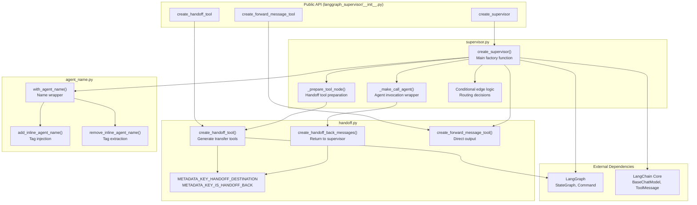
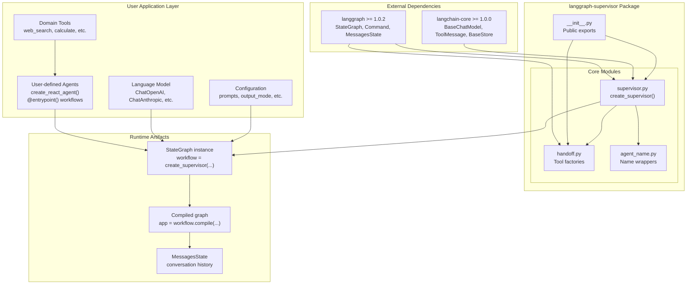

<!-- source: DeepWiki mcp.deepwiki.com · repo langchain-ai/langgraph-supervisor-py · page 1 Overview · fetched 2026-10-26 -->

# Overview

<details>
<summary>Relevant source files</summary>

The following files were used as context for generating this wiki page:

- [LICENSE](LICENSE)
- [README.md](README.md)
- [langgraph_supervisor/__init__.py](langgraph_supervisor/__init__.py)
- [pyproject.toml](pyproject.toml)

</details>


## Purpose and Scope

This document provides a high-level introduction to **langgraph-supervisor**, a Python library that implements hierarchical multi-agent systems using LangGraph. It covers the library's core purpose, architectural patterns, main components, and capabilities.

For installation instructions, see [Installation](#1.1). For a working example, see [Quick Start](#1.2). For detailed architecture explanations, see [Core Architecture](#2). For complete API documentation, see [API Reference](#3).

**Sources:** [README.md:1-3](), [pyproject.toml:5-8]()

---

## What is a Supervisor Multi-Agent System?

A **supervisor multi-agent system** is a hierarchical architecture where a central **supervisor agent** coordinates multiple **specialized worker agents**. The supervisor controls all communication flow and task delegation, making routing decisions about which agent should handle each task based on context and requirements.

This library implements the supervisor pattern using a **hub-and-spoke** topology where:
- The supervisor is the central hub that receives user input and makes delegation decisions
- Worker agents are specialized spokes that execute specific tasks
- Control flow passes from supervisor → worker → supervisor in a structured manner
- All agents communicate through a shared message state

**Key characteristics:**
- **Centralized control:** The supervisor maintains authority over task routing
- **Tool-based handoffs:** Agents transfer control using handoff tools (function calls)
- **Specialized agents:** Each worker agent has specific capabilities and tools
- **Hierarchical nesting:** Supervisors can manage other supervisors for multi-level hierarchies

**Sources:** [README.md:5-6]()

---

## Core Library Components

The library consists of three primary modules that work together to implement the supervisor pattern:

| Module | File Path | Primary Export | Purpose |
|--------|-----------|----------------|---------|
| **Supervisor** | `langgraph_supervisor/supervisor.py` | `create_supervisor()` | Factory function that constructs the supervisor workflow graph |
| **Handoff** | `langgraph_supervisor/handoff.py` | `create_handoff_tool()`, `create_forward_message_tool()` | Tools for transferring control between agents |
| **Agent Name** | `langgraph_supervisor/agent_name.py` | `with_agent_name()` | Utilities for embedding agent identities in messages |

The public API is exposed through [`langgraph_supervisor/__init__.py:1-7`](), which exports:
- `create_supervisor` - Main factory function
- `create_handoff_tool` - Handoff tool factory
- `create_forward_message_tool` - Message forwarding tool factory

**Sources:** [langgraph_supervisor/__init__.py:1-7](), [README.md:9-11]()

---

## Component Architecture

The following diagram shows how the core components relate to each other and map to code entities:



**Explanation:**
- **`create_supervisor()`** is the main entry point that assembles all components
- **`_prepare_tool_node()`** generates handoff tools for each agent
- **`_make_call_agent()`** wraps agent invocations with handoff-back logic
- **Handoff tools** use metadata keys to mark transfer destinations
- **Agent name utilities** optionally wrap models to tag messages
- **LangGraph** provides the graph execution engine (`StateGraph`)
- **LangChain Core** provides message types and model interfaces

**Sources:** [langgraph_supervisor/__init__.py:1-7](), [README.md:184-202]()

---

## Runtime Execution Flow

The following diagram illustrates how a compiled supervisor workflow processes user input at runtime:

```mermaid
sequenceDiagram
    participant User
    participant CompiledGraph["app = workflow.compile()"]
    participant SupervisorNode["Supervisor Node<br/>(create_react_agent)"]
    participant HandoffTool["transfer_to_worker_agent<br/>(handoff tool)"]
    participant WorkerAgent["Worker Agent Node<br/>(create_react_agent)"]
    participant HandoffBack["transfer_back_to_supervisor<br/>(built-in tool)"]
    participant MessagesState["MessagesState<br/>(conversation history)"]
    
    User->>CompiledGraph: app.invoke({"messages": [...]})
    CompiledGraph->>SupervisorNode: Route to supervisor
    SupervisorNode->>SupervisorNode: LLM decides delegation
    SupervisorNode->>HandoffTool: Call transfer_to_worker_agent
    HandoffTool->>MessagesState: Update with handoff metadata
    HandoffTool->>WorkerAgent: Command(goto=agent_name)
    WorkerAgent->>WorkerAgent: Execute task with tools
    WorkerAgent->>HandoffBack: Call transfer_back_to_supervisor
    HandoffBack->>MessagesState: Update with response
    HandoffBack->>SupervisorNode: Command(goto=supervisor)
    SupervisorNode->>SupervisorNode: Synthesize final answer
    SupervisorNode->>MessagesState: Add final message
    CompiledGraph->>User: Return final state
```

**Key runtime behaviors:**
1. **User input** enters through `app.invoke()` with a `messages` list
2. **Supervisor node** uses its LLM to make routing decisions
3. **Handoff tools** transfer control using `Command(goto=agent_name, graph=Command.PARENT)`
4. **Worker agents** process tasks and call `transfer_back_to_supervisor`
5. **Message state** accumulates all conversation history
6. **Final output** returns the complete state to the user

**Sources:** [README.md:36-100]()

---

## Key Capabilities

### Multi-Agent Orchestration

The library provides `create_supervisor()` to construct a workflow graph that coordinates multiple agents:

```python
workflow = create_supervisor(
    [agent1, agent2, agent3],  # List of worker agents
    model=model,                # LLM for supervisor decisions
    prompt="..."                # Supervisor system prompt
)
```

**Supported agent types:**
- **Graph API agents:** Created with `create_react_agent()`
- **Functional API agents:** Created with `@entrypoint()` and `@task` decorators
- **Compiled graphs:** Nested supervisors or custom workflows

**Sources:** [README.md:79-89](), [README.md:291-364]()

### Tool-Based Handoffs

Control transfer between agents uses **handoff tools** that agents can invoke:

| Tool Type | Function | Purpose |
|-----------|----------|---------|
| **Transfer to agent** | `create_handoff_tool()` | Transfer control from supervisor to worker agent |
| **Transfer back** | `create_handoff_back_messages()` | Return control from worker to supervisor |
| **Forward message** | `create_forward_message_tool()` | Bypass supervisor and output directly |

Handoff tools use **metadata annotations** to mark transfer destinations:
- `METADATA_KEY_HANDOFF_DESTINATION`: Target agent name
- `METADATA_KEY_IS_HANDOFF_BACK`: Flag for return transfers

**Sources:** [README.md:184-202](), [README.md:271-290]()

### Message History Management

The library supports two modes for managing conversation history:

| Mode | Configuration | Behavior |
|------|---------------|----------|
| **Full History** | `output_mode="full_history"` | Include all messages from worker agent execution |
| **Last Message** | `output_mode="last_message"` | Include only the final response from worker agent |

This controls what messages from worker agents are added to the overall conversation state.

**Sources:** [README.md:102-126]()

### Hierarchical Nesting

Supervisors can manage other supervisors to create **multi-level hierarchies**:

```python
# Level 1: Worker teams
research_team = create_supervisor([agent1, agent2], ...).compile()
writing_team = create_supervisor([agent3, agent4], ...).compile()

# Level 2: Top-level coordinator
top_supervisor = create_supervisor([research_team, writing_team], ...)
```

Each level maintains its own message state and routing logic.

**Sources:** [README.md:128-150]()

### Memory and Persistence

The library integrates with LangGraph's memory system:

- **Short-term memory:** `checkpointer` parameter for conversation persistence
- **Long-term memory:** `store` parameter for cross-thread data

These are passed to the `.compile()` method of the StateGraph:

```python
workflow = create_supervisor([...], model=model)
app = workflow.compile(
    checkpointer=InMemorySaver(),
    store=InMemoryStore()
)
```

**Sources:** [README.md:152-178]()

---

## Dependencies and Ecosystem

The library is built on top of the LangChain ecosystem:

### Core Dependencies

| Dependency | Version Constraint | Purpose |
|------------|-------------------|---------|
| **langgraph** | `>=1.0.2, <2.0.0` | Graph construction and execution engine |
| **langchain-core** | `>=1.0.0, <2.0.0` | Message types, model interfaces, tool protocols |

**Sources:** [pyproject.toml:16-18]()

### Python Version

- **Minimum:** Python 3.10
- **Tested:** Python 3.10 and 3.12 in CI

**Sources:** [pyproject.toml:15]()

### Dependency Resolution

The repository uses **uv** (version 0.5.25) for dependency management with a lock file (`uv.lock`) for reproducible builds. For details on the dependency management system, see [Dependency Management](#5.2).

**Sources:** [pyproject.toml:1-3]()

---

## Library Architecture Pattern

The following diagram shows the complete system architecture from dependencies to user applications:



**Architecture layers:**
1. **External Dependencies:** LangGraph and LangChain Core provide foundational abstractions
2. **Library Package:** Three focused modules implement supervisor pattern
3. **User Application:** User-defined agents, models, and configuration
4. **Runtime Artifacts:** StateGraph construction and execution

**Sources:** [pyproject.toml:16-18](), [README.md:36-100]()

---

## Design Philosophy

The library follows these design principles:

### Minimal API Surface

The library exports only three functions:
- [`create_supervisor()`]()
- [`create_handoff_tool()`]()
- [`create_forward_message_tool()`]()

This keeps the API simple while providing customization hooks for advanced use cases.

### Composability

Supervisors return `StateGraph` instances, not compiled graphs. This allows:
- Adding custom nodes and edges
- Composing supervisors into larger hierarchies
- Passing checkpointers and stores to `.compile()`

### LangGraph Native

The implementation uses LangGraph primitives directly:
- `Command` for graph navigation
- `MessagesState` for conversation history
- Conditional edges for routing logic

This ensures compatibility with LangGraph's features (streaming, persistence, human-in-the-loop).

**Sources:** [README.md:152-178]()

---

## Note on Recommended Pattern

The library maintainers recommend using the **supervisor pattern directly via tools** rather than this library for most use cases. The tool-calling approach provides more control over context engineering. This library remains maintained for:
- Users upgrading existing code to LangChain 1.0
- Use cases where the library's abstractions solve specific problems

For new projects, refer to the [LangChain multi-agent guide](https://docs.langchain.com/oss/python/langchain/multi-agent) and [supervisor tutorial](https://docs.langchain.com/oss/python/langchain/supervisor).

**Sources:** [README.md:3-3]()

---

## License

The library is released under the **MIT License**, which permits commercial and non-commercial use with minimal restrictions.

**Sources:** [LICENSE:1-1](), [pyproject.toml:12-13]()

---

## Next Steps

- **Installation:** See [Installation](#1.1) for setup instructions
- **Quick Start:** See [Quick Start](#1.2) for a minimal working example
- **Core Architecture:** See [Core Architecture](#2) for detailed component explanations
- **API Reference:** See [API Reference](#3) for complete function documentation
- **Advanced Usage:** See [Advanced Usage](#4) for complex patterns and customization

---

