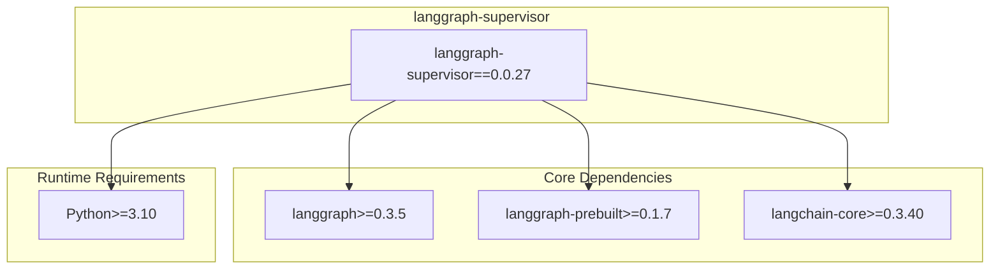
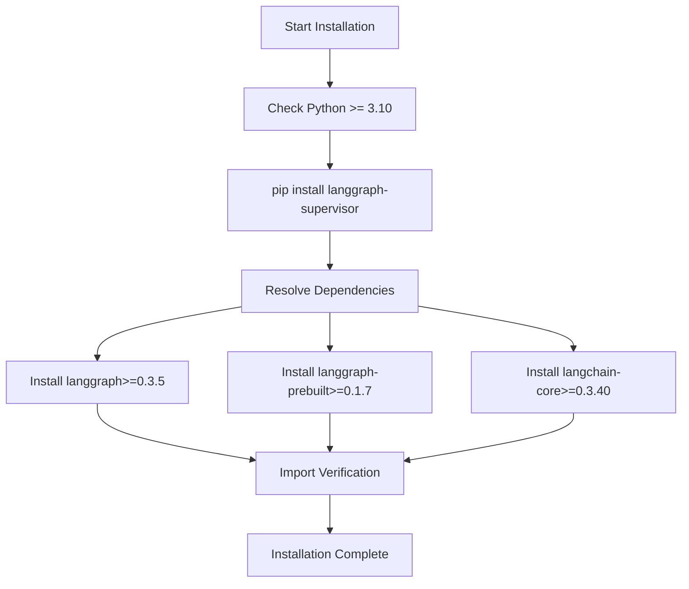

<!-- source: DeepWiki mcp.deepwiki.com · repo langchain-ai/langgraph-supervisor-py · page 1.1 Installation · fetched 2026-10-26 -->

# Installation

<details>
<summary>Relevant source files</summary>

The following files were used as context for generating this wiki page:

- [README.md](README.md)
- [pyproject.toml](pyproject.toml)
- [uv.lock](uv.lock)

</details>


This page provides comprehensive instructions for installing the `langgraph-supervisor` package and its dependencies. It covers system requirements, basic installation, dependency management, and verification steps needed to get started with the multi-agent supervisor framework.

For information about setting up a development environment, see [Development Environment](#5.4). For a quick start guide after installation, see [Quick Start](#1.2).

## System Requirements

The `langgraph-supervisor` package requires specific system dependencies and Python version constraints defined in the project configuration.

### Python Version

```
Python >= 3.10
```

This requirement is enforced in the package configuration and ensures compatibility with modern Python features used throughout the codebase.

Sources: [pyproject.toml:15]()

### Operating System

The package is platform-independent and supports:
- Linux (all major distributions)
- macOS (Intel and Apple Silicon)
- Windows 10/11

## Basic Installation

Install the package using pip from PyPI:

```bash
pip install langgraph-supervisor
```

This installs the latest stable version along with all required dependencies. The package is distributed as a wheel and source distribution through PyPI's trusted publishing system.

Sources: [README.md:15-17](), [pyproject.toml:6-7]()

## Dependencies Overview

The `langgraph-supervisor` package has a carefully managed dependency tree designed to provide multi-agent orchestration capabilities while maintaining version compatibility.

### Dependency Architecture



### Core Dependencies

| Package | Version Constraint | Purpose |
|---------|-------------------|---------|
| `langgraph` | `>=0.3.5` | State graph framework for multi-agent workflows |
| `langgraph-prebuilt` | `>=0.1.7` | Pre-built agent components and utilities |
| `langchain-core` | `>=0.3.40` | Core LangChain abstractions for LLM tools and messages |

### Development Dependencies

Additional packages required for development and testing:

| Package | Version Constraint | Purpose |
|---------|-------------------|---------|
| `pytest` | `>=8.0.0` | Testing framework |
| `ruff` | `>=0.9.4` | Code linting and formatting |
| `mypy` | `>=1.8.0` | Static type checking |
| `pytest-socket` | `>=0.7.0` | Network access control in tests |

Sources: [pyproject.toml:16-29]()

## Installation Verification

After installation, verify that the package is correctly installed and accessible:

### Import Test

```python
# Test core package imports
from langgraph_supervisor import create_supervisor
from langgraph_supervisor.handoff import create_handoff_tool, create_forward_message_tool
from langgraph_supervisor.agent_name import with_agent_name

print("langgraph-supervisor successfully installed!")
```

### Version Check

```python
import langgraph_supervisor
# Note: Version checking may require examining package metadata
# as the package may not expose __version__ directly
```

### Dependencies Check

```python
# Verify core dependencies are available
import langgraph
import langchain_core
from langgraph.prebuilt import create_react_agent

print("All dependencies successfully loaded!")
```

## Development Installation

For development work on the `langgraph-supervisor` codebase itself, install with development dependencies:

### Using uv (Recommended)

```bash
git clone https://github.com/langchain-ai/langgraph-supervisor-py
cd langgraph-supervisor-py
uv sync
```

### Using pip with Development Dependencies

```bash
git clone https://github.com/langchain-ai/langgraph-supervisor-py
cd langgraph-supervisor-py
pip install -e ".[test]"
```

This installs the package in editable mode with all development tools including `pytest`, `ruff`, and `mypy`.

Sources: [pyproject.toml:22-29]()

## Installation Process Flow



## Common Installation Scenarios

### With Language Model Providers

Most users will need language model providers for the supervisor and agent functionality:

```bash
# For OpenAI models
pip install langgraph-supervisor langchain-openai

# For Anthropic models  
pip install langgraph-supervisor langchain-anthropic

# For local models via Ollama
pip install langgraph-supervisor langchain-ollama
```

### With Memory and Persistence

For applications requiring persistent state and memory:

```bash
pip install langgraph-supervisor langgraph[sqlite]
```

### Container Installation

For Docker-based deployments:

```dockerfile
FROM python:3.11-slim

RUN pip install langgraph-supervisor

# Add your application code
COPY . /app
WORKDIR /app
```

## Troubleshooting

### Common Issues

| Issue | Solution |
|-------|----------|
| `ImportError: No module named 'langgraph'` | Ensure all dependencies installed correctly with `pip install --upgrade langgraph-supervisor` |
| Python version compatibility errors | Verify Python >= 3.10 with `python --version` |
| Dependency conflicts | Use virtual environment: `python -m venv venv && source venv/bin/activate` |

### Dependency Lock File

The repository includes a `uv.lock` file that provides exact version resolution for reproducible installations in development environments.

Sources: [pyproject.toml:1-63](), [README.md:13-32]()

---

