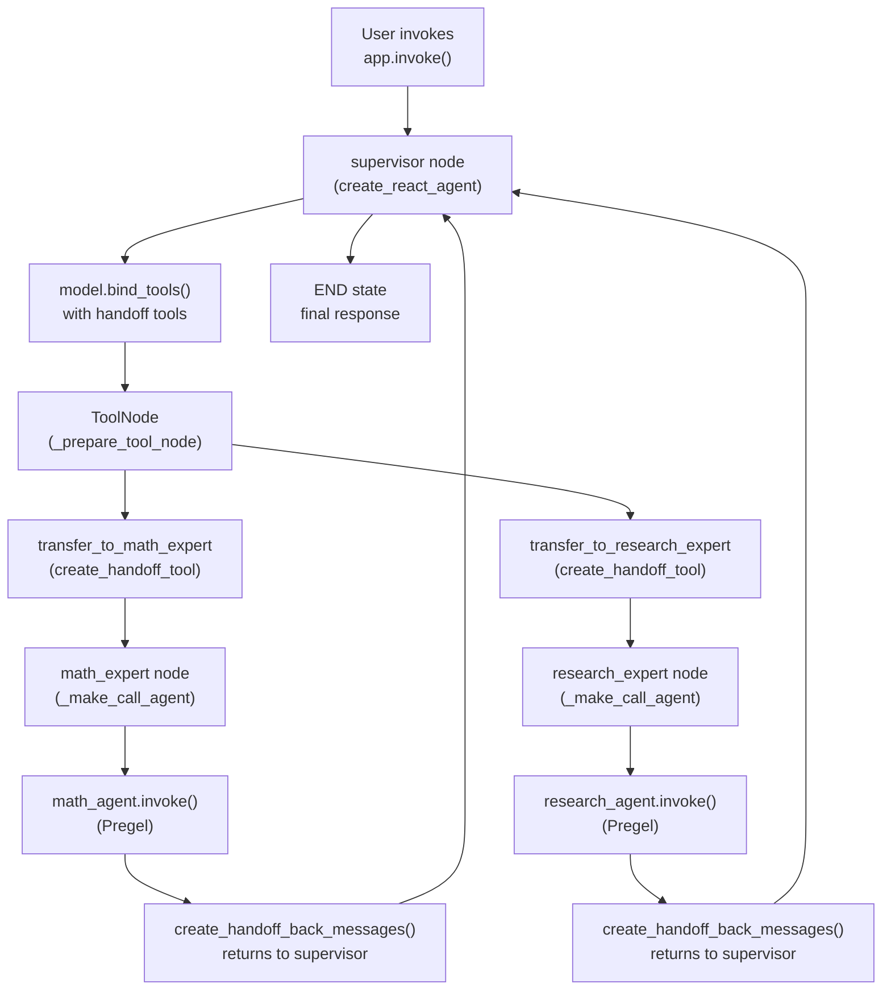
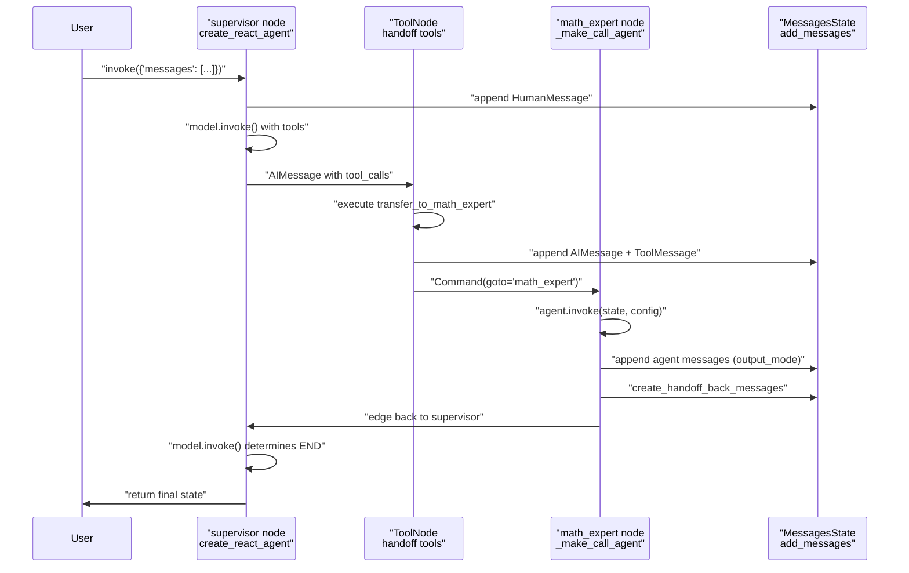

<!-- source: DeepWiki mcp.deepwiki.com · repo langchain-ai/langgraph-supervisor-py · page 1.2 Quick Start · fetched 2026-10-26 -->

# Quick Start

<details>
<summary>Relevant source files</summary>

The following files were used as context for generating this wiki page:

- [README.md](README.md)
- [langgraph_supervisor/handoff.py](langgraph_supervisor/handoff.py)
- [langgraph_supervisor/supervisor.py](langgraph_supervisor/supervisor.py)

</details>


This guide provides a minimal working example demonstrating how to create a basic multi-agent supervisor system. The supervisor orchestrates specialized agents, routing tasks and managing conversation flow.

## Complete Minimal Example

Here is a complete working example that creates a supervisor managing two specialized agents:

```python
from langchain_openai import ChatOpenAI
from langgraph_supervisor import create_supervisor
from langgraph.prebuilt import create_react_agent

# Define tools
def add(a: float, b: float) -> float:
    """Add two numbers."""
    return a + b

def web_search(query: str) -> str:
    """Search the web for information."""
    return "Search results..."

# Create specialized agents
model = ChatOpenAI(model="gpt-4o")

math_agent = create_react_agent(
    model=model,
    tools=[add],
    name="math_expert",
)

research_agent = create_react_agent(
    model=model,
    tools=[web_search],
    name="research_expert",
)

# Create supervisor
workflow = create_supervisor(
    [research_agent, math_agent],
    model=model,
)

# Compile and run
app = workflow.compile()
result = app.invoke({
    "messages": [{"role": "user", "content": "What is 2 + 2?"}]
})
```

Sources: [README.md:36-99]()

## Architecture Overview

The `create_supervisor` function from [langgraph_supervisor/supervisor.py:211-469]() creates a `StateGraph` containing:

- **Supervisor node**: A `create_react_agent` instance with handoff tools
- **Agent nodes**: Worker agents wrapped by `_make_call_agent` function
- **Handoff tools**: Generated by `create_handoff_tool` for each agent
- **State**: Managed via `MessagesState` with `add_messages` reducer



**Code Entity Flow in create_supervisor**

Sources: [langgraph_supervisor/supervisor.py:211-469](), [langgraph_supervisor/handoff.py:55-129](), [langgraph_supervisor/handoff.py:132-152]()

## Basic Setup

### 1. Installation and Imports

Install the required packages and set up your API key:

```bash
pip install langgraph-supervisor langchain-openai
export OPENAI_API_KEY=<your_api_key>
```

Import the core components:

```python
from langchain_openai import ChatOpenAI
from langgraph_supervisor import create_supervisor
from langgraph.prebuilt import create_react_agent
```

Sources: [README.md:28-38]()

### 2. Define Tools

Define domain-specific functions that agents will use:

```python
def add(a: float, b: float) -> float:
    """Add two numbers."""
    return a + b

def web_search(query: str) -> str:
    """Search the web for information."""
    return "Search results..."
```

Sources: [README.md:46-63]()

### 3. Create Agents

Use `create_react_agent` from LangGraph to create worker agents. Each agent requires:
- `model`: A LangChain chat model
- `tools`: List of tool functions
- `name`: Unique identifier (required by supervisor)

```python
math_agent = create_react_agent(
    model=model,
    tools=[add],
    name="math_expert",
)

research_agent = create_react_agent(
    model=model,
    tools=[web_search],
    name="research_expert",
)
```

Sources: [README.md:65-77](), [langgraph_supervisor/supervisor.py:409-422]()

### 4. Create Supervisor

Call `create_supervisor` with the list of agents and a model. The function returns a `StateGraph`:

```python
workflow = create_supervisor(
    [research_agent, math_agent],
    model=model,
)
```

The function automatically:
- Creates handoff tools for each agent via `_prepare_tool_node` [langgraph_supervisor/supervisor.py:146-202]()
- Binds tools to the supervisor model [langgraph_supervisor/supervisor.py:432-438]()
- Creates supervisor agent via `create_react_agent` [langgraph_supervisor/supervisor.py:443-452]()
- Builds graph with edges from START → supervisor → agents → supervisor → END [langgraph_supervisor/supervisor.py:454-467]()

Sources: [langgraph_supervisor/supervisor.py:211-469]()

### 5. Compile and Invoke

Compile the `StateGraph` into a `CompiledStateGraph` and invoke with messages:

```python
app = workflow.compile()
result = app.invoke({
    "messages": [{"role": "user", "content": "What is 2 + 2?"}]
})
```

The `result` dictionary contains a `messages` key with the full conversation history.

Sources: [README.md:91-99]()

## Execution Flow

The compiled application executes through the following sequence:



**Runtime Execution Sequence**

The key handoff mechanism uses `Command` objects from [langgraph_supervisor/handoff.py:92-126](). The `create_handoff_tool` function returns a tool that, when called, emits a `Command(goto=agent_name, graph=Command.PARENT)` to transfer control.

Sources: [langgraph_supervisor/supervisor.py:66-127](), [langgraph_supervisor/handoff.py:55-129]()

## Key Components

| Component | Source | Purpose |
|-----------|--------|---------|
| `create_supervisor` | [langgraph_supervisor/supervisor.py:211-469]() | Factory function that creates `StateGraph` with supervisor and agent nodes |
| `create_handoff_tool` | [langgraph_supervisor/handoff.py:55-129]() | Generates `transfer_to_*` tools that emit `Command(goto=agent_name)` |
| `create_handoff_back_messages` | [langgraph_supervisor/handoff.py:132-152]() | Creates (AIMessage, ToolMessage) pair for returning to supervisor |
| `_prepare_tool_node` | [langgraph_supervisor/supervisor.py:146-202]() | Combines user tools with auto-generated handoff tools into `ToolNode` |
| `_make_call_agent` | [langgraph_supervisor/supervisor.py:66-127]() | Wraps agent invocation with output mode handling and handoff messages |
| `MessagesState` | [langgraph_supervisor/supervisor.py:205-208]() | State schema with `messages` field using `add_messages` reducer |

Sources: [langgraph_supervisor/supervisor.py](), [langgraph_supervisor/handoff.py]()

## Output Modes

Control how agent messages appear in the final conversation history:

### Last Message Only (Default)
```python
workflow = create_supervisor(
    agents=[agent1, agent2],
    output_mode="last_message"  # Only final response from each agent
)
```

### Full History
```python
workflow = create_supervisor(
    agents=[agent1, agent2], 
    output_mode="full_history"  # All intermediate messages
)
```

Sources: [README.md:100-124](), [tests/test_supervisor.py:245-287]()

This basic setup creates a functional multi-agent system where the supervisor intelligently routes tasks to appropriate specialized agents based on the request content and returns coordinated responses.

---

