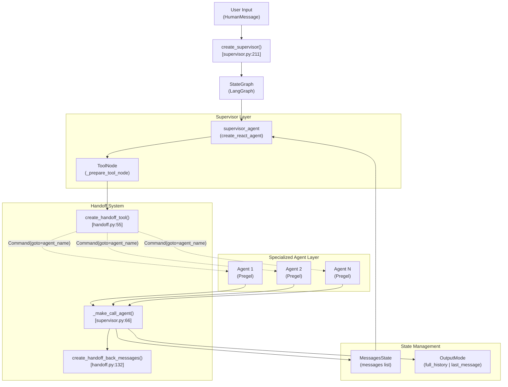
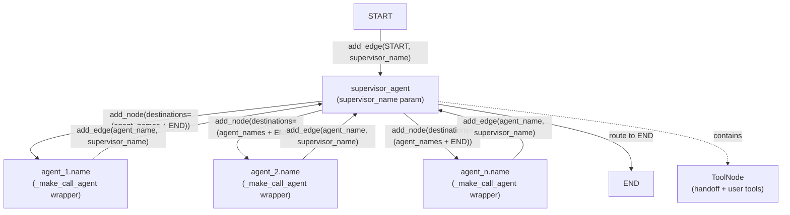
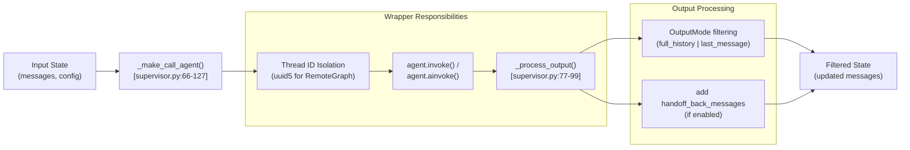
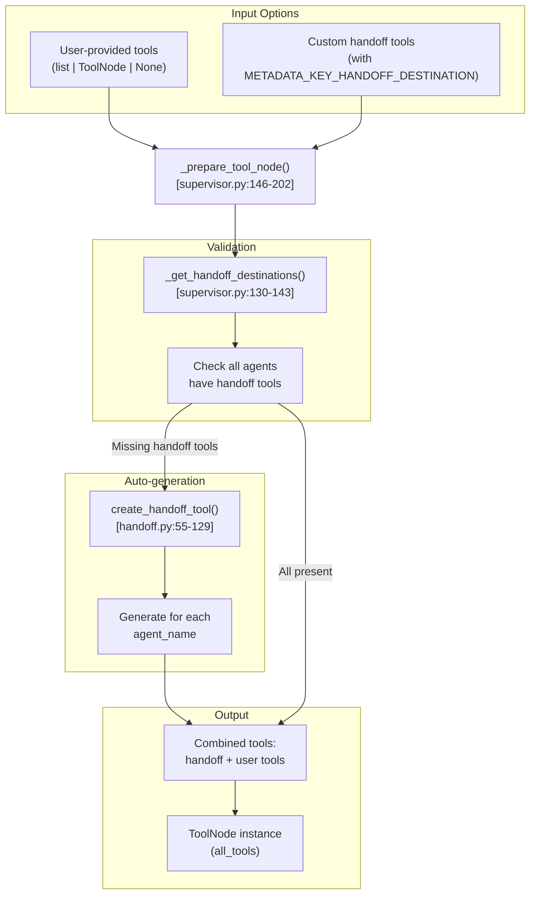
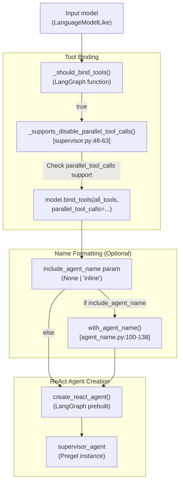

<!-- source: DeepWiki mcp.deepwiki.com · repo langchain-ai/langgraph-supervisor-py · page 2 Core Architecture · fetched 2026-10-26 -->

# Core Architecture

<details>
<summary>Relevant source files</summary>

The following files were used as context for generating this wiki page:

- [README.md](README.md)
- [langgraph_supervisor/agent_name.py](langgraph_supervisor/agent_name.py)
- [langgraph_supervisor/handoff.py](langgraph_supervisor/handoff.py)
- [langgraph_supervisor/supervisor.py](langgraph_supervisor/supervisor.py)

</details>


This page explains the fundamental design patterns, state management, and component interactions in the langgraph-supervisor package. The architecture implements a hierarchical multi-agent pattern where a central supervisor coordinates specialized sub-agents through tool-based handoffs.

## Related Pages

- **[Supervisor Component](#2.1)**: Deep dive into the supervisor's orchestration logic
- **[Handoff Mechanism](#2.2)**: How control transfers between agents
- **[Agent Name Formatting](#2.3)**: Message attribution and formatting
- **[Message History Management](#2.4)**: OutputMode and conversation state control
- **[API Reference](#3)**: Complete function signatures and parameters
- **[Advanced Usage](#4)**: Complex patterns and customization

## Architectural Pattern

The langgraph-supervisor package implements a **hub-and-spoke** multi-agent pattern where a central supervisor agent orchestrates specialized sub-agents. This pattern provides:

- **Centralized Control**: All agent coordination flows through the supervisor
- **Clear Separation of Concerns**: Each agent has a specific domain expertise
- **Flexible Delegation**: The supervisor can dynamically route to appropriate agents
- **Conversation Coherence**: Unified message history maintained across agent transitions

### Component Relationships



**Sources:** [langgraph_supervisor/supervisor.py:211-469](), [langgraph_supervisor/handoff.py:55-129](), [langgraph_supervisor/handoff.py:132-152]()

## Core Design Patterns

### StateGraph Execution Model

The supervisor uses LangGraph's `StateGraph` to define a cyclic workflow where the supervisor repeatedly evaluates the current state and delegates to agents as needed. The graph topology ensures all agent outputs flow back to the supervisor for coordination.

#### Graph Structure



The graph is constructed in [langgraph_supervisor/supervisor.py:454-468]():
- Line 455: `add_node(supervisor_agent, destinations=...)`
- Line 456: `add_edge(START, supervisor_agent.name)`
- Lines 457-467: Add agent nodes with edges back to supervisor

**Sources:** [langgraph_supervisor/supervisor.py:454-468]()

### Agent Isolation and State Filtering

Each specialized agent is wrapped by `_make_call_agent()` to provide execution isolation and output filtering. This wrapper ensures agents operate independently while maintaining conversation coherence.

#### Agent Wrapper Architecture



| Wrapper Function | Purpose | Implementation |
|-----------------|---------|----------------|
| **Thread Isolation** | Each agent gets deterministic sub-thread ID | `uuid5(parent_thread_id, agent.name)` for `RemoteGraph` [supervisor.py:102-108]() |
| **Output Filtering** | Controls message history verbosity | `OutputMode` parameter determines full history vs last message [supervisor.py:77-91]() |
| **Handoff Back Messages** | Signals agent completion to supervisor | Calls `create_handoff_back_messages()` if enabled [supervisor.py:93-94]() |

**Sources:** [langgraph_supervisor/supervisor.py:66-127](), [langgraph_supervisor/supervisor.py:77-99]()

### Tool-Based Handoff Pattern

Agent handoffs are implemented as LangChain tools that the supervisor can invoke. When called, these tools use LangGraph's `Command` primitive to transfer control to the target agent.

#### Handoff Tool Preparation



The tool preparation logic in `_prepare_tool_node()` [supervisor.py:146-202]():
1. **Lines 154-162**: Extract tools from input (supports `ToolNode` or list)
2. **Lines 164-170**: Validate custom handoff tools cover all agents
3. **Lines 175-186**: Auto-generate missing handoff tools with configurable prefix
4. **Lines 189-200**: Combine into final `ToolNode`

**Sources:** [langgraph_supervisor/supervisor.py:146-202](), [langgraph_supervisor/supervisor.py:130-143](), [langgraph_supervisor/handoff.py:55-129]()

## State Management

### Message State Flow

The system maintains a shared `MessagesState` containing the conversation history. This state is passed between the supervisor and agents, with each component updating the message list.

#### Execution Sequence

```mermaid
sequenceDiagram
    participant User
    participant StateGraph
    participant SupervisorAgent["supervisor_agent<br/>(create_react_agent)"]
    participant ToolNode
    participant HandoffTool["create_handoff_tool<br/>(tool function)"]
    participant AgentWrapper["_make_call_agent<br/>(wrapper)"]
    participant SpecializedAgent["Specialized Agent<br/>(Pregel)"]
    participant MessagesState["MessagesState<br/>(messages list)"]
    
    User->>StateGraph: HumanMessage
    StateGraph->>MessagesState: Append to messages
    StateGraph->>SupervisorAgent: Invoke with state
    SupervisorAgent->>SupervisorAgent: LLM decides to delegate
    SupervisorAgent->>ToolNode: Call handoff tool
    ToolNode->>HandoffTool: Execute tool function
    
    Note over HandoffTool: Adds ToolMessage<br/>with handoff metadata
    
    HandoffTool->>StateGraph: Command(goto=agent_name,<br/>update=messages)
    StateGraph->>AgentWrapper: Route to agent
    AgentWrapper->>SpecializedAgent: Invoke with filtered state
    SpecializedAgent->>SpecializedAgent: Process with domain tools
    SpecializedAgent->>AgentWrapper: Return agent output
    
    Note over AgentWrapper: Apply OutputMode filtering<br/>Add handoff_back_messages
    
    AgentWrapper->>MessagesState: Update with filtered messages
    StateGraph->>SupervisorAgent: Return control
    SupervisorAgent->>SupervisorAgent: Process agent response
    SupervisorAgent->>User: Final answer or next delegation
```

**Key State Transitions:**
- **Handoff Tool Call**: Adds `(AIMessage, ToolMessage)` pair to indicate delegation [handoff.py:88-126]()
- **Agent Execution**: Messages filtered by `OutputMode` before adding to state [supervisor.py:77-99]()
- **Handoff Back**: Optional `(AIMessage, ToolMessage)` pair signals completion [supervisor.py:93-94](), [handoff.py:132-152]()

**Sources:** [langgraph_supervisor/supervisor.py:66-127](), [langgraph_supervisor/handoff.py:88-126](), [langgraph_supervisor/handoff.py:132-152]()

### State Schema

The workflow uses `_OuterState` which contains an annotated messages list:

```python
class _OuterState(TypedDict):
    messages: Annotated[Sequence[AnyMessage], add_messages]
```

The `add_messages` reducer merges new messages into the existing list. Custom schemas can be provided via the `state_schema` parameter.

**Sources:** [langgraph_supervisor/supervisor.py:205-208](), [langgraph_supervisor/supervisor.py:404-407]()

## Model Configuration

### Supervisor LLM Preparation

The supervisor's language model is configured with tools and optional name formatting before being wrapped in a `create_react_agent`:

#### Model Preparation Pipeline



**Tool Binding Logic** [supervisor.py:432-442]():
- Uses LangGraph's `_should_bind_tools()` to determine if model supports tool binding
- Checks if model supports disabling parallel tool calls with `_supports_disable_parallel_tool_calls()` [supervisor.py:48-63]()
- Excludes certain models from parallel tool call configuration (e.g., o3-mini, o3, o4-mini) [supervisor.py:45]()

**Agent Name Formatting** [supervisor.py:440-441]():
- Optional `include_agent_name` parameter adds agent attribution to messages
- Currently supports `"inline"` mode which wraps content with XML tags
- See [Agent Name Formatting](#2.3) for details

**Sources:** [langgraph_supervisor/supervisor.py:432-452](), [langgraph_supervisor/supervisor.py:48-63](), [langgraph_supervisor/supervisor.py:45](), [langgraph_supervisor/agent_name.py:100-138]()

## Integration Points

### LangGraph Framework Dependencies

The supervisor integrates with several LangGraph components:

| Component | Purpose | Import Source |
|-----------|---------|---------------|
| `StateGraph` | Workflow orchestration | `langgraph.graph` |
| `create_react_agent` | Agent creation | `langgraph.prebuilt.chat_agent_executor` |
| `ToolNode` | Tool execution | `langgraph.prebuilt` |
| `AgentState` / `AgentStateWithStructuredResponse` | State schemas | `langgraph.prebuilt.chat_agent_executor` |
| `Pregel` | Agent interface | `langgraph.pregel` |

**Sources:** [langgraph_supervisor/supervisor.py:8-22]()

### Configuration and Extensibility

The `create_supervisor()` function provides extensive configuration options for customizing behavior:

- **State Management**: Custom `state_schema` and `config_schema` support
- **Model Hooks**: `pre_model_hook` and `post_model_hook` for custom processing
- **Tool Configuration**: Custom handoff tools and prefixes
- **Response Formatting**: Structured output via `response_format`
- **Agent Naming**: Configurable agent name inclusion modes

**Sources:** [langgraph_supervisor/supervisor.py:195-361]()

---

