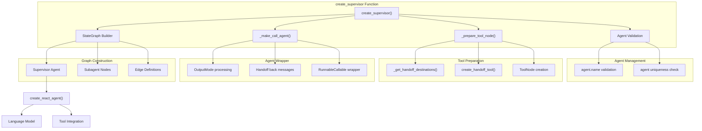
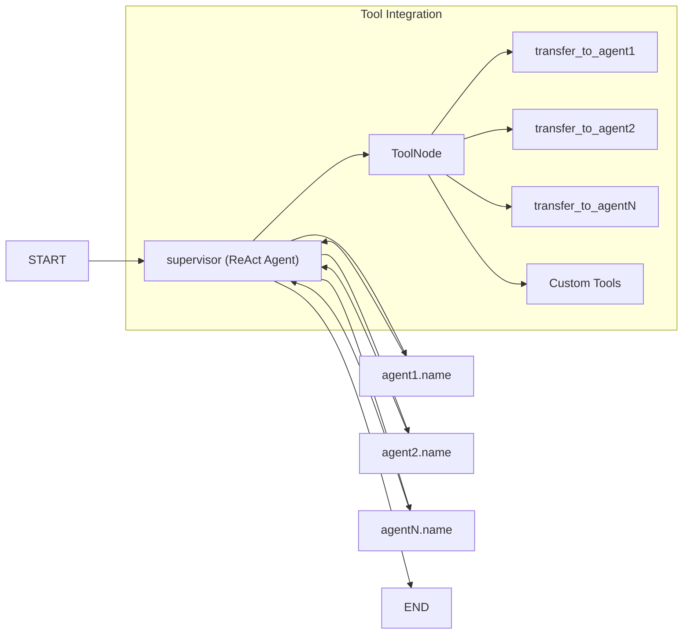
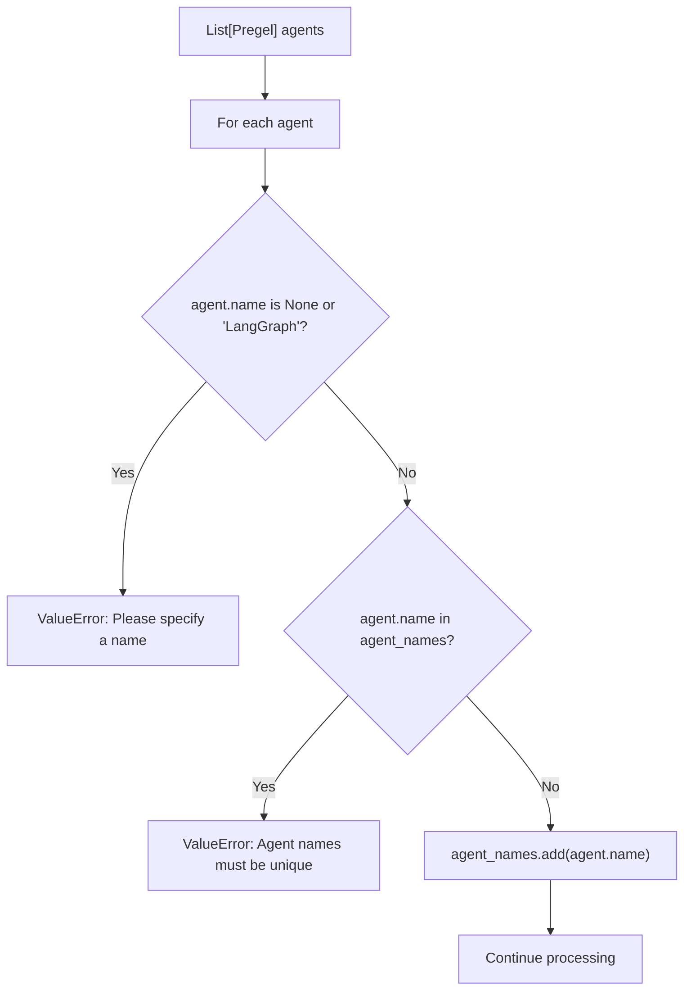
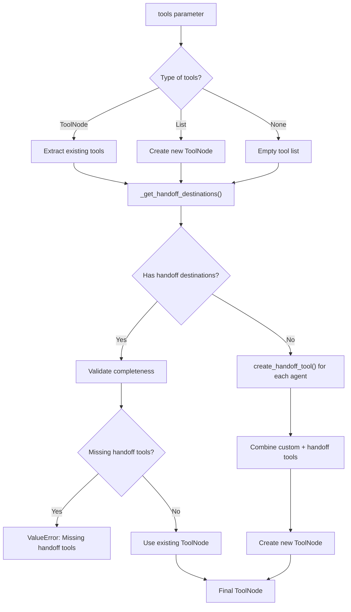
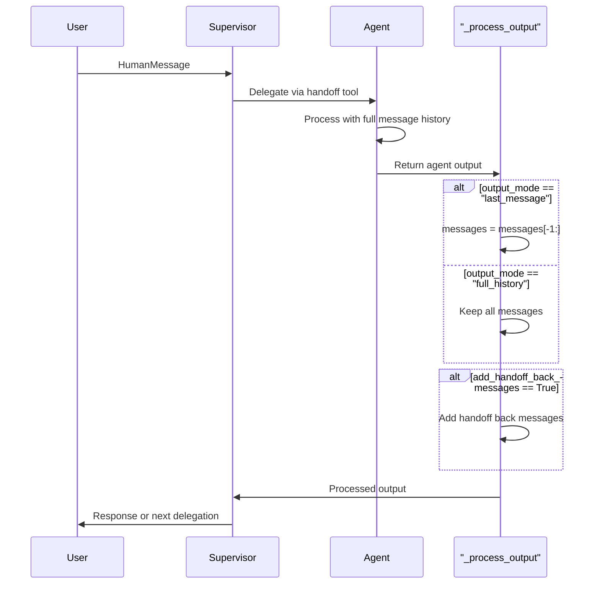
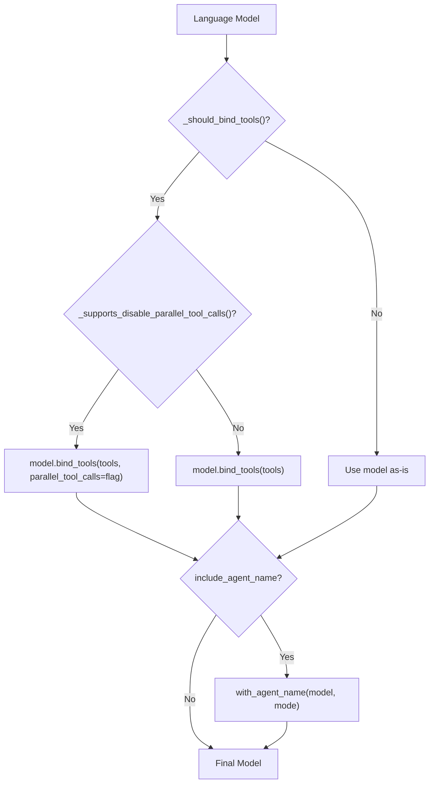

<!-- source: DeepWiki mcp.deepwiki.com · repo langchain-ai/langgraph-supervisor-py · page 2.1 Supervisor Component · fetched 2026-10-26 -->

# Supervisor Component

<details>
<summary>Relevant source files</summary>

The following files were used as context for generating this wiki page:

- [langgraph_supervisor/supervisor.py](langgraph_supervisor/supervisor.py)
- [tests/test_supervisor.py](tests/test_supervisor.py)

</details>


The supervisor component is the central orchestrator in the langgraph-supervisor framework, responsible for coordinating multiple specialized agents in a hierarchical multi-agent system. This component manages task delegation, agent handoffs, message routing, and maintains conversation state across the entire workflow.

For information about handoff mechanisms between agents, see [Handoff Mechanism](#2.2). For details on agent name management, see [Agent Name Formatting](#2.3).

## Core Architecture

The supervisor component is implemented primarily through the `create_supervisor` function, which constructs a LangGraph StateGraph that orchestrates multiple specialized agents. The supervisor acts as a central hub that receives user requests, decides which agent should handle each task, and coordinates the flow of information between agents.

### Supervisor System Structure



Sources: [langgraph_supervisor/supervisor.py:195-431]()

### StateGraph Architecture

The supervisor creates a StateGraph where the supervisor agent is the central node that can route to any of the managed agents. Each agent returns control to the supervisor after completing its task.



Sources: [langgraph_supervisor/supervisor.py:415-430]()

## Agent Management and Validation

The supervisor performs several validation steps when managing agents to ensure proper configuration and prevent conflicts.

### Agent Name Validation

The supervisor requires each agent to have a unique, non-null name for proper identification and routing:



Sources: [langgraph_supervisor/supervisor.py:370-383]()

### Agent Wrapper Creation

Each agent is wrapped with the `_make_call_agent` function to handle output processing and handoff management:

| Component | Purpose | Configuration |
|-----------|---------|---------------|
| `output_mode` | Controls message history inclusion | `"full_history"` or `"last_message"` |
| `add_handoff_back_messages` | Adds return-to-supervisor messages | Boolean flag |
| `thread_id` handling | Manages separate conversation threads | UUID-based thread isolation |

Sources: [langgraph_supervisor/supervisor.py:59-118]()

## Tool Integration and Handoff System

The supervisor integrates tools through the `_prepare_tool_node` function, which combines custom tools with automatically generated handoff tools.

### Tool Node Preparation Flow



Sources: [langgraph_supervisor/supervisor.py:136-193]()

## Message Flow and State Management

The supervisor manages message flow between agents using different output modes and state processing strategies.

### Output Mode Processing

The `OutputMode` type literal defines how agent outputs are integrated into the message history:



Sources: [langgraph_supervisor/supervisor.py:70-89](), [langgraph_supervisor/supervisor.py:32-37]()

### Thread Isolation

For RemoteGraph agents, the supervisor implements thread isolation using UUID5 generation to prevent conversation mixing:

```python
# Thread ID generation for RemoteGraph isolation
thread_id = str(uuid5(UUID(str(thread_id)), agent.name)) if thread_id else None
```

Sources: [langgraph_supervisor/supervisor.py:97](), [langgraph_supervisor/supervisor.py:110]()

## Configuration Options

The `create_supervisor` function accepts numerous configuration parameters that control behavior across different aspects of the system:

### Core Configuration Parameters

| Parameter | Type | Purpose |
|-----------|------|---------|
| `agents` | `list[Pregel]` | List of specialized agents to manage |
| `model` | `LanguageModelLike` | Language model for supervisor reasoning |
| `tools` | `list[BaseTool] \| ToolNode \| None` | Additional tools for supervisor |
| `parallel_tool_calls` | `bool` | Enable parallel agent handoffs |
| `output_mode` | `OutputMode` | Message history inclusion strategy |
| `supervisor_name` | `str` | Name identifier for supervisor node |

### Advanced Configuration

| Parameter | Type | Purpose |
|-----------|------|---------|
| `pre_model_hook` | `RunnableLike` | Message processing before LLM |
| `post_model_hook` | `RunnableLike` | Post-processing after LLM |
| `handoff_tool_prefix` | `str` | Prefix for generated handoff tools |
| `include_agent_name` | `AgentNameMode` | Agent name embedding strategy |
| `state_schema` | `StateSchemaType` | Custom state schema |
| `response_format` | `StructuredResponseSchema` | Structured output format |

Sources: [langgraph_supervisor/supervisor.py:195-214]()

### Model Integration Features

The supervisor includes intelligent model integration that adapts to different LLM capabilities:



Sources: [langgraph_supervisor/supervisor.py:393-402](), [langgraph_supervisor/supervisor.py:43-56]()

## Integration with LangGraph Framework 

The supervisor leverages several LangGraph components to provide a complete multi-agent orchestration system:

### Framework Dependencies

| Component | Source | Purpose |
|-----------|--------|---------|
| `StateGraph` | `langgraph.graph` | Workflow orchestration |
| `create_react_agent` | `langgraph.prebuilt.chat_agent_executor` | Supervisor agent creation |
| `ToolNode` | `langgraph.prebuilt` | Tool execution management |
| `AgentState` | `langgraph.prebuilt.chat_agent_executor` | Default state schema |
| `Pregel` | `langgraph.pregel` | Base agent interface |

Sources: [langgraph_supervisor/supervisor.py:8-22](), [langgraph_supervisor/supervisor.py:404-413]()

The supervisor component serves as the foundational orchestrator that transforms a collection of specialized agents into a coordinated multi-agent system capable of handling complex, multi-step tasks through intelligent delegation and state management.

---

