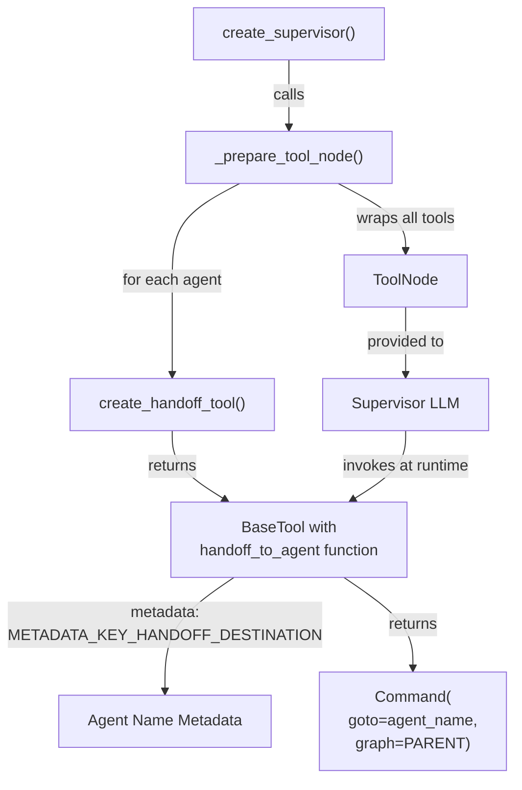
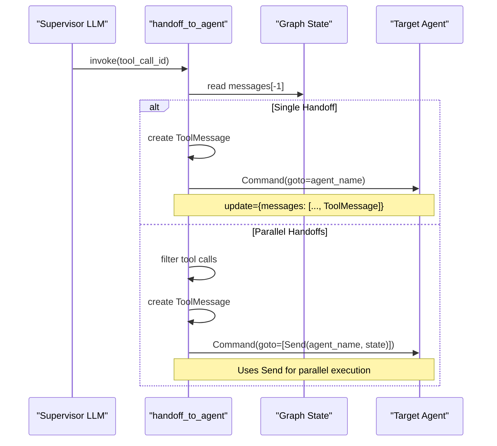
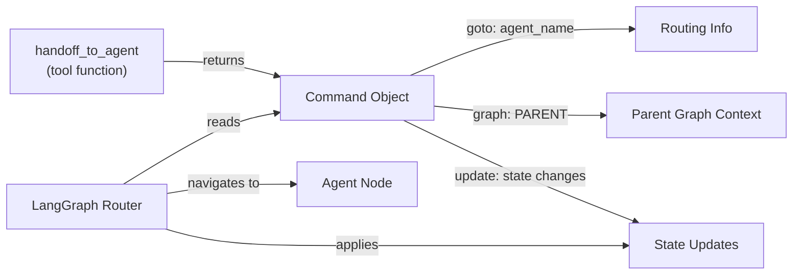
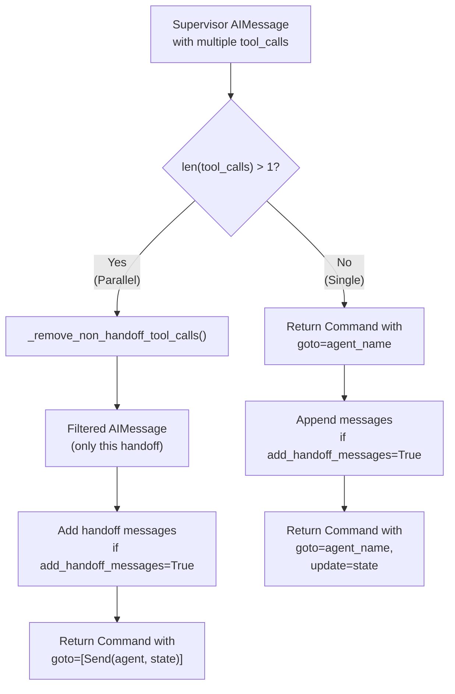
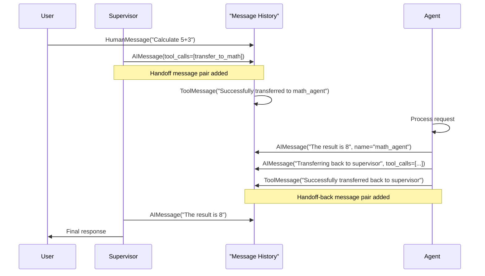
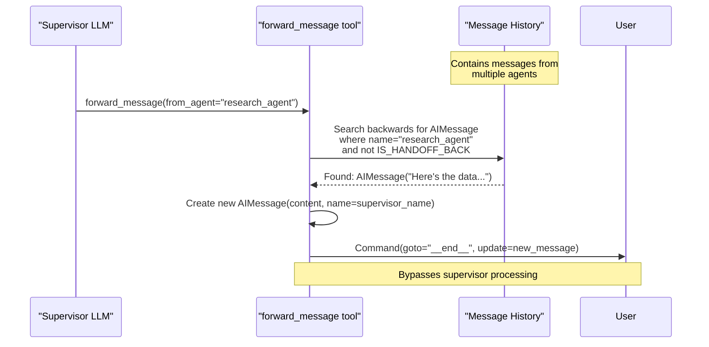
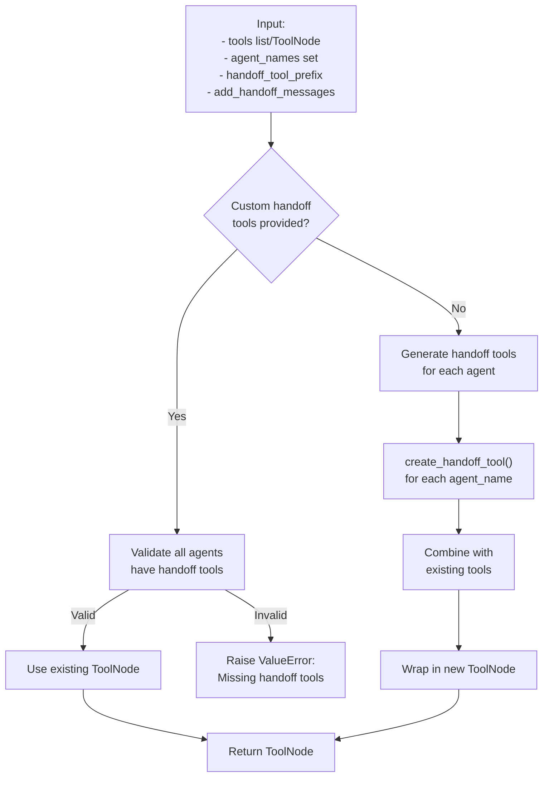

<!-- source: DeepWiki mcp.deepwiki.com · repo langchain-ai/langgraph-supervisor-py · page 2.2 Handoff Mechanism · fetched 2026-10-26 -->

# Handoff Mechanism

<details>
<summary>Relevant source files</summary>

The following files were used as context for generating this wiki page:

- [langgraph_supervisor/handoff.py](langgraph_supervisor/handoff.py)
- [langgraph_supervisor/supervisor.py](langgraph_supervisor/supervisor.py)
- [tests/test_supervisor.py](tests/test_supervisor.py)

</details>


## Purpose and Scope

This document explains the handoff mechanism that enables control transfer between the supervisor and managed agents in the langgraph-supervisor system. A handoff occurs when the supervisor delegates work to a specialized agent, or when an agent returns control back to the supervisor. This page covers the core handoff tools, control flow mechanics, message history management, and integration patterns.

For information about how the supervisor orchestrates these handoffs, see [Supervisor Component](#2.1). For details about agent name formatting in handoff messages, see [Agent Name Formatting](#2.3). For configuration of message history output modes, see [Message History Management](#2.4).

---

## Handoff Tool Architecture

The handoff mechanism is implemented through specialized tools that leverage LangGraph's `Command` API to route execution flow between nodes in the supervisor graph. Each managed agent gets a corresponding handoff tool that the supervisor's language model can invoke to delegate tasks.

### Handoff Tool Creation Flow



**Sources:** [langgraph_supervisor/supervisor.py:146-203](), [langgraph_supervisor/handoff.py:55-130]()

The `_prepare_tool_node` function generates handoff tools for all agents unless custom handoff tools are provided. Each handoff tool is named using the pattern `transfer_to_<agent_name>` (or a custom prefix), where the agent name is normalized by converting whitespace to underscores and lowercasing.

---

## Core Handoff Functions

### create_handoff_tool

The `create_handoff_tool` function creates a tool that transfers control to a specified agent. When invoked by the supervisor's LLM, it returns a `Command` object that instructs LangGraph to route execution to the target agent node.

**Function Signature:**
```python
create_handoff_tool(
    agent_name: str,
    name: str | None = None,
    description: str | None = None,
    add_handoff_messages: bool = True
) -> BaseTool
```

**Key Parameters:**
- `agent_name`: Target agent node name in the graph
- `name`: Optional tool name (defaults to `transfer_to_<agent_name>`)
- `description`: Optional tool description (defaults to `Ask agent '<agent_name>' for help`)
- `add_handoff_messages`: Whether to add AIMessage/ToolMessage pairs to message history

**Implementation Details:**



**Sources:** [langgraph_supervisor/handoff.py:55-130]()

The handoff tool implementation handles two scenarios:

1. **Single Handoff** [langgraph_supervisor/handoff.py:117-126](): When the supervisor calls only one handoff tool, the function returns a `Command` with `goto=agent_name` and updates the state with the handoff messages.

2. **Parallel Handoffs** [langgraph_supervisor/handoff.py:100-115](): When multiple handoff tools are called simultaneously, the function uses `Send` commands to enable parallel agent execution. It also filters out non-relevant tool calls from the last AI message to ensure valid message history.

The tool attaches metadata `{METADATA_KEY_HANDOFF_DESTINATION: agent_name}` to enable identification of handoff tools [langgraph_supervisor/handoff.py:128]().

### create_handoff_back_messages

The `create_handoff_back_messages` function generates a pair of messages that indicate an agent is returning control to the supervisor. These messages are automatically appended by the `_make_call_agent` wrapper when `add_handoff_back_messages=True`.

**Function Signature:**
```python
create_handoff_back_messages(
    agent_name: str,
    supervisor_name: str
) -> tuple[AIMessage, ToolMessage]
```

**Generated Message Structure:**

| Message Type | Field | Value |
|--------------|-------|-------|
| AIMessage | `content` | `"Transferring back to {supervisor_name}"` |
| | `tool_calls` | `[ToolCall(name="transfer_back_to_{supervisor_name}", ...)]` |
| | `name` | `agent_name` |
| | `response_metadata` | `{METADATA_KEY_IS_HANDOFF_BACK: True}` |
| ToolMessage | `content` | `"Successfully transferred back to {supervisor_name}"` |
| | `name` | `transfer_back_to_{supervisor_name}` |
| | `tool_call_id` | Generated UUID |
| | `response_metadata` | `{METADATA_KEY_IS_HANDOFF_BACK: True}` |

**Sources:** [langgraph_supervisor/handoff.py:132-152]()

These messages serve as markers in the conversation history that clearly indicate control flow transitions. The `METADATA_KEY_IS_HANDOFF_BACK` metadata flag allows other components (like `create_forward_message_tool`) to distinguish handoff-back messages from actual agent responses.

---

## Control Flow and Command Routing

### Command Pattern Usage

Handoff tools use LangGraph's `Command` API to control graph execution. The `Command` object specifies routing instructions and state updates:



**Sources:** [langgraph_supervisor/handoff.py:92-126]()

The `graph=Command.PARENT` parameter [langgraph_supervisor/handoff.py:111, 124]() ensures that routing occurs at the parent graph level, allowing the handoff tool (which runs inside the supervisor's tool node) to transfer control to sibling agent nodes.

### Parallel Handoff Handling

When the supervisor LLM calls multiple handoff tools simultaneously, the handoff mechanism must handle parallel execution correctly:



**Sources:** [langgraph_supervisor/handoff.py:101-126]()

The `_remove_non_handoff_tool_calls` helper function [langgraph_supervisor/handoff.py:26-52]() filters the last AI message to only include the specific tool call relevant to this handoff. This ensures each agent receives a clean message history without tool calls intended for other agents.

For parallel handoffs, the function uses `Send` commands [langgraph_supervisor/handoff.py:114]() to enable LangGraph's parallel execution support. The ToolNode in langgraph.prebuilt knows how to combine multiple Send commands into a single routing instruction.

---

## Message History Management

### Handoff Message Pairs

When `add_handoff_messages=True` (the default), each handoff adds a pair of messages to the conversation history:

1. **AIMessage**: The supervisor's tool call to transfer control
2. **ToolMessage**: Confirmation that the transfer was successful

**Example Message Flow:**



**Sources:** [langgraph_supervisor/handoff.py:89-126](), [langgraph_supervisor/supervisor.py:93-99]()

### Disabling Handoff Messages

Setting `add_handoff_messages=False` omits the handoff message pairs from history. This can be useful for cleaner message logs or when handoff details are not relevant to downstream processing:

```python
workflow = create_supervisor(
    agents=[agent1, agent2],
    model=model,
    add_handoff_messages=False,  # No handoff pairs in history
)
```

When disabled:
- The supervisor's handoff AIMessage and ToolMessage are excluded [langgraph_supervisor/handoff.py:121]()
- Only the initial HumanMessage and agent responses appear in history
- The test at [tests/test_supervisor.py:333-426]() demonstrates this behavior

**Sources:** [langgraph_supervisor/supervisor.py:226, 402](), [langgraph_supervisor/handoff.py:103-121]()

### Metadata Keys

The handoff mechanism uses two metadata keys to track control flow:

| Metadata Key | Purpose | Applied To |
|--------------|---------|------------|
| `METADATA_KEY_HANDOFF_DESTINATION` | Identifies the target agent for a handoff tool | `response_metadata` on ToolMessage [langgraph_supervisor/handoff.py:97]() |
| `METADATA_KEY_IS_HANDOFF_BACK` | Marks messages created when returning to supervisor | `response_metadata` on AIMessage and ToolMessage [langgraph_supervisor/handoff.py:144, 150]() |

**Sources:** [langgraph_supervisor/handoff.py:12-13]()

The `METADATA_KEY_IS_HANDOFF_BACK` flag is particularly important for the `create_forward_message_tool` function, which needs to skip handoff-back messages when searching for the latest agent response [langgraph_supervisor/handoff.py:185]().

---

## Message Forwarding Tool

### create_forward_message_tool

The `create_forward_message_tool` function creates a specialized tool that allows the supervisor to forward an agent's response directly to the user without modification. This is useful for preserving information fidelity and avoiding token costs when the agent's response doesn't need supervisor processing.

**Function Signature:**
```python
create_forward_message_tool(
    supervisor_name: str = "supervisor"
) -> BaseTool
```

**Forwarding Flow:**



**Sources:** [langgraph_supervisor/handoff.py:155-213]()

### Implementation Details

The tool implementation:

1. **Searches message history** [langgraph_supervisor/handoff.py:179-188](): Iterates backwards through messages to find the latest AIMessage from the specified agent, skipping messages with `METADATA_KEY_IS_HANDOFF_BACK` metadata.

2. **Validates agent name** [langgraph_supervisor/handoff.py:189-195](): Returns an error message if the agent name is not found, including a list of available agent names.

3. **Creates forwarded message** [langgraph_supervisor/handoff.py:196-202](): Constructs a new AIMessage with the agent's content but attributed to the supervisor.

4. **Routes to END** [langgraph_supervisor/handoff.py:204-211](): Returns a Command that routes to `"__end__"` with the forwarded message, bypassing any further supervisor processing.

### Usage Example

From the test suite [tests/test_supervisor.py:428-558]():

```python
# Create forwarding tool
forwarding = create_forward_message_tool("supervisor")

# Include it in supervisor tools
workflow = create_supervisor(
    [echo_agent],
    model=model,
    tools=[forwarding],  # Supervisor can now forward messages
)
```

When the supervisor invokes `forward_message(from_agent="echo_agent")`, the echo agent's response is forwarded directly to the output, preserving the original content without supervisor rewriting.

**Sources:** [langgraph_supervisor/handoff.py:155-213](), [tests/test_supervisor.py:428-558]()

---

## Integration with Supervisor

### Tool Node Preparation

The `_prepare_tool_node` function integrates handoff tools into the supervisor's tool set:



**Sources:** [langgraph_supervisor/supervisor.py:146-203]()

### Handoff Tool Generation

When custom handoff tools are not provided, the function generates them:

```python
handoff_tools = [
    create_handoff_tool(
        agent_name=agent_name,
        name=(
            None
            if handoff_tool_prefix is None
            else f"{handoff_tool_prefix}{_normalize_agent_name(agent_name)}"
        ),
        add_handoff_messages=add_handoff_messages,
    )
    for agent_name in agent_names
]
```

**Sources:** [langgraph_supervisor/supervisor.py:175-186]()

The generated tools are combined with any user-provided tools and wrapped in a `ToolNode`. If the input was already a `ToolNode`, its configuration (name, tags, error handling) is preserved [langgraph_supervisor/supervisor.py:191-198]().

### Custom Handoff Tool Validation

When users provide custom handoff tools, the function validates that handoff tools exist for all agents:

```python
handoff_destinations = _get_handoff_destinations(tool_classes)
if handoff_destinations:
    if missing_handoff_destinations := set(agent_names) - set(handoff_destinations):
        raise ValueError(
            "When providing custom handoff tools, you must provide them for all subagents. "
            f"Missing handoff tools for agents '{missing_handoff_destinations}'."
        )
```

**Sources:** [langgraph_supervisor/supervisor.py:164-170]()

Handoff tools are identified by the presence of `METADATA_KEY_HANDOFF_DESTINATION` in their metadata [langgraph_supervisor/supervisor.py:138-143]().

---

## Configuration Options

### Handoff Tool Prefix

The `handoff_tool_prefix` parameter allows customization of handoff tool names:

```python
# Default: transfer_to_agent_name
workflow = create_supervisor(agents, model=model)

# Custom prefix: delegate_to_agent_name
workflow = create_supervisor(
    agents, 
    model=model,
    handoff_tool_prefix="delegate_to_"
)
```

**Sources:** [langgraph_supervisor/supervisor.py:227, 331-335]()

### Handoff Back Messages

The `add_handoff_back_messages` parameter controls whether agents add handoff-back message pairs when returning control to the supervisor:

```python
# Default: same as add_handoff_messages
workflow = create_supervisor(agents, model=model)

# Explicitly disable handoff-back messages
workflow = create_supervisor(
    agents, 
    model=model,
    add_handoff_back_messages=False
)
```

If `add_handoff_back_messages` is `None`, it defaults to the value of `add_handoff_messages` [langgraph_supervisor/supervisor.py:401-402]().

**Sources:** [langgraph_supervisor/supervisor.py:228, 336-337, 401-402, 463]()

The handoff-back messages are added by the `_make_call_agent` wrapper, which processes agent outputs before returning them to the supervisor [langgraph_supervisor/supervisor.py:93-94]().

---

