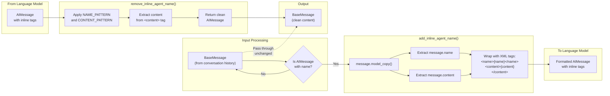
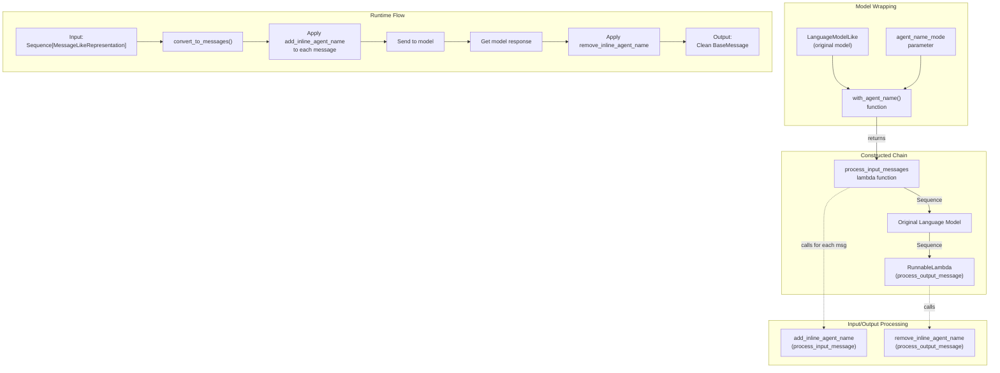
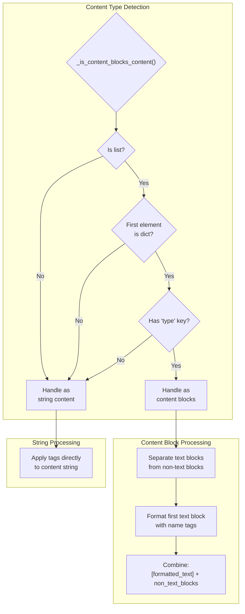
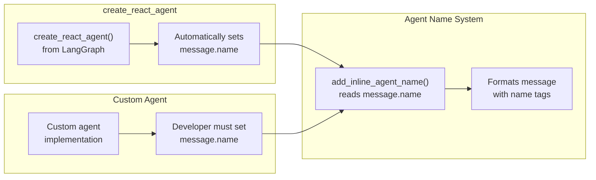

<!-- source: DeepWiki mcp.deepwiki.com · repo langchain-ai/langgraph-supervisor-py · page 2.3 Agent Name Formatting · fetched 2026-10-26 -->

# Agent Name Formatting

<details>
<summary>Relevant source files</summary>

The following files were used as context for generating this wiki page:

- [langgraph_supervisor/agent_name.py](langgraph_supervisor/agent_name.py)
- [tests/test_agent_name.py](tests/test_agent_name.py)

</details>


## Purpose and Scope

This document describes the agent name formatting system in `langgraph-supervisor`, which embeds agent identities directly into message content to improve coherence in multi-agent conversations. The system uses XML-style tags to annotate AI messages with their originating agent's name, making it easier for language models to distinguish between different agents' contributions in conversation history.

For information about how the supervisor orchestrates agent selection and control flow, see [Supervisor Component](#2.1). For details on message history configuration options, see [Message History Management](#2.4).

---

## System Overview

The agent name formatting system provides utilities to inject and extract agent names from message content. When multiple agents participate in a conversation, the language model needs clear attribution to understand which agent said what. This system solves that problem by formatting messages like:

```
Original: "I can help you with math problems"
Formatted: "<name>math_expert</name><content>I can help you with math problems</content>"
```

The system consists of three core functions defined in [langgraph_supervisor/agent_name.py]():

| Function | Purpose |
|----------|---------|
| `add_inline_agent_name()` | Wraps message content with XML tags containing the agent name |
| `remove_inline_agent_name()` | Extracts content from XML tags back to plain text |
| `with_agent_name()` | Wraps a language model to automatically apply formatting |

**Sources:** [langgraph_supervisor/agent_name.py:1-139]()

---

## Message Transformation Pipeline



**Diagram: Message Transformation Flow Through Inline Name Formatting Functions**

This diagram shows how messages flow through the formatting system. The `add_inline_agent_name()` function only processes `AIMessage` instances that have a `name` attribute set. Other message types and AI messages without names pass through unchanged. The reverse operation `remove_inline_agent_name()` uses regex patterns to extract content.

**Sources:** [langgraph_supervisor/agent_name.py:29-97]()

---

## Pattern Matching and Tag Formats

The system uses two regex patterns defined as module-level constants:

```python
NAME_PATTERN = re.compile(r"<name>(.*?)</name>", re.DOTALL)
CONTENT_PATTERN = re.compile(r"<content>(.*?)</content>", re.DOTALL)
```

These patterns support multi-line content due to the `re.DOTALL` flag, allowing agent responses with line breaks to be properly formatted and parsed.

### Tag Structure

| Component | Format | Example |
|-----------|--------|---------|
| Name tag | `<name>{agent_name}</name>` | `<name>research_expert</name>` |
| Content tag | `<content>{message_text}</content>` | `<content>Here are my findings...</content>` |
| Full format | `<name>...</name><content>...</content>` | `<name>math_expert</name><content>The answer is 42</content>` |

**Sources:** [langgraph_supervisor/agent_name.py:14-15]()

---

## Language Model Wrapper

### with_agent_name Function

The `with_agent_name()` function wraps a language model to automatically apply agent name formatting to all messages passing through it:



**Diagram: Language Model Wrapping Architecture**

The `with_agent_name()` function creates a processing chain that sits around the language model. It processes input messages before they reach the model and output messages after the model generates them. This ensures agent names are visible during model inference but hidden from the final output.

**Sources:** [langgraph_supervisor/agent_name.py:100-138]()

### Function Signature

```python
def with_agent_name(
    model: LanguageModelLike,
    agent_name_mode: AgentNameMode,
) -> LanguageModelLike
```

**Parameters:**

| Parameter | Type | Description |
|-----------|------|-------------|
| `model` | `LanguageModelLike` | The language model to wrap with name formatting |
| `agent_name_mode` | `AgentNameMode` | Formatting mode; currently only `"inline"` is supported |

**Returns:** A wrapped language model that automatically applies inline name formatting.

**Sources:** [langgraph_supervisor/agent_name.py:100-103]()

---

## Content Format Handling

The system supports two content formats used by LangChain:

### String Content

Simple text messages where `message.content` is a string:

```python
AIMessage(content="Hello world", name="assistant")
# Formatted: "<name>assistant</name><content>Hello world</content>"
```

### Content Blocks (Multimodal)

Structured content with multiple blocks, supporting images, files, and other media types:

```python
AIMessage(
    content=[
        {"type": "text", "text": "Here's the image"},
        {"type": "image", "image_url": "http://example.com/img.jpg"}
    ],
    name="assistant"
)
# Text block formatted: "<name>assistant</name><content>Here's the image</content>"
# Non-text blocks preserved unchanged
```



**Diagram: Content Format Detection and Processing Logic**

The system uses `_is_content_blocks_content()` type guard to determine the content format. For content blocks, it separates text from non-text blocks (images, files), formats only the first text block, and preserves non-text blocks unchanged.

**Sources:** [langgraph_supervisor/agent_name.py:20-26](), [langgraph_supervisor/agent_name.py:44-50](), [langgraph_supervisor/agent_name.py:72-94]()

---

## Processing Rules

### add_inline_agent_name Behavior

| Message Type | Has Name? | Action |
|--------------|-----------|--------|
| Non-AIMessage | N/A | Return unchanged |
| AIMessage | No | Return unchanged |
| AIMessage | Yes | Add XML tags |

For content blocks without any text blocks, the system creates an empty content tag: `<name>agent</name><content></content>`.

**Sources:** [langgraph_supervisor/agent_name.py:29-55](), [tests/test_agent_name.py:9-51]()

### remove_inline_agent_name Behavior

| Condition | Action |
|-----------|--------|
| Non-AIMessage | Return unchanged |
| Empty content | Return unchanged |
| No XML tags found | Return unchanged |
| Valid XML tags | Extract and return inner content |

When extracting content from blocks and the parsed content is empty, non-text blocks are still preserved.

**Sources:** [langgraph_supervisor/agent_name.py:58-97](), [tests/test_agent_name.py:54-113]()

---

## Integration with Agents

The `message.name` field is the source of the agent name. When using agents created with `create_react_agent()`, the name is automatically set on AI messages. For custom agents, developers must ensure the `name` attribute is set on returned `AIMessage` instances.



**Diagram: Agent Name Attribution Sources**

This diagram shows the two paths for setting agent names. The `create_react_agent()` function from LangGraph automatically sets the `name` field, while custom agents require manual name assignment.

**Sources:** [langgraph_supervisor/agent_name.py:108-110]()

---

## Usage in Supervisor System

While the functions in `agent_name.py` can be used independently, they are primarily consumed by the supervisor system. The supervisor may optionally wrap language models with `with_agent_name()` to improve multi-agent conversation coherence, though this is configurable behavior rather than a mandatory requirement.

The inline formatting helps language models understand the conversation context when multiple agents contribute to the same thread:

```
Without formatting:
- "I'll calculate that for you"
- "Let me search for information"
- "The calculation shows..."

With inline formatting:
- "<name>math_expert</name><content>I'll calculate that for you</content>"
- "<name>research_expert</name><content>Let me search for information</content>"
- "<name>math_expert</name><content>The calculation shows...</content>"
```

**Sources:** [langgraph_supervisor/agent_name.py:100-117]()

---

## Test Coverage

The test suite in [tests/test_agent_name.py]() validates:

- Non-AI messages pass through unchanged
- AI messages without names pass through unchanged  
- AI messages with names get properly formatted
- Content blocks (multimodal messages) are handled correctly
- Text blocks are formatted while non-text blocks are preserved
- Multi-line content is properly parsed
- Round-trip formatting (add → remove) preserves content

**Sources:** [tests/test_agent_name.py:1-113]()

---

