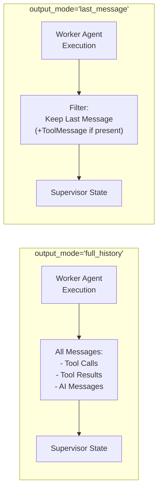
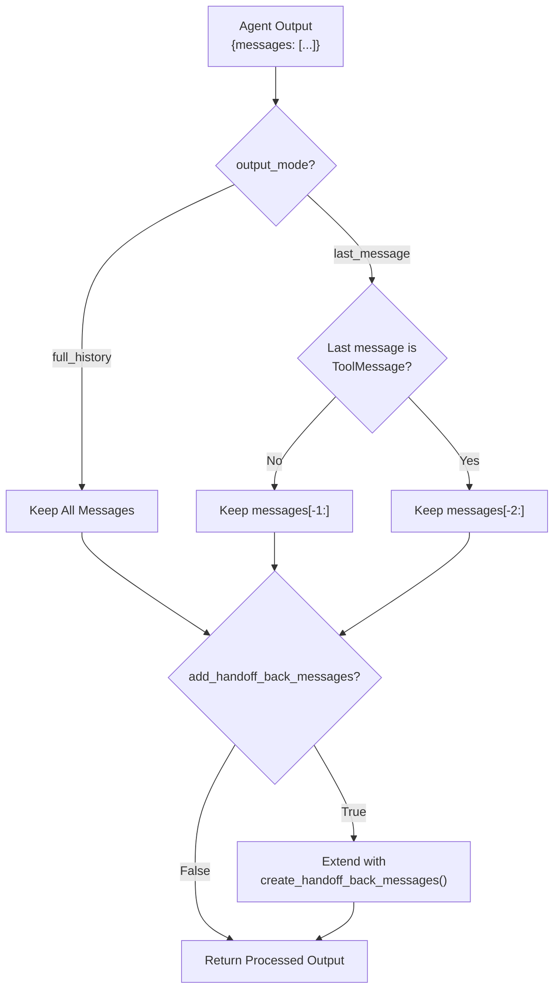
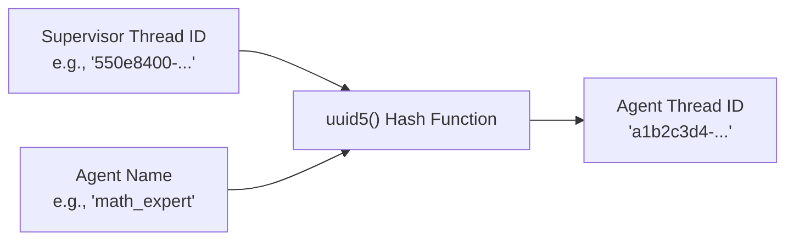
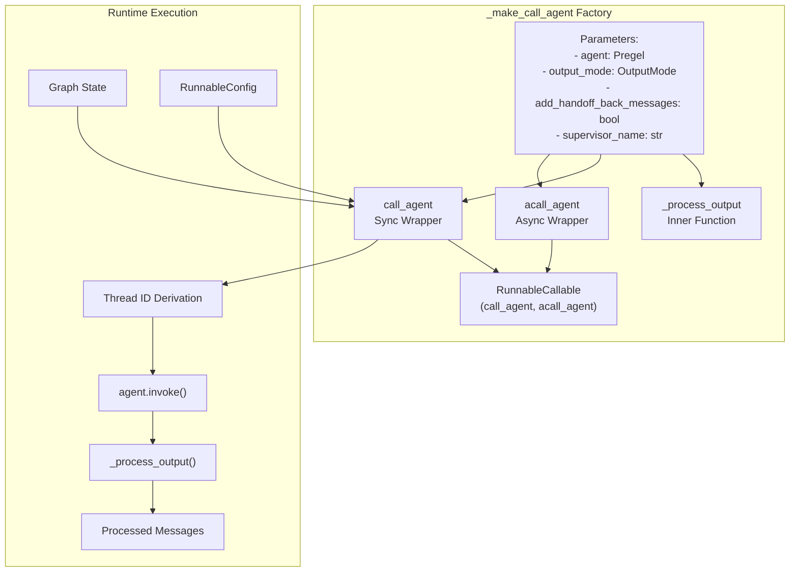

<!-- source: DeepWiki mcp.deepwiki.com · repo langchain-ai/langgraph-supervisor-py · page 2.4 Message History Management · fetched 2026-10-26 -->

# Message History Management

<details>
<summary>Relevant source files</summary>

The following files were used as context for generating this wiki page:

- [README.md](README.md)
- [langgraph_supervisor/supervisor.py](langgraph_supervisor/supervisor.py)
- [tests/test_supervisor.py](tests/test_supervisor.py)

</details>


## Purpose and Scope

This document explains how the supervisor manages conversation history when delegating tasks to worker agents. Message history management controls which messages from worker agents are propagated back to the supervisor's conversation state, affecting both context size and token usage.

This page covers the `output_mode`, `add_handoff_messages`, and `add_handoff_back_messages` parameters of `create_supervisor`. For information about how agents are invoked and coordinated, see [Supervisor Component](#2.1). For details on the handoff mechanism itself, see [Handoff Mechanism](#2.2).

---

## Output Modes

The supervisor provides two modes for managing how worker agent outputs are added to the multi-agent conversation history, controlled by the `output_mode` parameter.

### Overview



**Diagram**: Comparison of the two output modes for message history management

Sources: [langgraph_supervisor/supervisor.py:37-42](), [langgraph_supervisor/supervisor.py:323-328]()

### Full History Mode

When `output_mode="full_history"`, all messages generated by the worker agent are added to the supervisor's message history. This includes:

- All intermediate tool calls made by the agent
- All tool execution results
- All AI messages generated during agent execution

**Configuration:**

```python
workflow = create_supervisor(
    agents=[research_agent, math_agent],
    model=model,
    output_mode="full_history"
)
```

**Example Message Flow:**

| Step | Message Type | Content | Added to History |
|------|-------------|---------|------------------|
| 1 | HumanMessage | User query | ✓ |
| 2 | AIMessage | Supervisor delegates to agent | ✓ |
| 3 | ToolMessage | Handoff confirmation | ✓ |
| 4 | AIMessage | Agent calls tool 1 | ✓ |
| 5 | ToolMessage | Tool 1 result | ✓ |
| 6 | AIMessage | Agent calls tool 2 | ✓ |
| 7 | ToolMessage | Tool 2 result | ✓ |
| 8 | AIMessage | Agent final response | ✓ |

**Use Cases:**
- Maximum transparency: Full visibility into agent reasoning
- Debugging: Complete trace of all agent actions
- Complex tasks: When subsequent agents need full context
- Learning systems: When training data requires complete interaction logs

Sources: [langgraph_supervisor/supervisor.py:79-80](), [README.md:106-115](), [tests/test_supervisor.py:246-288]()

### Last Message Mode

When `output_mode="last_message"` (the default), only the final message from the worker agent is added to the supervisor's history. If the last message is a `ToolMessage`, the preceding `AIMessage` (containing the tool call) is also included to maintain context.

**Configuration:**

```python
workflow = create_supervisor(
    agents=[research_agent, math_agent],
    model=model,
    output_mode="last_message"  # This is the default
)
```

**Example Message Flow:**

| Step | Message Type | Content | Added to History |
|------|-------------|---------|------------------|
| 1 | HumanMessage | User query | ✓ |
| 2 | AIMessage | Supervisor delegates to agent | ✓ |
| 3 | ToolMessage | Handoff confirmation | ✓ |
| 4 | AIMessage | Agent calls tool 1 | ✗ |
| 5 | ToolMessage | Tool 1 result | ✗ |
| 6 | AIMessage | Agent calls tool 2 | ✗ |
| 7 | ToolMessage | Tool 2 result | ✗ |
| 8 | AIMessage | Agent final response | ✓ |

**Special Case - ToolMessage Handling:**

If the agent's last message is a `ToolMessage`, the implementation includes the preceding `AIMessage` to preserve the tool call context:

```
messages[-1] = ToolMessage  →  Include messages[-2:] (AIMessage + ToolMessage)
messages[-1] = AIMessage    →  Include messages[-1:] (AIMessage only)
```

**Use Cases:**
- Token efficiency: Minimize context size for cost optimization
- Concise history: When only results matter, not intermediate steps
- Production systems: When performance and cost are critical
- Simple delegation: When agent internal reasoning isn't needed by supervisor

Sources: [langgraph_supervisor/supervisor.py:81-85](), [langgraph_supervisor/supervisor.py:225](), [README.md:117-126](), [tests/test_supervisor.py:224-244]()

---

## Message Processing Implementation

### The _process_output Function

The core message filtering logic is implemented in `_process_output`, which is created within `_make_call_agent`:



**Diagram**: Message processing flow in the `_process_output` function

Sources: [langgraph_supervisor/supervisor.py:77-99]()

### Thread ID Handling for Agent Isolation

Each worker agent receives a derived thread ID to maintain independent conversation histories:



**Diagram**: Thread ID derivation for agent-specific conversation isolation

The implementation uses UUID5 to deterministically generate agent-specific thread IDs:

```python
thread_id = str(uuid5(UUID(str(thread_id)), agent.name)) if thread_id else None
```

This ensures:
- Each agent maintains its own conversation history in persistence layers
- Multiple invocations of the same agent within a supervisor thread use the same agent thread
- Agent histories are isolated from each other and from the supervisor

Sources: [langgraph_supervisor/supervisor.py:102-111](), [langgraph_supervisor/supervisor.py:114-125]()

---

## Handoff Message Management

### Handoff Invocation Messages

The `add_handoff_messages` parameter controls whether handoff tool invocations are added to the message history when the supervisor delegates to an agent.

**When `add_handoff_messages=True` (default):**

```
1. HumanMessage: "What's 2+2?"
2. AIMessage (supervisor): tool_calls=[transfer_to_math_expert()]
3. ToolMessage: "Successfully transferred to math_expert"
4. AIMessage (math_expert): "The answer is 4"
```

**When `add_handoff_messages=False`:**

```
1. HumanMessage: "What's 2+2?"
2. AIMessage (math_expert): "The answer is 4"
```

**Configuration:**

```python
workflow = create_supervisor(
    agents=[agent1, agent2],
    model=model,
    add_handoff_messages=False  # Hide handoff coordination messages
)
```

Sources: [langgraph_supervisor/supervisor.py:226](), [langgraph_supervisor/supervisor.py:329-330](), [tests/test_supervisor.py:333-426]()

### Handoff Back Messages

The `add_handoff_back_messages` parameter controls whether "transfer back" messages are added when an agent returns control to the supervisor.

**When `add_handoff_back_messages=True` (default):**

After the agent completes its task, `create_handoff_back_messages` generates:

```
AIMessage (agent_name): "Transferring back to supervisor"
    tool_calls=[transfer_back_to_supervisor()]
ToolMessage: "Successfully transferred back to supervisor"
```

**When `add_handoff_back_messages=False`:**

No transfer-back messages are added; the agent's final response flows directly to the supervisor.

**Configuration:**

```python
workflow = create_supervisor(
    agents=[agent1, agent2],
    model=model,
    add_handoff_back_messages=False  # Hide return coordination messages
)
```

**Implementation Detail:**

By default, `add_handoff_back_messages` inherits the value of `add_handoff_messages` if not explicitly set:

```python
if add_handoff_back_messages is None:
    add_handoff_back_messages = add_handoff_messages
```

This maintains consistency: if you hide forward handoffs, return handoffs are also hidden.

Sources: [langgraph_supervisor/supervisor.py:228](), [langgraph_supervisor/supervisor.py:336-337](), [langgraph_supervisor/supervisor.py:401-402](), [langgraph_supervisor/supervisor.py:93-94]()

---

## Integration with Agent Wrapper

The `_make_call_agent` function creates the wrapper that applies message history management:



**Diagram**: Structure of the agent wrapper created by `_make_call_agent`

The wrapper performs these operations:
1. **Thread ID Derivation**: Creates agent-specific thread ID from supervisor thread ID
2. **Agent Invocation**: Calls the worker agent with derived configuration
3. **Output Processing**: Applies `output_mode` filtering to agent messages
4. **Handoff Back**: Optionally adds transfer-back messages

Sources: [langgraph_supervisor/supervisor.py:66-128](), [langgraph_supervisor/supervisor.py:458-467]()

---

## Use Cases and Trade-offs

### Comparison Matrix

| Aspect | Full History | Last Message |
|--------|-------------|--------------|
| **Context Size** | Large (all messages) | Small (1-2 messages) |
| **Token Usage** | High | Low |
| **Transparency** | Complete agent trace | Result only |
| **Debugging** | Excellent | Limited |
| **Cost** | Higher | Lower |
| **Supervisor Context** | Maximum information | Essential information |
| **Use Case** | Development, complex tasks | Production, simple delegation |

### Recommended Configurations

**Development and Debugging:**
```python
workflow = create_supervisor(
    agents=[...],
    model=model,
    output_mode="full_history",
    add_handoff_messages=True,
    add_handoff_back_messages=True
)
```

**Production Optimization:**
```python
workflow = create_supervisor(
    agents=[...],
    model=model,
    output_mode="last_message",  # Default
    add_handoff_messages=False,
    add_handoff_back_messages=False
)
```

**Balanced Approach:**
```python
workflow = create_supervisor(
    agents=[...],
    model=model,
    output_mode="last_message",  # Default
    add_handoff_messages=True,  # Keep coordination visible
    add_handoff_back_messages=True
)
```

Sources: [langgraph_supervisor/supervisor.py:211-232](), [README.md:102-126]()

---

## State Schema Compatibility

Message history management operates on the `messages` key in the graph state. The supervisor uses:

- **Default State**: `_OuterState` with `messages: Annotated[Sequence[AnyMessage], add_messages]`
- **Custom State**: Any state schema with a `messages` key annotated with `add_messages`

The `add_messages` reducer ensures messages are properly merged when updates are applied:

```python
class _OuterState(TypedDict):
    messages: Annotated[Sequence[AnyMessage], add_messages]
```

This allows the message filtering and handoff message insertion to work correctly with LangGraph's state management.

Sources: [langgraph_supervisor/supervisor.py:205-208](), [langgraph_supervisor/supervisor.py:407](), [langgraph_supervisor/supervisor.py:454]()

---

