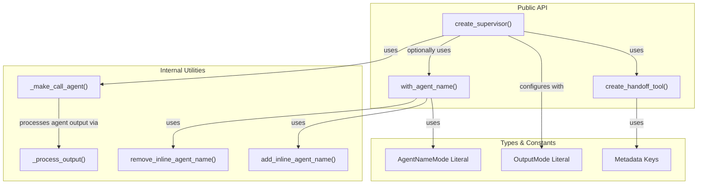
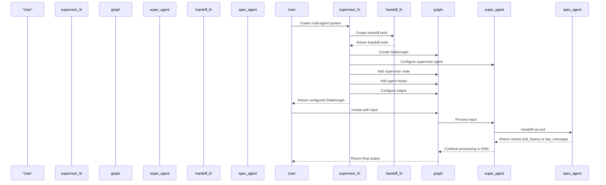
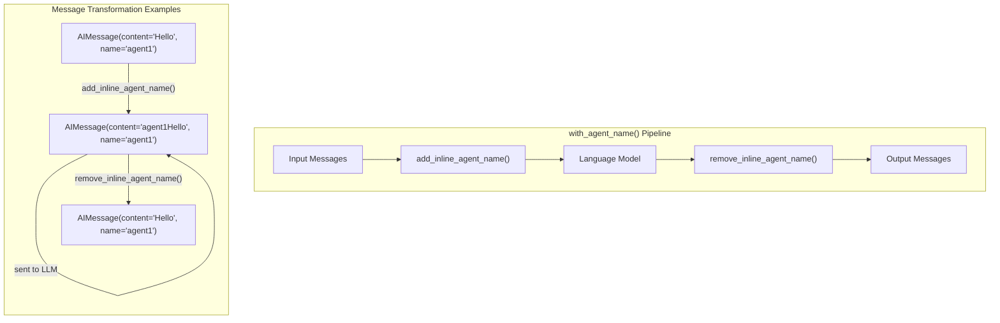
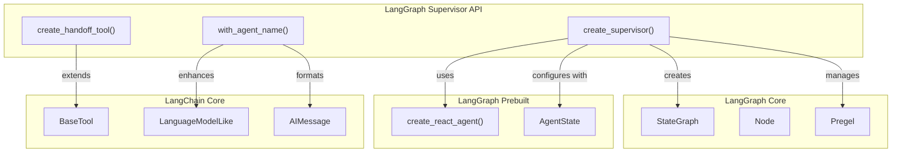

<!-- source: DeepWiki mcp.deepwiki.com · repo langchain-ai/langgraph-supervisor-py · page 3 API Reference · fetched 2026-10-26 -->

# API Reference

<details>
<summary>Relevant source files</summary>

The following files were used as context for generating this wiki page:

- [LICENSE](LICENSE)
- [langgraph_supervisor/__init__.py](langgraph_supervisor/__init__.py)
- [langgraph_supervisor/agent_name.py](langgraph_supervisor/agent_name.py)
- [langgraph_supervisor/handoff.py](langgraph_supervisor/handoff.py)
- [langgraph_supervisor/supervisor.py](langgraph_supervisor/supervisor.py)

</details>


This page provides a comprehensive reference for the primary public APIs available in the LangGraph Supervisor framework. It documents the core functions, types, and constants that you can use to create and configure multi-agent systems with a supervisor architecture.

For information about the high-level architecture, see [Core Architecture](#2). For implementation details of specific components, see the dedicated pages for the [Supervisor Component](#2.1), [Handoff Mechanism](#2.2), and [Agent Name Formatting](#2.3).

## Core API Components



Sources: [langgraph_supervisor/supervisor.py:51-90](), [langgraph_supervisor/supervisor.py:103-235](), [langgraph_supervisor/handoff.py:50-106](), [langgraph_supervisor/agent_name.py:94-128]()

## 1. Core Functions

### 1.1 create_supervisor

The primary function for creating a multi-agent system with a supervisor architecture. It creates a `StateGraph` that manages the interaction between a supervisor agent and multiple specialized agents.

**Signature**:
```python
def create_supervisor(
    agents: list[Pregel],
    *,
    model: LanguageModelLike,
    tools: list[BaseTool | Callable] | None = None,
    prompt: Prompt | None = None,
    response_format: Optional[Union[StructuredResponseSchema, tuple[str, StructuredResponseSchema]]] = None,
    parallel_tool_calls: bool = False,
    state_schema: StateSchemaType = AgentState,
    config_schema: Type[Any] | None = None,
    output_mode: OutputMode = "last_message",
    add_handoff_back_messages: bool = True,
    supervisor_name: str = "supervisor",
    include_agent_name: AgentNameMode | None = None,
) -> StateGraph
```

**Parameters**:

| Parameter | Type | Default | Description |
|-----------|------|---------|-------------|
| `agents` | `list[Pregel]` | required | List of agents to be managed by the supervisor |
| `model` | `LanguageModelLike` | required | Language model to use for the supervisor |
| `tools` | `list[BaseTool \| Callable] \| None` | `None` | Tools available to the supervisor, including any custom handoff tools |
| `prompt` | `Prompt \| None` | `None` | Optional prompt for the supervisor |
| `response_format` | `Optional[Union[StructuredResponseSchema, tuple[str, StructuredResponseSchema]]]` | `None` | Optional schema for structured output |
| `parallel_tool_calls` | `bool` | `False` | Whether to allow the supervisor to call tools (including handoffs to agents) in parallel |
| `state_schema` | `StateSchemaType` | `AgentState` | State schema for the supervisor graph |
| `config_schema` | `Type[Any] \| None` | `None` | Optional schema for configuration |
| `output_mode` | `OutputMode` | `"last_message"` | How to add agent outputs to message history |
| `add_handoff_back_messages` | `bool` | `True` | Whether to add messages when returning control to supervisor |
| `supervisor_name` | `str` | `"supervisor"` | Name of the supervisor node |
| `include_agent_name` | `AgentNameMode \| None` | `None` | How to format agent names in messages |

**Returns**: A `StateGraph` that manages the interaction between the supervisor and specialized agents.

**Important Notes**:
- Each agent in the `agents` list must have a unique name.
- If custom handoff tools are provided, they must be provided for all subagents.
- The `parallel_tool_calls` parameter is supported only by OpenAI and Anthropic models.

Sources: [langgraph_supervisor/supervisor.py:103-235]()

### 1.2 create_handoff_tool

Creates a tool that enables the supervisor to handoff control to a specific agent.

**Signature**:
```python
def create_handoff_tool(
    *, 
    agent_name: str, 
    name: str | None = None, 
    description: str | None = None
) -> BaseTool
```

**Parameters**:

| Parameter | Type | Default | Description |
|-----------|------|---------|-------------|
| `agent_name` | `str` | required | Name of the agent to handoff control to |
| `name` | `str \| None` | `None` | Optional custom name for the tool (default: `transfer_to_<agent_name>`) |
| `description` | `str \| None` | `None` | Optional description for the tool (default: `Ask agent '<agent_name>' for help`) |

**Returns**: A `BaseTool` that, when called, transfers control to the specified agent.

**Example**: The tool's name will be formatted as `transfer_to_<agent_name>` if not specified.

Sources: [langgraph_supervisor/handoff.py:50-106]()

## 2. Agent Name Utilities

### 2.1 with_agent_name

Attaches formatted agent names to messages passed to and from a language model. This makes message history with multiple agents more coherent.

**Signature**:
```python
def with_agent_name(
    model: LanguageModelLike,
    agent_name_mode: AgentNameMode,
) -> LanguageModelLike
```

**Parameters**:

| Parameter | Type | Default | Description |
|-----------|------|---------|-------------|
| `model` | `LanguageModelLike` | required | Language model to add agent name formatting to |
| `agent_name_mode` | `AgentNameMode` | required | How to format agent names in messages (`"inline"`) |

**Returns**: A modified language model with agent name formatting applied.

**Note**: The agent name is consumed from the `message.name` field. For agents built with `create_react_agent`, the name is automatically set.

Sources: [langgraph_supervisor/agent_name.py:94-128]()

## 3. Types and Constants

### 3.1 OutputMode

A Literal type that determines how agent outputs are added to the message history in the multi-agent workflow.

```python
OutputMode = Literal["full_history", "last_message"]
```

| Value | Description |
|-------|-------------|
| `"full_history"` | Add the entire agent message history |
| `"last_message"` | Add only the last message (default) |

Sources: [langgraph_supervisor/supervisor.py:24-29]()

### 3.2 AgentNameMode

A Literal type that specifies how to format agent names in messages.

```python
AgentNameMode = Literal["inline"]
```

| Value | Description |
|-------|-------------|
| `"inline"` | Add the agent name directly into the content field of the AI message using XML-style tags |

Sources: [langgraph_supervisor/agent_name.py:11]()

### 3.3 Metadata Keys

Constants used for storing metadata in tool definitions and messages.

| Constant | Value | Purpose |
|----------|-------|---------|
| `METADATA_KEY_HANDOFF_DESTINATION` | `"__handoff_destination"` | Marks a tool as a handoff tool and specifies the destination agent |
| `METADATA_KEY_IS_HANDOFF_BACK` | `"__is_handoff_back"` | Marks messages as handoff-back messages |

Sources: [langgraph_supervisor/handoff.py:12-13]()

## 4. Data Flow and Component Interaction

The following diagram illustrates how data flows through the system when using the LangGraph Supervisor API:



Sources: [langgraph_supervisor/supervisor.py:103-235](), [langgraph_supervisor/handoff.py:50-106]()

## 5. Message Formatting Workflow

The following diagram shows how agent names are formatted in messages when using the agent name utilities:



Sources: [langgraph_supervisor/agent_name.py:11-128](), [langgraph_supervisor/agent_name.py:22-92]()

## 6. Integration with LangGraph Ecosystem

This diagram shows how the LangGraph Supervisor API fits into the broader LangGraph ecosystem:



Sources: [langgraph_supervisor/supervisor.py:4-16](), [langgraph_supervisor/supervisor.py:103-235]()

---

