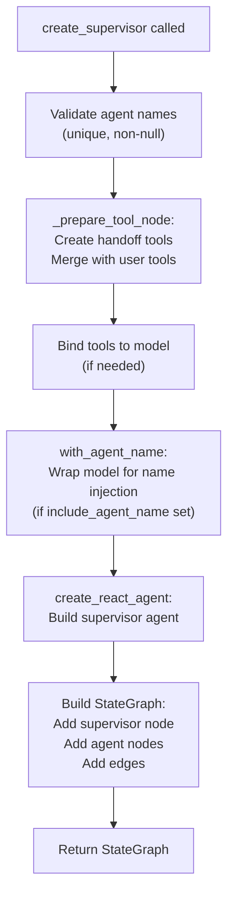
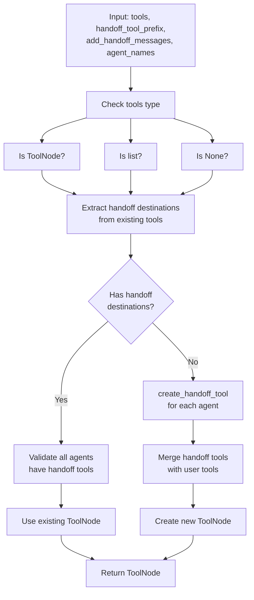
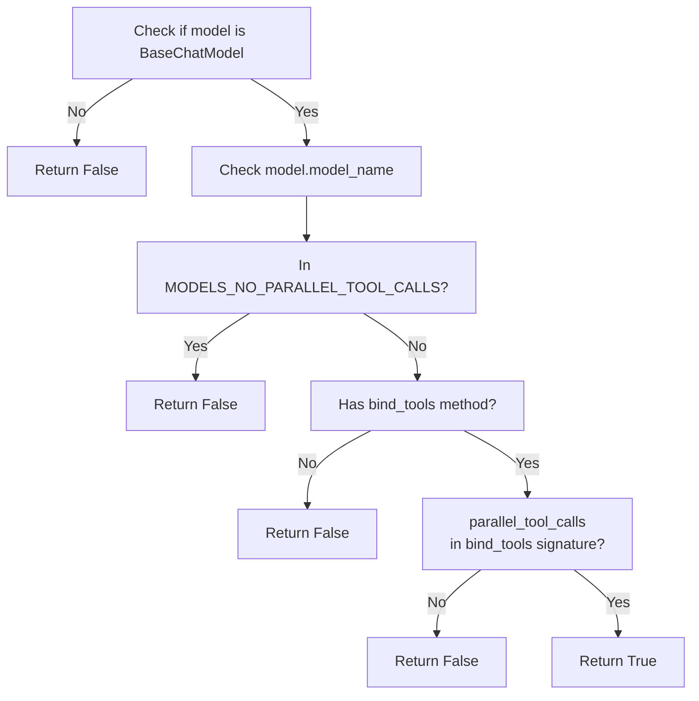
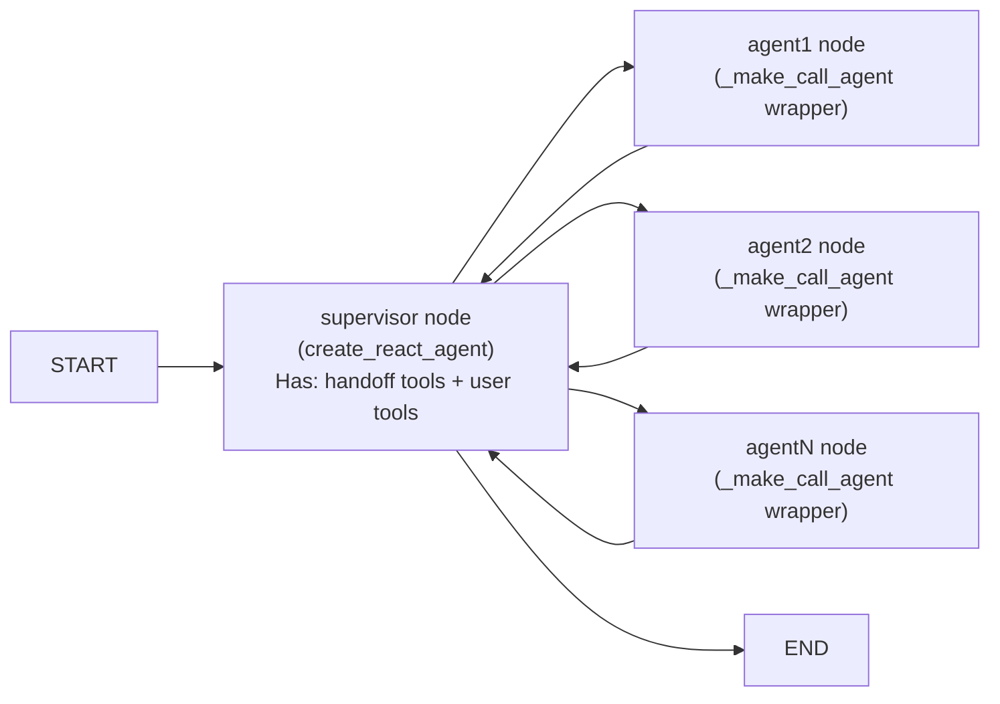
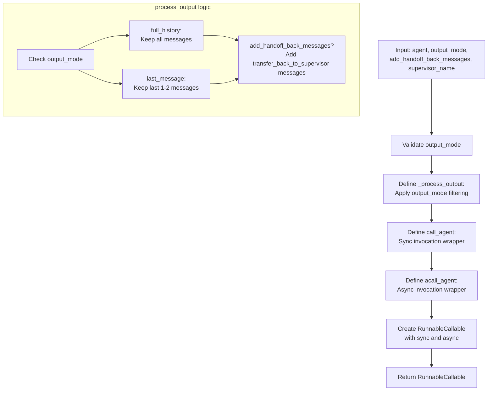

<!-- source: DeepWiki mcp.deepwiki.com · repo langchain-ai/langgraph-supervisor-py · page 3.1 create_supervisor · fetched 2026-10-26 -->

# create_supervisor

<details>
<summary>Relevant source files</summary>

The following files were used as context for generating this wiki page:

- [langgraph_supervisor/supervisor.py](langgraph_supervisor/supervisor.py)
- [tests/test_supervisor.py](tests/test_supervisor.py)

</details>


## Purpose and Scope

This page documents the `create_supervisor` function, the primary factory function for creating multi-agent supervisor workflows in the langgraph-supervisor package. This function constructs a `StateGraph` that orchestrates multiple specialized agents through a central supervisor agent using handoff tools and message routing.

For information about handoff tools and message transfers, see [Handoff Tools](#3.2). For agent name formatting utilities, see [Agent Name Utilities](#3.3). For architectural context about the supervisor pattern, see [Supervisor Component](#2.1).

**Sources:** [langgraph_supervisor/supervisor.py:211-469]()

---

## Function Signature

```python
def create_supervisor(
    agents: list[Pregel],
    *,
    model: LanguageModelLike,
    tools: list[BaseTool | Callable] | ToolNode | None = None,
    prompt: Prompt | None = None,
    response_format: Optional[
        Union[StructuredResponseSchema, tuple[str, StructuredResponseSchema]]
    ] = None,
    pre_model_hook: Optional[RunnableLike] = None,
    post_model_hook: Optional[RunnableLike] = None,
    parallel_tool_calls: bool = False,
    state_schema: StateSchemaType | None = None,
    context_schema: Type[Any] | None = None,
    output_mode: OutputMode = "last_message",
    add_handoff_messages: bool = True,
    handoff_tool_prefix: Optional[str] = None,
    add_handoff_back_messages: Optional[bool] = None,
    supervisor_name: str = "supervisor",
    include_agent_name: AgentNameMode | None = None,
    **deprecated_kwargs: Unpack[DeprecatedKwargs],
) -> StateGraph
```

**Sources:** [langgraph_supervisor/supervisor.py:211-232]()

---

## Parameters

### Required Parameters

| Parameter | Type | Description |
|-----------|------|-------------|
| `agents` | `list[Pregel]` | List of agents to manage. Can be `CompiledStateGraph`, functional API workflows, or any `Pregel` objects. Each agent must have a unique name. |
| `model` | `LanguageModelLike` | Language model to use for the supervisor agent's decision making. |

**Sources:** [langgraph_supervisor/supervisor.py:236-241]()

### Optional Tool and Prompt Configuration

| Parameter | Type | Default | Description |
|-----------|------|---------|-------------|
| `tools` | `list[BaseTool \| Callable] \| ToolNode \| None` | `None` | Additional tools for the supervisor beyond auto-generated handoff tools. Can be a list of tools/functions or a pre-configured `ToolNode`. |
| `prompt` | `Prompt \| None` | `None` | Supervisor prompt. Can be: `str` (converted to `SystemMessage`), `SystemMessage`, `Callable` (takes full state), or `Runnable`. |
| `response_format` | `Optional[Union[StructuredResponseSchema, tuple[str, StructuredResponseSchema]]]` | `None` | Schema for structured output. Can be OpenAI function schema, JSON Schema, TypedDict, Pydantic class, or tuple `(prompt, schema)`. Requires model support for `.with_structured_output`. |

**Sources:** [langgraph_supervisor/supervisor.py:242-272]()

### Model Hook Configuration

| Parameter | Type | Default | Description |
|-----------|------|---------|-------------|
| `pre_model_hook` | `Optional[RunnableLike]` | `None` | Node added before the LLM in the supervisor agent. Used for message management (trimming, summarization). Must return state update with `messages` or `llm_input_messages`. |
| `post_model_hook` | `Optional[RunnableLike]` | `None` | Node added after the LLM in the supervisor agent. Used for human-in-the-loop, guardrails, or validation. |
| `parallel_tool_calls` | `bool` | `False` | Whether to allow parallel tool calls (OpenAI/Anthropic only). Controls if supervisor can hand off to multiple agents simultaneously. |

**Sources:** [langgraph_supervisor/supervisor.py:273-320]()

### State and Context Configuration

| Parameter | Type | Default | Description |
|-----------|------|---------|-------------|
| `state_schema` | `StateSchemaType \| None` | `None` | Custom state schema for the supervisor graph. If `None`, uses `AgentStateWithStructuredResponse` when `response_format` is set, otherwise `AgentState`. |
| `context_schema` | `Type[Any] \| None` | `None` | Schema for the context object passed to the workflow. |

**Sources:** [langgraph_supervisor/supervisor.py:321-322](), [langgraph_supervisor/supervisor.py:404-407]()

### Output and Handoff Configuration

| Parameter | Type | Default | Description |
|-----------|------|---------|-------------|
| `output_mode` | `OutputMode` | `"last_message"` | Mode for adding agent outputs to message history. `"full_history"` adds all messages, `"last_message"` adds only the last message (or last two if ToolMessage). |
| `add_handoff_messages` | `bool` | `True` | Whether to add `(AIMessage, ToolMessage)` pair to history when handoff occurs. |
| `handoff_tool_prefix` | `Optional[str]` | `None` | Prefix for handoff tools (e.g., `"delegate_to_"` or `"transfer_to_"`). If `None`, uses `"transfer_to_"`. |
| `add_handoff_back_messages` | `Optional[bool]` | `None` | Whether to add messages when agents return control to supervisor. If `None`, inherits from `add_handoff_messages`. |

**Sources:** [langgraph_supervisor/supervisor.py:323-337](), [langgraph_supervisor/supervisor.py:401-402]()

### Naming Configuration

| Parameter | Type | Default | Description |
|-----------|------|---------|-------------|
| `supervisor_name` | `str` | `"supervisor"` | Name of the supervisor node in the graph. |
| `include_agent_name` | `AgentNameMode \| None` | `None` | How to expose agent names to the supervisor LLM. `None` uses the name attribute on AI messages (OpenAI only). `"inline"` embeds names in message content using XML-style tags. |

**Sources:** [langgraph_supervisor/supervisor.py:338-344]()

---

## Return Value

The function returns a `StateGraph` instance that is not yet compiled. The graph must be compiled before use:

```python
workflow = create_supervisor(agents=[...], model=...)
app = workflow.compile()
```

The returned `StateGraph` contains:
- A supervisor node that manages agent routing
- One node for each agent in the `agents` list
- Edges connecting the supervisor to agents and agents back to the supervisor
- Pre-configured handoff tools for agent transfers

**Sources:** [langgraph_supervisor/supervisor.py:232](), [langgraph_supervisor/supervisor.py:454-469]()

---

## Workflow Construction Process

### High-Level Construction Flow



**Sources:** [langgraph_supervisor/supervisor.py:211-469]()

### Agent Validation

The function first validates that all agents have unique, non-null names:

```python
agent_names = set()
for agent in agents:
    if agent.name is None or agent.name == "LangGraph":
        raise ValueError(
            "Please specify a name when you create your agent, either via "
            "`create_react_agent(..., name=agent_name)` or via `graph.compile(name=name)`."
        )
    
    if agent.name in agent_names:
        raise ValueError(
            f"Agent with name '{agent.name}' already exists. Agent names must be unique."
        )
    
    agent_names.add(agent.name)
```

**Sources:** [langgraph_supervisor/supervisor.py:409-422]()

### Tool Node Preparation

The `_prepare_tool_node` helper function handles tool configuration:



**Sources:** [langgraph_supervisor/supervisor.py:146-202]()

The function checks if custom handoff tools are provided by looking for the `METADATA_KEY_HANDOFF_DESTINATION` metadata key. If custom handoff tools are found, it validates that all agents have corresponding handoff tools. Otherwise, it generates handoff tools automatically using `create_handoff_tool`.

**Sources:** [langgraph_supervisor/supervisor.py:164-186]()

### Model Binding and Wrapping

The supervisor model goes through several transformation steps:

1. **Tool Binding**: If the model supports tool binding (`_should_bind_tools` returns `True`), tools are bound to the model. If the model supports `parallel_tool_calls` parameter, it's configured according to the `parallel_tool_calls` argument:

```python
if _should_bind_tools(model, all_tools):
    if _supports_disable_parallel_tool_calls(model):
        model = cast(BaseChatModel, model).bind_tools(
            all_tools, parallel_tool_calls=parallel_tool_calls
        )
    else:
        model = cast(BaseChatModel, model).bind_tools(all_tools)
```

**Sources:** [langgraph_supervisor/supervisor.py:432-438]()

2. **Agent Name Wrapping**: If `include_agent_name` is set, the model is wrapped with `with_agent_name` to inject agent names into messages:

```python
if include_agent_name:
    model = with_agent_name(model, include_agent_name)
```

**Sources:** [langgraph_supervisor/supervisor.py:440-441]()

### Parallel Tool Calls Support Detection

The function detects whether a model supports disabling parallel tool calls:



The `MODELS_NO_PARALLEL_TOOL_CALLS` set contains models that don't support the parameter:

```python
MODELS_NO_PARALLEL_TOOL_CALLS = {"o3-mini", "o3", "o4-mini"}
```

**Sources:** [langgraph_supervisor/supervisor.py:45-63]()

---

## Graph Structure

### Constructed Graph Architecture



**Sources:** [langgraph_supervisor/supervisor.py:454-468]()

The graph construction code:

```python
builder = StateGraph(cast(Type[Any], workflow_schema), context_schema=context_schema)
builder.add_node(supervisor_agent, destinations=tuple(agent_names) + (END,))
builder.add_edge(START, supervisor_agent.name)
for agent in agents:
    builder.add_node(
        agent.name,
        _make_call_agent(
            agent,
            output_mode,
            add_handoff_back_messages=add_handoff_back_messages,
            supervisor_name=supervisor_name,
        ),
    )
    builder.add_edge(agent.name, supervisor_agent.name)
```

**Sources:** [langgraph_supervisor/supervisor.py:454-468]()

### Node Types

| Node Type | Description | Implementation |
|-----------|-------------|----------------|
| **Supervisor Node** | Routes to agents via handoff tools | Created with `create_react_agent` |
| **Agent Nodes** | Execute specialized tasks | Wrapped with `_make_call_agent` |

The supervisor node is added with `destinations` parameter specifying all possible agent names plus `END`, allowing it to route to any agent or finish execution.

**Sources:** [langgraph_supervisor/supervisor.py:455]()

---

## Internal Helper Functions

### _make_call_agent

Creates a wrapper that invokes an agent and processes its output according to the configured `output_mode`:



**Sources:** [langgraph_supervisor/supervisor.py:66-127]()

#### Output Mode Processing

The `_process_output` function applies message filtering based on `output_mode`:

- **`full_history`**: Keeps all messages from the agent
- **`last_message`**: Keeps only the last message, or last two if the final message is a `ToolMessage`

```python
if output_mode == "full_history":
    pass
elif output_mode == "last_message":
    if isinstance(messages[-1], ToolMessage):
        messages = messages[-2:]
    else:
        messages = messages[-1:]
```

**Sources:** [langgraph_supervisor/supervisor.py:77-91]()

If `add_handoff_back_messages` is `True`, the function appends handoff-back messages to indicate the agent is returning control to the supervisor:

```python
if add_handoff_back_messages:
    messages.extend(create_handoff_back_messages(agent.name, supervisor_name))
```

**Sources:** [langgraph_supervisor/supervisor.py:93-94]()

#### Thread ID Handling for Remote Graphs

For `RemoteGraph` instances, the wrapper generates a unique thread ID for each agent based on the parent thread ID:

```python
thread_id = config.get("configurable", {}).get("thread_id")
output = agent.invoke(
    state,
    patch_configurable(
        config,
        {"thread_id": str(uuid5(UUID(str(thread_id)), agent.name)) if thread_id else None},
    )
    if isinstance(agent, RemoteGraph)
    else config,
)
```

This ensures isolated conversation threads for each agent while maintaining a deterministic relationship to the parent thread.

**Sources:** [langgraph_supervisor/supervisor.py:102-111]()

### _get_handoff_destinations

Extracts handoff destination agent names from tools by checking for the `METADATA_KEY_HANDOFF_DESTINATION` metadata key:

```python
def _get_handoff_destinations(tools: Sequence[BaseTool | Callable]) -> list[str]:
    """Extract handoff destinations from provided tools."""
    return [
        tool.metadata[METADATA_KEY_HANDOFF_DESTINATION]
        for tool in tools
        if isinstance(tool, BaseTool)
        and tool.metadata is not None
        and METADATA_KEY_HANDOFF_DESTINATION in tool.metadata
    ]
```

**Sources:** [langgraph_supervisor/supervisor.py:130-143]()

### _supports_disable_parallel_tool_calls

Determines if a model supports the `parallel_tool_calls` parameter in `bind_tools`:

```python
def _supports_disable_parallel_tool_calls(model: LanguageModelLike) -> bool:
    if not isinstance(model, BaseChatModel):
        return False
    
    if (
        model_name := getattr(model, "model_name", None)
    ) and model_name in MODELS_NO_PARALLEL_TOOL_CALLS:
        return False
    
    if not hasattr(model, "bind_tools"):
        return False
    
    if "parallel_tool_calls" not in inspect.signature(model.bind_tools).parameters:
        return False
    
    return True
```

**Sources:** [langgraph_supervisor/supervisor.py:48-63]()

---

## State Management

### Default State Schema

The function uses a default outer state schema when `state_schema` is not provided:

```python
class _OuterState(TypedDict):
    """The state of the supervisor workflow."""
    
    messages: Annotated[Sequence[AnyMessage], add_messages]
```

**Sources:** [langgraph_supervisor/supervisor.py:205-208]()

### State Schema Selection Logic

The supervisor agent's state schema is determined as follows:

```python
supervisor_schema = state_schema or (
    AgentStateWithStructuredResponse if response_format is not None else AgentState
)
workflow_schema = state_schema or _OuterState
```

- If `state_schema` is provided, it's used for both supervisor and workflow
- If `response_format` is set without `state_schema`, uses `AgentStateWithStructuredResponse` for supervisor
- Otherwise uses `AgentState` for supervisor
- The workflow (outer graph) uses the provided `state_schema` or falls back to `_OuterState`

**Sources:** [langgraph_supervisor/supervisor.py:404-407]()

---

## Usage Examples

### Basic Two-Agent Supervisor

```python
from langchain_openai import ChatOpenAI
from langgraph.prebuilt import create_react_agent
from langgraph_supervisor import create_supervisor

# Define tools
def add(a: float, b: float) -> float:
    '''Add two numbers.'''
    return a + b

def web_search(query: str) -> str:
    '''Search the web for information.'''
    return 'Results...'

# Create agents
math_agent = create_react_agent(
    model="openai:gpt-4o",
    tools=[add],
    name="math_expert",
)

research_agent = create_react_agent(
    model="openai:gpt-4o",
    tools=[web_search],
    name="research_expert",
)

# Create supervisor
workflow = create_supervisor(
    [research_agent, math_agent],
    model=ChatOpenAI(model="gpt-4o"),
)

# Compile and run
app = workflow.compile()
result = app.invoke({
    "messages": [{"role": "user", "content": "Calculate 2+2 and search for FAANG info"}]
})
```

**Sources:** [langgraph_supervisor/supervisor.py:346-391]()

### Supervisor with Custom Tools and Configuration

```python
workflow = create_supervisor(
    agents=[agent1, agent2],
    model=ChatOpenAI(model="gpt-4o"),
    tools=[custom_tool],
    prompt="You are a helpful supervisor that delegates tasks efficiently.",
    output_mode="full_history",
    add_handoff_messages=True,
    handoff_tool_prefix="delegate_to_",
    parallel_tool_calls=True,
    include_agent_name="inline",
)
```

**Sources:** [tests/test_supervisor.py:215-219](), [tests/test_supervisor.py:259-263]()

### Testing Output Modes

From the test suite, demonstrating `last_message` vs `full_history`:

- **`last_message` mode**: Results in 12 total messages (1 human + 11 system messages including handoffs and final responses)
- **`full_history` mode**: Results in 23 total messages (1 human + 22 system messages including all intermediate agent messages)

**Sources:** [tests/test_supervisor.py:234](), [tests/test_supervisor.py:275]()

### Disabling Handoff Messages

To hide handoff messages from agents' message history:

```python
workflow = create_supervisor(
    [agent],
    model=model,
    add_handoff_messages=False,
)
```

This prevents `(AIMessage, ToolMessage)` pairs from being added to the message history during handoffs, allowing agents to see a cleaner conversation history.

**Sources:** [tests/test_supervisor.py:417-421]()

### Metadata Propagation

The supervisor automatically propagates metadata from the config to sub-agents:

```python
test_metadata = {"test_key": "test_value", "another_key": 123}
config: RunnableConfig = {"metadata": test_metadata}

result = supervisor.invoke(
    {"messages": [HumanMessage(content="Test message")]},
    config=config
)
```

Sub-agents receive the same metadata in their `config` parameter.

**Sources:** [tests/test_supervisor.py:605-610]()

---

## Related Configuration

### OutputMode Type

The `OutputMode` literal type defines valid values for the `output_mode` parameter:

```python
OutputMode = Literal["full_history", "last_message"]
```

**Sources:** [langgraph_supervisor/supervisor.py:37-42]()

### Deprecated Parameters

The function handles deprecated parameters through the `deprecated_kwargs`:

```python
if (config_schema := deprecated_kwargs.get("config_schema", None)) is not None:
    warn(
        "`config_schema` is deprecated. Please use `context_schema` instead.",
        DeprecationWarning,
        stacklevel=2,
    )
    context_schema = config_schema
```

The `config_schema` parameter was renamed to `context_schema` but is still supported with a deprecation warning.

**Sources:** [langgraph_supervisor/supervisor.py:393-399]()

---

**Page Sources:** [langgraph_supervisor/supervisor.py:1-470](), [tests/test_supervisor.py:1-614]()

---

