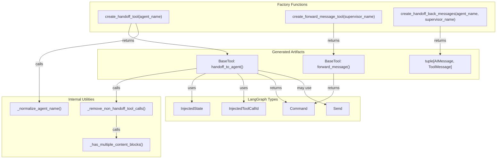
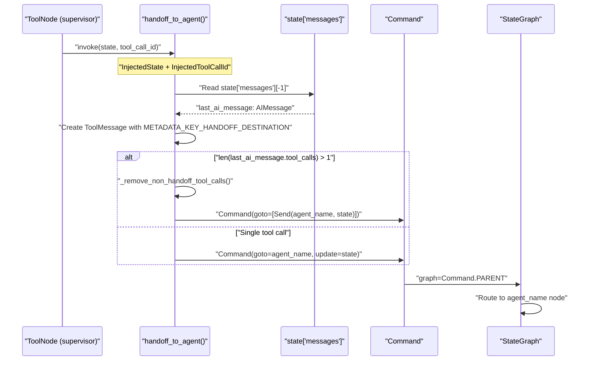
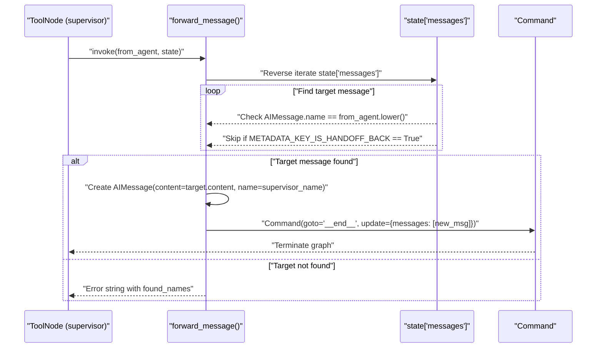
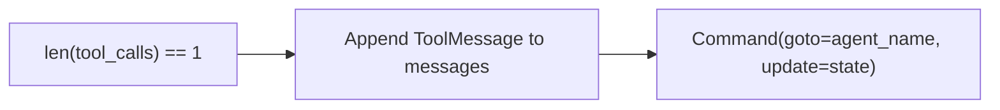
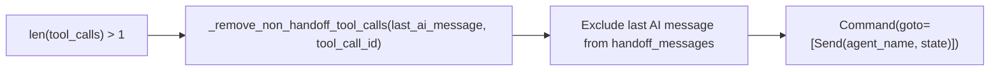

<!-- source: DeepWiki mcp.deepwiki.com · repo langchain-ai/langgraph-supervisor-py · page 3.2 Handoff Tools · fetched 2026-10-26 -->

# Handoff Tools

<details>
<summary>Relevant source files</summary>

The following files were used as context for generating this wiki page:

- [langgraph_supervisor/handoff.py](langgraph_supervisor/handoff.py)
- [tests/test_supervisor.py](tests/test_supervisor.py)

</details>


The `langgraph_supervisor.handoff` module provides three factory functions for creating tools that enable agent-to-agent control transfer in supervisor systems:

- `create_handoff_tool()` - Creates tools for supervisor-to-agent delegation
- `create_forward_message_tool()` - Creates tools for bypassing supervisor message rewriting
- `create_handoff_back_messages()` - Generates message pairs for agent-to-supervisor returns

For conceptual information about the handoff mechanism, see page 2.2.
</thinking>

Sources: [langgraph_supervisor/handoff.py:1-213]()

## Core Functions

### create_handoff_tool

Factory function that creates a `BaseTool` instance for transferring control from supervisor to agent.

**Function Signature:**
```python
def create_handoff_tool(
    *,
    agent_name: str,
    name: str | None = None,
    description: str | None = None,
    add_handoff_messages: bool = True,
) -> BaseTool
```

**Parameters:**

| Parameter | Type | Required | Default | Description |
|-----------|------|----------|---------|-------------|
| `agent_name` | str | Yes | - | Target agent node name (must match node name in StateGraph) |
| `name` | str | No | `transfer_to_<normalized_agent_name>` | Tool name exposed to LLM (auto-generated via `_normalize_agent_name()`) |
| `description` | str | No | `Ask agent '<agent_name>' for help` | Tool description for LLM tool selection |
| `add_handoff_messages` | bool | No | `True` | Whether to append `AIMessage` and `ToolMessage` to message history during handoff |

**Returns:** `BaseTool` with internal `handoff_to_agent` function using `InjectedState` and `InjectedToolCallId`

**Tool Behavior:**
- Returns `Command(goto=agent_name)` for single handoffs
- Returns `Command(goto=[Send(agent_name, state)])` for parallel handoffs (when `len(last_ai_message.tool_calls) > 1`)
- Sets `response_metadata[METADATA_KEY_HANDOFF_DESTINATION]` on generated `ToolMessage`
- Calls `_remove_non_handoff_tool_calls()` to filter tool calls in parallel scenarios

Sources: [langgraph_supervisor/handoff.py:55-129]()

### create_forward_message_tool

Factory function that creates a `BaseTool` allowing the supervisor to forward agent messages without rewriting them.

**Function Signature:**
```python
def create_forward_message_tool(supervisor_name: str = "supervisor") -> BaseTool
```

**Parameters:**

| Parameter | Type | Required | Default | Description |
|-----------|------|----------|---------|-------------|
| `supervisor_name` | str | No | `"supervisor"` | Supervisor node name (used in created `AIMessage.name` field) |

**Returns:** `BaseTool` named `"forward_message"` with `from_agent: str` parameter

**Tool Behavior:**
- Searches `state["messages"]` in reverse for most recent `AIMessage` where `m.name == from_agent.lower()`
- Excludes messages with `response_metadata[METADATA_KEY_IS_HANDOFF_BACK] == True`
- Creates new `AIMessage` with supervisor name and original content
- Returns `Command(goto="__end__", update=messages)` to terminate graph execution
- Returns error string if target agent message not found

Sources: [langgraph_supervisor/handoff.py:155-213]()

### create_handoff_back_messages

Factory function that generates a message pair representing agent-to-supervisor control return.

**Function Signature:**
```python
def create_handoff_back_messages(
    agent_name: str, supervisor_name: str
) -> tuple[AIMessage, ToolMessage]
```

**Parameters:**

| Parameter | Type | Required | Default | Description |
|-----------|------|----------|---------|-------------|
| `agent_name` | str | Yes | - | Agent node name (set as `AIMessage.name`) |
| `supervisor_name` | str | Yes | - | Supervisor node name (used in message content and tool name) |

**Returns:** `tuple[AIMessage, ToolMessage]` for appending to message history

**Generated Messages:**
1. `AIMessage`:
   - `content`: `"Transferring back to {supervisor_name}"`
   - `tool_calls`: Single `ToolCall` with name `transfer_back_to_{normalized_supervisor_name}`
   - `response_metadata[METADATA_KEY_IS_HANDOFF_BACK]`: `True`
2. `ToolMessage`:
   - `content`: `"Successfully transferred back to {supervisor_name}"`
   - `name`: `transfer_back_to_{normalized_supervisor_name}`
   - `response_metadata[METADATA_KEY_IS_HANDOFF_BACK]`: `True`

Sources: [langgraph_supervisor/handoff.py:132-152]()

## Function Dependencies

**Handoff Tool Creation and Usage**



Sources: [langgraph_supervisor/handoff.py:1-213]()

## Execution Flow

**create_handoff_tool Execution Path**



Sources: [langgraph_supervisor/handoff.py:88-126]()

**create_forward_message_tool Execution Path**



Sources: [langgraph_supervisor/handoff.py:174-211]()

## Implementation Details

### Dependency Injection

The `handoff_to_agent()` function uses LangGraph's dependency injection via `typing_extensions.Annotated`:

| Annotation | Parameter Type | Injected Value | Source |
|------------|---------------|----------------|---------|
| `InjectedState` | `dict` | Current graph state (contains `"messages"` key) | [langgraph_supervisor/handoff.py:90]() |
| `InjectedToolCallId` | `str` | Unique identifier for the tool call (e.g., `"call_gyQS..."`) | [langgraph_supervisor/handoff.py:91]() |

The `forward_message()` function uses only `InjectedState`:

| Annotation | Parameter Type | Injected Value | Source |
|------------|---------------|----------------|---------|
| `InjectedState` | `dict` | Current graph state | [langgraph_supervisor/handoff.py:177]() |

Sources: [langgraph_supervisor/handoff.py:90-91](), [langgraph_supervisor/handoff.py:177]()

### Parallel Handoff Handling

The `handoff_to_agent()` function detects parallel handoffs via `len(last_ai_message.tool_calls) > 1` and adjusts behavior:

**Single Handoff (len(tool_calls) == 1):**


**Parallel Handoff (len(tool_calls) > 1):**


The `_remove_non_handoff_tool_calls()` function filters:
1. **Content blocks**: Keeps only `tool_use` blocks matching `tool_call_id` and non-`tool_use` blocks
2. **Tool calls list**: Keeps only the matching `tool_call["id"] == handoff_tool_call_id`

This ensures each agent receives a valid message history containing only its relevant tool call.

Sources: [langgraph_supervisor/handoff.py:101-126](), [langgraph_supervisor/handoff.py:26-52]()

### Content Block Filtering

The `_remove_non_handoff_tool_calls()` function handles Anthropic-style multi-block content:

```python
# Input: AIMessage with multiple tool_use blocks
content = [
    {"type": "text", "text": "..."},
    {"type": "tool_use", "id": "call_A", ...},
    {"type": "tool_use", "id": "call_B", ...}
]

# Output: Filtered to single relevant tool_use
filtered_content = [
    {"type": "text", "text": "..."},
    {"type": "tool_use", "id": "call_A", ...}
]
```

The function:
1. Checks if content has multiple blocks via `_has_multiple_content_blocks(content)` (type guard for `list[dict]`)
2. Filters blocks keeping: `content_block["id"] == handoff_tool_call_id` or `content_block["type"] != "tool_use"`
3. Generates new message with filtered `content` and `tool_calls`, plus new `id=str(uuid.uuid4())`

Sources: [langgraph_supervisor/handoff.py:21-52]()

## Usage Examples

### Basic Handoff Tools

```python
from langgraph_supervisor.handoff import create_handoff_tool

# Create basic handoff tool
research_tool = create_handoff_tool(agent_name="research_expert")
# Creates tool named "transfer_to_research_expert"

# Create custom handoff tool
math_tool = create_handoff_tool(
    agent_name="math_expert",
    name="delegate_to_math",
    description="Delegate mathematical calculations to the math expert"
)
```

Sources: [langgraph_supervisor/handoff.py:55-82]()

### Message Forwarding

```python
from langgraph_supervisor.handoff import create_forward_message_tool

# Create message forwarding tool
forward_tool = create_forward_message_tool("supervisor")

# Usage in supervisor tools list
supervisor = create_supervisor(
    agents=[research_agent, math_agent],
    tools=[forward_tool],  # Supervisor can forward agent messages
    model=model
)
```

Sources: [langgraph_supervisor/handoff.py:151-209](), [tests/test_supervisor.py:472-477]()

### Suppressing Handoff Messages

The `add_handoff_messages` parameter controls whether handoff `AIMessage` and `ToolMessage` are added to state:

```python
# Per-tool suppression
quiet_handoff = create_handoff_tool(
    agent_name="worker_agent",
    add_handoff_messages=False
)

# In handoff_to_agent():
if add_handoff_messages:
    handoff_messages = state["messages"] + [tool_message]
else:
    handoff_messages = state["messages"][:-1]  # Removes supervisor's AIMessage
```

When `False`, the supervisor's tool-calling `AIMessage` and the resulting `ToolMessage` are omitted, creating a cleaner conversation history for the agent.

Sources: [langgraph_supervisor/handoff.py:78-79](), [langgraph_supervisor/handoff.py:103-121](), [tests/test_supervisor.py:420]()

### Manual Handoff Back Messages

```python
from langgraph_supervisor.handoff import create_handoff_back_messages

# Create handoff back messages manually
ai_msg, tool_msg = create_handoff_back_messages(
    agent_name="research_expert",
    supervisor_name="supervisor"
)

# Messages contain handoff metadata
assert tool_msg.response_metadata["__is_handoff_back"] == True
```

Sources: [langgraph_supervisor/handoff.py:128-148]()

## Helper Functions and Constants

### Internal Functions

| Function | Signature | Purpose |
|----------|-----------|---------|
| `_normalize_agent_name` | `(agent_name: str) -> str` | Converts agent name to lowercase with underscores (e.g., `"Math Expert"` → `"math_expert"`) |
| `_has_multiple_content_blocks` | `(content: str \| list) -> TypeGuard[list[dict]]` | Type guard checking if content is multi-block list (Anthropic format) |
| `_remove_non_handoff_tool_calls` | `(last_ai_message: AIMessage, handoff_tool_call_id: str) -> AIMessage` | Filters AIMessage to contain only the specified tool call |

**_normalize_agent_name Implementation:**
```python
WHITESPACE_RE = re.compile(r"\s+")

def _normalize_agent_name(agent_name: str) -> str:
    return WHITESPACE_RE.sub("_", agent_name.strip()).lower()
```

Sources: [langgraph_supervisor/handoff.py:11](), [langgraph_supervisor/handoff.py:16-18](), [langgraph_supervisor/handoff.py:21-23](), [langgraph_supervisor/handoff.py:26-52]()

### Metadata Constants

| Constant | Value | Set On | Usage |
|----------|-------|---------|--------|
| `METADATA_KEY_HANDOFF_DESTINATION` | `"__handoff_destination"` | `ToolMessage.response_metadata`, `BaseTool.metadata` | Identifies target agent for handoff tools |
| `METADATA_KEY_IS_HANDOFF_BACK` | `"__is_handoff_back"` | `AIMessage.response_metadata`, `ToolMessage.response_metadata` | Marks messages from `create_handoff_back_messages()` |

These constants enable filtering logic in `create_forward_message_tool()` and metadata-based routing.

Sources: [langgraph_supervisor/handoff.py:12-13](), [langgraph_supervisor/handoff.py:97](), [langgraph_supervisor/handoff.py:128](), [langgraph_supervisor/handoff.py:144](), [langgraph_supervisor/handoff.py:150](), [langgraph_supervisor/handoff.py:185]()

## Advanced Customization

For advanced use cases, you can create custom handoff tools that:

- Add additional tool call arguments for the LLM to populate (e.g., task descriptions)
- Customize what data is passed to the subagent
- Change how the state is updated during handoff

See [Custom Handoff Tools](#4.3) for more details on implementing fully custom handoff tools.

Sources: [README.md:182-187]()

## Summary

The `create_handoff_tool` function is an essential part of the LangGraph Supervisor framework that enables the creation of hierarchical multi-agent systems. It provides a flexible mechanism for transferring control between agents, allowing the supervisor to delegate tasks to specialized agents through a tool-based interface that language models can easily use.

---

