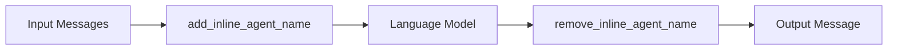
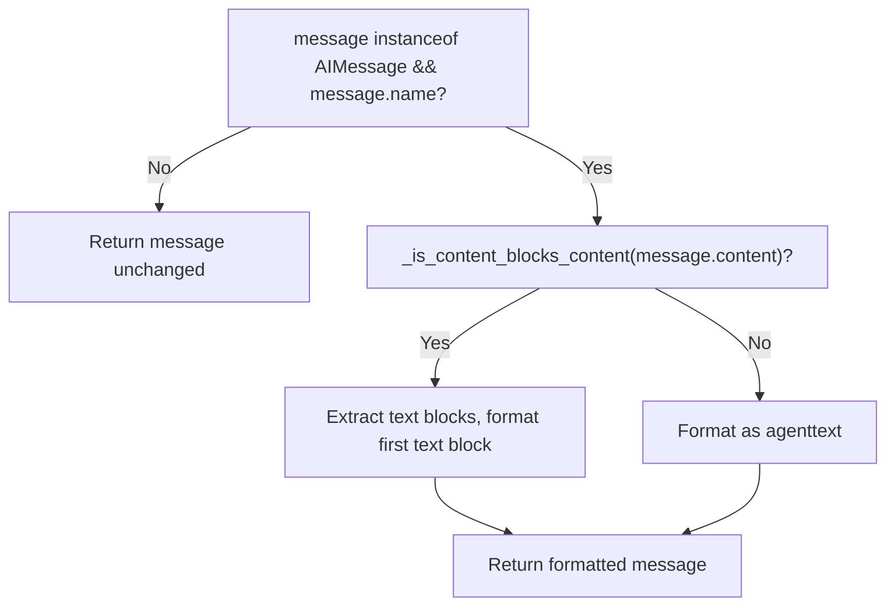

<!-- source: DeepWiki mcp.deepwiki.com · repo langchain-ai/langgraph-supervisor-py · page 3.3 Agent Name Utilities · fetched 2026-10-26 -->

# Agent Name Utilities

<details>
<summary>Relevant source files</summary>

The following files were used as context for generating this wiki page:

- [langgraph_supervisor/agent_name.py](langgraph_supervisor/agent_name.py)
- [tests/test_agent_name.py](tests/test_agent_name.py)

</details>


The Agent Name Utilities API provides functions for managing agent identity in multi-agent message flows. The primary function `with_agent_name` wraps language models to automatically format agent names using XML tags, while helper functions `add_inline_agent_name` and `remove_inline_agent_name` handle the underlying message transformations.

Sources: [langgraph_supervisor/agent_name.py:1-139]()

## Function Reference

### with_agent_name

```python
def with_agent_name(
    model: LanguageModelLike,
    agent_name_mode: AgentNameMode,
) -> LanguageModelLike
```

Wraps a language model to automatically format agent names in messages using the specified mode.

#### Parameters

| Parameter | Type | Description |
|-----------|------|-------------|
| `model` | `LanguageModelLike` | The language model to wrap with agent name formatting |
| `agent_name_mode` | `AgentNameMode` | Formatting mode, currently only `"inline"` is supported |

#### Returns

`LanguageModelLike` - A wrapped language model that automatically processes agent names

#### Behavior

The wrapper applies `add_inline_agent_name` to input messages and `remove_inline_agent_name` to output messages, creating a transparent agent name processing layer.



Sources: [langgraph_supervisor/agent_name.py:100-139]()

### add_inline_agent_name

```python
def add_inline_agent_name(message: BaseMessage) -> BaseMessage
```

Adds XML-style name and content tags to `AIMessage` content for agent identification.

#### Parameters

| Parameter | Type | Description |
|-----------|------|-------------|
| `message` | `BaseMessage` | Message to format, only `AIMessage` instances with `name` attribute are processed |

#### Returns

`BaseMessage` - Message with formatted content or original message if no processing needed

#### Processing Logic



#### Content Format Support

- **String content**: Directly wrapped with XML tags
- **Content blocks**: Only text blocks are processed, other block types (image, file) are preserved

Sources: [langgraph_supervisor/agent_name.py:29-56]()

### remove_inline_agent_name

```python
def remove_inline_agent_name(message: BaseMessage) -> BaseMessage
```

Removes XML-style name and content tags from `AIMessage` content, extracting the original content.

#### Parameters

| Parameter | Type | Description |
|-----------|------|-------------|
| `message` | `BaseMessage` | Message to process, only `AIMessage` instances are processed |

#### Returns

`BaseMessage` - Message with extracted content or original message if no tags found

#### Pattern Matching

Uses `NAME_PATTERN` and `CONTENT_PATTERN` regex patterns to locate and extract content:
- `NAME_PATTERN`: `r"<name>(.*?)</name>"`
- `CONTENT_PATTERN`: `r"<content>(.*?)</content>"`

Both patterns use `re.DOTALL` flag for multiline content support.

Sources: [langgraph_supervisor/agent_name.py:58-98](), [langgraph_supervisor/agent_name.py:14-15]()

## Type Definitions and Constants

### AgentNameMode

```python
AgentNameMode = Literal["inline"]
```

Type alias defining supported agent name formatting modes. Currently only supports `"inline"` mode.

### Regular Expression Patterns

```python
NAME_PATTERN = re.compile(r"<name>(.*?)</name>", re.DOTALL)
CONTENT_PATTERN = re.compile(r"<content>(.*?)</content>", re.DOTALL)
```

Compiled regex patterns for extracting agent names and content from formatted messages.

### Helper Functions

#### _is_content_blocks_content

```python
def _is_content_blocks_content(content: list[dict | str] | str) -> TypeGuard[list[dict]]
```

Type guard function that determines if message content is in content blocks format (list of dictionaries with `type` field).

Sources: [langgraph_supervisor/agent_name.py:17](), [langgraph_supervisor/agent_name.py:14-15](), [langgraph_supervisor/agent_name.py:20-27]()

## Usage Examples

### Basic Message Formatting

```python
from langchain_core.messages import AIMessage
from langgraph_supervisor.agent_name import add_inline_agent_name, remove_inline_agent_name

# Add agent name formatting
message = AIMessage(content="Hello world", name="assistant")
formatted = add_inline_agent_name(message)
# Result: AIMessage(content="<name>assistant</name><content>Hello world</content>", name="assistant")

# Remove agent name formatting
original = remove_inline_agent_name(formatted)
# Result: AIMessage(content="Hello world", name="assistant")
```

### Language Model Wrapping

```python
from langchain_openai import ChatOpenAI
from langgraph_supervisor.agent_name import with_agent_name

# Wrap a language model with automatic agent name processing
llm = ChatOpenAI()
wrapped_llm = with_agent_name(llm, agent_name_mode="inline")

# The wrapped model automatically formats agent names in message flow
response = wrapped_llm.invoke([AIMessage(content="Hello", name="agent1")])
```

### Content Blocks Handling

```python
# Content blocks are supported for multimodal messages
content_blocks = [
    {"type": "text", "text": "Hello world"},
    {"type": "image", "image_url": "http://example.com/image.jpg"}
]
message = AIMessage(content=content_blocks, name="assistant")
formatted = add_inline_agent_name(message)
# Only text blocks are processed, image blocks are preserved
```

Sources: [langgraph_supervisor/agent_name.py:29-56](), [langgraph_supervisor/agent_name.py:100-139]()

## Error Handling and Edge Cases

### Supported Message Types

Only `AIMessage` instances are processed by the agent name functions:

| Message Type | `add_inline_agent_name` | `remove_inline_agent_name` |
|--------------|-------------------------|----------------------------|
| `AIMessage` with `name` | Processes and formats | Processes if tags found |
| `AIMessage` without `name` | Returns unchanged | Returns unchanged |
| `HumanMessage` | Returns unchanged | Returns unchanged |
| Other message types | Returns unchanged | Returns unchanged |

### Content Format Edge Cases

- **Empty content**: Messages with empty content are returned unchanged
- **Missing tags**: `remove_inline_agent_name` returns message unchanged if XML tags are not found
- **Content blocks without text**: Empty text block is created with agent name tags
- **Multiline content**: Handled correctly with `re.DOTALL` flag in regex patterns

### Invalid Agent Name Mode

```python
# Raises ValueError for unsupported modes
with_agent_name(llm, agent_name_mode="unsupported")  # ValueError
```

Sources: [langgraph_supervisor/agent_name.py:40-41](), [langgraph_supervisor/agent_name.py:69-70](), [langgraph_supervisor/agent_name.py:122-124](), [tests/test_agent_name.py:10-18](), [tests/test_agent_name.py:55-68]()

## Usage Examples

### Basic Usage with Regular Text

```python
from langchain_core.messages import AIMessage
from langgraph_supervisor.agent_name import add_inline_agent_name, remove_inline_agent_name

# Adding agent name to a message
message = AIMessage(content="How can I help you?", name="assistant")
formatted = add_inline_agent_name(message)
# Result: AIMessage(content="<name>assistant</name><content>How can I help you?</content>", name="assistant")

# Removing agent name from a message
original = remove_inline_agent_name(formatted)
# Result: AIMessage(content="How can I help you?", name="assistant")
```

### Wrapping a Language Model

```python
from langchain_openai import ChatOpenAI
from langgraph_supervisor.agent_name import with_agent_name

# Create a language model
llm = ChatOpenAI()

# Wrap the model to automatically handle agent names
wrapped_llm = with_agent_name(llm, agent_name_mode="inline")

# Now the wrapped_llm will automatically format agent names in messages
```

Sources: [langgraph_supervisor/agent_name.py:23-47](), [langgraph_supervisor/agent_name.py:94-128]()

## Technical Details

### Regular Expressions

The agent name utilities use two key regular expression patterns:

```python
NAME_PATTERN = re.compile(r"<name>(.*?)</name>", re.DOTALL)
CONTENT_PATTERN = re.compile(r"<content>(.*?)</content>", re.DOTALL)
```

- `re.DOTALL` flag allows matching across multiple lines
- These patterns extract content from XML-style tags

Sources: [langgraph_supervisor/agent_name.py:8-9]()

### Agent Name Modes

Currently, the only supported agent name mode is "inline", which adds XML-style tags directly to the message content. This is defined using a type alias:

```python
AgentNameMode = Literal["inline"]
```

This design allows for possible future extensions to other formatting modes.

Sources: [langgraph_supervisor/agent_name.py:11](), [langgraph_supervisor/agent_name.py:112-118]()

## Summary

Agent Name Utilities provide a robust system for managing agent identities in multi-agent conversations by:

1. Adding clear attribution to messages using XML-style tags
2. Supporting both text content and content blocks for multimodal interactions
3. Providing a convenient wrapper to apply agent name formatting to any language model
4. Handling edge cases like multiline content and empty messages

These utilities enhance the readability and coherence of conversations in multi-agent systems, particularly when a supervisor orchestrates multiple specialized agents.

---

