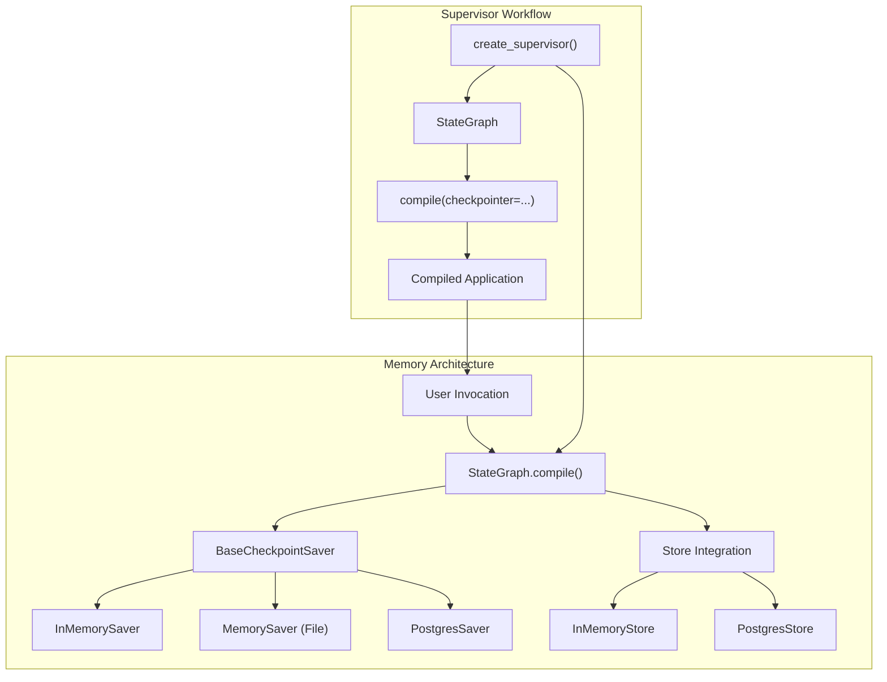
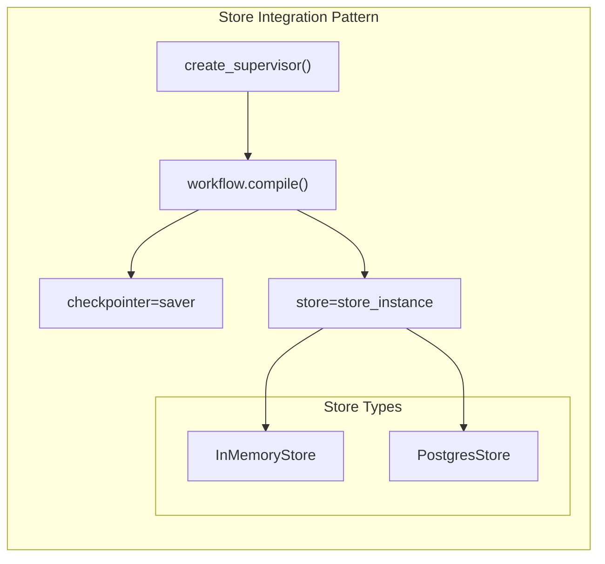
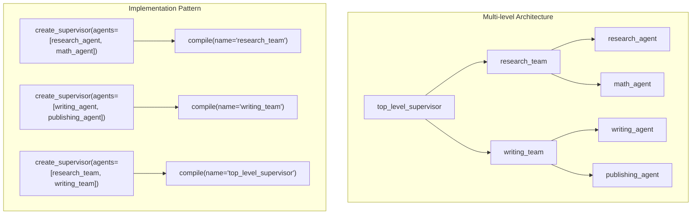
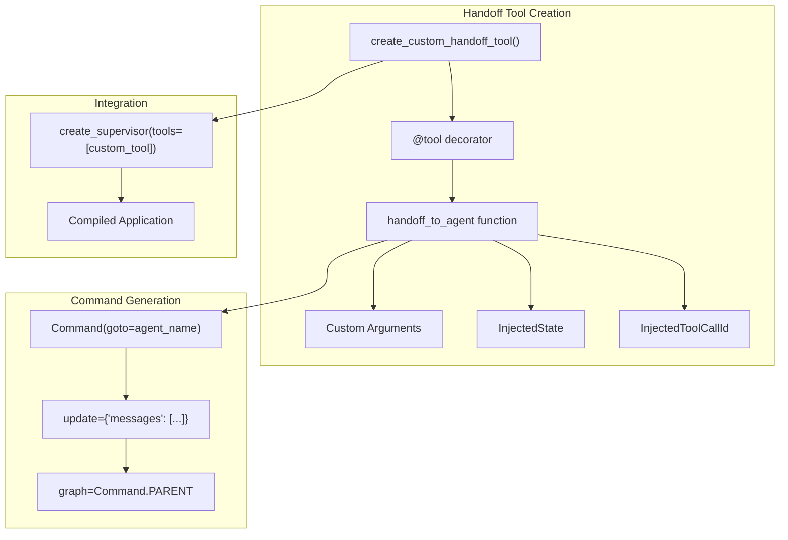
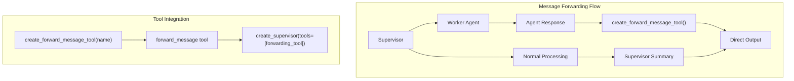
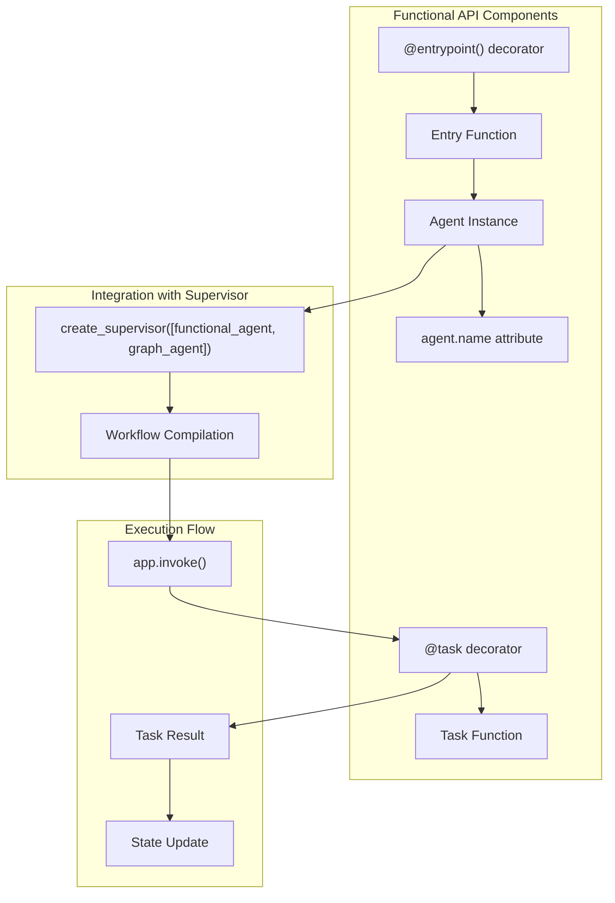
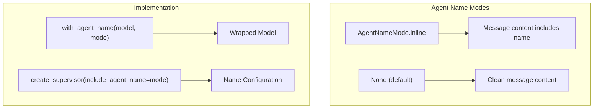

<!-- source: DeepWiki mcp.deepwiki.com · repo langchain-ai/langgraph-supervisor-py · page 4 Advanced Usage · fetched 2026-10-26 -->

# Advanced Usage

Relevant source files

The following files were used as context for generating this wiki page:

- [README.md](README.md)
- [langgraph_supervisor/supervisor.py](langgraph_supervisor/supervisor.py)
- [tests/test_supervisor.py](tests/test_supervisor.py)

This document covers sophisticated patterns and configurations for building complex multi-agent systems with langgraph-supervisor. It focuses on advanced architectural patterns, custom tool development, and integration techniques that extend beyond basic supervisor-agent workflows.

For basic setup and simple examples, see [Quick Start](#1.2). For comprehensive API documentation, see [API Reference](#3).

## Memory and Persistence

The `create_supervisor` function returns a `StateGraph` instance that supports LangGraph's memory and persistence features through checkpointers and stores.

### Short-term Memory with Checkpointers

Short-term memory preserves conversation state across multiple invocations within the same thread:

Sources: [README.md:151-176]()

The supervisor workflow integrates with LangGraph's persistence layer through the compile method. Memory configuration occurs at compile time, not during supervisor creation:

| Memory Type | Checkpointer | Use Case |
|-------------|--------------|----------|
| In-Memory | `InMemorySaver` | Development, testing |
| File-based | `MemorySaver` | Local persistence |
| Database | `PostgresSaver` | Production systems |

### Long-term Memory with Stores

Stores provide persistent data access across different conversation threads, enabling agents to maintain knowledge between separate user sessions.

Sources: [README.md:151-176]()

## Multi-level Hierarchies

Complex systems require hierarchical supervisor arrangements where supervisors manage other supervisors, creating tree-like organizational structures.

### Hierarchical Supervisor Pattern

Sources: [README.md:126-148]()

Each supervisor level operates independently while maintaining the hierarchical command structure. The `supervisor_name` parameter distinguishes different supervisor instances in the hierarchy.

### Hierarchical State Management

Multi-level systems require careful state management to ensure message history and context flow correctly between hierarchy levels:

| Hierarchy Level | State Scope | Message Visibility |
|-----------------|-------------|-------------------|
| Top-level | Global conversation | All messages |
| Mid-level | Team-specific | Team + global context |
| Agent-level | Task-specific | Local + inherited context |

Sources: [README.md:131-142]()

## Custom Handoff Tools

The default handoff mechanism can be extended with custom tools that include additional parameters, specialized behavior, or custom state management.

### Custom Tool Architecture

Sources: [README.md:223-265]()

### Custom Tool Implementation Pattern

Custom handoff tools extend the base functionality by adding LLM-populated parameters and specialized state updates. The pattern involves:

1. **Tool Definition**: Using `@tool` decorator with custom parameters
2. **State Injection**: Accessing current state via `InjectedState`
3. **Command Creation**: Generating `Command` objects for agent transitions
4. **State Updates**: Modifying parent graph state during handoff

Key components include `InjectedState` for accessing current conversation state and `Command.PARENT` for targeting the supervisor graph level.

Sources: [README.md:233-264]()

### Tool Configuration Options

| Parameter | Purpose | Default |
|-----------|---------|---------|
| `add_handoff_messages` | Include tool invocation messages | `True` |
| `handoff_tool_prefix` | Custom tool name prefix | `"transfer_to"` |
| `tools` | Custom handoff tool list | Auto-generated |

Sources: [README.md:202-221]()

## Message Forwarding

Advanced message routing allows supervisors to forward agent responses directly to the output without additional processing.

### Forward Message Architecture

Sources: [README.md:267-286]()

The forwarding mechanism bypasses supervisor post-processing, preserving the original agent response and reducing token consumption. The tool expects a `from_agent` parameter specifying which agent's last message to forward.

Sources: [README.md:271-285](), [tests/test_supervisor.py:427-556]()

## Functional API Integration

The supervisor system integrates with LangGraph's Functional API, enabling task-based agent definitions alongside traditional graph-based agents.

### Functional API Agent Pattern

Sources: [README.md:287-374]()

### Task-based Agent Definition

Functional API agents use decorators to define behavior:

- `@task`: Defines individual LLM operations or processing steps
- `@entrypoint()`: Creates the main agent entry point
- `.name` attribute: Required for supervisor recognition

The functional approach enables more granular control over agent operations while maintaining compatibility with the supervisor's handoff mechanism.

Sources: [README.md:310-329]()

## Advanced Configuration Patterns

### Agent Name Management

The supervisor system supports multiple agent naming strategies through the `include_agent_name` parameter and `with_agent_name` function:

Sources: [tests/test_supervisor.py:155-218]()

### Metadata Propagation

The supervisor system preserves and propagates metadata from the initial configuration to sub-agents, enabling context-aware agent behavior:

| Configuration Level | Metadata Scope | Access Pattern |
|---------------------|----------------|----------------|
| Supervisor | Global context | `config["metadata"]` |
| Sub-agent | Inherited + local | `config["metadata"]` |
| Tool calls | Tool-specific | Custom injection |

Sources: [tests/test_supervisor.py:559-612]()

### Output Mode Control

The `output_mode` parameter controls message history inclusion:

- `"last_message"`: Include only final agent responses
- `"full_history"`: Include complete agent conversation history

This affects token consumption and conversation clarity in multi-agent scenarios.

Sources: [README.md:100-124](), [tests/test_supervisor.py:244-287]()

---

